# Inloggen, vergrendeling en toestemmingsvragen: functies

## Stand van de bouw

Geteld op 2026-11-03 tegen de working tree van `feat/iphone-app`, inclusief niet-gecommit werk aan Scan (`CameraAccess.swift`, `ScanPermissionViews.swift`, `ScanScreen.swift`, de snelle actie voor scannen). Elke functie hieronder heeft één statusregel.

| Status | Aantal |
|---|---|
| Gebouwd | **21** |
| Deels gebouwd | **11** |
| Nog te bouwen | **13** |

De drie belangrijkste dingen die nog gebouwd moeten worden:

1. **De momentopname in de app-kiezer afdekken zolang de app vergrendeld is (3.17).** Dit is de enige privacybelofte uit de brief die de code niet nakomt: een ontgrendeld scherm, of de aantallen op Overzicht, verschijnen in de app-kiezer zoals ze zijn.
2. **Het inlogscherm zoals ontworpen, met zijn eigen foutstaten (3.8–3.16).** Eerst de toegangssleutel, het wachtwoord als tweede stap. Aparte antwoorden voor "geen toegangssleutel op deze telefoon", "deze toegangssleutel hoort niet meer bij je account", "server reageert niet" tegenover "offline", en "te veel pogingen" met het tijdstip waarop het weer kan. Nu vallen die allemaal in een handvol algemene teksten.
3. **Meldingen per soort aan of uit in Meer → Meldingen (3.28).** Dit is de enige functie in deze groep die een servermodel nodig heeft: een opgeslagen instelling per soort, een mobiele route om die te lezen en te schrijven, en een `notify()` die zich eraan houdt.

Deze groep beschrijft hoe de iPhone-app een sessie krijgt, hoe hij het dossier dicht houdt wanneer iemand anders de telefoon vasthoudt, en hoe hij iOS om toestemming vraagt voor de camera, de microfoon, spraakherkenning en meldingen. Het is geschreven voor Martin en voor iedereen die later aan verder werkt. Het beschrijft wat de app **doet**. Het visuele ontwerp staat in de Figma-frames hieronder.

Elke bewering hier komt uit de code op branch `feat/iphone-app` (working tree van 2026-11-03), de spec `docs/superpowers/specs/2026-10-28-iphone-app-design.md`, de ontwerpbrief `docs/superpowers/specs/2026-11-01-iphone-design-brief.md`, plan 3 `docs/superpowers/plans/2026-10-31-iphone-app-plan-3.md` en `CLAUDE.md`. De secties 3.1–3.7 beschrijven de **code**; de secties 3.8–3.30 beschrijven functies die de definitieve frames, de spec of de brief vastleggen, en de statusregel van elk zegt hoeveel ervan de code al doet. Verschillen in tekst staan onder **Ontwerp tegenover code**. De schermafbeeldingen gebruiken de synthetische fixture-dataset, geen echte dossiergegevens.

---

## 1. Doel

- **Inloggen** geeft de telefoon een gewone better-auth-sessie, van dezelfde soort als de webapp gebruikt. Die verschijnt in `/settings/security` als één apparaat meer en kan daar worden ingetrokken. De toegangssleutel (passkey, met Face ID) wordt als eerste aangeboden, het wachtwoord als tweede.
- **Vergrendeling** houdt het hele dossier, dat in deze broekzak zit, dicht tot de eigenaar met Face ID of de toegangscode van het toestel bewijst wie hij is. De vergrendeling dekt **dossierinhoud** af. Nooit de camera, en nooit de aantallen op Overzicht.
- **Toestemmingsvragen vooraf** vragen iOS om een toestemming op het moment dat de functie die nodig heeft, en nooit bij een koude start. Een koude start is van de camera, vanwege het anti-doel van 2 seconden voor een koude start.

De enige gebruiker is Martin. Er is één account, en de app kent geen wisselen van account.

---

## 2. Hoe je hier komt, en waar het heen leidt

| Ingang | Wat er gebeurt |
|---|---|
| Eerste start, of geen geldige sessie in de Keychain | `RootView` toont `SignInView`. |
| De server antwoordt 401 (of een 3xx) op een aanroep die de sessie nodig heeft | `AuthModel.sessionRejected()` vergeet de sessie lokaal, zet `sessionExpired`, en `RootView` toont `SessionExpiredView` ("Je sessie is verlopen."). |
| Meer → Account → "Uitloggen" (na een bevestigingsvenster) | `AuthModel.signOut()`, daarna terug naar `SignInView`. |
| Koude start met een sessie | Overzicht opent met alleen aantallen en bedragen. Het Face ID-venster verschijnt **vanzelf, één keer** (`RootView.promptOnOpen` → `AppLock.autoPromptIfNeeded`), tenzij het tabblad Scan zichtbaar is. |
| Terugkomen uit de achtergrond na **meer dan 5 minuten** | De app is weer vergrendeld en vraagt op dezelfde manier één keer vanzelf (`LockPolicy.graceSeconds = 300`). |
| Een aangetikte melding of een tik op een widget (`verder://…` via `DeepLink`) | `RootView` wisselt van tabblad en zet de navigatiestapel. De doeltabbladen zitten achter de vergrendeling, dus het item verschijnt pas na ontgrendelen. De stapels worden in `RootView` bewaard, zodat een link die op het vergrendelscherm binnenkomt dat overleeft. |
| Snelle actie op het beginscherm "Gesprek vastleggen" | Opent het spraakvenster, dat zelf achter de vergrendeling zit (`VoiceLogSheet(...).lockGated(by:)`). Bij een koude start vraagt de vergrendeling vanzelf. |
| Tabblad Scan | Vraagt nooit en wordt nooit afgedekt. De ontspanknop is altijd bereikbaar. |

Na een geslaagde inlog gaat de app naar de tabbalk. Bij een verse start is dat **Overzicht**. Het gekozen tabblad wordt in `RootView` bewaard en wordt **niet teruggezet** door uitloggen of een geweigerde sessie, dus opnieuw inloggen brengt je terug naar het tabblad dat zichtbaar was (na Meer → Uitloggen is dat **Meer**). Na een inlog met wachtwoord op een account zonder passkey springt de app naar **Meer**, waar het eenmalige aanbod voor een toegangssleutel staat (zie 3.3). De inlog ontgrendelt ook de app-vergrendeling (`AppLock.didSignIn()`), dus er volgt geen Face ID.

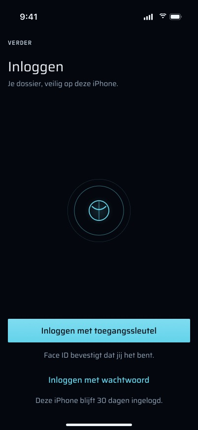 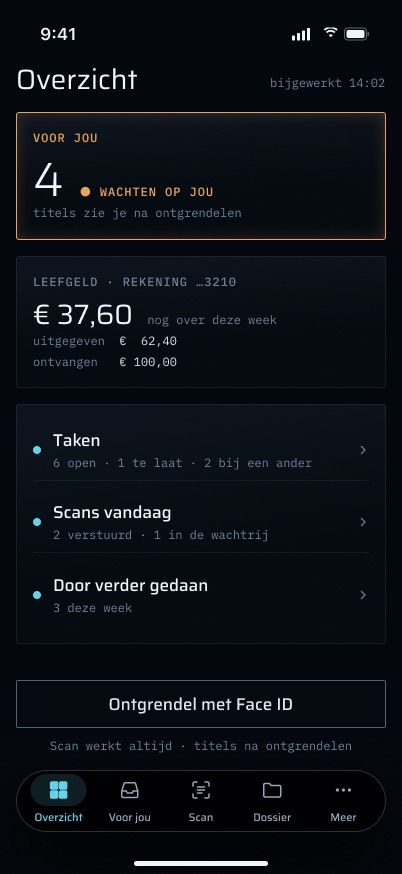

---

## 3. Functies en handelingen, van begin tot eind

### 3.1 Inloggen met een toegangssleutel (passkey)

**Status:** Gebouwd — `apps/ios/Verder/Auth/PasskeyAuth.swift`, `AuthModel.signInWithPasskey()` in `Verder/Auth/AuthModel.swift`.

1. `GET /api/auth/passkey/generate-authenticate-options`, verstuurd **zonder** opgeslagen cookie. De server antwoordt met de WebAuthn-opties en zet een ondertekende challenge-cookie voor eenmalig gebruik (`__Secure-better-auth.better-auth-passkey`, 300 s geldig).
2. iOS toont het passkey-venster van het systeem (`ASAuthorizationPlatformPublicKeyCredentialProvider`, relying party `verder.vanderpoel.pro`). Zonder sessie is de allow-list leeg, dus iOS biedt elke passkey aan die het voor verder heeft. Daar hoort ook een passkey bij die op de Mac is gemaakt en via de iCloud-sleutelhanger is gesynchroniseerd.
3. `POST /api/auth/passkey/verify-authentication` met de assertion. De challenge-cookie uit stap 1 wordt **met de hand** meegestuurd, omdat de URLSession van de app helemaal geen cookies bewaart.
4. De sessiecookie uit de `Set-Cookie` van het antwoord wordt in de Keychain opgeslagen. `isSignedIn` wordt true en `sessionGeneration` wordt opgehoogd. Die ophoging hervat de uploadwachtrij en start de controle voor de toestemmingsvraag voor meldingen.

Wat er wordt geschreven: een better-auth-rij in `session` op de server. Dat is geen bewijs, dus er wordt **geen ledger-event** toegevoegd. Omdat de client altijd `x-verder-trust-device: 1` meestuurt, geeft de hook `databaseHooks.session.create` deze sessie **30 dagen**, niet 12 uur (`packages/auth/src/session-trust.ts`). Dit is op de telefoon gemeten: aangemaakt om 12:33, verloopt op 30-11 om 12:33.

Limiet: better-auth staat 10 per minuut toe op `/passkey/verify-authentication`, en de Cloudflare-WAF staat 10 per minuut per IP toe op `/api/auth/*`. De app stuurt **één poging per tik en probeert nooit opnieuw**, omdat elke herhaling de limiet opnieuw laat ingaan.

### 3.2 Inloggen met een wachtwoord

**Status:** Gebouwd — `AuthModel.signInWithPassword(email:password:)` in `Verder/Auth/AuthModel.swift`, velden in `Verder/Auth/SignInView.swift`.

`POST /api/auth/sign-in/email` met `{ email, password, rememberMe: true }`. Eén poging per tik, nooit herhaald. better-auth beperkt dit pad tot 5 per minuut. Bij succes gaat de sessiecookie naar de Keychain, precies zoals in 3.1. De velden gebruiken `textContentType` `.username` / `.password`, zodat iOS AutoFill en de sleutelhanger ze kunnen invullen. "Inloggen met wachtwoord" blijft uitgeschakeld tot beide velden zijn ingevuld.

### 3.3 Een toegangssleutel toevoegen (het eenmalige aanbod, en Meer → Account)

**Status (de handeling zelf, vanuit Meer → Account):** Gebouwd — `AuthModel.addPasskey()` in `Verder/Auth/AuthModel.swift`, `PasskeyAuth.swift`, knop in `Verder/More/MoreScreens.swift`.

**Status (het eenmalige aanbod):** Deels gebouwd — het aanbod bestaat, maar als kaart bovenaan Meer (`Verder/More/MoreTab.swift`) in plaats van als volgende stap van de inlog zelf. De ontworpen stap noemt het resultaat ("Voortaan met Face ID inloggen?" / "Daarna is inloggen één tik."), zegt waar je het later vindt ("Later kan het in Meer → Account.") en wordt overgeslagen met "Sla over". Het wordt ook alleen aangeboden wanneer het account **helemaal geen** passkey heeft, dus een telefoon waarvan de toegangssleutel is verwijderd terwijl die van de Mac nog bestaat, krijgt nooit een nieuwe aangeboden (zie 3.12).

- **Wanneer het wordt aangeboden:** direct na een inlog met **wachtwoord**, hoogstens **één keer per installatie** (UserDefaults `passkeyOfferShown`), en alleen wanneer `GET /api/auth/passkey/list-user-passkeys` een lege lijst teruggeeft. Een mislukte opvraging biedt niets aan: een aanbod is nooit een foutmelding waard. Het aanbod verschijnt als kaart bovenaan **Meer**, en de app wisselt naar dat tabblad. Het wordt nooit gestapeld op de toestemmingsvraag voor meldingen.
- **Meer → Account** toont altijd "Passkey toevoegen" zodra `GET /api/mobile/v1/me` het aantal passkeys heeft teruggegeven. Dat aantal komt uit de tabel `passkey`, dezelfde die `/settings/security` toont.
- **Handeling:**
  1. `GET /api/auth/passkey/generate-register-options?authenticatorAttachment=platform`.
  2. iOS maakt de credential aan.
  3. `POST /api/auth/passkey/verify-registration` met `{ response, name: "verder op iPhone" }` en **beide** cookies (sessie plus challenge).

  De server schrijft één rij in `passkey`. Er wordt geen ledger-event toegevoegd.
- **Tekst van de aanbodkaart:** "Passkey toevoegen?" / "Dan log je voortaan in met Face ID, zonder wachtwoord.", met "Passkey toevoegen" en "Niet nu".
- **Uitkomsten:** bij succes staat er "Passkey toegevoegd. Voortaan log je in met Face ID." en wordt het aantal op Account ververst. Een geannuleerd venster zegt niets. Een 429 toont de tekst voor de limiet en geen verbinding toont de offline-tekst (beide zoals in sectie 4). Al het andere toont "Passkey toevoegen lukte niet. Probeer het over een moment opnieuw." met een regel over de oorzaak.
- **Verse sessie vereist:** better-auth registreert alleen op een sessie die jonger is dan één dag (`freshAge`). Een oudere sessie krijgt een 403, die de app (net als een 401, of geen opgeslagen geldige sessie) toont als "Log eerst opnieuw in; daarna kun je een passkey toevoegen."
- **Staat al op deze telefoon:** iOS antwoordt `ASAuthorizationError 1006` (`matchedExcludedCredential`) wanneer er al een gesynchroniseerde passkey bestaat. Dat is **geen fout**. De app zegt "Er staat al een passkey voor verder op deze iPhone, via je iCloud-sleutelhanger. Je kunt er meteen mee inloggen."

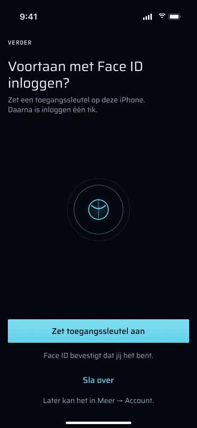 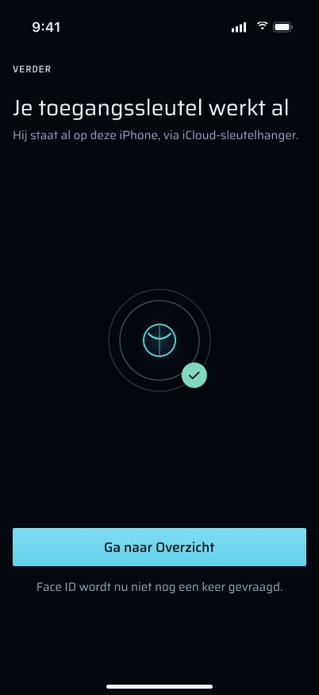

### 3.4 Sessie verlopen

**Status:** Deels gebouwd — `Verder/Auth/SessionExpiredView.swift` werkt van begin tot eind. Wat ontbreekt: het **moment** waarop de sessie eindigde ("UITGELOGD · 1 NOV 09:12" in het frame). `AuthModel.sessionRejected()` legt geen tijd vast, dus er is een tijdstempel nodig naast `sessionExpired` (in het geheugen is genoeg; het overleeft een herstart niet, en dat hoeft ook niet), plus de tekst. Het frame laat ook "Toch een brief scannen" weg; houden of schrappen is aan Martin, nu de snelle actie voor scannen (3.23) dezelfde behoefte dekt.

`SessionExpiredView` verschijnt wanneer de **server** de sessie heeft beëindigd, niet wanneer de telefoon zelf besloot dat de sessie weg was. Er staat:

> "Je sessie is verlopen." / "Log opnieuw in met je toegangssleutel en Face ID. Scans in de wachtrij blijven bewaard en gaan daarna vanzelf mee."

Er zijn drie handelingen:

- "Inloggen met toegangssleutel" voert 3.1 uit.
- "Inloggen met wachtwoord" opent `SignInView`, met een knop "Terug".
- "Toch een brief scannen" opent `ScanTab` schermvullend. Opnames gaan in de wachtrij en wachten op een sessie.

Zolang een passkey-poging loopt, leest de knop "Bezig…" en is hij uitgeschakeld. Een mislukking toont haar tekst onder de hoofdtekst en speelt een `.error`-haptiek.

**De uploadwachtrij vraagt om inloggen.** **Status:** Gebouwd — `UploadCenter.signInRequired` (`Verder/Upload/UploadCenter.swift`), banner en inlogvenster in `Verder/Scan/ScanTab.swift`, hervatten in `RootView` op `sessionGeneration`.

De uploadwachtrij heeft een eigen versie van deze regel. Een 401 op een upload zet `signInRequired`, waardoor **al** het versturen stopt. Het tabblad Scan toont dan de banner "Log opnieuw in om je scans te versturen", die inloggen als venster opent. De volgende geslaagde inlog (`sessionGeneration` verandert) haalt de banner weg en hervat het versturen.

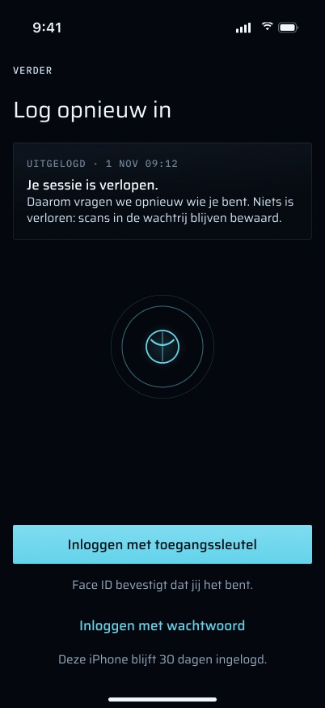

### 3.5 Uitloggen

**Status:** Gebouwd — `AuthModel.signOut()` / `forgetLocally()` in `Verder/Auth/AuthModel.swift`, `SessionEpoch.swift`, bevestiging in `Verder/More/MoreScreens.swift`.

Meer → Account → "Uitloggen" vraagt eerst: "Uitloggen op deze iPhone?" / "Het dossier op deze iPhone wordt gewist. Daarna log je opnieuw in met Face ID of je wachtwoord." Daarna volgen deze stappen, in deze volgorde:

1. Het sluit het spraaklogboek, vergeet het account en maakt de stapel van Meer leeg.
2. `POST /api/auth/sign-out` wordt geprobeerd. Als de telefoon verder niet kan bereiken, **vergeet hij toch alles lokaal**. Een sessie die op de server blijft leven, verloopt vanzelf en kan worden ingetrokken in `/settings/security`.
3. `forgetLocally()` wist het Keychain-item, beëindigt de `SessionEpoch`, wist de widget-momentopname en laadt de widget-tijdlijnen opnieuw.
4. `dossier.wipe()` maakt het zakdossier leeg.

Het beëindigen van de epoch laat elke store zijn dossierinhoud vergeten: de inbox en de samenvatting (badge op 0), het geldoverzicht, het dossier met zijn zoekopdracht en serverresultaten, en de cache van Tijdlijn. Een verversing die nog op het netwerk wacht, ziet dat de epoch is verschoven en schrijft niets terug.

**Niet gewist:** de uploadwachtrij. Scans die nog verstuurd moeten worden, blijven bewaard en gaan na de volgende inlog weg, zoals de tekst bij een verlopen sessie belooft.

### 3.6 App-vergrendeling (Face ID)

**Status (vergrendeling bij koude start en na de respijttijd van 5 minuten, Face ID of toegangscode van het toestel, één automatische vraag per vergrendelperiode):** Gebouwd — `LockPolicy`, `PlatformOwnerAuthenticator` en `AppLock.autoPromptIfNeeded()` in `Verder/Auth/AppLock.swift`; `RootView.promptOnOpen()`; `VerderTests/AppLockTests.swift`.

- **Beleid (`LockPolicy`):** de app vergrendelt bij een koude start, en na **meer dan** 300 s in de achtergrond. Als de klok terugliep terwijl de app weg was, vergrendelt hij ook, omdat hij bij twijfel dichtgaat. Het Face ID-venster, het bedieningspaneel en een oproepbanner maken de scene alleen inactief, en worden niet als een keer weg beoordeeld. Anders zou ontgrendelen de app opnieuw vergrendelen.
- **Authenticatie:** `LAPolicy.deviceOwnerAuthentication`, dus de **toegangscode van het toestel** werkt wanneer Face ID mislukt of niet beschikbaar is. Per poging wordt een nieuwe `LAContext` gemaakt. De redentekst is "Ontgrendel verder om je dossier te zien."
- **Eén keer bij openen, niet per scherm:** Martin besloot op 2026-11-01 dat de app één keer per vergrendelperiode vanzelf vraagt, welk tabblad ook zichtbaar is, behalve Scan. Na een annulering vraagt alleen een knop het opnieuw, zodat een geannuleerd venster nooit door de volgende activering weer wordt geopend.
- **Per gebied (`AppLock.Area`):**
  - `capture` (Scan) is open.
  - `glance` (Overzicht) is open, maar toont **alleen getallen en bedragen**. Geen titel, geen naam en geen notitie wordt zelfs maar opgebouwd zolang de app vergrendeld is. Overzicht biedt "Toon details" met een Face ID-pictogram en de voetnoot "Titels en de kaart verschijnen na Face ID."
  - `dossier` dekt Voor jou, Dossier, Meer, het scherm Geld en het spraakvenster af. Die tonen `LockView`, het verder-woordmerk met "Ontgrendel met Face ID". De afgeschermde inhoud wordt achter de vergrendeling **helemaal niet getekend** (het is geen overlay), dus hij kan niets laden en niets aan VoiceOver melden.
  - Een nieuw gebied is standaard afgeschermd. Open is de uitzondering, en die moet worden beargumenteerd.

  **Status (gebieden, en afgeschermde inhoud helemaal niet getekend):** Gebouwd — `AppLock.Area` / `isGated` in `Verder/Auth/AppLock.swift`, `.lockGated(by:)` in `Verder/Auth/LockView.swift`.

  **Status (het vergrendelde Overzicht, alleen getallen en bedragen):** Gebouwd — `Verder/Home/HomeTab.swift`, `Verder/Home/HomeSummary.swift` (`reveal`, `lockedFootnote`). De formulering van het frame ("Ontgrendel met Face ID" / "Scan werkt altijd · titels na ontgrendelen") is een tekstwijziging, vermeld in sectie 10.
- **Een link overleeft de vergrendeling:** een aangetikte melding, widget of snelle actie die naar een afgeschermd tabblad wijst, zet dat tabblad en zijn navigatiestapel meteen; het item zelf verschijnt na ontgrendelen, en daarvoor wordt er niets van getekend. **Status:** Gebouwd — de handler `links.pending` in `Verder/App/RootView.swift`, `DeepLink.destination` in `Verder/Push/DeepLink.swift`, `VerderTests/DeepLinkTests.swift`, `LinkDestinationTests.swift`.
- **Inloggen ontgrendelt:** een inlog met wachtwoord of passkey heeft net bewezen wie de telefoon vasthoudt, dus `didSignIn()` ontgrendelt zonder tweede Face ID. **Status:** Gebouwd — `AppLock.didSignIn()`, aangeroepen vanuit `onChange(of: auth.isSignedIn)` in `RootView`.
- **Uitkomsten** — **Status:** Gebouwd — `AppLock.Copy` en `LockView.swift`; de haptiek in `HomeTab.swift` (`failedUnlocks`). De ontworpen vensters die de kale teksten vervangen na een annulering en wanneer er geen toegangscode is ingesteld, zijn aparte functies (3.18, 3.20).
  - Annuleren toont niets.
  - Een mislukking toont "Ontgrendelen lukte niet. Probeer het nog eens."
  - Geen toegangscode ingesteld toont "Stel een toegangscode in op je iPhone; daarna kun je verder ontgrendelen."
  - Een ontgrendeling vanuit "Toon details" op Overzicht die de app vergrendeld laat, speelt een `.error`-haptiek. Dat geldt ook voor een **geannuleerd** venster, omdat de controle alleen is "daarna nog steeds vergrendeld". De foutteksten hierboven verschijnen alleen op `LockView`, niet op Overzicht.
- **Los van versturen:** het goedkeuren van een voorstel vraagt via `ApprovalGate` een **verse** Face ID, ook als de app ontgrendeld is. Die poort hoort bij het voorstelscherm (een andere schermgroep) en wordt niet door deze vergrendeling beïnvloed. **Status:** Gebouwd — `Verder/Proposals/ApprovalGate.swift`, `VerderTests/ApprovalGateTests.swift`.

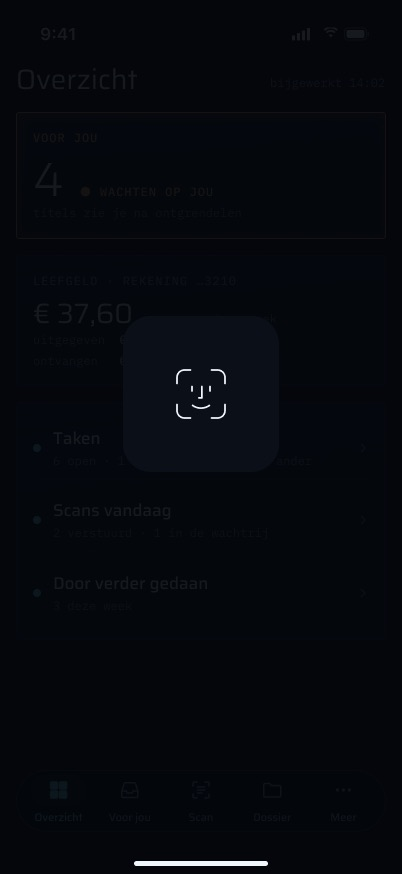 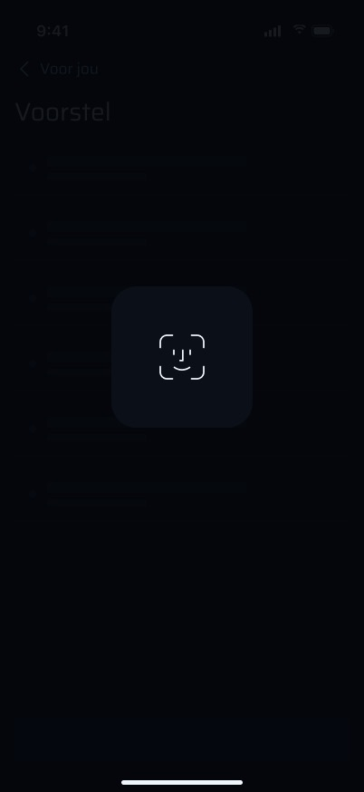

### 3.7 Toestemmingsvragen

| Toestemming | Wanneer het wordt gevraagd (code) | Wat de app eerst toont |
|---|---|---|
| **Meldingen** | Na een inlog (`sessionGeneration` verandert) of na een ontgrendeling met een sessie. **Nooit bij een koude start.** | Een melding in de app, "Meldingen aanzetten?" / "verder laat je weten als Verder iets vraagt of als er iets klaarstaat om te versturen.", met "Meldingen aanzetten" of "Niet nu". Het wordt **één keer per installatie** aangeboden (`pushPrePromptShown`). Alleen een ja toont het systeemvenster (`.alert, .sound, .badge`). "Niet nu" kost niets, omdat Meer → Meldingen het opnieuw aanbiedt. |
| **Camera** | De eerste tik op de schijf van Scan (of de eerste `verder://scan`) terwijl de status `notDetermined` is. | Een schermvullende vraag vooraf in de app, "Brieven scannen" / "verder gebruikt de camera om brieven voor je dossier te scannen.", twee beloften ("De camera gaat alleen aan als jij op scannen tikt." / "Scannen werkt ook zonder Face ID en zonder verbinding."), één knop "Ga verder" en "Daarna vraagt iOS om toestemming.", zonder sluitknop. Pas daarna de systeemvraag, waarvan de doeltekst in `project.yml` nu luidt "verder gebruikt de camera om brieven voor je dossier te scannen." Bij toestemming gaat de camera meteen open. |
| **Microfoon** | Wanneer een spraakopname begint (`AVAudioApplication.requestRecordPermission`). | De systeemvraag, "verder neemt je stem op om een gesprek vast te leggen." Bij weigering zegt het spraakvenster "verder mag de microfoon niet gebruiken. Zet het aan in Instellingen." en toont het "Open Instellingen". |
| **Spraakherkenning** | Niet gevraagd met een eigen aanroep. Transcriptie gebruikt `SpeechAnalyzer` / `SpeechTranscriber` op de telefoon, en de code controleert de *beschikbaarheid* (ready / needsDownload / unsupported) in plaats van een autorisatiestatus. | De plist bevat "verder zet je opname op je telefoon om in tekst." |
| **Face ID** | De eerste `evaluatePolicy`. | "verder vraagt Face ID zodat alleen jij je dossier opent." |

- **Toestemmingsvraag vooraf voor meldingen.** **Status:** Deels gebouwd — gevraagd op de juiste momenten en één keer per installatie (`Verder/Push/PushRegistrar.swift`, de `.alert` in `RootView`), maar als melding in systeemstijl. Het ontwerp maakt er een volledig scherm van, gevraagd op hetzelfde moment: een voorbeeldmelding ("Voorstel klaar om te keuren"), twee beloften ("Geen schuldeisers of bedragen op je vergrendelscherm." / "Per soort uit te zetten in Meer → Meldingen.") en één "Ga verder" met "Daarna vraagt iOS om toestemming.", zonder sluitknop. De tweede belofte hangt af van 3.28; tot die gebouwd is, mag het scherm haar niet doen.
- **Toestemmingsvraag vooraf voor de camera.** **Status:** Gebouwd — `CameraPrePrompt` in `Verder/Scan/ScanPermissionViews.swift`, `LiveCameraAccess` in `Verder/Scan/CameraAccess.swift`, aangesloten in `ScanTab.tapDisc()` / `openCamera()`. Niet gecommit in de working tree op 2026-11-03; nog geen unittest dekt de beslissing over de vraag vooraf.
- **Toestemmingsvragen vooraf voor microfoon en spraakherkenning:** zie 3.25–3.27.
- **Doeltekst voor Face ID.** **Status:** Gebouwd — `NSFaceIDUsageDescription` in `apps/ios/project.yml`.

Zodra er toestemming is, roept elke start met een sessie `registerForRemoteNotifications()` aan, omdat APNs-tokens veranderen. Het token gaat dan naar `POST /api/mobile/v1/push/register` met `{ token, environment, bundleId, appVersion }`.

**Status (registratie van het APNs-token):** Gebouwd — `Verder/Push/PushRegistrar.swift`, `ProvisioningEnvironment.swift`, `apps/web/src/app/api/mobile/v1/push/register/route.ts` met zijn `route.test.ts`.

- De route valideert de sessie **voordat** hij de body leest. De body is beperkt tot `MAX_REGISTER_BODY_BYTES`.
- Hij koppelt het apparaat aan de sessie-id uit de **gevalideerde cookie** en negeert een eventuele `sessionId` in de body.
- Hij doet een upsert van één rij in `push_devices`. Er wordt geen ledger-event toegevoegd.
- `environment` komt uit het eigen ondertekende provisioning profile van de app (`aps-environment`), dus deze development-ondertekende build registreert `development` en krijgt zijn pushes via de APNs-sandbox.
- Een 401 hier stuurt de app ook terug naar inloggen (`sessionRejected`, dus `SessionExpiredView`).
- Elke andere mislukking wordt één keer geprobeerd en wacht dan op de volgende start, die opnieuw registreert. Meer → Meldingen toont "Aanmelden voor meldingen lukte niet. verder probeert het bij de volgende start opnieuw.", of, wanneer APNs zelf weigerde, "Deze iPhone kon zich niet aanmelden bij Apple voor meldingen." met het foutdomein en de foutcode.

**Meer → Meldingen** toont de huidige stand: "Meldingen staan aan." / "Meldingen staan uit. Zet ze aan in Instellingen om te horen wanneer Verder iets vraagt." / "Meldingen zijn nog niet aangezet.". Daarna biedt het naar gelang "Meldingen aanzetten" of "Open Instellingen" aan, en somt het de negen soorten meldingen op, elk met één regel uitleg.

**Status (Meer → Meldingen, toestemmingsstand en de manier om die te herstellen):** Gebouwd — `Verder/More/MoreMenu.swift` (standregels), `Verder/More/MoreScreens.swift`. De schakelaars per soort zijn een aparte functie (3.28).

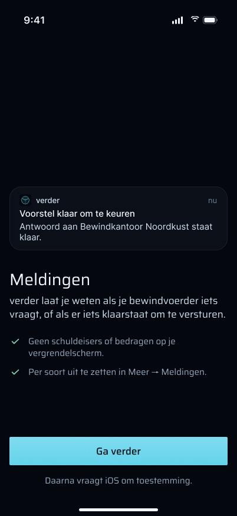 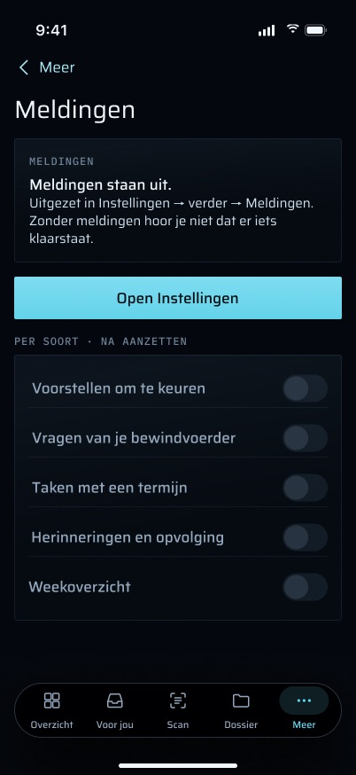

### 3.8 Inlogscherm: eerst de toegangssleutel, het wachtwoord als tweede stap

Het eerste scherm biedt **één** hoofdhandeling, "Inloggen met toegangssleutel", met daaronder "Face ID bevestigt dat jij het bent.". Het wachtwoord is een link, "Inloggen met wachtwoord", die de velden voor e-mail en wachtwoord als tweede stap opent; vandaar gaat een link terug naar "Inloggen met toegangssleutel". Elk inlogscherm zegt wat inloggen oplevert: "Deze iPhone blijft 30 dagen ingelogd." (de sessie van 30 dagen uit 3.1 is echt, de regel wordt nog niet getoond). Dit is het doel uit §3 van de brief: 1 tik plus Face ID bij elke latere installatie.

**Status:** Deels gebouwd — beide methoden werken (`Verder/Auth/SignInView.swift`), maar op één scherm, met de wachtwoordvelden altijd zichtbaar, geen link tussen de twee stappen en geen regel "30 dagen". Nodig is een `SignInView` in twee stappen (een `@State` voor de stap, met de veldfocus die meegaat) en de tekst; geen serverwijziging.

### 3.9 "Toegangssleutel", nooit "passkey", in de UI

Elk label, elke melding en elke bevestiging zegt "toegangssleutel" (brief §3, commit `e2b2b0f`).

**Status:** Deels gebouwd — `SessionExpiredView` zegt "toegangssleutel". Nog Engels: `SignInView` ("Inloggen met passkey"), `AuthModel.Copy` (`passkeyFailed`, `passkeyAlreadyOnDevice`, `passkeyAdded`, `passkeyAddFailed`, `passkeyNeedsFreshSignIn`), de aanbodkaart in Meer ("Passkey toevoegen?") en Meer → Account (`AccountCopy.passkeyLabel`, `passkeyLine`, de knop "Passkey toevoegen"). Alleen tekst, plus de verwachtingen in `AuthModelTests`/`MoreMenuTests` die de teksten citeren.

### 3.10 Een mislukking zegt wat voor soort het is en wanneer het gebeurde

Elke mislukte inlog verschijnt als één melding bovenaan het scherm, met een label voor de soort en het tijdstip van de poging ("WACHTWOORD · 14:02", "TOEGANGSSLEUTEL · 14:02", "SERVER · 14:02", "NETWERK · 14:02", "BEVEILIGING · 14:02"), een titel van één regel die de oorzaak noemt, en één regel die zegt wat je daarna doet. Het tijdstip doet ertoe omdat er minuten later opnieuw naar het scherm gekeken kan worden, en een "lukte niet" zonder tijd leest als actueel.

**Status:** Nog te bouwen — `AuthModel` heeft één string `errorMessage`. Nodig zijn een klein model (soort, tijd, titel, tekst) in `AuthModel`, een meldingsweergave die `SignInView` en `SessionExpiredView` delen, en tests die elke `APIError` / passkey-fout aan zijn soort koppelen. De oorzaakregel zonder geheimen (`AuthModel.diagnostic`) blijft, onder de tekst.

### 3.11 Geen toegangssleutel op deze telefoon

Wanneer iOS op deze telefoon geen toegangssleutel voor verder heeft, zegt het scherm dat ("Geen toegangssleutel gevonden op deze iPhone." / "Log in met je wachtwoord. Daarna kun je er een toegangssleutel bij zetten."), toont het meteen de wachtwoordvelden, en houdt het "Probeer toegangssleutel opnieuw" als link. Na de inlog met wachtwoord volgt het eenmalige aanbod (3.3).

**Status:** Nog te bouwen — nu komt dit uit in de algemene tekst `passkeyFailed` plus een oorzaakregel. Nodig: het geval herkennen in de foutvertaling van `PasskeyAuth.swift` (welke `ASAuthorizationError`-code iOS teruggeeft wanneer de allow-list leeg is en er geen credential bestaat, is **niet gemeten**; meet het op de telefoon voordat je het vertaalt, want een verkeerde vertaling zou een echte fout verbergen achter "gebruik je wachtwoord"), een nieuwe toestand in `AuthModel`, de schermvariant en een geval in `PasskeyErrorMappingTests`.

### 3.12 Deze toegangssleutel hoort niet meer bij je account

Wanneer de telefoon nog een toegangssleutel heeft maar de server die niet meer kent (verwijderd in `/settings/security` → Beveiliging), zegt het scherm "Deze toegangssleutel hoort niet meer bij je account." / "Misschien is hij verwijderd bij Beveiliging. Log in met je wachtwoord en zet daarna een nieuwe toegangssleutel aan.", verbergt het de knop voor de toegangssleutel, biedt het alleen "Inloggen met wachtwoord" aan, en belooft het "Daarna vragen we of je een nieuwe wilt." Na de inlog met wachtwoord verschijnt het aanbod om een nieuwe toe te voegen, **ook als het account nog andere passkeys heeft** (die van de Mac).

**Status:** Nog te bouwen — een 401 van `verify-authentication` wordt vertaald naar de algemene `passkeyFailed`. Nodig: de foutcode van better-auth uit de body van de 401 lezen om "onbekende credential" te onderscheiden van elke andere weigering (de precieze code moet worden afgelezen uit de geïnstalleerde `@better-auth/passkey` 1.7.0, niet aangenomen), een nieuwe toestand in `AuthModel`, de schermvariant, en een wijziging van de aanbodregel in `AuthModel` zodat dit geval aanbiedt, ook als `list-user-passkeys` niet leeg is. Tests in `AuthModelTests` en `PasskeyAuthTests`.

### 3.13 Te veel pogingen, met het tijdstip waarop het weer kan

Een 429 zegt "Te veel pogingen." / "Wacht een minuut · daarna kun je het opnieuw proberen.", schakelt de inlogknop uit, en meldt "Weer mogelijk om 14:03". De knop komt op dat tijdstip vanzelf terug; er wordt niets automatisch verstuurd.

**Status:** Deels gebouwd — de 429 wordt herkend en getoond (`APIError.rateLimited`, `AuthModel.Copy.rateLimited`). Wat ontbreekt: het tijdstip en de uitgeschakelde knop. Nodig: `APIError.rateLimited` moet een tijdstip voor opnieuw proberen meedragen (better-auth stuurt `X-Retry-After` in seconden; het antwoord van de Cloudflare-WAF stuurt mogelijk `Retry-After` of niets, val dan terug op één minuut na de poging), een timer in `SignInView`, en tests in `APIClientTests` / `AuthModelTests`.

### 3.14 De server reageert niet

Wanneer de server van verder niet antwoordt (een 5xx, een foutpagina van de Cloudflare-tunnel, een time-out) terwijl de telefoon zelf online is, zegt het scherm "De server reageert niet." / "Het ligt niet aan jou · probeer het over een paar minuten opnieuw. Scans in de wachtrij blijven bewaard.", biedt het één "Probeer opnieuw" aan en toont het "Laatste poging 14:02".

**Status:** Deels gebouwd — een 5xx geeft de algemene "Inloggen lukte niet…" en een time-out leest als "Geen verbinding" (`APIError.transport`). Nodig: "telefoon offline" (`NWPathMonitor` niet satisfied, zoals `UploadCenter` al gebruikt) onderscheiden van "server onbereikbaar" (pad satisfied, maar geen antwoord of een 5xx), een `Probeer opnieuw` die de laatste methode herhaalt, en de tijdregel. Een poging met de toegangssleutel herhalen betekent een nieuwe Face ID, dus "Probeer opnieuw" voert die nooit uit zonder een tik van Martin.

### 3.15 Offline: inloggen wacht op het netwerk

Zonder verbinding zegt het scherm "Geen verbinding." / "Inloggen kan pas als deze iPhone online is. We proberen het zelf opnieuw zodra er netwerk is.", met "Probeer opnieuw" en "Ook inloggen met toegangssleutel wacht op netwerk."

**Status:** Nog te bouwen — de offline-tekst bestaat, maar niets op dit scherm let op het netwerk en niets wordt opnieuw geprobeerd. Nodig zijn een `NWPathMonitor` in `AuthModel` of `SignInView`, en een **beslissing**: het frame belooft een automatische nieuwe poging, terwijl de regel van deze groep (3.1, 3.2) is: één poging per tik, nooit herhaald, omdat elke herhaling de limiet opnieuw laat ingaan. Eén wachtwoordpoging zodra het pad satisfied wordt, respecteert de limiet; een poging met de toegangssleutel kan niet zonder Face ID en kan dus alleen opnieuw worden aangeboden. Tot Martin beslist, mag de tekst geen nieuwe poging beloven die de code niet doet.

### 3.16 Bezig en geannuleerd, gewoon gezegd

Zolang de handeling met de toegangssleutel loopt, leest de knop "Wacht op Face ID…" en wordt het teken het Face ID-symbool. Een geannuleerd venster is geen fout, maar het scherm zegt het in één rustige regel: "Je tikte op Annuleer · er is niets veranderd."

**Status:** Deels gebouwd — een tweede tik wordt genegeerd (`isBusy`) en een annulering toont geen fout. Op `SignInView` wordt de knop voor de toegangssleutel alleen grijs (de wachtwoordknop is degene die "Bezig…" leest); `SessionExpiredView` leest "Bezig…". De annuleerregel bestaat niet: `PasskeyError.cancelled` zet niets. Tekst en één vlag in `AuthModel`; geen serverwijziging.

### 3.17 De app-kiezer toont niets van het dossier

Zolang de app niet op de voorgrond staat (scene `.inactive` of `.background`) en de vergrendeling geldt, is de momentopname van de app in de app-kiezer een effen afdekking met het verder-teken. Er verschijnt geen titel, geen aantal en geen bedrag.

**Status:** Nog te bouwen — niets in de code reageert op `.inactive`. Een afgeschermd tabblad is al `LockView` zodra het vergrendeld is, maar de aantallen op Overzicht en elk **ontgrendeld** scherm tijdens de respijttijd van 5 minuten verschijnen in de app-kiezer zoals ze zijn. Nodig: een afdekweergave in `RootView`, gestuurd door `scenePhase != .active` (getekend bij `.inactive`, zodat iOS hem vastlegt), en een beslissing of die ook een ontgrendelde app afdekt (de brief zegt "while locked"; het frame toont de afdekking over een ontgrendeld Overzicht, wat de veiligere lezing is). Hij mag het eigen `.inactive`-moment van het Face ID-venster niet zo afdekken dat het bij elke ontgrendeling flikkert; `LockPolicy` onderscheidt dat geval al en kan worden hergebruikt. UI-test via een fixture.

### 3.18 Na een geannuleerde Face ID: drie manieren verder

Een geannuleerd Face ID-venster laat Martin niet in een doodlopende straat staan. Een venster zegt "Ontgrendel je dossier" / "Je tikte op Annuleer · je dossier blijft vergrendeld.", legt de regel uit ("Eén keer bij openen. Ben je binnen 5 minuten terug, dan hoef je Face ID niet opnieuw te gebruiken.") en biedt drie manieren verder: "Ontgrendel met Face ID", "Bekijk alleen het overzicht" (gaat naar het vergrendelde Overzicht) en "Scan een brief" (opent de camera, die geen Face ID nodig heeft). Het werkt op de iPhone SE en bij AX5.

**Status:** Nog te bouwen — na een annulering toont de code niets: een afgeschermd tabblad houdt `LockView` met zijn ene knop, en Overzicht houdt zijn beknopte weergave. Nodig: `AppLock` moet "de laatste poging is geannuleerd" beschikbaar maken, een venster in `RootView` (of `LockView`), en de twee handelingen aangesloten op `tab = .home` en `cameraRequested = true` (dat laatste bestaat al voor `verder://scan`). `AppLockTests` voor de geannuleerde toestand.

### 3.19 De vergrendeling zegt wat erachter wacht, nooit wat erin staat

Wanneer een aangetikte melding op de vergrendeling uitkomt (een koude start, of na de respijttijd), noemen het Face ID-moment en het geannuleerde venster **de soort** van wat er wacht, in amber omdat het op Martin wacht: "Een voorstel wacht na ontgrendelen". Achter het venster wordt het doelscherm getekend als lege plaatshouderrijen, nooit met zijn inhoud.

**Status:** Nog te bouwen — de link zelf overleeft de vergrendeling (3.6), maar niets vertelt Martin wat het was. Nodig: `RootView` moet de soort van de wachtende link bewaren (voorstel, vraag, suggestie, taak, document) naast de stapel die hij al bewaart, een regel op `LockView` / het venster uit 3.18 die alleen uit de soort wordt opgebouwd (geen titel, geen partij), en een test dat er geen titel in terechtkomt.

### 3.20 Geen toegangscode op het toestel: één manier om het op te lossen

Wanneer de iPhone geen toegangscode heeft, kan Face ID in verder niet werken. Een venster zegt "Zet eerst een toegangscode aan" / "Zonder toegangscode werkt Face ID niet in deze app. Zet hem aan, dan werkt het meteen.", met "Open Instellingen" en "Bekijk alleen het overzicht".

**Status:** Deels gebouwd — het geval wordt herkend en de tekst verschijnt op `LockView` (`AppLock.Copy.unavailable`). Wat ontbreekt: de knop "Open Instellingen" (iOS biedt geen deep link naar de instellingen voor de toegangscode, dus hij opent de eigen pagina van de app in Instellingen of de hoofdpagina van Instellingen; de tekst mag geen plek beloven die hij niet kan openen) en "Bekijk alleen het overzicht". Alleen UI.

### 3.21 Een effen startscherm

Het startscherm is effen `void` (#04070d) zonder logo (brief §3, R27), zodat de stap van startscherm naar eerste frame niet flitst.

**Status:** Deels gebouwd — er is geen logo (`UILaunchScreen` in `apps/ios/project.yml` is een lege `UIColorName`), maar dat geeft de eigen donkere achtergrond van iOS (zwart), niet `void`. Nodig is een kleurasset `void` in `Assets.xcassets`, genoemd in `UILaunchScreen.UIColorName`.

### 3.22 Scan blijft open zolang de app vergrendeld is, en zegt dat

De camera, de wachtrij en de ontspanknop werken vóór Face ID; op Scan wordt nooit iets gevraagd. Zolang de app vergrendeld is, toont Scan één rustige regel, "Vergrendeld · scannen kan zonder Face ID", zodat duidelijk is dat de camera geen weg naar het dossier is.

**Status:** Deels gebouwd — Scan is niet afgeschermd en vraagt nooit (`ScanTab` leest bewust geen `AppLock`-toestand, zie het commentaar bovenaan). De regel ontbreekt, en die toevoegen betekent dat `ScanTab` **alleen** een boolean "vergrendeld" mag leren, nooit iets dat een vraag zou kunnen starten; geef die door vanuit `RootView` in plaats van hem de `AppLock` te geven.

### 3.23 Scannen rechtstreeks vanaf een vergrendelde telefoon

Een brief scannen kost één handeling plus de pagina's, zonder eerst verder te openen en zonder Face ID (brief §3 Scan, R20): het pictogram lang indrukken → "Scan een brief", een bediening in het bedieningspaneel, of de Actieknop. Elk daarvan opent meteen de camera van Scan.

**Status (snelle actie op het beginscherm "Scan een brief"):** Gebouwd — `QuickAction.scanType` in `Verder/App/QuickAction.swift`, `DeepLink.scan` → `LinkDestination(opensCamera:)` in `Verder/Push/DeepLink.swift`, `cameraRequested` in `RootView` en `ScanTab`, het shortcut-item in `project.yml`. Niet gecommit in de working tree op 2026-11-03.

**Status (bediening in het bedieningspaneel en Actieknop):** Nog te bouwen — er bestaat geen `ControlWidget` of `AppIntent`. `project.yml` noemt `Verder/Shared/ScanLetterIntent.swift` al in het widget-target, maar het bestand bestaat niet, dus dat target wordt pas gegenereerd als het er is. Nodig: een `OpenIntent`/`AppIntent` die `DeepLink.scan` aflevert (verder registreert geen URL-schema, dus het kan geen gewone URL-opening zijn), een `ControlWidgetButton` in `VerderWidget`, het beschikbaar maken voor de Actieknop via dezelfde intent, en een test dat de intent naar `.scan` vertaalt.

### 3.24 Camera geweigerd: zeggen waar je hem aanzet

Wanneer de camera voor verder uit staat, vervangt Scan de schijf door "Scannen kan nu niet" / "De camera staat uit in Instellingen → verder → Camera. Zet hem aan, dan kun je meteen scannen." en één "Open Instellingen". De tabbalk blijft staan, dus het is geen doodlopende straat.

**Status:** Gebouwd — `CameraDenied` in `Verder/Scan/ScanPermissionViews.swift`, getoond door `ScanTab` wanneer `CameraAccess.status()` `.denied` is. Niet gecommit in de working tree. De titel in de code luidt "De camera staat uit voor verder" waar het frame "Scannen kan nu niet" zegt (alleen tekst).

### 3.25 Toestemmingsvraag vooraf voor de microfoon

Het eerste spraaklogboek vraagt het, vóór iOS dat doet, met één scherm in de app: waar de microfoon voor is en één "Ga verder", daarna de eigen melding van iOS.

**Status:** Nog te bouwen — `VoiceRecorder` roept `AVAudioApplication.requestRecordPermission()` direct aan (`Verder/Voice/VoiceRecorder.swift`). Nodig: een statuscontrole vóór het opnemen, een weergave voor de vraag vooraf in het spraakvenster (de vorm van `CameraPrePrompt` kan worden hergebruikt), en een geval in `VoiceLogModelTests` voor het pad `undetermined`.

### 3.26 Microfoon geweigerd

Wanneer de microfoon voor verder uit staat, zegt het spraakvenster dat ("verder mag de microfoon niet gebruiken.", met waar in Instellingen je hem aanzet) en biedt het "Open Instellingen" en "Sluit" aan.

**Status:** Gebouwd — `VoiceLogModel.Copy.micDenied` en de knop "Open Instellingen" in `Verder/Voice/VoiceLogView.swift`. De langere tweede regel van het frame ("Uitgezet in Instellingen → verder → Microfoon. Zet het aan, dan kun je meteen inspreken.") is alleen tekst.

### 3.27 Spraakherkenning: vraag vooraf en geweigerd

Vóór de eerste transcriptie legt de app op één scherm uit dat iOS de opname omzet in tekst zodat Martin die kan lezen voordat hij opslaat ("Je stem omzetten in tekst"), met "Ga verder"; bij weigering zegt het spraakvenster "verder mag spraakherkenning niet gebruiken.", waar je het aanzet, en biedt het "Open Instellingen" aan.

**Status:** Nog te bouwen — en eerst een **meting**. De code gebruikt `SpeechAnalyzer` / `SpeechTranscriber` op de telefoon en controleert alleen de beschikbaarheid van het model, nooit een autorisatiestatus (`Verder/Voice/Transcriber.swift`). Of iOS 27 op dat pad überhaupt om toestemming voor spraakherkenning vraagt, is niet gemeten. Zo niet, dan zijn beide frames zinloos en moeten ze vervallen; zo ja, dan volgen de vraag vooraf en de weigeringsmelding de vorm van de microfoon. Let op: de belofte in het frame "De omzetting kan via de servers van Apple gaan." spreekt de transcriptie op het toestel tegen; de tekst moet overeenkomen met wat er gemeten wordt.

### 3.28 Meldingen per soort, aan of uit

In Meer → Meldingen kan Martin elke soort melding aan- of uitzetten ("Voorstellen om te keuren", "Vragen van je bewindvoerder", "Taken met een termijn", "Herinneringen en opvolging", "Weekoverzicht"). Zolang meldingen in iOS uit staan, worden de schakelaars getoond maar zijn ze inactief ("PER SOORT · NA AANZETTEN"), met "Open Instellingen" erboven. Een uitgezette soort wordt nooit naar deze telefoon gestuurd; de badge telt nog steeds wat er wacht.

**Status:** Nog te bouwen — de code somt de negen soorten alleen als tekst op. Nodig, van begin tot eind:
- **Model:** een verzameling gedempte soorten per gebruiker (of per rij in `push_devices`). Geen bewijs, dus geen ledger-event; een nieuwe tabel of een kolom op `push_devices`, met een migratie (en de gebruikelijke volgordeval: migreer vanaf de host vóór de images).
- **Serverroute:** `GET` / `PUT /api/mobile/v1/push/preferences` achter `mobileGet` / `mobilePost`, met routetests.
- **Worker:** `notify()` (`apps/worker/src/notify/notify.ts`) slaat een gedempte soort over en legt die vast als een `skipped`-poging met een reden, zodat het diagnosepad compleet blijft. De koppeling van de vijf ontworpen groepen aan de negen categorieën is een beslissing die moet worden vastgelegd (bijvoorbeeld of een mail van Verder überhaupt gedempt kan worden, gezien de regel dat elke mail van Verder zijn aandacht krijgt).
- **UI:** schakelaars in `MoreScreens.swift`, uitgeschakeld zolang de toestemming in iOS uit staat; tests in `MoreMenuTests`.

### 3.29 De telefoon wordt op het web bij naam herkend

`/settings/security` noemt de telefoon ("verder op iPhone") in plaats van "Onbekend apparaat", zodat Martin kan zien welke sessie hij moet intrekken.

**Status:** Nog te bouwen — de apparaatnaam-parser van het web herkent de user agent `Verder/1 CFNetwork/… Darwin/…` niet (CLAUDE.md, bekend en uitgesteld). Nodig is één geval in die parser en een test; geen iOS-wijziging.

### 3.30 De telefoon houdt zijn sessie in leven, en een verlopen sessie leest altijd als zodanig

Een sessie die de server verlengt, blijft op de telefoon verlengd, zodat "Deze iPhone blijft 30 dagen ingelogd." telt vanaf het laatste gebruik, niet vanaf de inlog. En wanneer een opgeslagen sessie op de telefoon zelf verloopt, toont de app "Je sessie is verlopen." (3.4), niet de gewone eerste inlog.

**Status:** Nog te bouwen — de app slaat alleen bij het inloggen een cookie op, dus de dagelijkse verlenging door de server (`updateAge`) bereikt de Keychain nooit, en een cookie die bij het starten verlopen blijkt, toont de gewone `SignInView` (sectie 9). Nodig: `APIClient` moet bij elk geauthenticeerd antwoord een vernieuwde sessiecookie uit `Set-Cookie` via `sessionCookie(from:url:)` doorgeven aan `KeychainSessionStore`, `AuthModel` moet `sessionExpired` zetten wanneer de opgeslagen cookie verlopen is, en tests in `APIClientTests` / `SessionStoreTests`.

---

## 4. Toestanden

### Inloggen (`SignInView`, `AuthModel.Copy`)

| Toestand | Wat er staat | Wat Martin kan doen |
|---|---|---|
| Standaard | "Inloggen", "Inloggen met passkey", daarna "of met je wachtwoord" met de velden E-mail en Wachtwoord, en "Inloggen met wachtwoord". | Een van beide methoden. |
| Bezig | Beide knoppen zijn uitgeschakeld. De wachtwoordknop leest "Bezig…". | Wachten. Een tweede tik wordt genegeerd (`isBusy`). |
| Passkey-venster geannuleerd | Niets. Het venster sluiten is geen fout. | Opnieuw proberen. |
| Passkey mislukt | "Inloggen met passkey lukte niet. Probeer het opnieuw, of log in met je wachtwoord." Als de server de assertion weigerde (401), is dat alles. Als iOS of de handeling mislukte, volgt een korte oorzaakregel zonder geheimen (`AuthModel.diagnostic`), bijvoorbeeld `(PasskeyError.failed("com.apple.AuthenticationServices.AuthorizationError 1004: …"))`. Een 429 of geen verbinding tijdens een passkey-inlog toont in plaats daarvan de tekst voor de limiet of de offline-tekst hieronder. | Opnieuw proberen, of het wachtwoord gebruiken. |
| Verkeerd wachtwoord (401) | "Dat werkte niet — controleer je e-mailadres en wachtwoord en probeer het nog eens." | Verbeteren en opnieuw proberen. |
| Te veel pogingen (429) | "Even wachten — te veel pogingen. Probeer het over een minuut opnieuw." | Een minuut wachten. |
| Offline / geen HTTP-antwoord | "Geen verbinding met verder. Controleer je internet en probeer het opnieuw." | Opnieuw proberen zodra er verbinding is. Er wordt niets in de wachtrij gezet: een inlog wordt nooit automatisch herhaald. |
| Serverfout / andere weigering | "Inloggen lukte niet. Probeer het over een moment opnieuw." | Later opnieuw proberen. |
| Sessie verlopen (401 van de server) | `SessionExpiredView` (3.4). | Passkey, wachtwoord, of toch scannen. |

### Vergrendeling

| Toestand | Wat er staat |
|---|---|
| Vergrendeld, op Overzicht | Alleen aantallen en geld, en "Toon details" met de voetnoot. Het Face ID-venster verschijnt één keer vanzelf. |
| Vergrendeld, op een afgeschermd tabblad | `LockView`, met "Ontgrendel met Face ID". Het vraagt één keer per vergrendelperiode vanzelf, en alleen zolang de scene actief is. |
| Vergrendeld, op Scan | De camera en de wachtrij werken gewoon. Er wordt niets gevraagd. |
| Ontgrendelen mislukt | "Ontgrendelen lukte niet. Probeer het nog eens." |
| Geen toegangscode op het toestel | "Stel een toegangscode in op je iPhone; daarna kun je verder ontgrendelen." Alleen Scan en de aantallen op Overzicht blijven bruikbaar. |

### Grote tekst en kleine telefoons

- Elk lettertype gebruikt `relativeTo:`, dus Dynamic Type schaalt de schermen. Bij toegankelijkheidsgroottes breekt `SessionExpiredView` zijn tekst af met koppeltekens (`HomeSummary.hyphenated`).
- Inloggen is een `ScrollView` die het toetsenbord interactief laat verdwijnen. De knoppen van het scherm voor een verlopen sessie staan in een `safeAreaInset` onderaan, zodat ze bereikbaar blijven op een iPhone SE (375 × 667) en bij AX5.

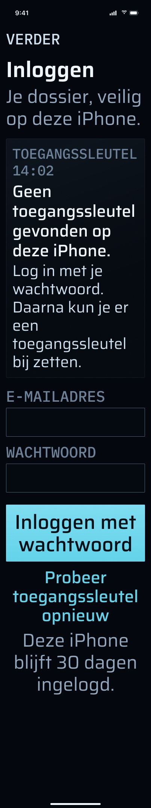 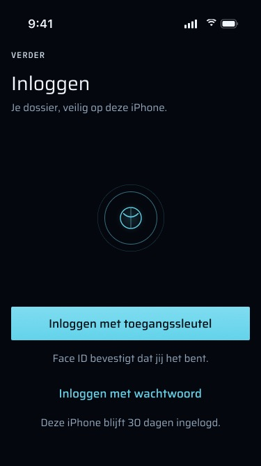

---

## 5. Privacy en beveiliging

- **De sessie is een cookie, geen bearer-token.** Het is de sessiecookie van better-auth, opgeslagen in het Keychain-item `pro.vanderpoel.verder.session` met toegang `kSecAttrAccessibleAfterFirstUnlockThisDeviceOnly`. Daardoor blijft hij leesbaar terwijl de telefoon vergrendeld is, zodat uploads op de achtergrond werken, en wordt hij nooit gesynchroniseerd of op een ander toestel teruggezet. De share-extensie leest hem via de gedeelde keychain access group.
- **De Keychain is de enige plek waar een sessie leeft.** De URLSession is ephemeral, zonder cookie-opslag, zonder URL-cache, en met `httpShouldSetCookies = false`. Een `Set-Cookie` wordt alleen een sessie door via `sessionCookie(from:url:)` in de store te komen.
- **Redirects worden nooit gevolgd.** Elke 3xx wordt vertaald naar `.unauthorized`. Een gevolgde 307 naar `/login` zou lezen als een 200 en een scan als verstuurd markeren. Om hierbij aan te sluiten, antwoordt de web-middleware op `/api/mobile/*` met een JSON-401 in plaats van door te sturen.
- **Origin:** elk verzoek draagt `Origin`, omdat better-auth auth-aanroepen die iets veranderen zonder die header weigert.
- **Passkeys zijn aan de hostnaam gebonden.** Het associated domain is `webcredentials:verder.vanderpoel.pro?mode=developer` (development-build; zie sectie 9). `/.well-known/apple-app-site-association` is openbaar (uitgezonderd van de middleware), wordt per verzoek gelezen, en antwoordt 404 wanneer `APPLE_TEAM_ID` niet is gezet, in plaats van een verkeerde app-id te publiceren.
- **Wat zonder Face ID zichtbaar is:**
  - Op Overzicht: alleen aantallen en bedragen.
  - In widgets: titels en de kop van de kaart zijn `.privacySensitive()`, dus iOS verbergt ze zolang het toestel vergrendeld is, bijvoorbeeld in StandBy.
  - In widgets op het vergrendelscherm: alleen het aantal en "wacht op jou" / "wachten op jou".

  De widget-momentopname in de App Group wordt geschreven met `completeFileProtectionUntilFirstUserAuthentication`.
- **Andere gegevens op de telefoon:**
  - Het zakdossier, de cache van Tijdlijn en spraakopnames gebruiken bestandsbeveiliging `.complete`, dus ze zijn onleesbaar zolang de telefoon vergrendeld is.
  - Scans in de wachtrij en gedeelde bestanden (uploadwachtrij, bodies van achtergronduploads, binnenkomende drops) gebruiken `completeUntilFirstUserAuthentication`, zodat ze verstuurd kunnen worden terwijl de telefoon vergrendeld is.
  - UserDefaults bevat alleen twee booleans: de vlag voor het passkey-aanbod (`passkeyOfferShown`) en de vlag voor de toestemmingsvraag voor meldingen (`pushPrePromptShown`).
- **Wat uitloggen wist:** zie 3.5. Een geweigerde sessie (401, `sessionRejected`) voert dezelfde `forgetLocally()` uit, dus het Keychain-item, de widget-momentopname en elke aan de epoch gebonden store (het zakdossier inbegrepen) worden ook gewist. Het verschilt op drie punten: het stuurt geen uitlogverzoek, het **bewaart een niet-verstuurd spraaklogboek** (dat komt terug na de volgende inlog, `VoiceLogSession`), en het toont `SessionExpiredView` in plaats van de gewone inlog.
- **Intrekken:** het intrekken van de sessie van de telefoon in `/settings/security` laat de volgende aanroep 401 antwoorden, en de app wist zichzelf dan zoals hierboven. Het stopt ook de pushes naar die telefoon: `notify()` controleert `push_devices.session_id` tegen de geldige sessies.

  **Status:** Gebouwd — `AuthModel.sessionRejected()` / `forgetLocally()` aan de iOS-kant; de sessiecontrole in `apps/worker/src/notify/notify.ts`.

---

## 6. Regels waaraan deze groep zich houdt

- **Hier nergens amber.** Vergrendeld zijn, uitgelogd zijn of een fout zien is niet iets in het dossier dat op Martin wacht (zo vastgelegd in `SignInView`, `LockView`, `AuthButton` en `SessionExpiredView`). Het vergrendelde Overzicht gebruikt nog wel amber voor het aantal dat wacht, omdat dat wél op hem wacht.
- **Niets wordt verstuurd zonder dat Martin de definitieve tekst goedkeurt.** Ontgrendelen van de app keurt nooit iets goed. Versturen heeft een eigen, verse Face ID nodig.
- **AI-uitvoer blijft een suggestie**, en de uitzondering voor het archiveren blijft onaangeroerd. Deze groep schrijft geen bewijs en voegt **geen ledger-events** toe. De rijen die hij raakt (`session`, `passkey`, `push_devices`) zijn geen bewijstabellen.

---

## 7. Meldingen en haptiek

- Deze groep **verstuurt** geen meldingen. Zijn rol is toestemming verkrijgen en het APNs-token registreren (3.7).
- Haptiek:
  - `.error` wanneer een inlogpoging vanaf het scherm voor een verlopen sessie mislukt.
  - `.error` wanneer een ontgrendeling vanuit "Toon details" op Overzicht de app vergrendeld laat (een annulering inbegrepen).
  - `SignInView` en `LockView` spelen geen eigen haptiek.

  **Status:** Gebouwd — `.sensoryFeedback(.error, …)` in `Verder/Auth/SessionExpiredView.swift` en in `Verder/Home/HomeTab.swift` (`failedUnlocks`). De haptiekkaart van de brief (§2.5) noemt geen ander moment in deze groep, dus hier is verder niets verschuldigd.

---

## 8. Gedrag zonder verbinding

- Inloggen heeft het netwerk nodig en wordt nooit in een wachtrij gezet of herhaald.
- Uitloggen werkt offline: het vergeet de sessie lokaal, ook als het verzoek mislukt.
- De app-vergrendeling is volledig lokaal en werkt offline.
- Scannen werkt offline en terwijl je uitgelogd bent. De wachtrij blijft bewaard en loopt leeg na de volgende inlog.

---

## 9. Bekende beperkingen en wat niet gemeten is

- **De telefoon slaat nooit een vernieuwde cookie op.** De server verlengt de vervaldatum van een sessie hoogstens één keer per dag (`updateAge`), maar de app slaat alleen bij het inloggen een cookie op. Na 30 dagen leest de opgeslagen cookie bij het starten als verlopen, en toont de telefoon het **gewone** inlogscherm, niet "Je sessie is verlopen.". `sessionExpired` wordt alleen door een 401 van de server gezet.
- **`/settings/security` noemt de telefoon "Onbekend apparaat"**, omdat de user agent `Verder/1 CFNetwork/… Darwin/…` niet wordt herkend (CLAUDE.md, bekend en uitgesteld).
- **Valkuilen bij het instellen van het toestel,** gemeten op de telefoon (CLAUDE.md):
  - Met het associated domain `?mode=developer` mislukken passkeys met `ASAuthorizationError 1004`, tenzij Instellingen → Ontwikkelaar → Associated Domains Development bij het installeren aan staat.
  - Een niet-geaccepteerde Apple Program License Agreement breekt elke ondertekende build.
  - Het development-certificaat verloopt op **2027-10-31**.
- **Niet gemeten:** een tijdgevoelige push die door een Focus-modus heen breekt; op verzoek van Martin overgeslagen.

---

## 10. Ontwerp tegenover code (de frames lopen voor op de code)

De Figma-frames in deze map zijn het **doel**. De huidige code wijkt op deze punten af:

1. **Het woord "passkey" staat nog in de UI.** De brief eist overal "toegangssleutel" (commit `e2b2b0f`). `SessionExpiredView` zegt al "toegangssleutel", maar `SignInView` ("Inloggen met passkey"), `AuthModel.Copy`, het aanbod in Meer ("Passkey toevoegen?") en Meer → Account ("Passkey", "1 passkey op je account.") zeggen nog "passkey".
2. **Tekst van het inlogscherm.** De frames tonen "Inloggen met toegangssleutel" met "Face ID bevestigt dat jij het bent." en "Deze iPhone blijft 30 dagen ingelogd.", met het wachtwoord achter een link. De code toont de passkey-knop met de velden voor e-mail en wachtwoord op hetzelfde scherm, en heeft geen regel "30 dagen".
3. **Specifieke foutstaten bij inloggen.** De frames hebben eigen meldingen voor "Geen toegangssleutel gevonden", "Server niet bereikbaar" en "Toegangssleutel hoort niet meer bij je account". De code heeft geen geval voor een passkey die uit het account is verwijderd, of voor geen gevonden passkey: beide vallen in de algemene tekst `passkeyFailed` met een oorzaakregel. "Server niet bereikbaar" en "Offline" zijn allebei de ene `offline`-tekst (`APIError.transport`).
4. **Sessie verlopen.** Het frame toont een gedateerde melding, "UITGELOGD · 1 NOV 09:12", onder de titel "Log opnieuw in". De code legt geen tijdstip van verlopen vast, toont "Je sessie is verlopen." met een andere hoofdtekst, en heeft een derde handeling, "Toch een brief scannen", die het frame niet heeft.
5. **Aanbod voor een toegangssleutel.** De frames tonen een volledig scherm, "Voortaan met Face ID inloggen?", met "Sla over". De code toont een kaart bovenaan Meer, met "Passkey toevoegen" en "Niet nu".
6. **Venster na geannuleerde Face ID.** De frames tonen een venster, "Ontgrendel je dossier", met "Bekijk alleen het overzicht" en "Scan een brief", en de varianten voor iPhone SE en AX5. De code toont niets na een annulering. Het vergrendelscherm blijft staan, met zijn ene knop.
7. **Geen toegangscode.** Het frame toont een venster, "Zet eerst een toegangscode aan", met "Open Instellingen". De code toont één tekstregel op het vergrendelscherm en geen knop.
8. **Vergrendeld Overzicht.** De knop in het frame leest "Ontgrendel met Face ID" met het onderschrift "Scan werkt altijd · titels na ontgrendelen". De code leest "Toon details" met "Titels en de kaart verschijnen na Face ID.".
9. **Afdekking in de app-kiezer.** De frames, en de brief ("The app-switcher snapshot is covered while locked"), tonen het verder-teken in plaats van inhoud in de app-kiezer. **De code heeft zo'n afdekking niet**: niets reageert op de scenefase `.inactive`. In de praktijk is een afgeschermd tabblad al `LockView` zolang het vergrendeld is, maar de aantallen op Overzicht en een *ontgrendeld* scherm verschijnen in de app-kiezer zoals ze zijn.
10. **Toestemmingsvragen vooraf voor camera, microfoon en spraak.** De frames tonen één scherm in de app per toestemming ("Brieven scannen" … "Ga verder" / "Daarna vraagt iOS om toestemming."), en voor elk een geweigerde toestand ("Scannen kan nu niet" met "Open Instellingen"). De **camera** heeft nu beide, in de niet-gecommitte working tree (3.7, 3.24); zijn beloften wijken af van het frame ("…als jij op scannen tikt." / "Scannen werkt ook zonder Face ID en zonder verbinding." tegenover "…als jij op Scan tikt." / "Wat je scant, gaat alleen naar je eigen dossier.") en zijn titel bij weigering luidt "De camera staat uit voor verder". De **microfoon** gaat nog rechtstreeks naar de systeemvraag en heeft een weigeringsmelding met "Open Instellingen" (3.25, 3.26). Om **spraak** wordt nooit als toestemming gevraagd (3.27).
11. **Toestemmingsvraag vooraf voor meldingen.** Het frame toont een volledig scherm. De code toont een `.alert` in systeemstijl.
12. **Meer → Meldingen.** Het frame "Meldingen uit" toont **schakelaars** per soort ("Voorstellen om te keuren", "Taken met een termijn", …). De code heeft geen instelling per soort: hij somt de negen soorten op als tekst ("Mail van Verder", …, "Deadline", …). De formulering "termijn" uit het frame staat niet in de code.
13. **Respijttijd.** De respijttijd van 5 minuten in de code komt overeen met de tekst in het frame "Face ID geannuleerd" ("Ben je binnen 5 minuten terug, dan hoef je Face ID niet opnieuw te gebruiken."), en met spec §6.2.

---

## 11. Waar in de code

**iOS (`apps/ios/`)**

- `Verder/Auth/AuthModel.swift`: inloggen (wachtwoord, passkey), het passkey-aanbod en toevoegen, uitloggen, `sessionRejected`, `forgetLocally`, en alle inlogteksten.
- `Verder/Auth/PasskeyAuth.swift`: de vier passkey-endpoints van better-auth, de met de hand meegestuurde challenge-cookie, en de brug naar AuthenticationServices met de foutvertaling.
- `Verder/Auth/WebAuthnJSON.swift`: het decoderen van WebAuthn-opties en de JSON van het antwoord.
- `Verder/Auth/SessionStore.swift`: `SessionCookie` en `KeychainSessionStore`.
- `Verder/Auth/SessionEpoch.swift`: de ene uitlog-epoch waaraan elke store gehoorzaamt.
- `Verder/Auth/AppLock.swift`: `LockPolicy`, `PlatformOwnerAuthenticator`, `AppLock` en de gebieden.
- `Verder/Auth/LockView.swift`: het vergrendelscherm en `.lockGated(by:)`.
- `Verder/Auth/SignInView.swift`, `Verder/Auth/SessionExpiredView.swift`, `Verder/Auth/AuthButton.swift`.
- `Verder/App/RootView.swift`: inloggen tegenover tabbladen, het doorgeven van de scenefase, `promptOnOpen`, de melding met de toestemmingsvraag voor pushes, de stapels voor deep links.
- `Verder/App/VerderApp.swift` en `Verder/App/AppServices.swift`: de bedrading, en de gedeelde epoch.
- `Verder/Net/APIClient.swift` en `Verder/Net/APIError.swift`: cookieafhandeling, de vertrouwensheader, geen redirects, de statusvertaling.
- `Verder/Push/PushRegistrar.swift` en `Verder/Push/ProvisioningEnvironment.swift`: toestemming, de vraag vooraf, tokenregistratie.
- `Verder/More/MoreTab.swift`, `Verder/More/MoreScreens.swift`, `Verder/More/MoreMenu.swift` en `Verder/More/AccountModel.swift`: de aanbodkaart, Account (e-mail, aantal passkeys, Uitloggen, "Apparaten op het web"), Meldingen.
- `Verder/Home/HomeTab.swift` en `Verder/Home/HomeSummary.swift`: de vergrendelde beknopte weergave ("Toon details").
- `Verder/Voice/VoiceRecorder.swift`, `Verder/Voice/VoiceLogModel.swift` en `Verder/Voice/Transcriber.swift`: microfoontoestemming en beschikbaarheid van spraakherkenning.
- `Verder/Scan/ScanTab.swift` en `Verder/Scan/DocumentCamera.swift`: de niet-afgeschermde camera en de banner dat inloggen nodig is.
- `project.yml` / `Verder/Info.plist`: doelteksten, entitlements (associated domains, keychain group, App Group).

**Server**

- `apps/web/src/middleware.ts`: `/api/mobile/*` antwoordt met een JSON-401, en `/.well-known/` is openbaar.
- `apps/web/src/app/.well-known/apple-app-site-association/route.ts`.
- `apps/web/src/app/api/mobile/v1/me/route.ts` met `apps/web/src/lib/mobile-account.ts` (e-mail, naam, aantal passkeys; schrijft niets).
- `apps/web/src/app/api/mobile/v1/push/register/route.ts` (de router `push.registerDevice` in `packages/api`).
- `apps/web/src/lib/mobile-route.ts`: `mobileGet` / `mobilePost`, eerst authenticatie, `cache-control: no-store`.
- `packages/auth/src/index.ts` (passkey-plugin, limieten, sessie-hook) en `packages/auth/src/session-trust.ts` (30 dagen tegenover 12 uur).
- De eigen endpoints `/api/auth/*` van better-auth: `sign-in/email`, `sign-out`, `passkey/*`.

**Tests**

- iOS:
  - `VerderTests/AppLockTests.swift`, `AuthModelTests.swift`, `PasskeyAuthTests.swift`, `PasskeyErrorMappingTests.swift`, `WebAuthnJSONTests.swift`.
  - `SessionStoreTests.swift`, `SessionEpochTests.swift`, `APIClientTests.swift`, `PushRegistrarTests.swift`, `ProvisioningEnvironmentTests.swift`, `MoreMenuTests.swift`.
  - `FixtureTests.swift`, waaronder de fixture `unauthorized`.
- Web:
  - `apps/web/src/app/api/mobile/v1/me/route.test.ts`, `apps/web/src/lib/mobile-account.test.ts`.
  - `apps/web/src/app/api/mobile/v1/push/register/route.test.ts`.
  - `apps/web/src/app/.well-known/apple-app-site-association/route.test.ts`.
  - `packages/auth/src/session-trust.test.ts`, `packages/auth/src/index.test.ts`.

---

## 12. Alle frames

Alle frames zijn geëxporteerd uit Figma-sectie `auth · final` (321:5817) op 1×. De afmetingen zijn 402 × 874, tenzij de naam iPhone SE (375 × 667) of AX5 (hoger) zegt.

| Frame | Toestand die het toont |
|---|---|
| `Sign-in_Default.jpg` | Eerste inlog: eerst de toegangssleutel, link naar het wachtwoord, "Deze iPhone blijft 30 dagen ingelogd." |
| `Sign-in_Wachtwoord_toetsenbord.jpg` | Inloggen met wachtwoord, met het toetsenbord omhoog en de velden ingevuld. |
| `Sign-in_Toegangssleutel_bezig.jpg` | Handeling met de toegangssleutel bezig. |
| `Sign-in_Toegangssleutel_geannuleerd.jpg` | Venster voor de toegangssleutel geannuleerd: rustig, geen fout. |
| `Sign-in_Geen_toegangssleutel_gevonden.jpg` | Geen toegangssleutel voor verder op deze telefoon (alleen ontwerp; de code toont de algemene passkey-fout). |
| `Sign-in_Geen_toegangssleutel_gevonden_AX5.jpg` | Hetzelfde bij tekstgrootte AX5. |
| `Sign-in_Wachtwoord_klopt_niet.jpg` | Verkeerd e-mailadres of wachtwoord (401). |
| `Sign-in_Te_veel_pogingen.jpg` | Limiet bereikt (429). |
| `Sign-in_Server_niet_bereikbaar.jpg` | De server is niet bereikbaar (de code vertaalt dit naar de offline-tekst). |
| `Sign-in_Toegangssleutel_hoort_niet_meer_bij_je_account.jpg` | Toegangssleutel uit het account verwijderd; alleen wachtwoord (alleen ontwerp). |
| `Sign-in_Uitgelogd.jpg` | De server heeft de sessie beëindigd: "Je sessie is verlopen." |
| `Sign-in_Offline.jpg` | Geen verbinding. |
| `Sign-in_Toegangssleutel_toevoegen.jpg` | Het eenmalige aanbod na een inlog met wachtwoord (de code toont het als kaart in Meer). |
| `Sign-in_Toegangssleutel_staat_al_op_je_telefoon.jpg` | `1006`: er staat al een gesynchroniseerde toegangssleutel op de telefoon. |
| `Sign-in_Default_iPhone_SE.jpg` | Standaard inlogscherm op de iPhone SE. |
| `Lock_Face_ID_vraagt.jpg` | Het Face ID-venster over het vergrendelde Overzicht bij openen. |
| `Lock_Face_ID_geannuleerd.jpg` | Na een annulering: het venster "Ontgrendel je dossier" (alleen ontwerp). |
| `Lock_Face_ID_geannuleerd_iPhone_SE.jpg` | Hetzelfde op de iPhone SE. |
| `Lock_Face_ID_geannuleerd_AX5.jpg` | Hetzelfde bij AX5. |
| `Lock_Koude_start_via_melding.jpg` | Koude start vanuit een aangetikte melding: Face ID over het doel (een voorstel), waarvan de inhoud niet wordt getekend. |
| `Lock_Koude_start_via_melding_geannuleerd.jpg` | Diezelfde koude start, geannuleerd. |
| `Lock_Geen_toegangscode.jpg` | Geen toegangscode op het toestel ingesteld. |
| `Lock_Alleen_overzicht.jpg` | Vergrendeld Overzicht: alleen aantallen en geld. |
| `Lock_Alleen_overzicht_AX5.jpg` | Hetzelfde bij AX5. |
| `Lock_App-switcher.jpg` | App-kiezer terwijl vergrendeld: inhoud afgedekt (alleen ontwerp). |
| `Lock_App-switcher_in_de_app-kiezer.jpg` | De afgedekte kaart zoals hij in de app-kiezer staat (alleen ontwerp). |
| `Lock_Koude_start_via_Scan.jpg` | Koude start op Scan: de camera is actief, zonder Face ID. |
| `Pre-prompt_Camera.jpg` | Toestemmingsvraag vooraf voor de camera, "Brieven scannen" (gebouwd in de working tree, 3.7). |
| `Pre-prompt_Microfoon.jpg` | Toestemmingsvraag vooraf voor de microfoon (alleen ontwerp). |
| `Pre-prompt_Spraakherkenning.jpg` | Toestemmingsvraag vooraf voor spraakherkenning (alleen ontwerp). |
| `Pre-prompt_Meldingen.jpg` | Toestemmingsvraag vooraf voor meldingen (de code toont het als melding in systeemstijl). |
| `Pre-prompt_Camera_geweigerd.jpg` | Camera geweigerd: "Scannen kan nu niet" met "Open Instellingen" (gebouwd in de working tree, 3.24). |
| `Pre-prompt_Microfoon_geweigerd.jpg` | Microfoon geweigerd (de code toont een melding en "Open Instellingen" in het spraakvenster). |
| `Pre-prompt_Spraakherkenning_geweigerd.jpg` | Spraakherkenning geweigerd (alleen ontwerp). |
| `Pre-prompt_Meldingen_uit.jpg` | Meer → Meldingen met meldingen uit, en schakelaars per soort (de code heeft geen schakelaars). |
| `Pre-prompt_Meldingen_AX5.jpg` | De toestemmingsvraag vooraf voor meldingen bij AX5. |
| `Pre-prompt_Camera_iPhone_SE.jpg` | De toestemmingsvraag vooraf voor de camera op de iPhone SE. |
