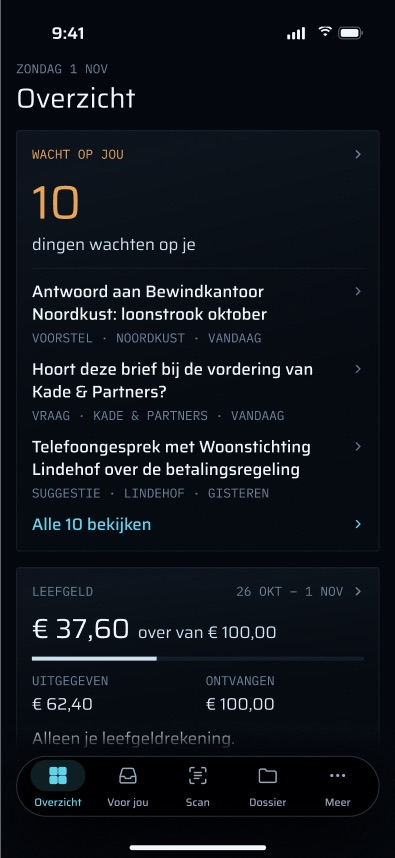
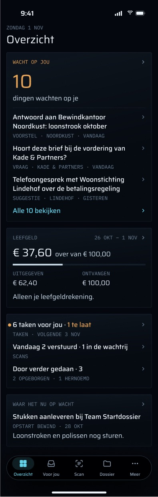
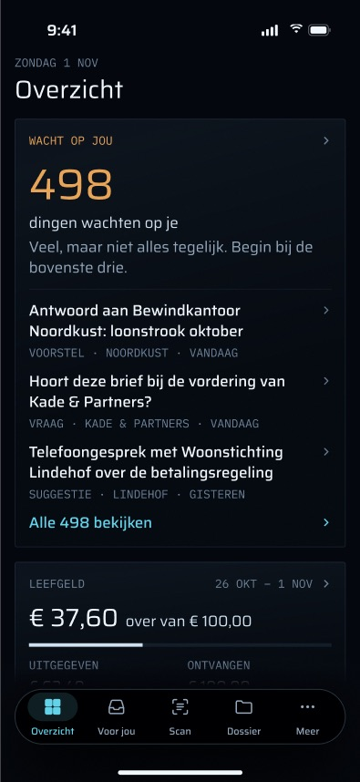
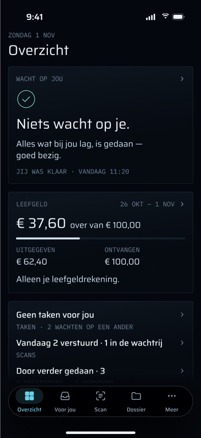
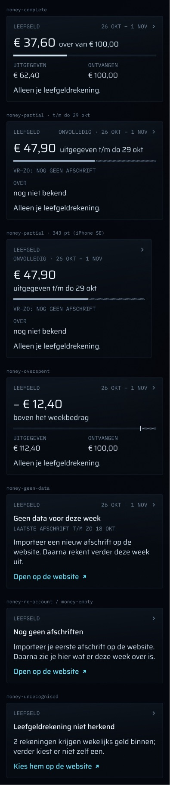
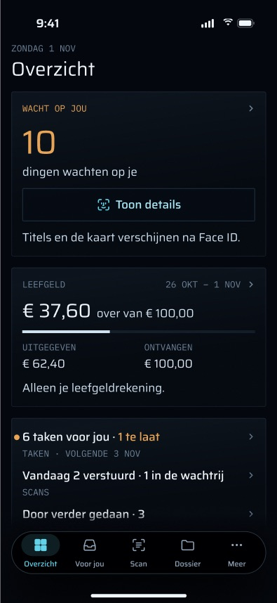
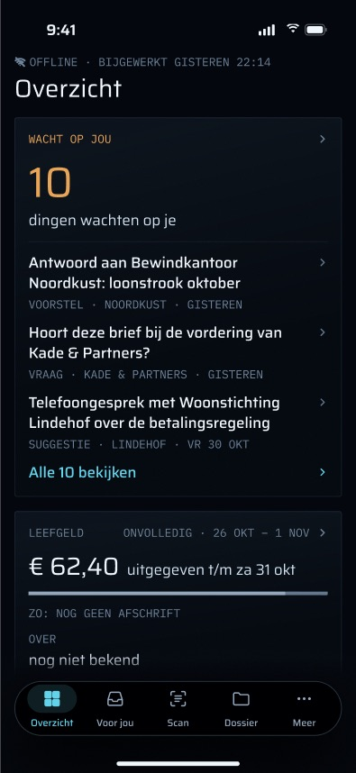
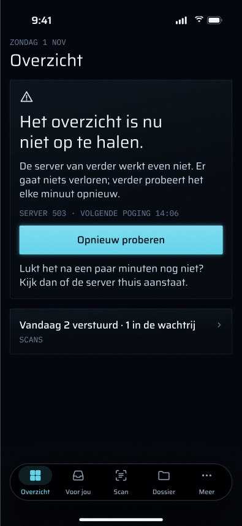
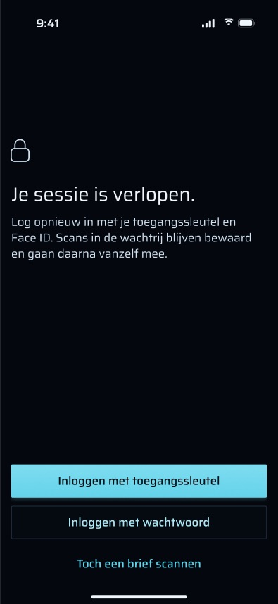

# Overzicht (start): functies

## Stand van de bouw

Geteld over elke functie in dit document die een statusregel heeft (2026-11-03, branch `feat/iphone-app` op `21426ad` plus de niet-gecommitte werkkopie):

- **Gebouwd: 48**
- **Deels gebouwd: 4**
- **Nog te bouwen: 6**

De drie belangrijkste dingen die nog gebouwd moeten worden:

1. **Het laatste overzicht op schijf bewaren** (zie "Laatst bekende overzicht na een koude start"). Nu leeft het overzicht alleen in het geheugen, dus een koude start zonder verbinding toont een foutkaart in plaats van het overzicht met zijn leeftijd. Principe 5 van de brief en het offline-frame ("bijgewerkt gisteren 22:14") gaan er allebei van uit dat het overzicht een herstart overleeft.
2. **De app-switcher-snapshot afdekken zolang de app vergrendeld is** (zie Privacy). Dit is de enige privacyregel uit de brief waarvoor helemaal geen code bestaat. Nu kan het laatste scherm van een vergrendelde app zichtbaar zijn in de app-switcher.
3. **Vanaf een vergrendelde telefoon in één stap scannen, en de wachtrij overal tonen** (zie "Gedeeld met de rest van de app"). Dit omvat de "Scan"-bediening in het Bedieningspaneel en op de Actieknop, het committen en meten van de nieuwe snelactie "Scan een brief", en de uploadwachtrij in de onderste accessoire van de tabbalk, die ook de rol van de scansrij zou overnemen als enige plek buiten Scan waar de wachtrij zichtbaar is.

De sectie "Regels die het volgt" somt randvoorwaarden op, geen functies. Die hebben geen status en worden niet meegeteld.

---

Overzicht is de tab waarop de iPhone-app opent. Het beantwoordt één vraag zonder een tik: *wacht er iets op mij, en hoe gaat de week?* Het is er voor Martin. Niemand anders gebruikt de app.

Dit document beschrijft wat het scherm doet, inclusief wat ontworpen en gespecificeerd maar nog niet gebouwd is. Het visuele ontwerp valt erbuiten (dat staat in Figma, sectie `overzicht · final`, node `341:18227`). Het is gebaseerd op de code op branch `feat/iphone-app` op commit `21426ad`, plus de niet-gecommitte werkkopie waar een functie dat vermeldt (de Overzicht-bestanden kwamen binnen in `312efc3`, het scherm voor een verlopen sessie in `1a18fb6`). De ontwerpbronnen zijn de definitieve frames hieronder, de spec `docs/superpowers/specs/2026-10-28-iphone-app-design.md`, de brief `docs/superpowers/specs/2026-11-01-iphone-design-brief.md` (§2 en de flowtabel in §3) en plan 3 `docs/superpowers/plans/2026-10-31-iphone-app-plan-3.md`. UI-teksten staan letterlijk zoals de app ze toont. Elke screenshot gebruikt de synthetische fixtureset (Noordkust, Kade & Partners, Lindehof), geen echte dossiergegevens.

Elke functie heeft precies één statusregel: **Gebouwd** (bestaat en werkt in de code, met het bestand erbij), **Deels gebouwd** (wat ontbreekt) of **Nog te bouwen** (wat ervoor nodig is).

## Doel

- Een alleen-lezen overzicht van de huidige stand van het dossier, in de volgorde "nu → straks → later". Van boven naar beneden: wat wacht op Martin, de leefgeldweek, taken, scans en "Door verder gedaan", en als laatste de kop van de kaart.
- **Op Overzicht wordt niets besloten.** Geen enkele rij keurt goed, verstuurt, archiveert of draait iets terug. Elke handeling ligt één tik verder, op het scherm dat erover gaat (Voor jou, Scan, Geld, de Tijdlijn). Niets op dit scherm schrijft naar de server, en niets erop maakt een ledger-event aan.
- **De telefoon rekent zelf geen enkel getal uit.** Het aantal wachtende items, de taakaantallen en de kop komen van de server. De geldbedragen zijn die van `leefgeld-week.ts`. De app verwoordt ze alleen en zet ze op het scherm (`HomeSummary`, `LeefgeldGlance`).

## Hoe je er komt, en waar het heen leidt

**Erheen:**

- **Opstarten.** `RootView` begint op `TabID.home`, de eerste tab, met het label "Overzicht".
  **Status:** Gebouwd — `apps/ios/Grip/App/RootView.swift` (`@State private var tab: TabID = .home`).
- **De tabbalk.** De tabs zijn Overzicht · Voor jou · Scan · Dossier · Meer. Alle vijf passen met hun labels op een iPhone SE (balk van 343 pt) en op 402 pt (frame `Overzicht_tab_bar_4_SE_en_402.jpg`).
  **Status:** Gebouwd — `RootView.swift` (systeem-`TabView` met vijf `Tab`s).
- **`grip://overzicht`.** `DeepLink.overzicht` verwijst naar de starttab, zonder stack. verder registreert geen URL-schema, dus deze link komt alleen binnen via de eigen kanalen van de app (de link van een push of de terugval hieronder), nooit vanuit een andere app.
  **Status:** Gebouwd — `apps/ios/Grip/Push/DeepLink.swift`.
- **Meldingen.** Een tik (of "Bekijken") op een push in categorie `SYSTEM` zonder link (bijvoorbeeld "verder hersteld" van de watchdog) valt terug op Overzicht (`NotificationRouter.fallback`).
  **Status:** Gebouwd — `apps/ios/Grip/Push/NotificationRouter.swift`.
- **Geen widget of snelactie opent Overzicht rechtstreeks.** De widgets openen `grip://inbox` of één item. De gecommitte snelactie ("Gesprek vastleggen") opent het spraakvenster. De werkkopie voegt een tweede toe, "Scan een brief", die Scan opent (zie "Gedeeld met de rest van de app").

**Eruit (elke tik):**

| Tik | Gaat naar |
|---|---|
| De kop "Wacht op jou" | Voor jou, op het beginscherm |
| Een voorbeeldrij | Voor jou, geopend op dat item (`InboxRoute(item)`). Lang indrukken biedt "Bekijken" (contextmenu), dat hetzelfde doet. |
| "Alle N bekijken" | Voor jou, op het beginscherm |
| De Leefgeld-kaart (of de "Geld"-kaart) | Geld (`GeldScreen`), op de eigen stack van Overzicht gezet achter `.lockGated(by:)` |
| Een berichtlink op de Leefgeld-kaart ("Open op de website", "Kies hem op de website") | `/money` van de webapp (`https://grip.vanderpoel.pro/money`), geopend buiten de app: de app claimt geen universal links (het associated domain is alleen `webcredentials:`) |
| De takenrij | Voor jou, op het beginscherm. De rij ontbreekt tot `/dashboard/summary` één keer heeft geantwoord. |
| De scansrij | De Scan-tab |
| "Door verder gedaan · N" | Voor jou → het scherm "Door verder gedaan" (`InboxRoute.doneByGrip`). Als er niets gedaan is, is de rij geen knop. |
| "Waar het nu op wacht" | De Tijdlijn onder Dossier (`dossierPath = [.timeline]`). Alleen zichtbaar als de app ontgrendeld is. |

**Status:** Gebouwd — `apps/ios/Grip/Home/HomeTab.swift` (de tikken, het contextmenu) en `RootView.swift` (`openInbox`, `openScan`, `openTimeline`).

Voor jou, Dossier, Meer en Geld zitten achter de vergrendeling; Scan niet. Een tik die op een vergrendeld scherm uitkomt terwijl de app vergrendeld is, komt eerst bij het vergrendelscherm. Het pad wordt in `RootView` vastgehouden, dus de bestemming opent zodra de app ontgrendeld is. Dit sluit aan bij het doel uit §3 van de brief: één tik van Overzicht naar het bovenste wachtende item (Face ID als de app vergrendeld is).

## Functies

### Kop

- **De datum.** De eyebrow toont de Amsterdamse dag in lange Nederlandse vorm ("zondag 1 nov"). De titel is "Overzicht" en is een VoiceOver-kop.
  **Status:** Gebouwd — `apps/ios/Grip/Home/HomeSummary.swift` (`eyebrow`), `HomeTab.swift` (`header`).
- **De leeftijd van het overzicht.** Als het overzicht op het scherm ouder is dan de laatste poging, zegt de eyebrow hoe oud het is:
  - na een serverfout: "zondag 1 nov · bijgewerkt 13:58";
  - offline: een `wifi.slash`-symbool en "offline · bijgewerkt gisteren 22:14".

  De leeftijd wordt bij weergave berekend tegen de klok van het dossier (`HomeSummary.age`/`stamp`), dus een overzicht dat sinds gisteren bewaard is, leest als dat van gisteren.
  **Status:** Gebouwd — `HomeSummary.swift` (`eyebrow`, `age`, `stamp`); tests in `GripTests/HomeSummaryTests.swift`.

### "Wacht op jou"

- **Eén definitie van "wacht op Martin".** `GET /api/mobile/v1/inbox` → `loadWaiting` in `packages/api/src/waiting.ts`. Die ene definitie omvat:
  - voorstellen en vragen met status `pending` (niet `drafting`, `draft-failed`, `approved` of `sending`: die wachten op verder);
  - suggesties die pending of needs-manual zijn en waarvan het document (als dat er is) niet weggegooid of definitief verwijderd is;
  - open taken en taken in uitvoering (naar effectieve status; `waiting` betekent wachten op iemand anders en telt niet mee);
  - de huidige halte van de kaart, als die `open` is en de taak ervan niet al in de lijst staat (één stuk werk telt één keer).

  `count` is de lengte van de lijst. Hetzelfde getal voedt Voor jou, de badge op het icoon en de widget, dus die drie kunnen het nooit oneens zijn.
  **Status:** Gebouwd — `packages/api/src/waiting.ts`, `apps/web/src/app/api/mobile/v1/inbox/route.ts`; tests in `waiting.test.ts`, `waiting-load.test.ts`.
- **De hero.** Het grote getal is het aantal, met daaronder "ding wacht op je" of "dingen wachten op je".
  **Status:** Gebouwd — `HomeSummary.swift` (`countCaption`, `waitingLine`), `HomeTab.swift`.
- **Het getal telt mee als het verandert.** Na een besluit elders (of een verversing) verandert het getal met een tellende overgang in plaats van een sprong, zodat Martin ziet dat er een item uit de wachtrij is verdwenen (brief §2.6, "Item leaves the queue after a decision"). Met Beperk beweging wisselt het getal gewoon.
  **Status:** Gebouwd — `HomeTab.swift` (`.contentTransition(.numericText())` op de hero).
- **Voorbeeldrijen** (alleen ontgrendeld). De eerste items in de volgorde van de **server**, nooit opnieuw gerangschikt op de telefoon:
  - normaal drie rijen;
  - twee op een scherm lager dan 700 pt (iPhone SE);
  - één bij de toegankelijkheidstekstgroottes.

  Elke rij toont de titel (hoogstens twee regels, behalve bij AX-groottes) en een metaregel: soort · ondertitel · leeftijd. De soort is "voorstel", "vraag", "suggestie", "taak" of "op de kaart". De ondertitel komt van de server: de partij bij een voorstel of vraag (of "Verder"), de soort suggestie ("Logboekregel", "Document", "Vaste last", "Vordering", "Taak"), de titel van de halte bij een taak die door een open halte gedragen wordt, en verder niets. De leeftijd is "vandaag", "gisteren" of "vr 30 okt", op basis van het `at` van het item in Amsterdamse dagen. Elke rij is een deeplink (zie "Eruit").
  **Status:** Gebouwd — `HomeSummary.swift` (`preview`, `previewLimit`, `previewMeta`), `HomeTab.swift`.
- **"Alle N bekijken"** verschijnt, als de app ontgrendeld is, wanneer er meer items zijn dan rijen.
  **Status:** Gebouwd — `HomeTab.swift`.
- **Vanaf 50 items**, alleen ontgrendeld, geeft een regel toestemming om bovenaan te beginnen: "Veel, maar niet alles tegelijk. Begin bij de bovenste drie." (of "twee", of "Begin bovenaan.", passend bij het aantal getoonde rijen).
  **Status:** Gebouwd — `HomeSummary.swift` (`manyHint`, `manyThreshold = 50`).

- **De rustige toestand.** Als er niets wacht, toont de kaart een vinkje, "Niets wacht op je." en "Alles wat bij jou lag, is gedaan — goed bezig." Het is een echte toestand, geen lege.
  **Status:** Gebouwd — `HomeSummary.swift` (`nothingWaiting`, `calmBody`), `HomeTab.swift` (`calm`).
- **Wanneer Martin het laatst klaar was.** Onder de tekst van de rustige kaart zegt een monoregel wanneer de lijst voor het laatst leeg raakte: "jij was klaar · vandaag 11:20" (altijd met de dag erbij, ook vandaag, omdat een kale tijd leest als een klok). De brief vraagt dat de lege toestand "the last moment something was handled" noemt. Zonder het moment van de server wordt de regel weggelaten, nooit geraden.
  **Status:** Deels gebouwd — de telefoonkant bestaat (`HomeSummary.clearedLine`, `InboxDTO.lastClearedAt`, `HomeSummaryTests.clearedLineCarriesItsDay`, fixture `calm/inbox.json`), maar geen enkele serverroute stuurt `lastClearedAt`. Ontbreekt: een definitie van het moment op de server (wanneer `loadWaiting` voor het laatst op nul kwam, of het nieuwste besluit over voorstellen, suggesties en statuswijzigingen van taken), het veld in `toInboxDTO` (`apps/web/src/lib/mobile-dto.ts`) en de inbox-route, en een routetest. Tot die tijd toont productie de regel nooit.

### Leefgeld

- **Bron.** `GET /api/mobile/v1/money/summary`. De route leest `money.glance` één keer en berekent dan `leefgeldWeek` voor deze week en voor de vorige week (als geheel beoordeeld). Configuratie:
  - `LEEFGELD_WEEKLY_CENTS`: alleen cijfers, anders "geen budget";
  - `LEEFGELD_IBAN`;
  - `LEEFGELD_WEEK_START`: ISO-weekdag, standaard maandag.

  **Status:** Gebouwd — `apps/web/src/app/api/mobile/v1/money/summary/route.ts`, `packages/api/src/leefgeld-week.ts`; tests in `leefgeld-week.test.ts` en de routetest.
- **De toestanden van de kaart**, uit `LeefgeldGlance.make`:

| Weektoestand | Wat de kaart toont |
|---|---|
| compleet | "€ 37,60 over van € 100,00", een balk voor wat er over is, kolommen "uitgegeven" / "ontvangen", voetnoot "Alleen je leefgeldrekening." |
| gedeeltelijk | Kop "onvolledig · 26 okt – 1 nov". De hero is wat er **uitgegeven** is: "€ 47,90 uitgegeven t/m do 29 okt". De niet-gedekte dagen zijn gearceerd, met een notitie als "vr–zo: nog geen afschrift". De enige kolom is "over", met "nog niet bekend". Het toont nooit wat er over is, en nooit "overschreden". |
| overschreden | "− € 12,40 boven het weekbedrag", de overschrijding gearceerd voorbij een streepje op 100 %. Niet amber. |
| geen data (de afschriften dekken de eerste dag van deze week niet) | "Geen data voor deze week", "laatste afschrift t/m zo 18 okt", "Importeer een nieuw afschrift op de website. Daarna rekent verder deze week uit." en de link "Open op de website". Nergens een bedrag. |
| geen rekening, niets geïmporteerd (ook geen data zonder leesbare boeking op de leefgeldrekening) | "Nog geen afschriften", "Importeer je eerste afschrift op de website. Daarna zie je hier wat er deze week over is." en "Open op de website". Dit wordt niet als fout getoond: er is nog niets om te herkennen. |
| geen rekening, wel afschriften (`LEEFGELD_IBAN` niet gezet en niet precies één rekening met bekend IBAN en een wekelijkse inkomstenlijn) | "Leefgeldrekening niet herkend" en hoeveel rekeningen wekelijks geld ontvangen ("Geen rekening krijgt wekelijks geld binnen.", "1 rekening …" of "2 rekeningen krijgen wekelijks geld binnen; verder kiest er niet zelf een.") plus "Kies hem op de website". |

  **Status:** Gebouwd — `apps/ios/Grip/Home/LeefgeldGlance.swift`, `HomeTab.swift` (`LeefgeldGlanceView`, `LeefgeldBar`); tests in `GripTests/LeefgeldGlanceTests.swift`.

- **De "Geld"-kaart als er geen weekbudget is ingesteld.** Geen Leefgeld-kaart. Ontgrendeld toont een "Geld"-kaart per rekening één regel voor de nieuwste maand met rijen ("…6789 · okt '26 · in € … · uit € …", met "deels" achter de maand als die maar gedeeltelijk gedekt is). Een maand zonder rijen wordt overgeslagen, nooit getoond als "€ 0,00". Vergrendeld vallen die regels (die een IBAN-staart bevatten) weg, dus verdwijnt de kaart. De brief noemt deze opmaak een open beslissing: er is geen Figma-frame voor, en er is een frame of Martins akkoord nodig.
  **Status:** Gebouwd — `LeefgeldGlance.swift`, `apps/ios/Grip/Money/MoneyGlance.swift`, `apps/web/src/lib/dashboard-money-slice.ts`.
- **"compleet" betekent gedekt tot en met vandaag**, of tot en met de laatste dag van de week zodra die voorbij is, dus een complete kaart kan midden in de week verschijnen. De vorige week (`previousWeek`, als geheel beoordeeld) zit in het antwoord, maar wordt op Geld getoond, niet op Overzicht.
  **Status:** Gebouwd — `packages/api/src/leefgeld-week.ts`.
- **De kaart houdt haar eigen dekking aan.** Een offline of verouderde eyebrow maakt een gedeeltelijke week nooit compleet.
  **Status:** Gebouwd — `LeefgeldGlance.swift`.

### Taken, scans en "Door verder gedaan" (één kaart)

- **Taken.** De aantallen komen uit `GET /api/mobile/v1/dashboard/summary` (`tasks.stats`). Let op: `tasks.stats` telt taken met `open`, `in-progress` **en** `waiting`, dus "N taken voor jou" kan groter zijn dan het aantal taken in "Wacht op jou" (dat `waiting` weglaat). "te laat" telt elk van die taken waarvan de `dueAt` verstreken is.
  - Titel: "6 taken voor jou", "1 taak voor jou" of "Geen taken voor jou".
  - Als er iets te laat is, krijgt de titel een amber "· 1 te laat" en een amber stip in de marge. De stip vervalt bij AX-groottes, waar het achtervoegsel naar een eigen regel gaat.
  - Meta: "taken · volgende 3 nov" (de vroegste nog komende `dueAt` onder de wachtende taken in de inbox). Zonder zo'n datum zegt het hoeveel er op een ander wachten ("2 wachten op een ander").

  **Status:** Gebouwd — `HomeSummary.swift` (`tasksRow`), `apps/web/src/app/api/mobile/v1/dashboard/summary/route.ts`, `packages/api/src/routers/tasks.ts` (`stats`).
- **Scans.** Deze rij leest de **eigen** uploadwachtrij van de telefoon (`QueueSummary`), dus blijft actueel als de server dat niet is:
  - normaal: "Vandaag 2 verstuurd · 1 in de wachtrij";
  - offline: "1 wacht op verbinding";
  - "N mislukt" als uploads mislukt zijn;
  - "Vandaag nog niets gescand" als er niets te melden is.

  **Status:** Gebouwd — `HomeSummary.swift` (`scansRow`), `apps/ios/Grip/Upload/UploadQueue.swift` (`QueueSummary`).
- **Door verder gedaan.** `doneByGrip` van de inbox-route omvat de laatste 7 dagen van wat verder zelf deed (`verderActions.list({ sinceDays: 7 })`).
  - Het toont alleen aantallen, dus is zichtbaar als de app vergrendeld is: "Door verder gedaan · 3" en "2 opgeborgen · 1 hernoemd" ("overig" voor elke andere soort).
  - Het is nooit amber.
  - Als er de laatste 7 dagen niets gedaan is, leest de rij "Door verder gedaan" met "verder deed niets zelf", en is ze geen knop.

  **Status:** Gebouwd — `HomeSummary.swift` (`doneCard`), `packages/api/src/routers/grip-actions.ts`.
- **Een verkeerde automatische archivering in twee tikken terugdraaien.** Het doel uit §3 van de brief is "Overzicht count → item → Ongedaan maken": de rij opent het scherm "Door verder gedaan", en elk item daar heeft een eigen "Ongedaan maken" (`POST /api/mobile/v1/grip-actions/[changeId]/undo`), alleen bij een automatische archivering. Een automatische naamgeving is daar nooit terug te draaien, omdat de naam ook op de NAS-share staat (`normalize-names --undo`). De brief vraagt daarnaast om een undo-toast van 5 s in plaats van een melding, en een `.impact(.light)`-haptic bij het terugdraaien.
  **Status:** Deels gebouwd — het pad van twee tikken en het terugdraaien bestaan (`apps/ios/Grip/Inbox/DoneByGripSection.swift`, de undo-route). Ontbreekt: de undo-toast van 5 s (R24), want het scherm toont in plaats daarvan inline "Ongedaan gemaakt.", en de `.impact(.light)`-haptic. Beide horen bij het scherm "Door verder gedaan", niet bij Overzicht.

### "Waar het nu op wacht" (de kop van de kaart)

- **De kop.** De bron is `/dashboard/summary` → `tracks.map()`, dezelfde aanroep die het webdashboard doet, gelezen via `currentStopId`. Het toont de titel van de halte, dan de titel van het spoor en de dag van `happenedAt` van de halte ("Opstart bewind · 28 okt"; elk deel vervalt als het ontbreekt), en dan de notitie van de halte als die er een heeft. Het is alleen ontgrendeld zichtbaar, omdat de titel van een halte dossierinhoud is. Zonder huidige halte is er geen kaart.
  **Status:** Gebouwd — `HomeTab.swift` (`headlineCard`), `HomeSummary.swift` (`headlineMeta`), `apps/web/src/lib/mobile-dto.ts` (`toDashboardSummaryDTO`).

### Verversen

- **Automatisch.** Het scherm ververst bij verschijnen, en daarna **elke 60 s** zolang het op het scherm staat (`HomeSummary.pollInterval`). De fouttekst belooft dit ("verder probeert het elke minuut opnieuw").
  **Status:** Gebouwd — `HomeTab.swift` (de `.task`-lus), `HomeSummary.swift` (`pollInterval = 60`).
- **Met de hand.** Omlaag trekken om te verversen doet hetzelfde. Elke verversing haalt de inbox, de dashboardsamenvatting en de geldsamenvatting tegelijk op.
  **Status:** Gebouwd — `HomeTab.swift` (`.refreshable`, `refreshAll`).
- **Bijwerkingen.** Een geslaagde verversing van de inbox doet ook het volgende:
  - de widgetsnapshot schrijven en de widgets herladen;
  - de badge op het icoon op het aantal van de server zetten.

  Een mislukte verversing verandert geen van beide. Een badge die door een dood netwerk op nul komt, zou liegen.
  **Status:** Gebouwd — `apps/ios/Grip/Inbox/InboxStore.swift`; tests in `GripTests/InboxStoreTests.swift`.
- **Ververst door een stille push.** Als het badge-aantal op de server verandert, stuurt `badge.sync` een stille `content-available`-push. De app ververst dezelfde inbox-store die Overzicht leest, zodat het overzicht, de badge en de widget al actueel zijn als Martin de app opent (spec §7.3). Niets hangt ervan af: iOS knijpt deze pushes af en wekt een geforceerd gesloten app nooit.
  **Status:** Gebouwd — `apps/ios/Grip/App/AppDelegate.swift` (`didReceiveRemoteNotification`), `apps/worker` `badge.sync`. Niet gemeten op de telefoon (zie "Bekende grenzen").

### Laatst bekende overzicht na een koude start

- **Wat het moet doen.** Principe 5 van de brief: "The phone renders from its last known state with the age stated." Na een koude start zonder verbinding toont Overzicht het laatste goede overzicht met "offline · bijgewerkt gisteren 22:14" in plaats van de kaart "Je bent nu offline.". Het offline-frame laat precies dit zien (een overzicht van gisteren).
  **Status:** Nog te bouwen — `InboxStore` en `MoneyStore` houden het laatste antwoord alleen in het geheugen, en de widgetsnapshot bevat alleen de bovenste vijf titels, niet het overzicht. Nodig: de inbox-, dashboard- en geld-DTO's naar de App Group geschreven met `.completeFileProtectionUntilFirstUserAuthentication`, samen met hun `fetchedAt`; bij het opstarten teruggelezen vóór de eerste fetch; gewist als de `SessionEpoch` eindigt (uitloggen en 401), net als de widgetsnapshot; de vergrendelregels ongewijzigd (titels vereisen nog steeds ontgrendelen); tests in `InboxStoreTests` voor teruglezen, wissen bij een nieuwe epoch en een mislukte verversing die de kopie op schijf behoudt. Geen serverwijziging.

## Toestanden

Elke toestand die §2.4 van de brief vereist heeft een frame (zie Frames), behalve het op schijf bewaarde offline-overzicht hierboven.

| Toestand | Wat er te zien is | Wat Martin kan doen | Status |
|---|---|---|---|
| Laden (eerste fetch) | Skeletons voor de kaarten "Wacht op jou" en Leefgeld, geen spinner | Wachten. Omlaag trekken om te verversen. | **Status:** Gebouwd — `HomeTab.swift` (skeletons, VoiceOver "Laden") |
| Ontgrendeld | Volledig overzicht | Alles uit de tabel hierboven | **Status:** Gebouwd — `HomeTab.swift` |
| Vergrendeld | Alleen aantallen en geld. In plaats van de voorbeeldrijen: "Toon details" (Face ID-symbool) en "Titels en de kaart verschijnen na Face ID." De kopkaart wordt helemaal niet opgebouwd. | Op "Toon details" tikken (roept `AppLock.unlock()` aan). Op een kaart tikken: alle kaarten behalve de scansrij leiden naar een vergrendeld scherm, dat daar om Face ID vraagt. | **Status:** Gebouwd — `HomeTab.swift` (`lockedReveal`), `Auth/AppLock.swift` |
| Niets wacht | De rustige kaart | — | **Status:** Gebouwd — `HomeTab.swift` (`calm`) |
| Eén item / veel | Zie de sectie "Wacht op jou" | — | **Status:** Gebouwd — `HomeSummary.swift` |
| Serverfout, overzicht bewaard | Een strook boven het bewaarde overzicht: "Overzicht nu niet op te halen.", een uitlezing als "server 503 · volgende poging 14:06" (of "te veel verzoeken" bij een 429), en "Opnieuw proberen". De eyebrow toont de leeftijd van het overzicht. | Opnieuw proberen, of wachten op de poll van de volgende minuut | **Status:** Gebouwd — `HomeSummary.swift` (foutmelding), `HomeTab.swift` |
| Serverfout, niets bewaard | Foutkaart: "Het overzicht is nu niet op te halen.", "De server van verder werkt even niet. Er gaat niets verloren; verder probeert het elke minuut opnieuw.", de uitlezing, een knop "Opnieuw proberen", en "Lukt het na een paar minuten nog niet? Kijk dan of de server thuis aanstaat." De scansrij blijft eronder staan. | Opnieuw proberen. Scan openen. | **Status:** Gebouwd — `HomeSummary.swift`, `HomeTab.swift` |
| Offline, overzicht bewaard | Het overzicht met de offline-eyebrow. Geen strook. Scans lezen "wacht op verbinding". | Alles opent nog steeds vanuit wat in het geheugen staat | **Status:** Gebouwd — `HomeSummary.swift` (`eyebrow`, `scansRow`) |
| Offline, niets bewaard | Foutkaart "Je bent nu offline.", "Zodra er weer verbinding is, haalt verder het overzicht op. Er gaat niets verloren; scans in de wachtrij gaan daarna vanzelf mee.", uitlezing "offline · volgende poging …". Er is geen stappenregel. | Opnieuw proberen. Scan openen. | **Status:** Gebouwd — `HomeSummary.swift`, `HomeTab.swift` |
| Sessie verlopen (een 401 van een willekeurige store terwijl ingelogd) | De hele tabbalk wordt vervangen door `SessionExpiredView`: "Je sessie is verlopen." en "Log opnieuw in met je toegangssleutel en Face ID. Scans in de wachtrij blijven bewaard en gaan daarna vanzelf mee." | "Inloggen met toegangssleutel", "Inloggen met wachtwoord", of "Toch een brief scannen" (de camera in een schermvullende cover) | **Status:** Gebouwd — `Auth/SessionExpiredView.swift`, `RootView.swift` |
| Grote tekst (AX-groottes) | Labels met een hoofdletter aan het begin in plaats van in hoofdletters. Eén voorbeeldrij. Meta opgesplitst in één feit per regel. Geen chevrons. Nederlandse zachte afbreekstreepjes in woorden van 10+ letters ("Bewind-kantoor"). Monolabels begrensd op AX3, het grote getal op AX4. | Scrollen | **Status:** Gebouwd — `HomeSummary.swift` (`hyphenated`, `previewMeta`), `HomeTab.swift` |
| Kleine telefoon (iPhone SE, < 700 pt hoog) | Twee voorbeeldrijen | — | **Status:** Gebouwd — `HomeSummary.swift` (`previewLimit`), `HomeTab.swift` (`onGeometryChange`) |

Een mislukte geld-fetch zonder bewaard antwoord verbergt de Leefgeld-kaart in plaats van een tweede fout aan Overzicht toe te voegen. Geld zelf zegt waarom.

"Bewaard" betekent **in het geheugen**. `InboxStore` en `MoneyStore` houden het laatste goede antwoord vast zolang het proces leeft. Geen van beide schrijft het naar schijf, dus een koude start zonder verbinding heeft niets bewaard en toont de kaart "niets bewaard". De widgetsnapshot op schijf wordt voor de widget geschreven en wordt door Overzicht niet teruggelezen. Dit veranderen is de functie "Laatst bekende overzicht na een koude start" hierboven.

## Privacy en beveiliging

- **Open als de app vergrendeld is, alleen aantallen.** Overzicht is `AppLock.Area.glance` en zit niet in `.lockGated(by:)` (Martin, 2026-11-01). Tot `lock.revealsCaseContent` toont het alleen:
  - het aantal wachtende items;
  - de aantallen voor taken, scans en "Door verder gedaan";
  - de leefgeldbedragen.

  Het toont nooit een titel, een partij, een notitie, de kop of een rekeningregel. De voorbeeldrijen worden zolang de app vergrendeld is niet eens opgebouwd. De Leefgeld-kaart noemt de *soort* rekening ("je leefgeldrekening"), nooit welke. De IBAN-regel hoort bij Geld.
  **Status:** Gebouwd — `Auth/AppLock.swift` (`Area.glance`), `HomeTab.swift`, `HomeSummary.swift` (`preview(revealed:)`); tests in `AppLockTests.swift`, `HomeSummaryTests.swift`.
- **Face ID één keer, uit zichzelf, bij openen en heropenen.** `RootView.promptOnOpen` vraagt erom bij een koude start en na meer dan 5 minuten op de achtergrond (`LockPolicy.graceSeconds = 300`). Een klok die achteruit loopt vergrendelt ook (fail closed). Het vraagt op elke tab die zichtbaar is, behalve Scan.
  - Ondertussen toont Overzicht zijn aantallen achter het venster.
  - Annuleren is geen fout. De prompt vraagt uit zichzelf hoogstens één keer per vergrendeling; daarna vraagt alleen een knop erom ("Toon details" hier, of de eigen knop van het vergrendelscherm op een vergrendelde tab).
  - Het beleid is `.deviceOwnerAuthentication`, dus de toegangscode werkt als Face ID dat niet doet.
  - Inloggen met wachtwoord of toegangssleutel telt als ontgrendeling (`didSignIn`).

  **Status:** Gebouwd — `RootView.swift` (`promptOnOpen`), `Auth/AppLock.swift` (`LockPolicy`, `unlock`).
- **App-switcher-snapshot afgedekt zolang de app vergrendeld is.** De brief (§3, Lock) vraagt dat de snapshot die iOS voor de app-switcher maakt niets van het dossier laat zien zolang de app vergrendeld is, zodat een titel die vlak voor het naar de achtergrond gaan zichtbaar was, niet in de switcher te lezen is.
  **Status:** Nog te bouwen — geen code in `apps/ios/Verder` dekt de scene af als die inactief wordt. Nodig: een `void`-afdekking in `RootView` bij `scenePhase == .inactive`/`.background` terwijl `lock.isLocked` (of op het punt staat te vergrendelen), weggehaald bij `.active`; ze mag de camera van Scan niet afdekken terwijl die in gebruik is; een test van de afdekregel naast `AppLockTests`.
- **Vergrendelscherm en widgets.** De verversing van Overzicht schrijft de widgetsnapshot:
  - de inhoud: aantal, bovenste titels, kop en leeftijd van het oudste item;
  - de bestandsbeveiliging: `completeFileProtectionUntilFirstUserAuthentication`, gemeten op het toestel.

  De families op het vergrendelscherm (accessory) tonen per constructie alleen aantallen. Titels in widgets op het beginscherm zijn `.privacySensitive()`.
  **Status:** Gebouwd — `Shared/WidgetSnapshot.swift`, `Widget/WidgetContent.swift`, `Widget/WidgetViews.swift`.
- **Sessie.** De sessiecookie van better-auth wordt in de Keychain bewaard (`AfterFirstUnlockThisDeviceOnly`). Elke route is `mobileGet`:
  - de sessie wordt gecontroleerd voordat een router draait;
  - een JSON-401 betekent geen sessie;
  - `cache-control: no-store`.

  **Status:** Gebouwd — `apps/web/src/lib/mobile-route.ts` (`mobileGet`), `Auth/SessionStore.swift`.
- **Uitloggen en 401.** `AuthModel.forgetLocally` beëindigt de `SessionEpoch`. Dat:
  - wist de inbox en de samenvatting uit het geheugen;
  - zet de badge op 0;
  - laat de geldsamenvatting vallen;
  - wist de widgetsnapshot.

  Een verversing die nog onderweg is, merkt dat de epoch verschoven is en schrijft niets terug. "Uitloggen" onder Meer wist ook het zakdossier. Een 401 van de server doet dat niet. De uploadwachtrij overleeft beide, en dat is wat "Scans in de wachtrij blijven bewaard" belooft.
  **Status:** Gebouwd — `Auth/AuthModel.swift`, `Auth/SessionEpoch.swift`; tests in `SessionEpochTests.swift`.

## Regels die het volgt

Dit zijn randvoorwaarden, geen functies. Ze hebben geen status en worden niet meegeteld.

- **Amber alleen voor wat op Martin wacht.** `HomeSummary.cardAmber` staat amber toe op de kaart "Wacht op jou" als het aantal groter is dan nul, en bij te late taken ("te laat" en de stip). Niets anders is ooit amber: geen geld (zelfs niet overschreden), niet "Door verder gedaan", niet de kop, niet de scans.
- **Rekeningen worden nooit samengevoegd.** `MoneyGlance` heeft geen totaal over rekeningen heen. De "Geld"-kaart zonder budget toont één regel per rekening.
- **Geen bedrag voor een niet-gedekte week.** `geen data` toont geen bedrag. Een gedeeltelijke week toont alleen wat er tot en met het laatste afschrift is uitgegeven, en "over" is "nog niet bekend".
- **AI-uitvoer is een suggestie. Niets wordt verstuurd zonder dat Martin de definitieve tekst goedkeurt.** Overzicht linkt alleen naar voorstellen en suggesties. Goedkeuren gebeurt op hun eigen schermen, achter de goedkeuringspoort.
- **De archiveringsuitzondering.** Wat verder zelf archiveerde of hernoemde, verschijnt als aantallen onder "Door verder gedaan". Archiveren zelf staat in productie uit (`DOCMETA_AUTO_APPLY` niet gezet), dus in de praktijk bevat het aantal de hernoemingen van de automatische naamgeving.

## Meldingen, haptics, beweging en toegankelijkheid

- **Overzicht stuurt geen meldingen.** Het zet wel de badge op het icoon bij elke geslaagde verversing (zie Verversen). Of de badge überhaupt het aantal wachtende items moet zijn, is een open beslissing in de brief (de HIG reserveert hem voor ongelezen meldingen).
- **Haptics.** Een `.error`-haptic speelt als "Opnieuw proberen" nog steeds mislukt (de inbox-fetch gaf opnieuw een fout), en als "Toon details" de app vergrendeld laat. Overzicht heeft geen ander haptisch moment in de kaart van §2.5 van de brief, omdat hier niets besloten wordt.
  **Status:** Gebouwd — `HomeTab.swift` (`.sensoryFeedback(.error, …)` op `failedRetries` en `failedUnlocks`).
- **Beperk beweging** wordt gerespecteerd: de animatie bij hoogteverandering wordt een korte ease-in-out in plaats van een veer.
  **Status:** Gebouwd — `HomeTab.swift` (`accessibilityReduceMotion`).
- **VoiceOver.** Elke voorbeeldrij is één element, voorgelezen in de volgorde van de brief: soort, titel, wie, "wacht op jou", leeftijd ("Voorstel, Antwoord aan Bewindkantoor Noordkust: loonstrook oktober, Noordkust, wacht op jou, vandaag"). De eyebrow leest als een zin ("Offline. Dit is de stand van …"), de rijen van de restkaart en de Leefgeld-kaart worden in hun geheel voorgelezen, en de titel en de kaartlabels zijn koppen.
  **Status:** Gebouwd — `HomeSummary.swift` (`rowAccessibilityLabel`, `Eyebrow.accessibilityLabel`, `Row.accessibilityLabel`), `LeefgeldGlance.swift` (`accessibilityLabel`), `HomeTab.swift`.
- **De tabbalk bij de grootste tekstgroottes.** De brief vraagt dat de tabbalk blijft werken met de grote-inhoudweergave van het systeem (een tab vasthouden om het label vergroot te zien).
  **Status:** Gebouwd — de systeem-`TabView` in `RootView.swift` levert dit. Niet gecontroleerd op de telefoon.
- **Ambient Holodek-beweging.** De brief staat langzame ambient beweging toe (`breathe`, `drift`, `sweep`, `halo`; hoogstens 0,2 Hz), alleen op Overzicht en het vergrendelscherm, nooit als drager van informatie, en volledig uit met Beperk beweging. De definitieve frames zijn statisch, dus er is nog geen beweging ontworpen.
  **Status:** Nog te bouwen — optioneel. Eerst is een ontwerpbeslissing nodig (welk element beweegt), dan een SwiftUI-animatie afhankelijk van `accessibilityReduceMotion`. Geen serverwijziging.

## Gedeeld met de rest van de app

Deze functies horen bij de hele app, niet alleen bij Overzicht. Ze staan hier omdat ze veranderen wat Martin vanuit Overzicht ziet, of omdat de scansrij van Overzicht nu hun plaatsvervanger is.

- **Het opstartscherm.** De brief (§3, Lock) vraagt om een effen `void`-opstartscherm zonder logo, zodat het eerste frame zonder flits overgaat in Overzicht.
  **Status:** Deels gebouwd — `project.yml` declareert `UILaunchScreen` zonder logo en met `UIUserInterfaceStyle: Dark`, maar `UIColorName` is leeg, dus het opstartscherm is het zwart van het systeem in plaats van `void` (#04070d). Nodig: een `void`-kleurset in `Resources/Assets.xcassets` (uit `Theme/Tokens.swift`) en `UIColorName` die ernaar verwijst.
- **Snelactie "Scan een brief".** Het app-icoon lang indrukken → "Scan een brief" opent Scan met de camera al actief, zonder Face ID (Scan zit niet achter de vergrendeling), via `grip://scan` (brief §3, Scan, R20).
  **Status:** Deels gebouwd — aanwezig in de niet-gecommitte werkkopie (`App/QuickAction.swift` `scanType`, `Push/DeepLink.swift` `.scan` met `opensCamera`, `project.yml` `UIApplicationShortcutItems`, `RootView.swift` `cameraRequested`). Ontbreekt: het committen, een `DeepLink`-test voor `grip://scan`, en een controle op de telefoon dat een koude start vanuit de snelactie de camera opent en dat er geen Face ID-prompt overheen komt.
- **"Scan"-bediening in het Bedieningspaneel en op de Actieknop.** Een bediening in het Bedieningspaneel (en toe te wijzen aan de Actieknop) die de camera rechtstreeks opent vanaf een vergrendelde telefoon: één handeling plus de pagina's (doel uit §3 van de brief: "1 + pages").
  **Status:** Nog te bouwen — er is nergens in `apps/ios` een `ControlWidget` of `AppIntent`. Nodig: een `ControlWidgetButton` met een `OpenIntent` in de `GripWidget`-extensie die `grip://scan` opent (de link en het cameraverzoek staan in de werkkopie, zie hierboven), en een test dat de link van de intent als `.scan` wordt geparsed.
- **Uploadwachtrij in de onderste accessoire van de tabbalk.** Zolang de wachtrij niet leeg is, toont een compacte strook boven de tabbalk (zichtbaar op elke tab, ook Overzicht) wat er wordt geüpload, wacht of mislukt is, met een pulssymbool tijdens het uploaden (brief §3, Upload queue, R4). De scansrij van Overzicht zou dan niet langer de enige plek buiten Scan zijn waar de wachtrij zichtbaar is.
  **Status:** Nog te bouwen — geen `.tabViewBottomAccessory` in `RootView.swift`. Nodig: de accessoire op de `TabView`, gevoed door `QueueSummary` van `UploadCenter`, alleen getoond als de wachtrij niet leeg is, met een tik naar Scan; een test van de toon/verberg-regel. Geen serverwijziging.
- **Live Activity terwijl 3 of meer scans worden verwerkt.** Als er drie of meer uploads onderweg zijn, toont een Live Activity op het vergrendelscherm en in het Dynamic Island hoe de wachtrij leegloopt, en eindigt die als de wachtrij leeg is (brief §3, Upload queue, R18). Alleen de update-animaties van het systeem.
  **Status:** Nog te bouwen — geen ActivityKit-code in `apps/ios`. Nodig: `ActivityAttributes` gedeeld tussen de app en `GripWidget`, een `ActivityConfiguration` in de widgetextensie, `NSSupportsLiveActivities` in de Info.plist van de app (`project.yml`), starten/bijwerken/beëindigen vanuit `UploadCenter` bij de drempel van 3+, en tests van de drempelregel. Geen serverwijziging.

## Bekende grenzen en wat niet gemeten is

- **Het overzicht wordt niet op schijf bewaard.** Zie "Laatst bekende overzicht na een koude start".
- **Verschillen tussen de code en het plan:**
  - Plan 3 Task 19 beschreef een "GELD"-kaart ("Leefgeld over deze week: € 37,60") met een actualiteitsaanduiding bij elk bedrag. De code tekent een "Leefgeld"-kaart (`LeefgeldGlance`) waarvan de enige actualiteitsaanduiding in de toestand `geen data` zit; een gedeeltelijke week draagt die als "t/m <dag>".
  - Het Task GAP-plan beschreef een kaart "Door verder gedaan" die na ontgrendelen de bovenste drie titels toont. De code toont in beide toestanden één rij met aantallen, en de definitieve frames ook.
- **Productie heeft nog geen bedragen.** Op 2026-11-01 bevatte productie 0 transacties en was `LEEFGELD_WEEKLY_CENTS` nog niet uitgerold (P3-D3 open), dus de live kaart is "Nog geen afschriften" of ontbreekt. `LEEFGELD_WEEK_START` blijft maandag tot een uitbetalingsweekdag gemeten kan worden.
- **Niet gemeten op de telefoon:**
  - de vertraging van de badge na een echt besluit, en of die een geforceerd gesloten app bereikt;
  - of een stille push het overzicht ververst voordat Martin de app opent;
  - Overzicht met productiegegevens;
  - de grote-inhoudweergave van de tabbalk;
  - de volledige controles uit spec §9 voor deze slices (Task 27, nog open).
- **De scansrij in de captures** komt uit `FixtureEnvironment.seedUploads` (launch-argument `-fixtures-scans`: 2 vandaag verstuurd, 1 in afwachting), omdat een live fixturewachtrij meteen zou uploaden.

## Waar in de code

**iOS (`apps/ios/Grip/`):**

- `Home/HomeTab.swift`: opmaak, verversingslus, skeletons, `LeefgeldGlanceView`, `LeefgeldBar`
- `Home/HomeSummary.swift`: elk woord, elke datum, elke telregel, de amberregel, de foutmelding en het afbreken
- `Home/LeefgeldGlance.swift`: de toestanden van de Leefgeld-kaart
- `Money/MoneyGlance.swift`: `MoneyStore`, `MoneyGlance`, `LeefgeldCard`. `Money/MoneyGlanceView.swift` bevat `GeldScreen`. `Money/MoneyModels.swift` en `Money/MoneyFormat.swift` bevatten de DTO's en de opmaak.
- `Inbox/InboxStore.swift`: ophalen van inbox en samenvatting, badge, widgetsnapshot
- `Inbox/InboxModels.swift`, `Shared/KindLabel.swift`
- `Inbox/DoneByGripSection.swift`: het scherm "Door verder gedaan" en het terugdraaien daarop
- `Upload/UploadQueue.swift`: `QueueSummary`
- `Auth/AppLock.swift`: `Area.glance`, `LockPolicy`
- `Auth/AuthModel.swift`, `Auth/SessionEpoch.swift`, `Auth/SessionExpiredView.swift`
- `App/RootView.swift`: tabs, routering vanuit Overzicht, prompt bij openen
- `App/AppDelegate.swift`: de verversing door een stille push
- `App/QuickAction.swift`: de snelacties op het beginscherm
- `Push/DeepLink.swift`, `Push/NotificationRouter.swift`
- `Widget/WidgetContent.swift`, `Widget/WidgetViews.swift`, `Shared/WidgetSnapshot.swift`
- Fixtures: `Fixtures/FixtureEnvironment.swift`; `FixtureData/{_shared,calm,one-item,voorjou-long,voorjou-many,loading,offline,offline-cached,server-error,server-error-cached,unauthorized,money-*}`

**Server:**

- `apps/web/src/app/api/mobile/v1/inbox/route.ts`
- `apps/web/src/app/api/mobile/v1/dashboard/summary/route.ts`
- `apps/web/src/app/api/mobile/v1/money/summary/route.ts`
- `apps/web/src/app/api/mobile/v1/grip-actions/[changeId]/undo/route.ts`
- `apps/web/src/lib/mobile-route.ts` (`mobileGet`), `apps/web/src/lib/mobile-dto.ts` (`toInboxDTO`, `toDashboardSummaryDTO`)
- `apps/web/src/lib/dashboard-money-slice.ts` (zes nieuwste maanden per rekening)
- `packages/api/src/waiting.ts`, `packages/api/src/routers/inbox.ts`, `packages/api/src/routers/tasks.ts` (`stats`), `packages/api/src/routers/grip-actions.ts`, `packages/api/src/leefgeld-week.ts`, `packages/api/src/money-series.ts`, `packages/api/src/amsterdam.ts`
- `apps/worker`: `badge.sync`, dat de stille push stuurt die het overzicht ververst

**Tests:**

- iOS: `GripTests/HomeSummaryTests.swift`, `GripTests/LeefgeldGlanceTests.swift`, `GripTests/InboxStoreTests.swift`, `GripTests/AppLockTests.swift`, `GripTests/SessionEpochTests.swift`, `GripTests/NotificationRouterTests.swift`, `GripTests/LeefgeldCardTests.swift`, `GripTests/MoneyFormatTests.swift`, `GripTests/FixtureTests.swift`, `GripTests/LinkDestinationTests.swift`, `GripTests/PasskeyAuthTests.swift`
- Server: `packages/api/src/waiting.test.ts`, `packages/api/src/waiting-load.test.ts`, `apps/web/src/lib/mobile-dto.test.ts`, `packages/api/src/leefgeld-week.test.ts`, `packages/api/src/money-series.real.test.ts` (het geldorakel), en de routetests naast elke `route.ts`

## Frames

| Frame | Toestand die het laat zien |
|---|---|
| [Overzicht_ontgrendeld.jpg](frames/Overzicht_ontgrendeld.jpg) | Ontgrendeld, 10 wachtend, drie voorbeeldrijen, complete leefgeldweek |
| [Overzicht_ontgrendeld_hele_pagina.jpg](frames/Overzicht_ontgrendeld_hele_pagina.jpg) | Hetzelfde, hele pagina: taken met "1 te laat", scans, "Door verder gedaan · 3", de kop van de kaart |
| [Overzicht_vergrendeld.jpg](frames/Overzicht_vergrendeld.jpg) | Vergrendeld: alleen aantallen en geld, "Toon details" |
| [Overzicht_laden.jpg](frames/Overzicht_laden.jpg) | Eerste keer laden: skeletons |
| [Overzicht_niets_wacht.jpg](frames/Overzicht_niets_wacht.jpg) | Rustig: "Niets wacht op je.", "jij was klaar · vandaag 11:20", "Geen taken voor jou" |
| [Overzicht_n_ding.jpg](frames/Overzicht_n_ding.jpg) | Eén item ("ding wacht op je") |
| [Overzicht_veel_498.jpg](frames/Overzicht_veel_498.jpg) | 498 wachtend, met "Veel, maar niet alles tegelijk." |
| [Overzicht_lange_titels.jpg](frames/Overzicht_lange_titels.jpg) | Lange titels en partijnamen: titels van twee regels, meta die alleen bij " · " afbreekt |
| [Overzicht_offline.jpg](frames/Overzicht_offline.jpg) | Offline met een bewaard overzicht ("bijgewerkt gisteren 22:14"); de leefgeldweek gedeeltelijk ("onvolledig") |
| [Overzicht_fout_met_cache.jpg](frames/Overzicht_fout_met_cache.jpg) | Server 503 boven een bewaard overzicht: de strook, "bijgewerkt 13:58" |
| [Overzicht_fout_eerste_keer_geen_cache.jpg](frames/Overzicht_fout_eerste_keer_geen_cache.jpg) | Server 503 zonder bewaard overzicht: de foutkaart plus de scansrij |
| [Overzicht_uitgelogd.jpg](frames/Overzicht_uitgelogd.jpg) | Sessie verlopen (`SessionExpiredView`) |
| [Overzicht_iPhone_SE.jpg](frames/Overzicht_iPhone_SE.jpg) | iPhone SE (375 × 667): twee voorbeeldrijen |
| [Overzicht_AX5.jpg](frames/Overzicht_AX5.jpg) | Grootste toegankelijkheidstekst: labels met beginhoofdletter, zachte afbreekstreepjes, één rij |
| [Overzicht_AX5_hele_pagina.jpg](frames/Overzicht_AX5_hele_pagina.jpg) | Hetzelfde, hele pagina |
| [Overzicht_leefgeld-kaart_varianten.jpg](frames/Overzicht_leefgeld-kaart_varianten.jpg) | De toestanden van de Leefgeld-kaart: compleet, gedeeltelijk (402 en 343 pt), overschreden, geen data, geen rekening / niets geïmporteerd, niet herkend |
| [Overzicht_tab_bar_4_SE_en_402.jpg](frames/Overzicht_tab_bar_4_SE_en_402.jpg) | De tabbalk op 343 pt (iPhone SE) en 370 pt (402-overzicht): alle vijf labels passen, gemeten aan de inkt van de labels |
