# Voor jou en "Door verder gedaan": functies

## Stand van de bouw

Gecontroleerd tegen de code op branch `feat/iphone-app` op 2026-11-04. Dit document beschrijft de VOLLEDIGE functieset van het scherm zoals de definitieve frames, de spec (`docs/superpowers/specs/2026-10-28-iphone-app-design.md` §7.2, §6.6, §12.9) en de ontwerpbrief (`docs/superpowers/specs/2026-11-01-iphone-design-brief.md` §2.1, §2.4–2.7 en de flowtabel in §3) die vastleggen. Elke functie heeft één statusregel, bepaald door de code te lezen.

| Status | Aantal |
|---|---|
| **Gebouwd** | 49 |
| **Deels gebouwd** | 5 |
| **Nog te bouwen** | 1 |

De drie belangrijkste dingen die nog gebouwd moeten worden:

1. **De serverkant van beslissen vanuit de lijst** (functies 16–18 en 21): de telefoon leest `approvable` (suggestie), `validNext` (taak) en `taskCount` (halte) al per inbox-item en biedt een veeg of menu-actie alleen aan als het veld er is. `toInboxDTO` / `waiting.ts` sturen ze nog niet, dus in productie zie je die acties pas als de server ze meestuurt.
2. **`lastClearedAt` in de inbox** (functie 39): de lege lijst zegt "Je rondde … het laatste af" zodra de server het stuurt.
3. **De halte opent** (functie 10): een link naar één halte op de Tijdlijn; tot dan heeft de halterij geen chevron.

---

Voor jou is de inbox van de iPhone-app: één lijst van alles wat op Martin wacht, gerangschikt door de server. Daaronder staat "Door verder gedaan", een lijst van wat verder zelf heeft gedaan, met ongedaan maken in één tik. Alleen Martin gebruikt de app.

Het visuele ontwerp valt hier buiten; dat staat in Figma (bestand `QDRL5zHNEOjPzLZqzd19Ii`, sectie `voorjou · final`, node `339:12478`), en de frames in `frames/` zijn daaruit geëxporteerd op 2026-11-03 met de synthetische fixture-dataset, niet met echte dossiergegevens. UI-teksten staan in het Nederlands geciteerd, precies zoals de app ze toont (of, bij een nog niet gebouwde functie, zoals het frame ze toont).

## Doel

- **Eén antwoord op "wat wacht er op mij?"** Voor jou toont openstaande voorstellen en vragen, open suggesties, de taken die Martin moet doen, en de huidige open halte van de kaart, in de volgorde van de server.
- **Overal één aantal.** De lijst, de badge op het icoon, de widgets, Overzicht en het webdashboard lezen allemaal dezelfde definitie, `loadWaiting` in `packages/api/src/waiting.ts`. Het icoon kan nooit 3 zeggen boven een lijst van 2.
- **Routinebeslissingen vanuit de lijst, de rest één stap dieper.** Zoals ontworpen wordt een ongewijzigde suggestie goedgekeurd en een taak afgerond met één veeg, en kunnen meerdere suggesties tegelijk worden beslist. Versturen hoort daar nooit bij: een voorstel wordt alleen vanaf zijn eigen scherm verstuurd, achter een verse Face ID. Vandaag wordt elke beslissing op het detailscherm genomen.
- **"Door verder gedaan"** is er om te controleren, niet om op te handelen. Het toont wat verder in de afgelopen 7 dagen zelf heeft opgeborgen of hernoemd, en biedt ongedaan maken aan waar de server dat toestaat.

## Hoe je er komt, en waar het heen leidt

### 1. Ingangen

- **De tabbalk:** het tweede tabblad, "Voor jou" (`TabID.voorJou`), na Overzicht, waarop de app opent.
- **Overzicht:** de kop "Wacht op jou", "Alle N bekijken" en de takenrij openen Voor jou op het hoofdniveau. Een voorbeeldrij opent dat item. "Door verder gedaan · N" opent het scherm "Door verder gedaan". Zie `../02-overzicht/FEATURES.md`.
- **Meldingen.** Een tik of "Bekijken" levert de `link` van de push af (`NotificationRouter`, `DeepLink`):
  - `verder://inbox` opent Voor jou op het hoofdniveau;
  - `verder://proposal/<uuid>`, `verder://suggestion/<uuid>` en `verder://task/<uuid>` openen Voor jou met het scherm van dat item erbovenop;
  - `verder://done-by-verder` opent het scherm "Door verder gedaan".

  Een push zonder link valt terug op zijn categorie: `VERDER_MAIL`, `CREDITOR_MAIL`, `PROPOSAL`, `REMINDER`, `FOLLOW_UP` en `TASK_DUE` openen Voor jou. Een `FILING`-push met als link `verder://inbox` (de auto-file-samenvatting van 19:00) wordt in plaats daarvan naar "Door verder gedaan" geleid.
- **Widgets.** Een tik op de widget opent zijn `widgetURL` (`verder://inbox`); bij de varianten die items tonen is elke rij een `Link` naar de `verder://`-link van dat item. Beide komen uit bij `RootView.onOpenURL`, dat dezelfde strikte `DeepLink.parse` toepast.
- **Het Weekoverzicht** (Meer) eindigt met "Naar Voor jou", dat de actuele lijst opent.
- **Er is geen URL-schema geregistreerd.** `verder://`-links werken alleen binnen een push of vanuit verders eigen widget. Geen webpagina of andere app kan er een afvuren.

**Status:** Gebouwd — `apps/ios/Verder/App/RootView.swift`, `Push/DeepLink.swift`, `Push/NotificationRouter.swift`, `Widget/WidgetContent.swift`.

### 2. Een deep link overleeft de vergrendeling

De Voor jou-stack (`inboxPath: [InboxRoute]`) wordt in `RootView` bewaard, niet in het tabblad. Het tabblad is vergrendeld (`.lockGated(by: lock)`), dus de inhoud ervan bestaat niet zolang de app vergrendeld is. Een link die binnenkomt terwijl de app vergrendeld is, zet het tabblad en `inboxPath` in `RootView` meteen; het scherm van het item wordt pas opgebouwd, en de gegevens pas opgehaald, zodra Face ID slaagt.

**Status:** Gebouwd — `App/RootView.swift`, `Auth/AppLock.swift`.

**Uitgangen (elke tik), zoals vandaag gebouwd:**

| Tik | Gaat naar |
|---|---|
| Een voorstelrij (antwoord of opvolging) | `ProposalScreen` (Plan 2): aanleiding, concept, Versturen / Aanpassen / Afwijzen |
| Een vraagrij | Hetzelfde `ProposalScreen`, dat de opties als knoppen toont plus "Iets anders…" |
| Een suggestierij | `SuggestionDetailView` |
| Een taakrij | `TaskScreen` (`TaskRowView.swift`) |
| De huidige halte van de kaart | Niets. De rij wordt getekend zonder chevron en is geen knop (de frames openen hem: functie 10). |
| Een soort die deze build niet kent | Niets. De rij wordt getekend, niet geopend. |
| "Door verder gedaan · N" | Klapt ter plekke open (een `DisclosureGroup`). Het is een sectie, geen link. |

## Functies

### De lijst

#### 3. Eén ophaalactie voedt de lijst

`GET /api/mobile/v1/inbox`. De route roept `caller.inbox.list()` (→ `loadWaiting`) en `caller.verderActions.list({ sinceDays: 7 })` samen aan, en antwoordt met `{ count, items, doneByVerder }`. `count` is de lengte van `items` op de server. Dezelfde ophaalactie, in de ene `InboxStore`, voedt ook de badge en de widget-snapshot.

**Status:** Gebouwd — `apps/web/src/app/api/mobile/v1/inbox/route.ts`, `apps/ios/Verder/Inbox/InboxStore.swift`.

#### 4. Eén definitie van "wacht op Martin"

Eén keer gedefinieerd in `waiting.ts` (spec §12.9):

- alleen voorstellen met `status = 'pending'`. Drafting, draft-failed, approved en sending wachten op verder, niet op Martin;
- suggesties die `pending` of `needs-manual` zijn, en niet bij een weggegooid of vernietigd document horen;
- taken waarvan de effectieve status `open` of `in-progress` is. Martin besliste op 2026-10-31 dat `in-progress` meetelt, omdat hij degene is die ermee bezig is. `waiting` betekent wachten op iemand anders en telt niet mee;
- de huidige open halte van de kaart, tenzij een getoonde taak er al voor staat. In dat geval draagt de taakrij de titel van de halte als ondertitel, zodat één stuk werk één keer telt.

**Status:** Gebouwd — `packages/api/src/waiting.ts` (`loadWaiting`, `WAITING_TASK_STATUSES`).

#### 5. De volgorde van de server, nooit herschikt

`waitingOnMartin` (puur): eerst voorstellen met Verder-prioriteit, dan de overige voorstellen en vragen (nieuwste eerst), dan suggesties (nieuwste eerst), dan taken (vroegste deadline eerst, zonder datum achteraan), dan de halte. Elk item draagt ook een `priority` (1 voor een Verder-voorstel of een taak die binnen 24 uur vervalt); dat is data voor de client en verandert deze volgorde niet, en de telefoon leest het niet. `VoorJouList.rows` neemt de array van de server één op één over (`InboxRankingTests.rendersServerOrderUnchanged`).

**Status:** Gebouwd — `packages/api/src/waiting.ts` (`waitingOnMartin`), `Inbox/VoorJouTab.swift` (`VoorJouList`).

#### 6. Titels komen van de server

Een vraag gebruikt zijn prompt. Een voorstel gebruikt zijn `ask`, of valt terug op "Voorstel van verder" / "Vraag van verder". Een suggestie gebruikt de voorgestelde samenvatting, naam, schuldeiser of titel, en daarna de documenttitel of het onderwerp van de mail.

**Status:** Gebouwd — `packages/api/src/waiting.ts`, `apps/web/src/lib/mobile-dto.ts` (`toInboxDTO`).

#### 7. Trekken om te verversen, en verversen bij terugkeer

Trekken om te verversen haalt opnieuw op. Het tabblad ververst ook wanneer het voor het eerst verschijnt en wanneer de stack terugkeert naar het hoofdniveau (`onChange(of: path)`), zodat wat op een detailscherm is beslist uit de lijst verdwenen is.

**Status:** Gebouwd — `Inbox/VoorJouTab.swift`.

#### 8. Eén rij per zaak

Elke rij leest als een vertrekbord (brief §1.1): wat het is, van wie het komt, hoe lang het al wacht, en of het op Martin wacht.

- **Soort:** een symbool per soort (antwoord, vraag, logboek, document, taak, halte) en het Nederlandse soortlabel: "voorstel", "vraag", "suggestie", "taak", "halte" in de frames ("op de kaart" in de code), "overig" voor een onbekende soort.
- **Wie / wat:** de partij met haar korte naam, zonder het woord voor het soort organisatie ("Bewindkantoor Noordkust" → "Noordkust", "Incassobureau Kade & Partners" → "Kade & Partners"; een gemeente houdt haar woord), "Verder", of voor een suggestie de partij waar die over gaat (veld `party`, nog niet door de server gestuurd) en anders het soort suggestie ("Logboek" voor de `Logboekregel` van de server, "Document"). Zo blijft "VOORSTEL · NOORDKUST" op één regel naast de leeftijd; VoiceOver leest de hele naam. Een halterij zegt hoeveel taken eraan hangen ("halte · 1 taak").
- **Deadline,** relatief waar dat helpt: "uiterlijk morgen".
- **Leeftijd,** rechts uitgelijnd: "vandaag", "gisteren", "31 okt", uit de `at` van het item.
- **Amber:** de stip staat op de Nu-rijen (voorstellen en vragen); de Kan wachten-rijen dragen hun soortsymbool. Het aantal in de kop draagt "wachten op jou" met zijn amberen stip, zodat de kleur nooit zonder woorden staat.
- Een chevron markeert een rij die opent.

**Status:** Gebouwd — soortsymbool per soort (suggesties naar hun ondertitel), titel, metaregel soort · wie of deadline, leeftijdskolom rechts, relatieve deadline ("uiterlijk morgen"), amber alleen op de Nu-rijen, chevron (`Inbox/VoorJouViews.swift` `VoorJouRowView`, `Inbox/VoorJouModel.swift`). Het label "halte · N taken" verschijnt zodra de server `taskCount` stuurt; `toInboxDTO` doet dat nog niet.

#### 9. Lange titels

De frames beperken een titel tot twee regels met een staart ("…"), en korten een lange bestandsnaam in het midden in, zodat de datum en de extensie zichtbaar blijven ("Loonstrook.2026-10.Atelier-Sterrenwacht.defin…Noordkust.pdf"). Aantallen worden nooit afgekapt.

**Status:** Gebouwd — twee regels met staart; een titel die een bestandsnaam is, wordt in het midden afgekapt (`VoorJouList.looksLikeFileName`). VoiceOver leest de hele titel (`accessibilityLabel`). Bij AX-groottes nooit afgekapt.

#### 10. De huidige halte van de kaart opent

In de frames heeft de halterij ("Stukken aanleveren bij Team Startdossier · halte · 1 taak") een chevron en opent die halte op de Tijdlijn, waar de status, notitie en bewijsstukken staan.

**Status:** Deels gebouwd — de halte wordt getoond en geteld (`waiting.ts`), en de Tijdlijn met zijn haltesheet bestaat (`Timeline/TimelineScreen.swift`, `verder://timeline`). Ontbreekt: `InboxRoute` geeft nil terug voor `.stop`, en er is geen link naar ÉÉN halte (`DeepLink` kent alleen `verder://timeline`). Nodig: een link `verder://stop/<uuid>` (of een `InboxRoute.stop`) die de Tijdlijn opent met de sheet van die halte, en een `LinkDestinationTests`-geval.

### De kop

#### 11. Aantal en actualiteit

"MAANDAG 2 NOV" als mono-bovenregel, de titel "Voor jou", dan het aantal als hoofdgetal met "wachten op jou" (enkelvoud "1 wacht op jou") en zijn amberen stip, en daaronder "bijgewerkt 14:02". Offline staat er "offline · bijgewerkt 14:02"; bij een serverstoring "laatste stand 14:02". Het getal telt mee wanneer een beslissing het verandert (functie 22).

**Status:** Gebouwd — `VoorJouHeader`: bovenregel, titel, hoofdgetal (de `count` van de server min de beslissingen die in hun undo-venster staan), enkelvoud/meervoud, "bijgewerkt" / "offline · bijgewerkt" / "laatste stand" (`VoorJouList.freshness`).

#### 12. Compacte titel tijdens het scrollen

Bij scrollen maakt de grote kop plaats voor een gecentreerd "Voor jou" met "• 498 wachten op jou" eronder, zodat het aantal zichtbaar blijft verderop in de lijst.

**Status:** Gebouwd — `VoorJouCompactHeader` verschijnt zodra de grote kop wegscrolt, en bij AX-groottes altijd.

#### 13. Secties: Nu en Kan wachten

"NU 2" bevat voorstellen en vragen; "KAN WACHTEN 496" bevat suggesties, taken en de halte. Elke sectie heeft zijn aantal. De splitsing herschikt niets: de volgorde van de server zet al elk voorstel en elke vraag vóór elke suggestie.

**Status:** Gebouwd — `VoorJouList.sections` splitst op soort zonder te herschikken; sectiekoppen met aantal, vastgepind tijdens het scrollen.

#### 14. 20 per sectie, dan "Toon alle"

Een lange sectie toont zijn eerste 20 rijen en zegt dat ("20 GETOOND"), met "Toon alle 496" om de rest te zien (brief §3: "most relevant first, offer view more").

**Status:** Gebouwd — alleen Kan wachten wordt afgekapt (20), met "20 GETOOND" en "Toon alle N"; Nu nooit.

#### 15. Selecteer

Een knop "Selecteer" in de kop opent de selectiemodus (functie 21).

**Status:** Gebouwd — getoond zodra er minstens drie suggesties zijn (`VoorJouList.selectMinimum`; bij twee zijn twee veegbewegingen sneller, en de frames tonen "Selecteer" alleen op de lange lijst en de SE), de lijst niet offline is en er geen beslissing in haar undo-venster staat (de toast heeft dan de onderkant van het scherm).

### Beslissen vanuit de lijst

Al deze acties roepen dezelfde routes aan als de detailschermen, dus een beslissing vanuit de lijst wordt precies zo vastgelegd als een vanaf een detailscherm: het oordeel, de bewerkingsdiff (leeg) en eventuele ledger-events. **Geen van alle verstuurt iets.** Voorstellen en vragen hebben in de lijst geen andere actie dan "Bekijken".

#### 16. Naar rechts vegen: Goedkeuren (een suggestie)

Een veeg vanaf de voorkant op een suggestie keurt hem goed zoals voorgesteld ("Goedkeuren"). Alleen voor een suggestie die ongewijzigd kan worden goedgekeurd: geen registry-item (alleen op het web), geen needs-manual-suggestie waarvan een verplicht veld leeg is.

**Status:** Deels gebouwd — de veeg bestaat (`.swipeActions`), wordt vastgehouden en daarna gepost met `{ edits: {} }`. Hij wordt alleen aangeboden als het item `approvable: true` draagt; de server stuurt dat veld nog niet (`toInboxDTO`), dus in productie verschijnt de veeg pas als dat erbij komt.

#### 17. Naar rechts vegen: Gedaan (een taak)

Een veeg vanaf de voorkant op een taak zet die op afgerond ("Gedaan"), **+1 `task.status`**.

**Status:** Deels gebouwd — de veeg "Gedaan" bestaat en wordt alleen aangeboden als `validNext` van het item `done` bevat; de server stuurt `validNext` nog niet in de inbox.

#### 18. Naar links vegen: Niet relevant

Een veeg vanaf de achterkant wijst een suggestie af ("Niet relevant"), zonder reden en **zonder ledger-event**. Op een taak betekent hetzelfde woord "laten vallen" (`dropped`, +1 `task.status`).

**Status:** Gebouwd voor suggesties (afwijzen zonder reden). Op een taak alleen met `validNext` ∋ `dropped` (serverveld nog niet gestuurd).

#### 19. Contextmenu's

Lang drukken opent een menu met de acties van de rij en "Bekijken":

- **suggestie:** Bekijken · Keur goed · Markeer als niet relevant;
- **taak:** Bekijken · Markeer als gedaan · Zet op bezig · Zet op wacht op een ander · Markeer als niet relevant — alleen de stappen die `validNext` toestaat (brief §3: `waiting` en `in-progress` bereikbaar vanuit het menu);
- **voorstel of vraag:** alleen Bekijken, met de regel "Versturen kan alleen in het voorstel zelf, met Face ID."

**Status:** Gebouwd — `.contextMenu` per soort; een voorstel of vraag toont alleen Bekijken en de regel over versturen. Taakstappen volgen `validNext` (`VoorJouMenu`).

#### 20. Haptiek bij de veegdrempel

Het passeren van de actiedrempel van een veeg geeft één `.selection`-tik, één keer per passage (brief §2.5).

**Status:** Nog te bouwen — de systeemveeg van SwiftUI meldt het passeren van de drempel niet aan de app; een eigen `.selection`-tik kan er dus niet aan hangen.

#### 21. Selectiemodus: meerdere suggesties tegelijk

"Selecteer" maakt van de lijst een selectie: "Annuleer · 3 geselecteerd · Alle 18 hier". Alleen suggesties kunnen worden aangevinkt; de Nu-sectie zegt "Alleen suggesties kun je samen afhandelen. Voorstellen, vragen en taken beslis je één voor één." De balk onderaan biedt "Niet relevant (3)" en "Keur 3 goed". Goedkeuren vraagt eerst bevestiging en noemt elk item: "3 suggesties goedkeuren? Telefoongesprek met …, Afschrift oktober … en Brief …. Daarna heb je 5 seconden om het ongedaan te maken." **Er is nooit een bulkverzending** (brief §5.6).

**Status:** Gebouwd — `VoorJouSelectionBar`, de Nu-uitleg, vinkjes alleen op suggesties, "Niet relevant (N)" / "Keur N goed" en een bevestiging die elke titel noemt; elke beslissing loopt via zijn eigen route, vastgehouden in één toast. Goedkeuren vraagt dat alle geselecteerde items `approvable` zijn.

#### 22. Beslist items verlaten de lijst

Na een beslissing schuift de rij weg en klapt in (0,25 s) en telt het aantal in de kop af (`.contentTransition(.numericText())`); met Beperk beweging vervaagt hij (brief §2.6).

**Status:** Gebouwd — een vastgehouden beslissing verbergt de rij met een animatie (crossfade bij Beperk beweging) en het aantal telt af (`.numericText()`).

#### 23. Overgang van rij naar detail

Een rij openen zoomt vanaf de titel van de rij in naar het detailscherm (veer 0,35 s, demping 0,86), met de lijst gedimd erachter; Beperk beweging geeft een crossfade van 0,2 s (brief §2.6).

**Status:** Gebouwd — `.navigationTransition(.zoom)` vanaf de rij; met Beperk beweging de standaard push.

### Ongedaan maken en mislukken

#### 24. Undo-toast, 5 seconden

Na een beslissing vanuit de lijst zegt een toast wat er gebeurde en biedt "Ongedaan maken" met een aftelling ("Goedgekeurd · Telefoongesprek met Woonstichting Lindehof … · nog 4 s"). Bij toegankelijkheidstekstgroottes groeit de toast en geeft het frame hem langer ("nog 8 s"). Een undo, geen waarschuwing (brief §3, R24).

**Status:** Gebouwd — `InboxDecisions` HOUDT de POST vast gedurende 5 s (8 s bij AX), "Ongedaan maken" verstuurt dus niets; naar de achtergrond gaan verstuurt meteen. `DecisionToastView` met aftelling en balk.

#### 25. Eén toast voor meerdere beslissingen

Twee beslissingen binnen één venster smelten samen tot één toast: "2 beslissingen · Laatste: Gedaan — Formulier bijzondere bijstand ondertekenen. Ook 1 goedgekeurd." met "Ongedaan maken" (de laatste) en "Bekijk beide".

**Status:** Gebouwd — beslissingen binnen één venster smelten samen ("2 beslissingen · Laatste: … Ook 1 goedgekeurd.") met "Bekijk beide" (`DecisionReviewSheet`).

#### 26. "NIET OPGESLAGEN": een mislukte beslissing, ter plekke bewaard

Wanneer een beslissing vanuit de lijst niet kan worden opgeslagen, blijft de rij staan waar hij stond, met een melding in de rij: "NIET OPGESLAGEN · Je goedkeuring is nog niet opgeslagen: de server van verder heeft een storing. Probeer het opnieuw zodra verder weer werkt." met "Opnieuw proberen" en "Goedkeuring intrekken". Haptiek bij mislukken `.error`.

**Status:** Gebouwd — een mislukte post zet de rij terug met `VoorJouNotSavedNotice`: oorzaak, "Opnieuw proberen" en "… intrekken"; haptiek `.error`.

### "Door verder gedaan"

Onder het opbergamendement (CLAUDE.md, Project laws; spec §6.6) mag verder zelf een document opbergen: het past de soort uit een document-meta-suggestie toe en zet de status op opgeborgen, nooit de titel. Het mag ook een document hernoemen (auto-name). Elke zulke wijziging is een `document_status_changes`-rij met `actor = 'verder'` en wordt in de ledger vastgelegd. **Automatisch opbergen staat bij oplevering UIT.** `DOCMETA_AUTO_APPLY` is in productie niet gezet, omdat de gemeten drempel geen beslist verleden had om op te slagen (Plan 3 Task 13). Vandaag bevat deze lijst daarom auto-name-hernoemingen.

#### 27. De sectie onderaan de lijst

Een ingeklapte sectie, "DOOR VERDER GEDAAN · N", onderaan de Voor jou-lijst, alleen getekend als er minstens één actie is. Nooit amber (`InboxRankingTests.doneByVerderIsNeverAmber`). Bron: dezelfde `/inbox`-aanroep, veld `doneByVerder` — `listVerderActions` over de afgelopen 7 dagen, nieuwste eerst, hooguit 200, gelezen uit de in de ledger vastgelegde wijzigingstabel, nooit uit de suggestie.

**Status:** Gebouwd — `DoneByVerderListSection`: kop met "BEKIJKEN ›" / "INKLAPPEN ⌄", in de lege lijst met samenvattingszin; nooit amber.

#### 28. Een eigen scherm

`InboxRoute.doneByVerder` (`DoneByVerderScreen`), geopend vanuit Overzicht, vanuit `verder://done-by-verder` en vanuit de samenvattingspush van 19:00. Het draagt de uitleg "Wat verder zelf heeft opgeborgen of hernoemd. Klopt iets niet? Wat hier kan, maak je met één tik ongedaan." Als er niets is gedaan, staat er "verder deed niets zelf."

**Status:** Gebouwd — `Inbox/DoneByVerderSection.swift`, `Inbox/VoorJouTab.swift`.

#### 29. Wat elke rij zegt

"Opgeborgen door verder" of "Hernoemd door verder" met de datum en tijd; de documenttitel; één regel per veld dat veranderde, afgeleid uit voor en na: "inbox → opgeborgen", "soort zonder soort → Brief", "naam … → …".

**Status:** Gebouwd — in de lijst als zin ("Opgeborgen als bankafschrift: …", "Hernoemd: … → …") met soort of "hernoemd" en de dag (`DoneByVerderList`); het eigen scherm houdt `DoneByVerderCopy`.

#### 30. Ongedaan maken in één tik

"Ongedaan maken" verschijnt alleen wanneer de server zegt dat de rij `undoable` is en hij nog niet ongedaan is gemaakt. Een tik roept `POST /api/mobile/v1/verder-actions/:changeId/undo` aan met een lege body, en de route weigert elk veld daarin. **Geen Face ID**, met opzet: een undo onthult niets en verstuurt niets. In één transactie, onder de vergrendeling per document, doet de server het volgende:

- hij voegt een Martin-rij (actor NULL) toe aan `document_status_changes`, die de status, titel en soort van vóór de wijziging van verder herstelt;
- hij voegt **+1 `document.updated`** ledger-event toe in de brede payloadvorm;
- als de wijziging uit een suggestie kwam, markeert hij de undo op de `final_payload` van die suggestie, als leersignaal.

Er wordt niets verwijderd of bijgewerkt in de bewijstabellen. Twee keer tikken is onschadelijk: de rij van de eerste undo is nieuwer, dus de tweede wordt geweigerd met "al aangepast" en voegt niets toe. Na een geslaagde undo of een 409 ververst de inbox. Meldingen: "Ongedaan gemaakt.", "Al aangepast of vernietigd — de lijst is bijgewerkt." (409), "Dit kan hier niet ongedaan worden gemaakt." (400) en "Log opnieuw in.".

**Status:** Gebouwd — `apps/web/src/app/api/mobile/v1/verder-actions/[changeId]/undo/route.ts`, `DoneByVerderModel` in `Inbox/DoneByVerderSection.swift`.

#### 31. Waarom er geen knop is

Wanneer een rij niet ongedaan kan worden gemaakt, zegt hij waarom; de server beslist en de telefoon toont alleen de reden van de server:

- "Ongedaan gemaakt", als het al gebeurd is;
- "Al aangepast — niet meer terug te draaien", als er sindsdien iets aan het document is veranderd;
- "Vernietigd", als het document definitief is verwijderd;
- "De naam staat ook op de NAS; terugdraaien gaat op de server", voor **elke auto-name**. De naam staat ook op de NAS-share, die de webcontainer niet koppelt, dus een undo alleen in de database zou de share en het dossier met elkaar laten verschillen. Een hernoeming wordt teruggedraaid met `pnpm --filter worker normalize-names --undo`.

**Status:** Gebouwd — `DoneByVerderCopy.note`, `packages/api/src/routers/verder-actions.ts`.

#### 32. Een toast na een undo, met een eigen undo

Na "Ongedaan maken" toont het frame een toast "Terug in Kan wachten · Afschrift september" met "Ongedaan maken" en een aftelling, en verschijnt de suggestie van het document weer in Kan wachten. Haptiek `.impact(.light)` (brief §2.5).

**Status:** Gebouwd (2026-11-04) — de undo vanuit de lijst wordt vastgehouden met een toast "Terug in Kan wachten" en een eigen "Ongedaan maken". Zolang die undo op de telefoon staat (vastgehouden of onderweg) staat het document in Kan wachten tussen de suggesties op zijn eigen datum (nieuwste eerst, waar de server het bij de volgende verversing zet), en volgen het hoofdgetal, het getal van Kan wachten en dat van "Door verder gedaan" mee (`VoorJouList.restoring` / `restoredItem` / `doneCount`), zoals het frame toont. Die rij heeft nog geen suggestie-id van de server en biedt dus geen beslissing aan (geen veeg, geen vinkje); een tik opent het document zelf (`InboxRoute.document`). De volgende verversing zet de rij van de server ervoor in de plaats. Haptiek `.impact(.light)`.

### Een item openen

Elke schrijfactie hieronder gaat door dezelfde tRPC-procedure die het web gebruikt. Een oordeel vanaf de telefoon wordt daarom precies zo vastgelegd als een oordeel op het web: het oordeel, de bewerkingsdiff en eventuele ledger-events.

#### 33. Voorstel of vraag → `ProposalScreen`

(Plan 2; het volledige gedrag hoort in het document van dat scherm.)

- `GET /api/mobile/v1/proposals/:id`.
- "Versturen" vereist een verse Face ID via `ApprovalGate`. Daarna roept het `POST …/proposals/:id/approve` aan met de definitieve tekst. De worker verstuurt later, en de uitgaande logboekregel en zijn `entry.created`-event worden pas geschreven nadat Gmail het bericht heeft geaccepteerd. **Er wordt niets verstuurd zonder dat Martin de definitieve tekst goedkeurt.**
- "Afwijzen" roept `POST …/proposals/:id/reject` aan met een optionele reden, die het leren voedt.
- Het antwoord op een vraag roept `POST …/proposals/:id/answer` aan met `{ revision, option }` (na een bevestiging van de gekozen optie) of `{ revision, freeText }`. Daarvoor is geen verse Face ID nodig, omdat het niets naar buiten verstuurt; de app-vergrendeling dekt het al. Het voorstel gaat naar `sent` met het oordeel `approved` (een optie) of `edited` (vrije tekst). Een optie voert een bestaande procedure uit op Martins caller: `set-task-status` → `tasks.setStatus`, **+1 `task.status`**; `link-document-to-debt` → een `debt_documents`-rij, geen ledger-event (schulden zijn geen bewijs); `create-task` → een `tasks`-rij, geen ledger-event bij het aanmaken; `none` → niets. Vrije tekst voert niets uit.

**Status:** Gebouwd — `Proposals/ProposalScreen.swift`, `Proposals/ApprovalGate.swift`, `apps/web/src/app/api/mobile/v1/proposals/[id]/`.

#### 34. Suggestie → `SuggestionDetailView`

- `GET /api/mobile/v1/suggestions/:id` geeft de soort, status, `proposed`, de aanleidende mail (van, onderwerp, datum), de EFFECTIEVE titel, soort en status van het document, en de opgehaalde verwijzingen terug.
- De velden per soort volgen de `/queue`-kaart op het web: logboekregel, document-meta (titel en soort), schuld en taak.
- **"Klopt zo"** roept `POST …/suggestions/:id/approve` aan met `{ edits }`, met daarin **alleen de velden die Martin heeft veranderd** (`SuggestionDetailTests.approveSendsOnlyChangedFields`). De server kiest de procedure op basis van de opgeslagen soort van de suggestie en bouwt `{ ...proposed, ...edits }` via het eigen schema van die procedure. Een onbekende bewerkingssleutel wordt geweigerd met 400. Het oordeel wordt vastgelegd als `approved`, of als `edited` wanneer er iets is veranderd. Wat er wordt toegevoegd, hangt af van de soort:
  - log-entry: een logboekregel, +1 `entry.created`;
  - document-meta: een `document_status_changes`-rij met status `filed`, +1 `document.updated`. Geweigerd met 409 ("weggegooid" / "vernietigd") als het document intussen is weggegooid of definitief verwijderd; de telefoon toont dan "Deze suggestie is al afgehandeld.";
  - debt: een `debts`-rij en **geen ledger-event** (schulden zijn geen bewijs);
  - task: een `tasks`-rij en geen ledger-event bij het aanmaken (alleen statuswijzigingen worden in de ledger vastgelegd).
- **"Aanpassen"** opent de bewerkbare velden. "Klaar met aanpassen" sluit ze. Een verplicht veld moet tekst bevatten voordat "Klopt zo" beschikbaar wordt.
- **"Niet relevant"** vraagt "Waarom? Niet verplicht — verder leert ervan." en roept daarna `POST …/suggestions/:id/reject` aan met een optionele reden van hooguit 2000 tekens. Het legt het oordeel `rejected` vast met de reden en voegt **geen ledger-event** toe.
- Een schuldsuggestie draagt de regel "Dit lijkt op een incassopartij — geen oordeel, wel goed om op de lijst te hebben."
- Uitkomsten: "Vastgelegd.", "Afgewezen.", "Deze suggestie is al afgehandeld." (409, een elders gegeven oordeel blijft staan), "verder weigerde dit. Controleer de velden." (400) en "Deze suggestie bestaat niet (meer)."

**AI-uitvoer is een suggestie.** Niets wat een model voorstelde komt in de ledger voordat Martin op "Klopt zo" tikt (of verder een document opbergt onder het opbergamendement, hierboven).

**Status:** Gebouwd — `Inbox/SuggestionDetailView.swift`, `apps/web/src/app/api/mobile/v1/suggestions/[id]/{route,approve,reject}`. (De markering "aangepast" uit de brief op bewerkte velden vóór het goedkeuren hoort in het eigen document van het suggestiescherm, `../05-vraag-suggestie-taak/`.)

#### 35. Een registry-item wordt op het web beslist

Een registry-item (Vaste last) heeft geen formulier op de telefoon. Het scherm zegt "Een vaste last leg je vast op de website: daar kies je de categorie." met een link "Open op de website" naar `/queue`, biedt geen "Klopt zo", en de approve-route antwoordt 409 "open op de website" als hij toch wordt aangeroepen. "Niet relevant" wordt nog wel aangeboden, dus een registry-item kan op de telefoon worden afgewezen.

**Status:** Gebouwd — `Inbox/SuggestionDetailView.swift`, `suggestions/[id]/approve/route.ts`.

#### 36. Taak → `TaskScreen`

- Er is geen route voor één taak. Het scherm leest `GET /api/mobile/v1/tasks` en kiest de taak op id. Elke taak draagt zijn effectieve status en `validNext`. Een taak die niet in de lijst staat, toont "Deze taak bestaat niet (meer)."
- Het toont "WACHT OP JOU" in amber wanneer de status `open` of `in-progress` is, daarna de titel, "taak · <status>", de deadline, de toegewezene en de details.
- "STATUS WIJZIGEN" biedt **alleen `validNext`** aan, het antwoord van de server uit dezelfde overgangsmatrix die `tasks.setStatus` afdwingt. De statussen zijn "open", "mee bezig", "wacht op iemand", "klaar" en "laten vallen".
- Eén tik opent de bevestiging "Status wordt: <status>", en een tweede tik bevestigt. Dan `POST /api/mobile/v1/tasks/:id/status` met `{ status }` → `tasks.setStatus` → **+1 `task.status`** ledger-event. De route is strikt: hij accepteert `status` en een optionele `note` (hooguit 2000 tekens, die de telefoon nooit stuurt), en weigert een `overrideReason` of een `taskId`, zodat de telefoon nooit een geblokkeerde overgang kan forceren. Het antwoord draagt de nieuwe `validNext`, zodat de knoppen opnieuw worden getekend zonder tweede verzoek.
- Een 400 (de stap is niet meer toegestaan) laadt de taak opnieuw en zegt "Die stap kan niet (meer). De taak is bijgewerkt."

**Status:** Gebouwd — `Inbox/TaskRowView.swift`, `apps/web/src/app/api/mobile/v1/tasks/route.ts`, `tasks/[id]/status/route.ts`. (De gesegmenteerde statusbediening uit de brief hoort in het eigen document van het taakscherm.)

## Staten

Brief §2.4: elke staat heeft een volgende stap, en geen frame is een doodlopende weg.

#### 37. Laden: een skelet

Vóór de eerste ophaalactie tekent de lijst grijze plaatshouderrijen in de vorm van de echte secties, zodat het eerste betekenisvolle frame binnen 100 ms op het scherm staat (brief §2.1: geen kale spinner waar een lijst zal verschijnen).

**Status:** Gebouwd — `VoorJouLoadingPage`: kop en grijze rijen in de vorm van de secties.

#### 38. De laatste lijst, bewaard over herstarts heen

De telefoon toont de laatst bekende lijst van schijf binnen 300 ms nadat het tabblad verschijnt, en ververst daarna ter plekke (brief §2.1, §1.5: offline is een ontworpen staat). Dit is wat de offline- en storingsframes na een koude start mogelijk maakt.

**Status:** Gebouwd — `InboxCache` (Application Support, `.completeFileProtection`, uitgesloten van back-up), geladen bij het maken van `InboxStore`, gewist door `SessionEpoch` en bij een 401. Fixtures `voorjou-offline` / `voorjou-storing` zaaien hem (`inboxCachedAt`).

#### 39. Leeg: niets wacht

"Niets wacht op je" als grote regel met een vinkzegel, dan "Goed bezig. Je rondde zaterdag 31 okt het laatste af. Komt er iets nieuws binnen, dan krijg je een melding." en "0 wachten · bijgewerkt 14:02". "Door verder gedaan" blijft bereikbaar, als samenvattingsregel ("3 dingen deed verder deze week zelf. …") met "Bekijken".

**Status:** Deels gebouwd — `VoorJouEmptyState` met zegel, kop, "Goed bezig…", "0 wachten · bijgewerkt" en de samenvatting van Door verder gedaan. De zin "Je rondde … het laatste af" verschijnt alleen als de server `lastClearedAt` stuurt; `toInboxDTO` doet dat nog niet.

#### 40. Offline over de laatste lijst

Een kaart "OFFLINE · Je ziet je laatste stand. Goedkeuren en afronden kan weer zodra je verbinding hebt.", de kop met "offline · bijgewerkt 14:02", en de Kan wachten-sectie gemarkeerd als "ALLEEN LEZEN · OFFLINE": acties die de server nodig hebben, zijn uitgeschakeld met de reden erbij, nooit stilzwijgend (brief §2.4).

**Status:** Gebouwd — kaart "OFFLINE", "offline · bijgewerkt", "ALLEEN LEZEN · OFFLINE" op Kan wachten; vegen uit, menu's zeggen waarom.

#### 41. Storing over de laatste lijst

Een kaart "STORING · De server van verder heeft een storing. Je ziet je laatste stand; er is niets verloren gegaan." met "Opnieuw proberen", en de kop met "laatste stand 14:02".

**Status:** Gebouwd — kaart "STORING" met "Opnieuw proberen", kop "laatste stand".

#### 42. Mislukken zonder iets om te tonen

"Voor jou laadt nu niet · De server van verder heeft een storing. Er is niets verloren gegaan." met "Opnieuw proberen" en "laatste poging 14:02 · serverfout 502".

**Status:** Gebouwd — `VoorJouFailurePage` met knop en "laatste poging 14:02 · serverfout 502".

#### 43. Sessie verlopen

Een 401 op `/inbox` of een detailaanroep laat de store de lijst en de samenvatting vergeten, de widget-snapshot wissen en de badge op nul zetten. `AuthModel.sessionRejected()` vervangt daarna de tabbladen door `SessionExpiredView`: "Je sessie is verlopen." met "Inloggen met toegangssleutel", "Inloggen met wachtwoord" en "Toch een brief scannen". Er flitst eerst geen lijst. Scans in de wachtrij blijven bewaard.

**Status:** Gebouwd — `Inbox/InboxStore.swift`; het scherm is het "Uitgelogd"-inlogscherm (`SignInView`, zie 01-inloggen 3.4). Het frame "Voor jou / sessie verlopen" (een slot-icoon met "Je sessie is verlopen" en één knop "Opnieuw inloggen" binnen het tabblad) is **bewust vervangen** door dat inlogscherm uit de auth-final frames (2026-11-04): een verlopen sessie geldt voor de hele app, niet voor één tabblad, dus er is één plek waar dat staat, met de inlogknoppen er direct op in plaats van een tussenstap. Martin kan dat terugdraaien.

#### 44. Vergrendeld

Het vergrendelscherm (`LockGate`) in plaats van het tabblad; Face ID of de toegangscode, waarna een openstaande deep link opent.

**Status:** Gebouwd — `Auth/AppLock.swift`, `Auth/LockView.swift`.

#### 45. Grote tekst, tot en met AX5

Elk lettertype schaalt mee met Dynamic Type en titels worden bij toegankelijkheidsgroottes nooit afgekapt. Bij AX5 stapelt de metaregel verticaal (soort, wie, deadline, leeftijd elk op een eigen regel) en worden aantallen nooit afgekapt (brief §2.7).

**Status:** Gebouwd — bij AX staat de metaregel per feit op een eigen regel, valt de goot weg, breekt geen woord midden in (`wholeWords`) en staat de compacte kop altijd bovenaan.

#### 46. Kleine telefoon (iPhone SE, 375 × 667)

Dezelfde lijst in één kolom, niets afgesneden.

**Status:** Gebouwd — `Inbox/VoorJouTab.swift` (één kolom met een marge van 16 pt).

## Toegankelijkheid

#### 47. VoiceOver leest één rij als één zin

Eén element per rij, voorgelezen in de volgorde soort, titel, wie, "wacht op jou", leeftijd — bijvoorbeeld "Voorstel, antwoord aan Regio 3, wacht op jou, 2 dagen". De schermtitel is een kop.

**Status:** Gebouwd — één element per rij met `VoorJouList.accessibilityLabel` (soort, titel, wie, "wacht op jou", leeftijd); titel en sectiekoppen zijn koppen.

#### 48. Veegacties als VoiceOver-acties

Elke veeg- en contextmenuactie is ook een aangepaste VoiceOver-actie op de rij (brief §2.7), zodat niets van een gebaar afhangt.

**Status:** Gebouwd — elke veeg- en menuactie is ook een `.accessibilityActions`-actie; de toast heeft "Ongedaan maken" als actie.

## Privacy en beveiliging

#### 49. Face ID bewaakt het tabblad; alleen versturen vraagt opnieuw

Voor jou is vergrendeld. De app vraagt om Face ID (of de toegangscode) bij een koude start en na meer dan 5 minuten op de achtergrond (`LockPolicy.graceSeconds = 300`). Overzicht en Scan openen zonder, maar Overzicht toont tot het ontgrendelen alleen aantallen en geld. Binnen Voor jou vraagt het versturen van een voorstel altijd om een **verse** Face ID (`ApprovalGate`), ook terwijl de app ontgrendeld is; een suggestie goedkeuren of afwijzen, een taakstatus wijzigen, een vraag beantwoorden en een actie van verder ongedaan maken vragen geen verdere Face ID. Geen van alle verstuurt iets naar buiten.

**Status:** Gebouwd — `Auth/AppLock.swift`, `Proposals/ApprovalGate.swift`.

#### 50. Vergrendelscherm, meldingen en widgets tonen geen dossierinhoud

- Met verborgen voorvertoningen luidt een melding alleen "Nieuw bericht van verder": geen titel, geen afzender.
- "Bekijken" (`OPEN`, op `PROPOSAL`, `REMINDER` en `FOLLOW_UP`) is `.foreground` en `.authenticationRequired`. Het opent het item achter de vergrendeling en verstuurt nooit.
- De antwoordknoppen van een vraag (categorieën `q.<id>`) vereisen authenticatie. Ze draaien op de achtergrond, omdat een antwoord niets verstuurt.
- De widgetvarianten voor het vergrendelscherm tonen alleen aantallen. Titels op het beginscherm zijn gemarkeerd als `.privacySensitive()`. De widget leest `widget/snapshot.json` in de App Group: het aantal, de bovenste vijf items (soort, id, titel), de kop van de kaart en de leeftijd van het oudste item. De app schrijft het na elke geslaagde verversing met `.completeFileProtectionUntilFirstUserAuthentication` (gemeten op het toestel: `NSFileProtectionCompleteUntilFirstUserAuthentication`). Een mislukte verversing laat de oude snapshot staan, en de widget laat die na 24 uur verlopen ("Open verder om bij te werken").

**Status:** Gebouwd — `Push/NotificationCategories.swift`, `Push/QuestionCategories.swift`, `Shared/WidgetSnapshot.swift`, `Widget/WidgetContent.swift`.

#### 51. Er blijft niets van het dossier achter nadat de sessie eindigt

Op de telefoon: de inboxlijst en de samenvatting staan alleen in het geheugen; de widget-snapshot is het enige bestand op schijf; de sessiecookie staat in de Keychain (`AfterFirstUnlockThisDeviceOnly`). Bij uitloggen of een geweigerde sessie wist `AuthModel.forgetLocally()` de cookie, beëindigt de `SessionEpoch` (elke store laat zijn dossierinhoud vallen, en de badge gaat naar 0), wist de widget-snapshot en laadt de widgets opnieuw. Een verversing die nog onderweg is wanneer de sessie eindigt, schrijft niets terug, omdat de epoch-controle vóór elke schrijfactie draait. De telefoon intrekken in `/settings/security` beëindigt zijn sessie; de volgende aanroep antwoordt 401, en `notify()` stopt met pushen naar het toestel. (De lijst op schijf uit functie 38 moet hierbij aansluiten wanneer die gebouwd wordt.)

**Status:** Gebouwd — `Inbox/InboxStore.swift`, `Auth/AuthModel.swift`, `apps/worker/src/notify/notify.ts`.

## Regels waaraan dit scherm zich houdt

- **Er wordt niets verstuurd zonder dat Martin de definitieve tekst goedkeurt,** achter een verse Face ID, en alleen op `ProposalScreen`. Geen lijstrij, veeg, menu of meldingsactie verstuurt. Er is geen bulkverzending. Het bulkgoedkeuren in het ontwerp is alleen voor suggesties.
- **Amber alleen voor wat op Martin wacht.** "Door verder gedaan" is nooit amber.
- **Eén definitie van wachten,** op de server. De telefoon telt, filtert of herschikt nooit.
- **AI-uitvoer is een suggestie.** Het wordt pas bewijs bij "Klopt zo" (of het "Goedkeuren" van de lijst, dat dezelfde route aanroept). Het voorstel van het model, het oordeel en de bewerkingsdiff worden allemaal vastgelegd.
- **Het opbergamendement.** verder mag een document alleen zelf opbergen wanneer de gemeten drempel wordt gehaald. Dat staat vandaag uit. Elke zulke wijziging staat hier vermeld en is in één tik ongedaan te maken. Auto-name-hernoemingen staan er ook, maar worden op de server teruggedraaid.
- **Wat de telefoon niet mag:**
  - een taakovergang forceren;
  - een registry-item goedkeuren;
  - beslissen of een actie van verder ongedaan kan worden gemaakt.

## Meldingen, badge en haptiek

Voor jou maakt zelf geen meldingen. Het is waar ze naartoe leiden.

#### 52. De badge is het aantal van de server

`badge.sync` (worker, elke 5 minuten) pusht alleen wanneer het aantal verandert. Het stuurt twee pushes, omdat Apple een badge op een achtergrondpush verbiedt: een alert-type `{aps:{badge:N}}`, die ook een geforceerd gesloten app bereikt; en een achtergrondpush met `content-available`, naar beste vermogen. `notify()` zet de badge ook bij elke melding en leest het aantal daarbij zelf. De app zet de badge na elke geslaagde verversing op de `count` van de server; een mislukte verversing laat hem met rust ("a badge zeroed by a dead network is a badge that lies").

**Status:** Gebouwd — `apps/worker/src/badge-sync.ts`, `apps/worker/src/notify/notify.ts`, `Inbox/InboxStore.swift`.

#### 53. Een stille push ververst de lijst

De achtergrondpush met `content-available` wekt `AppDelegate`, die dezelfde `InboxStore.refresh()` aanroept. Die verversing werkt de lijst, de badge en de widget tegelijk bij.

**Status:** Gebouwd — `App/AppDelegate.swift`, `Inbox/InboxStore.swift`.

#### 54. De dagelijkse samenvatting

`autofile.digest` (19:00 Amsterdamse tijd) stuurt één passieve `FILING`-push met alleen aantallen, en alleen op dagen waarop verder iets heeft gedaan. Een tik opent "Door verder gedaan".

**Status:** Gebouwd — `apps/worker/src/autofile-digest.ts`, `Push/NotificationRouter.swift`.

#### 55. Haptiek

Brief §2.5: suggestie goedgekeurd of taakstatus gewijzigd (ook vanuit een veeg) `.success`; een afwijzing `.impact(.soft)`, omdat afwijzen geen mislukking is; een veeg die zijn drempel passeert `.selection`; een undo in "Door verder gedaan" `.impact(.light)`; een mislukte beslissing `.error`, met het opnieuw proberen in de rij. Allemaal overgeslagen wanneer systeemhaptiek uit staat; niets hangt ervan af.

**Status:** Gebouwd voor de lijst — `.success`, `.impact(.soft)` (afwijzen), `.error` (mislukt, en een mislukte verversing), `.impact(.light)` (undo in Door verder gedaan). Nog te bouwen: de drempeltik `.selection` (zie 20) en de detailschermen.

## Offline gedrag en synchronisatie

- Er is geen offline wachtrij voor beslissingen, en er is er ook geen ontworpen: goedkeuren, afwijzen, een taakstatus en een undo hebben allemaal de server nodig op het moment van de tik. Offline zegt het detailscherm "Geen verbinding met verder. Probeer het opnieuw." en wordt er niets vastgelegd. De ontworpen offlinestaat (functie 40) maakt dit zichtbaar door de acties uit te schakelen met de reden erbij; "Niet opgeslagen" (functie 26) dekt een beslissing die na de tik mislukte.
- De lijst op het scherm is de laatste geslaagde ophaalactie in dit proces. Hij wordt niet over herstarts heen bewaard totdat functie 38 gebouwd is. Het zakdossier (tabblad Dossier) is de offline opslag. Voor jou is dat niet.

## Bekende beperkingen en wat niet gemeten is

- **Niet gemeten:** de vertraging van de badge na een echte beslissing, en of die badgepush een geforceerd gesloten app bereikt (Plan 3 Task 9 stap 2). Dat wacht op een suggestie die Martin echt wil beslissen; er wordt niets goedgekeurd voor een test.
- **Gemeten:** het badgeaantal kwam overeen met Voor jou, het web en het icoon (498, 2026-10-31). Een vraagpush toonde "Ja / Nee" bij lang drukken op iOS 27.2, dus een categorie die binnen de service-extensie wordt geregistreerd, werkt voor diezelfde melding. Een tik op een vraag waarvan het voorstel niet bestaat, opende "Dit voorstel bestaat niet (meer).".
- Automatisch opbergen staat uit, dus het undo-pad voor auto-file heeft unit- en routetests maar nog geen gebruik in productie.
- Registry-items kunnen op de telefoon niet worden goedgekeurd (alleen afgewezen).
- De suggestieroute geeft `retrievedRefs` terug, maar het suggestiescherm op de telefoon toont ze niet.
- Het taakscherm haalt de hele takenlijst op om één taak te tonen.
- `/settings/security` toont de telefoon als "Onbekend apparaat", omdat de apparaatnaamparser van het web zijn user agent niet herkent.

## Waar in de code

**iOS (`apps/ios/Verder/`):**

- `Inbox/VoorJouTab.swift`: het tabblad, `InboxRoute`, `VoorJouList` (rijen, amber, lege tekst) en de foutteksten.
- `Inbox/InboxStore.swift`: de ene ophaalactie (`/inbox` plus `/dashboard/summary`), `fetchedAt`/`attemptedAt`, de widget-snapshot, de badge, en het vergeten bij een 401 of het einde van de sessie.
- `Inbox/InboxModels.swift`: `WaitingItem`, `WaitingKind` (een onbekende soort decodeert als `.other`), `VerderAction`, `InboxDTO` (met `lastClearedAt`, dat de server nog niet stuurt), `SuggestionDTO`, `TaskDTO` en `DashboardSummaryDTO`.
- `Inbox/SuggestionDetailView.swift`: `SuggestionDetailModel` en de kaart per soort.
- `Inbox/TaskRowView.swift`: `TaskModel` en `TaskScreen`.
- `Inbox/DoneByVerderSection.swift`: `DoneByVerderCopy`, `DoneByVerderModel` (undo), de sectie, het scherm en de rij.
- `Proposals/ProposalScreen.swift`, `Proposals/ProposalModel.swift` en `Proposals/ApprovalGate.swift`: het voorstel- en vraagscherm, en de verse Face ID bij versturen.
- `App/RootView.swift` (het tabblad, `inboxPath`, afhandeling van deep links), `App/AppDelegate.swift` (verversen bij een stille push), `Push/DeepLink.swift`, `Push/NotificationRouter.swift`, `Push/NotificationCategories.swift`, `Push/QuestionCategories.swift`, en `Auth/AppLock.swift` plus `Auth/LockView.swift` (`lockGated`).
- `Shared/WidgetSnapshot.swift` (het App Group-bestand, zijn beschermingsklasse, wissen) en `Widget/WidgetContent.swift` (wat elke variant tekent, privacygevoelige titels).
- `Fixtures/` en `FixtureData/{voorjou-few,voorjou-long,voorjou-many,empty,loading,offline,offline-cached,server-error,server-error-cached,unauthorized,one-item}`: de synthetische datasets waaruit de frames zijn getekend, voor simulatorcaptures van elke staat hierboven.

**Server:**

- `apps/web/src/app/api/mobile/v1/inbox/route.ts`
- `apps/web/src/app/api/mobile/v1/suggestions/[id]/route.ts`, `…/approve/route.ts` en `…/reject/route.ts`
- `apps/web/src/app/api/mobile/v1/tasks/route.ts` en `tasks/[id]/status/route.ts`
- `apps/web/src/app/api/mobile/v1/verder-actions/[changeId]/undo/route.ts`
- `apps/web/src/app/api/mobile/v1/proposals/[id]/{route,approve,reject,answer,task}`
- `apps/web/src/lib/mobile-dto.ts` (`toInboxDTO`)
- `packages/api/src/waiting.ts` (`waitingOnMartin`, `loadWaiting`, `WAITING_TASK_STATUSES`)
- `packages/api/src/routers/verder-actions.ts` (lijst, ongedaan-maakbaarheid, undo)
- `packages/api/src/routers/suggestions.ts`, `packages/api/src/routers/tasks.ts` en `packages/api/src/task-status.ts` (de overgangsmatrix)
- `apps/worker/src/badge-sync.ts`, `apps/worker/src/autofile-digest.ts`, `apps/worker/src/auto-file.ts` en `apps/worker/src/notify/notify.ts`

**Tests:**

- iOS:
  - `VerderTests/InboxRankingTests.swift`: volgorde van de server, nooit-amberen gedaan-rijen, routes per soort, lege tekst;
  - `VerderTests/InboxStoreTests.swift`: snapshot, badge, mislukte verversing behoudt beide, 401 wist, onbekende soort;
  - `VerderTests/SuggestionDetailTests.swift`: alleen veranderde velden, gewiste soort als null, registry-item, reden bij afwijzen, 409, taak-`validNext`;
  - `VerderTests/DoneByVerderTests.swift`: undo met lege body, een niet-ongedaan-te-maken rij wordt nooit gepost, conflict ververst;
  - `DeepLinkTests`, `LinkDestinationTests`, `NotificationRouterTests`, `NotificationCategoriesTests`, `WidgetSnapshotTests` en `WidgetEntryTests`.
- Server:
  - `packages/api/src/waiting.test.ts` en `waiting-load.test.ts`;
  - `packages/api/src/routers/verder-actions.test.ts`;
  - de `route.test.ts` naast elke route hierboven;
  - `apps/worker/src/badge-sync.test.ts`, `autofile-digest.test.ts` en `auto-file.test.ts`.

## Frames

Alle 26 frames uit `voorjou · final` (`339:12478`), opnieuw geëxporteerd op 2026-11-03. De kolom "Functie" koppelt elk frame aan de functies hierboven; "Code vandaag" zegt hoe ver de huidige build ermee overeenkomt.

| Frame | Wat het toont | Functie | Code vandaag |
|---|---|---|---|
| 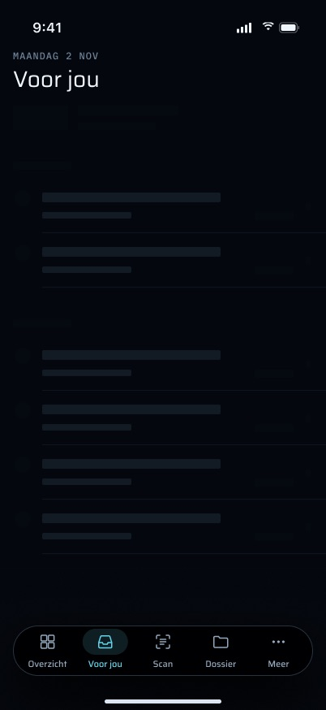 `Voor_jou_laden.jpg` | Laden, vóór de eerste ophaalactie | 37 | Titel en een spinner |
| 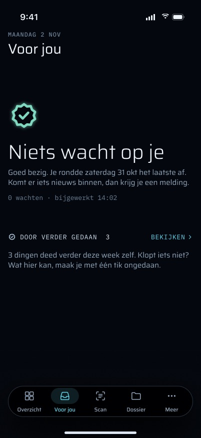 `Voor_jou_leeg.jpg` | Leeg: niets wacht, laatst afgehandeld, samenvatting "Door verder gedaan" | 39 | "Niets wacht op je." |
| 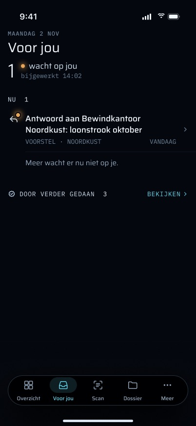 `Voor_jou_n_item.jpg` | Eén item, enkelvoud "wacht op jou" | 11 | Eén rij, geen hoofdgetal |
| 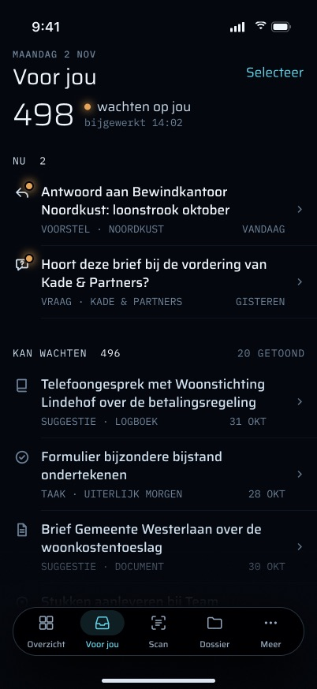 `Voor_jou_veel_498.jpg` | 498 wachtend: Nu / Kan wachten, 20 getoond | 11, 13, 14, 15 | Platte lijst van alle rijen, geen secties of limiet |
| 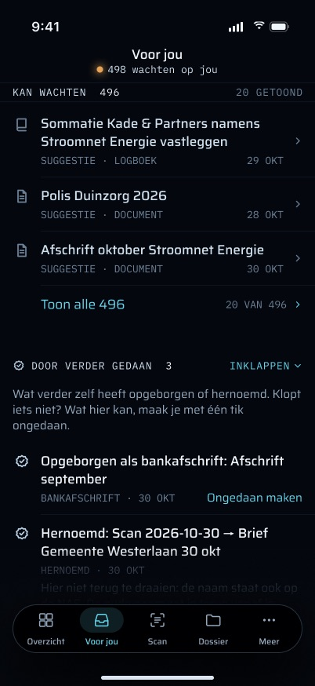 `Voor_jou_veel_gescrold.jpg` | Dezelfde lijst gescrold, compacte titel met aantal | 12 | Niet gebouwd |
| 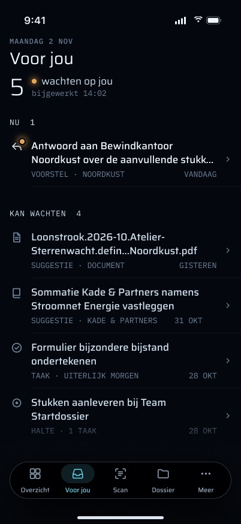 `Voor_jou_lange_titels.jpg` | Lange titels, twee regels en een staart | 9 | De code laat volledig doorlopen, geen afkapping |
| 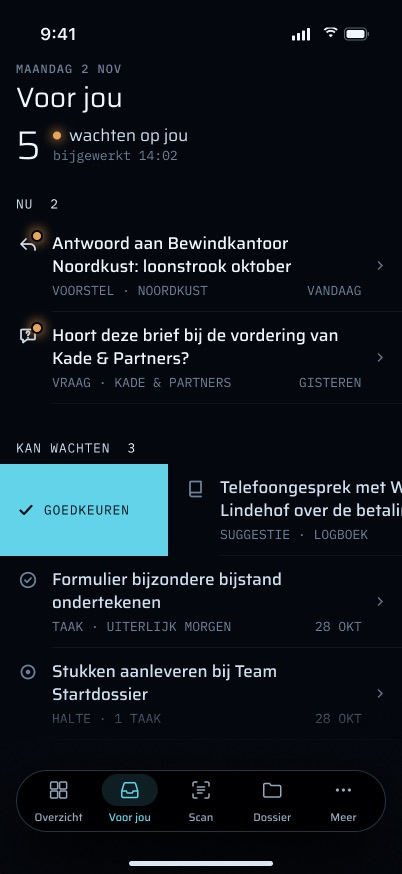 `Voor_jou_swipe_goedkeuren.jpg` | Veeg vanaf de voorkant "Goedkeuren" op een suggestie | 16 | Niet gebouwd (goedkeuren op het detailscherm) |
| 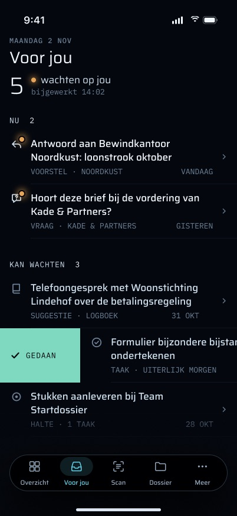 `Voor_jou_swipe_gedaan.jpg` | Veeg "Gedaan" op een taak | 17 | Niet gebouwd (status op het taakscherm) |
| 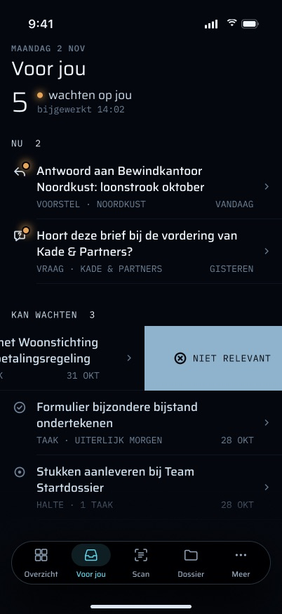 `Voor_jou_swipe_niet_relevant.jpg` | Veeg vanaf de achterkant "Niet relevant" | 18 | Niet gebouwd (afwijzen op het detailscherm) |
| 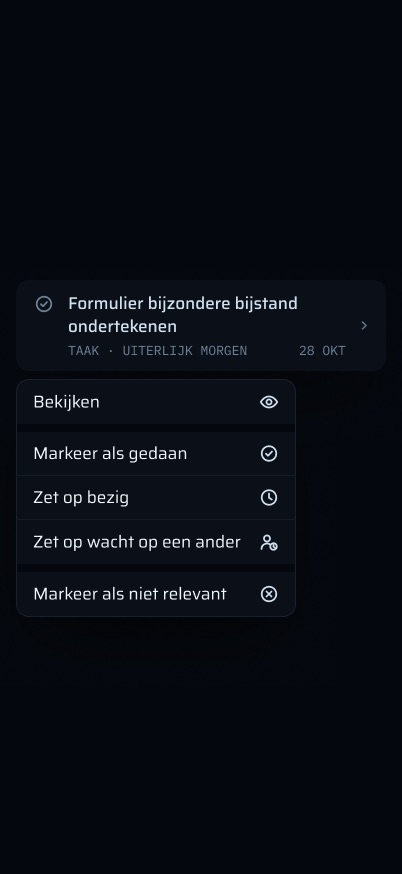 `Voor_jou_contextmenu_taak.jpg` | Contextmenu op een taak | 19 | Niet gebouwd |
| 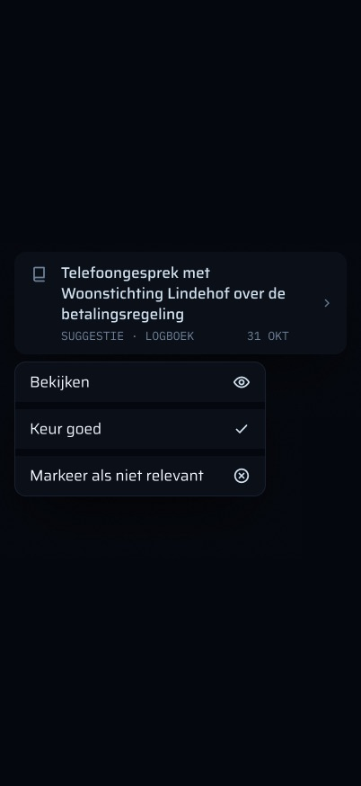 `Voor_jou_contextmenu_suggestie.jpg` | Contextmenu op een suggestie | 19 | Niet gebouwd |
| 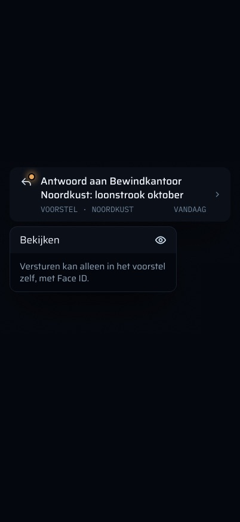 `Voor_jou_contextmenu_voorstel.jpg` | Contextmenu op een voorstel: alleen "Bekijken", niet versturen | 19 | Niet gebouwd; de verzendregel geldt hoe dan ook |
| 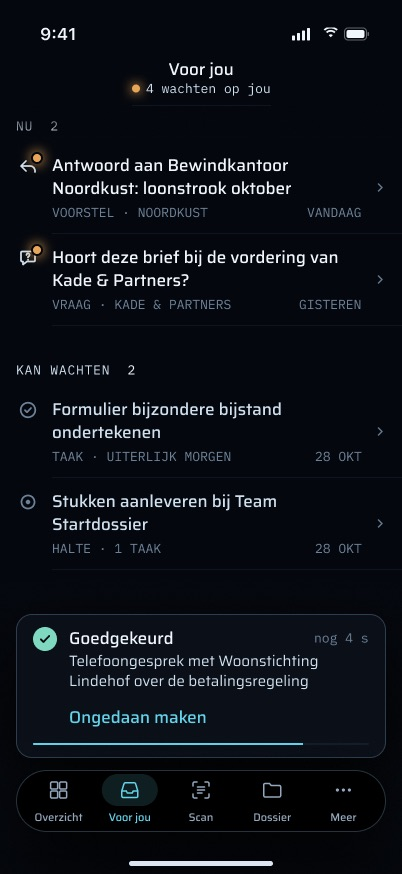 `Voor_jou_undo-toast.jpg` | Undo-toast van 5 s na een beslissing | 22, 24 | Niet gebouwd |
| 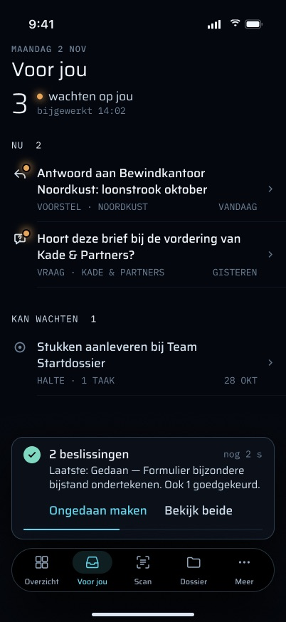 `Voor_jou_undo-toast_twee_beslissingen.jpg` | Undo-toast na twee beslissingen | 25 | Niet gebouwd |
| 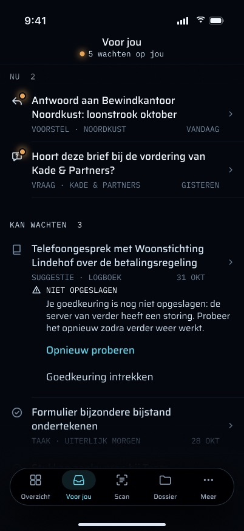 `Voor_jou_niet_opgeslagen.jpg` | Een beslissing niet opgeslagen, opnieuw proberen of intrekken in de rij | 26 | Niet gebouwd; het detailscherm toont de fout |
| 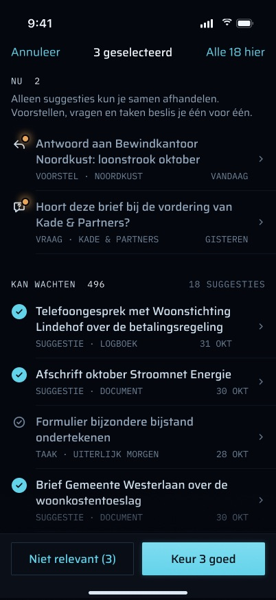 `Voor_jou_selecteren.jpg` | Selectiemodus voor bulkbeslissingen over suggesties | 21 | Niet gebouwd |
| 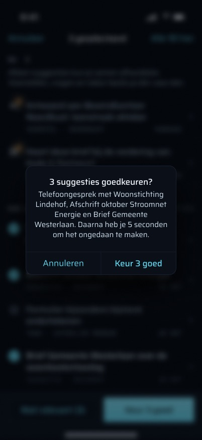 `Voor_jou_selecteren_bevestigen.jpg` | Bevestiging "3 suggesties goedkeuren?" | 21 | Niet gebouwd |
| 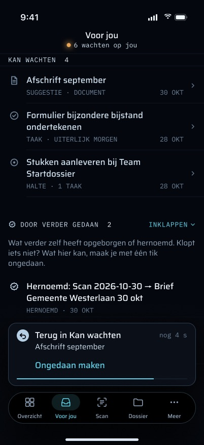 `Voor_jou_door_verder_gedaan_ongedaan.jpg` | "Door verder gedaan" uitgeklapt, een undo met zijn toast | 27, 30, 32 | Sectie en undo gebouwd; geen toast |
| 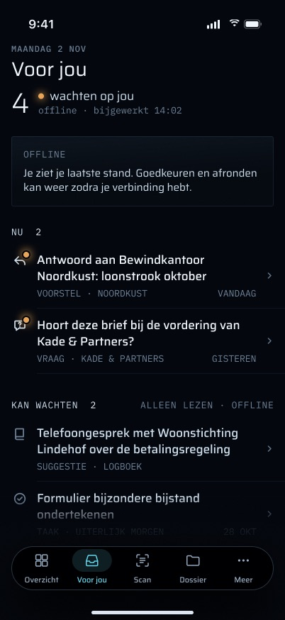 `Voor_jou_offline.jpg` | Offline met de laatste lijst en zijn leeftijd | 38, 40 | Eén regel "Geen verbinding met verder…" boven de lijst in het geheugen |
| 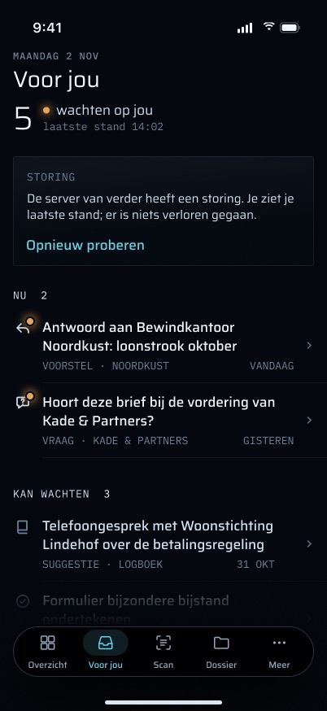 `Voor_jou_storing_met_cache.jpg` | Serverstoring, kaart "STORING" boven de laatste lijst | 38, 41 | Eén regel "Dat lukte niet…" boven de lijst in het geheugen |
| 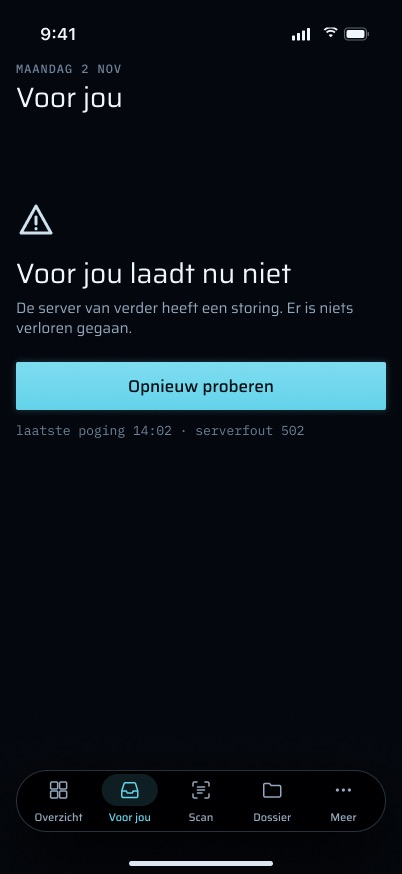 `Voor_jou_fout_geen_cache.jpg` | Mislukken zonder cache, "Opnieuw proberen" | 42 | Alleen de melding; trekken om te verversen |
| 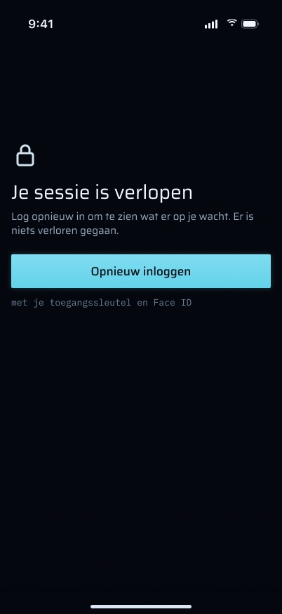 `Voor_jou_sessie_verlopen.jpg` | Sessie verlopen, één weg terug naar inloggen | 43 | Gebouwd (`SessionExpiredView`) |
| 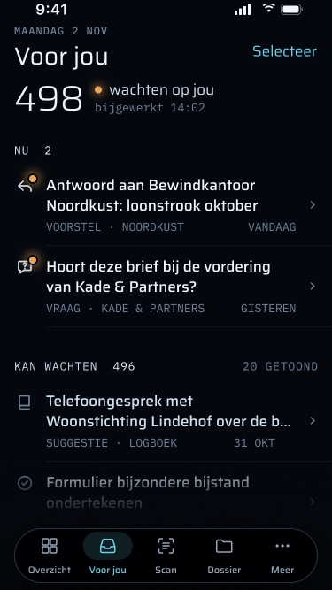 `Voor_jou_iPhone_SE.jpg` | De lijst op een iPhone SE (375 × 667) | 46 | Zelfde layout als die van de code |
| 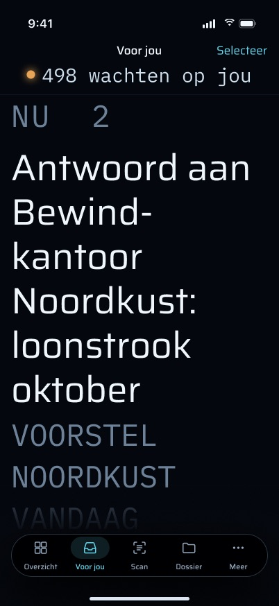 `Voor_jou_AX5.jpg` | Grootste toegankelijkheidstekstgrootte | 45 | Dynamic Type schaalt; geen hoofdgetal, meta stapelt niet |
| 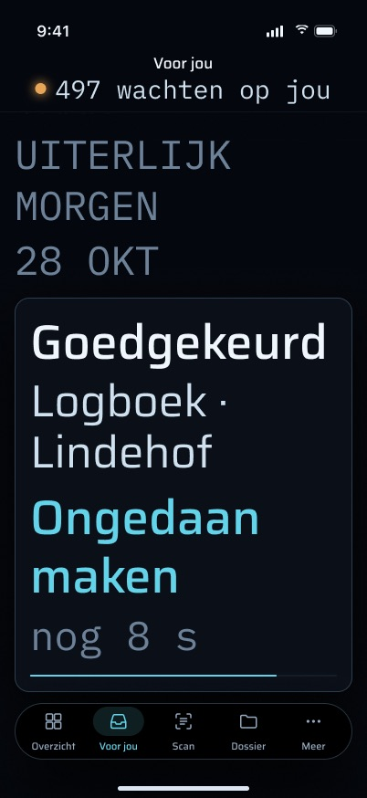 `Voor_jou_AX5_gescrold.jpg` | AX5 gescrold, met een toast | 24, 45 | Niet gebouwd (toast) |
| 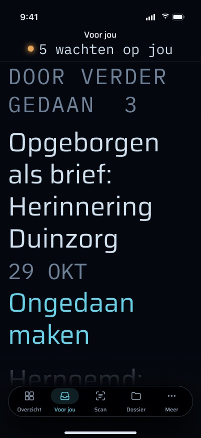 `Voor_jou_AX5_door_verder_gedaan.jpg` | AX5 met "Door verder gedaan" | 27, 45 | Sectie gebouwd |
