# Voorstel (voorsteldetail en de editor): functies

## Stand van de bouw

Geteld op branch `feat/iphone-app`, 2026-11-04 (na de bouw van de definitieve frames: vasthouden, editor-sheet, ⋯-menu, vaste afwijsredenen, leesdrempel, offline vooraf, Face ID-balk, de besloten toestanden), door de code te lezen (niet door aan te nemen). Dit document beschrijft de VOLLEDIGE functieset van het scherm: wat vandaag werkt, plus alles wat de definitieve frames, de spec (`2026-10-28-iphone-app-design.md` §6.5, §7.2, §12) en de designbrief (`2026-11-01-iphone-design-brief.md` §2.4–2.7 en de §3-rijen "Proposal detail" en "Notifications") vastleggen. Elke functie heeft één statusregel.

| Status | Aantal |
|---|---|
| Gebouwd | 35 |
| Deels gebouwd | 9 |
| Nog te bouwen | 10 |
| **Totaal** | **54** |

De drie belangrijkste dingen die nog gebouwd moeten worden:

1. **Een mislukte verzending die Martin kan zien en opnieuw kan proberen** (F-38, F-39). Vandaag verdwijnt een `failed` voorstel uit Voor jou (alleen `pending` wacht op Martin) en heeft het geen actie, dus zodra de `SYSTEM`-push is weggeveegd, is de mislukking alleen nog te vinden door eraan te denken. Nodig: een besluit of `failed` op Martin wacht (de amberwet), een overgang in de levenscyclus vanuit `failed` (vandaag `failed: []`) die ALLEEN mag na een aantoonbare niet-aflevering, een route om opnieuw te versturen achter een verse Face ID, en tests dat een onzekere verzending nooit opnieuw verstuurd kan worden.
2. **Uitkomst onbekend, duidelijk gezegd** (F-42). De worker weet dat een verzending in herstel is, de telefoon niet: hij toont de hele tijd "Goedgekeurd · Wordt verstuurd…" en `followSend` stopt na ongeveer 10 minuten. Nodig: een herstelvlag of het claimtijdstip in `GET`, de tekst "Nog onbekend of het is aangekomen." en een volglus die het herstelvenster van 30 minuten overleeft.
3. **Openen waar het voorstel op steunt** (F-29, F-30, F-31): de oorspronkelijke mail, de bijlagen en de aangehaalde dossierdocumenten. Vandaag is geen daarvan een knop, dus keurt Martin een antwoord goed zonder de mail te kunnen openen waarop het antwoordt. Documenten kunnen `Dossier/DocumentViewer.swift` en `GET /api/mobile/v1/documents/<id>/file` hergebruiken; de mail heeft een nieuwe mobiele route nodig.

Conceptversies en de keuze tussen twee versies bij een 409 (F-34, F-35, F-36) zijn het grootste resterende stuk, maar vragen eerst een besluit: vandaag is een nieuw concept een NIEUW voorstel dat het oude vervangt, terwijl de frames ervan uitgaan dat een nieuw concept een nieuwe VERSIE van hetzelfde voorstel is.

Niet op dit scherm: de Scan-bediening in het Bedieningspaneel en op de Actieknop, de Live Activity, veegacties en alles-tegelijk-goedkeuren horen bij de schermen Scan en Voor jou (06, 03). De brief sluit voorstellen helemaal uit van bulkacties ("sending is never bulk").

Een voorstel is iets waarvoor verder Martins goedkeuring vraagt. Er zijn drie soorten. Een **antwoord** reageert op een binnengekomen mail of brief. Een **opvolging** zit achter een draad aan waarin de andere kant stil is gevallen. Een **vraag** laat Martin kiezen uit twee tot vier opties. Het voorstelscherm is de enige plek op de telefoon waar een antwoord of opvolging voor verzending kan worden goedgekeurd. Martin is de enige gebruiker.

Dit document beschrijft wat het scherm doet. Het visuele ontwerp staat er niet in; dat staat in Figma: sectie `proposal · final`, node `307:1047`, bestand `QDRL5zHNEOjPzLZqzd19Ii`. Elke uitspraak is gebaseerd op de code op branch `feat/iphone-app` per 2026-11-03. UI-teksten staan in het Nederlands geciteerd, precies zoals de app ze toont. Elke schermafbeelding gebruikt de synthetische dataset (Noordkust, Ilse, Kade & Partners, Duinzorg, Lindehof), geen echte dossiergegevens.

> **De Figma-frames lopen voor op de code.** De definitieve frames tonen een herontwerp, met een knop om vast te houden om te versturen, genummerde conceptversies, een aparte editor-sheet, een keuze tussen twee versies na een conflict, een ⋯-menu, een redenkiezer bij afwijzen, "Opnieuw versturen", "Opnieuw laten opstellen" en een leesdrempel vóór het versturen. De code die vandaag draait is Plan 2's `ProposalScreen` (commit `89cf2b2`; `db90d54` verwijderde de aparte `ProposalListView` toen Voor jou de lijst overnam). Die heeft één knop "Versturen", bewerken ter plekke en geen van die extra's. Elke sectie hieronder beschrijft **eerst de code**. Waar een frame iets toont dat de code niet doet, zegt een notitie **Ontworpen, niet gebouwd** dat. Niets in die notities bestaat al op de telefoon of op de server. Elk ervan staat ook als functie beschreven, met status en wat ervoor nodig is, onder *Ontworpen en gespecificeerd, nog niet (volledig) gebouwd* hieronder. Functies zijn genummerd F-1 tot en met F-54.

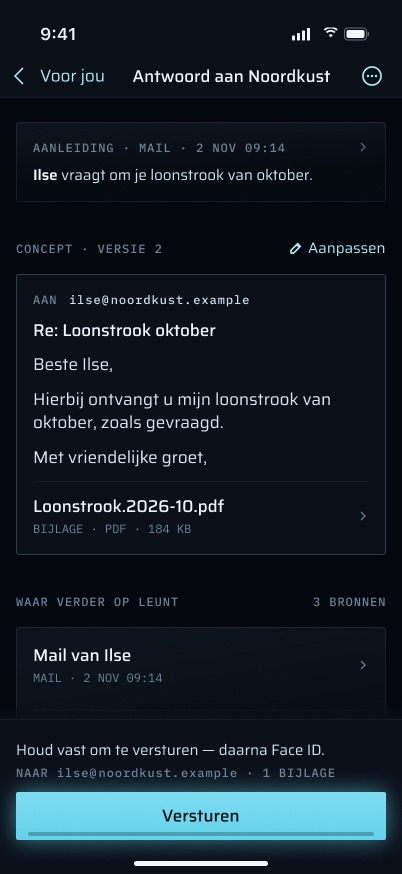

## Doel

- **Lezen wat verder voorstelt, en waarom.** Het scherm toont de aanleiding (wie schreef, wanneer, het onderwerp, een fragment), wat ze vragen ("Wat ze vragen"), de deadline, wat nog ontbreekt en de dossierstukken waar de opsteller op steunde ("Waar verder op leunt").
- **Beslissen.** Bij een antwoord of opvolging kan Martin het versturen (na Face ID), aanpassen ("Aanpassen") of afwijzen ("Afwijzen"). Bij een vraag kiest hij een optie of typt hij zelf een antwoord.
- **De voorgestelde taak aanmaken**, als het concept er een voorstelt ("Taak aanmaken: …"). Dat gebeurt alleen als hij erop tikt.
- **De verzending volgen** tot de worker meldt dat ze verstuurd of mislukt is.

**Niets op dit scherm verstuurt mail.** Goedkeuren zet het voorstel van `pending` op `approved`. De job `proposals.send` van de worker (pg-boss, elke minuut; de bijbehorende run-rijen heten `proposal-send`) claimt het en praat met Gmail. De telefoon praat nooit met Gmail.

## Hoe je er komt, en waar het heen leidt

**Erin:**

| Pad | Wat er gebeurt |
|---|---|
| Voor jou | Een rij van soort `proposal` of `question` zet `InboxRoute.proposal(id)` op de stapel van Voor jou (`VoorJouTab`). Vragen openen hetzelfde scherm. |
| Overzicht | Als de app ontgrendeld is, schakelt een voorbeeldrij in "Wacht op jou" naar Voor jou met `[.proposal(id)]` als stapel, zodat het voorstel direct opent. Als de app vergrendeld is, toont Overzicht alleen het aantal en geen rijen. |
| Push, gewone tik of "Bekijken" | Elke push over een voorstel draagt `link: verder://proposal/<uuid>`. `DeepLink.proposal` komt uit op het tabblad Voor jou met `[.proposal(id)]` als stapel. Dat geldt voor de categorieën `PROPOSAL`, `REMINDER` en `FOLLOW_UP`, plus de `SYSTEM`-pushes over een mislukte of onzekere verzending. De actie "Bekijken" (`.foreground, .authenticationRequired`) bestaat alleen op `PROPOSAL`, `REMINDER` en `FOLLOW_UP`. |
| Rij in de beginschermwidget | Een item `proposal` of `question` linkt naar `verder://proposal/<uuid>` (`WidgetContent.url(for:)`). |
| Debugstart | `-route proposal:<id>` (`RootView.applyFixtureStart`, alleen `#if DEBUG`), afgeleverd via dezelfde `DeepLinkInbox` die een aangetikte push gebruikt. |

Het tabblad Voor jou is `.lockGated(by: lock)`. De stapel (`inboxPath`) wordt in `RootView` bewaard, dus een link die binnenkomt terwijl de app vergrendeld is, wacht daar en opent zodra Face ID de app heeft ontgrendeld.

**F-1 · Toegangswegen.** **Status:** Gebouwd (`Inbox/VoorJouTab.swift` `InboxRoute`, `Push/DeepLink.swift`, voorbeeldrijen in `Home/HomeTab.swift`, `Widget/WidgetContent.swift` `url(for:)`, `App/RootView.swift` `inboxPath`).

**Eruit:** de terugknop gaat terug naar Voor jou, dat zijn lijst ververst zodra de stapel leeg is (`onChange(of: path)`). Een afgehandeld voorstel valt daardoor van de lijst. Niets op het scherm opent de oorspronkelijke mail, een document of een ander scherm.

> **Ontworpen, niet gebouwd:** de oorspronkelijke mail of een document openen vanuit de aanleiding, een bijlagerij of een rij in "Waar verder op leunt", en een ⋯-menu met "Originele mail openen" en "Kopieer concepttekst". In de code is geen van die rijen een knop. De concepttekst is buiten de bewerkmodus `.textSelection(.enabled)`, dus hij is met de hand te selecteren en te kopiëren.

## Wat het scherm toont

Van boven naar beneden, uit `GET /api/mobile/v1/proposals/<id>` (`proposals.get` in `packages/api/src/routers/proposals.ts`):

1. **Kop.** "WACHT OP JOU" in amber, alleen zolang het voorstel `pending` is. Daarna de afzender (`trigger.from`, anders de naam van de partij, anders "Onbekend"), de soort ("antwoord", "opvolging", "vraag"), de datum van de aanleiding in Amsterdamse tijd ("30 okt 2026, 10:12"), het onderwerp en een fragment van maximaal 300 tekens (afgekapt met "…"). Wat de aanleiding vult, hangt af van het type (`triggerView`): bij mail de From-header, het onderwerp, de verzenddatum en de tekst; bij een gescande brief "Verder" of de partij, de effectieve titel van het document, de ontvangstdatum en de geëxtraheerde tekst (geen meer na definitief verwijderen); bij een opvolging "verder" en het onderwerp, de verzendtijd en de tekst van het eerder verstuurde voorstel, of de eerdere uitgaande mail zelf.
2. **"lijkt van Verder — afzender niet bevestigd"** staat onder de afzender als de aanleiding een gescande brief is en de effectieve partij van die brief (gezet doordat Martin hem archiveerde) nog niet overeenkomt met de gok van verder — een gok op een schuldeiser vraagt precies die partij, een gok op Verder een partij op een Verder-domein. Mail wordt nooit als onbevestigd gemarkeerd (spec §12.5).
3. **"Wat ze vragen"**, de `ask` van één regel van de opsteller.
4. **"Uiterlijk 7-11"**, de deadline (`dueAt`) als kalenderdag in Amsterdam. Amber zolang het voorstel openstaat, gewoon zodra er besloten is.
5. **"Wat nog ontbreekt"** noemt wat de opsteller niet in het dossier kon vinden.
6. **"Waar verder op leunt"** toont elk aangehaald id als chip, gelabeld vanuit de context die de worker bij het voorstel opsloeg (het kale id als de context er geen label voor heeft). De `why` van de opsteller per bron wordt meegestuurd maar niet getoond. De opsteller moet aanhalen waar hij op steunde (spec §6.5).
7. **"Concept"** (alleen bij antwoord en opvolging) toont Aan, Cc (indien gezet), Onderwerp en de tekst.
8. **"Bijlagen"** toont elke bijlage met effectieve titel en grootte, of "Geen bijlagen.". Na een besluit is de lijst die van de bijlagen in de goedgekeurde `final_payload`, niet die van het model.
9. **"In het logboek als"** toont de samenvatting die de uitgaande logboekregel krijgt zodra de mail weg is. Die is bewerkbaar; de telefoon kapt af op 100 tekens en de server weigert meer dan 100.
10. **"Vraag"** (alleen bij vragen). Zie *Een vraag beantwoorden*.
11. **De voorgestelde taak**: "Taak aanmaken: <titel>" of, na het aanmaken, "Taak aangemaakt: <titel>". Anders dan de acties is dit in elke status zichtbaar, niet alleen bij `pending`.
12. **Een berichtregel** voor de uitkomst van de laatste actie, en **een statusregel** na een besluit: "Goedgekeurd — wordt zo verstuurd.", "Wordt verstuurd…", "Verstuurd.", "Versturen mislukt: <reden>", "Afgewezen." of "Vervangen door een nieuwer voorstel.".
13. **Acties**, alleen bij `pending`: "Versturen", "Aanpassen" / "Klaar met aanpassen", "Afwijzen".

- **F-2 · Kop en aanleiding** (items 1, 13). **Status:** Gebouwd (`Proposals/ProposalScreen.swift` `header`; `packages/api/src/routers/proposals.ts` `triggerView`).
- **F-3 · Afzender niet bevestigd** (item 2). **Status:** Gebouwd (`ProposalModel.senderNote`; `proposals.ts` `senderUnconfirmed`).
- **F-4 · Wat ze vragen, de deadline, wat ontbreekt** (items 3–5). **Status:** Gebouwd (`ProposalScreen.content`, `ProposalModel.dueText` / `missing`).
- **F-5 · Waar verder op steunde, als gelabelde chips** (item 6). **Status:** Gebouwd (`ProposalScreen.content` met `ChipFlow`; `proposals.ts` `get` bouwt `reliedOn`). Rijen met type, datum, reden en een manier om ze te openen zijn F-30 en F-31.
- **F-6 · Het concept, de bijlagen en de logboeksamenvatting, alleen-lezen** (items 7–9, 11–12). **Status:** Gebouwd (`ProposalScreen.draftSection`, `ProposalModel.attachmentRows` / `statusLine`).

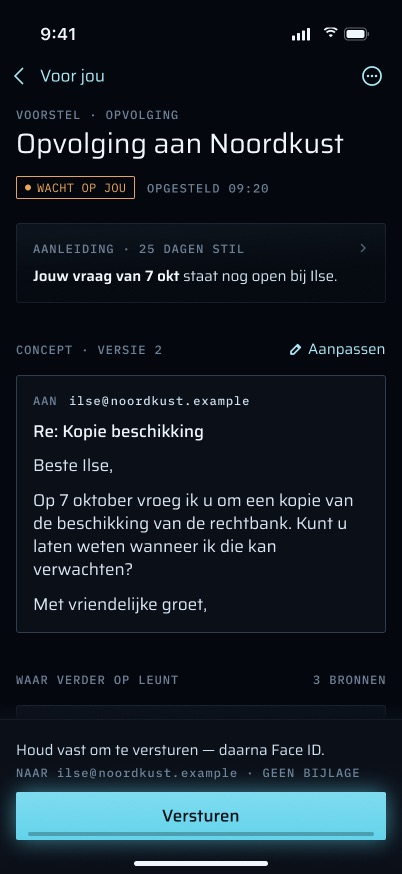

**Opvolgingen** gebruiken hetzelfde scherm. De job `proposals.clock` van de worker (elke 15 minuten) maakt er een aan, in `drafting`, wanneer Martins eigen mail of een `sent` voorstel het laatste woord had in een Gmail-draad met Verder of een schuldeiser en de andere kant `PROPOSAL_FOLLOWUP_DAYS` Amsterdamse kalenderdagen stil is gebleven (standaard `DEFAULT_FOLLOWUP_DAYS` = 7). Achter een draad die langer dan `FOLLOWUP_MAX_SILENCE_DAYS` = 30 dagen stil is, wordt nooit aangezeten, JMAP-draden hebben geen klok, en elk uitgaand bericht krijgt hooguit één opvolging (migratie 0039, twee partiële unieke indexen). De aanleiding van een opvolging is die eerdere uitgaande mail (`trigger_raw_email_id`) of dat verstuurde voorstel (`parent_proposal_id`).

**F-7 · Opvolgingen aangemaakt door de klok.** **Status:** Gebouwd (`apps/worker/src/proposals/clocks.ts` `chaseOne` / `followUpCreator`, ingepland als `proposals.clock` in `apps/worker/src/index.ts`).

> **Ontworpen, niet gebouwd:** genummerde conceptversies ("CONCEPT · VERSIE 2") en het tijdstip waarop het concept is gemaakt. De code kent geen conceptversies: `revision` is een gelijktijdigheidsteller die alleen besluiten ophogen (goedkeuren, afwijzen, beantwoorden), geen conceptversie.

## Functies en acties, van begin tot eind

### Versturen (een antwoord of opvolging goedkeuren)

- **F-8 · Versturen met een verse Face ID, op de momentopname van daarvoor** (stappen 1–4). **Status:** Gebouwd (`ProposalModel.canSend` / `approve`, `Proposals/ApprovalGate.swift`; vastgelegd door `ProposalModelTests`).
- **F-9 · De server bakent af wat goedgekeurd mag worden en legt de gouden regel vast** (stap 5). **Status:** Gebouwd (`proposals.ts` `approve`, `packages/api/src/proposal-state.ts` `verdictFor` / `proposalDiff`; `apps/web/src/app/api/mobile/v1/proposals/[id]/approve/route.ts`).
- **F-10 · De worker verstuurt één keer en schrijft de ene ledger-gebeurtenis** (stap 7). **Status:** Gebouwd (`apps/worker/src/proposals/send.ts`, `proposals.send` elke minuut).
- **F-11 · Het scherm volgt de verzending tot die is afgerond** (stap 6). **Status:** Gebouwd (`ProposalModel.followSend`, aangestuurd door `.task(id: model?.status)` in `ProposalScreen`).

1. De knop is alleen actief als al het volgende geldt (`ProposalModel.canSend`): het voorstel is `pending`, er is minstens één ontvanger, onderwerp, tekst en logboeksamenvatting zijn niet leeg, geen bijlage is onbeschikbaar en er loopt niets anders (`isBusy`, dat ook gezet blijft zolang de Face ID-sheet open is).
2. De tik **maakt eerst een momentopname van het concept en zijn revisie**. Daarna vraagt hij Face ID via `ApprovalGate`. De reden in de systeemsheet noemt de ontvangers: "Versturen aan ilse@noordkust.example".
3. **Face ID wordt bij elke verzending gevraagd.** De vijf minuten speling van de app-vergrendeling (`LockPolicy.graceSeconds = 300`) bepalen of de telefoon het dossier mag *tonen*. Dat telt niet als goedkeuring van een uitgaande mail. `PlatformOwnerAuthenticator` maakt per aanroep een nieuwe `LAContext`, zodat het systeem de ontgrendeling niet kan hergebruiken. Annuleren, mislukken of een telefoon zonder toegangscode betekenen allemaal "nee", en er wordt niets gepost.
4. `POST /api/mobile/v1/proposals/<id>/approve` met `{ revision, payload: { to, cc, subject, body, attachmentDocumentIds, entrySummary } }`. Dat is precies de momentopname, dus een wijziging gemaakt terwijl de Face ID-sheet openstond, kan niet meeliften.
5. De server (`proposals.approve`, in één transactie met een rijvergrendeling):
   - weigert tenzij het voorstel `pending` is en op die revisie staat (409);
   - weigert een vraag (400);
   - controleert de vorm (400): 1–20 Aan- en hooguit 20 Cc-adressen, een onderwerp van 1–300 tekens, een tekst van hooguit 20 000 tekens (witruimte aan het eind verwijderd, daarna niet leeg), hooguit 20 bijlagen, een logboeksamenvatting van 1–100 tekens;
   - weigert elke ontvanger die niet in de door de worker verzamelde context staat (`context.addresses`, vergeleken in kleine letters; 400). Ontvangers worden in kleine letters en zonder dubbelen opgeslagen, en een Cc die ook Aan is, vervalt. Dezelfde weigering geldt voor elke bijlage die de context niet aanbood (`context.attachable`), en voor een bijlage die sinds het opstellen is weggegooid of definitief verwijderd. Een foute bijlage wordt geweigerd in plaats van stilletjes weggelaten, omdat de tekst die Martin goedkeurde de tekst moet zijn die weggaat;
   - slaat `final_payload` op en zet het voorstel op `approved`. Hij legt het **oordeel** volgens de gouden regel vast (`approved` als er niets veranderd is, anders `edited`; ontvangers en bijlagen worden als verzamelingen vergeleken, tekst exact), de **diff** ten opzichte van het concept van het model (de gewijzigde velden plus een regelgebaseerde unified diff van de tekst), `decided_at` en `decided_by`, en hoogt daarna `revision` op.
   - **schrijft geen ledger-gebeurtenis.** `proposals` is geen bewijs.
6. De telefoon herlaadt en toont "Goedgekeurd — wordt zo verstuurd.". `followSend` leest het voorstel daarna elke 5 seconden opnieuw, hooguit 120 keer (ongeveer 10 minuten), zolang het `approved` of `sending` is. Het stopt als de weergave verdwijnt.
7. De worker (`apps/worker/src/proposals/send.ts`, `proposal.send` elke minuut):
   - claimt het voorstel met één voorwaardelijke UPDATE (`approved → sending`) en slaat in dezelfde instructie een gegenereerde RFC 5322 Message-ID op, vóórdat Gmail wordt aangeroepen;
   - bouwt het MIME-bericht (From "Martin van der Poel", bijlagen gelezen uit de kluis) en verstuurt het via het alleen-lezen gekoppelde verzendtoken, onder de oorspronkelijke Gmail-draad als die er is. Een bericht of bijlagen boven `SEND_MAX_BYTES` worden vóór het versturen geweigerd ("het bericht is te groot om te versturen" / "de bijlagen zijn samen te groot om te versturen"), wat het voorstel op `failed` zet;
   - schrijft **pas nadat Gmail het accepteerde** de uitgaande logboekregel via `insertEntry`, met `source='proposal'` en `source_ref='proposal:<id>'`, kanaal e-mail, de partij van het voorstel als deelnemer en de bijlagen als documenten. Dat is de **ene ledger-gebeurtenis** die een verzending oplevert: `entry.created`. De samenvatting is de tekst van "In het logboek als". De status wordt `sent` in dezelfde transactie, en het bericht-id van Gmail wordt opgeslagen.
   - zolang Gmail een snelheidslimiet geeft (een lopende 429-deadline op welk Gmail-pad dan ook), wordt de hele tik overgeslagen, en een 429 op de verzending zelf zet de rij terug op `approved` voor de eerste tik na de deadline.

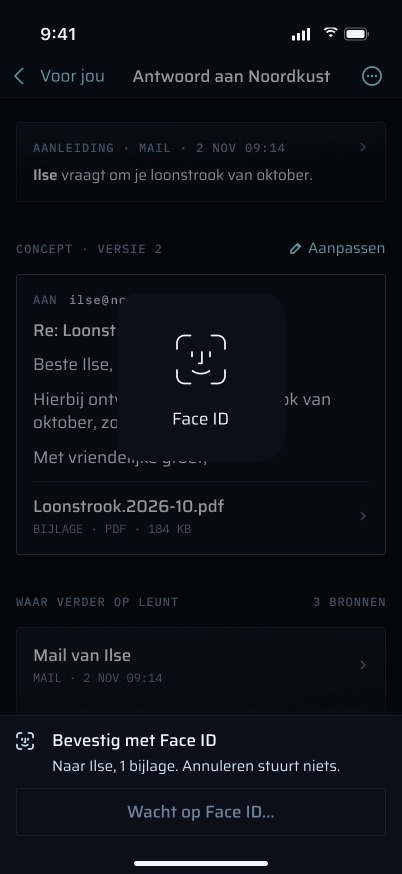

> **Ontworpen, niet gebouwd:** de frames vervangen de tik door **vasthouden**: "Houd vast om te versturen — daarna Face ID.", dan "Blijf vasthouden" / "Loslaten stopt — er gaat dan niets weg.". Ze voegen een balk in de app toe zolang Face ID openstaat ("Bevestig met Face ID · Naar Ilse, 1 bijlage. Annuleren stuurt niets.") en "Face ID afgebroken. Er is niets verstuurd. Houd opnieuw vast.". In de code geeft een geannuleerde Face ID stilletjes `.cancelled` terug en toont geen bericht. De samenvattingsregel "NAAR … · 1 BIJLAGE" boven de knop uit het ontwerp bestaat evenmin.

### Aanpassen (het concept bewerken)

- **F-12 · Het concept ter plekke bewerken: ontvangers, onderwerp, tekst, bijlagen uit wat werd aangeboden, logboeksamenvatting.** **Status:** Gebouwd (`ProposalScreen.draftSection`, `ProposalModel.edit` / `attach` / `setRecipients` / `setEntrySummary`).
- **F-13 · Een bijlage die sinds het opstellen is weggegooid of definitief verwijderd, blokkeert het versturen tot ze is weggehaald.** **Status:** Gebouwd (`ProposalModel.attachmentRows` / `canSend`, `Copy.unavailableAttachment`).

- "Aanpassen" zet de conceptsectie **ter plekke** om in bewerkbare velden. De velden zijn Aan en Cc als vrije tekst (gesplitst op komma's, puntkomma's en witruimte), Onderwerp, een `TextEditor` voor de tekst, "Weghalen" bij elke bijlage, "Bijlage toevoegen" (een menu met alleen wat de server aanbood in `attachable`) en de logboek-"Samenvatting". "Klaar met aanpassen" zet het terug.
- Wijzigingen leven **alleen in het geheugen van het scherm** (`ProposalModel.draft`). Er wordt niets op de server opgeslagen tot "Versturen", en niets naar schijf geschreven. Wie het scherm verlaat, raakt ze kwijt, en dat geldt ook voor elk herladen (na een 409, of na afwijzen of beantwoorden), omdat herladen het concept vervangt door de versie van de server. Een 400 herlaadt niet, dus de wijzigingen blijven staan om te herstellen.
- De telefoon mag alleen bijlagen toevoegen die de server aanbood. De server weigert daarnaast elke ontvanger buiten de opgeslagen context, dus een bewerking kan geen nieuwe partij aanschrijven.
- Een onbeschikbare bijlage (sinds het opstellen weggegooid of definitief verwijderd) wordt doorgestreept getoond met "niet meer beschikbaar", en "Weghalen" wordt ook buiten de bewerkmodus aangeboden. Zolang ze er staat, blijft "Versturen" uitgeschakeld, en een poging toont "Een bijlage is niet meer beschikbaar. Haal hem weg voordat je verstuurt.".

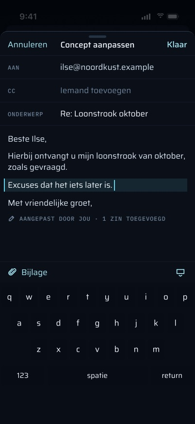

> **Ontworpen, niet gebouwd:** een aparte editor, "Concept aanpassen", met "Annuleren" / "Klaar"; markeren wat Martin veranderde ("AANGEPAST DOOR JOU · 1 ZIN TOEGEVOEGD"); een bevestiging "Wijzigingen weggooien?" bij annuleren met wijzigingen; en de versie van verder naast die van Martin bewaren ("VERSIE 2 VAN VERDER BEWAARD"). Niets van die diff-markering bestaat op de telefoon. De diff wordt alleen op de server berekend, bij het goedkeuren, voor de vastlegging volgens de gouden regel (`proposalDiff`), en wordt niet getoond.

### Afwijzen

**F-14 · Afwijzen, met een optionele vrije reden waar verder van leert.** **Status:** Gebouwd (`ProposalScreen.rejectSheet`, `ProposalModel.reject`; `proposals.ts` `reject`; `…/[id]/reject/route.ts`). De vaste redenen zijn F-51.

- Opent een sheet op halve hoogte: "Afwijzen", "Waarom? Niet verplicht — verder leert ervan.", een vrij tekstveld "Reden", en de knoppen "Afwijzen" en "Annuleren".
- `POST /api/mobile/v1/proposals/<id>/reject` met `{ reason? }` (bijgesneden, hooguit 1000 tekens op de server; leeg wordt geen reden).
- De server zet het voorstel van `pending → rejected`, slaat oordeel `rejected` en de reden op, legt `decided_at`/`decided_by` vast en hoogt de revisie op. Afwijzen stuurt geen revisie mee en wordt niet op revisie gecontroleerd: het antwoordt alleen 409 als het voorstel niet meer `pending` is. **Geen ledger-gebeurtenis.** De uitvoer van het model blijft op de rij staan om van te leren.
- Afwijzen wordt aangeboden voor elke openstaande soort, vragen inbegrepen.
- Geen Face ID: een afwijzing verstuurt niets.

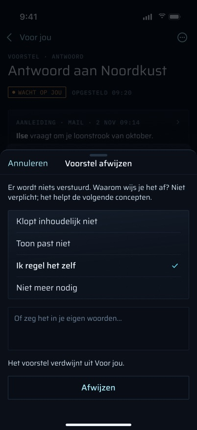

> **Ontworpen, niet gebouwd:** vier vaste redenen ("Klopt inhoudelijk niet", "Toon past niet", "Ik regel het zelf", "Niet meer nodig") boven het vrije tekstveld, en "Het voorstel verdwijnt uit Voor jou.". De route neemt één vrije `reason`, dus vaste redenen zouden als tekst verstuurd moeten worden.

### Een vraag beantwoorden

**F-15 · Een vraag in de app beantwoorden: een optie met de eigen omschrijving van de server, of vrije tekst.** **Status:** Gebouwd (`ProposalScreen.questionSection`, `ProposalModel.answer(option:)` / `answer(freeText:)`; `proposals.ts` `answer`, `renderTarget`). Alleen bevestigen als een optie gevolgen heeft, is F-23.

- "Vraag" toont de vraagtekst. Elke optie is een knop met het label van het model en daaronder **de eigen Nederlandse omschrijving van de server van wat de optie doet** (`target`, opgebouwd door `renderTarget` uit de gecontroleerde id's). Een knop toont nooit alleen de woorden van het model.
- Een tik op een optie opent een bevestigingsdialoog met die `target` als titel. Bevestigen post `POST …/answer` met `{ revision, option }`.
- "Iets anders…" plus "Antwoorden" post `{ revision, freeText }` (bijgesneden, hooguit 2000 tekens op de server). Een body met zowel `option` als `freeText` wordt geweigerd (strikt schema).
- **Geen Face ID** voor een antwoord: een vraag gaat nooit de deur uit, en de app-vergrendeling dekt het scherm al.
- Op de server (`proposals.answer`) wordt de optie opnieuw gecontroleerd tegen de opgeslagen context en de live database, precies zoals bij het opstellen (de taak staat nog in de context en mag die stap zetten vanuit haar HUIDIGE effectieve status; het document is nog live en zowel document als vordering staan in de context; een taaktitel van 1–200 tekens). Daarna loopt ze via een **bestaande procedure** onder Martins aanroeper, in dezelfde transactie, zodat een weigering waar dan ook niets achterlaat:
  - `set-task-status` roept `tasks.setStatus` aan en voegt een gebeurtenis `task.status` toe — de enige optie die bewijs schrijft;
  - `link-document-to-debt` roept `registry.debts.linkDocument` aan. Vorderingen en hun koppeltabellen zijn geen bewijs, dus dit voegt geen gebeurtenis toe;
  - `create-task` roept `tasks.create` aan, dat de taak invoegt en geen gebeurtenis toevoegt (taken zijn geen bewijs; alleen hun statuswijzigingen wel);
  - `none` doet niets.
  Het voorstel gaat van `pending → sent`, met het antwoord opgeslagen in `final_payload`. Die overgang mag alleen bij een vraag. Het oordeel is `approved` voor een optie en `edited` voor vrije tekst. Een antwoord in vrije tekst voert geen actie uit.
- Hetzelfde antwoord kan **vanuit de melding** worden gegeven. Zie *Meldingen*.

### Taak aanmaken (de voorgestelde taak)

**F-16 · De taak die het concept voorstelt aanmaken, alleen na een tik.** **Status:** Gebouwd (`ProposalModel.createTask`; `proposals.ts` `createProposedTask`; `…/[id]/task/route.ts`).

- Alleen zichtbaar als het concept een taak voorstelt. `POST …/task` (de route leest geen body) roept `proposals.createProposedTask` aan, dat `tasks.create` onder een rijvergrendeling uitvoert en `created_task_id` opslaat. Een tweede tik geeft dezelfde taak terug (`created: false`). De telefoon biedt de knop niet meer aan zodra `createdTaskId` gezet is, of na zijn eigen geslaagde tik.
- Er is geen `pending` voor nodig: de taak kan vóór of na het besluit over het voorstel worden aangemaakt, ook na een afwijzing.
- Een taak wordt nooit aangemaakt door het opstellen of door het goedkeuren. Alleen deze tik maakt er een aan. Er wordt geen ledger-gebeurtenis toegevoegd.

## Toestanden

| Toestand | Wat de code toont | Wat Martin kan doen |
|---|---|---|
| Laden | Een draaiend wieltje (`ProgressView`) | Wachten of teruggaan |
| `pending`, antwoord of opvolging | Alles hierboven, amber "WACHT OP JOU", de drie acties | Versturen, aanpassen, afwijzen, de taak aanmaken |
| `pending`, vraag | De vraagsectie, "Afwijzen" | Beantwoorden, afwijzen |
| `drafting` / `draft-failed` | Alleen kop en aanleiding. De payload is null, dus geen conceptsectie en geen acties, omdat het voorstel niet `pending` is | Teruggaan. Deze voorstellen staan niet in Voor jou: "wacht op Martin" telt alleen `pending` (`waiting.ts`). De push van een opvolging gaat uit zodra de opvolging wordt AANGEMAAKT, nog in `drafting`, dus wie er in de eerste minuten op tikt, komt hier uit |
| `approved` / `sending` | "Goedgekeurd — wordt zo verstuurd." / "Wordt verstuurd…", geen acties, volgt automatisch elke 5 s | Wachten. Een verzending waarvan de logboekregel drie keer mislukte, blijft voorgoed `sending` (herstel slaat haar over) en de telefoon blijft "Wordt verstuurd…" tonen; alleen de `SYSTEM`-push zegt dat de mail weg is |
| `sent` | "Verstuurd." in staal, geen acties | Teruggaan |
| `failed` | "Versturen mislukt: <reden>" (de Nederlandse reden van de worker, bijvoorbeeld "niet gevonden in Verzonden" of "Gmail weigerde het bericht (400): …"), "Versturen mislukt." als er geen reden is opgeslagen | Niets op de telefoon. `failed` is definitief, en een nieuwe poging moet een nieuw voorstel zijn (`proposal-state.ts`) |
| `rejected` / `superseded` | "Afgewezen." / "Vervangen door een nieuwer voorstel." | Teruggaan |
| 409 bij een besluit | Herlaadt. Toont "Er is intussen een nieuwere versie. Bekijk hem en verstuur opnieuw." als het nog openstaat, anders "Dit voorstel is al afgehandeld." Lokale wijzigingen worden vervangen door de versie van de server | Opnieuw lezen, opnieuw beslissen. **Een 409 wordt nooit opnieuw geprobeerd** |
| 400 bij een besluit | "verder weigerde dit: een ontvanger of bijlage hoort niet (meer) bij dit voorstel." De telefoon toont dit bij ELKE 400, ook bij een vormweigering (een te lang onderwerp, een opnieuw gecontroleerde optie die niet meer klopt) | Ontvangers of bijlagen herstellen |
| Offline / transportfout | "Geen verbinding met verder. Probeer het opnieuw." (als laadfout, of als bericht na een actie) | De actie opnieuw proberen. Wijzigingen blijven alleen bewaard zolang het scherm openblijft |
| Andere serverfout | "Dat lukte niet. Probeer het over een moment opnieuw." | Opnieuw proberen |
| Niet gevonden (404) | "Dit voorstel bestaat niet (meer)." | Teruggaan. Gemeten op de telefoon op 2026-11-01 met een test-vraagpush voor een niet-bestaand id |
| Sessie verlopen (401) | Roept `onUnauthorized` aan, dat de sessie beëindigt, lokale dossierinhoud wist en het inlogscherm toont ("Je sessie is verlopen."). De eigen regel van het scherm is "Log opnieuw in." | Opnieuw inloggen |
| Vergrendeld | Het tabblad Voor jou zit achter het vergrendelscherm. Een deeplink wacht tot er ontgrendeld is | Ontgrendelen met Face ID |
| Grote tekst | Elk lettertype is `relativeTo:` een tekststijl, dus het hele scherm schaalt mee met Dynamic Type binnen één `ScrollView`. Niets wordt afgekapt | Scrollen |
| Kleine telefoon (SE) | Dezelfde opmaak, scrollt | Hetzelfde |

- **F-17 · Eén statusregel per besloten toestand** (goedgekeurd, wordt verstuurd, verstuurd, mislukt met reden, afgewezen, vervangen). **Status:** Gebouwd (`ProposalModel.statusLine`).
- **F-18 · Conflicten en fouten: een 409 herlaadt en wordt nooit opnieuw geprobeerd, een 400 bewaart de wijzigingen, offline / 404 / andere fouten zeggen dat, een 401 beëindigt de sessie.** **Status:** Gebouwd (`ProposalModel.approve` / `decide` / `handle`, `Copy`).
- **F-19 · Het scherm zit achter de app-vergrendeling, en een link wacht op het ontgrendelen.** **Status:** Gebouwd (`.lockGated(by: lock)` en `inboxPath` in `App/RootView.swift`, `Auth/AppLock.swift`).
- **F-20 · Dynamic Type tot AX5, alles in één scroll, niets afgekapt.** **Status:** Gebouwd (elk lettertype `relativeTo:` in `ProposalScreen.swift`).

**Hoe de 409 van de code verschilt van de frames.** In de code hoogt `storeDraft` `revision` nooit op, en een nieuw concept is een nieuw voorstel dat het oude vervangt (`create.ts` `supersedeOlder`: een nieuwere inkomende mail in de draad, of Martin die zelf antwoordt). Een 409 betekent dus "elders besloten of vervangen", meestal op het web. Het betekent nooit "verder heeft het concept herschreven tot versie 3".

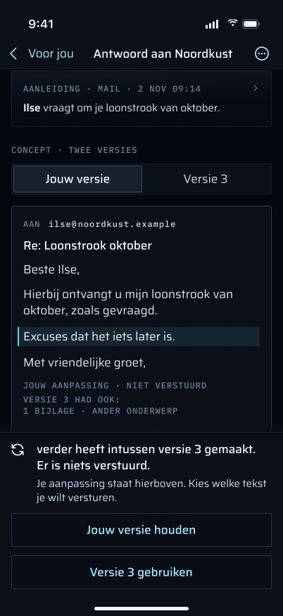

> **Ontworpen, niet gebouwd:** "Het concept is intussen gewijzigd. Er is niets verstuurd." met de wijzigingen van versie 3 gemarkeerd. Met lokale wijzigingen biedt een gesegmenteerde keuze "Jouw versie" / "Versie 3" de knoppen "Jouw versie houden" en "Versie 3 gebruikt", en labels als "JOUW ZIN NIET OPGENOMEN · BEWAARD IN DE GESCHIEDENIS". De server kent geen conceptversies en geen geschiedenis van concepten.

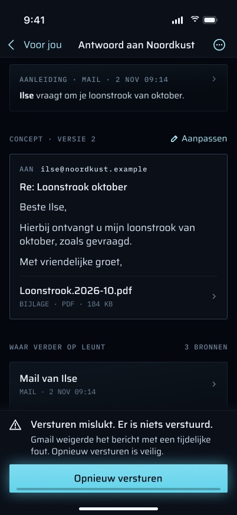

> **Ontworpen, niet gebouwd:** "Versturen mislukt. Er is niets verstuurd." met **"Opnieuw versturen"**, en een rij "NIET VERSTUURD" die in Voor jou blijft staan. In de code is `failed` een definitieve toestand zonder actie. `GET /proposals` (de lijstroute) bevat wel mislukkingen van de afgelopen 7 dagen, maar de telefoon leest die route niet: Voor jou leest `/inbox`, dat alleen `pending` telt. Een mislukking bereikt Martin via de `SYSTEM`-push hieronder, niet via de lijst.

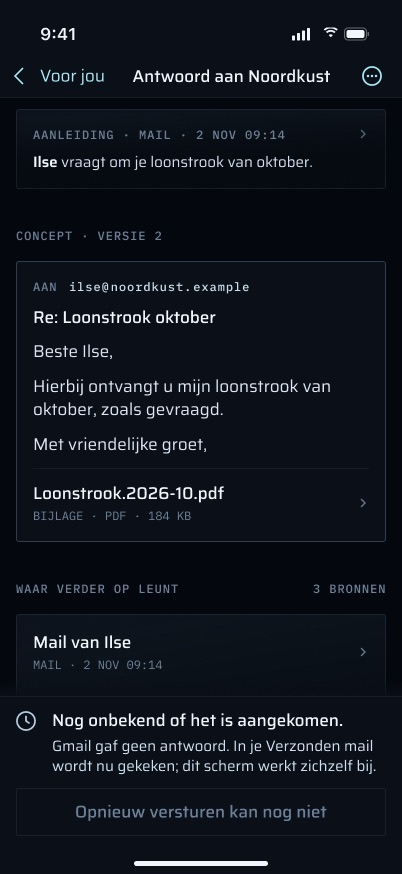

> **Ontworpen, niet gebouwd (deels):** "Nog onbekend of het is aangekomen." is echt gedrag van de **worker**, zonder eigen schermtekst. Een time-out, een socket-reset of een 5xx laat de rij in `sending` staan. Na 10 minuten (`RECOVERY_AFTER_MS`) vraagt het herstel de map Verzonden van Gmail (alleen-lezen), hooguit 3 aanroepen per tik, en verstuurt nooit opnieuw. Wordt het bericht gevonden, dan rondt het herstel het af als verstuurd. Is het 30 minuten na de claim nog niet gevonden (`NOT_FOUND_FAIL_MS`), dan wordt het voorstel `failed`, met de push "Versturen onzeker: …". De telefoon toont de hele tijd "Wordt verstuurd…", en `followSend` geeft het na ongeveer 10 minuten op.

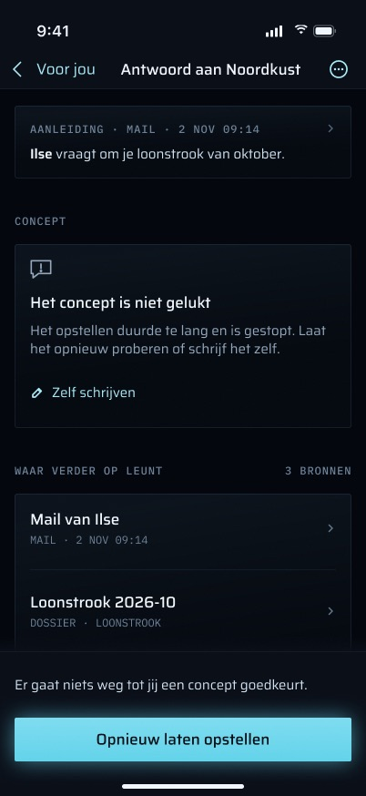

> **Ontworpen, niet gebouwd:** "Het concept is niet gelukt" met "Zelf schrijven" en "Opnieuw laten opstellen", en "Wordt opgesteld · Meestal binnen 5 minuten". Geen mobiele route zet een concept opnieuw in de wachtrij. De levenscyclustabel staat `draft-failed → drafting` toe als nieuwe poging van de opsteller, maar geen code voert die stap vandaag uit: de opsteller op de host (`ops/proposal-drafter.sh`, cron `*/5`) pakt alleen rijen op die al in `drafting` staan, dus `draft-failed` is in de praktijk definitief.

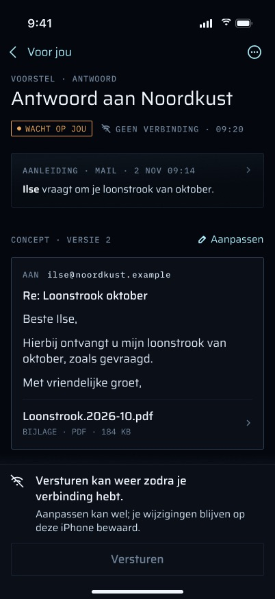

> **Ontworpen, niet gebouwd:** vooraf merken dat er geen verbinding is ("GEEN VERBINDING", "Versturen" van tevoren uitgeschakeld) en wijzigingen op de telefoon bewaren ("je wijzigingen blijven op deze iPhone bewaard"). De code merkt pas aan het mislukte verzoek dat hij offline is en bewaart geen wijzigingen.

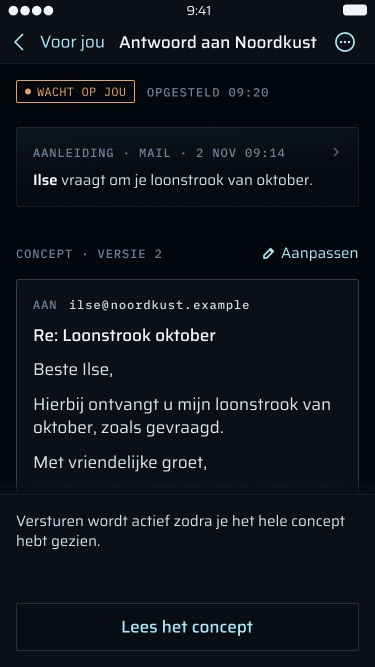

> **Ontworpen, niet gebouwd:** een leesdrempel, "Versturen wordt actief zodra je het hele concept hebt gezien." met "Lees het concept", die Versturen uitgeschakeld houdt tot het hele concept in beeld is geweest. De code heeft geen leesdrempel. De garantie die hij wel geeft, is dat de goedgekeurde payload precies die is die op het scherm stond toen Martin tikte.

## Ontworpen en gespecificeerd, nog niet (volledig) gebouwd

Elke functie die de definitieve frames, de spec of de brief vastleggen en die de code hierboven niet volledig doet. Bij elke functie staat wat ze doet, daarna wat er bestaat en wat ervoor nodig is. "Puur UI" betekent dat de server al alles levert wat de functie nodig heeft.

### Beslissen

**F-23 · Een antwoord alleen bevestigen als de optie gevolgen heeft.** De brief (§3, "Question detail") vraagt om optieknoppen over de volle breedte van 44 pt en een bevestiging alleen voor een optie die iets verandert (een taakstatus, een koppeling, een nieuwe taak), niet voor `none`.
**Status:** Deels gebouwd — opties en de bevestigingsdialoog bestaan (`ProposalScreen.questionSection`), maar elke optie wordt bevestigd, `none` inbegrepen. Nodig: de dialoog overslaan als `option.action == "none"`, en een testgeval in `ProposalModelTests`.

**F-24 · Vasthouden om te versturen.** Versturen is vasthouden, geen tik: een vulling loopt in 0,6 s met oplopende haptiek, het label luidt "Blijf vasthouden" en de hint "Loslaten stopt — er gaat dan niets weg."; te vroeg loslaten annuleert en er wordt niets gepost; alleen een voltooid vasthouden opent Face ID ("Houd vast om te versturen — daarna Face ID."). Het vasthouden is Martins bewuste handeling en Face ID het bewijs dat hij het is; het een vervangt het ander niet. Op elk moment te onderbreken (brief §2.6).
**Status:** Gebouwd — `SendHold` (de vasthoudtoestand, getest in `SendHoldTests`: te vroeg loslaten bereikt `approve()` en dus `ApprovalGate` nooit) en `HoldToSendButton` in `Proposals/ProposalViews.swift`; drie oplopende tikken tijdens de 0,6 s. Geen serverwijziging.

**F-25 · Een toegankelijke manier om te versturen zonder vasthouden.** Voor VoiceOver en Schakelbediening wordt het vasthouden aangeboden als één aangepaste actie die eerst om bevestiging vraagt ("tikken en bevestigen"); met Verminder beweging wordt de vulling een gewone voortgangsbalk (brief §2.6, §2.7).
**Status:** Gebouwd — `HoldToSendButton` biedt het vasthouden als één toegankelijkheidsactie die eerst vraagt ("Nu versturen?", met ontvanger en bijlagen) en daarna dezelfde verse Face ID. De vulling is al een voortgangsbalk, dus Verminder beweging verandert er niets aan.

**F-26 · Wat een verzending doet, vermeld boven de knop.** Eén regel onder de hint noemt de ontvangers en het aantal bijlagen: "NAAR ilse@noordkust.example · 1 BIJLAGE" / "· GEEN BIJLAGE" / "· 6 BIJLAGEN", en de acties staan vast onderaan het scherm (brief §3: "Versturen bottom-pinned").
**Status:** Gebouwd — de vastgezette balk (`ProposalScreen.barPanel`, inhoud uit `ProposalModel.sendBar`, getest in `ProposalBarTests`); bij de toegankelijkheidsgroottes staat dezelfde inhoud als sectie "Versturen" in de scroll.

**F-27 · Het Face ID-moment op het scherm.** Zolang de systeemsheet openstaat, zegt een balk in de app "Bevestig met Face ID · Naar Ilse, 1 bijlage. Annuleren stuurt niets."; na annuleren of mislukken zegt het scherm "Face ID afgebroken. Er is niets verstuurd. Houd opnieuw vast."
**Status:** Gebouwd — `ProposalModel.phase` (`confirming` / `cancelled`) en de balk "Bevestig met Face ID" / "Face ID afgebroken."; getest dat een geannuleerde Face ID niets post en dat een nieuw vasthouden het bericht wist.

**F-51 · Afwijzen met een vaste reden.** Vier redenen met één tik ("Klopt inhoudelijk niet", "Toon past niet", "Ik regel het zelf", "Niet meer nodig") boven de vrije tekst, en de sheet zegt "Het voorstel verdwijnt uit Voor jou."
**Status:** Gebouwd — vier vaste redenen met één tik boven de vrije tekst, "Het voorstel verdwijnt uit Voor jou.", verstuurd als de ene `reason`-tekst (`ProposalText.rejectReason`, getest). Opslaan als gestructureerde code zou een kolom vragen.

### Lezen waar het op steunt

**F-28 · Wanneer het concept is gemaakt.** De kop toont "OPGESTELD 09:20" tijdens het wachten, en "WORDT OPGESTELD · SINDS 09:41" tijdens het opstellen.
**Status:** Deels gebouwd — "OPGESTELD 09:20" en "SINDS 09:41" staan in de kop (`ProposalText.badgeNote`), maar uit de `createdAt` van de rij; het tijdstip van het concept zelf hoort bij F-34.

**F-29 · De oorspronkelijke mail openen.** De aanleidingskaart (via haar chevron), een bronrij "Mail van Ilse" en "Originele mail openen" in het ⋯-menu openen het bericht waarop het voorstel antwoordt.
**Status:** Nog te bouwen — nodig: een mobiele route die één `raw_emails`-rij levert (headers en tekst, achter de sessie, `no-store`), een mailweergave op de telefoon, een routetest, en dezelfde regel als in het dossier voor wat getoond mag worden. `type` en `id` van de aanleiding worden al geleverd.

**F-30 · Een bijlage of een aangehaald dossierdocument openen.** Elke bijlagerij en elke dossier-bronrij opent het document schermvullend.
**Status:** Deels gebouwd — elke bijlagerij en elke dossierbron opent `DocumentViewer` via `InboxRoute.document`; een onbeschikbare bijlage wordt doorgestreept en opent niet. Nog nodig: een test dat een definitief verwijderd of weggegooid aangehaald document (een bronrij) niet opent.

**F-31 · Bronnen als rijen: wat, wanneer, waarom, hoeveel.** "Waar verder op leunt · 3 BRONNEN" toont elke bron als rij met type en datum ("MAIL · 2 NOV 09:14", "DOSSIER · LOONSTROOK") en de reden van de opsteller.
**Status:** Deels gebouwd — bronnen zijn rijen met soort ("MAIL", "DOSSIER", "KAART · HALTE") en "3 BRONNEN"; de mail waarop het antwoordt heet "Mail van Ilse" met haar datum (`ProposalText.source`). Nog nodig: een datum per bron uit de server, en of `why` getoond wordt (de frames tonen het niet).

**F-32 · Het ⋯-menu.** Aanpassen, Afwijzen, "Originele mail openen" en "Kopieer concepttekst" (kopieert onderwerp en tekst naar het klembord).
**Status:** Deels gebouwd — het ⋯-menu met Aanpassen, Afwijzen en "Tekst kopiëren" (niet "Kopieer concepttekst": het systeemmenu breekt dat woord af). "Originele mail openen" wacht op F-29.

**F-33 · Hoe lang de andere kant al stil is.** De aanleiding van een opvolging luidt "25 DAGEN STIL · Jouw vraag van 7 okt staat nog open bij Ilse."
**Status:** Gebouwd — "AANLEIDING · 26 DAGEN STIL" en "**Jouw vraag van 7 okt** staat nog open bij Noordkust.", in Amsterdamse kalenderdagen op de telefoon berekend (`ProposalText.daysSilent`, getest).

**F-50 · Het totaal van de bijlagen.** "6 BIJLAGEN · 4,2 MB SAMEN" boven een lange bijlagenlijst.
**Status:** Gebouwd — "6 BIJLAGEN · 4,2 MB SAMEN" vanaf drie bijlagen (`ProposalText.attachmentsTotal`, getest).

### Versies en Martins wijzigingen

**F-34 · Genummerde conceptversies.** "CONCEPT · VERSIE 2": een nieuw concept wordt een nieuwe versie van hetzelfde voorstel, en eerdere versies worden bewaard.
**Status:** Nog te bouwen — vraagt eerst een besluit: vandaag is een nieuw concept een nieuw voorstel dat het oude vervangt (`create.ts` `supersedeOlder`), en `revision` is een besluitteller, geen conceptversie. Daarna: een kolom voor de conceptversie of een geschiedenistabel `proposal_drafts` (migratie; geen bewijs, geen ledger-gebeurtenis), `storeDraft` die versies schrijft, de versie in `GET`, en tests.

**F-35 · Martins wijzigingen gemarkeerd.** Bewerkte regels worden gemarkeerd en samengevat ("AANGEPAST DOOR JOU · 1 ZIN TOEGEVOEGD"), met "VERSIE 2 VAN VERDER BEWAARD", zowel op het scherm als in de editor (brief §3: de gouden regel zichtbaar vóór het goedkeuren).
**Status:** Deels gebouwd — Martins eigen wijzigingen tegen het concept van verder worden gemarkeerd en samengevat (`DraftChanges`, getest; "CONCEPT · AANGEPAST DOOR JOU", "AANGEPAST DOOR JOU · 1 ZIN TOEGEVOEGD"). "VERSIE 2 VAN VERDER" wacht op F-34; in de editor zelf wordt een toegevoegde zin niet gemarkeerd (alleen samengevat).

**F-36 · Een conflict biedt twee versies.** Als het concept onder Martin door veranderde: "Het concept is intussen gewijzigd. Er is niets verstuurd." met de wijzigingen van versie 3 gemarkeerd; met lokale wijzigingen een keuze "Jouw versie" / "Versie 3" ("Jouw versie houden", "Versie 3 gebruikt"), en een weggevallen zin vermeld als "JOUW ZIN NIET OPGENOMEN · BEWAARD IN DE GESCHIEDENIS".
**Status:** Nog te bouwen — hangt af van F-34 (versies en hun geschiedenis) en F-35 (diff); vandaag betekent een 409 "elders besloten of vervangen" en toont één bericht (F-18). Nodig: een samenvoegmodel op de telefoon, een geschiedenis die de server bijhoudt, en tests dat geen van beide keuzes kan versturen zonder opnieuw vasthouden en een verse Face ID.

**F-37 · De editor als eigen sheet.** "Concept aanpassen" opent een grote sheet met "Annuleren" links en "Klaar" rechts; Cc luidt "Iemand toevoegen"; "Bijlage uit je dossier" voegt een aangeboden document toe; elke bijlage heeft een bediening om haar weg te halen. "Annuleren" keert terug naar het concept zoals het was voordat de sheet openging.
**Status:** Gebouwd — `ProposalEditor` in `Proposals/ProposalEditor.swift`: een werkkopie; Klaar geeft haar aan `ProposalModel.replaceDraft` (alleen aangeboden bijlagen, logboekregel op 100 tekens; getest), Annuleren laat het concept zoals het was.

**F-40 · Vragen voordat wijzigingen worden weggegooid.** Annuleren of de editor met wijzigingen omlaag vegen vraagt "Wijzigingen weggooien? Je aanpassingen aan dit concept gaan verloren. Het oorspronkelijke concept blijft staan." met "Wijzigingen weggooien" en "Doorgaan met aanpassen" (brief §3: "swipe-dismiss with edits asks first").
**Status:** Deels gebouwd — Annuleren met wijzigingen vraagt "Wijzigingen weggooien?". Omlaag vegen met wijzigingen is geblokkeerd (`interactiveDismissDisabled`) maar vraagt niets: SwiftUI geeft geen signaal bij een poging tot sluiten.

### Na het besluit

**F-38 · Opnieuw versturen wat aantoonbaar niet is weggegaan.** "Versturen mislukt. Er is niets verstuurd. Gmail weigerde het bericht met een tijdelijke fout. Opnieuw versturen is veilig." met **"Opnieuw versturen"**, dat opnieuw vasthouden en een verse Face ID vraagt. Zolang de uitkomst onbekend is, luidt de knop "Opnieuw versturen kan nog niet" en is hij uitgeschakeld.
**Status:** Nog te bouwen — nodig: een overgang in de levenscyclus vanuit `failed` (vandaag `failed: []` in `proposal-state.ts`) die ALLEEN mag als de mislukking een aantoonbare niet-aflevering was (een weigering vóór het versturen, een Gmail-4xx) en nooit na "niet gevonden in Verzonden" van het herstel (dat kan wel zijn weggegaan); een opgeslagen soort mislukking zodat de server de twee kan onderscheiden (vandaag zegt alleen de Nederlandse `error`-tekst het); een route om opnieuw te versturen; en tests dat een onzekere verzending nooit opnieuw verstuurd kan worden. Of Martin besluit "een nieuwe poging is een nieuw voorstel" te houden en deze functie vervalt.

**F-39 · Een mislukte verzending blijft in Voor jou tot ze is afgehandeld.** Een rij "NIET VERSTUURD" in de lijst, en een push die de volgende stap noemt ("Versturen mislukt · Je antwoord aan Noordkust is niet verstuurd. Open het om opnieuw te versturen.").
**Status:** Deels gebouwd (alleen de telefoon) — een rij met een optionele `failedAt` leest "VOORSTEL · NIET VERSTUURD · 09:32" (`VoorJouList.meta` / `rowAge`), maar de server levert die nog niet: `waiting.ts` telt alleen `pending` voorstellen, dus een mislukking verdwijnt uit de lijst en uit de badge. Nodig: Martins besluit dat een mislukte verzending op hem wacht (de amberwet), daarna `loadWaiting` die recente `failed` voorstellen meeneemt, de rijsoort op de telefoon, en de pushtekst in `send.ts` `notSent` zodra F-38 bestaat (de push van vandaag zegt "Er is niets verzonden." zonder volgende stap).

**F-41 · De bevestiging van verzending.** Een badge "VERSTUURD", de sectie hernoemd tot "VERSTUURD BERICHT", en een afsluitende kaart "Verstuurd aan Ilse · Staat in je logboek en in de draad Loonstrook oktober · 09:31" met "Terug naar Voor jou".
**Status:** Deels gebouwd — badge "VERSTUURD", "VERSTUURD BERICHT", de kaart "Verstuurd aan Ilse · Staat in je logboek en in de draad …" en "Terug naar Voor jou". Het tijdstip ontbreekt: `sentAt` wordt niet geleverd.

**F-42 · Uitkomst onbekend, duidelijk gezegd.** "Nog onbekend of het is aangekomen. Gmail gaf geen antwoord. In je Verzonden mail wordt nu gekeken; dit scherm werkt zichzelf bij."
**Status:** Deels gebouwd — de telefoon toont de toestand ("Nog onbekend of het is aangekomen.", "Controle sinds HH:MM", uitgeschakeld "Opnieuw versturen kan nog niet") zodra `GET` het claimtijdstip `sendingAt` levert en dat langer dan `RECOVERY_AFTER_MS` (10 minuten) geleden is (`ProposalModel.outcomeUnknown`), en `followSend` volgt nu 40 minuten. De server levert `sendingAt` nog niet, dus vandaag blijft het "Wordt verstuurd…". Het herstel van de worker bestaat en verstuurt nooit opnieuw (`send.ts`: na `RECOVERY_AFTER_MS` vraagt het Verzonden, rondt af als verstuurd wanneer gevonden, mislukt met "Versturen onzeker" na `NOT_FOUND_FAIL_MS`). De telefoon toont de hele tijd "Wordt verstuurd…" en `followSend` stopt na ongeveer 10 minuten. Nodig: dat de server zegt dat een verzending in herstel is (bijvoorbeeld het claimtijdstip, of een herstelvlag, in `GET`), de tekst, en een volglus die het herstelvenster van 30 minuten overleeft.

**F-43 · Wordt opgesteld.** "WORDT OPGESTELD · SINDS 09:41", "Wordt opnieuw opgesteld · Meestal binnen 5 minuten. Je krijgt een melding als het klaar is.", een skeletconcept, en "Versturen kan zodra er een concept staat." onder een uitgeschakeld Versturen.
**Status:** Gebouwd — badge "WORDT OPGESTELD · SINDS 09:41", `DraftingCard` met skelet en "Versturen kan zodra er een concept staat." onder een uitgeschakeld Versturen.

**F-44 · Opnieuw opstellen na een mislukt concept.** "Het concept is niet gelukt · Het opstellen duurde te lang en is gestopt." met **"Opnieuw laten opstellen"** en "Er gaat niets weg tot jij een concept goedkeurt."
**Status:** Nog te bouwen — de levenscyclus staat `draft-failed → drafting` toe en de opsteller op de host (`ops/proposal-drafter.sh`) pakt `drafting`-rijen op, maar geen route voert de stap uit en de opgeslagen `error` (wordt geleverd) wordt niet getoond. Nodig: een mobiele route plus routerprocedure voor de stap, UI en tests.

**F-45 · Zelf schrijven.** "Zelf schrijven" bij een mislukt concept opent de editor op een leeg concept, geadresseerd vanuit de opgeslagen context.
**Status:** Nog te bouwen — nodig: een serverprocedure die een `draft-failed` voorstel omzet in `pending` met een handmatige payload (vastgelegd als Martins eigen tekst voor de gouden regel: geen modeluitvoer om tegen te vergelijken), afgebakend met dezelfde contextcontrole als goedkeuren; de editor (F-37); en tests.

### Offline, kleine schermen, terugkoppeling

**F-46 · Vóór het handelen weten dat er geen verbinding is.** "GEEN VERBINDING · 09:20" in de kop, Versturen uitgeschakeld met de reden "Versturen kan weer zodra je verbinding hebt." (brief §2.4: acties die de server nodig hebben, worden met reden uitgeschakeld, nooit stilletjes).
**Status:** Gebouwd — `EnvironmentValues.networkOffline` (gezet in `RootView` uit `UploadCenter.isOffline`); "GEEN VERBINDING" in de kop en Versturen uitgeschakeld met de reden. De tweede zin zegt eerlijk dat wijzigingen alleen blijven zolang het scherm openstaat (F-47).

**F-47 · Wijzigingen op de iPhone bewaren.** "Aanpassen kan wel; je wijzigingen blijven op deze iPhone bewaard." Wijzigingen overleven het verlaten van het scherm en een herstart van de app, tot ze verstuurd, afgewezen of vervangen zijn.
**Status:** Nog te bouwen — nodig: een conceptopslag op het toestel, met als sleutel voorstel-id en revisie, met bestandsbeveiliging, bij uitloggen gewist door het sessie-epoch zoals elke andere opslag, en weggegooid zodra de revisie op de server verder is (nooit verouderd verstuurd). Vandaag leven wijzigingen alleen in het geheugen. Tests: overleeft een herstart, gewist bij uitloggen, nooit gepost na een 409.

**F-48 · Haptiek op de momenten die ertoe doen** (brief §2.5): `.success` wanneer de server de goedkeuring accepteert (niet bij het indrukken), een tweede `.success` wanneer de toestand `sent` wordt terwijl het scherm openstaat, `.success` bij een antwoord, `.impact(.soft)` bij een bevestigde afwijzing (afwijzen is geen mislukking), `.error` bij een mislukte actie, en oplopende terugkoppeling tijdens het vasthouden (F-24). Overgeslagen als systeemhaptiek uitstaat.
**Status:** Gebouwd — `.sensoryFeedback` op `ProposalModel.successes` / `softs` / `errors` (goedkeuring geaccepteerd, `sent` terwijl het scherm openstaat, een antwoord; een zachte tik bij afwijzen; `.error` bij een mislukte actie) en oplopende tikken tijdens het vasthouden. iOS slaat ze over als systeemhaptiek uitstaat.

**F-49 · Het hele concept lezen vóór het versturen.** Op een klein scherm (iPhone SE) blijft Versturen uitgeschakeld tot het hele concept in beeld is gescrold: "Versturen wordt actief zodra je het hele concept hebt gezien." met "Lees het concept", dat naar het einde scrolt.
**Status:** Gebouwd — het einde van de conceptkaart meldt zich via `onScrollVisibilityChange` (`ProposalModel.markDraftSeen`, een vergrendeling die niet terugvalt); tot dan zegt de balk "Versturen wordt actief zodra je het hele concept hebt gezien." met "Lees het concept". Een concept dat past, is meteen gezien.

**F-52 · Een skelet tijdens het laden.** Het eerste frame toont binnen 100 ms de vorm van het scherm, nooit een kaal draaiend wieltje (brief §2.1, §2.4).
**Status:** Gebouwd — `ProposalSkeleton` in plaats van een kaal wieltje.

**F-53 · Voortgang in de knop.** Goedkeuren, afwijzen, beantwoorden en opnieuw versturen tonen binnen 100 ms voortgang in de ingedrukte knop, nooit een schermvullende blokkade (brief §2.1).
**Status:** Nog te bouwen — `Auth/AuthButton.swift` heeft geen voortgangstoestand; de knoppen zijn alleen uitgeschakeld zolang `isBusy`. Alleen iOS.

**F-54 · Geen actie die alleen opent op antwoordmeldingen.** "Bekijken" weghalen bij `PROPOSAL`, `REMINDER` en `FOLLOW_UP` (een actie die alleen opent, doet hetzelfde als een tik; brief §3 "Notifications"); vragen houden hun opties, en niets op een melding kan ooit versturen.
**Status:** Nog te bouwen — alleen iOS: `Push/NotificationCategories.swift` (`openAction`) en de bijbehorende tests; `NotificationRouter` blijft de gewone tik als "openen" behandelen.

## Privacy en beveiliging

- **Twee deuren.** De app-vergrendeling (gaat weer aan bij een koude start en na meer dan vijf minuten weg; Face ID wordt gevraagd wanneer Martin een afgeschermd tabblad opent) schermt het tabblad Voor jou af en daarmee dit scherm. De verzendpoort (`ApprovalGate`) is een tweede, verse Face ID bij **elke** verzending. Afwijzen, beantwoorden en de voorgestelde taak aanmaken vragen alleen een ontgrendelde app. Overzicht is niet afgeschermd, maar toont in vergrendelde toestand alleen het aantal en geen rijen, dus het kan geen voorstel openen tot de app ontgrendeld is.
- **Beantwoorden vanuit een melding slaat de app-vergrendeling over.** De acties `answer.<n>` van een vraag zijn `.authenticationRequired`, niet `.foreground`: iOS vereist dat de TELEFOON ontgrendeld is, daarna wordt het antwoord gepost zonder dat de app opent en zonder de eigen Face ID van verder. Dat is aanvaardbaar omdat een antwoord niets naar buiten verstuurt, maar het is een zwakkere deur dan die van het scherm.
- **De server kan Face ID niet zien.** Hij vertrouwt op het sessiecookie en de revisie (Plan 2, "Not grounded in code"). De poort bestaat zodat iemand die een opgepakte, ontgrendelde telefoon vasthoudt, niet met één tik namens Martin kan versturen.
- **Ontvangers en bijlagen worden door de server afgebakend**, niet door de telefoon. Goedkeuren accepteert alleen adressen en documenten uit de context die de worker bij het opstellen opsloeg.
- **Vergrendelscherm.** Voorstelpushes hebben een titel als "Voorstel: <ask>". Met verborgen voorvertoningen toont het vergrendelscherm alleen "Nieuw bericht van verder" (`hiddenPreviewsBodyPlaceholder`). Widgets op het vergrendelscherm tonen alleen aantallen. Widgets op het beginscherm kunnen titels van items tonen en het voorstel via zijn link openen, waarna de app-vergrendeling volgt.
- **Opgeslagen op de telefoon:** niets van dit scherm. Het voorsteldetail en eventuele wijzigingen leven in het geheugen. Het sessiecookie staat in de Keychain (`AfterFirstUnlockThisDeviceOnly`). De widget-momentopname (App Group, `completeUntilFirstUserAuthentication`) bevat titels uit Voor jou, geen concepttekst. De extensie registreert per vraag een categorie `q.<id>` bij iOS (voorstel-id plus optielabels, hooguit 40 tekens elk) en houdt hun volgorde bij in `push/q-order.json` in de App Group, dat alleen categorie-id's bevat.
- **Uitloggen** (Meer → Uitloggen, of elke 401) wist de sessie uit de Keychain, beëindigt het sessie-epoch zodat elke opslag zijn dossierinhoud vergeet, en wist de widget-momentopname.

## Regels die het volgt

- **Niets wordt verstuurd zonder dat Martin de definitieve tekst goedkeurt.** De goedgekeurde payload is de momentopname van vóór Face ID. De verzendjob verstuurt `final_payload` en niets anders. Een meldingsactie kan nooit versturen (zie hieronder).
- **Hooguit één bericht per voorstel.** De Message-ID wordt opgeslagen vóór de Gmail-aanroep. Naar een rij die in `sending` blijft hangen, wordt gevraagd; ze wordt nooit opnieuw verstuurd. Alleen een aantoonbare niet-aflevering (een weigering vóór het versturen, een Gmail-4xx, een 429) mag de claim op de rij opheffen of haar als "Niet verstuurd" op mislukt zetten. Een 429 zet haar terug op `approved` voor een latere tik. De enige andere weg naar `failed` is "na 30 minuten niet gevonden in Verzonden" van het herstel, en die is uitdrukkelijk GEEN bewijs: de push zegt dat de mail MOGELIJK verstuurd is.
- **AI-uitvoer is een suggestie.** Opstellen voegt niets toe. Goedkeuren en afwijzen voegen niets toe. Het enige bewijs dat een antwoord oplevert, is de uitgaande `entry.created` nadat Gmail de mail accepteerde. Een beantwoorde vraag voegt alleen toe wat haar bestaande procedure toevoegt. De modeluitvoer, het oordeel en de diff worden op het voorstel bewaard (de gouden regel).
- **Amber alleen voor wat op Martin wacht.** "WACHT OP JOU" en de amber deadline verschijnen alleen bij `pending`.
- De archiveeruitzondering en de geldregels gelden niet voor dit scherm.

## Meldingen en haptiek

| Push | Van | Categorie / niveau | Tekst | Opent |
|---|---|---|---|---|
| Nieuw voorstel | `proposalPush` (`ops/proposals-store.ts`) | `PROPOSAL`. Tijdgevoelig bij Verder-prioriteit, anders actief | "Voorstel: <ask>" / "Antwoord klaar voor <wie>. Bekijk en verstuur." of, bij een vraag, "Een vraag over <wie>. Kies een antwoord." Vervangt de push van de mail of brief op het vergrendelscherm (zelfde draad en samenvouw-id) | Het voorstel |
| Herinnering, eenmalig, voor een voorstel dat 24 uur na aanmaak nog `pending` is | `clocks.ts` `remind` | `REMINDER`. Tijdgevoelig bij Verder-prioriteit, actief bij een schuldeiser, anders passief | "Wacht nog: <ask>" / "Dit voorstel wacht al een dag op je." | Het voorstel |
| Opvolging aangemaakt | `clocks.ts` `chaseOne` | `FOLLOW_UP`. Tijdgevoelig bij Verder, actief bij een schuldeiser | "Nog geen antwoord van <wie> sinds <dd-mm>" / "verder heeft een herinnering voor je klaargezet." Verstuurd wanneer de opvolging wordt aangemaakt, voordat ze is opgesteld | Het opvolgingsvoorstel |
| Verzending geweigerd | `send.ts` `notSent` | `SYSTEM`, tijdgevoelig | "Niet verstuurd: <ask>" / "<reden>. Er is niets verzonden." | Het voorstel |
| Verzending onzeker | herstel in `send.ts` | `SYSTEM`, tijdgevoelig | "Versturen onzeker: <ask>" / "De mail is MOGELIJK verstuurd. Kijk eerst in Gmail › Verzonden voordat je opnieuw goedkeurt." | Het voorstel |
| Verstuurd maar logboek mislukt (na 3 pogingen) | `send.ts` `tryFinish` | `SYSTEM`, tijdgevoelig | "Mail VERSTUURD, logboek ontbreekt" / "<ask> — de mail is verzonden (Gmail <id>), maar de logboekregel kon niet worden geschreven: <fout>" | Het voorstel |

De klokken (`proposals.clock`, elke 15 minuten) pushen alleen van 08:00 tot 22:00, Amsterdamse tijd; wat 's nachts verviel, gaat bij de eerste ochtendtik de deur uit. De pushes voor nieuwe voorstellen en voor verzendingen zijn niet aan die uren gebonden.

**F-21 · De zes voorstelpushes, het klokvenster van 08:00–22:00, en een push wanneer een concept klaar is.** **Status:** Gebouwd (`apps/worker/src/ops/proposals-store.ts` `proposalPush`, `apps/worker/src/proposals/clocks.ts`, `apps/worker/src/proposals/send.ts`, allemaal via `apps/worker/src/notify/notify.ts`).

**Beantwoorden vanuit de melding.** Een vraagpush draagt `options` (hooguit 4, elk afgekapt op 40 tekens) en `revision`. De service-extensie `VerderNotify` registreert per voorstel een categorie `q.<id>`. Ze voegt die categorie samen met de vaste negen en houdt de 20 nieuwste vraagcategorieën aan. Lang drukken op de push toont dan de optielabels. `NotificationRouter` post `{ revision, option }` naar `…/answer`, en alleen als het id van de categorie en de link van de push hetzelfde voorstel noemen (bij een verschil wordt het genegeerd, niet beantwoord en niet geopend). Een geslaagd antwoord ververst Voor jou en de badge. Een mislukt antwoord (geen sessie, een 409 omdat het op het web al beantwoord is, een 400, het netwerk) verandert niets, wordt **nooit opnieuw geprobeerd**, en opent in plaats daarvan het voorstel. Gemeten op iOS 27.2, 2026-11-01: een testpush toonde "Ja / Nee" bij lang drukken. Een antwoord of opvolging kan nooit op deze manier worden beantwoord. De server weigert dat met 400 ("only a question can be answered"), en de enige actie op die categorieën is "Bekijken", die het voorstel opent.

**F-22 · Een vraag beantwoorden vanuit de melding.** **Status:** Gebouwd (`apps/ios/VerderNotify/NotificationService.swift`, `Push/QuestionCategories.swift`, `Push/NotificationRouter.swift`; gemeten op iOS 27.2, 2026-11-01). "Bekijken" weghalen bij de antwoordcategorieën is F-54.

**Haptiek:** zie F-48 — `.success` bij een geaccepteerde goedkeuring en bij `sent` terwijl het scherm openstaat, `.impact(.soft)` bij afwijzen, `.error` bij een mislukte actie, en drie oplopende tikken tijdens het vasthouden.

## Offline gedrag en synchronisatie

- Geen cache. Elke keer openen doet een verse `GET`, en elk besluit herlaadt daarna van de server, zodat het scherm altijd toont waarop goedkeuren nu zou handelen.
- Geen wachtrij. Anders dan bij scans wordt een besluit niet voor later vastgehouden. Komt het niet door, dan herhaalt Martin het.
- De badge en Voor jou worden bijgewerkt via `badge.sync` (`*/5`) en via het verversen wanneer de stapel leeg is.

## Bekende grenzen en wat niet gemeten is

- Het hele herontwerp in de frames is niet gebouwd: vasthouden om te versturen, versies en diff-markering, de editor-sheet, de keuze tussen twee versies bij een 409, het ⋯-menu, vaste afwijsredenen, "Opnieuw versturen", "Opnieuw laten opstellen", de leesdrempel, offline bewaren en de Face ID-berichten in de app. Een aantal daarvan vraagt serverwerk: conceptversies, een route voor opnieuw opstellen, en ofwel een route om een mislukte verzending opnieuw te versturen, ofwel een besluit om "een nieuwe poging is een nieuw voorstel" te houden.
- Gmail vervangt bij het versturen de Message-ID van de client (gemeten 2026-10-31), dus het herstel leunt op de terugvaloptie via draad/onderwerp/tijd. Die terugvaloptie vond de ene testmail. Dubbelzinnige treffers worden nooit automatisch gekozen.
- `followSend` stopt na ongeveer 10 minuten, dus een herstel dat langer duurt, is pas zichtbaar na het opnieuw openen van het scherm.
- **Nog niet gemeten:** de vertraging van een echte Verder-mail tot zijn push en voorstel (Plan 2, taken 8/10); een gescande Verder-brief die een voorstel oplevert (Plan 2, taak 21 stap 9); en de vertraging van de badge na een echt besluit. Volgens CLAUDE.md wachten die op echte mail en worden ze nooit in scène gezet.
- De eerste echte verzending (2026-10-31, een opvolging aan Verder) ging na goedkeuring in ongeveer 30 seconden van concept naar verstuurd. Het ledger schoof precies één `entry.created` op.

## Waar in de code

**iOS**
- `apps/ios/Verder/Proposals/ProposalScreen.swift`: het scherm, de editor ter plekke, de afwijssheet en de vraagsectie
- `apps/ios/Verder/Proposals/ProposalModel.swift`: laden, bewerken, `approve` / `reject` / `answer` / `createTask`, `followSend`, en de Nederlandse teksten
- `apps/ios/Verder/Proposals/ProposalDTO.swift`: `ProposalDetail`, `ReplyDraft`, de request-bodies, `ProposalFormat`
- `apps/ios/Verder/Proposals/ApprovalGate.swift`: de verse Face ID bij elke verzending
- `apps/ios/Verder/Inbox/VoorJouTab.swift`: de route naar het scherm
- `apps/ios/Verder/Push/DeepLink.swift`, `NotificationRouter.swift`, `NotificationCategories.swift`, `QuestionCategories.swift`; `apps/ios/VerderNotify/NotificationService.swift`
- `apps/ios/Verder/Auth/AppLock.swift` (`LockPolicy`), `AuthModel.swift` (wissen bij uitloggen)

**Serverroutes** (`apps/web/src/app/api/mobile/v1/proposals/`)
- `[id]/route.ts`: GET detail
- `[id]/approve/route.ts`, `[id]/reject/route.ts`, `[id]/answer/route.ts`, `[id]/task/route.ts`
- `route.ts`: GET lijst (wordt geleverd, maar niet door de telefoon gelezen)

**Gedeelde logica en worker**
- `packages/api/src/routers/proposals.ts`: `get`, `approve`, `reject`, `answer`, `createProposedTask`
- `packages/api/src/proposal-state.ts`: de levenscyclustabel, `verdictFor`, `proposalDiff`
- `packages/api/src/waiting.ts`: wat telt als wachtend op Martin
- `apps/worker/src/proposals/send.ts`: claimen, versturen, herstel, mislukkingspushes
- `apps/worker/src/proposals/clocks.ts`: herinnering, opvolging, vervallen taak, stille uren
- `apps/worker/src/proposals/create.ts`, `context.ts`, `validate-draft.ts`; `apps/worker/src/ops/proposals-store.ts`; `ops/proposal-drafter.sh`

**Tests**
- `apps/ios/VerderTests/ProposalModelTests.swift`: exacte payload en revisie, momentopname vóór Face ID, een geannuleerde Face ID verstuurt niets, herladen bij 409, definitief verwijderde bijlage, alleen aangeboden bijlagen, taak alleen na een tik, servertarget op opties, `followSend`
- `apps/ios/VerderTests/ApprovalGateTests.swift`, `NotificationRouterTests.swift`, `QuestionCategoriesTests.swift`, `DeepLinkTests.swift`, `NotificationCategoriesTests.swift`
- `apps/web/src/app/api/mobile/v1/proposals/**/route.test.ts`
- `packages/api/src/routers/proposals.test.ts`, `packages/api/src/proposal-state.test.ts`
- `apps/worker/src/proposals/send.test.ts`, `clocks.test.ts`, `create.test.ts`, `validate-draft.test.ts`, `apps/worker/src/ops/proposals-store.test.ts`

## Alle frames

Alle frames komen uit de Figma-sectie `proposal · final` (node `307:1047`), opnieuw geëxporteerd op 2026-11-03. "Gebouwd" zegt of de toestand in de code bestaat zoals getekend.

| Frame | Toestand die het toont | Gebouwd |
|---|---|---|
| [Proposal / wacht op jou](frames/Proposal_wacht_op_jou.jpg) | Een openstaand antwoord, gescrold, met de aanleiding, concept versie 2, één bijlage, "Waar verder op leunt" en de vasthoudbalk om te versturen | Ja (de systeemterugknop is een glazen chevron zonder "Voor jou") |
| [Proposal / opvolging](frames/Proposal_opvolging.jpg) | Een openstaande opvolging: "25 DAGEN STIL", "Jouw vraag van 7 okt staat nog open bij Ilse." | Ja ("26 DAGEN STIL" op de klok van de fixture) |
| [Proposal / vasthouden](frames/Proposal_vasthouden.jpg) | Vasthouden bezig: "Blijf vasthouden", "Loslaten stopt — er gaat dan niets weg." | Ja |
| [Proposal / Face ID](frames/Proposal_Face_ID.jpg) | De Face ID-systeemsheet over het concept, balk "Bevestig met Face ID" | Balk ja; de systeemsheet is van iOS |
| [Proposal / Face ID afgebroken](frames/Proposal_Face_ID_afgebroken.jpg) | Face ID geannuleerd: "Er is niets verstuurd." | Ja |
| [Proposal / wordt verstuurd](frames/Proposal_wordt_verstuurd.jpg) | Goedgekeurd, wacht op de worker: "Goedgekeurd met Face ID", "Wordt verstuurd…" | Ja; "met Face ID" alleen na een goedkeuring op dit scherm |
| [Proposal / verstuurd](frames/Proposal_verstuurd.jpg) | Verstuurd: "Verstuurd aan Ilse", "Staat in je logboek…", "Terug naar Voor jou" | Ja, zonder tijdstip (`sentAt` ontbreekt) |
| [Proposal / geweigerd door Gmail](frames/Proposal_geweigerd_door_Gmail.jpg) | Versturen mislukt, "Opnieuw versturen" | Mislukking ja; "Opnieuw versturen" nee (F-38) |
| [Voor jou / niet verstuurd in de lijst](frames/Voor_jou_niet_verstuurd_in_de_lijst.jpg) | De pushbanner "Versturen mislukt" en een rij "NIET VERSTUURD" in Voor jou | Push ja (andere tekst); rij nee |
| [Proposal / uitkomst onbekend](frames/Proposal_uitkomst_onbekend.jpg) | Gmail gaf geen antwoord; Verzonden wordt nagekeken | Worker ja; schermtekst nee |
| [Proposal / intussen gewijzigd (409)](frames/Proposal_intussen_gewijzigd_409.jpg) | Conflict: versie 3 met gemarkeerde wijzigingen | Nee (409 toont één bericht) |
| [Proposal / 409 met jouw aanpassingen](frames/Proposal_409_met_jouw_aanpassingen.jpg) | Conflict met lokale wijzigingen: kies "Jouw versie" of "Versie 3" | Nee |
| [Proposal / 409 · jouw versie gekozen](frames/Proposal_409_jouw_versie_gekozen.jpg) | Martin hield zijn versie | Nee |
| [Proposal / 409 · versie 3 gebruikt](frames/Proposal_409_versie_3_gebruikt.jpg) | Martin nam versie 3; zijn zin bewaard in de geschiedenis | Nee |
| [Proposal / offline](frames/Proposal_offline.jpg) | Geen verbinding; Versturen uitgeschakeld; wijzigingen op de telefoon bewaard | Ja; wijzigingen blijven alleen zolang het scherm openstaat (F-47) |
| [Proposal / geen concept](frames/Proposal_geen_concept.jpg) | Opstellen mislukt: "Zelf schrijven", "Opnieuw laten opstellen" | Kaart ja; "Zelf schrijven" en "Opnieuw laten opstellen" nee (F-44, F-45) |
| [Proposal / wordt opgesteld](frames/Proposal_wordt_opgesteld.jpg) | Wordt opnieuw opgesteld, skeletconcept | Ja |
| [Proposal / aangepast door jou](frames/Proposal_aangepast_door_jou.jpg) | Concept bewerkt door Martin, wijziging gemarkeerd | Ja |
| [Proposal / lange titels · begin](frames/Proposal_lange_titels_begin.jpg) | Lang onderwerp, zes bijlagen, leesdrempel "Lees het concept" | Ja |
| [Proposal / lange titels · 6 bijlagen](frames/Proposal_lange_titels_6_bijlagen.jpg) | Gescrold naar zes bijlagen, "6 BIJLAGEN · 4,2 MB SAMEN" | Ja |
| [Proposal / ⋯ menu](frames/Proposal_menu.jpg) | Menu: Aanpassen, Afwijzen, Originele mail openen, Kopieer concepttekst | Ja, zonder "Originele mail openen" (F-29) |
| [Aanpassen / editor · typen](frames/Aanpassen_editor_typen.jpg) | Editor-sheet met toetsenbord, nieuwe zin gemarkeerd | Sheet ja; geen markering in het tekstveld, geen bijlagebalk boven het toetsenbord |
| [Aanpassen / jouw zin in versie 3](frames/Aanpassen_jouw_zin_in_versie_3.jpg) | Editor na het overnemen van versie 3, met Martins zin ingevoegd | Nee |
| [Aanpassen / wijzigingen weggooien?](frames/Aanpassen_wijzigingen_weggooien.jpg) | Bevestiging om wijzigingen weg te gooien | Ja (iOS tekent de vraag vanaf Annuleren) |
| [Afwijzen / reden](frames/Afwijzen_reden.jpg) | Afwijssheet met vaste redenen en vrije tekst | Ja |
| [Proposal / iPhone SE · concept nog niet gezien](frames/Proposal_iPhone_SE_concept_nog_niet_gezien.jpg) | Kleine telefoon, concept nog niet helemaal gezien, "Lees het concept" | Ja |
| [Proposal / iPhone SE · concept gelezen](frames/Proposal_iPhone_SE_concept_gelezen.jpg) | Kleine telefoon, concept gezien, Versturen actief | Ja |
| [Proposal / AX5 · begin](frames/Proposal_AX5_begin.jpg) | Grootste toegankelijkheidstekstgrootte, bovenkant van het scherm | Ja |
| [Proposal / AX5 · hele scroll](frames/Proposal_AX5_hele_scroll.jpg) | Grootste tekstgrootte, de hele scroll | Ja |
| [Proposal / AX5 · uitkomst onbekend](frames/Proposal_AX5_uitkomst_onbekend.jpg) | Grootste tekstgrootte, uitkomst onbekend | Tekst nee |
| [Aanpassen / AX5 · in rust](frames/Aanpassen_AX5_in_rust.jpg) | Grootste tekstgrootte, editor-sheet in rust | Ja; adressen en bestandsnamen op één regel, in het midden afgekapt |
| [Proposal / AX5 · 409 kiezen](frames/Proposal_AX5_409_kiezen.jpg) | Grootste tekstgrootte, keuze tussen twee versies | Nee |
| [Afwijzen / AX5 · reden](frames/Afwijzen_AX5_reden.jpg) | Grootste tekstgrootte, afwijssheet | Ja |
