# Vraag, suggestie en taakdetail: functies

## Stand van de bouw

Gecontroleerd tegen de code op branch `feat/iphone-app` op 2026-11-03 (iOS in `apps/ios/Verder/`, mobiele routes in `apps/web/src/app/api/mobile/v1/`, routers in `packages/api/src/routers/`, worker in `apps/worker/src/`). Elke functie hieronder heeft precies één statusregel.

| Status | Aantal |
|---|---|
| **Gebouwd** | 26 |
| **Deels gebouwd** | 19 |
| **Nog te bouwen** | 19 |

De drie belangrijkste dingen die nog gebouwd moeten worden:

1. **Ongedaan maken, en de serverroutes die daarvoor nodig zijn.** Het ontwerp biedt na bijna elk besluit een ongedaan maken: "Brief losmaken" en "Ongedaan maken" na het beantwoorden van een vraag, een toast met ongedaan maken na "Niet relevant", en "Ongedaan maken" nadat een taak op "gedaan" is gezet. Voor geen van deze bestaat een serverroute. Twee ervan botsen met bestaande regels: `proposals.answer` is definitief, en `done`/`dropped` zijn definitief in `TASK_EDGES`. Martin moet over elk ervan beslissen voordat er UI wordt gebouwd (zie [Waar ontwerp en code verschillen](#waar-ontwerp-en-code-verschillen)).
2. **De bewerkingsdiff zichtbaar vóór het goedkeuren** (brief §3: "Edit diff visible before approve (golden rule)"). Dat betekent: tikken-om-te-bewerken per veld, "was: … / Zet terug", "N AANGEPAST" en "Goedkeuren · N aangepast", plus de velden die de telefoon nog niet biedt: het bedrag van de vordering en "Namens hen", "Gesprek" bij een logboekregel, en "Van wie" en het document zelf bij een documentsuggestie. Het model berekent de diff al (`SuggestionDetailModel.edits`), dus het meeste hiervan is UI-werk. "Van wie" en "Namens hen" vragen serverwerk.
3. **Offline- en sessie-verlopen-toestanden die het werk bewaren.** Het ontwerp toont een gecachte kopie gemarkeerd met "OFFLINE · BIJGEWERKT 14:02", uitgeschakelde besluiten met de reden erbij, bewerken nog toegestaan, en aanpassingen die een verlopen sessie overleven. Nu toont een mislukte lading alleen een foutregel, wordt niets gecachet en gaan de aanpassingen verloren bij een 401.

---

Dit zijn de drie detailschermen één niveau onder Voor jou. Op elk ervan neemt Martin één besluit over één item:

- **Vraag**: verder vraagt iets over de zaak en biedt antwoorden aan. In de code is dit geen eigen scherm. Het is een voorstel van het soort vraag, getoond op het voorstelscherm (`ProposalScreen`).
- **Suggestie**: iets wat verder vond in een mail, een document of een spraaknotitie. Het wordt pas een logboekregel, een documenttitel en -soort, een vordering of een taak als Martin het goedkeurt.
- **Taak**: een van Martins taken, met de statusstappen die ze nog mag maken.

Alleen Martin gebruikt de app. Dit document beschrijft wat de schermen doen: de **volledige functieset zoals ontworpen en gespecificeerd**, en per functie hoe ver de code is. Het visuele ontwerp valt erbuiten; dat staat in Figma: bestand `QDRL5zHNEOjPzLZqzd19Ii`, sectie `detail · final`, node `326:6980`. De 44 frames in `frames/` zijn op 2026-11-03 opnieuw uit die sectie geëxporteerd, nadat de tabbalk centraal was gerepareerd. Elke schermafbeelding gebruikt de synthetische fixture-dataset (Kade & Partners, Stroomnet Energie, Woonstichting Lindehof, Gemeente Westerlaan, Duinzorg), geen echte zaakgegevens. UI-teksten zijn in het Nederlands geciteerd, precies zoals de app ze toont of zoals het frame ze toont.

Bronnen voor de ontworpen functies: de definitieve frames; de spec `docs/superpowers/specs/2026-10-28-iphone-app-design.md` (§6.5, §7.2, §7.3, §12.9); de brief `docs/superpowers/specs/2026-11-01-iphone-design-brief.md` (§2.4 toestanden, §2.5 haptiek, §2.1 actiefeedback, §3 flowtabel); en plan 3 `docs/superpowers/plans/2026-10-31-iphone-app-plan-3.md` (taken 4, 7, 8).

## Doel

- **Eén item, één besluit.** De Voor jou-lijst geeft door aan een van deze schermen, en daar wordt het besluit genomen. De brief laat de lijst ook een ongewijzigd item met een veeg beslissen (zie [Beslissen zonder het scherm te openen](#beslissen-zonder-het-scherm-te-openen)).
- **De vragen van verder beantwoorden** over de zaak, bijvoorbeeld "hoort deze brief bij die vordering?". Elke optie voert één bestaande, gevalideerde actie uit op de server. Martin kan ook een eigen antwoord schrijven.
- **AI-uitvoer beoordelen.** Een suggestie is het voorstel van het model, en er komt niets van in het dossier totdat Martin het goedkeurt. Goedkeuren, aanpassen-en-goedkeuren en afwijzen worden elk als oordeel vastgelegd, samen met wat er is veranderd (de gouden regel).
- **Een taak verder brengen** langs hetzelfde gelogde statuspad dat de web-app gebruikt. De telefoon biedt alleen de stappen die de server toestaat.

## Hoe je er komt, en waar het heen leidt

#### Openen vanuit een Voor jou-rij

Een vraagrij opent `ProposalScreen` (`InboxRoute.proposal`), een suggestierij opent `SuggestionDetailView` (`InboxRoute.suggestion`), en een taakrij opent `TaskScreen` (`InboxRoute.task`).

**Status:** Gebouwd — `apps/ios/Verder/Inbox/VoorJouTab.swift` (`navigationDestination(for: InboxRoute.self)`).

#### Een taak openen vanuit Dossier

De takenkaart van Dossier, of een taak die aan een Tijdlijn-halte is gekoppeld, zet `TaskScreen` op de Dossier-stack (`DossierRoute.task`).

**Status:** Gebouwd — `apps/ios/Verder/Dossier/DossierTab.swift`.

#### Een vraag openen vanuit de push

Een tik op een vraagpush, of "Bekijken" op een push die de extensie niet in een `q.*`-categorie heeft omgezet, levert `verder://proposal/<uuid>` op. Dat selecteert Voor jou en zet `ProposalScreen` erop.

**Status:** Gebouwd — `apps/ios/Verder/Push/NotificationRouter.swift`, `Push/DeepLink.swift`.

#### Een suggestie of taak openen vanuit een link

`verder://suggestion/<uuid>` en `verder://task/<uuid>` openen Voor jou met dat scherm erop (`DeepLink.destination`). De spec wil "categories per kind, deep-linking to the item" (§7.3).

**Status:** Deels gebouwd — de app leest en routeert beide links (`Push/DeepLink.swift`), maar geen enkele push van de worker bevat er een. Deadlinepushes van taken linken naar `verder://inbox` (`apps/worker/src/proposals/clocks.ts`), dus een tik komt uit op de lijst en niet op de taak, en een suggestiepush bestaat niet. Nog nodig: de deadlinepush van de worker die naar `verder://task/<id>` linkt.

#### Een link die binnenkomt terwijl de app vergrendeld is, wacht

`verder://` is geen geregistreerd URL-schema, dus deze links komen alleen van een push of van verders eigen widget. Voor jou en Dossier zijn allebei `.lockGated(by: lock)`, dus geen van deze schermen bestaat zolang de app vergrendeld is. Een link die binnenkomt op een vergrendelde app wacht in `RootView` en opent zodra Face ID slaagt.

**Status:** Gebouwd — `apps/ios/Verder/App/RootView.swift`.

#### Terug naar de lijst, ververst

Elk scherm heeft de systeemterugknop ("Voor jou" of "Dossier"). Wanneer de Voor jou-stack terugkeert naar de wortel, ververst de lijst, zodat een item dat hier is beslist uit de lijst en de badge is verdwenen.

**Status:** Gebouwd — `VoorJouTab.onChange(of: path)`.

#### "Volgende in Voor jou · N"

Na een besluit opent een onderaan vastgezette knop het volgende wachtende item en zegt hoeveel er nog over zijn ("Volgende in Voor jou · 3"). Dit is een bewuste tik en nooit een automatische overgang: het plan verbiedt automatisch doorgaan na een verzending. Bij een taaksuggestie legt het frame uit waarom het aantal niet daalde: de suggestie is uit Voor jou verdwenen, maar de nieuwe taak wacht nu op Martin.

**Status:** Nog te bouwen — alleen UI. Het volgende item en het aantal kunnen uit `InboxStore` komen (servervolgorde, de ene `loadWaiting`-definitie). Er is een test nodig dat de knop nooit vanzelf afgaat.

#### Beslissen zonder het scherm te openen

Brief §3 (Voor jou-lijst): een ongewijzigde suggestie goedkeuren met één veeg (vooraan "Goedkeuren", achteraan "Niet relevant"); een taak gedaan markeren met één veeg ("Gedaan"); een contextmenu met dezelfde acties plus "Bekijken", met "wacht" en "mee bezig" daarvandaan bereikbaar; en bulkgoedkeuren alleen voor suggesties, nooit voor voorstellen. Deze gebruiken dezelfde serverroutes als de detailschermen. VoiceOver biedt veegacties aan als aangepaste acties (§2.7). Dit hoort bij de lijst (`../03-voor-jou/FEATURES.md`) en staat hier omdat het over deze items beslist.

**Status:** Nog te bouwen — geen `swipeActions` of `contextMenu` in `Inbox/VoorJouTab.swift`. De routes voor goedkeuren, afwijzen en status bestaan. Bulkgoedkeuren vraagt een route of een lus in de client, plus een test dat er nooit een voorstel bij kan zitten.

## Vraag — een vraag van verder

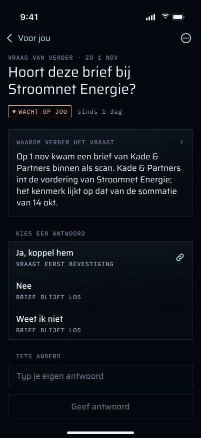

Een vraag is een voorstel met `kind = 'question'`. De voorstelschrijver (`ops/proposal-drafter.sh` → `storeDraft` in `apps/worker/src/ops/proposals-store.ts`) schrijft hem met een `prompt` en **2 tot 4 opties** (`validateDraft` in `apps/worker/src/proposals/validate-draft.ts` weigert elk ander aantal). Elke optie is een van vier acties, en `validateDraft` heeft ze al stuk voor stuk gecontroleerd tegen de context die verder verzamelde:

| Optie-actie | Wat het beantwoorden ervan op de server uitvoert | Ledger |
|---|---|---|
| `set-task-status` | `tasks.setStatus` op een taak in de context | **+1 `task.status`** |
| `link-document-to-debt` | `registry.debts.linkDocument` (een `debt_documents`-rij) | geen, want koppelingen aan vorderingen zijn geen bewijs |
| `create-task` | `tasks.create` met de titel en deadline van de optie | geen, want het aanmaken van een taak wordt niet gelogd |
| `none` | niets | geen |

#### Kop: wie, wat, en of het wacht

"WACHT OP JOU" zolang het voorstel `pending` is. Daarna de afzender (`trigger.from`, anders de naam van de partij, anders "Onbekend"), de opmerking "lijkt van Verder — afzender niet bevestigd" wanneer de afzender van een brief nog een gok is (spec §12.5), het soort ("vraag") met datum en tijd van de aanleiding, en het onderwerp van de aanleiding plus een uittreksel (hoogstens 300 tekens) als die er zijn.

**Status:** Gebouwd — `apps/ios/Verder/Proposals/ProposalScreen.swift`, uit `GET /api/mobile/v1/proposals/:id` (`proposals.get`).

#### Hoe lang het al wacht ("sinds 1 dag")

Naast "WACHT OP JOU", de leeftijd van de vraag.

**Status:** Nog te bouwen — alleen UI. `proposals.get` geeft `createdAt` al terug.

#### Wat ze vragen, wanneer uiterlijk, wat ontbreekt, waar verder op leunde

"Wat ze vragen" (de `ask`), "Uiterlijk <d-m>" (bijvoorbeeld "Uiterlijk 7-11", op de Amsterdamse kalender) in amber zolang het open staat, "Wat nog ontbreekt", en "Waar verder op leunt" als chips.

**Status:** Gebouwd — `Proposals/ProposalScreen.swift`.

#### "Waarom verder het vraagt"

Een kaart die in gewoon Nederlands zegt waarom verder het vraagt, bijvoorbeeld "Op 1 nov kwam een brief van Kade & Partners binnen als scan. Kade & Partners int de vordering van Stroomnet Energie; het kenmerk lijkt op dat van de sommatie van 14 okt.". Een chevron opent de bron. De spec eist dat de schrijver zegt waar hij op leunde, zodat Martin kan zien waarom (§6.5).

**Status:** Deels gebouwd — de `why` van elke bronvermelding wordt al teruggegeven (`reliedOn[].why` in `proposals.get`) en gedecodeerd (`ProposalDetail.Citation.why`), maar het scherm toont van elke bronvermelding alleen het label als chip. De schrijver schrijft geen lopende toelichting voor de vraag als geheel. Nog nodig: een `why`-tekst in de payload van de vraag (`validate-draft.ts` en de prompt van de schrijver), de kaart, en een link van de kaart naar de aangehaalde mail of het aangehaalde document.

#### Opties die zeggen wat ze doen

Eén knop per optie. Elke knop toont het label van het model en daaronder de Nederlandse beschrijving **van de server** van wat de optie doet (`renderTarget`): "Taak '<titel>' → <status>" (bijvoorbeeld "→ klaar"), "Document '<titel>' koppelen aan vordering <naam>", "Nieuwe taak '<titel>'" plus ", uiterlijk <d-m>" als er een datum is, of "Geen actie". Een knop toont nooit alleen de woorden van het model. Het ontwerp gebruikt een korte gevolgregel ("VRAAGT EERST BEVESTIGING", "BRIEF BLIJFT LOS").

**Status:** Gebouwd — `ProposalScreen.questionSection`, `ProposalModel.optionButtons`; vastgelegd door `ProposalModelTests.optionButtonShowsServerTarget`.

#### Alleen bevestigen bij een optie met gevolgen

Brief §3: "Confirm dialog only when the option has consequences." In de frames opent "Ja, koppel hem" een sheet, "Brief koppelen aan de vordering?", die uitlegt wat er gebeurt en dat Martin de brief later weer kan losmaken ("Je kunt hem daar later weer losmaken"). "Nee" en "Weet ik niet" worden direct vastgelegd, met een toast om het ongedaan te maken.

**Status:** Deels gebouwd — er bestaat een bevestigingsdialoog, met de serverbeschrijving van de optie als titel en het label van de optie als knop. Hij verschijnt bij **elke** optie, `none` inbegrepen. Nog nodig: een regel per actie (bevestigen bij `link-document-to-debt`, `set-task-status` en `create-task`; `none` direct vastleggen), de gevolgtekst, en het ongedaan maken waar vastleggen met één tik van afhangt (zie hieronder).

#### Antwoorden in eigen woorden

Een vrij tekstveld ("Iets anders…" in de code, "Typ je eigen antwoord" / "Geef antwoord" in het ontwerp) post `{ revision, freeText }` (getrimd, 1 tot 2000 tekens). Er wordt niets uitgevoerd. De tekst wordt op het voorstel opgeslagen als `finalPayload.answer.freeText` met oordeel `edited`.

**Status:** Gebouwd — `ProposalModel.answer(freeText:)`; vastgelegd door `ProposalModelTests.freeTextPostsFreeTextAndRevision`.

#### verder pakt een vrij antwoord op

Het beantwoorde frame belooft "verder bekijkt je antwoord. Er is nog niets gekoppeld; stelt verder iets voor, dan zie je dat in Voor jou."

**Status:** Nog te bouwen — geen code leest `finalPayload.answer.freeText`. Nodig: een workerstap die het antwoord teruggeeft aan de schrijver en een nieuw voorstel of een nieuwe suggestie oplevert, en een test dat die nooit uit zichzelf handelt.

#### De voorgestelde taak aanmaken

"Taak aanmaken: <titel>": een vraag kan, net als een antwoordmail, een voorgestelde taak bevatten. De knop post `POST /api/mobile/v1/proposals/:id/task` (`proposals.createProposedTask`), die de taak pas bij die tik aanmaakt, nooit bij het opstellen of beantwoorden. Een tweede tik geeft dezelfde taak terug (`created_task_id`), en de regel luidt dan "Taak aangemaakt: <titel>". Dit wordt niet gelogd (het aanmaken van een taak nooit), en het blijft beschikbaar nadat de vraag is beantwoord.

**Status:** Gebouwd — `ProposalScreen.swift`, `proposals/[id]/task/route.ts`.

#### De vraag afwijzen

"Afwijzen" opent een sheet met een optionele reden (hoogstens 1000 tekens op de server), net als bij een antwoordmail. Het voorstel wordt `rejected`, zonder ledger-event. Het ontwerp verplaatst dit naar het "…"-menu.

**Status:** Gebouwd — `ProposalScreen.swift`, `proposals/[id]/reject/route.ts`. Op dit scherm is nog geen "…"-menu.

#### Een antwoord wordt opnieuw gecontroleerd en in één transactie uitgevoerd

`proposals.answer`, in één transactie:

1. Het voorstel wordt vergrendeld (`FOR UPDATE`) en moet `pending` zijn bij de opgegeven `revision`. Anders is het antwoord **409** (een onbekend id is 404). De route geeft alleen `revision`, `option` en `freeText` door, en een body met zowel `option` als `freeText` wordt geweigerd (strikt schema, 400).
2. Het voorstel moet een vraag zijn. Elk ander soort is **400**, zodat een antwoord nooit een antwoordmail kan versturen.
3. De gekozen optie wordt opnieuw gevalideerd tegen de wereld zoals die **nu** is (`revalidateOption`): de taak moet nog in de context staan en de statusstap moet nog toegestaan zijn vanaf de huidige effectieve status van de taak; het document moet nog in de context staan en niet weggegooid of definitief verwijderd zijn; een nieuwe taak heeft een titel en een geldige datum nodig. Een mislukking is een **400** en er wordt niets geschreven.
4. De procedure van de optie draait onder Martins eigen aanroeper, binnen dezelfde transactie. Een weigering waar dan ook draait het hele antwoord terug.
5. Het voorstel gaat van `pending → sent` met `finalPayload.answer`, oordeel `approved` voor een optie of `edited` voor vrije tekst, `decidedAt`/`decidedBy`, en `revision + 1`.

`proposals` zelf is geen bewijs, en het antwoord voegt geen eigen ledger-event toe. Alleen de eigen procedure van de optie kan dat, en van de vier doet alleen `set-task-status` het. Een antwoord zit niet achter `ApprovalGate` (geen verse Face ID), omdat het niets naar buiten verstuurt.

**Status:** Gebouwd — `packages/api/src/routers/proposals.ts` (`answer`, `revalidateOption`), `proposals/[id]/answer/route.ts`.

#### Wat er gebeurde, na het beantwoorden

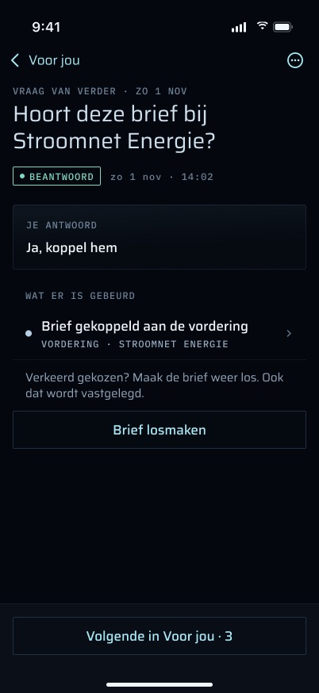

Het scherm wordt een verslag: een badge "BEANTWOORD" met de tijd, "JE ANTWOORD" (de gekozen optie of de geciteerde eigen tekst), en "WAT ER IS GEBEURD" met een rij die het resultaat opent, bijvoorbeeld "Brief gekoppeld aan de vordering · VORDERING · STROOMNET ENERGIE".

**Status:** Deels gebouwd — na een antwoord laadt het scherm opnieuw, verdwijnen de knoppen en luidt de algemene statusregel "Verstuurd.". Het antwoord wordt op de server opgeslagen (`finalPayload.answer`). Nog nodig: `proposals.get` die het antwoord teruggeeft en wat het opleverde (de taak, de koppeling aan de vordering, de nieuwe taak), de badge en beide kaarten, en de link naar Dossier.

#### Een antwoord ongedaan maken ("Brief losmaken", "Ongedaan maken")

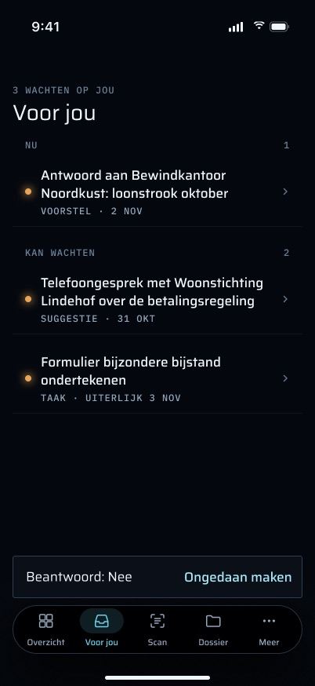

Na "Ja, koppel hem" biedt het beantwoorde scherm "Brief losmaken" ("Verkeerd gekozen? Maak de brief weer los. Ook dat wordt vastgelegd."). Na "Nee" of "Weet ik niet" toont Voor jou een toast, "Beantwoord: Nee · Ongedaan maken".

**Status:** Nog te bouwen — en in strijd met de server. `proposals.answer` zet het voorstel op `sent` zonder weg terug, en de mobiele API heeft geen route voor `registry.debts.unlinkDocument` (die bestaat op de webrouter). Een antwoord dat een taak op `done` of `dropped` zette kan nooit worden teruggedraaid, omdat die definitief zijn. Nodig: Martins besluit over wat ongedaan maken per actie betekent; een mobiele route om los te koppelen; een route die een `none`-antwoord terugzet naar `pending`; de toast; tests.

#### Rechtstreeks vanuit de melding antwoorden

Een vraagpush (`kind: "proposal"`) heeft de titel "Voorstel: <ask>" en de tekst "Een vraag over <wie>. Kies een antwoord." (`proposalPush` in `apps/worker/src/ops/proposals-store.ts`). Hij is `time-sensitive` als de aanleiding van Verder kwam en anders `active`. Hij bevat de optielabels (hoogstens 4, elk hoogstens 40 tekens) en de `revision` van het voorstel.

- De meldingsdienst-extensie (`VerderNotify`) maakt van de labels een categorie per vraag, `q.<proposal id>`, en laat de melding daarnaar wijzen. Elke optie krijgt één actie (`answer.<n>`), `.authenticationRequired` en **niet** `.foreground`. De categorie wordt samengevoegd met de negen vaste categorieën en de 20 nieuwste `q.*`. De `q.*`-categorie heeft **geen "Bekijken"-actie**, wat overeenkomt met de brief ("Drop 'Bekijken'"). Die knop bestaat alleen op de vaste categorie `PROPOSAL`, die een vraagpush alleen houdt als de extensie hem niet herschreef (geen opties, geen gehele `revision`, of een link die niet precies `verder://proposal/<uuid>` is).
- Voor het indrukken van een antwoord moet het **toestel** ontgrendeld zijn (iOS vraagt Face ID of de toegangscode). De app opent niet en de app-vergrendeling speelt geen rol. `NotificationRouter` post dezelfde `POST …/answer { revision, option }` en ververst daarna de inbox en de badge.
- **Er is geen bevestigingsstap** vanuit de melding, dus "Ja, koppel hem" koppelt het document op het moment dat het wordt ingedrukt. De hervalidatie van de server geldt nog steeds.
- Een antwoord dat mislukt verandert niets en wordt **nooit opnieuw geprobeerd**: een push zonder revisie, geen sessie, een 409 (intussen op het web beantwoord, of een nieuwere revisie), een 400, geen netwerk. Het voorstel wordt dan als link afgeleverd, zodat de volgende keer openen laat zien hoe het ervoor staat.
- Met verborgen voorvertoningen toont het vergrendelscherm alleen "Nieuw bericht van verder".

**Status:** Gebouwd — `apps/ios/VerderNotify/`, `Push/QuestionCategories.swift`, `Push/NotificationRouter.swift`, `App/AppDelegate.swift`. Gemeten op iOS 27.2 met één testpush op 2026-11-01. Er is nog geen echte vraag vanuit een melding beantwoord.

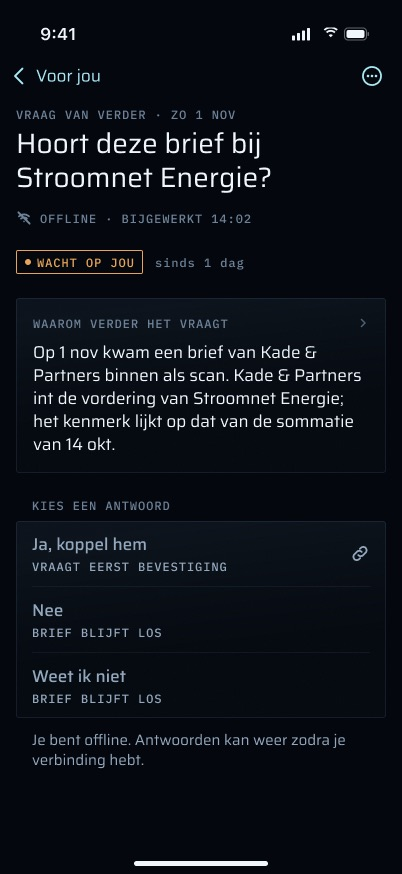

## Suggestie — een suggestie

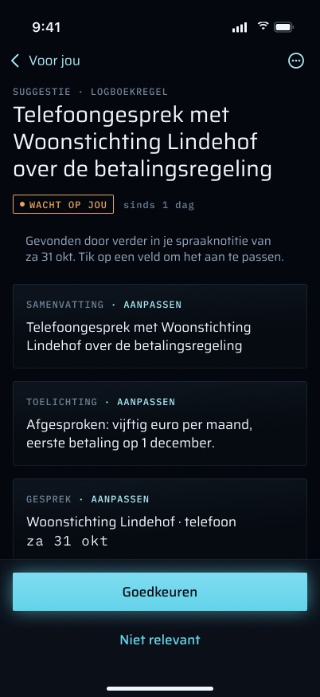

`SuggestionDetailView` laadt `GET /api/mobile/v1/suggestions/:id` (`suggestions.get` → `toSuggestionDTO`). Het DTO bevat het soort, de status, `proposed` (de uitvoer van het model), de aanleidende mail (van, onderwerp, verzonden op), het document met zijn **effectieve** titel, soort en status, en `retrievedRefs`.

#### Kop: soort en herkomst

Het soort in hoofdletters: "LOGBOEKREGEL", "DOCUMENT", "VORDERING", "TAAK" of "VASTE LAST". Daaronder de herkomstregel: "E-mail van <afzender>: “<onderwerp>”", "Uit e-mail “…”", "Document “<titel>”", of het soort. Daarna datum en tijd van de mail, als die er is.

**Status:** Gebouwd — `Inbox/SuggestionDetailView.swift` (`sourceLine`, `SuggestionFormat.kind`).

#### De eigen woorden van de suggestie als titel, en een gewone herkomstzin

De frames zetten de suggestie zelf in de titel ("Telefoongesprek met Woonstichting Lindehof over de betalingsregeling") en zeggen in een zin waar ze vandaan kwam, voor elke bron: "Gevonden door verder in je spraaknotitie van za 31 okt.", "… in de scan van vr 30 okt.", "… in de sommatie van 14 okt.", gevolgd door "Tik op een veld om het aan te passen.".

**Status:** Deels gebouwd — herkomst uit mail en document bestaat als mono-regel. Een suggestie uit een spraaknotitie heeft geen aanleidende mail en geen document, dus valt terug op het soortlabel. Er is geen titelregel. Nog nodig: een brontype voor spraaknotities in `toSuggestionDTO`, de zin en de titel.

#### "WACHT OP JOU · sinds 1 dag"

De frames markeren een open suggestie als wachtend op Martin, met haar leeftijd. Een openstaande suggestie telt onder `loadWaiting` als wachtend, dus amber is hier toegestaan.

**Status:** Nog te bouwen — alleen UI. De code toont bewust het soort in cyaan en geen badge. `createdAt` zit al in het DTO.

#### De velden per soort

`SuggestionDetailModel.fields(for:)` volgt de kaart van `/queue`:

| Soort | Getoonde (en bewerkbare) velden | Ook getoond, alleen-lezen |
|---|---|---|
| `log-entry` | "Samenvatting" (verplicht), "Toelichting" | — |
| `document-meta` | "Titel" (verplicht), "Soort" | — |
| `debt` | "Schuldeiser" (verplicht; valt terug op de tegenpartij als het model geen schuldeiser noemde) | "Gevorderd: € 1.234,56", of **"Gevorderd: onbekend"** als de brief geen totaal noemt, nooit € 0,00 |
| `task` | "Taak" (verplicht), "Toelichting", "Uiterlijk op" (een dag) | — |

Totdat op "Aanpassen" wordt getikt, worden de velden als platte tekst getoond ("—" als ze leeg zijn, een deadline als "7-11").

**Status:** Gebouwd — `SuggestionDetailModel.fields(for:)`, `claimedText`; vastgelegd door `SuggestionDetailTests`.

#### Logboekregel: "Gesprek" (partij, kanaal, datum)

De partij, het kanaal en de datum van het gesprek, elk bewerkbaar ("Woonstichting Lindehof · telefoon · za 31 okt").

**Status:** Nog te bouwen — UI en een partijkiezer. De goedkeurroute accepteert `occurredAt`, `channel`, `direction` en `participantPartyIds` al via `entryFromProposed`, en `GET /api/mobile/v1/parties` bestaat.

#### Document: "Van wie" en "Het document"

De afzender, bewerkbaar, en het document zelf, dat de viewer opent.

**Status:** Nog te bouwen — voor "Van wie" moet de server veranderen: `suggestions.approveDocumentMeta` neemt alleen `title` en `docType` en neemt de effectieve afzender over, dus een aangepaste afzender vraagt een `partyId`-invoer, geschreven naar `document_status_changes.party_id`. "Het document" vraagt alleen UI: het document-id zit in het DTO, en `Dossier/DocumentViewer.swift` en `documents/[id]` bestaan.

#### Vordering: bewerkbaar bedrag

"Gevorderd · aangepast € 240,00, was: € 420,00", en een onbekend bedrag dat bewerkbaar is vanaf "onbekend — de brief noemt geen totaal". Een leeggemaakt bedrag blijft onbekend en wordt nooit € 0,00.

**Status:** Nog te bouwen — alleen UI (een veld in hele centen). De goedkeurroute accepteert `claimedCents` via `debtFields`.

#### Vordering: "Namens hen" (de incassopartij)

De partij die namens de schuldeiser int, bewerkbaar.

**Status:** Nog te bouwen — server en UI. `debtFields` kent geen partijrollen, en `approveDebt` schrijft geen `debt_parties`-rij, dus de goedkeurroute heeft een `incasso`-partij als invoer nodig en een koppelrij (geen bewijs, geen ledger).

#### Vordering: wat goedkeuren betekent

Het frame zegt "Goedkeuren legt vast wat zij vorderen; je erkent het bedrag daarmee niet." Dit is de regel dat het vastleggen van een vordering een waarneming is, terwijl het accepteren ervan een registerbesluit is.

**Status:** Deels gebouwd — de telefoon toont een vaste opmerking, "Dit lijkt op een incassopartij — geen oordeel, wel goed om op de lijst te hebben.", bij **elke** vorderingssuggestie, wat het model ook concludeerde. Nog nodig: de zin uit het frame in plaats van die opmerking, en de incasso-opmerking alleen getoond wanneer `isDebtCollector` van het model dat zegt.

#### Taak: "Gevonden in"

Waar de taak vandaan kwam, als link.

**Status:** Nog te bouwen — UI. De herkomst (aanleidende mail of document) zit in het DTO.

#### Taak: een deadline met een tijd

"Uiterlijk op" als dag, uur en minuut ("wo 4 nov 2026 · 17:00").

**Status:** Deels gebouwd — een Nederlandse datumkiezer op Amsterdamse kalenderdagen, met "Geen datum" om te wissen en "Datum kiezen" om bij vandaag te beginnen. Hij stuurt een kale dag (`yyyy-MM-dd`) en heeft geen tijd. `taskFields.dueAt` accepteert een tijdstip, dus wat ontbreekt is de kiezer en zijn codering.

#### Vaste last: goedkeuren op de website

Een `registry-item`-suggestie toont haar naam, "Een vaste last leg je vast op de website: daar kies je de categorie." en "Open op de website" (→ `/queue`). "Niet relevant" werkt nog steeds vanaf de telefoon.

**Status:** Gebouwd — `SuggestionDetailModel.opensOnWebsite`. De server antwoordt 409 "open op de website" als het toch ooit wordt geprobeerd.

#### Goedkeuren, met alleen wat er veranderde

"Klopt zo" (ontwerp: "Goedkeuren") is ingeschakeld zolang de suggestie `pending` of `needs-manual` is, het soort een telefoonformulier heeft en elk verplicht veld tekst bevat. Het post `POST /api/mobile/v1/suggestions/:id/approve { edits }`, en **`edits` bevat alleen de velden die Martin veranderde**. Een leeggemaakt optioneel veld wordt verstuurd als `null` (soort, de toelichting en deadline van een taak) of als `""` (de toelichting van een logboekregel). De server laadt de suggestie, kiest de procedure op het **opgeslagen** soort, legt `{ ...proposed, ...edits }` eroverheen, parseert dat met het eigen schema van de procedure (een onbekende sleutel is een 400), en roept **dezelfde** procedure aan die de webwachtrij aanroept:

| Soort | Procedure | Wat er wordt geschreven | Ledger |
|---|---|---|---|
| `log-entry` | `suggestions.approveEntry` via `entryFromProposed` (`source` op de server afgeleid) | een `log_entries`-rij met zijn documenten, bijlagen opnieuw bepaald bij goedkeuring | **+1 `entry.created`** |
| `document-meta` | `suggestions.approveDocumentMeta` | een `document_status_changes`-rij: status `filed`, titel en soort, de effectieve afzender overgenomen | **+1 `document.updated`** |
| `debt` | `suggestions.approveDebt` | een `debts`-rij | geen |
| `task` | `suggestions.approveTask` | een `tasks`-rij | geen |

Het oordeel is `approved` als er niets veranderde en `edited` als er wel iets veranderde, met `finalPayload` als wat er is opgeslagen. Een soort wordt vergeleken via `docTypeKey`; bij een taak is een ongewijzigde datum of een leeg toelichtingsvak geen aanpassing.

**Status:** Gebouwd — `SuggestionDetailModel.approve`, `suggestions/[id]/approve/route.ts`, `packages/api/src/entry-from-proposed.ts`; vastgelegd door `SuggestionDetailTests.approveSendsOnlyChangedFields`. Er blijven twee gebreken. Een soort wissen wist hem niet, omdat de effectieve soort de nieuwste rij is die er een heeft. Een document dat intussen is weggegooid of definitief verwijderd krijgt 409 met het algemene "Deze suggestie is al afgehandeld.".

#### Een veld aanpassen en de diff zien vóór het goedkeuren

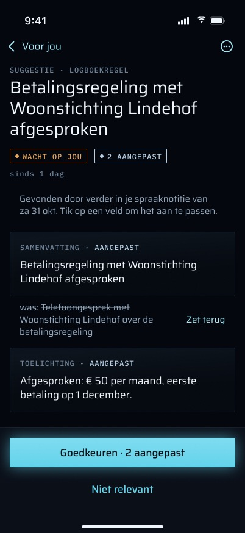

Brief §3: "Edit diff visible before approve (golden rule)." Een tik op één veld bewerkt dat veld ("AAN HET AANPASSEN", met "Klaar" boven het toetsenbord). Een veranderd veld leest "AANGEPAST", toont "was: <oud>" doorgestreept, en biedt "Zet terug". De kop telt "N AANGEPAST", en de goedkeurknop luidt "Goedkeuren · N aangepast".

**Status:** Deels gebouwd — bewerken werkt via één "Aanpassen"-schakelaar ("Klaar met aanpassen") die alle velden tegelijk in tekstvakken verandert, en het model kent de diff al (`SuggestionDetailModel.edits`). Ontbreekt: bewerken per veld, de "was:"-regel, "Zet terug", de telbadge en het knoplabel met aantal. Dat zijn UI en een view-modeltest voor "Zet terug".

#### "Niet relevant", met een optionele reden

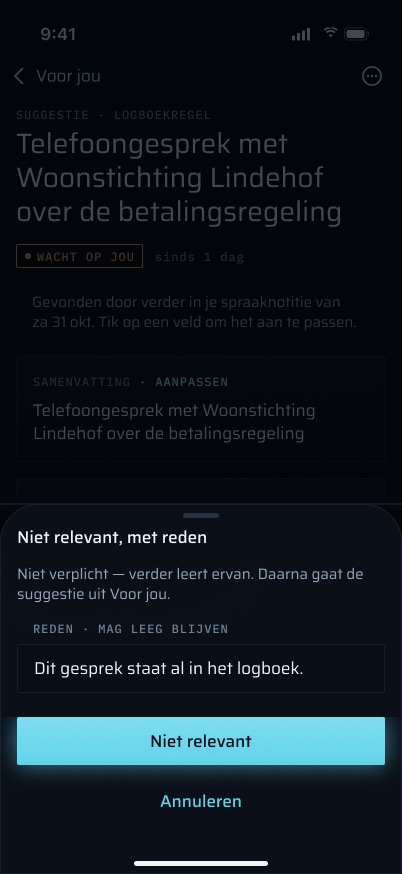

Een sheet met de titel "Niet relevant", met de regel "Waarom? Niet verplicht — verder leert ervan.", een veld "Reden", een knop "Niet relevant" en "Annuleren". Het post `POST /api/mobile/v1/suggestions/:id/reject { reason? }` (hoogstens 2000 tekens, strikte body). De suggestie wordt `rejected` met de reden in `finalPayload`, wat het leren voedt. Geen ledger-event, en verder verandert er niets. Het bericht luidt daarna "Afgewezen.".

**Status:** Gebouwd — `SuggestionDetailView.rejectSheet`, `suggestions/[id]/reject/route.ts`.

#### "Niet relevant" met één tik, met een toast om ongedaan te maken

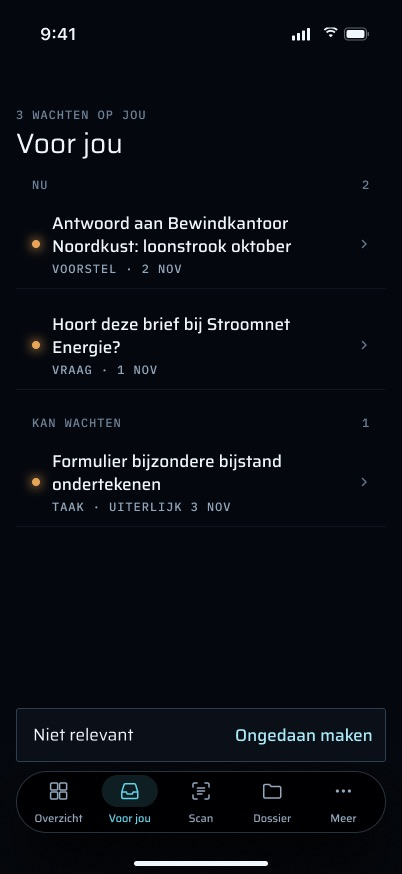

De onderste knop wijst direct af en keert terug naar Voor jou met een toast om het ongedaan te maken. Het redensheet verhuist naar het "…"-menu.

**Status:** Nog te bouwen — server en UI. `suggestions.reject` is definitief, en geen route heropent een suggestie. Nodig: een heropenroute (`rejected → pending` binnen een kort venster, waarbij het ongedaan maken wordt vastgelegd), de toast op Voor jou, en tests.

#### Het "…"-menu

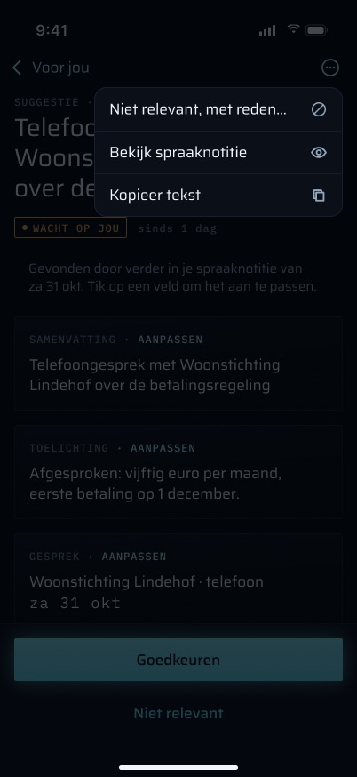

"Niet relevant, met reden…", "Bekijk spraaknotitie" en "Kopieer tekst".

**Status:** Nog te bouwen — het menu is UI. "Kopieer tekst" heeft alleen het klembord nodig. "Bekijk spraaknotitie" heeft het transcript nodig en, als Martin de opname bewaarde, het document-id van de audio (`audioDocumentId` uit `entries/voice`) in `toSuggestionDTO`. Nu bevat het DTO geen van beide.

#### Wat er is vastgelegd, na het goedkeuren

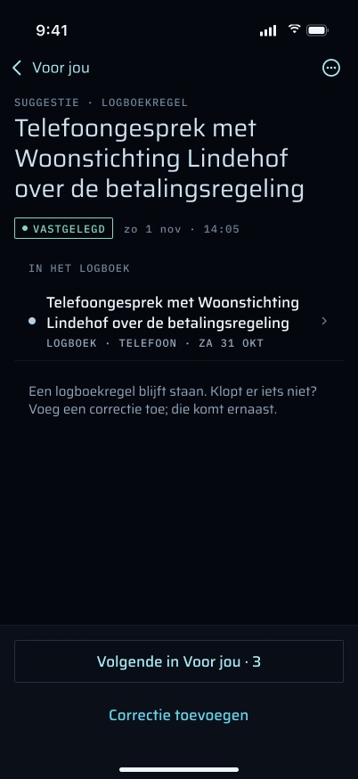

Een badge "VASTGELEGD" (of "TAAK AANGEMAAKT") met de tijd, en een rij die het aangemaakte item opent: "IN HET LOGBOEK" voor een logboekregel, "NIEUWE TAAK" voor een taak (die nog op Martin wacht, dus amber).

**Status:** Deels gebouwd — het bericht luidt "Vastgelegd." en de knoppen verdwijnen. De goedkeurroute antwoordt al met `entryId`, `debtId` of `taskId`, maar de telefoon decodeert het antwoord als `Ignored`. Nog nodig: het id decoderen, de badge en een link naar Dossier of `TaskScreen`.

#### "Correctie toevoegen"

"Een logboekregel blijft staan. Klopt er iets niet? Voeg een correctie toe; die komt ernaast." Het corrigeren van een goedgekeurde logboekregel voegt een vervangende regel toe en bewerkt nooit het origineel.

**Status:** Nog te bouwen — een mobiele route en een editor. De serverprocedure bestaat (`entries.correct`, gelogd als `entry.corrected` met `supersedesId`).

#### Wie het eerst besliste

Elke goedkeuring neemt een rijvergrendeling (`FOR UPDATE`) en eist dat de suggestie nog `pending` of `needs-manual` is. Afwijzen is een voorwaardelijke update die de rij alleen in een van die toestanden claimt. Een tweede besluit is een **409**, getoond als "Deze suggestie is al afgehandeld.", en de knoppen verdwijnen: een dubbele tik, het web dat eerder besliste, of een herhaalde POST waarvan het antwoord verloren ging.

**Status:** Gebouwd — `packages/api/src/routers/suggestions.ts`, `SuggestionDetailModel.decide`.

## Taak — een taak

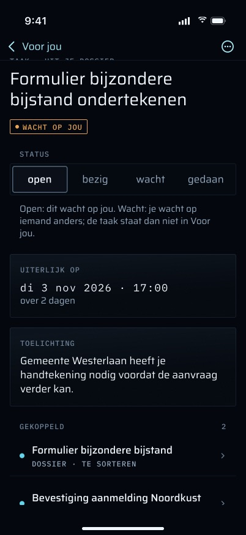

Er is geen route voor één taak. `TaskModel.load` haalt `GET /api/mobile/v1/tasks` op en kiest de taak op id. Elke rij bevat de **effectieve** status (op ledger-seq, nooit de ruwe kolom) en `validNext`, de lijst van de server met toegestane stappen.

#### Op wie het wacht

"WACHT OP JOU" in amber wanneer de effectieve status `open` of `in-progress` is (de ene definitie, `WAITING_TASK_STATUSES`). Het ontwerp voegt "WACHT OP ANDER" toe, zonder amber, voor `waiting`.

**Status:** Deels gebouwd — "WACHT OP JOU" staat in `Inbox/TaskRowView.swift`. Een `waiting`-taak krijgt geen label. Alleen UI.

#### Titel, status, deadline, toegewezene en toelichting

De titel; "taak · <status>"; "uiterlijk <datum tijd>"; de naam van de toegewezene, als die er is; en de toelichting. Het ontwerp voegt onder de deadline een relatieve regel toe ("over 2 dagen").

**Status:** Deels gebouwd — alles behalve de relatieve deadlineregel, die alleen UI is.

#### De status veranderen, alleen langs toegestane stappen

Eén knop per status in `validNext`, met de woorden van de web-app: "open", "mee bezig", "wacht op iemand", "klaar", "laten vallen". De overgangsmatrix (`task-status.ts`):

| Van | Mag naar |
|---|---|
| open | mee bezig, wacht op iemand, klaar, laten vallen |
| mee bezig | wacht op iemand, klaar, laten vallen |
| wacht op iemand | mee bezig, klaar, laten vallen |
| klaar | — (definitief) |
| laten vallen | — (definitief) |

Een tik opent "Status wordt: <status>" met die status als knop en "Annuleren". Bevestigen post `POST /api/mobile/v1/tasks/:id/status { status }` (strikt: `status` en een optionele `note`; een `overrideReason`, een `taskId` of een onbekende status is een 400). De server voert `tasks.setStatus` uit (`setTaskStatus` in `task-decide.ts`): die vergrendelt de taak, leest de effectieve status opnieuw, weigert een niet-toegestane stap, schrijft een `task_status_changes`-rij en voegt **+1 `task.status`** toe. Hij antwoordt met de nieuwe status en `validNext`, zodat de knoppen opnieuw worden getekend. Naar "wacht op iemand", "klaar" of "laten vallen" gaan haalt de taak uit Voor jou en de badge; "mee bezig" houdt haar erin (Martin, 2026-10-31). Een gedane of laten vallen taak toont geen knoppen.

**Status:** Gebouwd — `Inbox/TaskRowView.swift` (`TaskModel.setStatus`), `tasks/[id]/status/route.ts`, `packages/api/src/task-decide.ts`; vastgelegd door de taaktests in `SuggestionDetailTests.swift`. Eén gebrek: een niet-toegestane stap antwoordt **500**, niet 400, omdat `setTaskStatus` een gewone `Error` gooit, dus de telefoon zegt "Dat lukte niet…" en houdt verouderde knoppen.

#### Status als segmentknop, met wat elke status betekent

Brief §3: "Status as a segmented control, not a buried button" (3 tikken → 2). De frames tekenen "open · bezig · wacht · gedaan" met één uitlegregel eronder: "Open: dit wacht op jou. Wacht: je wacht op iemand anders; de taak staat dan niet in Voor jou.", "Je wacht op een reactie. Deze taak staat nu niet in Voor jou.", "Gedaan. Vergist? Kies een andere status.".

**Status:** Deels gebouwd — de stappen bestaan als gestapelde knoppen achter een bevestiging. De segmentknop is niet gebouwd, en zoals getekend botst hij met de server: elk segment is aantikbaar, terwijl alleen `validNext` is toegestaan ("open" komt nooit terug), en "laten vallen" heeft geen segment. Nog nodig: een besturing die niet-toegestane segmenten uitschakelt en "laten vallen" een plek geeft, de uitlegregels, en Martins besluit of een gelogde stap zijn bevestigingsstap houdt.

#### "GEKOPPELD": waar de taak aan gekoppeld is

De gekoppelde items van de taak als rijen die ze openen ("Formulier bijzondere bijstand · DOSSIER · TE SORTEREN").

**Status:** Nog te bouwen — server en UI. `tasks` heeft al `entry_id`, `debt_id`, `document_id` en `financial_item_id`, maar `toTaskDTO` (`apps/web/src/lib/mobile-dto.ts`) stuurt er geen van mee. Nodig: de koppelingen met labels in het DTO, rijen, navigatie naar Dossier, en een test dat weggegooide of definitief verwijderde documenten erbuiten blijven.

#### Ongedaan maken na "gedaan"

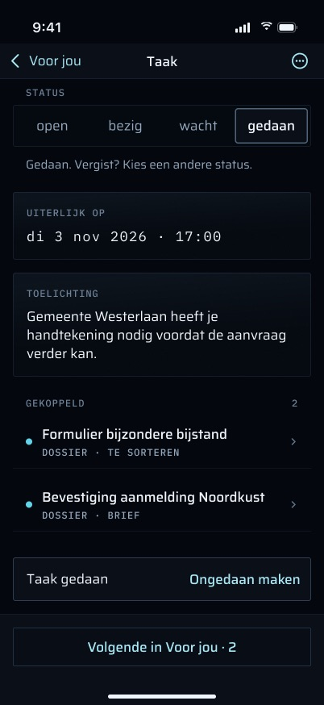

"Taak gedaan · Ongedaan maken", en "Gedaan. Vergist? Kies een andere status.".

**Status:** Nog te bouwen — in strijd met de server. `done` heeft geen uitgaande overgangen in `TASK_EDGES`. De enige uitweg is een `overrideReason`, die de mobiele route bewust weigert. Dit vraagt eerst Martins besluit: óf een korte gelogde "ongedaan maken"-overgang, óf geen ongedaan maken en aangepaste tekst.

#### Een taak gedaan markeren vanuit de melding

Brief §3 (meldingen): "TASK_DUE gains **Gedaan** (`authenticationRequired`, Martin's own action)." De deadlinepush zelf luidt "<Te laat | Vandaag | Morgen>: <task title>" / "Deadline <dd-mm>." en wordt alleen tussen 08:00 en 22:00 Amsterdamse tijd verstuurd.

**Status:** Deels gebouwd — de push bestaat (`apps/worker/src/proposals/clocks.ts`, categorie `TASK_DUE`), maar hij heeft geen actie en linkt naar `verder://inbox`. Nog nodig: een actie "Gedaan" op `TASK_DUE` in `Push/NotificationCategories.swift`, het taak-id in de payload, een tak in `NotificationRouter` die `tasks/:id/status { status: "done" }` post alleen als `done` in `validNext` staat, en tests.

## Voor alle drie de schermen

#### Laden

Brief §2.4: een skelet in de vorm van de echte inhoud, nooit een spinner.

**Status:** Deels gebouwd — elk scherm toont een `ProgressView`-spinner. Skeletten bestaan alleen op Overzicht (`Home/HomeTab.swift` `skeletonCard`).

#### Weg (404)

"Dit voorstel bestaat niet (meer).", "Deze suggestie bestaat niet (meer).", "Deze taak bestaat niet (meer)." (ook als het id niet in de takenlijst staat).

**Status:** Gebouwd — `ProposalModel`, `SuggestionDetailModel.Copy.gone`, `TaskModel.Copy.gone`.

#### Al besloten

Vraag: de statusregel ("Verstuurd.", "Afgewezen.", "Vervangen door een nieuwer voorstel."), en bij een 409 "Er is intussen een nieuwere versie. Bekijk hem en verstuur opnieuw." zolang het open staat, anders "Dit voorstel is al afgehandeld.". Suggestie: "Deze suggestie is al afgehandeld.". Taak: een gedane of laten vallen taak heeft geen knoppen.

**Status:** Gebouwd — de drie modellen.

#### Geweigerd (400)

De oorzaak in gewoon Nederlands.

**Status:** Deels gebouwd — de suggestie zegt "verder weigerde dit. Controleer de velden.", en de taak laadt opnieuw met "Die stap kan niet (meer). De taak is bijgewerkt.". Een antwoord op een vraag hergebruikt de tekst van de antwoordmail, "verder weigerde dit: een ontvanger of bijlage hoort niet (meer) bij dit voorstel.", wat voor een vraag niet klopt (de oorzaak is een mislukte hervalidatie). Een niet-toegestane taakstap komt binnen als 500 en krijgt dus nooit de tekst van de taak.

#### Een mislukte actie noemt haar oorzaak en biedt opnieuw proberen aan

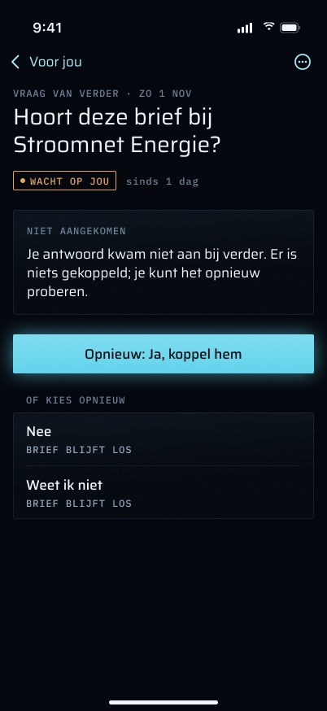

Brief §2.4: één regel gewoon Nederlands plus een knop met een werkwoord. De frames tonen een kaart "NIET AANGEKOMEN" / "NIET OPGESLAGEN" ("Je antwoord kwam niet aan bij verder. Er is niets gekoppeld; je kunt het opnieuw proberen.") en een primaire knop "Opnieuw: Ja, koppel hem" / "Opnieuw goedkeuren" / "Opnieuw: zet op gedaan", met de andere opties onder "OF KIES OPNIEUW". De aanpassingen blijven bewaard. Een mislukte actie krijgt de `.error`-haptiek.

**Status:** Deels gebouwd — het bericht verschijnt boven de knoppen, al het andere (scherm, aanpassingen, gekozen optie) blijft staan, en nogmaals op dezelfde knop tikken probeert het opnieuw. Er wordt niets in een wachtrij gezet, dus een besluit dat de server niet bereikte is eenvoudig niet genomen. Ontbreekt: de kaart, de benoemde knop "Opnieuw: …" en de haptiek.

#### Offline: de laatste kopie, met besluiten uitgeschakeld en de reden erbij

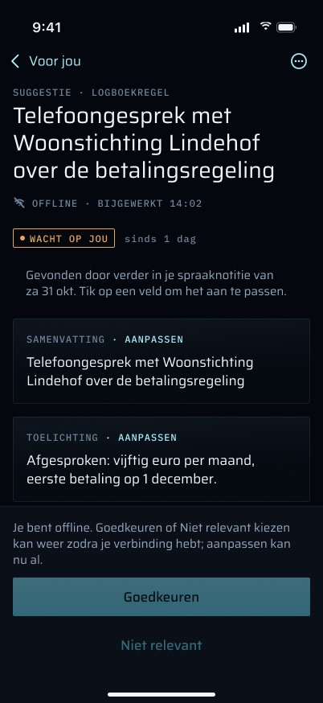

Brief §2.4: gecachte inhoud met "offline · bijgewerkt 14:02" in een mono-uitlezing, en serveracties uitgeschakeld **met de reden**: "Je bent offline. Antwoorden kan weer zodra je verbinding hebt." / "Je bent offline. Goedkeuren of Niet relevant kiezen kan weer zodra je verbinding hebt; aanpassen kan nu al." / statuswijzigingen uitgeschakeld bij een taak.

**Status:** Nog te bouwen — niets van deze schermen wordt gecachet. Een mislukte lading toont alleen "Geen verbinding met verder. Probeer het opnieuw.", zonder knop om het opnieuw te proberen en zonder trekken-om-te-verversen, dus Martin gaat terug en opent het item opnieuw. Nodig: een detailcache (in de App Group, gewist bij uitloggen zoals de andere stores), een bereikbaarheidssignaal, uitgeschakelde acties met hun reden, en een fixture (`-fixtures offline-cached`).

#### Sessie verlopen, met de aanpassingen bewaard

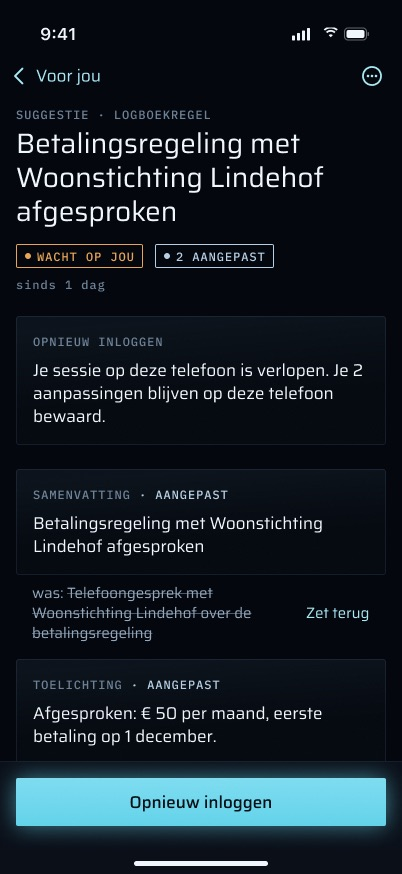

"Je sessie op deze telefoon is verlopen. Je 2 aanpassingen blijven op deze telefoon bewaard." met "Opnieuw inloggen". Na het inloggen zijn de aanpassingen terug.

**Status:** Deels gebouwd — een 401 van een van deze routes roept `auth.sessionRejected()` aan, die de app vervangt door "Je sessie is verlopen." (`Auth/SessionExpiredView.swift`). Aanpassingen die zijn getypt maar niet goedgekeurd gaan **verloren**, omdat ze alleen in het model van het scherm leven. Nodig: een beschermde opslag voor niet-verstuurde aanpassingen per suggestie-id (gewist door `forgetLocally` bij uitloggen), ze terugzetten na het inloggen, en een test.

#### Vergrendeld

De schermen worden nooit getoond zolang de app vergrendeld is. Een openstaande link wacht op Face ID.

**Status:** Gebouwd — `.lockGated(by: lock)` in `App/RootView.swift`.

#### Grote tekst (AX5) en een kleine telefoon (iPhone SE)

Elke tekst gebruikt Dynamic Type-stijlen met `relativeTo:` en verticale `fixedSize` binnen een `ScrollView`, zodat alles afbreekt en scrolt. Actieknoppen (`AuthButton`) zijn minstens 44 pt hoog; de optieknoppen van een vraag hebben 12 pt opvulling rond twee regels. De bevestigingsdialogen zijn systeemdialogen en schalen vanzelf. Op een iPhone SE (375 × 667) is de indeling dezelfde enkele scrollende kolom.

**Status:** Gebouwd — `ProposalScreen.swift`, `SuggestionDetailView.swift`, `TaskRowView.swift`.

#### Voortgang in de knop binnen 100 ms

Brief §2.1: een actie die het netwerk nodig heeft (goedkeuren, antwoorden, opnieuw proberen, ongedaan maken) toont binnen 100 ms voortgang in de knop, nooit een blokkade over het hele scherm.

**Status:** Nog te bouwen — `AuthButton` is alleen uitgeschakeld zolang hij bezig is (`isBusy`) en toont geen voortgang. Alleen UI, gedeeld met elk scherm.

#### Haptiek

Brief §2.5: `.success` wanneer een vraag in de app wordt beantwoord (de meldingsactie heeft er geen), wanneer een suggestie wordt goedgekeurd en wanneer een taakstatus verandert (ook vanuit een veeg); `.impact(.soft)` wanneer een afwijzing wordt bevestigd; `.error` bij een mislukte actie; `.selection` eenmaal per overschreden veegdrempel; `.impact(.light)` bij ongedaan maken. Alles wordt overgeslagen als systeemhaptiek uit staat.

**Status:** Nog te bouwen — geen `sensoryFeedback` in `Proposals/` of `Inbox/` (het bestaat alleen op Overzicht, `Home/HomeTab.swift`). Alleen UI.

## Privacy en beveiliging

#### Achter de app-vergrendeling

Alle drie de schermen leven in de Voor jou- en Dossier-stacks, die achter de vergrendeling zitten: Face ID (of de toegangscode) eenmaal bij een koude start, en opnieuw na meer dan 5 minuten op de achtergrond (`LockPolicy.graceSeconds = 300`).

**Status:** Gebouwd — `Auth/AppLock.swift`, `App/RootView.swift`.

#### Geen extra Face ID voor deze besluiten

Een vraag beantwoorden, een suggestie goedkeuren of afwijzen en een taakstatus veranderen vragen geen Face ID bovenop de app-vergrendeling, omdat geen ervan iets naar buiten verstuurt. De verse Face ID bij elke actie (`ApprovalGate`) is alleen voor **Versturen** bij een antwoordvoorstel.

**Status:** Gebouwd — geen `ApprovalGate` op deze paden (`Proposals/ApprovalGate.swift` wordt alleen gebruikt door `ProposalModel.approve`).

#### Het vergrendelscherm toont geen schuldeiser en geen bedrag

Brief §3: "Lock-screen preview never shows a creditor or an amount; the hidden-preview placeholder 'Nieuw bericht van verder' stays."

**Status:** Deels gebouwd — de plaatshouder voor verborgen voorvertoningen is gebouwd, en geen vraagpush bevat een bedragveld. Maar de titel is "Voorstel: <ask>", en de `ask` is vrije modeltekst die een schuldeiser kan noemen, zoals de eigen vraag van het frame doet ("Hoort deze brief bij Stroomnet Energie?"). Niets filtert dat. Nodig: een titel in `proposalPush` (`apps/worker/src/ops/proposals-store.ts`) die veilig is voor het vergrendelscherm, en een test.

#### Niets opgeslagen op de telefoon, en niets achtergelaten bij uitloggen

Deze schermen schrijven niets naar schijf; de vraag, de suggestie met haar aanpassingen en de taak worden in het geheugen gehouden zolang het scherm open is. Los daarvan registreert de meldingsextensie de optielabels van elke vraag bij iOS als `q.<id>`-categorie (hoogstens 20) en bewaart hun volgorde in het App Group-bestand `push/q-order.json`.

**Status:** Deels gebouwd — de schermen slaan niets op. Uitloggen (`AuthModel.forgetLocally`) wist de inbox, de samenvatting, Geld, het dossier en de widget-snapshot, maar niet de `q.*`-categorieën of `push/q-order.json`. Een antwoord dat na het uitloggen op een ervan wordt ingedrukt vindt geen sessie en beantwoordt niets, maar de optielabels blijven geregistreerd. Nodig: ze wissen in `forgetLocally`, en een test.

De sessie is de cookie van better-auth in de Keychain, met de hand meegestuurd, waarbij redirects nooit worden gevolgd (zie `../01-inloggen-en-vergrendeling/FEATURES.md`).

## De regels die deze schermen volgen

- **AI-uitvoer is een suggestie.** Niets uit een suggestie komt in het dossier totdat Martin het goedkeurt, en niets uit een vraag wordt uitgevoerd totdat Martin een optie kiest. Elk besluit legt het oordeel vast (`approved` / `edited` / `rejected`), de definitieve payload en, bij een afwijzing, de optionele reden.
- **Niets wordt verstuurd zonder dat Martin de definitieve tekst goedkeurt.** Geen van deze schermen verstuurt iets naar buiten. De server weigert een antwoord op elk voorstel dat geen vraag is (400), dus een antwoordknop, in de app of op het vergrendelscherm, kan nooit een antwoordmail versturen.
- **Elke bewijsschrijving wordt gelogd, via de eigen procedures van de web-app:** `entry.created`, `document.updated` en `task.status` (en `entry.corrected` zodra "Correctie toevoegen" bestaat). Vorderingen, koppelingen tussen vordering en document, en nieuwe taken zijn geen bewijs en voegen niets toe. De telefoon heeft geen eigen pad naar deze tabellen.
- **Amber alleen voor wat op Martin wacht:** een openstaande vraag, een `open`- of `in-progress`-taak en, volgens de frames, een openstaande suggestie. Nooit voor een `waiting`-taak.
- **Een onbekend bedrag blijft onbekend:** een vordering zonder genoemd totaal leest "Gevorderd: onbekend", nooit € 0,00, en dat blijft zo zodra het bedrag bewerkbaar is.
- **Weggegooide en definitief verwijderde documenten blijven erbuiten.** Een document-meta-goedkeuring op zo'n document wordt geweigerd, de bijlagen van een logboekregel worden bij goedkeuring opnieuw bepaald, en een vraagoptie die een weggegooid of definitief verwijderd document koppelt faalt bij de hervalidatie.
- **De archiveringsuitzondering** (verder mag een document zelf archiveren) werkt niet op deze schermen. Een document-meta-suggestie die hier wordt beslist is Martins eigen besluit, geschreven zonder `actor = 'verder'`. Automatisch archiveren staat in productie sowieso uit (`DOCMETA_AUTO_APPLY` niet gezet).
- **Ongedaan maken herschrijft nooit de ledger.** Elk ongedaan maken dat uit het ontwerp wordt gebouwd moet een nieuwe, gelogde wijziging zijn, nooit een verwijdering of bewerking van wat er al is geschreven.

## Waar ontwerp en code verschillen

Dit zijn de plekken waar de definitieve frames **serverwerk** of een besluit van Martin vragen, niet alleen een nieuwe tekening:

1. **Ongedaan maken na het beantwoorden van een vraag** ("Beantwoord: Nee · Ongedaan maken", "Brief losmaken"). `proposals.answer` zet het voorstel op `sent` zonder weg terug, en de mobiele API heeft geen route om los te koppelen. Een `set-task-status`-antwoord ongedaan maken is bovendien onmogelijk, omdat `done` en `dropped` definitief zijn.
2. **Ongedaan maken na "gedaan" bij een taak** ("Taak gedaan · Ongedaan maken", "Gedaan. Vergist? Kies een andere status."). `done` heeft geen uitgaande overgangen in `TASK_EDGES`. De enige uitweg is een `overrideReason`, die de mobiele route bewust weigert.
3. **De vierdelige statusbesturing** laat elk segment aantikken. De server staat alleen `validNext` toe: "open" kan nooit meer worden gekozen zodra een taak die status heeft verlaten, en de besturing heeft geen "laten vallen".
4. **Ongedaan maken na "Niet relevant"** (toast). `suggestions.reject` is definitief en er is geen route om een suggestie te heropenen.
5. **Het bedrag van een vordering aanpassen en "Namens hen" toevoegen, en "Van wie" bij een document.** De goedkeurroute accepteert een bedrag (`debtFields.partial()`), maar geen incassopartij of documentafzender.
6. **"verder bekijkt je antwoord"** na een vrij antwoord. Niets leest vandaag `finalPayload.answer.freeText`.
7. **Bevestigen bij elke optie of alleen bij opties met gevolgen.** De code bevestigt elke optie, `none` inbegrepen. Het ontwerp legt "Nee" direct vast, wat pas veilig is zodra het ongedaan maken ervan bestaat.
8. **De titel van de vraag op het vergrendelscherm** kan een schuldeiser noemen, wat de brief verbiedt.

## Bekende grenzen en wat nog niet gemeten is

- Niet gemeten (uit CLAUDE.md en plan 3 taak 9): de vertraging van de badge na een **echt** besluit, en of die een geforceerd gesloten app bereikt. Dat wacht op een suggestie waarover Martin echt wil beslissen, en er wordt niets goedgekeurd voor een test.
- Gemeten: antwoordknoppen op een vraagpush verschijnen op iOS 27.2 (één testpush naar een voorstel-id dat niet bestaat, 2026-11-01). Erop tikken opende "Dit voorstel bestaat niet (meer).". **Er is nog geen echte vraag vanuit een melding beantwoord.**
- Een taak openen haalt de hele takenlijst op. Bij de huidige omvang is dat prima, maar het is geen route voor één taak.
- De 409-melding "Deze suggestie is al afgehandeld." dekt ook een document dat intussen is weggegooid of definitief verwijderd.
- De 400-melding bij een antwoord op een vraag spreekt over "een ontvanger of bijlage", wat een antwoordmail beschrijft, geen vraag.
- De telefoon kan een `registry-item`-suggestie niet goedkeuren. Hij linkt naar het web (afwijzen werkt wel).
- Een niet-toegestane taakstap antwoordt 500 in plaats van 400 (een gewone `Error` uit `setTaskStatus`), dus de telefoon zegt "Dat lukte niet…" en laadt de taak niet opnieuw. De eigen test van de route mockt een `BAD_REQUEST` en ziet dit dus niet.
- Het wissen van de soort van een document bij goedkeuren laat de vorige effectieve soort staan.

## Waar in de code

**iOS (`apps/ios/Verder/`)**

- `Proposals/ProposalScreen.swift`: het vraaggedeelte, de bevestigingsdialoog voor opties en "Iets anders…".
- `Proposals/ProposalModel.swift`: `answer(option:)`, `answer(freeText:)`, `reject`, de foutteksten.
- `Proposals/ProposalDTO.swift`: `ProposalDetail.Option` (label + server-`target`), `Citation.why`, `AnswerOptionRequest`, `AnswerTextRequest`.
- `Inbox/SuggestionDetailView.swift`: `SuggestionDetailModel` (velden per soort, de `edits`-diff, goedkeuren en afwijzen), `SuggestionFormat` (soortlabels, Amsterdamse dagen, euro uit hele centen).
- `Inbox/TaskRowView.swift`: `TaskModel` en `TaskScreen` (statuslabels, `validNext`-knoppen, bevestiging).
- `Inbox/VoorJouTab.swift`: `InboxRoute` en de navigatiebestemmingen. `Dossier/DossierTab.swift`: de tweede weg naar `TaskScreen`.
- `Push/QuestionCategories.swift`, `Push/NotificationRouter.swift`, `Push/NotificationCategories.swift`, `App/AppDelegate.swift`, `../VerderNotify/`: antwoorden vanuit de melding.
- `Push/DeepLink.swift`: `verder://proposal|suggestion|task/<uuid>`.

**Server (`apps/web/src/app/api/mobile/v1/`)**

- `proposals/[id]/route.ts` (GET), `proposals/[id]/answer/route.ts`, `proposals/[id]/reject/route.ts`, `proposals/[id]/task/route.ts` ("Taak aanmaken").
- `apps/web/src/lib/mobile-route.ts` (`mobileGet`/`mobilePost`: eerst authenticatie, ZodError → 400) en `apps/web/src/lib/mobile-json.ts` (`trpcErrorResponse`: alleen `TRPCError`s met een bekende code worden vertaald; al het andere is een 500).
- `suggestions/[id]/route.ts` (GET), `suggestions/[id]/approve/route.ts` (antwoordt `entryId` / `debtId` / `taskId`), `suggestions/[id]/reject/route.ts`.
- `tasks/route.ts` (GET, met `validNext`), `tasks/[id]/status/route.ts`.
- `apps/web/src/lib/mobile-dto.ts`: `toSuggestionDTO`, `toTaskDTO` (nog geen gekoppelde items).

**Packages en worker**

- `packages/api/src/routers/proposals.ts`: `get`, `answer`, `reject`, `createProposedTask`, `revalidateOption`, `renderTarget`.
- `apps/worker/src/proposals/validate-draft.ts`: de controles bij het opstellen van een vraag (2 tot 4 opties, elk tegen de context).
- `packages/api/src/routers/suggestions.ts`: `approveEntry`, `approveDocumentMeta`, `approveDebt`, `approveTask`, `reject`.
- `packages/api/src/routers/entries.ts`: `correct` (de serverhelft van "Correctie toevoegen"). `packages/api/src/routers/registry.ts`: `debts.unlinkDocument` (de serverhelft van "Brief losmaken", alleen web), `debtFields`.
- `packages/api/src/entry-from-proposed.ts`: de gedeelde vertaling naar een logboekregel.
- `packages/api/src/routers/tasks.ts`, `packages/api/src/task-status.ts`, `packages/api/src/task-decide.ts`: de statusmatrix en de gelogde wijziging.
- `apps/worker/src/ops/proposals-store.ts` (`proposalPush`: vraagpush met opties en revisie), `apps/worker/src/proposals/clocks.ts` (deadlinepush voor taken).

**Tests**

- `apps/ios/VerderTests/SuggestionDetailTests.swift`: alleen veranderde velden verstuurd, onaangeroerd verstuurt geen aanpassingen, gewiste soort als null, velden per soort, vaste last → alleen website, reden bij afwijzen, 409. Ook de taaktests: alleen `validNext` aangeboden, body met alleen status, een niet-aangeboden status nooit verstuurd.
- `apps/ios/VerderTests/ProposalModelTests.swift`: `optionButtonShowsServerTarget`, `freeTextPostsFreeTextAndRevision`, herladen bij conflict.
- `apps/ios/VerderTests/QuestionCategoriesTests.swift`, `NotificationRouterTests.swift`, `NotificationCategoriesTests.swift`, `DeepLinkTests.swift`.
- `route.test.ts` naast elke mobiele route hierboven. `packages/api/src/routers/proposals.test.ts`, `suggestions.test.ts`, `tasks.test.ts`.

## Frames

Alle 44 frames uit `detail · final` (`326:6980`), opnieuw geëxporteerd op 2026-11-03. De kolom "Code nu" zegt hoe ver de huidige build overeenkomt.

| Frame | Wat het toont | Code nu |
|---|---|---|
|  `Vraag_normaal.jpg` | Vraag, open: waarom verder het vraagt, drie opties, eigen antwoord | Opties met servertekst en "Iets anders…" op `ProposalScreen`; geen "Waarom"-kaart |
| 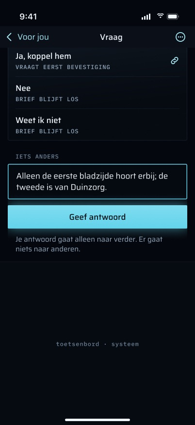 `Vraag_eigen_antwoord.jpg` | Een eigen antwoord typen, "Geef antwoord" | Gebouwd als "Iets anders…" + "Antwoorden" |
| 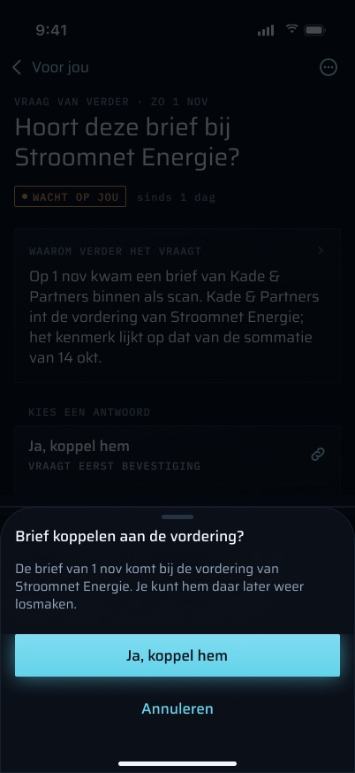 `Vraag_bevestigen.jpg` | Bevestigingssheet "Brief koppelen aan de vordering?" | Een systeembevestigingsdialoog, bij **elke** optie |
|  `Vraag_beantwoord.jpg` | "Ja" beantwoord: wat er gebeurde, "Brief losmaken", volgend item | Alleen statusregel; geen ongedaan maken, geen volgende |
| 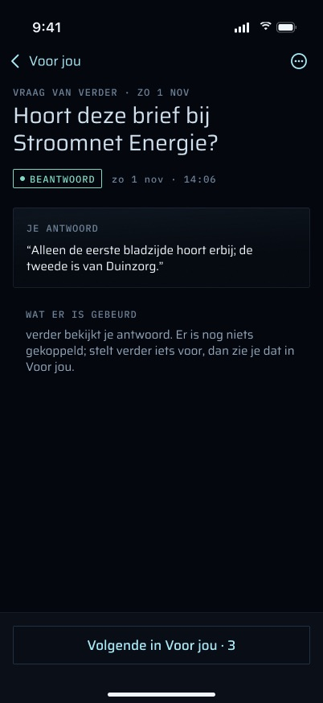 `Vraag_beantwoord_eigen_antwoord.jpg` | Beantwoord met eigen tekst, "verder bekijkt je antwoord" | Alleen opgeslagen; er volgt niets |
|  `Vraag_beantwoord_Nee_of_Weet_ik_niet.jpg` | Terug op Voor jou met "Beantwoord: Nee · Ongedaan maken" | Niet gebouwd; geen ongedaan maken op de server |
|  `Vraag_fout.jpg` | Antwoord niet aangekomen, "Opnieuw: Ja, koppel hem" | Eén foutregel; opnieuw op de optie tikken |
|  `Vraag_offline.jpg` | Offlinebanner met tijd van laatste update, antwoorden uitgeschakeld | "Geen verbinding met verder…" na een mislukte lading of een mislukt antwoord |
| 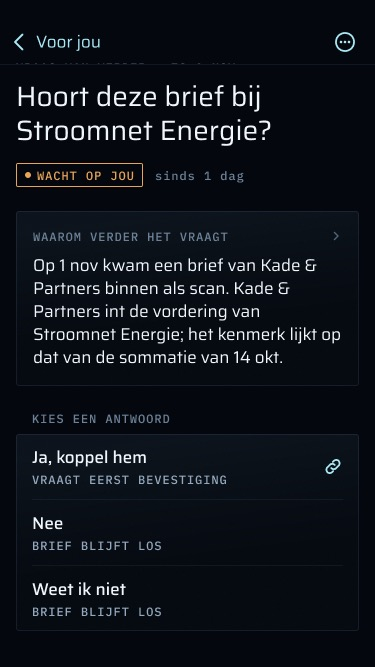 `Vraag_iPhone_SE.jpg` | Vraag op een iPhone SE | Dezelfde enkele scrollende kolom |
| 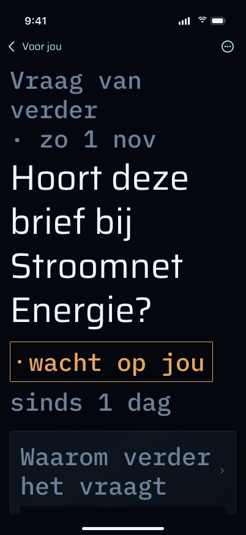 `Vraag_AX5.jpg` | Grootste toegankelijkheidstekst | Dynamic Type schaalt |
| 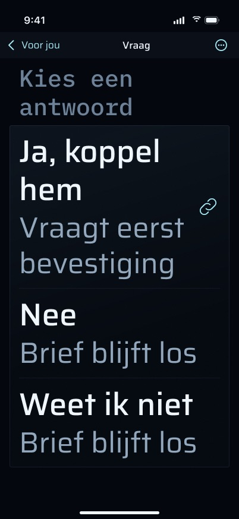 `Vraag_AX5_gescrold.jpg` | AX5 gescrold naar de opties | Scrolt |
| 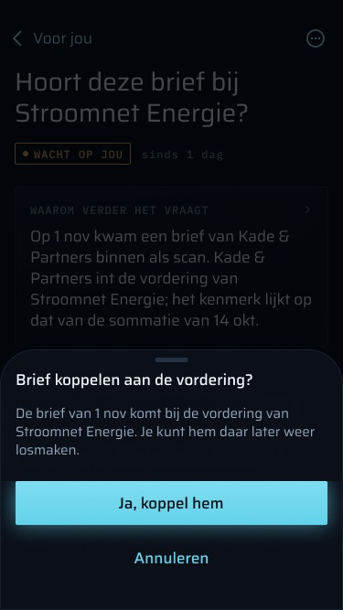 `Vraag_bevestigen_SE.jpg` | Bevestiging op een iPhone SE | Systeemdialoog |
| 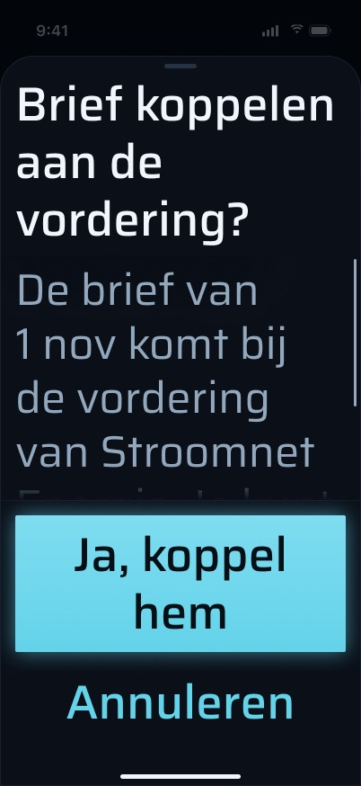 `Vraag_bevestigen_AX5.jpg` | Bevestiging bij AX5 | Systeemdialoog schaalt |
| 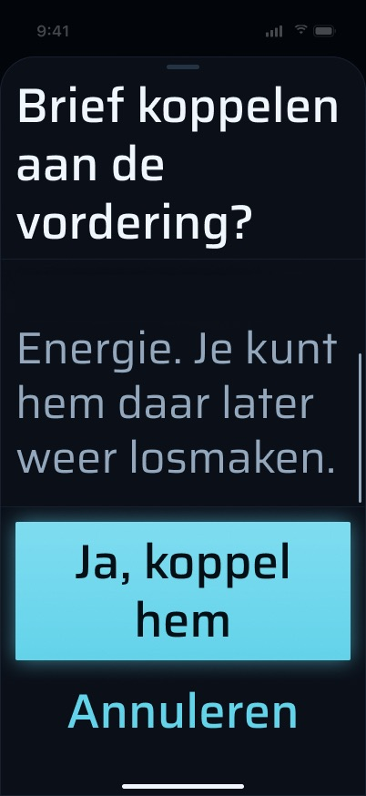 `Vraag_bevestigen_AX5_gescrold.jpg` | Bevestiging bij AX5, gescrold | Systeemdialoog scrolt |
|  `Taak_normaal.jpg` | Taak open: statusbesturing, deadline, toelichting, gekoppelde items | Statusknoppen uit `validNext`; geen gekoppelde items |
| 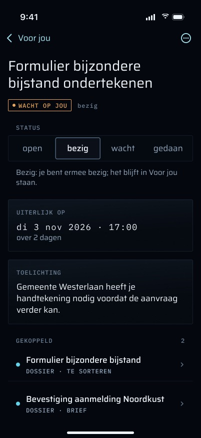 `Taak_bezig.jpg` | Taak mee bezig, wacht nog op Martin | "mee bezig", nog amber |
| 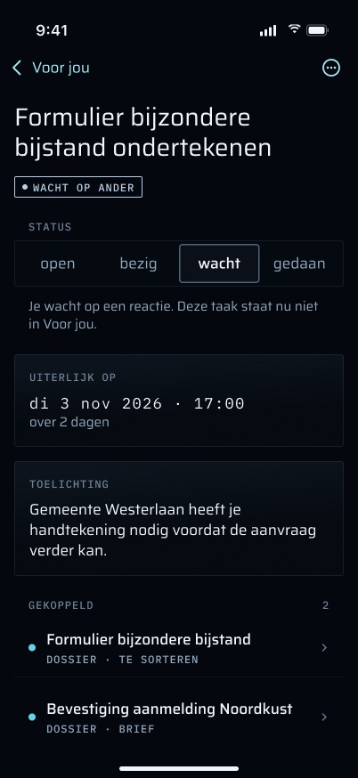 `Taak_wacht.jpg` | Taak wacht op iemand anders ("WACHT OP ANDER") | "wacht op iemand", geen amber, geen label |
|  `Taak_gedaan.jpg` | Gedaan, met "Ongedaan maken" en "Kies een andere status" | Gedaan is definitief; geen knoppen; **botst met de server** |
| 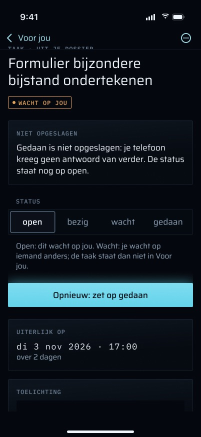 `Taak_fout.jpg` | Status niet opgeslagen, "Opnieuw: zet op gedaan" | Eén foutregel; opnieuw tikken |
| 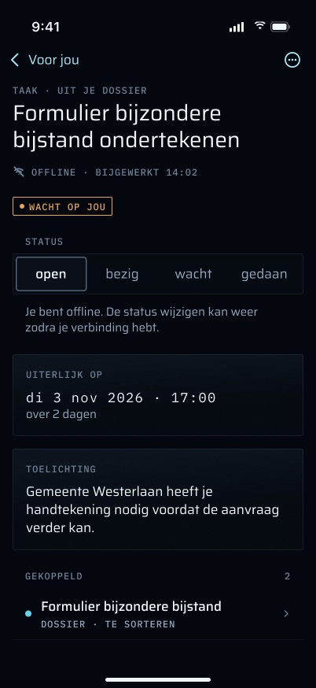 `Taak_offline.jpg` | Offlinebanner, statuswijzigingen uitgeschakeld | Foutregel na een mislukte lading of wijziging |
| 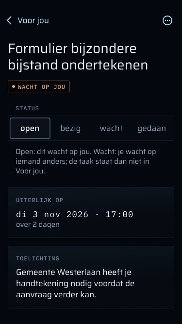 `Taak_iPhone_SE.jpg` | Taak op een iPhone SE | Dezelfde kolom |
| 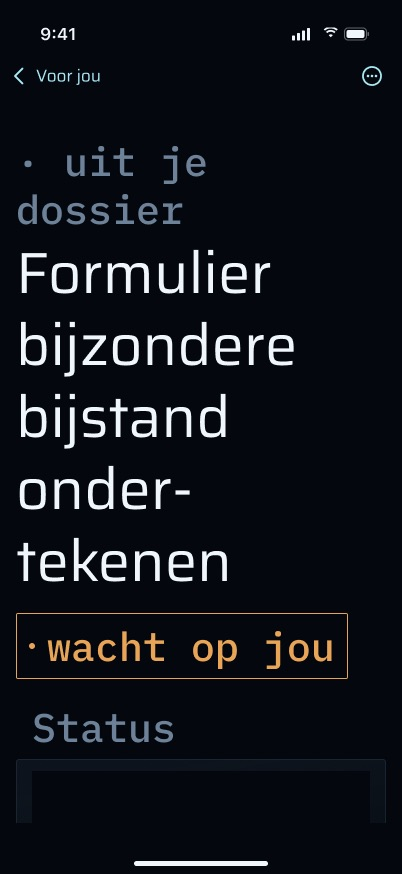 `Taak_AX5.jpg` | Taak bij AX5 | Dynamic Type schaalt |
| 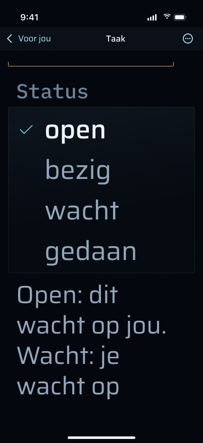 `Taak_AX5_gescrold.jpg` | Taak bij AX5, status als verticale lijst | Knoppen staan al verticaal gestapeld |
|  `Suggestie_normaal.jpg` | Suggestie voor een logboekregel, Goedkeuren / Niet relevant | "Klopt zo" / "Aanpassen" / "Niet relevant"; alleen samenvatting + toelichting |
|  `Suggestie_meer-menu.jpg` | "…"-menu: met reden, spraaknotitie, tekst kopiëren | Niet gebouwd |
| 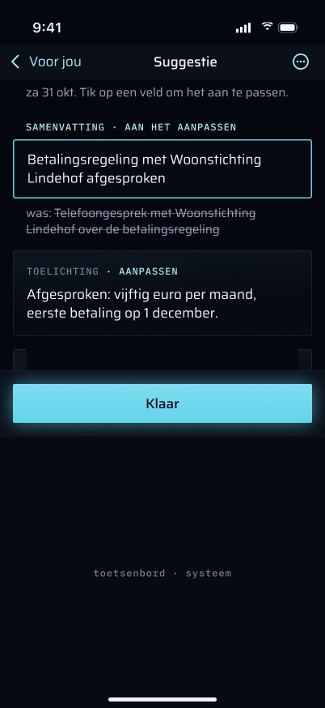 `Suggestie_veld_aanpassen.jpg` | Eén veld aanpassen, "was:" getoond | "Aanpassen" maakt alle velden bewerkbaar; geen "was:" |
|  `Suggestie_aangepast.jpg` | Twee velden veranderd, "Zet terug", "Goedkeuren · 2 aangepast" | Alleen veranderde velden verstuurd; knop blijft "Klopt zo" |
|  `Suggestie_niet_relevant.jpg` | Afgewezen met één tik, toast om ongedaan te maken op Voor jou | Altijd via het redensheet; geen ongedaan maken |
|  `Suggestie_niet_relevant_met_reden.jpg` | Redensheet | Gebouwd ("Waarom? Niet verplicht — verder leert ervan.") |
| 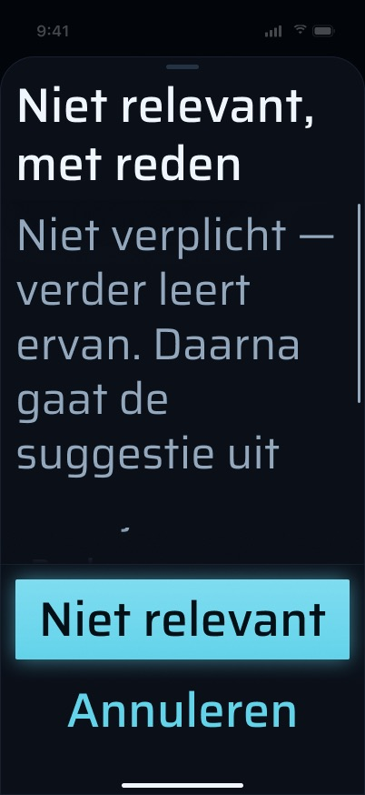 `Suggestie_niet_relevant_met_reden_AX5.jpg` | Redensheet bij AX5 | Sheet schaalt |
| 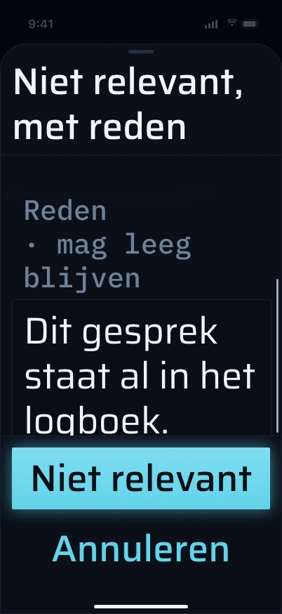 `Suggestie_niet_relevant_met_reden_AX5_gescrold.jpg` | Redensheet bij AX5, gescrold | Sheet op middelhoge stand |
|  `Suggestie_vastgelegd.jpg` | Goedgekeurd: link naar de logboekregel, "Correctie toevoegen" | Alleen "Vastgelegd." |
| 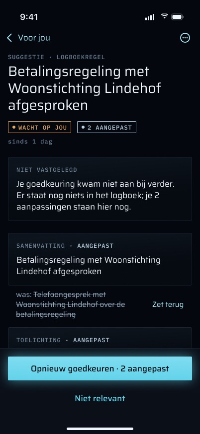 `Suggestie_fout.jpg` | Goedkeuring niet aangekomen, aanpassingen bewaard, "Opnieuw goedkeuren" | Foutregel, aanpassingen in het geheugen bewaard, opnieuw tikken |
|  `Suggestie_sessie_verlopen.jpg` | Sessie verlopen, aanpassingen op de telefoon bewaard | App-breed "Je sessie is verlopen."; aanpassingen verloren |
|  `Suggestie_offline.jpg` | Offlinebanner, aanpassen toegestaan, beslissen uitgeschakeld | Foutregel alleen na een mislukt verzoek |
| 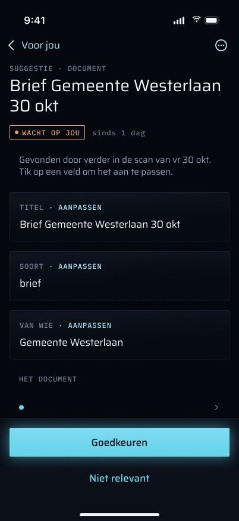 `Suggestie_document_normaal.jpg` | Documentsuggestie: titel, soort, afzender, het document | Alleen titel + soort |
| 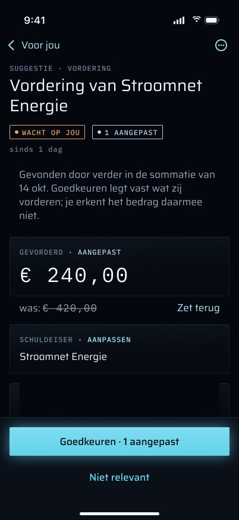 `Suggestie_vordering_aangepast.jpg` | Vordering met een aangepast bedrag | Bedrag alleen-lezen; schuldeiser bewerkbaar |
| 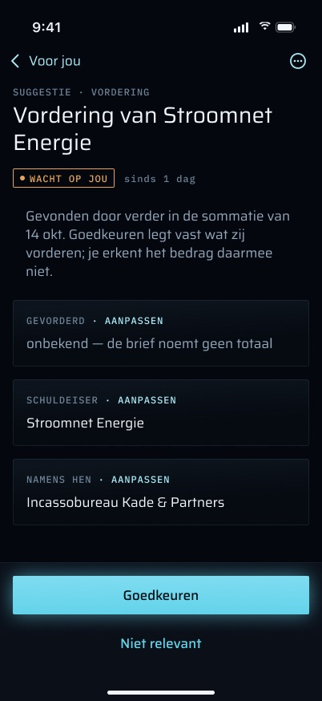 `Suggestie_vordering_onbekend_bedrag.jpg` | Vordering zonder genoemd totaal, schuldeiser en incassopartij | "Gevorderd: onbekend"; geen "Namens hen" |
| 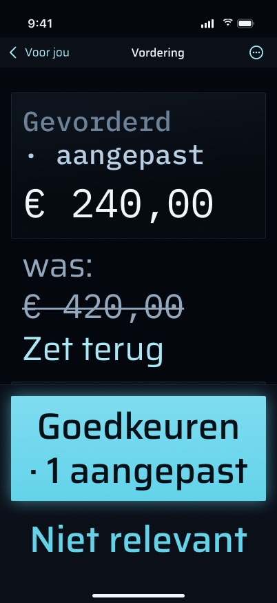 `Suggestie_vordering_aangepast_AX5.jpg` | Aangepaste vordering bij AX5 | Dynamic Type schaalt |
| 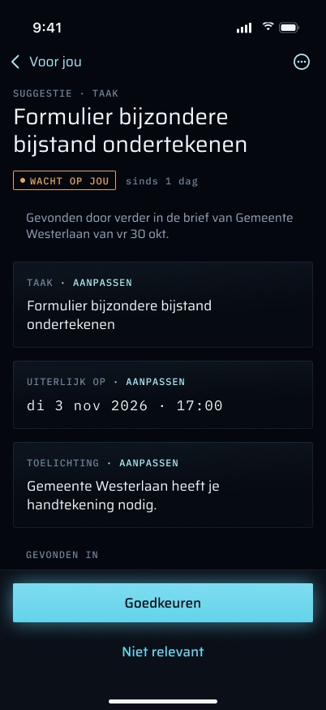 `Suggestie_taak_normaal.jpg` | Taaksuggestie: titel, deadline, toelichting | Gebouwd; deadline is een dag |
| 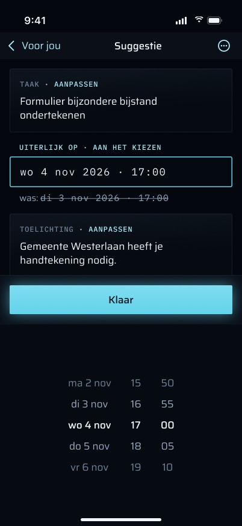 `Suggestie_taak_datum_kiezen.jpg` | Draaiwiel voor dag + tijd van de deadline | Kiezer voor alleen een dag, met "Geen datum" |
| 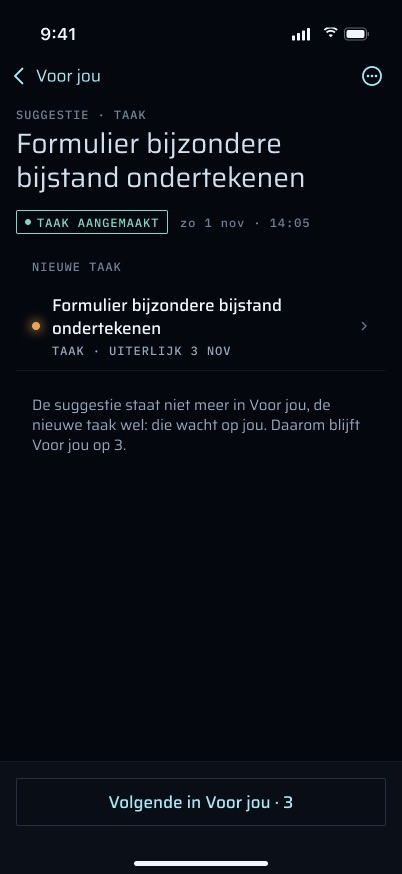 `Suggestie_taak_vastgelegd.jpg` | Taak aangemaakt, de nieuwe taak wacht nu | "Vastgelegd."; de nieuwe taak verschijnt na verversen in de lijst |
| 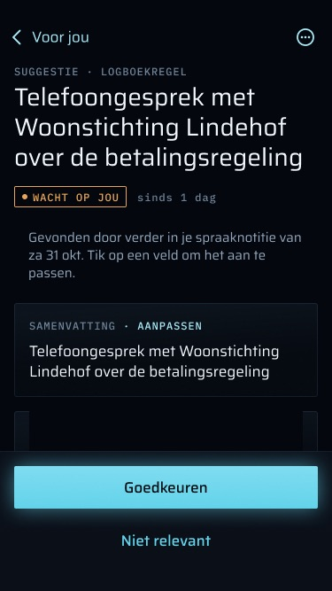 `Suggestie_iPhone_SE.jpg` | Suggestie op een iPhone SE | Dezelfde kolom |
| 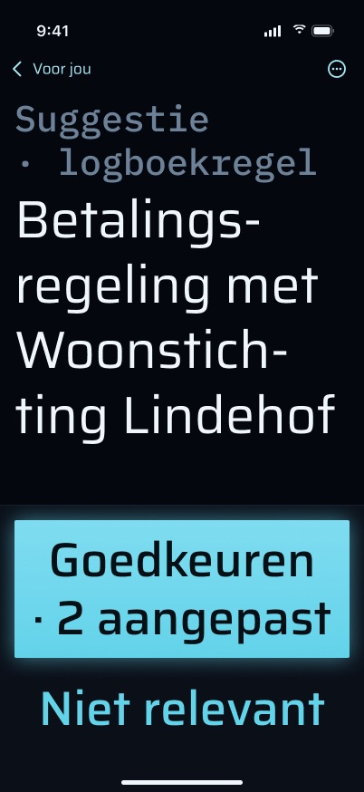 `Suggestie_AX5.jpg` | Suggestie bij AX5 met de knop met aantal aanpassingen | Dynamic Type schaalt; "Klopt zo" |
