# Scan en de uploadwachtrij: functies

## Stand van de bouw

Gecontroleerd tegen de code op 2026-11-03, 19:15 CET, branch `feat/iphone-app`. Dat wil zeggen: de gecommitte HEAD (`21426ad`) plus de niet-gecommitte working tree.

| Status | Functies |
|---|---|
| **Gebouwd** | 28 |
| **Deels gebouwd** | 27 |
| **Nog te bouwen** | 5 |

**Het herontwerp van Scan is gaande in de working tree, en daarom is "Deels" de grootste groep.** Een andere sessie bouwt op dit moment de definitieve frames: `ScanScreen.swift`, `QueueViews.swift`, `ScanPermissionViews.swift` en `CameraAccess.swift` zijn nieuw en untracked, `QueueStrip.swift` is verwijderd, en `ScanTab.swift`, `UploadQueue.swift`, `UploadItem.swift`, `UploadCenter.swift`, `DeepLink.swift`, `QuickAction.swift` en `project.yml` zijn gewijzigd. Een functie die alleen daar bestaat, staat op **Deels gebouwd**, nooit op Gebouwd, want niets ervan is gecommit, niets ervan is getest (er is geen `ScanScreenTests`, en `UploadQueueTests` dekt `setNote` noch `remove`) en niets ervan is gebouwd of op de telefoon gedraaid. De tree bewoog nog tijdens de controle: twee compileerfouten (`SessionExpiredView` die geen `cameraRequested`-binding doorgeeft, en een ontbrekende `FixtureLaunch.scanState`) zijn tijdens de controle door de andere sessie opgelost, en voor dit document is geen build gedraaid.

**De drie belangrijkste dingen die nog gebouwd moeten worden:**

1. **Een duplex-samenvoeging voor telefoonscans.** De duplexkaart belooft al "verder legt ze samen", met een aftelling, maar alleen NAS-bestanden met de naam `scanNNNN.pdf` worden ooit samengevoegd (`apps/worker/src/duplex.ts`). Een scan van de voorkanten en een scan van de achterkanten vanaf de telefoon blijven twee documenten. Zolang er geen samenvoeging is: bouw die, of lever de belofte van de kaart niet uit.
2. **Een plek voor de notitie ("Iets bijzonders?") op de server.** De telefoon bewaart de notitie en stuurt die mee als formulierveld `note`, maar `POST /api/mobile/v1/documents` negeert het en `documents` heeft er geen kolom voor, dus elke notitie die Martin schrijft gaat bij aankomst verloren. Er is ook een manier nodig om na de upload een notitie toe te voegen, want de chip verdwijnt zodra de scan verstuurd is, en online is dat een kwestie van seconden.
3. **De bediening in het Bedieningspaneel en de Actieknop "Scan een brief"** (brief R20, de "1 + pagina's"-flow uit de brief). Daarvoor zijn een App Intent en een `ControlWidget` in de widgetextensie nodig. Vandaag bestaat alleen de snelle actie op het beginscherm, en die alleen in de working tree.

---

Het tabblad Scan is de weg waarlangs een papieren brief in het dossier komt: fotografeer hem met de telefoon, en verder schoont de pagina's op, bundelt ze tot één PDF en stuurt die op de achtergrond naar de server. De uploadwachtrij is het eigen overzicht van de telefoon van wat onderweg is, wat is aangekomen en wat is mislukt. Alleen Martin gebruikt de app.

Dit document beschrijft wat deze schermen doen, ontworpen en gebouwd, en vermeldt per functie hoe ver de code is. Het visuele ontwerp valt erbuiten; dat staat in Figma: bestand `QDRL5zHNEOjPzLZqzd19Ii`, sectie `scan · final`, node `305:2`. De frames in `frames/` zijn op 2026-11-03 opnieuw uit die sectie geëxporteerd, nadat de tabbalk centraal was gerepareerd. Elke schermafbeelding gebruikt de synthetische fixture-dataset, geen echte dossiergegevens. UI-teksten worden in het Nederlands geciteerd, precies zoals de app ze toont (of, voor een functie die nog niet gebouwd is, zoals het frame ze toont).

Zo lees je een statusregel:

- **Gebouwd:** gecommit, en het doet wat er staat. Het bestand wordt genoemd.
- **Deels gebouwd:** een deel bestaat. De regel zegt wat ontbreekt. "Working tree" betekent code die bestaat maar niet gecommit, niet getest en nog niet gebouwd of gedraaid is (zie hierboven).
- **Nog te bouwen:** er bestaat nog niets. De regel zegt wat ervoor nodig is.

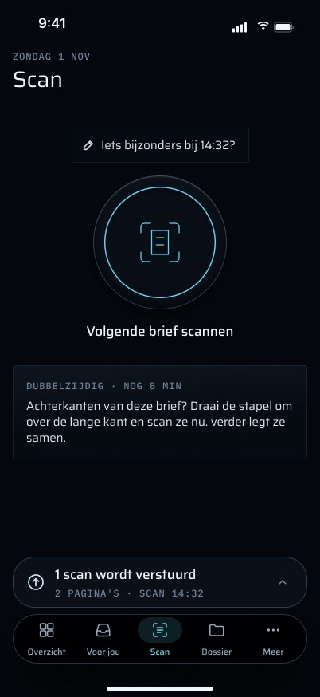

## Doel

- **Papier sneller in het dossier krijgen dan door de trap op te lopen naar de scanner.** Het anti-doel van de spec is "snapping is slower than walking upstairs" (spec §4; koude start tot camera onder 2 s). Een opname wordt buiten de main thread opgeschoond, gebundeld en in de wachtrij gezet, en het scherm is meteen terug.
- **Nooit een brief kwijtraken.** De wachtrij is een set bestanden in de App Group-container. Die overleeft het afsluiten van de app en het herstarten van de telefoon. Een mislukte upload is nooit definitief, en een item waarvan het bestand verdwenen is, wordt als mislukt gemarkeerd in plaats van weggegooid.
- **Nooit een brief twee keer innemen.** Elke upload draagt een door de client gegenereerde UUID (`clientId`). De server bewaart die en beantwoordt een herhaling met `duplicate: true`.
- **Werken vóór Face ID en zonder verbinding.** Scan zit niet achter de vergrendeling: een scan in de wachtrij onthult niets, en de camera mag nooit door een Face ID-prompt worden afgedekt.
- **Niets te beslissen.** Scannen stelt Martin geen vragen. Wat de server daarna met het document doet (OCR, naamgeving, een suggestie, misschien een voorstel) gebeurt op de server en bereikt hem via Voor jou.

## Hoe je er komt, en waar het heen leidt

### Erin

#### De tabbalk

Het derde tabblad, "Scan" (`TabID.scan`, SF Symbol `doc.viewfinder`). De volgorde van de tabbladen in de code is Overzicht · Voor jou · Scan · Dossier · Meer.

**Status:** Gebouwd (`App/RootView.swift`).

#### De scanregel op Overzicht

"Vandaag 2 verstuurd · 1 in de wachtrij", of "Vandaag nog niets gescand". Een tik erop schakelt naar het tabblad Scan (`openScan`). Als Overzicht zelf offline is, luidt het wachtende deel "N wacht op verbinding". Zie `../02-overzicht/FEATURES.md`.

**Status:** Gebouwd (`Home/HomeSummary.swift`, `scansRow`).

#### Scannen vanuit "Je sessie is verlopen."

"Toch een brief scannen" opent dezelfde `ScanTab` in een schermvullende cover met "Sluiten" rechtsboven. Scannen werkt daar zonder sessie, en de scans wachten in de wachtrij (zie [Sessie verlopen en uitgelogd](#sessie-verlopen-en-uitgelogd)).

**Status:** Gebouwd (`Auth/SessionExpiredView.swift`). In de working tree geeft de cover `cameraRequested: .constant(true)` door, zodat de camera meteen opent, net als vanuit de snelle actie. Er wordt geen `openDocument` doorgegeven, dus het pijltje van een verstuurde rij in de Wachtrij doet vanuit deze cover niets (er zit daar toch geen Dossier achter).

#### Snelle actie op het beginscherm "Scan een brief"

Druk lang op het app-icoon, kies "Scan een brief", en de camera opent meteen, zonder Face ID. Na Bewaar staat Martin op Scan met de brief in de wachtrij (frame `Scan_snelstart`). De actie staat boven "Gesprek vastleggen".

**Status:** Deels gebouwd — alleen in de working tree. De onderdelen zijn `project.yml` (`pro.vanderpoel.grip.scan`), `App/QuickAction.swift` (`scanType` → `DeepLink.scan`), `Push/DeepLink.swift` (`grip://scan` → `LinkDestination(tab: .scan, opensCamera: true)`) en `RootView.cameraRequested`. Er is geen test (`QuickActionTests`, `DeepLinkTests` en `LinkDestinationTests` hebben geen scangeval), en het is niet op de telefoon geprobeerd.

#### Bediening in het Bedieningspaneel "Scan een brief"

Een bediening in het Bedieningspaneel die de camera op Scan direct opent, zonder Face ID (brief §3 Scan-rij, R20; frame `Scan_snelstart`, sectie "Bedieningspaneel").

**Status:** Nog te bouwen — nodig zijn een App Intent die de app op `.scan` met de camera opent (een `OpenIntent` of een intent die `DeepLink.scan` binnen het proces aflevert, want verder registreert geen URL-schema), een `ControlWidget` in de `GripWidget`-extensie, en een test dat de intent op de cameralink uitkomt. Het commentaar bij `DeepLink.scan` in de working tree noemt deze bediening al, maar er staat nergens in `apps/ios` een `AppIntent` of `ControlWidget`.

#### Actieknop "verder: Scan een brief"

De Actieknop, gekoppeld aan de scan van verder, opent de camera direct (brief R20; frame `Scan_snelstart`, sectie "Actieknop").

**Status:** Nog te bouwen — dezelfde App Intent als voor het Bedieningspaneel, aangeboden als App Shortcut zodat die onder Instellingen → Actieknop te kiezen is. Er is geen serverwerk voor nodig.

#### Meldingen en widgets

Geen enkele melding en geen enkele widget leidt naar het tabblad Scan. Er is er ook geen ontworpen.

**Verschil met de spec:** spec §7 zegt dat de app vier tabbladen heeft met Scan als eerste en "on launch the camera is live". Sinds Martins besluit van 2026-11-01 opent de app op Overzicht. Op HEAD opent de camera vanzelf de eerste keer dat het tabblad Scan in een proces wordt getoond. In de working tree opent hij alleen na een tik op de schijf, of meteen vanuit de snelle actie (en, zodra die gebouwd zijn, de bediening en de Actieknop). Dat klopt met de frames en R25: om de camera wordt gevraagd bij het eerste gebruik, nooit bij het opstarten.

### Eruit

#### Een verstuurde scan opent zijn document in Dossier

In de Wachtrij heeft een rij onder "Verstuurd vandaag" een pijltje. Een tik erop sluit het sheet en opent dat document op het tabblad Dossier. De telefoon bewaart het document-id dat de server teruggaf (`UploadItem.documentId`, uit `markSent(documentId:)`).

**Status:** Deels gebouwd — alleen in de working tree (`QueueViews.swift` `QueueSheetView.open`, `RootView` `dossierPath = [.document(id:…)]`). Niet getest. Items die vóór deze wijziging verstuurd zijn, hebben geen `documentId` en geen pijltje. Of het document opent voordat Dossier het gesynchroniseerd heeft, is niet gecontroleerd.

Verder zijn verstuurde scans te vinden in Dossier en op het web onder Files, bron "Telefoon" (bron `phone-scan`; gedeelde bestanden zijn "Gedeeld").

## Functies

### Opnemen

#### De schijf opent de camera

Het tabblad Scan toont een titel ("Scan", met de datum erboven, of "OFFLINE" zolang er geen netwerk is), één statusregel, een grote schijf met onderschrift, en de duplexkaart. Een tik op de schijf opent de camera. Het onderschrift is "Scan een brief" met daaronder "Leg de brief plat neer, de camera doet de rest.", of "Volgende brief scannen" binnen 10 minuten na de laatste scan.

**Status:** Deels gebouwd — alleen in de working tree (`Scan/ScanTab.swift` `ScanDisc`, `Scan/ScanScreen.swift`). De teksten komen uit `ScanScreen`, dat zo geschreven is dat het zonder simulator te testen is, maar er bestaat nog geen test. Op HEAD is het tabblad de camera zelf, daarna een rustscherm met de telling "N pagina's in de wachtrij" en één knop "Volgende brief scannen" / "Scan een brief".

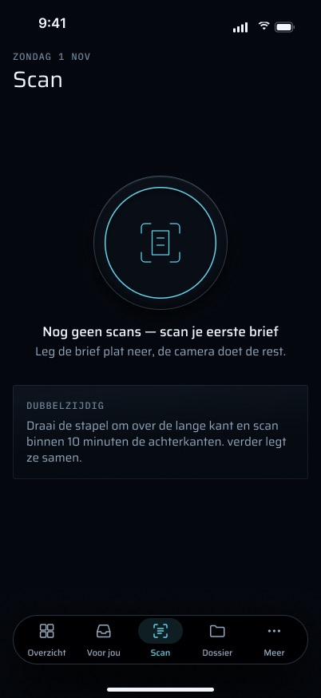

#### De documentcamera

De camera is VisionKits `VNDocumentCameraViewController` (`DocumentCamera.swift`). Die doet opnames van meerdere pagina's, automatische randdetectie en perspectiefcorrectie, en heeft eigen knoppen voor ontspanner, opnieuw nemen en "Bewaar". Het uiterlijk is dat van Apple en is niet aan te passen. Elke opname krijgt een nieuwe controller, omdat de controller van VisionKit zijn afgeronde pagina's vasthoudt. Zolang de camera actief is, speelt er geen haptiek (brief R13).

**Status:** Gebouwd (`Scan/DocumentCamera.swift`).

#### ✓ en ✗ sluiten de camera

✓ (klaar) geeft de pagina's aan `UploadCenter.capture` en brengt terug op het tabblad Scan. ✗ (annuleren), of een fout van VisionKit (`didFailWithError:`, gemeld als annuleren), brengt terug zonder dat er iets in de wachtrij staat. De eerste build zette bij ✓ en ✗ ter plekke een nieuwe camera klaar, waardoor de camera op de telefoon nooit zichtbaar sloot en de tabbalk onbereikbaar was (gemeten met Martin, 2026-10-31). Beide sluiten de camera nu.

**Status:** Gebouwd (`Scan/ScanTab.swift`, commit `f994028`; in de working tree behouden als schermvullende cover).

#### Uitleg vóór de cameravraag

Bij het eerste gebruik, vóór de eigen melding van iOS, legt één scherm uit waarom: "Brieven scannen", "verder gebruikt de camera om brieven voor je dossier te scannen.", twee beloftes ("De camera gaat alleen aan als jij op scannen tikt.", "Scannen werkt ook zonder Face ID en zonder verbinding."), en één knop "Ga verder" met daaronder "Daarna vraagt iOS om toestemming.". Het heeft geen sluitknop en kan niet weggeveegd worden (brief R25). Na de tik volgt de melding van iOS; als Martin toestemming geeft, opent de camera. De gebruiksomschrijving is nu "verder gebruikt de camera om brieven voor je dossier te scannen."

**Status:** Deels gebouwd — alleen in de working tree (`Scan/ScanPermissionViews.swift` `CameraPrePrompt`, `Scan/CameraAccess.swift`, `project.yml`). Niet getest, niet op de telefoon gezien. Op een telefoon die de HEAD-build al cameratoegang gaf, verschijnt het nooit.

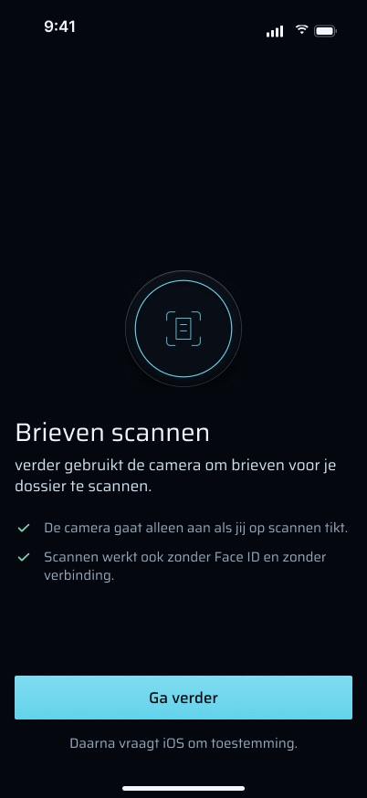

#### Camera geweigerd

Als de camera uit staat voor verder, vervangt het tabblad de schijf door "De camera staat uit voor verder", "Zet hem aan in Instellingen → verder → Camera. Daarna kun je meteen scannen." en een knop "Open Instellingen" die de pagina van verder in Instellingen opent. De wachtrijregel blijft staan, zodat wachtende scans zichtbaar blijven.

**Status:** Deels gebouwd — alleen in de working tree (`ScanPermissionViews.swift` `CameraDenied`). De toestand wordt gelezen bij verschijnen en bij een tik op de schijf, niet wanneer de app terugkomt uit Instellingen, dus nadat Martin de camera heeft aangezet, ziet hij mogelijk het weigerscherm tot hij van tabblad wisselt. Niet getest.

#### Geen documentcamera

Op een toestel zonder documentcamera (de simulator) toont een tik op de schijf daaronder "Geen camera op dit toestel." (op HEAD: "Geen camera beschikbaar op dit toestel.").

**Status:** Gebouwd (`Scan/ScanTab.swift`, `VNDocumentCameraViewController.isSupported`). De formulering uit de working tree is niet getest.

#### Eerste bezoek: "Nog geen scans"

Op een telefoon die nog nooit iets in de wachtrij heeft gezet, luidt het onderschrift "Nog geen scans — scan je eerste brief" met de uitlegregel, en is er geen wachtrijregel. "Ooit in de wachtrij gezet" wordt onthouden in `queue.json` (`everEnqueued`), zodat de tekst voor de eerste keer niet terugkomt nadat de verstuurde items zeven dagen later zijn opgeruimd.

**Status:** Deels gebouwd — alleen in de working tree (`ScanScreen.swift`, `UploadQueue.everEnqueued`). Niet getest.

#### De statusregel boven de schijf

Eén regel tussen de titel en de schijf, gekozen in deze volgorde:

1. de chip "Iets bijzonders bij 14:32?" voor de zojuist gemaakte scan (zie [de notitie](#iets-bijzonders-een-notitie-bij-de-scan));
2. wachten op inloggen: "Je scan staat veilig op dit toestel." / "Je 2 scans staan veilig op dit toestel.";
3. een mislukking: "11:05 niet verstuurd, staat veilig op dit toestel." / "N scans niet verstuurd, ze staan veilig op dit toestel.";
4. offline: "Scannen werkt gewoon zonder verbinding.";
5. anders niets. De lege regel houdt zijn hoogte, zodat de schijf nooit verspringt.

Bij de toegankelijkheidstekstgroottes vervalt de regel, en draagt de wachtrijregel de toestand.

**Status:** Deels gebouwd — alleen in de working tree (`ScanScreen.Slot`). Niet getest.

### Opschonen en de PDF (op de telefoon)

#### Pagina's opschonen

`PageCleaner.swift` draait per pagina voordat de PDF wordt gebouwd. Er bestaan drie varianten, zodat ze tegen elkaar gemeten kunnen worden:

- `raw`: het beeld van de camera, onbewerkt;
- `baseline` (**de standaard**): `CIHighlightShadowAdjust` (licht de schaduwkant op) plus een milde contrastverhoging;
- `documentEnhancer`: `CIDocumentEnhancer` van Core Image.

De variant wordt gelezen uit `UserDefaults`-sleutel `pageCleaner`, zodat een startargument `-pageCleaner <variant>` er een kiest zonder UI. Een filter dat faalt, geeft de originele pagina terug; een pagina gaat nooit verloren aan het opschonen.

**Status:** Gebouwd (`Scan/PageCleaner.swift`, `PageCleanerTests`). De vergelijking die de spec vraagt (5 echte brieven, één verfrommeld) is niet gemaakt; zie [Bekende grenzen](#bekende-grenzen-en-wat-nog-niet-gemeten-is).

#### Kreuken en krul verminderen (dewarp)

Spec §7.1 vraagt om vouwen en krul glad te trekken voordat de PDF wordt gebouwd, met de document-API's van Vision, en alleen uit te leveren wat de OCR aantoonbaar helpt.

**Status:** Nog te bouwen — en geblokkeerd: de iOS 27.2 SDK heeft geen API in Vision, VisionKit of Core Image die een pagina gladtrekt (headers doorzocht, 2026-10-31). Het zou een eigen model op de telefoon nodig hebben, of een stap op de server vóór de OCR, plus de meting met 5 brieven om aan te tonen dat het helpt.

#### Eén PDF per opname

`PDFAssembler.swift`: elke pagina wordt verkleind tot 2200 px aan de lange kant, als JPEG gecodeerd met kwaliteit 0,6 en ongewijzigd ingebed (DCTDecode), 595 pt breed. Een pagina zonder echte kleur wordt als grijswaarden met één kanaal gecodeerd; een gekleurd briefhoofd, een stempel of markeerstift houdt de pagina in kleur. Een pagina die niet gecodeerd kan worden, wordt weggelaten; helemaal geen pagina levert lege data op, die de wachtrij weigert.

**Status:** Gebouwd (`Scan/PDFAssembler.swift`, `PDFAssemblerTests`).

#### De naam

`Scan yyyy-MM-dd HH.mm.pdf` volgens de klok in **Amsterdam**, nooit UTC en nooit de eigen tijdzone van de telefoon.

**Status:** Gebouwd (`Scan/ScanNaming.swift`, `ScanNamingTests`).

#### Gebundeld buiten de main thread, en opengehouden

Het werk draait in een losgekoppelde taak binnen een `beginBackgroundTask("verder.scan")`, zodat een brief die gefotografeerd wordt vlak voordat de telefoon in de zak gaat, toch de wachtrij bereikt. Zolang het loopt, telt de opname als onderweg (`preparing`). Het aantal pagina's wordt bij het item bewaard ("2 pagina's"), en de bestandsgrootte ook.

**Status:** Gebouwd (`Upload/UploadCenter.swift` `capture`). Aantal pagina's en grootte per item staan alleen in de working tree (`UploadItem.pages`, `byteCount`).

#### "De scan kon niet worden bewaard."

Als de PDF niet geschreven kan worden, gaat er niets in de wachtrij en zegt het tabblad "De scan kon niet worden bewaard. Probeer het opnieuw." Martin scant opnieuw.

**Status:** Deels gebouwd — `UploadCenter` zet de melding nog steeds, maar de `ScanTab` in de working tree toont `center.message` nergens meer, dus de fout is daar stil. Op HEAD staat de regel bovenaan het tabblad. Er is geen frame voor deze toestand.

### De overdracht aan de wachtrij

#### De pagina vliegt de wachtrij in

Na ✓ krimpt de miniatuur van de eerste pagina vanuit het midden van het scherm de wachtrijregel boven de tabbalk in, een veer van 0,4 s (brief §2.6, CapWords; frame `Scan_overdracht`). Met Verminder beweging vervaagt hij in plaats daarvan ter plekke. Hij blokkeert nooit een tik.

**Status:** Deels gebouwd — alleen in de working tree (`ScanTab.launchFlight`, `flightOverlay`). Niet getest, niet op de telefoon gezien.

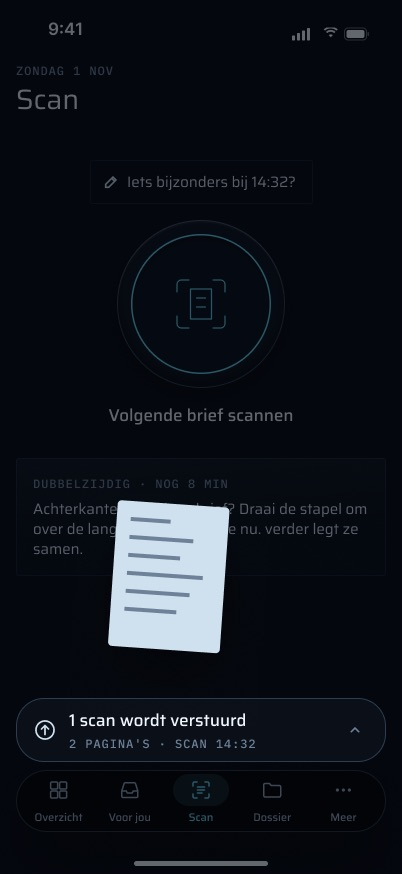

#### Eén haptische tik wanneer de scan de wachtrij bereikt

`.impact(.medium)` wanneer de PDF in de wachtrij komt, nadat de camera gesloten is. Niets wanneer een upload slaagt, want achtergrondwerk zoemt niet (brief §2.5).

**Status:** Deels gebouwd — alleen in de working tree (`ScanTab` `.sensoryFeedback(.impact(weight: .medium), trigger: center.enqueuedCount)`). Nog niet op de telefoon gevoeld.

### De wachtrijregel boven de tabbalk

Zolang de wachtrij iets te melden heeft, staat er één regel vlak boven de tabbalk (brief R4). Een tik erop opent de Wachtrij. Als de regel een actie draagt, is die actie een eigen knop. In volgorde van voorrang:

| Situatie | Regel | Actie |
|---|---|---|
| Wachten op inloggen | "2 wachten" · "LOG OPNIEUW IN OM TE VERSTUREN" | "Opnieuw inloggen" opent het inlogsheet |
| Een mislukking | "Niet verstuurd" · "GEEN ANTWOORD" / "NIET AANGENOMEN" / "BESTAND ONTBREEKT", of "N scans" | "Opnieuw proberen" verstuurt elk mislukt item opnieuw |
| Offline, scans wachten | "3 scans wachten op verbinding" · "VERSTUURD ZODRA JE ONLINE BENT" | — |
| Onderweg | "1 scan wordt verstuurd" · "2 PAGINA'S · SCAN 14:32" (meerdere: "LAATSTE 14:36") | — |
| Alles vandaag verstuurd | "Alles is verstuurd" · "VANDAAG 3 SCANS · LAATSTE 14:32" | — |
| Vandaag niets en niets wachtend | geen regel | — |

Niets erop is amber: een scan die onderweg is, wacht of mislukt is, is de toestand van de telefoon, niet iets in het dossier dat op Martin wacht. De regel wordt door Scan zelf getekend, niet als accessoire van de systeemtabbalk, want dat heeft één vaste hoogte, verschijnt op elk tabblad en kan bij AX5 geen twee rijen bevatten.

**Status:** Deels gebouwd — alleen in de working tree (`ScanScreen.swift` `QueueAccessory`, `QueueViews.swift` `QueueAccessoryView`). Niet getest. Het vervangt de strip van één regel bovenaan het tabblad op HEAD (`QueueStrip.swift`, verwijderd in de working tree): "1 wordt verstuurd" · "N verstuurd vandaag" · "N mislukt — opnieuw", die op HEAD Gebouwd is en gedekt wordt door `UploadQueueTests` (striptekst, Amsterdamse dag).

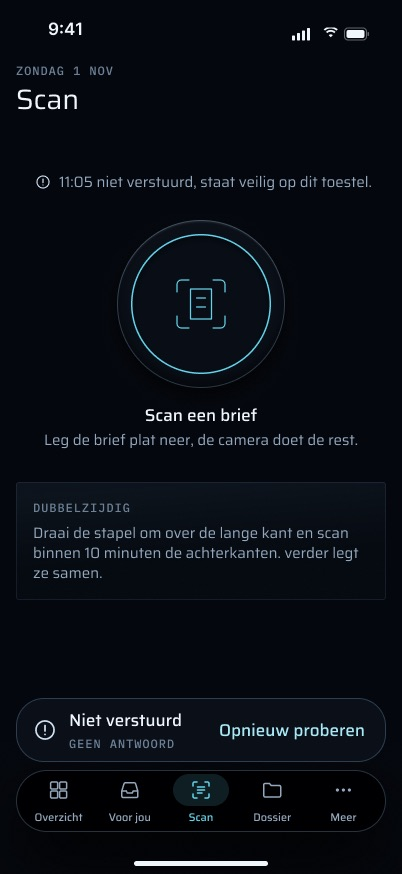

#### Het uploadsymbool pulseert

Zolang een scan onderweg is, pulseert de pijl van de regel (SF Symbols `.pulse`, R14). De brief vraagt ook om `.replace` bij een toestandswijziging en één `.bounce` wanneer het klaar is, en om een pulserend symbool op elke uploadende rij in de Wachtrij.

**Status:** Deels gebouwd — alleen in de working tree, en alleen op de wachtrijregel (`QueueAccessoryView.icon`). De badges van de rijen zijn statisch, en er is geen `.replace` of `.bounce`.

#### Weten dat hij offline is

De telefoon houdt het netwerkpad in de gaten (`NWPathMonitor`). Zonder pad toont de datum boven de titel "OFFLINE", zegt de statusregel "Scannen werkt gewoon zonder verbinding.", heten wachtende scans "wachten op verbinding", en loopt de wachtrij vanzelf leeg zodra het netwerk terug is. (De achtergrond-uploadsessie wachtte zelf al op een netwerk; dit maakt de toestand zichtbaar en verstuurt de items die er nog niet aan waren overgedragen.)

**Status:** Deels gebouwd — alleen in de working tree (`UploadCenter.watchNetwork`, `isOffline`). Niet getest; de vliegtuigmodus is niet op de telefoon geprobeerd.

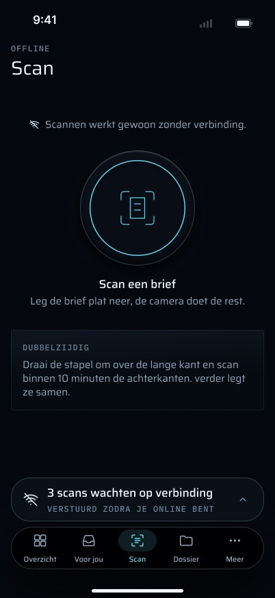

#### Een Live Activity terwijl meerdere scans leeglopen

Zolang er 3 of meer scans onderweg zijn, toont een Live Activity op het toegangsscherm en in het Dynamic Island de telling die afloopt, en eindigt die wanneer de wachtrij leeg is (brief §3 Uploadwachtrij-rij, R18; alleen systeemanimaties, ≤ 2 s).

**Status:** Nog te bouwen — nodig zijn ActivityKit (`NSSupportsLiveActivities` in `project.yml`, een `ActivityAttributes`-type gedeeld met `GripWidget`, een `ActivityConfiguration` met weergaven voor het toegangsscherm en het Dynamic Island), start/update/end-aanroepen vanuit `UploadCenter` naarmate items verschuiven, en een besluit over hoe hij bijwerkt terwijl de app gepauzeerd is (de achtergrondsessie start de app opnieuw per afgeronde taak, wat genoeg kan zijn; bijwerken via push zou de server nodig hebben). Hij mag alleen tellingen tonen, nooit een titel. Er bestaat nog geen frame voor.

### Het Wachtrij-sheet

Een tik op de wachtrijregel opent "Wachtrij", een sheet over de volle hoogte met "Klaar" rechtsboven. Secties in de volgorde waarin Martin erop handelt:

- **"NIET VERSTUURD · N"**: elke rij toont "Scan 11:05 · 1 pagina", de reden in mono ("GEEN ANTWOORD", "NIET AANGENOMEN", "BESTAND ONTBREEKT"), een toelichting ("Staat veilig op dit toestel. Tik Opnieuw proberen om het nog eens te versturen.", of voor een geweigerd bestand "verder nam dit bestand niet aan. Opnieuw proberen stuurt het nog eens.") en een eigen "Opnieuw proberen";
- **"WORDT VERSTUURD · N"**, met de bestandsgrootte ("1,4 MB"); of, wanneer versturen is opgeschort, **"WACHT OP VERBINDING · N"** of **"WACHT OP INLOGGEN · N"** met "Staat veilig op dit toestel" op elke rij, en "Opnieuw inloggen" naast de titel van de inlogsectie;
- **"VERSTUURD VANDAAG · N"** (de Amsterdamse kalenderdag): de eerste twee rijen, "Verstuurd 13:11 · in Dossier", daarna "Toon alle N".

Een gedeeld bestand houdt zijn eigen naam als titel van de rij. Een rij toont zijn notitie, als die er is. De voettekst: "Verstuurde scans staan in Dossier. Deze lijst begint morgen weer leeg.", of tijdens het wachten "Na het inloggen worden ze vanzelf verstuurd." / "Ze worden vanzelf verstuurd zodra je online bent." gevolgd door "Verstuurde scans staan in Dossier."

**Status:** Deels gebouwd — alleen in de working tree (`ScanScreen.swift` `QueueSheet`, `QueueViews.swift` `QueueSheetView`, `UploadItem.failure`/`byteCount`). Niet getest. HEAD heeft helemaal geen weergave per item.

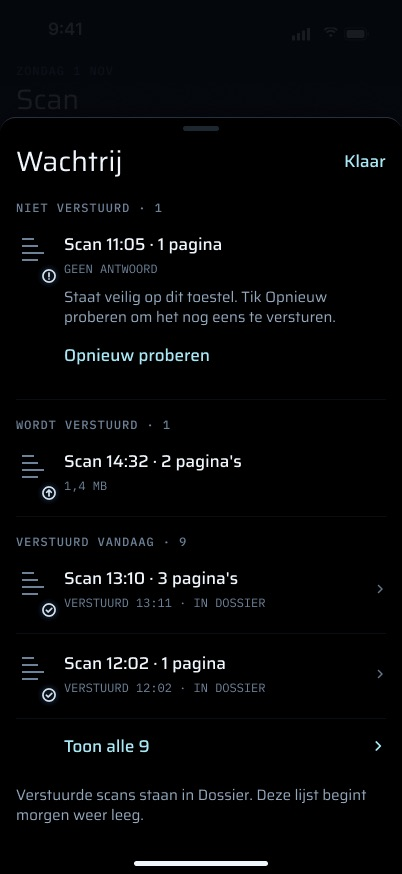

#### "Toon alle N"

Toont elke scan die vandaag verstuurd is in plaats van de eerste twee.

**Status:** Deels gebouwd — alleen in de working tree (`QueueSheet.sentPreview`, `showAllSent`). Niet getest.

#### Eén item opnieuw proberen

"Opnieuw proberen" op een mislukte rij (en in het menu ervan) verstuurt dat ene item opnieuw vanaf poging 0, met dezelfde `clientId`.

**Status:** Deels gebouwd — de UI alleen in de working tree (`UploadCenter.retry(_:)`). `UploadQueue.retry(_:)` zelf is gecommit en getest via `retryAllFailed`.

#### Alles wat mislukt is opnieuw proberen

"Opnieuw proberen" op de wachtrijregel (HEAD: "opnieuw" op de strip, VoiceOver "Mislukte scans opnieuw versturen") verstuurt elk mislukt item opnieuw met een schone lei.

**Status:** Gebouwd (`UploadQueue.retryAllFailed`, `UploadCenter.retryFailed`, `UploadQueueTests`). De nieuwe plek op de wachtrijregel staat alleen in de working tree.

#### Rijmenu: Opnieuw proberen · Notitie toevoegen · Verwijder

Lang drukken op een rij die nog niet verstuurd is, tilt hem op en toont zijn acties (frame `Wachtrij_rij-acties`): "Opnieuw proberen" (alleen mislukte rijen), "Notitie toevoegen" (of "Notitie wijzigen" als er al een is) en, na een scheidingslijn, "Verwijder". Dezelfde acties zijn aangepaste VoiceOver-acties.

**Status:** Deels gebouwd — alleen in de working tree (`QueueSheetView.rowView`, contextmenu en `accessibilityActions`; bij de VoiceOver-acties ontbreekt "Opnieuw proberen", dat in plaats daarvan een knop binnen de rij is). Niet getest.

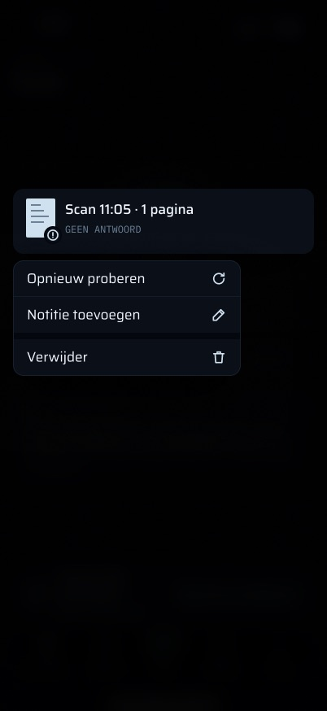

#### Een scan verwijderen die nog niet weg is

"Verwijder" vraagt eerst "Deze scan verwijderen?" met "Hij is nog niet verstuurd en staat dan nergens meer.", met een `.warning`-haptiek zodra de vraag verschijnt. Alleen een wachtend of mislukt item kan verwijderd worden: een item dat verstuurd wordt, is van de uploader, en een verstuurd item staat al in het dossier, waar de wachtrij niet bij kan. Eerst gaat de vermelding weg, daarna het bestand.

**Status:** Deels gebouwd — alleen in de working tree (`UploadQueue.remove`, `UploadCenter.remove`, bevestiging in `QueueSheetView`). Geen test, en dit is de ene wachtrijactie die een brief vernietigt, dus die verdient er een: dat `sending` en `sent` weigeren, en dat het bestand na de vermelding verdwijnt.

#### Waarom het mislukte

Elke mislukking legt haar reden vast op het item: geen antwoord (5xx, 429, geen verbinding), geweigerd (elke andere 4xx) of het bestand ontbreekt. De wachtrijregel en de rijen noemen die.

**Status:** Deels gebouwd — alleen in de working tree (`UploadItem.Failure`, gezet in `UploadQueue.markFailure` en `claim`). Niet getest.

### "Iets bijzonders?": een notitie bij de scan

Spec §7.1 staat na een scan één optionele, niet-blokkerende chip toe, "Iets bijzonders?", voor een notitie van één regel die met de upload meegaat. Nooit verplicht. Boven de schijf luidt de chip "Iets bijzonders bij 14:32?". Hij opent een sheet: "Niet nu" linksboven, "Iets bijzonders?", "BIJ SCAN 14:32 · 2 PAGINA'S · MAG OOK LEEG", een tekstveld ("Bijvoorbeeld: kwam aangetekend"), drie snelkeuzes die het veld vullen ("Kwam aangetekend", "Achterkant ontbreekt", "Hoort bij vorige scan", elk met een `.selection`-haptiek) en "Bewaar bij de scan". De notitie is ook bereikbaar via het menu van een rij in de Wachtrij, en een rij toont zijn notitie.

**Status:** Deels gebouwd — de telefoonhelft staat in de working tree (`QueueViews.swift` `ScanNoteSheet`, `UploadQueue.setNote`, `UploadRequest.build` voegt een formulierveld `note` toe). Wat ontbreekt:

- **de serverhelft:** `apps/web/src/app/api/mobile/v1/documents/route.ts` leest `note` niet, en `documents` heeft geen notitiekolom (spec §7.8 stelde de notitie van de deelextensie om precies deze reden uit). Er is een daarvoor ontworpen plek nodig: een migratie, de route die het veld leest en begrenst, en een plek op het web en in Dossier die het toont. Het is geen bewijs, dus het hoort niet zonder besluit mee te liften op een ledger-event;
- **een notitie na het versturen:** `setNote` weigert een verstuurd item en de chip verdwijnt zodra de scan verstuurd is, wat online seconden na ✓ is. Ofwel krijgt de notitie een eigen serveraanroep (bijvoorbeeld een `PATCH` op het document via `clientId`), ofwel verschijnt de chip pas wanneer Martin er bij kan, alleen als hij offline is;
- tests voor `setNote` (leeg wist hem, een verstuurd item weigert).

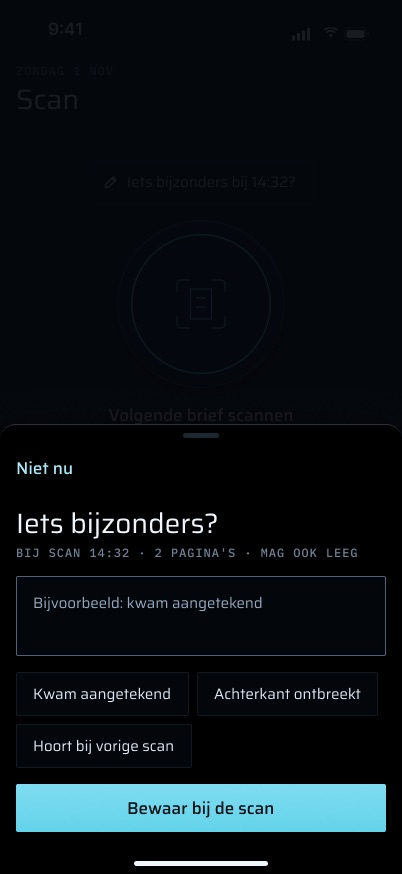

### Duplex (dubbelzijdig)

#### De duplexkaart

Onder de schijf staat één instructie: "DUBBELZIJDIG" — "Draai de stapel om over de lange kant en scan binnen 10 minuten de achterkanten. verder legt ze samen." Binnen 10 minuten na een telefoonscan wordt het een aftelling, "DUBBELZIJDIG · NOG 8 MIN" — "Achterkanten van deze brief? Draai de stapel om over de lange kant en scan ze nu. verder legt ze samen." Het scherm leest elke 30 s opnieuw in, zodat de minuten vanzelf verspringen.

**Status:** Deels gebouwd — de kaart en de aftelling staan in de working tree (`ScanScreen.duplex`, `DuplexCard`), maar **de belofte is vandaag onwaar**: niets voegt telefoonscans samen (volgende functie). Niet getest.

#### Voor- en achterkanten van een telefoonscan samenvoegen

Een scan van de voorkanten en een scan van de achterkanten die binnen 10 minuten gemaakt zijn, worden één document, om en om (voorkant i, achterkant n−1−i, lege achterkanten weggelaten), zoals de NAS-samenvoeging dat doet.

**Status:** Nog te bouwen — de duplex-samenvoeging (`apps/worker/src/duplex.ts`) hoort bij `nas.scan` en koppelt alleen bestanden op de NAS-share met de naam `scanNNNN.pdf` (`SCANNER_NAME = /^scan(\d+)\.pdf$/i`). Een telefoonscan heet `Scan 2026-10-28 14.05.pdf` en komt binnen via de API, dus wordt nooit gekoppeld. Bouwen vraagt een besluit over waar: op de telefoon vóór de upload (de telefoon kent beide opnames en hun aantallen pagina's, en er bereikt niets de ledger tot de samenvoeging), of op de server (uploads van `phone-scan` vasthouden zoals `DUPLEX_HOLD_MS`, daarna de regel van positief bewijs van `judgeDuplexPair`). Op de server moet het samenvoegen vóór `document.ingested` gebeuren, want de documententabel is append-only en een weggevoegde voorkant zou anders in het dossier blijven staan. Hoe dan ook zijn er tests nodig dat een verkeerde samenvoeging geweigerd wordt, want een verkeerde samenvoeging is erger dan een gemiste.

### Versturen

`UploadCenter` beslist **wanneer** er verstuurd wordt; `UploadQueue` houdt de items vast; `BackgroundUploader` verstuurt ze.

#### Wanneer de wachtrij leegloopt

Bij het opstarten (na herstel), na elke opname, telkens wanneer de app naar de voorgrond komt, na een nieuwe aanmelding, en, zolang de app op de voorgrond is, op de backoff-deadline van het volgende item (in de working tree ook wanneer het netwerk terugkomt). Opstarten en naar de voorgrond komen laten de wachtrij alleen leeglopen **zolang er ingelogd is** (`RootView` roept `uploads.start()` alleen aan als `auth.isSignedIn`); een opname laat hem hoe dan ook leeglopen, en zonder sessie komt dat versturen gewoon terug met 401. Een item in backoff waarvan de deadline verstrijkt terwijl de app gepauzeerd is, wacht op de eerstvolgende van deze momenten.

**Status:** Gebouwd (`Upload/UploadCenter.swift`, `App/RootView.swift`).

#### De achtergrond-uploadsessie

Een achtergrond-`URLSession` (`pro.vanderpoel.grip.upload`, `sessionSendsLaunchEvents`, niet discretionary) draagt elke upload. Die loopt door terwijl de app gepauzeerd is, wacht zelf op een netwerk, en start de app opnieuw om het resultaat te melden (`.backgroundTask(.urlSession(…))` in `GripApp.swift`). Een achtergrondupload moet vanuit een bestand komen, dus de multipart-body van elk item wordt zolang ernaast geschreven en daarna verwijderd.

**Status:** Gebouwd (`Upload/BackgroundUploader.swift`, `BackgroundUploaderTests`).

#### Het verzoek, en wat als verstuurd telt

`POST /api/mobile/v1/documents`, multipart met `clientId`, `source` (`phone-scan`), `capturedAt` (ISO 8601) en het bestand (in de working tree ook `note`), een expliciete `Content-Length`, en de sessiecookie die met de hand uit de Keychain wordt meegegeven. De sessie zelf bewaart en verstuurt geen cookies. Alleen een 2xx **van de URL waarnaar de scan verstuurd is** die de JSON van het endpoint bevat, telt als verstuurd. Een achtergrondsessie volgt redirects uit zichzelf, dus een 307 naar /login en de 200 daarvan zouden anders een scan als verstuurd markeren die nooit aankwam; een andere uiteindelijke URL geldt als "niet ingelogd". Een 2xx zonder de JSON wordt opnieuw geprobeerd (veilig, dankzij de `clientId`).

**Status:** Gebouwd (`Upload/UploadRequest.swift` `UploadOutcome.judge`, `Upload/Multipart.swift`, `MultipartTests`).

#### Bij succes

Het item wordt gemarkeerd als `sent` met `sentAt`, en de PDF wordt van de telefoon verwijderd. De vermelding zelf (bestandsnaam, tijden; in de working tree ook het document-id) blijft 7 dagen staan voor "verstuurd vandaag" en wordt daarna bij het eerstvolgende laden opgeruimd.

**Status:** Gebouwd (`UploadQueue.markSent`, `UploadQueueTests`). Het bewaarde `documentId` staat alleen in de working tree.

#### Mislukkingen en backoff

`UploadQueue.markFailure`:

- **401 of een redirect:** niet de schuld van het item. Het blijft `pending`, kost geen poging, en `signInRequired` stopt **al** het versturen tot Martin opnieuw inlogt, want elk verzoek daarvoor zou weer een 401 zijn.
- **5xx, 429 en transportfouten:** backoff van 30 s, 2 min, 10 min, 1 u; de vijfde mislukking markeert het item als `failed`.
- **Elke andere 4xx** (bijvoorbeeld 413, boven 50 MB): meteen `failed`, want de server zal deze bytes opnieuw weigeren.
- **`failed` is nooit definitief:** opnieuw proberen verstuurt het opnieuw met een schone lei, met dezelfde `clientId`.

**Status:** Gebouwd (`Upload/UploadQueue.swift`, `UploadQueueTests`: 401, backoff, vijfde mislukking, 4xx).

#### Nooit twee keer verstuurd

Twee gelijktijdige leegloopacties kunnen één item nooit twee keer versturen: claimen zet een item in dezelfde stap op `sending`. Bij het opstarten gaat een item dat door een afgebroken proces op `sending` is blijven staan terug naar `pending`, tenzij de achtergrondsessie er nog een taak voor heeft (`recover`, dat vóór elke leegloop draait). Een item waarvan het bestand verdwenen is, wordt als mislukt gemarkeerd, nooit weggegooid.

**Status:** Gebouwd (`UploadQueue.claim`, `BackgroundUploader.recover`, `UploadQueueTests`: claim, herstel, ontbrekend bestand).

### Wat de server ermee doet

#### De uploadroute

`apps/web/src/app/api/mobile/v1/documents/route.ts`:

1. **Eerst de sessie**, voordat er één byte gelezen wordt: zonder sessie volgt JSON `401 {"error":"unauthorized"}` (een tRPC-`UNAUTHORIZED` verderop in de handler geeft hetzelfde antwoord).
2. **Groottebewaking:** zonder `Content-Length` volgt 411; boven `MAX_UPLOAD_BYTES` (50 MB) volgt 413. De eigen grootte van het bestand wordt vóór het bufferen nog eens gecontroleerd.
3. **Validatie:** er moet een `file`-part zijn, `clientId` moet een UUID v4 zijn, `source` moet `phone-scan` of `phone-share` zijn, `capturedAt` moet ISO 8601 zijn (datum, of datum-tijd met een offset). Al het andere krijgt 400.
4. **Idempotentie:** `documents.bySourceRef` zoekt `source` + `sourceRef = "phone:<clientId>"` op (clientId in kleine letters) **voordat** er iets geschreven wordt. Bestaat het, dan is het antwoord `{ id, duplicate: true }` en wordt er niets opgeslagen.
5. **Opslaan en registreren:** `storeFile` schrijft de bytes in de kluis onder hun sha256, en `documents.registerUpload` → `ingestDocument` voegt de `documents`-rij in met `receivedAt = capturedAt`, de bestandsnaam van het part als titel (terugval `Telefoonscan <yyyy-mm-dd>.pdf`), het mediatype van het part als mime (terugval `application/octet-stream`) en de bron van het verzoek, en voegt in dezelfde transactie **één `document.ingested`-ledger-event** toe. Als identieke bytes al in de kluis staan (de brief is bijvoorbeeld ook gemaild), wordt dat bestaande document teruggegeven en wordt er **geen** nieuwe rij of event geschreven; het antwoord zegt dan `duplicate: true`.

**Status:** Gebouwd (`route.ts` + `route.test.ts`, `packages/api/src/routers/documents.ts`). Het leest het veld `note` niet dat de app uit de working tree meestuurt.

Daarna gebeurt er niets telefoonspecifieks meer; de gewone pijplijn neemt het over.

#### Tekst (OCR)

De uploadroute zet niets in een queue (de web-app heeft geen pg-boss-verbinding), dus het kan tot een minuut duren voordat het werk begint: `docmeta.sweep` (elke minuut, batches van 5) vindt het document zonder `document_texts`-rij en zet `suggest.docmeta` in de queue, dat OCR draait (`ocr-pdf` voor een scan) en de tekst opslaat.

**Status:** Gebouwd (`apps/worker/src/docmeta-sweep.ts`, `docmeta-sweep.test.ts`; gemeten op de eerste echte scan).

#### Naam

Auto-name kan het hernoemen (bijvoorbeeld van `Scan 2026-10-28 14.05.pdf` naar een beschrijvende naam). Die hernoeming is een eigen wijziging van verder: een `document_status_changes`-rij met `actor = 'verder'` plus een `document.updated`-ledger-event, vermeld onder "Door verder gedaan" en teruggedraaid met `normalize-names --undo`.

**Status:** Gebouwd (`apps/worker/src/auto-name.ts`, `auto-name.test.ts`).

#### Soort, en zelf archiveren

Er verschijnt een document-meta-**suggestie** (soort en titel) in Voor jou. Het is alleen een suggestie; als de Ollama-aanroep van 120 s een time-out krijgt, is het een `needs-manual`-suggestie zonder soort. Met de archiveringsuitzondering zou verder het zelf mogen archiveren wanneer de drempel in `auto-file.ts` gehaald wordt.

**Status:** Deels gebouwd — de suggestie is gebouwd; automatisch archiveren bestaat in `apps/worker/src/auto-file.ts` maar **wordt uitgeschakeld uitgeleverd**: `DOCMETA_AUTO_APPLY` is in productie niet gezet, omdat er nog geen beslisgeschiedenis is om de drempel op te baseren (zie CLAUDE.md, eval baselines). Daarvoor zijn ongeveer 40 beoordeelde document-meta-suggesties en de eval-run nodig, geen code.

#### Brieven van Verder of een schuldeiser

`apps/worker/src/proposals/letters.ts` (`phone-scan` en `phone-share` zijn allebei briefbronnen) draait binnen dezelfde `suggest.docmeta`-job, op dezelfde tekst. Als de OCR-tekst een domein of adres van Verder als heel token bevat (het losse woord "verder" telt nooit), wordt een **time-sensitive** push "Brief lijkt van Verder" verstuurd (tekst: de titel van het document, link `grip://inbox`) en wordt er een voorstel aangemaakt, dat de host-cron `ops/proposal-drafter.sh` daarna uitwerkt. Een schuldeiser wordt **alleen aan het e-mailadres** herkend, wat een `active` push "Brief lijkt van <naam>" geeft. Dezelfde controle geldt voor `nas-scan`- en `upload`-documenten; ze voegt geen ledger-event toe. De afzender is een gok op basis van OCR, dus de push zegt "lijkt van" en de gok wordt op het voorstel bewaard, nooit op het document. **Er wordt niets verstuurd** zonder dat Martin de definitieve tekst op het voorstelscherm goedkeurt.

**Status:** Gebouwd (`letters.ts`, `letters.test.ts`, `apps/worker/src/mail/priority.ts` `letterSender`). Nog niet gezien op een echte gescande brief van Verder. Schuldeisers zonder bekend e-mailadres (KvK, CAK, PLM, CZ) worden op papier niet herkend.

De telefoon hoort niets terug over deze stappen; de wachtrij kent alleen "verstuurd".

### Sessie verlopen en uitgelogd

#### Wachten op inloggen

Een 401 bij het uploaden (de server heeft de sessie beëindigd terwijl de app hem nog vasthoudt) stopt al het versturen, en scannen blijft werken: nieuwe scans wachten. In de working tree luidt de wachtrijregel "2 wachten · LOG OPNIEUW IN OM TE VERSTUREN" met "Opnieuw inloggen", zegt de statusregel "Je 2 scans staan veilig op dit toestel.", en toont de Wachtrij "WACHT OP INLOGGEN · 2" met "Opnieuw inloggen" ernaast. Op HEAD is het een banner "Log opnieuw in om je scans te versturen" met "Inloggen". Hoe dan ook opent de knop het inlogsheet, en wanneer er een nieuwe sessie komt (`AuthModel.sessionGeneration` verandert), wist `sessionRenewed` de vlag en verstuurt alles. Niets ervan is amber.

**Status:** Gebouwd (`UploadQueue` `signInRequired`, `UploadCenter.sessionRenewed`, `UploadQueueTests` 401). De nieuwe formulering op de wachtrijregel en in de Wachtrij staat alleen in de working tree.

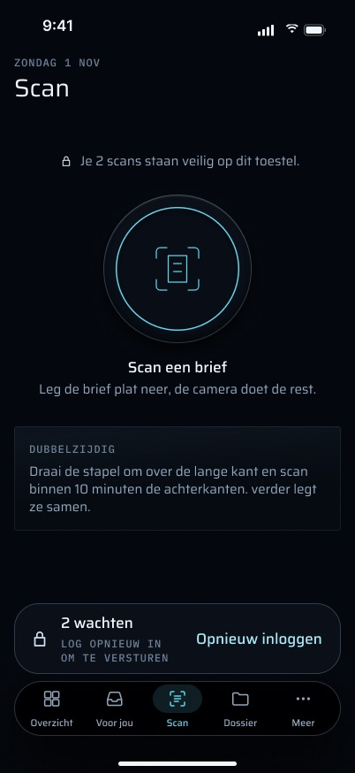

#### "Je sessie is verlopen."

Een 401 ergens anders toont `SessionExpiredView`. De tekst zegt "Scans in de wachtrij blijven bewaard en gaan daarna vanzelf mee." en biedt "Toch een brief scannen" aan (zie [Erin](#scannen-vanuit-je-sessie-is-verlopen)).

**Status:** Gebouwd (`Auth/SessionExpiredView.swift`).

#### Uitloggen bewaart de wachtrij

`forgetLocally` wist de sessie, de dossiercaches en de widget-snapshot, maar niet `uploads/`. Wachtende scans blijven op de telefoon en gaan mee met de volgende sessie. Dit is bewust, in die zin dat een scan nooit mag verdwijnen.

**Status:** Gebouwd (`Auth/AuthModel.swift` `forgetLocally`). Geen test legt het vast; houd er rekening mee voordat er ooit een tweede account bijkomt.

### Vergrendeld: Scan werkt al voor Face ID

Scan en de wachtrij zijn bereikbaar terwijl de app vergrendeld is, bewust (plan 1 Task 7 stap 3): een scan in de wachtrij onthult niets. `ScanTab` leest `AppLock.isLocked` nooit, en `RootView.promptOnOpen` slaat de automatische Face ID-prompt over zolang Scan het geselecteerde tabblad is, zodat de ontspanner nooit wordt afgedekt. De snelle actie (en, zodra die gebouwd zijn, de bediening en de Actieknop) opent de camera op dezelfde manier, zonder Face ID.

**Status:** Gebouwd (`App/RootView.swift`, `Scan/ScanTab.swift`).

### De deelextensie: dezelfde wachtrij vanuit andere apps

`apps/ios/GripShare/ShareViewController.swift` (spec §7.8, plan 3 Task 22). PDF's, foto's en andere bestanden die vanuit een willekeurige app gedeeld worden, gaan naar hetzelfde endpoint met bron `phone-share`. In het kort:

- één scherm "Naar verder" met "Annuleren" en "Versturen"; tot 10 items, maximaal 48 MB per bestand ("Dit is te groot voor verder (max. 48 MB per bestand).");
- foto's worden één verkleinde PDF, pagina voor pagina gebouwd zodat de extensie onder haar geheugengrens van ~120 MB blijft;
- de extensie schrijft nooit `queue.json`. Ze laat een drop achter in `<group>/uploads/incoming/` (eerst de bytes, als laatste de beschrijving), doet **één** begrensde poging op de voorgrond voor drops tot 8 MB (20 s in totaal), en schrijft `<uuid>.sent` alleen bij een echte 2xx. De app importeert drops bij elk opstarten en elke activering zolang er ingelogd is (`UploadCenter.start` → `importIncoming`, idempotent); de UUID van de drop wordt de `clientId`, zodat de twee wegen nooit twee documenten kunnen opleveren;
- uitkomsten: "Staat in je dossier." of "Bewaard. Het gaat mee zodra je verder opent.";
- gedeelde items verschijnen in de Wachtrij onder hun eigen bestandsnaam.

**Status:** Gebouwd (`GripShare/`, `Upload/IncomingDrop.swift`, `IncomingImport.swift`, `ShareModel.swift`, tests `IncomingDropTests`, `ShareModelTests`, `PhotoPageTests`). De optionele notitie van één regel is **uitgesteld** om dezelfde reden als de scannotitie. Volledige beschrijving: `../15-delen-naar-verder/FEATURES.md`.

### Opnieuw versturen voor ontwikkelaars (Meer → Ontwikkelaar)

Paneel "Scans": "Opnieuw versturen (zelfde clientId)", achter de bevestiging "Laatste scan opnieuw versturen met dezelfde clientId?" Het verstuurt een **nieuwe proef-PDF van één pagina** (niet het origineel, dat verwijderd is) onder de `clientId` van het nieuwste verstuurde item (een scan of een gedeeld bestand, wat het laatst bevestigd is en nog binnen de lijst van 7 dagen valt) als één verzoek op de voorgrond, buiten de wachtrij en de achtergrondsessie, en toont het antwoord van de server. Verwacht: `duplicate: true` en geen nieuw document. Er worden met opzet andere bytes gebruikt, zodat de controle de `clientId` bewijst en niet de sha256-deduplicatie.

**Status:** Gebouwd (`More/MoreScreens.swift` `DeveloperScreen`, `UploadCenter.resendLastSent`, `ResendProbe`). Gemeten op de telefoon 2026-10-31: `phone-scan` bleef op 1 document en de ledger op 549.

### Simulatortoestanden voor de frames (DEBUG)

`-fixtures-scans` vult de wachtrij met de scans van vandaag (2 verstuurd, 1 wachtend). `-fixtures-scan <handoff|queue|note|preprompt>` zet het tabblad in een toestand die alleen met een gebaar bereikbaar is (de overdracht halverwege, de Wachtrij open, het notitiesheet, de uitleg vóór de cameravraag), zodat elk frame zonder telefoon vastgelegd en vergeleken kan worden.

**Status:** Deels gebouwd — `-fixtures-scans` bestaat (`Fixtures/FixtureLaunch.swift`); `-fixtures-scan` (`FixtureLaunch.scanState`, gelezen door `ScanTab.applyFixtureScan`) en de wachtrij-/camerapresets ernaast staan alleen in de working tree, zijn niet getest, en er is nog geen frame mee vastgelegd.

### Toegankelijkheid en formaat

#### Grote tekst (AX-groottes)

Alle tekst gebruikt Dynamic Type. Bij de toegankelijkheidsgroottes vervalt de statusregel boven de schijf, houdt het onderschrift van de schijf alleen zijn titel, en schakelt de wachtrijregel over op een titel van twee woorden ("1 mislukt", "2 wachten", "1 bezig", "Alles verstuurd") met de actie op een tweede rij, zodat hij nog past.

**Status:** Deels gebouwd — alleen in de working tree (`ScanScreen` `compactTitle`, `ScanTab` `ax`). Nog niet vergeleken met de AX5-frames. De strip van HEAD krimpt tot 80 % voordat hij afkapt.

#### VoiceOver

De schijf is één knop ("Scan een brief", hint "Opent de camera."); de wachtrijregel leest "Wachtrij. 1 scan wordt verstuurd. 2 pagina's · scan 14:32." met de hint "Opent de wachtrij."; elke rij is één element, gelezen als titel, meta, notitie en reden; schermtitels zijn koppen; rijacties zijn aangepaste acties.

**Status:** Deels gebouwd — alleen in de working tree. Niet met VoiceOver geprobeerd.

#### Kleine telefoon (iPhone SE, 375 × 667)

Onder 600 pt hoogte krimpt de schijf (168 → 148) en wordt de witruimte krapper, zodat de schijf, de duplexkaart en de wachtrijregel passen zonder scrollen.

**Status:** Deels gebouwd — alleen in de working tree (`ScanTab.compactHeight`). Nog niet vergeleken met het SE-frame.

## Toestanden

| Toestand | Wat het ontwerp toont | Status |
|---|---|---|
| Eerste bezoek | "Nog geen scans — scan je eerste brief", geen wachtrijregel | Deels gebouwd (working tree) |
| Rust | "Scan een brief" + uitleg, duplexkaart | Deels gebouwd (working tree); HEAD: de camera opent meteen, daarna één knop |
| Camera nog nooit gevraagd | Uitleg "Brieven scannen" · "Ga verder", daarna de melding van iOS | Deels gebouwd (working tree); HEAD: alleen de melding van iOS |
| Camera geweigerd | "De camera staat uit voor verder" · "Open Instellingen" | Deels gebouwd (working tree); HEAD: geen eigen scherm |
| Camera open | De documentcamera van VisionKit | Gebouwd |
| Overdracht | De pagina krimpt de wachtrijregel in | Deels gebouwd (working tree) |
| Net gescand (< 10 min) | Notitiechip, "Volgende brief scannen", duplex-aftelling | Deels gebouwd (working tree; de samenvoeging zelf is Nog te bouwen) |
| Opname bundelen | Telt als onderweg | Gebouwd |
| PDF kon niet worden bewaard | "De scan kon niet worden bewaard. Probeer het opnieuw." | Deels gebouwd (getoond op HEAD, niet weergegeven in de working tree; geen frame) |
| Uploaden | "1 scan wordt verstuurd" · pagina's · tijd, pulserende pijl | Deels gebouwd (working tree); HEAD: "1 wordt verstuurd" |
| Meerdere lopen leeg | Live Activity bij 3+ | Nog te bouwen |
| Alles vandaag verstuurd | "Alles is verstuurd" · "Vandaag 3 scans · laatste 14:32" | Deels gebouwd (working tree); HEAD: "N verstuurd vandaag" |
| Offline | "OFFLINE", "Scannen werkt gewoon zonder verbinding.", "3 scans wachten op verbinding" | Deels gebouwd (working tree) |
| Mislukt | "11:05 niet verstuurd, staat veilig op dit toestel." · "Niet verstuurd" · "Opnieuw proberen" | Deels gebouwd (working tree); HEAD: "N mislukt — opnieuw" |
| Sessie geweigerd (401) | "Je 2 scans staan veilig op dit toestel." · "2 wachten" · "Opnieuw inloggen" | Logica Gebouwd; formulering Deels gebouwd (working tree) |
| Scherm sessie verlopen | "Toch een brief scannen" | Gebouwd |
| Vergrendeld (Face ID nog niet gegeven) | Scan werkt normaal; geen Face ID-prompt op dit tabblad | Gebouwd |
| Geen documentcamera (simulator) | "Geen camera op dit toestel." | Gebouwd |
| Wachtrij: veel / wacht op netwerk / wacht op inloggen | Secties, rijen, "Toon alle N", voetteksten | Deels gebouwd (working tree) |
| Notitiesheet | "Iets bijzonders?" | Deels gebouwd (alleen telefoon; de server laat de notitie vallen) |
| Grote tekst (AX5) | Wachtrijregel van twee woorden, actie op een eigen rij | Deels gebouwd (working tree) |
| Kleine telefoon (SE) | Kleinere schijf, krappere witruimte | Deels gebouwd (working tree) |

## Privacy en beveiliging

- **Niet achter Face ID**, bewust (zie [Vergrendeld](#vergrendeld-scan-werkt-al-voor-face-id)).
- **Niets op het toegangsscherm of in widgets.** De scanflow maakt geen eigen melding, en geen widget toont de wachtrij. De pushes die op een scan kunnen volgen (een brief die van Verder of een schuldeiser lijkt) komen uit de pijplijn van de server; zie `../03-voor-jou/FEATURES.md` en `../04-voorstel/FEATURES.md`. Een toekomstige Live Activity mag alleen tellingen tonen, nooit een titel.
- **Op de telefoon:** bestanden in de wachtrij, `queue.json`, de multipart-bodies per upload en de drops van de deelextensie staan in de App Group-container (`group.pro.vanderpoel.grip`, `uploads/`), allemaal geschreven met `.completeFileProtectionUntilFirstUserAuthentication`: versleuteld tot de eerste ontgrendeling na een herstart, wat een achtergrondupload mogelijk maakt terwijl de telefoon vergrendeld is. De PDF van een scan wordt verwijderd zodra de server hem bevestigt; de vermelding in de wachtrij (bestandsnaam, tijden, aantal pagina's, grootte, document-id en notitie, geen inhoud) blijft 7 dagen staan. In de working tree wordt een notitie in `queue.json` bewaard in dezelfde beschermingsklasse.
- **De sessie** is de cookie van better-auth in de Keychain (`AfterFirstUnlockThisDeviceOnly`), per verzoek meegegeven. De achtergrondsessie heeft cookie-opslag uit.
- **Bij uitloggen:** de wachtrij wordt **niet** gewist (zie hierboven). Al het andere dat het dossier op de telefoon achterlaat wel.
- **Aan de serverkant:** de sessie wordt bewezen voordat er bytes gelezen worden; de grootte wordt bewaakt vóór het parsen; `clientId`, `source` en `capturedAt` worden gevalideerd; een mediatype van een part dat geen eenvoudig `type/subtype`-token is, wordt als `application/octet-stream` verstuurd, en headerwaarden tussen aanhalingstekens worden percent-gecodeerd, zodat een bestandsnaam geen multipart-headers kan injecteren. Wanneer de route `note` gaat lezen, moet die de lengte op dezelfde manier begrenzen.

## De regels die het volgt

- **Bewijs is append-only.** Een upload voegt precies één `document.ingested`-event toe, of geen als het een duplicaat is. Gemeten: de eerste echte scan bracht de ledger van 548 → 549; opnieuw versturen met dezelfde `clientId` liet hem op 549. Een scan in de wachtrij verwijderen raakt alleen de telefoon, want er heeft nog niets het dossier bereikt. Een duplex-samenvoeging van telefoonscans moet vóór `document.ingested` gebeuren, nooit erna.
- **AI-uitvoer is een suggestie.** De soort en titel die terugkomen zijn een document-meta-suggestie in Voor jou. De hernoeming door auto-name is van verder zelf, in de ledger vastgelegd met `actor = 'verder'` en vermeld onder "Door verder gedaan". Automatisch archiveren (de archiveringsuitzondering) staat in productie uit.
- **Niets wordt verstuurd zonder Martins goedkeuring.** Een gescande brief van Verder kan leiden tot een uitgewerkt antwoord, nooit tot een verstuurd antwoord.
- **Amber alleen voor wat op Martin wacht.** Niets op het tabblad Scan is amber: niet de wachtrijregel, niet "Niet verstuurd", niet "Opnieuw inloggen".

## Meldingen en haptiek

- **Meldingen:** geen vanaf de telefoon. Aan de serverkant kan een gescande brief "Brief lijkt van Verder" (time-sensitive) of "Brief lijkt van <naam>" (active) opleveren, ontdubbeld op `letter:<documentId>`. **Status:** Gebouwd (`letters.ts`).
- **Haptiek** (brief §2.5): `.impact(.medium)` wanneer een scan de wachtrij bereikt; `.error` wanneer een upload mislukt; `.warning` wanneer "Verwijder" de vraag stelt; `.selection` per snelkeuze in het notitiesheet; niets wanneer een upload slaagt, en niets zolang de camera actief is. **Status:** Deels gebouwd — alle vier staan in de working tree (`ScanTab`, `QueueSheetView`, `ScanNoteSheet`), geen op HEAD, nog geen op de telefoon gevoeld. De `.error` gaat af wanneer het aantal mislukte items stijgt, dus ook bij een mislukking die gebeurt terwijl het tabblad alleen maar openstaat, wat overeenkomt met de brief.

## Bekende grenzen en wat nog niet gemeten is

- **Niet gemeten:** de vergelijking van het opschonen. Het plan vraagt om 5 echte brieven, één verfrommeld, elke variant geüpload en de aantallen OCR-tekens van de server vergeleken. Martin had één brief en hield `baseline`; er is niets verfrommelds gescand.
- **Niet gemeten op het toestel:** vliegtuigmodus → app afsluiten → opnieuw verbinden, en het leeglopen van de wachtrij. De persistentie van de wachtrij is alleen met unittests gedekt.
- **Niet gemeten:** de controle met 5 brieven uit de spec, inclusief één van Verder die een time-sensitive push en een voorstel oplevert. Wacht op echte brieven; maak ze nooit zelf.
- **Gemeten** (2026-10-31): de eerste echte scan, een brief van 2 pagina's op `baseline`, kwam aan als **673 KB**; `ocr-pdf` las **2.588 tekens** 42 s na de upload.
- **Backoff-timing tijdens pauzeren:** een item dat zijn backoff uitzit, wordt pas opnieuw geprobeerd wanneer de app weer naar de voorgrond komt (of een andere leeglooptrigger afgaat). Een upload die al aan de achtergrondsessie is overgedragen, rondt zichzelf af.
- **Het hele herontwerp in de working tree is ongemeten:** het is niet gecommit, heeft geen tests en heeft niet op de telefoon gedraaid. Elke "Deels gebouwd — alleen in de working tree" hierboven wordt pas Gebouwd nadat het bouwt, `ScanScreen`/`QueueSheet`/`QueueAccessory` tests hebben voor de toestand van elk frame, `setNote`/`remove` getest zijn, en het op de telefoon gezien is.
- **Schuldeisers zonder bekend e-mailadres** (KvK, CAK, PLM, CZ) worden op een gescande brief niet herkend.

## Waar in de code

**iOS (`apps/ios/Grip/`):**

- `Scan/ScanTab.swift`: het tabblad, de schijf, de cameracover, de overdracht, de haptiek (working tree; op HEAD de wissel tussen camera en rust, de strip en de inlogbanner).
- `Scan/ScanScreen.swift` (working tree): elk woord dat het tabblad en de Wachtrij tonen — `ScanScreen`, `QueueAccessory`, `QueueSheet`.
- `Scan/QueueViews.swift` (working tree): `QueueAccessoryView`, `QueueSheetView`, de rijen, `ScanNoteSheet`, `FlowLayout`.
- `Scan/ScanPermissionViews.swift`, `Scan/CameraAccess.swift` (working tree): de uitleg vooraf, het weigerscherm, de cameratoestemming.
- `Scan/DocumentCamera.swift`: de VisionKit-wrapper.
- `Scan/PageCleaner.swift`, `Scan/PDFAssembler.swift`, `Scan/ScanNaming.swift`: opschonen, PDF, naam.
- `Scan/QueueStrip.swift`: de strip van één regel op HEAD, verwijderd in de working tree.
- `Upload/UploadCenter.swift`: opname, leeglooptriggers, opnieuw proberen, hervatten na inloggen, het opnieuw versturen voor debug; in de working tree ook offline-bewaking, `remove`, `setNote`, `enqueuedCount`.
- `Upload/UploadQueue.swift`: de duurzame wachtrij, backoff, `QueueSummary`; in de working tree ook `everEnqueued`, `setNote`, `remove`, redenen van mislukking.
- `Upload/BackgroundUploader.swift`: de achtergrond-`URLSession`, herstel, `ResendProbe`.
- `Upload/UploadItem.swift`, `Upload/UploadRequest.swift` (`UploadOutcome.judge`), `Upload/Multipart.swift`.
- `Upload/IncomingDrop.swift`, `Upload/IncomingImport.swift`, `Upload/ShareModel.swift`, `Upload/SharePreparation.swift`, `Upload/ShareSender.swift` en `apps/ios/GripShare/ShareViewController.swift`: de deelextensie.
- `App/RootView.swift` (Scan zonder vergrendeling, geen prompt op Scan, leeglopen bij activering en nieuwe sessie, `cameraRequested`), `App/QuickAction.swift`, `Push/DeepLink.swift` (`grip://scan`), `App/GripApp.swift` (events van de achtergrondsessie), `Auth/SessionExpiredView.swift`, `Home/HomeSummary.swift` (`scansRow`), `More/MoreScreens.swift` (`DeveloperScreen`).
- `project.yml`: `NSCameraUsageDescription`, snelle acties.
- Bestaat nog niet: een App Intent en `ControlWidget` (Bedieningspaneel, Actieknop), een `ActivityAttributes` / `ActivityConfiguration` (Live Activity).

**Server:**

- `apps/web/src/app/api/mobile/v1/documents/route.ts` (+ `route.test.ts`).
- `apps/web/src/lib/vault-upload.ts`, `apps/web/src/lib/upload-limit.ts`.
- `packages/api/src/routers/documents.ts`: `ingestDocument`, `registerUpload`, `bySourceRef`.
- `apps/worker/src/index.ts` (`suggest.docmeta`), `apps/worker/src/docmeta-sweep.ts`, `apps/worker/src/auto-name.ts`, `apps/worker/src/auto-file.ts`, `apps/worker/src/proposals/letters.ts`, `apps/worker/src/mail/priority.ts` (`letterSender`), `apps/worker/src/duplex.ts` (alleen NAS).

**Tests:**

- `apps/ios/GripTests/UploadQueueTests.swift` (persistentie, 401, backoff, vijfde mislukking, 4xx, verwijderde PDF, claim, herstel, ontbrekend bestand, opruimen, striptekst, Amsterdamse dag), `BackgroundUploaderTests.swift`, `PageCleanerTests.swift`, `PDFAssemblerTests.swift`, `ScanNamingTests.swift`, `MultipartTests.swift`, `IncomingDropTests.swift`, `ShareModelTests.swift`, `PhotoPageTests.swift`, `HomeSummaryTests.swift` (scanregel).
- `apps/web/src/app/api/mobile/v1/documents/route.test.ts`, `packages/api/src/routers/documents.test.ts`, `apps/worker/src/proposals/letters.test.ts`, `apps/worker/src/docmeta-sweep.test.ts`, `apps/worker/src/auto-name.test.ts`.
- Ontbreekt: tests voor `ScanScreen`, `QueueAccessory`, `QueueSheet`, `UploadQueue.setNote`, `UploadQueue.remove`, redenen van mislukking, `everEnqueued`, en de snelle scanactie / de link `grip://scan`.

## Frames

Alle 20 frames uit `scan · final` (`305:2`), opnieuw geëxporteerd op 2026-11-03. De kolom "Code vandaag" zegt hoe ver de huidige code overeenkomt (HEAD plus de working tree).

| Frame | Wat het toont | Code vandaag |
|---|---|---|
|  `Scan_eerste_keer.jpg` | Eerste bezoek: schijf, "Nog geen scans — scan je eerste brief", duplexhint | Working tree tekent het; HEAD opent meteen de camera |
|  `Scan_camera_vragen.jpg` | Uitleg vóór de cameravraag "Brieven scannen", "Ga verder" | Working tree; HEAD: alleen de eigen melding van iOS |
| 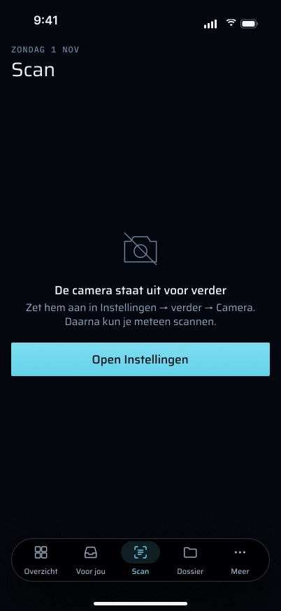 `Scan_geen_camera-toegang.jpg` | Camera geweigerd, "Open Instellingen" | Working tree; HEAD: niets |
| 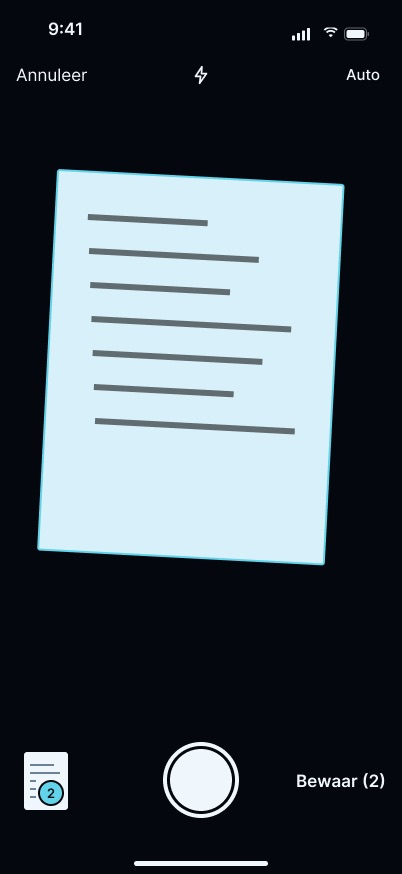 `Scan_camera_systeem.jpg` | De documentcamera van het systeem | Gebouwd (VisionKit) |
|  `Scan_overdracht.jpg` | Overdracht: de pagina krimpt de wachtrijregel in | Working tree |
|  `Scan_1_in_de_wachtrij.jpg` | Eén scan onderweg, notitiechip, duplex-aftelling | Working tree (de beloofde duplex-samenvoeging is niet gebouwd) |
| 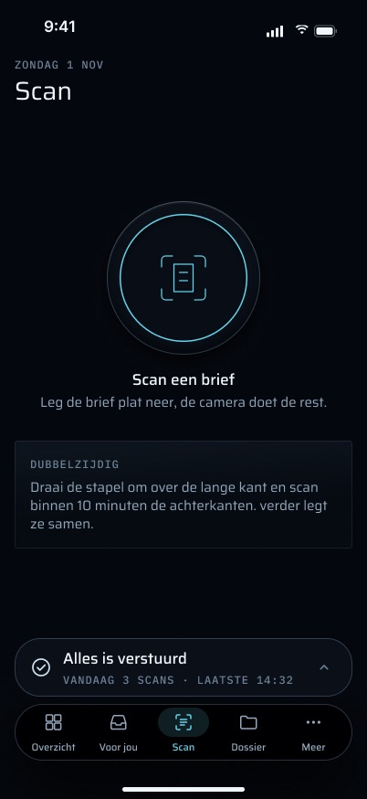 `Scan_wachtrij_leeg.jpg` | Alles verstuurd, "Alles is verstuurd" | Working tree; HEAD: "N verstuurd vandaag" |
|  `Scan_mislukt.jpg` | Een mislukte upload, "Opnieuw proberen" op de wachtrijregel | Working tree; HEAD: "1 mislukt — opnieuw" |
|  `Wachtrij_veel.jpg` | Het Wachtrij-sheet met secties en rijen per item | Working tree |
|  `Wachtrij_rij-acties.jpg` | Rijmenu: Opnieuw proberen, Notitie toevoegen, Verwijder | Working tree |
|  `Scan_offline.jpg` | Offline: "Scannen werkt gewoon zonder verbinding.", "3 scans wachten op verbinding" | Working tree |
| 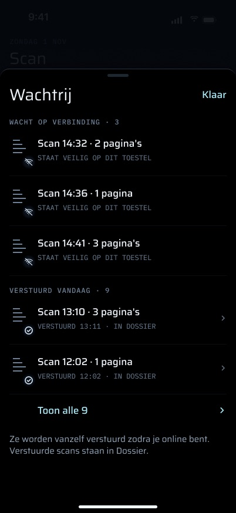 `Wachtrij_wacht_op_verbinding.jpg` | Het sheet terwijl er geen verbinding is | Working tree |
|  `Scan_log_opnieuw_in.jpg` | Sessie geweigerd: "2 wachten", "Opnieuw inloggen" | Working tree; HEAD: banner "Log opnieuw in om je scans te versturen" · "Inloggen" |
| 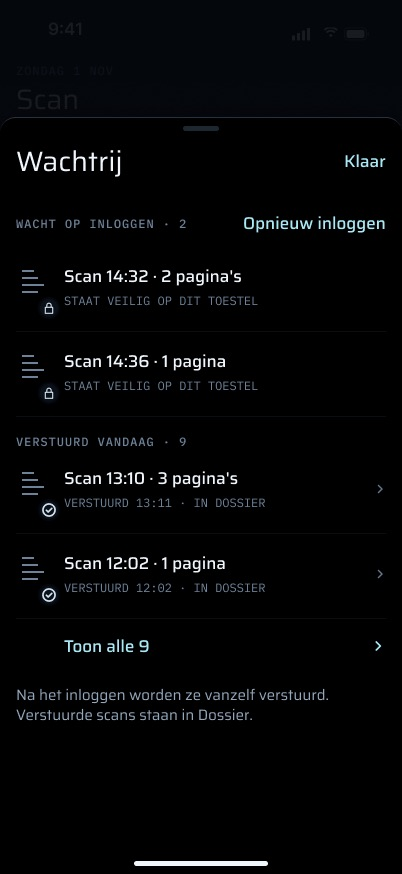 `Wachtrij_wacht_op_inloggen.jpg` | Het sheet tijdens het wachten op inloggen | Working tree |
|  `Scan_iets_bijzonders.jpg` | Notitiesheet "Iets bijzonders?" | Working tree op de telefoon; de server laat de notitie vallen |
| 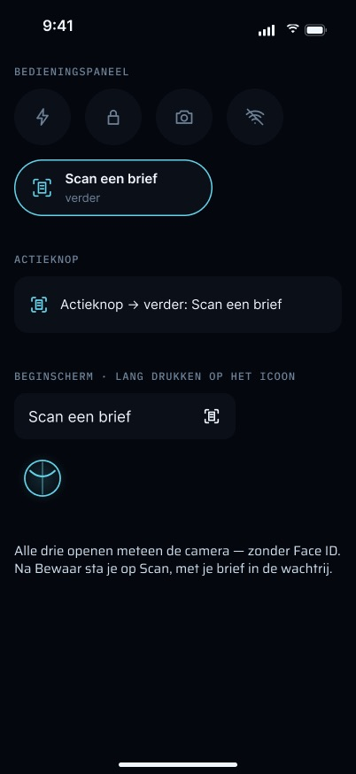 `Scan_snelstart.jpg` | Bedieningspaneel, Actieknop en snelle actie "Scan een brief" | Snelle actie in de working tree; Bedieningspaneel en Actieknop niet gebouwd |
| 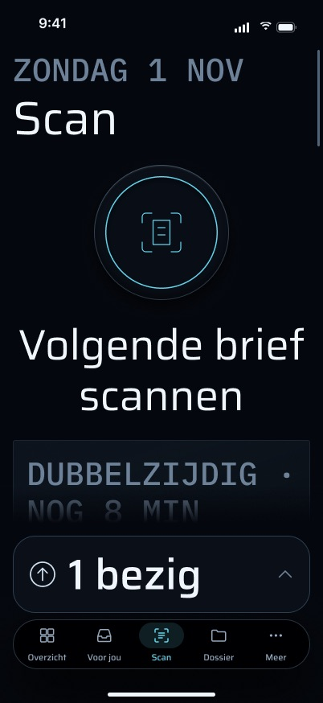 `Scan_AX5_1_in_de_wachtrij.jpg` | Grootste tekstgrootte, één onderweg | Working tree (compacte wachtrijregel) |
| 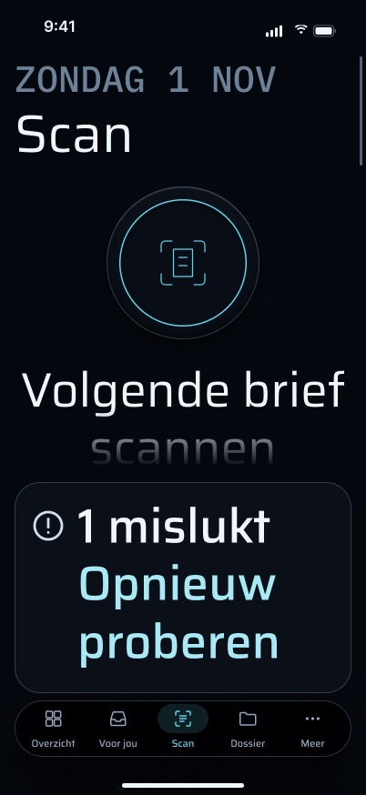 `Scan_AX5_mislukt.jpg` | Grootste tekstgrootte, mislukt | Working tree (actie op een eigen rij) |
| 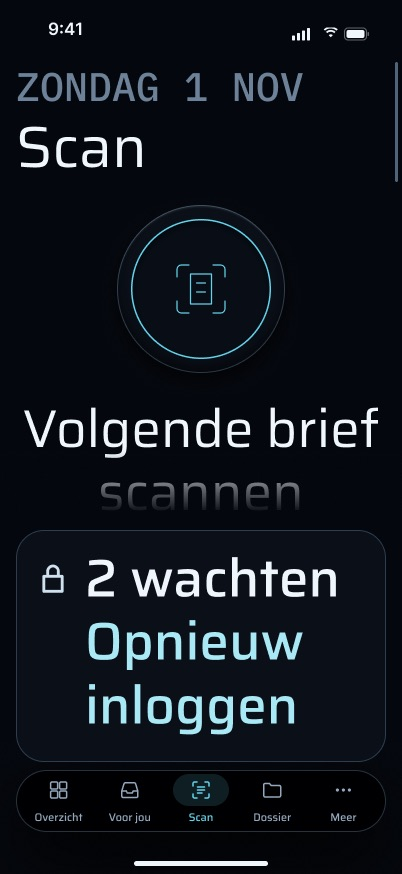 `Scan_AX5_log_opnieuw_in.jpg` | Grootste tekstgrootte, sessie geweigerd | Working tree |
| 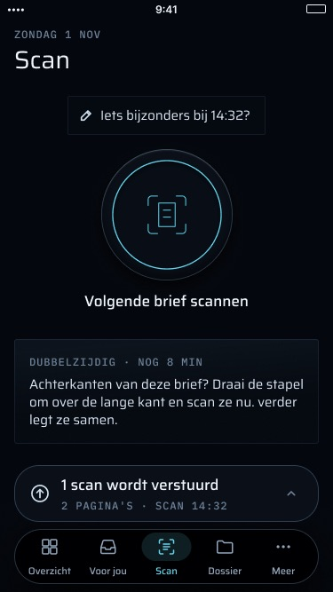 `Scan_iPhone_SE_1_in_de_wachtrij.jpg` | iPhone SE (375 × 667), één onderweg | Working tree (`compactHeight`) |
