# Dossier (zakdossier) en de documentviewer: functies

## Stand van de bouw

Per functie gecontroleerd tegen de code op branch `feat/iphone-app` (werkkopie van 2026-11-03). Martin, 2026-11-03: "it's ok if not all features are built yet, we will do that next". Dit document beschrijft daarom de **volledige** set functies van het scherm zoals ontworpen (de definitieve frames) en gespecificeerd (spec §7.5, brief §2–3, plan 3 Tasks 20–21). Bij elke functie staat of die al bestaat.

| Status | Aantal |
|---|---|
| Gebouwd | **24** |
| Deels gebouwd | **11** |
| Nog te bouwen | **16** |

**Bijgewerkt 2026-11-04 (de definitieve frames gebouwd).** Sindsdien gebouwd: de inklappende titel en de vastgezette documentenkop (#12, #13), "Zoek in titel en tekst" met "Annuleer" (#14), de tikbare kop met "wacht op jou · <datum>" in amber (#15, behalve offline bij een koude start), "Toon alle N", "te laat" en de volgorde op uiterste datum (#17, behalve de cache voor offline), het soortsymbool, het aantal pagina's (PDFKit, op de telefoon), "foto-scan" en "niet opgeborgen" (#18; `source` komt nog niet van de server), het soortfilter (#20), het menu bij lang indrukken (#21), "Deel…" (#22), de voortgang van de eerste synchronisatie met de lijst die zich vult, "onderbroken" en "Haal de rest op" (#26, #27; het totaal komt nog niet van de server, zonder telt de kaart wat binnen is), "bijwerken… · 2 van 3 nieuw" (#28), "OP DEZE IPHONE" met het gevonden woord vet (#30), "alleen op de titel doorzocht" (#31), "Niets gevonden voor …" met een kortere term die echt voorkomt en "Wis zoekopdracht" (#32), de uitleg en de voortgang in de knop (#33), servertreffers per soort met de eigen regel en "NIEUW" (#34; afzender, toegewezene en kanaal komen nog niet van de server), de limiet van 10 seconden (#36), de offline-reden van het frame (#37), de metaregel en de titel op de pagina (#43), één pagina tegelijk met "PAGINA 1 VAN 2" (#44), "Toon aan de balie" met helderheid, "1 / 2", zoom en dubbeltik (#45), "Geen tekst herkend" (#46), "Haal nu op" dat bewaart (#47, voor documenten die de server noemde; een losse link zonder record wordt nog eenmalig opgehaald), en de AX5-regels onder elkaar en titels zonder limiet (#49). Nog te bouwen blijft: #15/#17 offline bij een koude start, #35, #48, #51, en de serverkant van de velden hierboven.

**De drie belangrijkste dingen die nog gebouwd moesten worden (2026-11-03):**

1. **"Toon aan de balie"** ([#45](#45-toon-aan-de-balie)). Dit is de bestaansreden van het tabblad (spec §7.5: "open a document full-screen to show at a counter"). Nu opent een document in de gewone viewer en verandert de helderheid nooit. Nodig is een schermvullende weergave die de helderheid verhoogt en daarna herstelt, plus het paginanummer ([#44](#44-paginanummer-en-bladeren)) dat beide schermen delen.
2. **Voortgang van de eerste synchronisatie, en een lijst die zich vult terwijl documenten binnenkomen** ([#26](#26-voortgang-van-de-eerste-synchronisatie)). De eerste synchronisatie is ongeveer 223 documenten en 139 MB. Nu toont die een skelet tot elke pagina klaar is. Nodig zijn een totaal in de delta (een serverwijziging), opnieuw laden na elke pagina, en de voortgangskaart.
3. **"Haal nu op": een document bewust op de telefoon houden** ([#47](#47-nog-niet-op-deze-iphone-haal-nu-op)). Nu wordt een document dat de telefoon niet heeft voor één keer bekijken opgehaald en weer weggegooid, zodat het offline aan de balie mislukt. Nodig zijn een store-methode die één document opneemt, en een manier om het record van dat document op id op te halen.

---

Het tabblad Dossier stopt de hele zaak in Martins broekzak. Het bewaart een kopie van elk document op de telefoon, zodat hij zonder netwerk een brief kan vinden en aan een balie kan laten zien. Boven de documenten staat waar de zaak op wacht en welke taken open staan. De documentviewer opent één document schermvullend. Alleen Martin gebruikt de app.

Dit document beschrijft wat deze schermen doen. Het visuele ontwerp valt erbuiten; dat staat in Figma: bestand `QDRL5zHNEOjPzLZqzd19Ii`, sectie `dossier · final`, node `319:4229`; de frames in `frames/` zijn uit die sectie geëxporteerd. Elke schermafbeelding gebruikt de synthetische fixture-dataset ("Gemeente Westerlaan", "Team Startdossier", "Noordkust"), geen echte zaakgegevens. UI-teksten staan letterlijk zoals de app ze toont, of zoals het frame ze toont voor een functie die nog niet gebouwd is.

Elke functie heeft één statusregel:

- **Status:** Gebouwd — het bestaat en werkt in de code; het bestand wordt genoemd.
- **Status:** Deels gebouwd — een deel bestaat; wat ontbreekt wordt genoemd.
- **Status:** Nog te bouwen — het bestaat niet; wat ervoor nodig is wordt genoemd (serverroute, model, UI, test).

De nummers (#1–#51) dienen alleen om vanuit de samenvatting hierboven naar te verwijzen.

## Doel

- **Een document offline aan een balie laten zien.** Een medewerker vraagt om de beschikking of de loonstrook van vorige maand, en de telefoon heeft geen bereik. Het zakdossier heeft de bytes en de geëxtraheerde tekst al op de telefoon (spec §7.5).
- **Een document vinden op wat erin staat, niet alleen op de naam.** Zoeken gebeurt over de titel en de geëxtraheerde tekst, op de telefoon, en heeft geen netwerk nodig.
- **Antwoord op "waar staat de zaak nu?"** Het tabblad opent met dezelfde kop als Overzicht ("WAAR HET NU OP WACHT"), de open taken en een ingang naar de Tijdlijn.
- **Alleen-lezen.** Niets op dit tabblad of in de viewer verandert een document. Definitief verwijderen, weggooien, hernoemen en opbergen worden op de telefoon nooit aangeboden. Dat gebeurt op het web, en de telefoon volgt.

Het doel uit §3 van de brief voor dit tabblad is "een document offline aan een balie laten zien" in **3 tikken plus typen** (tabblad → zoeken → resultaat). De code bereikt de viewer in zoveel stappen. De laatste stap van dat doel, het document aan de balie tonen, wacht op [#45](#45-toon-aan-de-balie).

## Hoe je er komt, en waar het heen leidt

**Naar binnen:**

#### 1. De tabbalk
Het vierde tabblad, "Dossier" (`TabID.dossier`, SF Symbol `folder`). De volgorde van de tabbladen in de frames is Overzicht · Voor jou · Scan · Dossier · Meer.

**Status:** Gebouwd (`App/RootView.swift`).

#### 2. Deep links
Geparseerd door `DeepLink.swift` en toegepast in `RootView`, dat `dossierPath` bewaart. Omdat het pad in `RootView` leeft, opent een link die binnenkomt terwijl de app vergrendeld is zodra die ontgrendeld wordt.
- `grip://dossier` opent het tabblad in de basisweergave.
- `grip://document/<uuid>` opent de viewer voor dat document op de Dossier-stack.
- `grip://timeline` opent de Tijdlijn op de Dossier-stack.
- Captures (debug-builds): het fixture-startargument `-route document:<id>` opent de viewer, en `-route timeline` opent de Tijdlijn.

**Status:** Gebouwd (`Push/DeepLink.swift`, `App/RootView.swift`).

#### 3. Meldingen komen hier uit
Een `FILING`-push zonder bruikbare link komt uit op de basisweergave van Dossier (`NotificationRouter.fallback`). Nu geldt dat voor twee pushes: de samengevoegde duplexscan (`apps/worker/src/duplex.ts`) en "Nieuwe loonstrook" (`apps/worker/src/loondossier.ts`). Het nachtelijke overzicht "Door Grip gedaan" is ook `FILING`, maar draagt `grip://inbox` en opent daarom "Door Grip gedaan". Geen enkele worker-push linkt nu naar `grip://document/<id>`. De links die in gebruik zijn, zijn `grip://proposal/<id>` en `grip://inbox`.

**Status:** Gebouwd (`Push/NotificationRouter.swift`).

#### 4. Vanuit Overzicht
Een tik op de kopkaart opent de Tijdlijn op de Dossier-stack (`openTimeline`). Dat werkt alleen in ontgrendelde toestand.

**Status:** Gebouwd (`Home/HomeTab.swift`, `App/RootView.swift`).

#### 5. Vanuit de Tijdlijn
Het sheet van een halte toont het bijbehorende bewijs. Een gekoppeld bestand opent de viewer en een gekoppelde taak opent `TaskScreen`, beide op de Dossier-stack (`open` van `TimelineScreen`, met links `grip://document/<id>` en `grip://task/<id>` uit `GET /api/mobile/v1/case-map`).

**Status:** Gebouwd (`Timeline/TimelineView.swift`).

**Wat hier niet heen leidt:** geen widget en geen snelle actie leidt naar Dossier. De rijen van de widget openen `grip://proposal|suggestion|task/<id>`, en al het andere (de kop inbegrepen) opent `grip://inbox` (`WidgetContent.url(for:)`). De snelle acties op het beginscherm ("Scan een brief", "Gesprek vastleggen") en de App Shortcut voor de Actieknop (`App/GripShortcuts.swift`, "Scan een brief") leiden naar Scan en naar de spraaknotitie. Grip registreert geen URL-schema voor andere apps. Noch de spec noch de frames vragen hier om een ingang naar Dossier.

**Naar buiten:**

- Een documentrij → de viewer (`DossierRoute.document`).
- Een taakrij → `TaskScreen` (`DossierRoute.task`), hetzelfde taakscherm dat Voor jou gebruikt. Daar kan de status via een eigen, in het logboek vastgelegde route worden gewijzigd; dat valt buiten dit document.
- De rij "Tijdlijn" → `TimelineScreen` (`DossierRoute.timeline`). De Tijdlijn wordt beschreven in een eigen schermgroep.
- Een zoekresultaat van de server → de viewer voor een `document`, en `TaskScreen` voor een `task`. Elk ander soort wordt getoond als een rij die niet opent (zie [#35](#35-mail-en-logboekresultaten-openen)).

## Vergrendeling en privacy

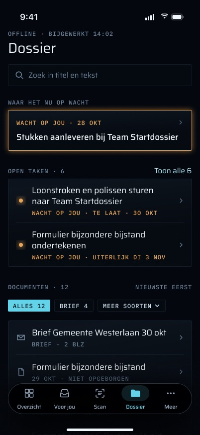

#### 6. Het hele tabblad zit achter de vergrendeling
`RootView` omhult `DossierTab` met `.lockGated(by: lock)`. Zolang de app vergrendeld is, is `AppLock.isGated(.dossier)` waar en vervangt `LockView` het tabblad. Het is geen overlay: de dossierweergave bestaat niet achter de vergrendeling, dus die kan niets laden en niets aan VoiceOver melden.

**Status:** Gebouwd (`App/RootView.swift`, `Auth/AppLock.swift`, `Auth/LockView.swift`).

#### 7. Eén keer Face ID bij openen en heropenen
Martins besluit van 2026-11-01. De app vraagt er zelf om bij het openen, of bij terugkeer na de respijtperiode (`LockPolicy.graceSeconds`, 5 minuten op de achtergrond). Daarna blijft elk tabblad open tot de volgende vergrendeling. Overzicht zit niet achter de vergrendeling: vergrendeld toont het alleen aantallen en geld. Scan zit nooit achter de vergrendeling.

**Status:** Gebouwd (`Auth/AppLock.swift`).

#### 8. Niets uit het dossier bereikt het vergrendelscherm of een widget
Het tabblad maakt geen meldingen. De widget-snapshot (`WidgetSnapshot.swift`) wordt geschreven door `InboxStore`, niet door dit tabblad. Die bevat het aantal wachtende items, maximaal vijf titels van wachtende items en de kop van de kaart, gemarkeerd als privacygevoelig zodat iOS ze in vergrendelde toestand verbergt. Hij bevat nooit een document, de bytes of de tekst ervan, en de widget kan de dossiermap niet lezen.

**Status:** Gebouwd.

#### 9. Een beschermde kopie op de telefoon
- **Waar die staat:** `Application Support/dossier` (`AppServices.dossierDir`). Bewust NIET in de App Group, zodat geen extensie en geen widget hem kan lezen. Erin staan `state.json` (cursor, records, synchronisatietijd, documenten die niet aanwezig zijn), `files/<id>` (de bytes) en `texts/<id>.txt` (de geëxtraheerde tekst).
- **Hoe die beschermd is:**
  - Elke schrijfactie loopt via één schrijver met `[.atomic, .completeFileProtection]`, zodat de bestanden niet leesbaar zijn zolang de telefoon vergrendeld is.
  - De mappen worden aangemaakt met `FileProtectionType.complete`.
  - De map is uitgesloten van back-ups. Hij is opnieuw op te bouwen vanaf de server, en een back-up zou het hele dossier naar iCloud brengen.
  - Een document-id wordt alleen een bestandsnaam als het een UUID is.
- **Een vergrendelde start verliest niets:** de store laadt lui. Een leesactie die mislukt omdat de telefoon vergrendeld is, laat hem ongeladen en wordt bij ontgrendelen opnieuw geprobeerd, en er wordt nooit iets opgeslagen over een kopie die nog niet gelezen is (plan 3 Task 21, "locked launch").

**Status:** Gebouwd (`Dossier/DossierStore.swift`, `App/AppServices.swift`).

#### 10. Gewist als de sessie eindigt
De hele map wordt gewist, samen met alles wat het tabblad toont (documenten, taken, de zoekopdracht, serverresultaten, melding, offline-vlag). Dat gebeurt:
- bij "Uitloggen" in Meer, dat op `dossier.wipe()` wacht voordat het sheet sluit ("Het dossier op deze iPhone wordt gewist. Daarna log je opnieuw in met Face ID of je wachtwoord.");
- bij elke 401 (een geweigerde sessie), via `SessionEpoch`.

Elke schrijfactie na een await wordt gecontroleerd tegen de sessie waarin die begon. Een synchronisatie die haar sessie overleeft, schrijft niets in de gewiste store (`DossierStore.wipes`, `SyncError.wiped`).

**Verschil met het plan:** punt (10) van de herafbakening in Task 21 zegt dat een geweigerde sessie de offline kopie behoudt. De latere vervolgstap van 2026-11-01 (`SessionEpoch`) veranderde dat, en de code wist ook bij een 401.

**Status:** Gebouwd (`Auth/SessionEpoch.swift`, `More/MoreTab.swift`, `Dossier/DossierModel.swift`).

**Een bekend risico, geen functie: de telefoon houdt wat de server vernietigde, tot de volgende synchronisatie.** Spec §9 noemt dit risico. Een definitief verwijderd of weggegooid document blijft op de telefoon tot een synchronisatie de tombstone ervan toepast. De synchronisatie draait alleen op de voorgrond en in ontgrendelde toestand.

## Het tabblad zonder zoekopdracht

Van boven naar beneden (`DossierTab.body`).

#### 11. Kop met de leeftijd van de kopie
"Dossier", en daaronder de leeftijd van de kopie (`DossierCopy.freshness`), in Amsterdamse tijd:
- "bijgewerkt 14:02" als de laatste synchronisatie vandaag was, en "bijgewerkt 30 okt 14:02" als dat niet zo was;
- "offline · bijgewerkt 14:02" als de laatste synchronisatie geen netwerk had;
- "offline · nog niet bijgewerkt" als de telefoon offline is vóór enige synchronisatie;
- niets als de telefoon online is en nooit gesynchroniseerd heeft (het skelet zegt het dan). De frames van de eerste synchronisatie tonen hier "NOG NIET BIJGEWERKT"; zie [#26](#26-voortgang-van-de-eerste-synchronisatie).

Onder de leeftijd kunnen nog twee regels staan: een melding dat de synchronisatie mislukte, en de regel over niet-aanwezige documenten (zie [#24](#24-elke-download-gecontroleerd-één-slecht-document-houdt-de-synchronisatie-nooit-op)).

**Status:** Gebouwd (`Dossier/DossierTab.swift`, `Dossier/DossierModel.swift`).

#### 12. De titel klapt in bij scrollen
In de frames klapt de grote titel "Dossier" bij scrollen in tot een kleine, gecentreerde titel in de balk (`Dossier_gescrold_documenten_vastgezet`, `Dossier_document_contextmenu`). De typografische schaal van de brief zegt dat de schermtitel "collapses on scroll". De code verbergt de navigatiebalk en tekent een eigen kop, die wegscrolt.

**Status:** Nog te bouwen — Alleen UI is nodig: de grote systeemtitel, of een kop die inklapt tot een inline titel. Daarnaast een snapshot- of UI-test op de standaardgrootte en op AX5.

#### 13. De documentenkop blijft vastgezet tijdens scrollen
Naar beneden gescrold blijven "DOCUMENTEN · 12 · NIEUWSTE EERST" en de soortchips bovenaan staan terwijl de rijen eronder doorschuiven (`Dossier_gescrold_documenten_vastgezet`).

**Status:** Nog te bouwen — Nodig is de UI: een vastgezette sectiekop (`LazyVStack(pinnedViews: .sectionHeaders)`) met het label en de chips uit [#20](#20-soortfilter). Voor de inhoud hangt het af van #20.

#### 14. Zoekveld
Het veld heeft een wisknop ("Wis zoekopdracht" voor VoiceOver). Een zoekopdracht die alleen uit witruimte bestaat, telt niet als zoeken. De frames voegen twee dingen toe: de placeholder luidt "Zoek in titel en tekst" (die zegt wat doorzocht wordt), en een knop "Annuleer" naast het actieve veld verlaat het zoeken en sluit het toetsenbord.

**Status:** Deels gebouwd — Het veld, de wisknop en de witruimteregel staan in `Dossier/DossierTab.swift`. Ontbreekt: de placeholder is "Zoek in je dossier" (`DossierCopy.searchPrompt`) in plaats van de tekst uit het frame, en er is geen "Annuleer". Daarvoor zijn UI en een wijziging in `DossierCopy` nodig.

#### 15. "WAAR HET NU OP WACHT": de huidige halte
- De huidige open halte uit `InboxStore.summary.headline`. Dit is dezelfde fetch als voor Overzicht, de badge en de widget (`GET /api/mobile/v1/dashboard/summary`).
- Getoond worden de titel van de halte, een regel met het spoor en de datum, en maximaal 4 regels notitie.
- Zonder open halte staat er "Geen open halte op de kaart.". Offline zonder geladen gegevens staat er "Geen verbinding — je ziet wat je telefoon al had.". Voordat het antwoord binnen is, toont de kaart een skelet.
- Het ontwerp maakt de kaart een **tikdoel dat de Tijdlijn opent** (met een chevron), zoals op Overzicht. Het markeert de kaart ook in woorden als wachtend op Martin, "WACHT OP JOU · 28 OKT": elke open halte is werk dat op Martin wacht (CLAUDE.md, `case-history.test.ts`), dus amber is hier toegestaan. De frames tonen de kop ook offline, uit wat de telefoon het laatst had.

**Status:** Deels gebouwd — De inhoud en de toestanden van de kaart staan in `Dossier/DossierTab.swift` (`headlineCard`). Ontbreekt:
- de tik → Tijdlijn (alleen UI; de Tijdlijn-rij in #16 doet dat nu);
- de regel "wacht op jou · <datum>" met het amber (UI);
- de kop offline bij een koude start. De samenvatting van `InboxStore` staat alleen in het geheugen, dus de samenvatting moet in de cache, of gelezen worden uit de widget-snapshot, die de kop al bevat.

#### 16. De ingang naar de Tijdlijn
Een link "Tijdlijn" rechts naast het label "WAAR HET NU OP WACHT" (zoals "Toon alle 6" naast "OPEN TAKEN"). Hij opent de zaakkaart (`TimelineScreen`), de "vertical read-only version of the case map" uit de spec (§7.5). Hij is op 2026-11-03 toegevoegd op verzoek van Martin ("I'm also missing the timeline from the web app in the app") en staat niet in de Figma-frames. Eerst was het een eigen kaart onder de kop; die duwde de documenten van het eerste scherm (op de iPhone SE ook de tweede taak), dus sinds 2026-11-04 is het een link die geen ruimte kost. Bij de toegankelijkheidsgrootten staat hij er alleen als er geen kopkaart is: de kopkaart opent de Tijdlijn zelf al. Martin moet nog bevestigen dat dit de ingang is.

**Status:** Gebouwd (`Dossier/DossierTab.swift` `headlineSection`, `Timeline/`, `apps/web/src/app/api/mobile/v1/case-map/route.ts`).

#### 17. "OPEN TAKEN" met een aantal
- Bron: `GET /api/mobile/v1/tasks`, op de telefoon gefilterd op `open` en `in-progress` (`DossierCopy.openTasks`). Dit is de ene definitie van wachten op Martin (`WAITING_TASK_STATUSES` in `packages/api/src/waiting.ts`).
- Het label wordt amber zodra er minstens één taak is. Elke rij heeft een amber stip en een regel "wacht op jou · <status> · uiterlijk <dag>".
- Leeg: "Geen open taken." Offline zonder geladen gegevens: "Taken zijn offline niet te zien." De takenlijst staat niet in de cache op de telefoon. Een mislukte fetch van de taken behoudt de lijst die er was. Zonder geladen taken en zonder offline-vlag blijft de kaart een skelet.
- Een rij opent `TaskScreen`.
- Het ontwerp toont de **eerste twee** taken en een link "Toon alle 6". Het zegt ook **"te laat"** bij een taak waarvan de uiterste datum voorbij is ("WACHT OP JOU · TE LAAT · 30 OKT"), en de frames tonen de taken offline.

**Status:** Deels gebouwd — De lijst, de bron, het amber en de routering staan in `Dossier/DossierTab.swift` (`tasksCard`). Ontbreekt:
- de limiet van twee rijen met "Toon alle N", die de volledige lijst opent (UI; de takenlijst van Voor jou of een nieuwe route op de Dossier-stack);
- "te laat" voor een verstreken `dueAt`, bepaald op de Amsterdamse kalender (modelfunctie plus test, daarna UI);
- taken offline, waarvoor de takenlijst op de telefoon in de cache moet (model plus test).

#### 18. "DOCUMENTEN": elk document dat de telefoon heeft
- Nieuwste eerst (`receivedAt`, daarna id). Elke rij toont de titel (twee regels, daarna afgekapt) en een regel als "26 okt 2026 · loonstrook · opgeborgen".
- De soort wordt vertaald uit het docmeta-vocabulaire (`letter` → "brief", `payslip` → "loonstrook", `bank-statement` → "bankafschrift", `id-document` → "identiteitsbewijs", enzovoort). Een soort die Martin zelf typte, blijft zoals getypt.
- De status luidt "opgeborgen" voor `filed` en "in de inbox" voor al het andere.
- Leeg: "Nog geen documenten op je telefoon. Ze komen binnen zodra Grip bereikbaar is."
- De rijen in het ontwerp bevatten meer:
  - een symbool per soort (envelop voor een brief, bank voor een bankafschrift, kaart voor een identiteitsbewijs);
  - het aantal pagina's ("2 BLZ");
  - de bron als die ertoe doet ("FOTO-SCAN");
  - "NIET OPGEBORGEN" alleen bij een document dat niet opgeborgen is;
  - een aanduiding "NIEUWSTE EERST" naast het label, die de volgorde noemt.

**Status:** Deels gebouwd — De lijst, de volgorde, de vertaling van de soort, de status en de lege toestand staan in `Dossier/DossierTab.swift` en `DossierCopy.rowLine`. Ontbreekt:
- het aantal pagina's en de bron. De delta stuurt die niet mee: daarvoor zijn `pageCount` en `source` op `DossierDoc` in `packages/api/src/routers/dossier-sync.ts` nodig, plus de iOS-DTO, een routetest en een modeltest. Voor een aanwezige PDF kan het aantal pagina's ook op de telefoon met PDFKit worden gelezen.
- het soortsymbool, de statusformulering en de aanduiding van de volgorde (UI en `DossierCopy`).

#### 19. Omlaag trekken om te verversen
Voert dezelfde synchronisatie en fetch van de taken naast elkaar uit (`DossierModel.refresh`).

**Status:** Gebouwd (`Dossier/DossierTab.swift`, `Dossier/DossierModel.swift`).

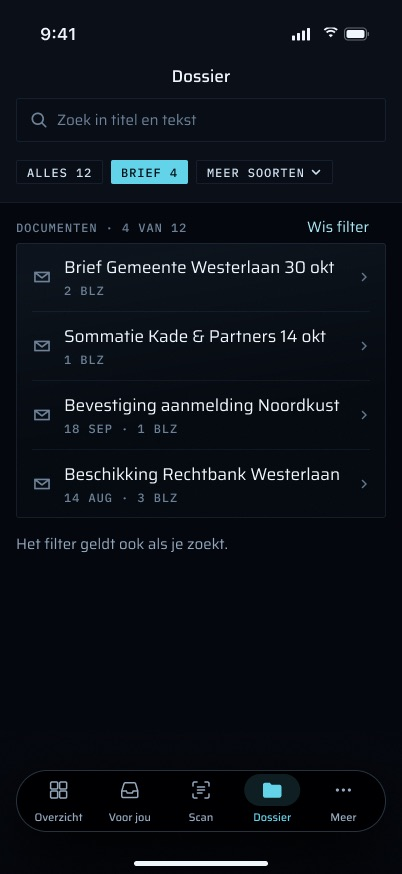

#### 20. Soortfilter
- Chips boven de documenten: "ALLES 12", dan de meest voorkomende soort ("BRIEF 4"), dan "MEER SOORTEN" voor de rest. Op AX5 is elke soort een chip en lopen de chips door naar de volgende regel (`Dossier_AX5_verder_gescrold`: "Alles 12 · Brief 4 · Loonstrook 2 · Contract 2 · Overig 2 · Bankafschrift 1 …").
- Een keuze beperkt de lijst tot "DOCUMENTEN · 4 VAN 12", met "Wis filter" om terug te gaan naar alles.
- **Het filter geldt ook voor zoeken** ("Het filter geldt ook als je zoekt."), en de chips blijven boven de resultaten zichtbaar.
- De aantallen komen uit de eigen kopie van de telefoon, dus het filter werkt offline.

**Status:** Nog te bouwen — Er is geen serverroute nodig: de soort staat al op elk `DossierDoc`. Nodig:
- een model: de aantallen per soort met dezelfde normalisatie als `docTypeKey` (hoofdletters en witruimte), de gekozen soort, en gefilterde `docs` en `results`;
- UI: de chips, het menu "Meer soorten", "N van M", "Wis filter", doorlopen naar de volgende regel op AX5, en tikdoelen van 44 pt (brief §2.2);
- tests in `DossierModelTests`: aantallen, filteren, filteren tijdens zoeken, en wissen dat ook het filter leegt.

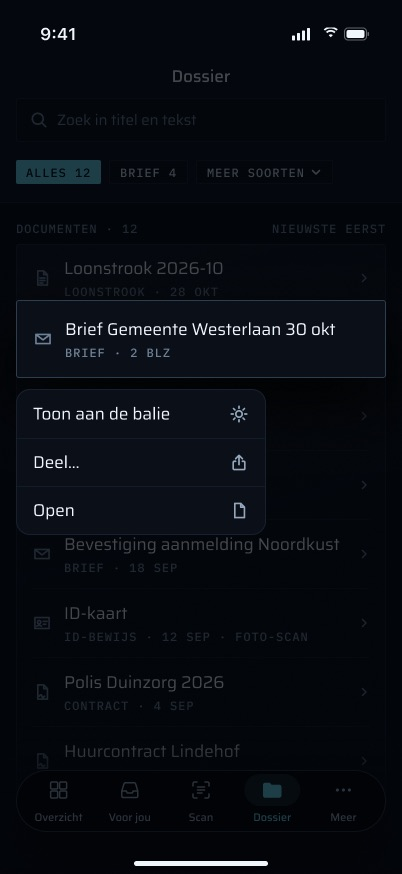

#### 21. Menu bij lang indrukken van een document
Lang indrukken van een documentrij opent "Toon aan de balie", "Deel…" en "Open". Zo staat de baliepresentatie één gebaar van de lijst af, zonder eerst de viewer te openen.

**Status:** Nog te bouwen — Nodig is de UI (`.contextMenu` op de documentrij, met een voorvertoning); het hangt af van [#45](#45-toon-aan-de-balie) en [#22](#22-een-document-delen-deel). Brief §2.7 vraagt bovendien dat de acties van het menu als aangepaste acties voor VoiceOver beschikbaar zijn.

#### 22. Een document delen ("Deel…")
Een document met het deelvenster van het systeem aan een andere app geven: mailen naar een medewerker, of via AirDrop naar een computer aan de balie. Het wordt aangeboden in het menu bij lang indrukken en als deelknop in de balk van de viewer (`Document_viewer`). Dit is Martins eigen handeling. Het is geen verzending door Grip: geen voorstel, geen ledger-event, en er wordt niets vastgelegd.

**Status:** Nog te bouwen — Er is nergens op het tabblad of in de viewer een deelactie. Nodig:
- UI: `ShareLink` of `UIActivityViewController` over een tijdelijke kopie met de effectieve titel als naam, omdat het opgeslagen bestand naar het id heet;
- een privacybesluit: de kopie verlaat de `.complete`-map, dus die hoort in een tijdelijke map te staan en daarna verwijderd te worden;
- een test dat de tijdelijke kopie wordt verwijderd.

## Synchronisatie: de kopie op de telefoon

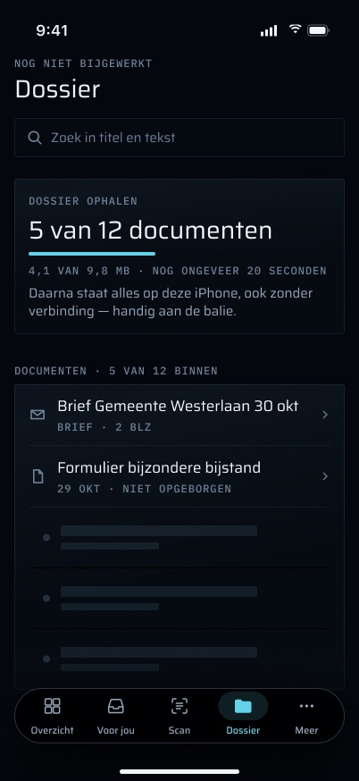

#### 23. Deltasynchronisatie met verplichte tombstones
Van begin tot eind (`DossierStore.sync`, serverkant `packages/api/src/routers/dossier-sync.ts`):

1. **Wanneer die draait:** alleen als `DossierSyncPolicy.maySync` het toestaat, dat wil zeggen ontgrendeld EN op de voorgrond. De aanleidingen zijn:
   - de `.task` van het tabblad (eerste verschijning; die leest eerst de kopie van schijf, en haalt de samenvatting van Overzicht op als die nog niet geladen is);
   - elke terugkeer naar `scenePhase == .active`;
   - `protectedDataDidBecomeAvailable` (een start in vergrendelde toestand kon de kopie niet lezen);
   - omlaag trekken om te verversen.

   Een stille push synchroniseert het dossier nooit, omdat een `.complete`-bestand niet geschreven kan worden zolang de telefoon vergrendeld is. Een tweede synchronisatie terwijl er een loopt, keert direct terug.
2. **De delta:** `GET /api/mobile/v1/documents/sync?cursor=<n>&limit=50` (`dossierSync.delta`).
   - De cursor is `ledger_events.seq`. Elke documentmutatie (binnenhalen, hernoemen, soort wijzigen, opbergen, weggooien, ongedaan maken, definitief verwijderen, koppelen) voegt een ledger-event toe onder advisory lock 42, dus de volgorde van seq is de volgorde van commits.
   - De server geeft elk geraakt document één keer terug, op zijn nieuwste seq, bepaald via `effectiveDocument` en nooit via de ruwe `documents.status`.
   - Een definitief verwijderd document (een rij in `document_purges`) komt terug als tombstone `purged`, een weggegooid document als tombstone `discarded`. Al het andere komt terug als upsert met effectieve titel, soort en status.
   - Zowel `inbox`- als `filed`-documenten worden bewaard. **Verschil met de spec:** spec §7.5 zegt "filed documents". Het plan mat op 2026-11-01 dat slechts 10 van 223 live documenten opgeborgen waren, dus ook de inbox wordt in de cache gezet (ongeveer 139 MB).
   - `more` geeft aan dat er nog een pagina volgt. De teruggegeven `cursor` is de seq van het laatste document op de pagina (ongewijzigd bij een lege pagina). De route weigert een cursor of limit die niet uit gewone cijfers bestaat, of een limit buiten 1..50, met 400.
3. **Een pagina toepassen:**
   - Eerst de tombstones: het bestand, de tekst en het record worden verwijderd.
   - Daarna de upserts. De bytes worden alleen van `GET /api/mobile/v1/documents/<id>/file` gedownload als de `sha256` veranderd is of het bestand ontbreekt.
   - **De cursor wordt pas opgeslagen nadat de hele pagina is toegepast.** Valt de verbinding halverwege een pagina weg, dan blijft het toegepaste bewaard met de oude cursor, en vraagt de volgende synchronisatie dezelfde pagina opnieuw op.

**Ledger:** synchroniseren en bekijken lezen alleen. Niets op dit tabblad schrijft een rij of maakt een ledger-event op de server.

**Status:** Gebouwd (`Dossier/DossierStore.swift`, `packages/api/src/routers/dossier-sync.ts`, `apps/web/src/app/api/mobile/v1/documents/sync/route.ts`). Live op de server sinds P3-D3.

#### 24. Elke download gecontroleerd; één slecht document houdt de synchronisatie nooit op
- **Elke download wordt gecontroleerd tegen zijn `sha256`.** De kluis is content-addressed en een ongewijzigde sha wordt nooit opnieuw opgehaald, dus een slechte download die één keer is opgeslagen, zou blijvend zijn.
- Een download waarvan de bytes niet op de sha uitkomen (een `file-hash-mismatch`, die /verify meldt), of een 5xx van de bestandsroute, maakt dat document *niet aanwezig*. Het id wordt in `state.json` bewaard, de rest van de pagina wordt toegepast, en de cursor gaat verder.
- Niet-aanwezige documenten worden bij elke synchronisatie één keer opnieuw geprobeerd. De kop zegt dan "1 document staat nog niet op je telefoon. Grip probeert het bij elke update opnieuw." (of "N documenten staan …"). Er wordt niets van Martin gevraagd.
- Een 410 (definitief verwijderd) of 404 (weggegooid, of de bytes ontbreken in de kluis) van de bestandsroute laat het document vallen zoals een tombstone.
- Fouten die niets over het document zeggen (geen netwerk, 401, 429, een geannuleerd verzoek) stoppen de synchronisatie met de oude cursor.

**Status:** Gebouwd (`Dossier/DossierStore.swift`, `DossierCopy.notHeldLine`).

#### 25. Teksten voor zoeken
Extractie voegt geen ledger-event toe, dus de delta kan die niet aankondigen.
- Na het doorlopen van de pagina's vraagt de telefoon bij elke synchronisatie `GET /api/mobile/v1/documents/texts?ids=…` op voor elk document dat nog geen tekst heeft, 20 tegelijk.
- De server geeft alleen niet-lege tekst terug, en nooit de tekst van een weggegooid of definitief verwijderd document. De route weigert een lege `ids`, meer dan 20 ids, of een id dat geen UUID is, met 400.
- Een tekst die niet aankomt, wordt de volgende keer opnieuw gevraagd.

**Status:** Gebouwd (`Dossier/DossierStore.swift`, `apps/web/src/app/api/mobile/v1/documents/texts/route.ts`).

#### 26. Voortgang van de eerste synchronisatie
Het ontwerp geeft de eerste synchronisatie een eigen kaart boven de documenten: "DOSSIER OPHALEN · 5 van 12 documenten", met een voortgangsbalk, "4,1 VAN 9,8 MB · NOG ONGEVEER 20 SECONDEN" en de belofte "Daarna staat alles op deze iPhone, ook zonder verbinding — handig aan de balie." De kop luidt "NOG NIET BIJGEWERKT". Onder de kaart vullen de documenten zich **terwijl ze binnenkomen** ("DOCUMENTEN · 5 VAN 12 BINNEN"), met skeletrijen voor de rest.

**Status:** Nog te bouwen — De code leest de lijst pas opnieuw als een synchronisatie eindigt (`DossierModel.sync` → `reload`), dus tijdens een eerste synchronisatie blijft de documentenkaart een skelet tot elke pagina, de nieuwe pogingen voor niet-aanwezige documenten en de teksten klaar zijn. Nodig:
- **server:** een totaal in de delta (aantal documenten en totaal aantal bytes dat nog komt, of voor het hele dossier), omdat de telefoon uit `more` alleen niet "5 van 12" kan zeggen. Dat betekent `dossierDelta` plus de routetest;
- **model:** voortgang gepubliceerd per pagina en per download (documenten, bytes, een schatting op basis van de gemeten snelheid), en opnieuw laden na elke toegepaste pagina;
- **UI:** de kaart, het label "N van M binnen" en de skeletrijen erachter;
- **tests:** voortgang over een fixture met meerdere pagina's, en opnieuw laden na elke pagina.

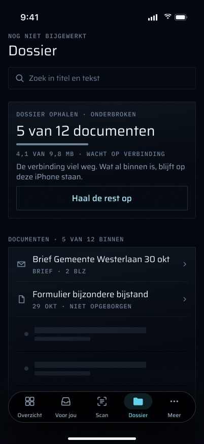

#### 27. Een onderbroken eerste synchronisatie houdt wat binnenkwam, en "Haal de rest op"
Als de verbinding wegvalt, luidt de kaart "DOSSIER OPHALEN · ONDERBROKEN", "4,1 VAN 9,8 MB · WACHT OP VERBINDING" en "De verbinding viel weg. Wat al binnen is, blijft op deze iPhone staan." Een knop "Haal de rest op" gaat verder.

**Status:** Deels gebouwd — Het gedrag klopt al in de code: een onderbroken synchronisatie eindigt nog steeds met opnieuw laden, dus wat is toegepast wordt getoond en blijft staan, en de volgende synchronisatie gaat verder vanaf de laatst opgeslagen pagina (`cursorSavedOnlyAfterApply`, `aCancelledDownloadIsNotOffline`). Ontbreekt: de kaart, de formulering en de knop "Haal de rest op". Die knop is UI die `DossierModel.refresh` aanroept, en hangt af van de voortgang uit #26.

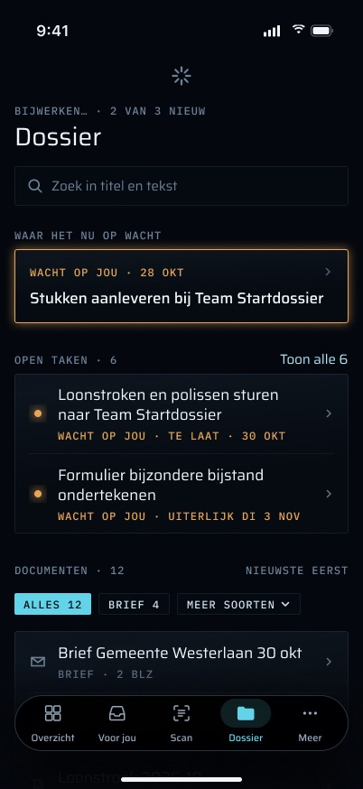

#### 28. "Bijwerken… · 2 van 3 nieuw"
Bij een latere synchronisatie staat bovenaan een verversindicator en zegt de kopregel wat er binnenkomt: "BIJWERKEN… · 2 VAN 3 NIEUW". De rest van het tabblad blijft bruikbaar vanuit de kopie.

**Status:** Nog te bouwen — Bijwerken werkt (`isSyncing`), maar de code toont geen voortgangsregel, en nieuwe documenten verschijnen allemaal tegelijk als de synchronisatie eindigt. Nodig zijn dezelfde voortgang per pagina als in #26 (model), de formulering in de kop (UI en `DossierCopy`) en een test.

## Zoeken op de telefoon

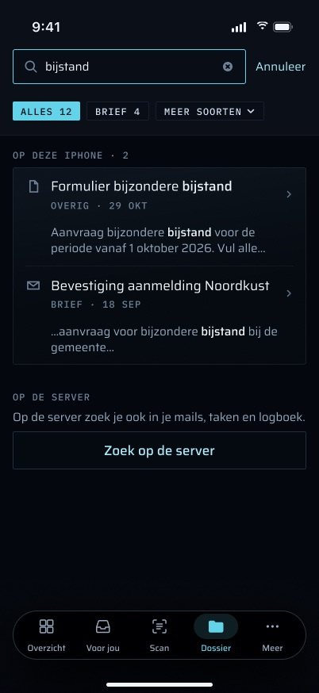

#### 29. Zoeken op het apparaat tijdens het typen
Zonder netwerk (`DossierSearch`):
- Het zoeken is ongevoelig voor hoofdletters, diakrieten en tekenbreedte: "beschikking" vindt "Beschíkking", en andersom.
- Elk woord van de zoekopdracht moet in de titel of de geëxtraheerde tekst voorkomen, in willekeurige volgorde.
- Treffers in de titel komen eerst. Verder blijft de lijst nieuwste eerst.
- **Niet gemeten:** de zoektijd over het echte corpus (plan 3 Task 21 Step 3). De regel van het plan is dat het zoeken boven 100 ms naar SQLite FTS5 verhuist.

**Status:** Gebouwd (`Dossier/DossierSearch.swift`, `DossierSearchTests`).

#### 30. Hoe lokale treffers eruitzien
- **Het fragment:** als de titel alleen niet elk woord bevat, toont de rij ongeveer 40 tekens van de oorspronkelijke tekst aan weerszijden van de eerste treffer van het eerste woord, met behoud van accenten, "…" aan afgekapte uiteinden, en maximaal twee regels. Er is geen fragment als het eerste woord alleen in de titel staat.
- In de code heeft de kaart het label "DOCUMENTEN" met het aantal treffers, en de lege toestand is "Niets gevonden op je telefoon.".
- Het ontwerp geeft de kaart het label **"OP DE IPHONE · 2"**, de tegenhanger van "OP DE SERVER", zodat Martin ziet waar elke treffer vandaan komt. Het **benadrukt ook het gevonden woord** in de titel en in het fragment (vet "bijstand").

**Status:** Deels gebouwd — Het fragment staat in `DossierSearch.snippet`. Ontbreekt: de formulering van het label (`DossierCopy`), en het benadrukken van treffers in lokale titels en fragmenten. Fragmenten van de server worden al benadrukt via `SearchSnippet.segments`, dus nodig is een lokale tegenhanger die de bereiken van treffers teruggeeft, plus een test.

#### 31. "Alleen op de titel doorzocht"
Een document zonder herkende tekst is alleen op de titel te vinden. Als de telefoon zulke documenten heeft, zeggen de zoekresultaten dat: "1 document zonder herkende tekst is alleen op de titel doorzocht." (`Zoeken_geen_resultaten_op_deze_iPhone`, `Zoeken_op_de_server_niet_bereikbaar`).

**Status:** Nog te bouwen — De telefoon kent `hasText` al per document (`DossierDoc.hasText`). Nodig zijn een telling in het model van aanwezige documenten zonder tekst, de regel (UI en `DossierCopy`, enkelvoud en meervoud), en een test.

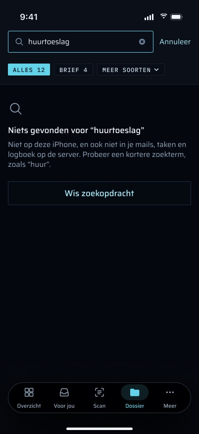

#### 32. Niets gevonden: een volgende stap
- Geen lokale treffers: "Niets gevonden op deze iPhone", gevolgd door de regel uit #31 en "Op de server zoek je ook in je mails, taken en logboek.", met "Zoek op de server" als volgende stap.
- Niets op de telefoon en niets op de server: één toestand, "Niets gevonden voor “huurtoeslag”", dan "Niet op deze iPhone, en ook niet in je mails, taken en logboek op de server. Probeer een kortere zoekterm, zoals “huur”.", dan een knop "Wis zoekopdracht".

**Status:** Deels gebouwd — De code zegt "Niets gevonden op je telefoon." en, na een zoekopdracht op de server, "Ook op de server niets gevonden." in aparte kaarten (`Dossier/DossierTab.swift`). Ontbreekt: de gecombineerde toestand waarin de zoekopdracht genoemd wordt, de tip voor een kortere term, en de knop "Wis zoekopdracht" (UI en `DossierCopy`). Om echt een kortere term voor te stellen, zoals in "zoals “huur”", zijn een regel (bijvoorbeeld het langste Nederlandse woordvoorvoegsel) en een test nodig.

## Zoeken op de server

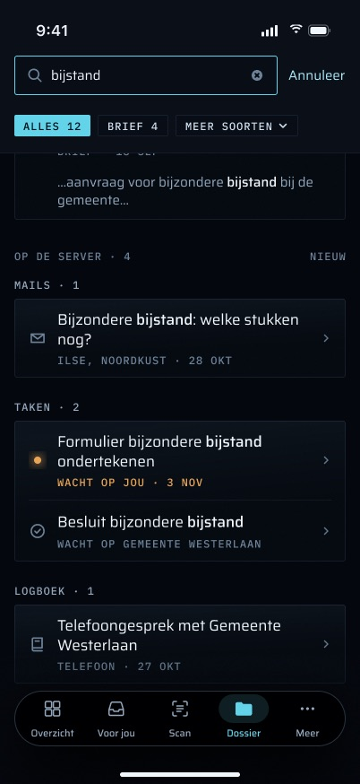

#### 33. "Zoek op de server": expliciet, alleen de snelle modus
- Een expliciete tik onder de lokale resultaten. Nooit automatisch.
- **De aanroep:** `GET /api/mobile/v1/search?q=…` voert `search.query` uit in **alleen de snelle modus**. De diepe modus kost een Ollama-rerank en wordt niet vanuit een tekstvak gebruikt.
  - De telefoon trimt `q`, kapt het af op 500 tekens en codeert het als alleen ASCII, zodat een `+` niet als spatie teruggelezen kan worden.
  - De route weigert een lege `q`, of een van meer dan 500 tekens, met 400.
  - Het antwoord bevat maximaal 20 treffers. De telefoon negeert `nextCursor`, dus er is geen "meer".
- Het ontwerp zet een korte uitleg boven de knop: "OP DE SERVER · Op de server zoek je ook in je mails, taken en logboek.". Terwijl het zoeken loopt, toont de knop zelf de voortgang, "Zoekt op de server…" met een spinner (brief §2.1: voortgang in de knop binnen 100 ms).

**Status:** Deels gebouwd — De knop, de aanroep en de route staan in `Dossier/DossierModel.swift` `searchServer` en `apps/web/src/app/api/mobile/v1/search/route.ts`. Ontbreekt: de uitlegregel, en de voortgang in de knop. De code toont in plaats daarvan een skeletkaart. Beide zijn UI en `DossierCopy`.

#### 34. Servertreffers gegroepeerd per soort, met de juiste detailregel
- **In de code:** één kaart "OP DE SERVER" met een aantal, in de volgorde van de server. Elke treffer toont de titel, een regel met de soort ("document", "taak", "logboek") en de dag, en het fragment van de server met de treffers benadrukt (de `«…»`-markeringen). Een soort anders dan document, taak of logboekregel toont zijn ruwe `entityType`, dus een mail luidt "email".
- **In het ontwerp:** de treffers zijn gegroepeerd onder "MAILS · 1", "TAKEN · 2" en "LOGBOEK · 1", met een aanduiding "NIEUW" naast het totaal. Elke soort heeft een eigen regel:
  - een mail toont de afzender en de datum ("ILSE, NOORDKUST · 28 OKT");
  - een taak toont of die wacht: "WACHT OP JOU · 3 NOV" in amber met een stip als die op Martin wacht, en "WACHT OP GEMEENTE WESTERLAAN" met een vinkje als die op iemand anders wacht;
  - een logboekregel toont het kanaal en de datum ("TELEFOON · 27 OKT").

**Status:** Nog te bouwen — Groeperen op `entityType` vraagt alleen model en UI. De detailregels vragen velden die de zoek-DTO niet bevat: de afzender van de mail, de toegewezene van de taak en of die op Martin wacht, en het kanaal van de logboekregel. Dat betekent een serverwijziging in `toSearchDTO` in `apps/web/src/lib/mobile-dto.ts` (en mogelijk in de vorm van de treffers van `search.query`), plus een routetest, daarna de iOS-`SearchHit`, daarna UI, daarna een test dat amber alleen verschijnt bij een taak die op Martin wacht.

#### 35. Mail- en logboekresultaten openen
In het ontwerp heeft elke servertreffer een chevron, mails en logboekregels inbegrepen. Het zoeken in de spec is "⌘K-style", en op het web opent elke treffer.

**Status:** Nog te bouwen — Een treffer opent alleen als de server er een app-route aan gaf, en `APP_ROUTE` in `apps/web/src/lib/mobile-dto.ts` koppelt alleen `document` en `task`, dus een mail of een logboekregel wordt getoond als een rij die niet opent. Nodig:
- **server:** app-routes voor `email` en `entry`, en alleen-lezen mobiele routes die één mail en één logboekregel leveren;
- **iOS:** `DeepLink`-gevallen, en alleen-lezen schermen voor een mail en een logboekregel (geen van beide bestaat in de app);
- **tests:** 401-eerst en 404 van de routes, het parsen van de deep links, en de linkbestemmingen.

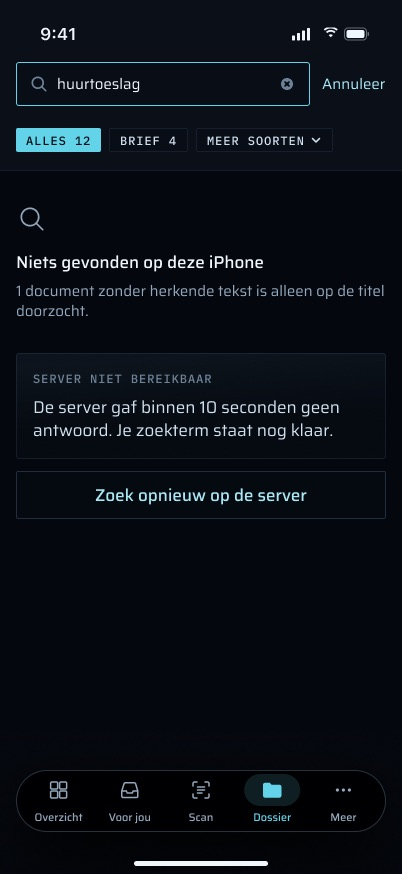

#### 36. Mislukt zoeken op de server en opnieuw proberen
- In de code:
  - Tijdens het laden staat er een skelet in de kaart.
  - Een fout toont de melding met "Opnieuw proberen". Bij een 401 is de melding "Log opnieuw in." en eindigt de sessie. Zonder netwerk is die "Geen verbinding — je ziet wat je telefoon al had." en gaat het tabblad offline, zodat "Opnieuw proberen" niets doet tot een synchronisatie weer slaagt. Anders is die "Grip is even niet bereikbaar. Je ziet wat je telefoon al had."
  - Een mislukte toestand blijft staan terwijl Martin doortypt. "Opnieuw proberen" zoekt dan wat er op dat moment in het veld staat.
  - Een zoekopdracht die onderbroken wordt door het tabblad te verlaten, gaat terug naar de knop, zonder fout.
- Het ontwerp voegt een **limiet van 10 seconden** toe met een eigen melding: "SERVER NIET BEREIKBAAR · De server gaf binnen 10 seconden geen antwoord. Je zoekterm staat nog klaar.", en de knop om opnieuw te proberen luidt "Zoek opnieuw op de server".

**Status:** Deels gebouwd — De fouttoestanden en het opnieuw proberen staan in `Dossier/DossierModel.swift` en `Dossier/DossierTab.swift`. Ontbreekt: een timeout van 10 seconden op dit verzoek (de netwerklaag van de app onder `Net/` stelt nergens een timeout in, dus nu is de limiet de standaard van URLSession, 60 s), de timeoutmelding, en de formulering van de knop. Daarvoor zijn het model, `DossierCopy` en een test met een stub die blijft hangen nodig.

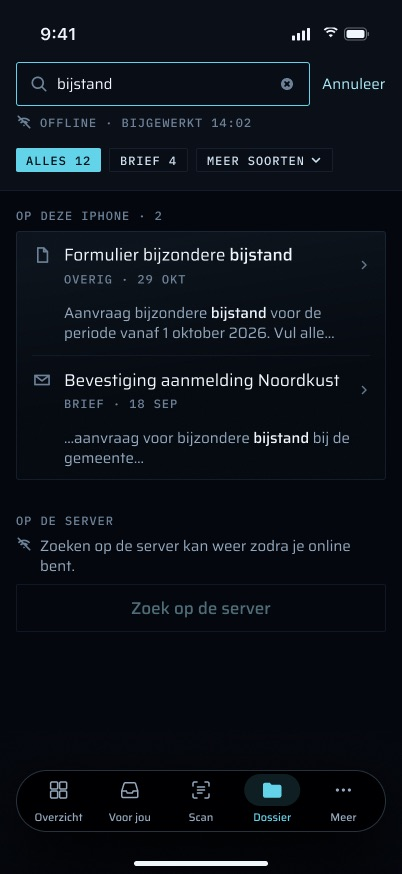

#### 37. Zoeken op de server offline: uitgeschakeld, met de reden
De knop is offline uitgeschakeld, en de reden staat erbij. De code zegt "Zoeken op de server kan niet offline.". Het frame zegt "Zoeken op de server kan weer zodra je online bent." De leeftijd van de kopie ("OFFLINE · BIJGEWERKT 14:02") blijft boven de resultaten zichtbaar.

**Status:** Gebouwd (`Dossier/DossierTab.swift` `serverResults`). Het enige verschil is de formulering: de regel in het frame noemt de weg terug, die in de code niet.

#### 38. Een verouderd antwoord wordt weggegooid
Doortypen zet het zoeken op de server terug, en een antwoord op een zoekopdracht die niet meer in het veld staat, wordt weggegooid. Treffers voor "huur" kunnen nooit onder "beschikking" terechtkomen.

**Status:** Gebouwd (`DossierModel.searchServer`, `aReplyForAnEarlierQueryIsDropped`).

## De documentviewer

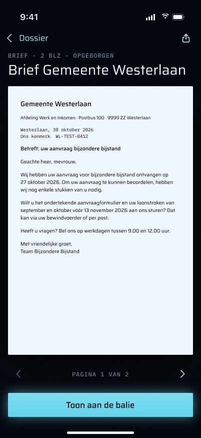

`DocumentViewer` wordt op de Dossier-stack geplaatst. De tabbalk is verborgen, de titel staat in de navigatiebalk, en vegen vanaf de rand gaat terug.

#### 39. PDF's en afbeeldingen bekijken, met zoom
Wat getoond wordt, hangt af van het `Content-Type` dat de bestandsroute leverde (`ViewerKind`), niet van het opgeslagen mimetype:
- **PDF:** PDFKit, met pagina's die verticaal in één kolom scrollen, geschaald op de breedte, en knijpen om te zoomen.
- **Afbeelding:** `ZoomingImageScrollView`. Die opent passend en gecentreerd, en zoomt met knijpen tot 4× de passende grootte (nooit minder dan 2× de eigen pixels van de afbeelding). Dubbeltikken zoomt naar 2,5× de passende grootte rond het tikpunt, en weer terug (`ImageZoom`).
- **Al het andere:** "Dit soort bestand kan de telefoon niet tonen. Open het in Grip op de computer."
- Vegen vanaf de rand gaat terug (brief §3, iA Writer).

**Status:** Gebouwd (`Dossier/DocumentViewer.swift`, `ImageZoomTests`).

#### 40. Waar de bytes vandaan komen
Uit de eigen kopie van de telefoon, als die het document heeft. Anders (bijvoorbeeld een servertreffer, of een link naar een document dat nog niet gesynchroniseerd is) worden ze één keer opgehaald van `GET /api/mobile/v1/documents/<id>/file`, **alleen voor deze weergave en nooit opgeslagen**. #47 is wat het ontwerp in plaats daarvan wil.

**Status:** Gebouwd (`DocumentViewerModel.load`).

#### 41. De bestandsroute
`apps/web/src/app/api/mobile/v1/documents/[id]/file/route.ts` past dezelfde regels toe als `/api/files/[sha256]` van het web: een veilig mimetype, de effectieve titel in `Content-Disposition`, en `nosniff`. De route antwoordt:
- 404 bij een misvormd id (vóór enige routeraanroep), een onbekend document, een weggegooid document, of bytes die in de kluis ontbreken. Nooit een 500, die de telefoon eindeloos opnieuw zou proberen;
- 410 bij een definitief verwijderd document;
- JSON 401 zonder sessie, nooit een redirect.

Niets in de viewer verandert een document, en definitief verwijderen wordt nooit aangeboden.

**Status:** Gebouwd (de route en de bijbehorende `route.test.ts`, `apps/web/src/lib/safe-mime.ts`).

#### 42. Toestanden van de viewer
- Laden: een lege plaatshouder, zonder spinner.
- Weg (404 of 410, of een link waarvan het id geen UUID is): "Dit document is er niet meer."
- Niet op de telefoon en offline: "Dit document staat nog niet op je telefoon, en er is geen verbinding."
- Elke andere fout, of een afbeelding die niet te decoderen is: "Het document kon niet worden geopend."
- 401: "Log opnieuw in." en de sessie eindigt.

**Status:** Gebouwd (`DocumentViewerModel.Copy`).

#### 43. De metaregel
Boven de titel zegt één aanduiding wat het document is: "BRIEF · 2 BLZ · OPGEBORGEN". Bij een fotoscan staat er "ID-BEWIJS · 12 SEP · FOTO-SCAN", en bij een document dat nog niet op de telefoon staat "LOONSTROOK · 28 OKT · 0,4 MB". Op AX5 staan de onderdelen onder elkaar, één per regel (`Document_AX5_gescrold`; brief §2.7). Het ontwerp toont de titel ook groot op de pagina, onder de terugknop, in plaats van alleen in de balk.

**Status:** Nog te bouwen — Soort, status, datum en grootte staan al op `DossierDoc`. Het aantal pagina's kan voor een aanwezige PDF uit PDFKit komen, of van de server ([#18](#18-documenten-elk-document-dat-de-telefoon-heeft)). De bron vraagt het serverveld uit #18. Nodig zijn UI en de opmaak in `DossierCopy` (met een test: de grootte in Nederlandse notatie, "0,4 MB").

#### 44. Paginanummer en bladeren
Onder het document: "PAGINA 1 VAN 2" met knoppen vorige en volgende, die de pagina omslaan. Op AX5 luidt de aanduiding "1 van 2". In "Toon aan de balie" luidt die "1 / 2".

**Status:** Nog te bouwen — De code scrolt alle pagina's in één kolom zonder aanduiding. Nodig: de huidige pagina bijgehouden vanuit `PDFView` (`PDFViewPageChanged`), de knoppen (`goToNextPage` / `goToPreviousPage`, tikdoelen van 44 pt), de aanduiding, VoiceOver-labels, en een test van de paginarekenkunde. Een afbeelding is één pagina en toont geen aanduiding.

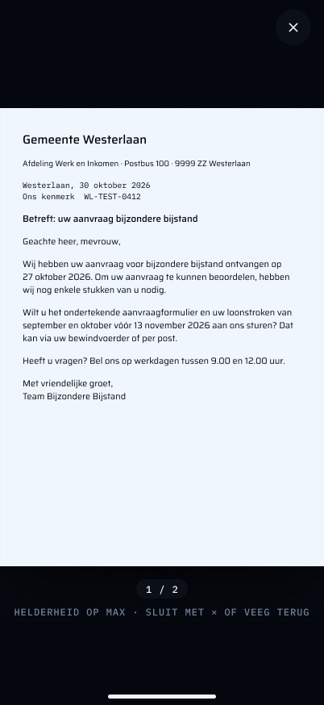

#### 45. "Toon aan de balie"
De hoofdactie van het tabblad, vastgezet onderaan de viewer (en in het menu bij lang indrukken, #21). Die toont het document aan iemand aan de andere kant van een balie:
- schermvullend op zwart, zonder balk en zonder tabbalk;
- **de schermhelderheid gaat naar het maximum, en keert terug naar wat die was als de modus sluit** (bij ×, bij het vegen, en als de app de voorgrond verlaat);
- sluiten met × of terugvegen ("HELDERHEID OP MAX · SLUIT MET × OF VEEG TERUG");
- het paginanummer "1 / 2" (#44);
- zoomen blijft mogelijk, met een aanduiding van het zoomniveau ("230 %"), en dubbeltikken gaat terug naar de hele pagina ("DUBBELTIK: HELE PAGINA") (`Document_toon_aan_de_balie_ingezoomd`);
- het werkt voor een scan zonder herkende tekst ("Tonen aan de balie werkt gewoon.", #46).

Het scherm hoort ook niet te dimmen of te vergrendelen zolang de modus open is. Dat volgt uit het doel, en staat niet in een frame.

**Status:** Nog te bouwen — Niets in de code verandert de schermhelderheid, en er is geen schermvullende modus. Nodig:
- **UI:** een `fullScreenCover` met dezelfde PDF- en afbeeldingsweergaven, met de sluitknop, de aanduidingen en het vegen;
- **model:** een helderheidsbewaker die `UIScreen.brightness` opslaat, op 1.0 zet, en herstelt bij sluiten en wanneer `scenePhase` `.active` verlaat; `isIdleTimerDisabled` zolang de modus getoond wordt;
- **tests:** herstel bij elke manier van verlaten, met de helderheid geïnjecteerd zodat de simulator het kan testen, plus een controle op de telefoon.

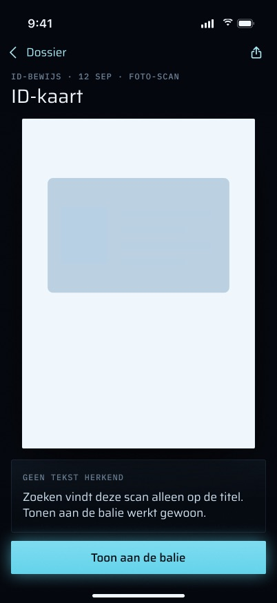

#### 46. "Geen tekst herkend"
Bij een document zonder geëxtraheerde tekst zegt de viewer wat dat betekent: "GEEN TEKST HERKEND · Zoeken vindt deze scan alleen op de titel. Tonen aan de balie werkt gewoon."

**Status:** Nog te bouwen — De telefoon kent `hasText` per document (`DossierDoc.hasText`), maar de viewer leest het niet. Nodig: dat de viewer het `DossierDoc` ontvangt (nu krijgt die een id en een titel), de mededeling (UI en `DossierCopy`), en een test. Voor een document dat de telefoon niet heeft, is `hasText` onbekend en mag de mededeling niet verschijnen.

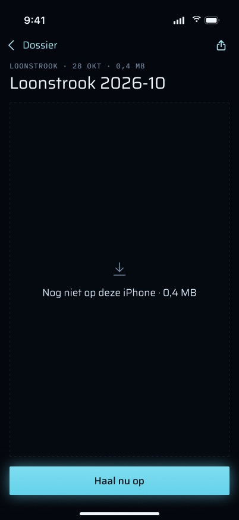

#### 47. Nog niet op deze iPhone: "Haal nu op"
Voor een document dat de telefoon niet heeft (een servertreffer, een link, een niet-aanwezig document) vraagt de viewer eerst in plaats van direct op te halen. Die toont "Nog niet op deze iPhone · 0,4 MB" en een knop "Haal nu op" die het document opneemt **en bewaart**, zodat het de volgende keer offline opent. Offline is de knop uitgeschakeld met de reden: "Haal het op zodra je weer online bent. Daarna kun je het ook zonder verbinding openen." (`Document_nog_niet_op_deze_iPhone_offline`).

**Status:** Deels gebouwd — Het offline geval is afgehandeld ("Dit document staat nog niet op je telefoon, en er is geen verbinding."), en online worden de bytes opgehaald, maar alleen voor deze weergave en nooit bewaard (`DocumentViewerModel.load`). Ontbreekt:
- **model:** een `DossierStore`-methode die één document buiten de delta opneemt, gecontroleerd tegen de sha zoals elke andere download, en op dezelfde manier beschermd;
- **server:** het record van het document (`DossierDoc`: sha256, grootte, soort, status) op id, omdat een zoektreffer of een link dat niet meedraagt. Dat betekent een route `GET /api/mobile/v1/documents/<id>`, of die velden in de zoek-DTO, plus een routetest;
- **UI:** de regel met de grootte, de knop en de offline-reden;
- **tests:** een bewaard document opent offline, en een sha die niet klopt wordt geweigerd.

#### 48. Overgang van rij naar viewer
De brief (§2.6) legt de overgang van een Dossier-rij naar de viewer vast: een zoomende navigatieovergang verankerd op de rij (matched geometry op de titel), spring response 0,35 s en damping 0,86, met de lijst gedimd erachter. Met Beperk beweging is het een crossfade van 0,2 s zonder schaling.

**Status:** Nog te bouwen — De code gebruikt de standaard push. Alleen UI is nodig: `.matchedTransitionSource` op de rij en `.navigationTransition(.zoom)` op de viewer, met een controle op Beperk beweging.

## Toegankelijkheid en lay-out

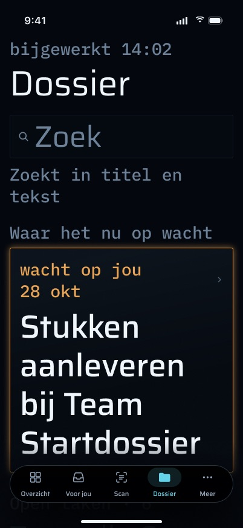

#### 49. Dynamic Type tot AX5
Alle tekst schaalt mee met Dynamic Type. In de code zijn document- en taaktitels begrensd op twee regels, de notitie van de kop op vier regels en serverfragmenten op drie. De titel van de kop en de meldingen lopen volledig door. De AX5-frames van het ontwerp tonen lange titels **volledig**, en inline metadata **onder elkaar, één onderdeel per regel** ("wacht op jou / te laat / 30 okt", "Documenten · 12 / nieuwste eerst"), zoals brief §2.7 vereist. Aantallen worden nooit afgekapt. De iPhone SE gebruikt dezelfde lay-out met één kolom (`Dossier_iPhone_SE_*`).

**Status:** Deels gebouwd — Het schalen en de SE-lay-out zijn er (`Dossier/DossierTab.swift`, lettertypen `relativeTo:` tekststijlen). Ontbreekt: het opheffen van de limiet van twee regels bij toegankelijkheidsgroottes, en het onder elkaar zetten van de aanduidingsregels op AX5. Daarvoor zijn UI (`dynamicTypeSize.isAccessibilitySize`) en een capture op AX5 op het apparaat nodig, omdat AX5 daar nog niet is gecontroleerd.

#### 50. VoiceOver
Elke rij is één element (`accessibilityElement(children: .combine)`). De kaartlabels en de titel zijn koppen. De wisknop heeft het label "Wis zoekopdracht", en het skelet leest "Laden".

**Status:** Gebouwd (`Dossier/DossierTab.swift`). Als #21 gebouwd wordt, moeten de acties daarvan ook als aangepaste acties beschikbaar zijn (brief §2.7).

#### 51. Afkappen in het midden bij bestandsnamen
Brief §2.2: een lange titel wordt aan het eind afgekapt als het lopende tekst is, en in het **midden** als het een bestandsnaam is (`Loonstrook.mp.2026-07…pdf`), zodat datum en extensie leesbaar blijven. Veel documenten houden een bestandsnaam als titel (auto-name schrijft `Loonstrook.mp.<yyyy>-<mm>.Saurens.pdf`).

**Status:** Nog te bouwen — Elke titel wordt aan het eind afgekapt. Nodig zijn een regel die een titel als bestandsnaam herkent (bijvoorbeeld een extensie en geen spaties), `.truncationMode(.middle)` daarvoor, en een test van de regel.

### Geen onderdeel van dit scherm

De veegacties en het in één keer goedkeuren uit de brief (Voor jou), vasthouden om te bevestigen (Versturen bij een voorstel), de "Scan"-bediening in het Bedieningspaneel en op de Actieknop, en de Live Activity voor een upload-wachtrij die leegloopt (Scan) horen bij andere schermen. Geen daarvan is ontworpen voor het Dossier of de viewer. Noch de haptiekkaart van de brief (§2.5) noch de frames noemen een Dossier-moment, en `Grip/Dossier/` heeft geen haptiek, wat klopt.

## Elke toestand

| Toestand | Wat de code toont | Wat Martin kan doen |
|---|---|---|
| Laden (kopie nog niet gelezen, of eerste synchronisatie zonder iets binnen) | Skeletrijen in de vorm van de inhoud, nooit een spinner (`SkeletonLines`, VoiceOver "Laden"). De kaart voor de eerste synchronisatie uit het ontwerp is #26 | Wachten; van tabblad wisselen (de synchronisatie gaat de volgende keer verder) |
| Gesynchroniseerd | Kop met "bijgewerkt HH:MM", kop van de kaart, Tijdlijn, open taken, documenten | Zoeken, een document of taak openen, omlaag trekken om te verversen |
| Leeg dossier | "Nog geen documenten op je telefoon. Ze komen binnen zodra Grip bereikbaar is." | Omlaag trekken om te verversen |
| Offline | "offline · bijgewerkt …" plus "Geen verbinding — je ziet wat je telefoon al had."; documenten en lokaal zoeken werken; taken tonen "Taken zijn offline niet te zien." als er geen geladen waren; zoeken op de server uitgeschakeld met de reden | Alles wat de kopie op de telefoon leest, inclusief de viewer voor aanwezige documenten |
| Serverfout | "Grip is even niet bereikbaar. Je ziet wat je telefoon al had." | Omlaag trekken om te verversen |
| Schrijven mislukt in ontgrendelde toestand | "Een document kwam niet goed binnen. Trek omlaag om het opnieuw te proberen." | Omlaag trekken om te verversen |
| Documenten niet aanwezig | "N documenten staan nog niet op je telefoon. Grip probeert het bij elke update opnieuw." | Niets nodig |
| Tabblad verlaten of telefoon vergrendeld tijdens synchronisatie | Niets: niet gemeld als offline of als fout; wat is toegepast blijft bewaard | Terugkomen; de volgende verversing op de voorgrond gaat verder |
| Sessie verlopen (401) | Het tabblad wordt gewist en de app toont "Je sessie is verlopen." | Opnieuw inloggen; het dossier synchroniseert vanaf nul |
| Vergrendeld | `LockView` in plaats van het tabblad | Ontgrendelen met Face ID |
| Grote tekst | Zie #49 | Zoals gewoonlijk |
| Kleine telefoon (iPhone SE) | Dezelfde lay-out met één kolom | Zoals gewoonlijk |

**Grote tekst, niet gecontroleerd op het apparaat:** omdat document- en taaktitels op elke grootte op twee regels begrensd zijn, worden lange titels op AX5 met een beletselteken afgekapt. De AX5-frames van het ontwerp tonen ze volledig (#49).

## Regels die het volgt

- **Effectieve status, nooit de ruwe kolom.** De synchronisatie, de tekstenroute en de bestandsroute lossen allemaal op via `effectiveDocument` / `effective-status.ts`. `documents.status` leest na een weggooiactie voor altijd "inbox" (spec §7.5, CLAUDE.md).
- **Tombstones zijn verplicht.** Definitief verwijderen of weggooien op het web haalt het document bij de volgende synchronisatie van de telefoon. Een 410 of 404 van de bestandsroute betekent hetzelfde.
- **Amber alleen voor wat op Martin wacht.** In de code verschijnt amber op het label en de stippen van de open taken, die uit de ene definitie van wachten komen. Documenten, de kop en de serverresultaten zijn in de code nooit amber. Het ontwerp voegt amber toe op nog twee plekken die op Martin wachten: de kop ("wacht op jou", #15) en een servertreffer voor een taak die op hem wacht (#34). Beide altijd samen met de woorden.
- **Alleen-lezen.** Dit scherm maakt geen suggestie, geen logboekregel en geen ledger-event, en verstuurt niets. (Het `TaskScreen` dat het opent, kan de status van een taak wijzigen, wat in het logboek wordt vastgelegd; dat is een functie van het taakscherm, niet van dit tabblad.) De regels voor AI-suggesties en opbergen gelden hier niet. Wat Grip zelf opborg, komt op de telefoon binnen als een gewone upsert met de nieuwe status ("opgeborgen"). "Deel…" (#22) geeft een bestand aan een andere app op Martins eigen tik. Het is geen verzending door Grip.

## Meldingen, haptiek, offline

- **Meldingen:** het tabblad maakt er geen. Het is de landingsplek voor `FILING`-pushes zonder link (#3).
- **Haptiek:** geen in `Grip/Dossier/`, en geen ontworpen (zie "Geen onderdeel van dit scherm").
- **Offline:** alles wat de kopie op de telefoon leest, werkt, inclusief de viewer voor aanwezige documenten en lokaal zoeken. Wat de server nodig heeft, zegt waarom het niet beschikbaar is. Dit tabblad zet de taken noch de kop in de cache: de kop komt uit de samenvatting van `InboxStore`, en de taken staan alleen in het geheugen (#15, #17).

## Bekende grenzen en wat niet gemeten is

- **Niet gemeten op de telefoon** (plan 3 Task 21 Step 3, staat nog open):
  - de tijd en het aantal bytes van een volledige synchronisatie over het echte corpus (ongeveer 223 documenten en 139 MB voorspeld);
  - de zoektijd over het echte corpus (de regel van 100 ms in #29);
  - de oefening met definitief verwijderen. Met Martins OK: upload een wegwerp-PDF, laat de telefoon hem synchroniseren, verwijder hem definitief op het web, en controleer dat hij van de telefoon verdwenen is en dat `nightly-verify` hem als definitief verwijderd meldt met 0 nog op schijf.
- **Uitrol.** De serverkant (`documents/sync`, `documents/[id]/file`, `documents/texts`, `search`) is live sinds P3-D3, 2026-11-01 20:16 CET (CLAUDE.md). De controle "purge removes it from the phone" uit Task 27 step 5 moet nog gebeuren. De route `case-map` achter de Tijdlijn-rij (toegevoegd 2026-11-03) staat nog niet als uitgerold geregistreerd.
- De eerste synchronisatie downloadt documenten één voor één zonder zichtbare voortgang, en de lijst ververst pas als een synchronisatie eindigt (#26).
- Zoeken op de server geeft maximaal 20 treffers, zonder bladeren.
- Een document dat voor één weergave is opgehaald, wordt niet bewaard. Het offline opnieuw openen mislukt tot een synchronisatie het opneemt (#47).

## Waar in de code

**iOS (`apps/ios/Grip/`):**

- `Dossier/DossierTab.swift`: het tabblad, de kaarten, rijen en het skelet.
- `Dossier/DossierModel.swift`: `DossierModel` (toestand, synchronisatie, taken, zoeken op de server, wissen), `DossierCopy` (elke tekst), `DossierRoute`.
- `Dossier/DossierStore.swift`: de kopie op schijf, de deltasynchronisatie, de afhandeling van niet-aanwezige documenten, bestandsbescherming en wissen. Ook `DossierSyncPolicy`.
- `Dossier/DossierModels.swift`: de DTO's (`DossierDoc`, `DossierDelta`, `DossierText`, `SearchHit`).
- `Dossier/DossierSearch.swift`: zoeken op het apparaat en fragmenten, plus `SearchSnippet` voor de «…»-markeringen van de server.
- `Dossier/DocumentViewer.swift`: de viewer, `ViewerKind`, `PDFKitView`, `ImageZoom`, `ZoomingImageScrollView`.
- `App/RootView.swift` (het tabblad, de vergrendeling, `dossierPath`), `App/AppServices.swift` (de map), `Auth/LockView.swift` en `Auth/AppLock.swift` (vergrendeling), `Auth/SessionEpoch.swift` (wissen bij einde sessie), `More/MoreTab.swift` (wissen bij uitloggen).
- `Push/DeepLink.swift` en `Push/NotificationRouter.swift`: de links en de `FILING`-terugval.
- `Timeline/TimelineView.swift` (`TimelineScreen`, de bewijslinks in het sheet van een halte) en `Timeline/TimelineLayout.swift` (`TimelineCopy`).
- Fixtures: `apps/ios/scripts/make-dossier-fixtures.swift` schrijft de synthetische PDF's, `sync.json` en `texts.json`, die `Fixtures/FixtureServer.swift` levert.

**Server:**

- `apps/web/src/app/api/mobile/v1/documents/sync/route.ts`, `.../documents/texts/route.ts`, `.../documents/[id]/file/route.ts`, `.../search/route.ts`, `.../tasks/route.ts`, `.../dashboard/summary/route.ts`, `.../case-map/route.ts` (de Tijdlijn).
- `packages/api/src/routers/dossier-sync.ts` (`dossierDelta`, `dossierTexts`).
- `apps/web/src/lib/mobile-dto.ts` (`toSearchDTO`, `APP_ROUTE`) en `apps/web/src/lib/safe-mime.ts`.
- `packages/api/src/waiting.ts` (de definitie van wachten op Martin).
- `packages/core/src/search/entity-types.ts` (`SEARCH_ENTITY_TYPES`: wat het zoeken op de server omvat, mail inbegrepen).

**Tests:**

- iOS: `GripTests/DossierStoreTests.swift`, `DossierModelTests.swift`, `DossierSearchTests.swift`, `ImageZoomTests.swift`, `SessionEpochTests.swift`, `DeepLinkTests.swift`, `LinkDestinationTests.swift`, `FixtureTests.swift` (inclusief `fixturesHoldNoRealCaseDate`).
- Server: `packages/api/src/routers/dossier-sync.test.ts`; een `route.test.ts` naast elk van de routes hierboven.

**Spec en plan:** `docs/superpowers/specs/2026-10-28-iphone-app-design.md` §7.5 en §9; `docs/superpowers/specs/2026-11-01-iphone-design-brief.md` §2 en §3 (de Dossier-rij); `docs/superpowers/plans/2026-10-31-iphone-app-plan-3.md` Tasks 20 en 21.

## Frames

| Frame | Toestand die het toont | In de code? |
|---|---|---|
|  `Dossier_gesynchroniseerd` | Gesynchroniseerd: kop, open taken, documenten | Ja, behalve het soortfilter (#20), "Toon alle" en "te laat" (#17), de rijdetails (#18) en een tikbare kop met woorden (#15); de code voegt de Tijdlijn-rij toe (#16) |
| 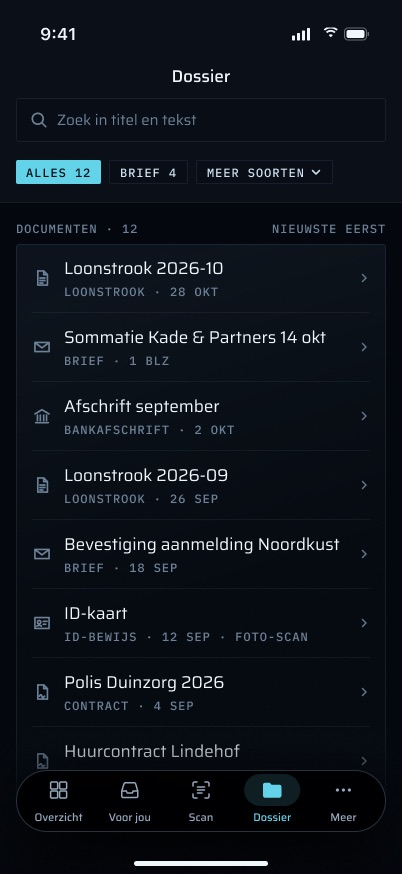 `Dossier_gescrold_documenten_vastgezet` | Gescrold, documentenkop vastgezet | Scrollen ja; de inklappende titel (#12) en de vastgezette kop (#13) nee |
|  `Dossier_document_contextmenu` | Menu bij lang indrukken: "Toon aan de balie", "Deel…", "Open" | Nee (#21, #22, #45) |
|  `Dossier_gefilterd_op_soort` | Gefilterd op "BRIEF", "Wis filter" | Nee (#20) |
|  `Dossier_offline` | "OFFLINE · BIJGEWERKT 14:02", de kopie op de telefoon | Ja (de code toont ook de offline-zin); kop en taken alleen als ze al geladen waren (#15, #17) |
|  `Dossier_bijwerken` | Bijwerken, "2 VAN 3 NIEUW" | Bijwerken ja; de voortgangsregel nee (#28) |
|  `Dossier_eerste_sync` | Eerste synchronisatie met voortgang | Alleen skelet, geen voortgang (#26) |
|  `Dossier_eerste_sync_onderbroken` | Eerste synchronisatie onderbroken, "Haal de rest op" | Gedrag ja (gaat verder, houdt wat binnenkwam); kaart en knop nee (#27) |
| 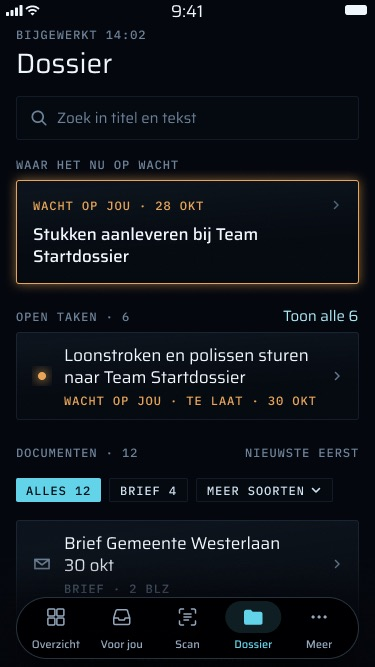 `Dossier_iPhone_SE_gesynchroniseerd` | iPhone SE, gesynchroniseerd | Ja (zelfde lay-out) |
| 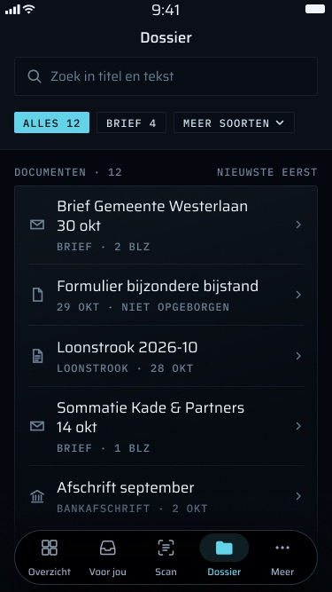 `Dossier_iPhone_SE_gescrold` | iPhone SE, gescrold | Ja |
|  `Dossier_AX5_bovenaan` | Grootste toegankelijkheidstekst, bovenaan | Dynamic Type ja; titels begrensd op twee regels, metadata niet onder elkaar (#49) |
| 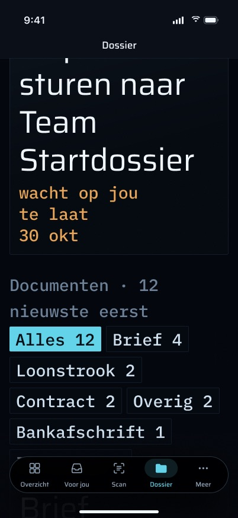 `Dossier_AX5_verder_gescrold` | Grootste toegankelijkheidstekst, gescrold (chips lopen door) | Deels (geen chips, #20) |
|  `Zoeken_bijstand_op_deze_iPhone` | Lokale treffers met fragmenten, "Zoek op de server" | Ja, met label "DOCUMENTEN"; treffers niet gemarkeerd, geen "Annuleer", geen uitlegregel (#14, #30, #33) |
| 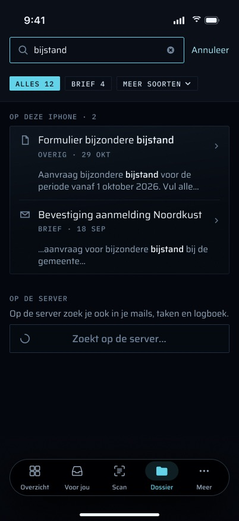 `Zoeken_op_de_server_bezig` | Zoeken op de server bezig | Skelet in plaats van "Zoekt op de server…" (#33) |
|  `Zoeken_op_de_server_resultaten` | Servertreffers gegroepeerd als mails, taken, logboek | Eén platte lijst "OP DE SERVER"; mails en logboekregels openen niet (#34, #35) |
|  `Zoeken_op_de_server_niets_gevonden` | Nergens iets, "Wis zoekopdracht" | Alleen "Ook op de server niets gevonden." (#32) |
|  `Zoeken_op_de_server_niet_bereikbaar` | Server niet bereikbaar na 10 s, opnieuw proberen | Fout en opnieuw proberen ja, met de eigen formulering van de code; geen limiet van 10 s (#36) |
|  `Zoeken_offline` | Offline: lokale treffers, zoeken op de server uitgeschakeld met reden | Ja ("Zoeken op de server kan niet offline.", #37) |
| 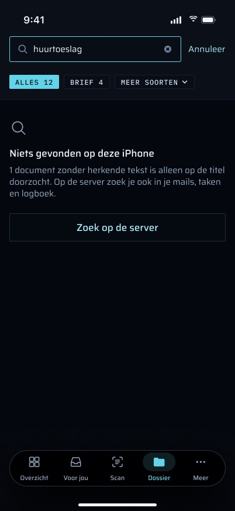 `Zoeken_geen_resultaten_op_deze_iPhone` | Geen lokale treffers | "Niets gevonden op je telefoon."; geen opmerking over alleen-titel (#31, #32) |
|  `Document_viewer` | Viewer met metaregel, bladeren, delen, "Toon aan de balie" | Viewer ja; metaregel, bladeren, delen en de knop nee (#43, #44, #22, #45) |
|  `Document_toon_aan_de_balie` | Schermvullend op maximale helderheid | Nee (#45) |
| 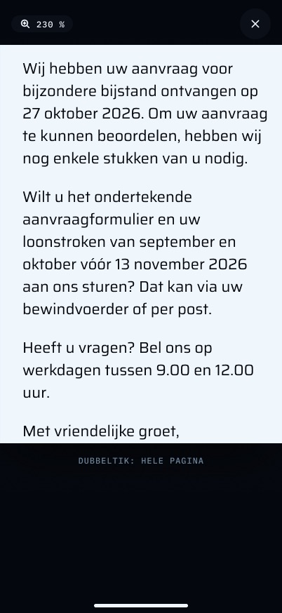 `Document_toon_aan_de_balie_ingezoomd` | Hetzelfde, ingezoomd, "230 %", "Dubbeltik: hele pagina" | Zoomen ja (in de gewone viewer); de modus nee (#45) |
|  `Document_tekst_ontbreekt` | Afbeeldingsdocument met "GEEN TEKST HERKEND" | Afbeelding bekijken ja; de mededeling nee (#46) |
|  `Document_nog_niet_op_deze_iPhone` | Niet aanwezig, "Haal nu op" | Nee: de code haalt direct op, alleen voor deze weergave (#47) |
| 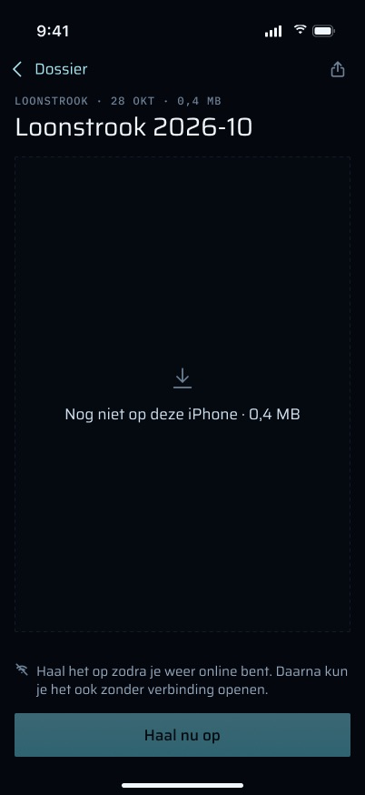 `Document_nog_niet_op_deze_iPhone_offline` | Niet aanwezig en offline | Ja, als "Dit document staat nog niet op je telefoon, en er is geen verbinding." (#47) |
| 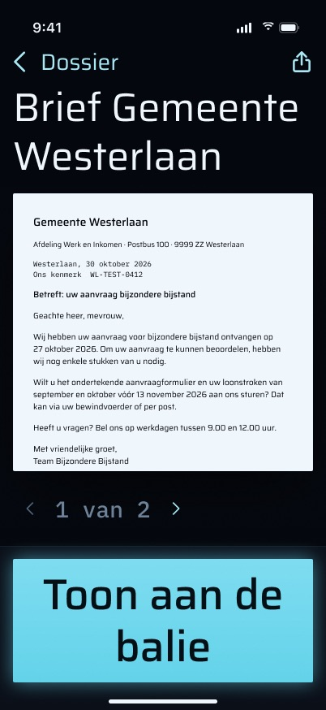 `Document_AX5` | Viewer met grootste toegankelijkheidstekst, bladeren | Viewer ja; bladeren nee (#44) |
| 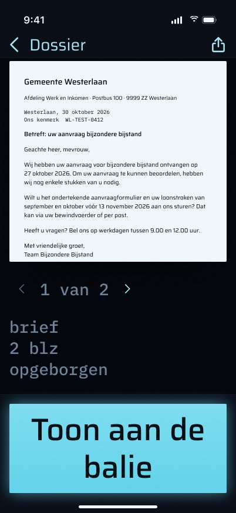 `Document_AX5_gescrold` | Hetzelfde, gescrold naar de metaregel | Geen metaregel in de code (#43) |
