# Tijdlijn, de zaakkaart: functies

## Stand van de bouw

Geteld over elke functie hieronder die een statusregel heeft (2026-11-03, branch `feat/iphone-app`):

- **Gebouwd:** 32
- **Deels gebouwd:** 18
- **Nog te bouwen:** 16

De drie belangrijkste dingen die nog gebouwd moeten worden:

1. **Zeggen wat er binnen een verborgen spoor op Martin wacht** ("1 SPOOR VERBORGEN · DAARIN WACHT 1 OP JOU", plus "Toon alle sporen"). Met "Schuldeisers verbergen" aan kan de telefoon de halte verbergen die Voor jou en de badge nog wel tellen, en niets op het scherm zegt dat. Vraagt een serverveld in de zaakkaart-DTO, UI en een routetest. Zie [Verborgen wachttelling](#verborgen-wachttelling-daarin-wacht-n-op-jou).
2. **Per document tonen of het offline opent** ("OP JE TELEFOON" / "OPENT MET VERBINDING", en de melding onder een bestand dat niet op de telefoon staat). Nu opent een bestand dat de telefoon niet heeft de viewer en mislukt het pas daar. Vraagt UI die `DossierStore.fileURL(_:)` leest, en een test. Zie [Offline beschikbaarheid per document](#offline-beschikbaarheid-per-document).
3. **"Waar het nu op wacht" binnen bereik houden tijdens het scrollen**: de hero in de kaart bij NU, daarna een vaste strook onder de ingeklapte titel, plus de regel van het open spoor ("loopt hierheen", gestippelde rail). Dit is alleen UI; de DTO bevat alles al. Zie [De huidige halte als hero van de kaart](#de-huidige-halte-als-hero-van-de-kaart) en [Vaste strook](#vaste-waar-het-nu-op-wacht-strook).

---

De Tijdlijn is de `/timeline` van de website op de telefoon. Hij toont de zaak als een verticale metrokaart: het nieuwste bovenaan, maandbanden naar beneden, de hoofdlijn in de meest linkse baan en de sporen (zijlijnen, één per episode) rechts daarvan. Elke haltetitel wordt volledig getoond. Het scherm is **alleen-lezen**. Haltes en sporen worden op de website gemaakt en bewerkt, nooit op de telefoon. Alleen Martin gebruikt de app.

Dit document beschrijft wat het scherm doet: de **volledige functieset zoals ontworpen en gespecificeerd**, met per functie een statusregel die zegt of de code op `feat/iphone-app` het heeft. Het visuele ontwerp valt erbuiten; dat staat in Figma: bestand `QDRL5zHNEOjPzLZqzd19Ii`, sectienode `352:16996`; de frames in `frames/` zijn exports van die sectie. Bronnen voor de functieset: die frames, de spec (`docs/superpowers/specs/2026-10-28-iphone-app-design.md`, Dossier: "a vertical read-only version of the case map"), de designbrief (`docs/superpowers/specs/2026-11-01-iphone-design-brief.md`: de Dossier-rij van §3 en de schermbrede regels van §2) en plan 3 ("Added 2026-11-03"). Elke schermafbeelding gebruikt de synthetische fixtureset (een zaak bij Bewindkantoor Noordkust, vier sporen, veertien haltes), geen echte zaakgegevens. UI-teksten staan in het Nederlands geciteerd, precies zoals de app ze toont of zoals het ontwerp ze spelt.

Elke statusregel is een van:

- **Status:** Gebouwd: bestaat en werkt in de code; het bestand wordt genoemd.
- **Status:** Deels gebouwd: een deel bestaat; de rest wordt benoemd.
- **Status:** Nog te bouwen: niet in de code; wat ervoor nodig is wordt benoemd (serverroute of -veld, model, UI, test).

Het gebouwde scherm is nu eenvoudiger dan het ontwerp. Het heeft een kop met de titel "De zaak", een inleidende alinea en een schakelaar "Schuldeisers verbergen", daarna een aparte, opgelichte kopkaart, de kaart in een kaartje met het label "DE KAART", een legenda-alinea en een kaartje met problemen. Het ontwerp heeft een titel "Tijdlijn" met een tellingenregel, een filtermenu in de navigatiebalk, de huidige halte als hero in de kaart, een vaste strook, een rijker halteblad en een eigen AX5-opmaak. De [frametabel](#frames) aan het eind zegt per frame hoe ver de code overeenkomt.

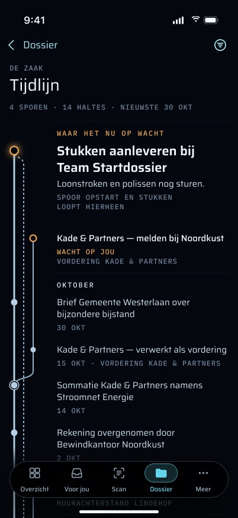

## Doel

- **De hele zaak in één oogopslag zien, op volgorde.** De pagina beantwoordt twee vragen: wat er gebeurde, en wat er nu wacht. De hoofdlijn is hoe de bewindvoering zelf verliep. Een spoor begint wanneer er iets binnenkomt (een brief, een sommatie, een verzoek) en komt ofwel terug op de hoofdlijn of eindigt op zichzelf.
- **Eerst zeggen wat er op Martin wacht.** De ene halte die de server als huidig kiest (`currentStopId`: de bovenste open halte in de eigen volgorde van de kaart, zodat een ongedateerde open halte in de NU-band wint van een gedateerde) wordt als eerste getoond als "WAAR HET NU OP WACHT".
- **Dezelfde zaak tekenen als de website.** Rijen, banen, banden, verbindingen en de huidige halte worden allemaal op de server berekend door `buildTrackMap`. De telefoon leidt er niets van af, dus de telefoon en `/timeline` kunnen het niet oneens zijn over wat het nieuwste is of wat er wacht.
- **Werken aan een balie zonder netwerk.** De laatst opgehaalde kaart blijft op de telefoon en wordt met zijn leeftijd getoond.

## Hoe je er komt, en waar het heen leidt

### Naar binnen

#### Tijdlijn-rij op Dossier

Een rij direct onder de kopkaart van Dossier. Een tik zet `.timeline` op de Dossier-stack (`DossierTab.timelineRow`). De rij in de code luidt "Tijdlijn" / "De zaak, het nieuwste bovenaan". De rij in het ontwerp zegt wat er op de kaart staat: "4 SPOREN · 14 HALTES · NIEUWSTE 30 OKT".

**Status:** Deels gebouwd — de rij en de push bestaan (`apps/ios/Grip/Dossier/DossierTab.swift`); de tellingenregel ontbreekt. Daarvoor zijn nodig: de tellingen uit de gecachte zaakkaart (de cache van `TimelineStore`) of een telling in `GET /dashboard/summary`, de UI, en een test dat de regel met de kaart klopt.

#### De kopkaart van Dossier opent de Tijdlijn

In het ontwerp draagt de kaart "WAAR HET NU OP WACHT" op het Dossier-tabblad "OPENT TIJDLIJN" en een chevron, en een tik opent de Tijdlijn. In de code is het een gewone kaart (`DossierTab.headlineCard`, een `DossierCard`), geen knop.

**Status:** Nog te bouwen — alleen UI: maak de kaart een knop die `.timeline` toevoegt (en, net als bij Overzicht, het blad van de huidige halte opent), met een toegankelijkheidshint.

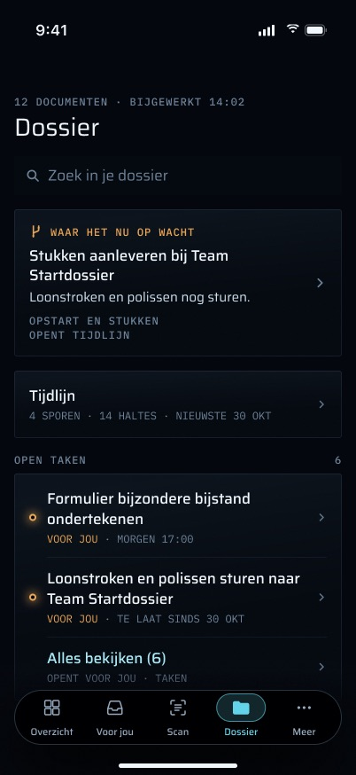

#### De kopkaart van Overzicht opent de Tijdlijn

Een tik op de kaart "Waar het nu op wacht" van Overzicht opent de Tijdlijn (`HomeTab.headlineCard`, toegankelijkheidshint "Opent de tijdlijn"). De kaart wordt alleen getekend zolang ontgrendeld (`lock.revealsCaseContent`), omdat een haltetitel zaakinhoud is. De halte komt uit `GET /api/mobile/v1/dashboard/summary`, dat de ongefilterde `tracks.map()` aanroept, niet uit de zaakkaartroute.

**Status:** Deels gebouwd — de kaart en de tik bestaan (`apps/ios/Grip/Home/HomeTab.swift`, `apps/ios/Grip/App/RootView.swift`). Ontbreekt: het ontwerp zet de Tijdlijn op de **Overzicht**-stack (terugknop "Overzicht", Overzicht-tabblad blijft geselecteerd), terwijl de code de Dossier-stack op `[.timeline]` zet en naar het Dossier-tabblad wisselt. Zie ook de volgende functie.

#### Geopend vanaf Overzicht met het blad van de huidige halte open

Het frame "vanaf Overzicht" in het ontwerp opent de kaart met het blad van de huidige halte al zichtbaar, omdat de tik op de kaart "laat me die halte zien" betekende. Wie het blad sluit, blijft op de kaart, met een terugknop "Overzicht".

**Status:** Nog te bouwen — vraagt een Overzicht-route voor de Tijdlijn (`RootView` heeft daar nu geen Overzicht-stack voor), een manier om "open het blad voor `currentStopId`" door te geven aan `TimelineScreen`, en een test dat het blad opent zodra de kaart (gecacht of opgehaald) die halte heeft.

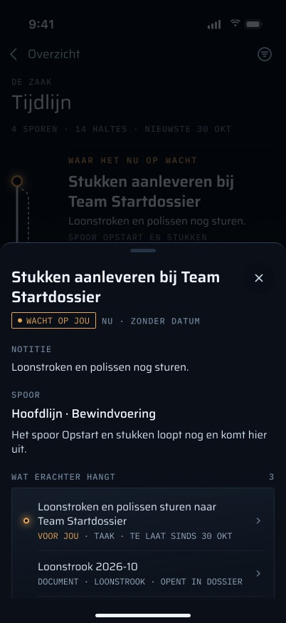

#### Vergrendelde teaser op Overzicht

Zolang vergrendeld toont Overzicht een teaser in plaats van de kopkaart: "Je volgende stap staat op je tijdlijn / Tik en ontgrendel met Face ID om te zien wat het is." met "OPENT TIJDLIJN". Een tik vraagt om Face ID en opent daarna de Tijdlijn. Vóór ontgrendelen wordt geen haltetitel getoond.

**Status:** Nog te bouwen — UI in `HomeTab` (de kaart ontbreekt nu simpelweg zolang vergrendeld), de stroom ontgrendelen-en-openen via het vergrendelmodel, en een test dat er zolang vergrendeld geen titeltekst wordt getekend.

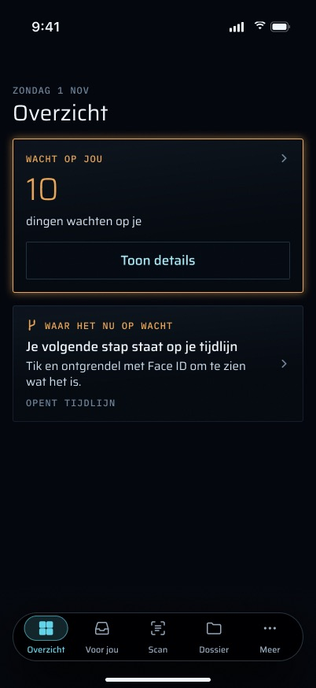

#### Deep link `grip://timeline`

Opent het Dossier-tabblad met `[.timeline]` op de stack (`DeepLink.timeline`). Alleen de kale link wordt herkend: `grip://timeline/x` en `grip://timeline?schuldeisers=verborgen` worden afgewezen (`LinkDestinationTests`). Geen servercode verstuurt deze link nu, en geen push, widget of snelle actie draagt hem, dus in de praktijk wordt hij vanuit de app zelf bereikt. Niets in het ontwerp of de spec vraagt om een afzender.

**Status:** Gebouwd — `apps/ios/Grip/Push/DeepLink.swift`.

#### Fixture-opnames

`-route timeline` opent het scherm in een fixture-opname (`FixtureLaunch`, `apps/ios/scripts/capture.sh`).

**Status:** Gebouwd — `apps/ios/Grip/Fixtures/FixtureLaunch.swift`.

### Naar buiten

#### Naar de taak van een halte, het document van een halte, en terug

- **De taak van een halte** opent `TaskScreen` op de Dossier-stack.
- **Een document van een halte** opent `DocumentViewer` op de Dossier-stack. De push gebeurt pas nadat het blad volledig is gesloten (`pending`-route, `onDismiss`).
- **Terug** keert terug naar de wortel van Dossier.

**Status:** Gebouwd — `apps/ios/Grip/Timeline/TimelineView.swift` (`TimelineScreen`, `TimelineStopSheet`).

## Functies

### De kaart laden

#### De zaakkaart ophalen

- **Het verzoek:** `GET /api/mobile/v1/case-map`, of `GET /api/mobile/v1/case-map?schuldeisers=verborgen` zolang schulden verborgen zijn (`TimelineStore.path`).
- **Wanneer hij wordt gelezen:**
  - wanneer het scherm verschijnt (`.task { await store.load() }`), dat eerst de kopie van de telefoon toont en dan de server vraagt;
  - bij omlaag trekken om te vernieuwen;
  - telkens wanneer de app naar de voorgrond terugkeert terwijl het scherm open is (`scenePhase == .active`).

**Status:** Gebouwd — `apps/ios/Grip/Timeline/TimelineStore.swift`, `TimelineView.swift`.

#### De serverroute

- Het is een `mobileGet`. De sessie wordt gecontroleerd vóór elke routeraanroep, en een verzoek zonder sessie krijgt JSON `401 unauthorized`. Een routerfout wordt beantwoord via `trpcErrorResponse`. Elk antwoord draagt `cache-control: no-store`, zodat de Cloudflare-tunnel geen kopie bewaart.
- Hij roept `caller.tracks.map({ hideDebtEpisodes })` aan, dezelfde tRPC-aanroep die `/timeline` doet. `hideDebtEpisodes` is alleen waar bij `schuldeisers=verborgen`; elke andere waarde geeft de standaardweergave, net als op de website.
- Hij geeft het resultaat door `toCaseMapDTO` (`apps/web/src/lib/mobile-case-map.ts`), dat elk veld met de hand benoemt en nooit een routerrij uitspreidt.
- **Hij is alleen-lezen.** Er wordt niets geschreven, niets toegevoegd en geen ledger-event aangemaakt. Sporen en haltes zijn hoe dan ook geen bewijs: ze zijn een weergavehulp (CLAUDE.md, subproject 6).
- **Wat de DTO bevat:**
  - banden: `nu`, één per maand zoals `2026-10`, of `onbekend`; een stille maand wordt gemarkeerd als `empty`;
  - sporen, met `isRoot`, `status`, `note`, `firstRow`/`lastRow`, `mergesBack` en de eigen `terminus` van de website;
  - haltes, met staat, titel, notitie, ISO-datum, rij, baan, band, de knooppuntvlag en de vlag voor een afwijkende volgorde;
  - het bewijs achter elke halte (een document heeft id, titel en mime, **niet** zijn soort);
  - `edges`, `rowCount`, `laneCount`, `currentStopId`;
  - `problems` (Nederlandse regels);
  - `hiddenDebtTrackCount` en `debtEpisodesHidden`.
- **Bewijs reist als link of als tekst.** Bewijslinks zijn app-routes (`grip://task/<id>`, `grip://document/<id>`). Een logboekregel en een e-mail hebben geen scherm op de telefoon, dus die reizen als tekst. Het Gmail-bericht-id en het id van de raw-email-rij verlaten de server nooit.

**Status:** Gebouwd — `apps/web/src/app/api/mobile/v1/case-map/route.ts`, `apps/web/src/lib/mobile-case-map.ts`, `apps/web/src/lib/mobile-route.ts`.

### De kop

#### Titel en tellingenregel

Het ontwerp geeft het scherm de titel "Tijdlijn" (bovenregel "DE ZAAK") met één uitlezing eronder: "4 SPOREN · 14 HALTES · NIEUWSTE 30 OKT" — hoeveel sporen en haltes de kaart bevat en de datum van de nieuwste gedateerde halte. De code geeft het de titel "De zaak" en toont een inleidende alinea ("Het nieuwste staat bovenaan. De hoofdlijn is …") in plaats van de tellingen.

**Status:** Deels gebouwd — een titel en een uitleg bestaan (`TimelineView.swift`, `TimelineCopy` in `TimelineLayout.swift`). Ontbreekt: de tellingenregel. Alleen UI; elk getal staat in de DTO (sporen die geen wortel zijn, haltes, de nieuwste `happenedAt`). Vraagt een functie in `TimelineCopy` en een test op de fixture ("4 sporen · 14 haltes · nieuwste 30 okt").

#### Actualiteitsregel

Onder de titel, zolang er een kaart getoond wordt, de leeftijd van wat er op het scherm staat: "bijgewerkt 14:02" vandaag, of met de datum op een eerdere dag. Offline krijgt hij het voorvoegsel "offline · " (`DossierCopy.freshness`, Amsterdamse klok). Het ontwerp formuleert het als "OFFLINE · TIJDLIJN VAN 09:20", met het offline-symbool ervoor, en zet het op de plek van de tellingenregel.

**Status:** Deels gebouwd — de leeftijd en het offline-voorvoegsel bestaan (`TimelineView.swift`, `apps/ios/Grip/Dossier/DossierModel.swift`). Ontbreekt: de formulering van het ontwerp ("tijdlijn van …") en het offline-symbool.

#### Inklappende titel

De grote titel klapt in tot in de navigatiebalk ("Tijdlijn", gecentreerd) wanneer de kaart scrolt, zoals de typeschaal van de brief voor elke schermtitel vereist.

**Status:** Deels gebouwd — de code zet een inline navigatietitel "Tijdlijn" en tekent "De zaak" in de scrollinhoud, dus de balk toont altijd "Tijdlijn" en er klapt niets in. Vraagt dat de kop de grote titel wordt en bij scrollen inklapt (UI).

#### Vaste "Waar het nu op wacht"-strook

Zodra de hero uit beeld is gescrold, houdt een strook onder de navigatiebalk hem binnen bereik: een amberen ring, "WAAR HET NU OP WACHT", de titel van de huidige halte en een chevron. Een tik opent het blad van die halte. Bij AX5 wordt de strook ingekort tot "Wacht op jou". Zonder huidige halte is er geen strook.

**Status:** Nog te bouwen — alleen UI (scrollpositie volgen, de strook, de tik), plus een test dat de strook alleen verschijnt zolang de hero buiten beeld is en nooit zonder huidige halte.

### "Waar het nu op wacht"

#### De huidige halte, als eerste gezegd

De halte waarvan het id `currentStopId` is, getoond vóór de rest van de kaart: "WAAR HET NU OP WACHT" in amber, de titel van het spoor (tenzij de halte op de hoofdlijn ligt), de haltetitel en de notitie. Een tik opent het blad van die halte. Zonder huidige halte zegt de code "Er staat op dit moment geen halte open."

- **Hoe de halte wordt gekozen:** door `buildTrackMap` op de server. In de standaardweergave is het dezelfde halte die `loadWaiting` (`packages/api/src/waiting.ts`) meetelt voor Voor jou, de badge en de widget, omdat beide `loadTrackMapRows` lezen. **Met "Schuldeisers verbergen" aan kan hij afwijken:** de kaart wordt opnieuw opgebouwd uit de gefilterde invoer, dus als de bovenste open halte in een verborgen schuldspoor ligt, toont de telefoon de volgende open halte terwijl Voor jou, de badge en Overzicht de verborgen halte nog meetellen (`loadWaiting` filtert nooit). Zie [Verborgen wachttelling](#verborgen-wachttelling-daarin-wacht-n-op-jou), die bestaat om dat te zeggen.

**Status:** Gebouwd — als aparte, opgelichte kaart boven de kaart (`TimelineScreen.headline` in `TimelineView.swift`).

#### De huidige halte als hero van de kaart

In het ontwerp is de huidige halte geen kaart boven de kaart: het is de eerste halte **in** de kaart, in de NU-band, met een grote titel, de notitie en een uitlezing van het spoor dat ernaartoe leidt ("SPOOR OPSTART EN STUKKEN / LOOPT HIERHEEN"). Andere open haltes in NU volgen als gewone rijen ("Kade & Partners — melden bij Noordkust · WACHT OP JOU").

**Status:** Nog te bouwen — UI in `TimelineLayout`/`TimelineMap` (een hero-variant van de rij van de huidige halte, en de regel "loopt hierheen", gelezen uit de verbindingen en het spoor waarvan de open rail erin uitkomt), plus opmaaktests. De aparte kaart verdwijnt zodra dit bestaat.

### De kaart

#### Pure opmaak uit de kaart van de server

`TimelineLayout` neemt de DTO en geeft rijen terug. De weergave tekent ze één op één en beslist niets.

**Status:** Gebouwd — `apps/ios/Grip/Timeline/TimelineLayout.swift`.

#### Maandbanden, stille maanden inbegrepen

Elke band krijgt een kop, het nieuwste eerst, en stille maanden worden meegenomen ("· geen haltes"), omdat een periode waarin niets gebeurde een feit over de zaak is. Binnen een band volgen haltes de `row` van de server. Haltes staan op volgorde, maar niet op schaal.

**Status:** Gebouwd — `TimelineLayout.swift`, `TimelineMap.bandRow` in `TimelineView.swift`.

#### De band "onbekend", altijd als afsluiting van de kaart

Het ontwerp sluit elke kaart af met de band "ONBEKEND", en als geen enkele halte ongedateerd is, zegt hij dat: "ONBEKEND · GEEN HALTES ZONDER DATUM". De server geeft die band alleen mee wanneer er een halte in valt, en noemt hem "Zonder datum" (`packages/api/src/track-map.ts`).

**Status:** Nog te bouwen — ofwel voegt de telefoon een lege afsluitende band toe wanneer de DTO er geen heeft (UI in `TimelineLayout`, met een test), ofwel geeft `toCaseMapDTO` hem altijd mee; en de formulering van het label moet worden afgestemd met "Zonder datum" van de website.

#### Rails, aftakkingen, samenkomsten en omgeleide omwegen

- **Rails worden per rij getekend.** Elke rij tekent haar eigen stuk van de rails over haar eigen hoogte, zodat de stukken op elkaar aansluiten, hoe hoog de rij ook is. Er wordt geen tekst gemeten, en een titel wordt nooit afgekapt (`titleLineLimit = nil`).
- Een aftakking is een boog van de stip van de ouder naar de baan van het spoor. Een samenkomst is een boog van onderaf naar de stip van de ouder. Een aftakking zonder anker wordt horizontaal getekend.
- Wanneer een ander spoor dezelfde baan bezet tussen een spoor en zijn aanleiding, wordt de verbinding **omgeleid** via een omweg een halve baan naar links. Twee sporen delen nooit één lijn.

**Status:** Gebouwd — `TimelineLayout.swift`, `RailGutter` in `TimelineView.swift`; `TimelineLayoutTests`.

#### Vaste baanafstand voor elk aantal banen

- Banen staan op **één vaste afstand** (18 pt), voor elk aantal banen. Boven de vier banen groeit de goot en wijkt de labelkolom.
- De afstand is afgeleid van de markeringsmaten (`TimelineLayout.Marks`), zodat kappen en ringen nooit een naburige rail bedekken.
- De goot is 24 pt plus 18 pt per baan na de eerste (150 pt bij acht banen). `pastFourLanesTheGutterGrowsAndTheLabelsStillHaveRoom` stelt minstens 180 pt voor titels bij acht banen op een iPhone SE van 375 pt, maar meet tegen 375 − 32 pt (alleen de paginamarges). De kaart staat in het kaartje "DE KAART", dat aan elke kant nog 16 pt opvulling heeft, dus op de telefoon is de titelkolom bij acht banen ongeveer 161 pt.

**Status:** Gebouwd — `TimelineLayout.Lanes` en `Marks`; het frame met vier banen in het ontwerp ("vier sporen maattest") komt overeen.

#### Haltemarkeringen

- **Huidige halte:** een gevulde amberen stip met een amberen halo.
- **Elke andere open halte:** een amberen omtrek. Ook dat is werk dat op Martin wacht.
- **Gebeurd:** een gevulde staalkleurige stip.
- **Knooppunt** (waar een spoor vertrekt of terugkomt): een ring in signaalkleur. Die wordt niet op de huidige halte getekend, die al de amberen halo draagt.

**Status:** Gebouwd — `RailGutter` in `TimelineView.swift`.

#### Lijneinden: afgerond, geëindigd, en het begin van een lijn

- **Afgerond spoor:** een dubbele staalkleurige streep boven de nieuwste halte van het spoor. **Geëindigd spoor:** daar in plaats daarvan een enkele gedempte streep. Een spoor dat terugkomt, of nog open is, krijgt aan dat eind geen kap.
- De legenda van het ontwerp voegt "BEGIN OF EINDE VAN EEN LIJN" toe: een streep sluit ook het **oudste** eind van een lijn af, zodat de hoofdlijn eindigt in een streep onder de eerste halte en een geëindigd spoor aan beide einden een streep toont ("Huurachterstand Lindehof").

**Status:** Deels gebouwd — de kappen aan het nieuwste eind bestaan (`TimelineLayout.swift`, `RailGutter`). Ontbreekt: de kap aan het oudste eind van elke lijn (UI in `TimelineLayout`, plus een opmaaktest).

#### Een open spoor getekend als een lijn die doorloopt

Een spoor dat nog open is (terminus `open`) wordt getekend als een gestippelde rail die doorloopt tot waar hij heen leidt, in de legenda aangeduid als "SPOOR LOOPT NOG", zodat "niet af" in de lijn zelf zichtbaar is.

**Status:** Nog te bouwen — alleen UI (`terminus` staat in de DTO): een gestippelde lijn in `RailGutter` voor rails van een open spoor, de legenda-regel, en een opmaaktest.

#### De uitlezing van elke halterij

De code toont per rij: de titel; een metaregel "spoor · datum (of "loopt nu" / "zonder datum") · wacht op jou" ("hoofdlijn" voor de wortel), amber voor een open halte; en voor een halte gemarkeerd met `datesOutOfOrder` "! datum vóór de vorige halte" in amber. De uitlezing in het ontwerp verschilt op drie punten:

- een halte op de hoofdlijn toont alleen haar datum (geen "hoofdlijn");
- de nieuwste halte van een afgerond spoor begint met de uitkomst ("AFGEHANDELD · 1 OKT · HUURACHTERSTAND LINDEHOF");
- de nieuwste halte van een spoor dat terugkomt zegt waar het heen ging ("LAATSTE HALTE · TERUG OP 3 JUN").

**Status:** Deels gebouwd — titel, meta, amber en de volgordevlag bestaan (`TimelineLayout.meta`, `TimelineMap.stopRow`). Ontbreekt: de drie ontwerpvarianten hierboven. Alleen UI (de datum van de samenkomst is de doelhalte van de samenkomstverbinding), plus gevallen in `TimelineLayoutTests`.

#### Een tik op een rij opent het halteblad

Elke rij is één knop van minstens 44 pt.

**Status:** Gebouwd — `TimelineMap.stopRow` in `TimelineView.swift`.

#### VoiceOver per rij

Elke rij wordt als één element voorgelezen: titel, meta, "waar het nu op wacht" voor de huidige halte, en "let op: deze datum ligt vóór de vorige halte" wanneer gemarkeerd. De rails zijn verborgen voor VoiceOver. Bandkoppen hebben de kop-eigenschap. Het ontwerp (de AX5-frames) spelt ook de vorm van de kaart in woorden uit: "Spoor Vordering Kade & Partners splitst hier af.", "Spoor Aanvraag bewindvoering komt hier terug."

**Status:** Deels gebouwd — het rij-element, de volgorde en de kop-eigenschappen bestaan (`TimelineMap.spoken`). Ontbreekt: waar een spoor aftakt of terugkomt, wat een VoiceOver-gebruiker nu helemaal niet kan zien. Alleen UI (uit `edges`), plus een test op `spoken`.

#### Legenda als sleutel aan het eind van de kaart

Het ontwerp sluit de kaart af met een sleutel, één symbool per regel: "GEBEURD", "WACHT OP JOU", "SPLITST AF OF KOMT SAMEN", "SPOOR LOOPT NOG", "BEGIN OF EINDE VAN EEN LIJN", daarna "NIET OP SCHAAL · BINNEN EEN MAAND STAAN HALTES OP GELIJKE AFSTAND". De code heeft één alinea onder de kaart: "Gevuld = gebeurd · amber = wacht op jou · omcirkeld = vertrek- of aankomstpunt van een zijspoor · dubbele streep = spoor afgerond · enkele streep = spoor geëindigd. Binnen een maand staan de haltes op volgorde, niet op schaal."

**Status:** Deels gebouwd — de uitleg bestaat (`TimelineCopy.legend`). Ontbreekt: de sleutelvorm met getekende symbolen, en de regels "spoor loopt nog" en "begin of einde" (die afhangen van de twee functies hierboven).

#### Wat de kaart niet kon tekenen

Als de server tekenproblemen meldde (`problems` van `buildTrackMap`, zoals `halte "…" hoort bij geen enkel spoor`), somt een kaartje "WAT DE KAART NIET KON TEKENEN" ze op. Het kaartje is bewust niet amber: het is een feit over de tekening, geen taak voor Martin. Geen frame toont het; het blijft omdat de website hetzelfde toont.

**Status:** Gebouwd — `TimelineScreen.content` in `TimelineView.swift`.

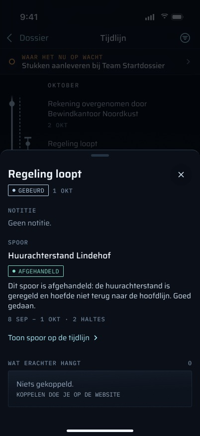

### "Schuldeisers verbergen"

#### Schuldepisodes verbergen

Aan vraagt de store om `?schuldeisers=verborgen`, en de server geeft `hideDebtEpisodes: true` door aan `tracks.map`.

- **Het filter werkt op de INVOER van `buildTrackMap`**, nooit op de gebouwde kaart. Banden, banen en de huidige halte worden daardoor eerlijk opnieuw opgebouwd.
- **Welke sporen als schulden tellen:** `isDebtEpisodeTrack` verbergt elk spoor dat geen wortel is en waarvan de titel begint met "Vordering " of "Vonnis ". Dat is een naamgevingsafspraak, geen schemafeit: een schuldspoor met een andere titel blijft zichtbaar, en elk spoor dat naar dat voorvoegsel wordt hernoemd, wordt verborgen.
- **De aanleiding wordt structureel verborgen.** De aanleidingshalte van elk verborgen spoor op de hoofdlijn wordt verborgen via de `branches_at_stop_id`, nooit door de titel van de halte te matchen. Een schuldspoor met een NULL `branches_at_stop_id` laat zijn aanleiding op de hoofdlijn staan.
- **Verborgen is verborgen, open haltes inbegrepen.** Een open halte binnen een verborgen spoor wordt niet getekend, en de huidige halte wordt zonder haar opnieuw berekend.
- **Elke weergave heeft een eigen kopie.** Elke weergave wordt in een eigen bestand gecacht. Wisselen wist eerst de kaart, toont de gecachte kopie van die weergave als die er is, en vernieuwt daarna. Een antwoord dat binnenkomt nadat er opnieuw is gewisseld, wordt weggegooid.

**Status:** Gebouwd — `TimelineStore.setHideDebts`, `packages/api/src/track-map.ts` (`filterDebtEpisodes`, `isDebtEpisodeTrack`); `TimelineStoreTests`, `route.test.ts`.

#### Filtermenu in de navigatiebalk

Het ontwerp zet de keuze achter een filterknop in de navigatiebalk. Die opent een menu: "Alle sporen" / "Schuldeisers verbergen" (met een doorgestreept-oogsymbool), een vinkje bij de actieve keuze, en de uitleg "Verbergt de vorderingen en de brieven waarmee ze begonnen. Wacht daar iets op jou, dan zie je dat bovenaan." De knop wordt gevuld getekend zolang er een filter aan staat. De code heeft in plaats daarvan een schakelaar in de kop.

**Status:** Nog te bouwen — alleen UI: een `Menu` in de werkbalk, gekoppeld aan `store.setHideDebts`, de gevulde staat, en het verwijderen van de schakelaar in de kop.

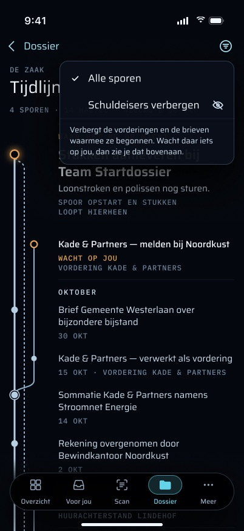

#### Verborgen aantal hardop gezegd

Er verdwijnt niets stilletjes: zolang het filter aan staat, zegt het scherm "1 spoor verborgen" of "N sporen verborgen". Het ontwerp zet het op de plek van de tellingenregel ("1 SPOOR VERBORGEN").

**Status:** Gebouwd — `TimelineCopy.hiddenCount`, onder de schakelaar in `TimelineView.swift` (het verhuist naar de tellingenregel bij het herontwerp van de kop).

#### Verborgen wachttelling ("daarin wacht N op jou")

Met schulden verborgen zegt het scherm ook of er binnen de verborgen sporen iets op Martin wacht: "1 SPOOR VERBORGEN · DAARIN WACHT 1 OP JOU", de tweede helft in amber. Dit is wat de belofte in het filtermenu nakomt ("Wacht daar iets op jou, dan zie je dat bovenaan"), en wat de Tijdlijn in overeenstemming brengt met Voor jou en de badge, die nooit filteren.

**Status:** Nog te bouwen — server: `toCaseMapDTO` (of `tracks.map`) voegt een telling toe van open haltes in de verborgen sporen, gelezen uit de ongefilterde rijen; iOS: het veld in `CaseMapDTO` en de regel; tests in `route.test.ts` / `mobile-case-map.test.ts` en de fixture `case-map~schuldeisers=verborgen.json`.

#### "Toon alle sporen"

Zolang er een filter aan staat, zet een link "Toon alle sporen" naast de titel het met één tik uit.

**Status:** Nog te bouwen — alleen UI (`store.setHideDebts(false)`).

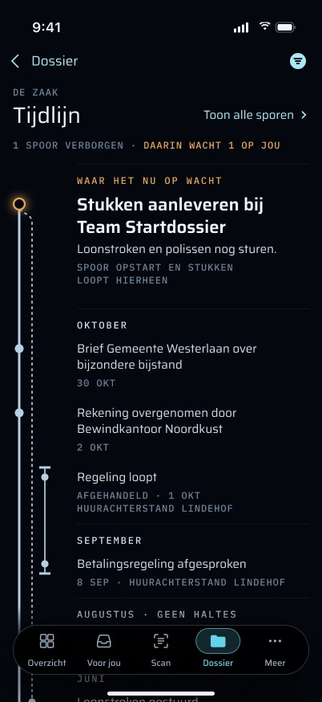

### Het halteblad

#### Het blad

Het blad opent op halve hoogte en kan naar volle hoogte worden gesleept. Rechtsboven zit een sluitknop ("Sluiten" in de code, een ✕ in het ontwerp).

**Status:** Gebouwd — `TimelineStopSheet` in `TimelineView.swift`.

#### Titel, staat en datum

De haltetitel; de staat ("wacht op jou" of "gebeurd") met de datum, of "loopt nu" / "zonder datum" ("NU · ZONDER DATUM" in het ontwerp); "waar het nu op wacht" als dit de huidige halte is. De regel is amber voor een open halte. Het ontwerp tekent de staat als badge.

**Status:** Gebouwd — `TimelineStopSheet.top` / `whenLine`.

#### De notitie

De notitie van de halte onder een label "NOTITIE". Zonder notitie zegt het ontwerp "Geen notitie."; de code laat het onderdeel weg.

**Status:** Deels gebouwd — de notitie verschijnt als er een is. Ontbreekt: het label en "Geen notitie." (UI).

#### Melding bij een afwijkende volgorde

Voor een halte die als afwijkend van volgorde is gemarkeerd, in amber: "De datum van deze halte ligt vóór de halte ervoor. De kaart tekent de volgorde zoals hij is ingevoerd — meestal betekent dit dat deze halte op een ander spoor thuishoort." De correctie gebeurt op de website.

**Status:** Gebouwd — `TimelineCopy.outOfOrder`, `TimelineStopSheet`.

#### Het spoor en hoe het afliep

De bovenste regel in de code noemt het spoor ("Hoofdlijn" voor de wortel, anders de titel), hoe het eindigt ("hoofdlijn" / "komt terug op de hoofdlijn" / "eindigt op zichzelf") en de status ("loopt nog" / "afgerond" / "geëindigd"). Alles behalve een getekende samenkomst leest als "eindigt op zichzelf", dus een spoor dat nog open is leest als "eindigt op zichzelf · loopt nog". "Geëindigd" is een schone uitkomst en wordt nooit als mislukking geformuleerd of gekleurd.

Het ontwerp geeft het spoor een eigen onderdeel ("SPOOR"): de naam van het spoor ("Hoofdlijn · Bewindvoering" op de wortel, met de eigen titel van het wortelspoor), een uitkomstbadge ("TERUG OP DE HOOFDLIJN", "AFGEHANDELD"), en één zin die de uitkomst in de termen van de zaak uitlegt: "Dit spoor kwam terug op de hoofdlijn bij de beschikking van 3 juni. Het was nodig om onder bewind te komen." of "Dit spoor is afgehandeld: de huurachterstand is geregeld en hoefde niet terug naar de hoofdlijn. Goed gedaan."

**Status:** Deels gebouwd — naam, terminus en status bestaan (`TimelineCopy.terminus`, `trackStatus`). Ontbreekt: de titel van het wortelspoor, de badge, de zin die de samenkomsthalte en haar datum noemt (uit de samenkomstverbinding), de eigen notitie van het spoor (`Track.note` staat in de DTO en wordt niet gebruikt), en het afsluitende "Goed gedaan." bij een afgerond spoor. UI en tests van `TimelineCopy`; geen serverwijziging.

#### Sporen die bij deze halte beginnen of aankomen

Op een knooppunthalte zegt het blad welke sporen hier vertrekken of aankomen en of ze nog lopen: "Het spoor Opstart en stukken loopt nog en komt hier uit."

**Status:** Nog te bouwen — alleen UI (uit `edges` en de `status` van elk spoor), plus een test van `TimelineCopy`.

#### De looptijd van het spoor

Onder de zin over het spoor, de looptijd: "12 MEI – 3 JUN · 2 HALTES".

**Status:** Nog te bouwen — alleen UI (de oudste en nieuwste gedateerde halte op het spoor, en het aantal haltes), plus een test; ongedateerde haltes mogen geen einddatum verzinnen.

#### "Toon spoor op de tijdlijn"

Een link die het blad sluit en dat spoor op de kaart toont: scrolt ernaartoe en licht het uit.

**Status:** Nog te bouwen — UI (een `ScrollViewReader`-doel per halte, een uitlichtstaat voor de baan van één spoor) en een test dat de juiste rijen worden getroffen.

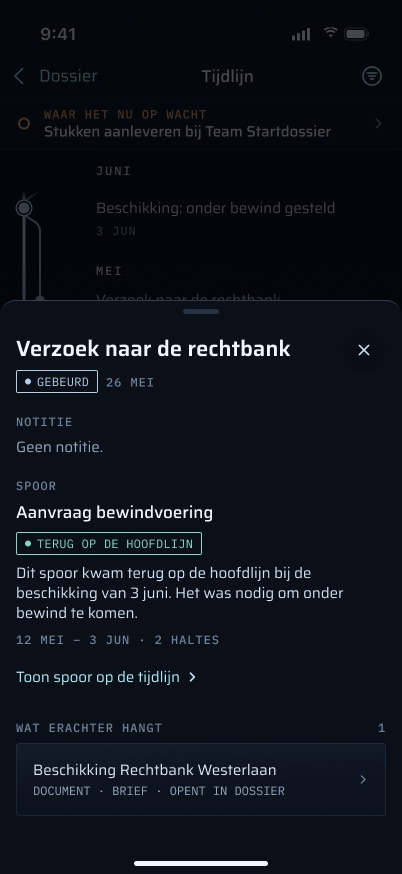

#### Wat er achter de halte hangt

Wat er werkelijk achter de halte zit, live gelezen door `track-evidence.ts` op de server. Elke rij toont de eigen titel van het item boven een regel:

- **De taak:** "taak · <status> · uiterlijk <datum>". Opent `TaskScreen`.
- **Elk document:** "bestand". Opent `DocumentViewer`, dat de kopie uit het zakdossier gebruikt als de telefoon die heeft, en anders het bestand voor die ene keer bekijken ophaalt.
- **De logboekregel:** "logboek · <datum>". Alleen tekst.
- **De e-mail:** "e-mail · van <adres> · <datum>". Alleen tekst.
- Een link die de server stuurt, wordt gelezen via `DeepLink.parse`. Een link die niet als taak of document wordt herkend, wordt als gewone tekst getoond.

Het ontwerp noemt het onderdeel "WAT ERACHTER HANGT", met het aantal items ernaast ("3").

**Status:** Gebouwd — `TimelineStopSheet.evidence` (label "ACHTER DEZE HALTE", geen aantal; het aantal is alleen UI).

#### Een taak die op Martin wacht, en een die te laat is

Het ontwerp markeert een gekoppelde taak die op Martin wacht met een amberen stip en "VOOR JOU", en zegt wanneer hij over tijd is: "VOOR JOU · TAAK · TE LAAT SINDS 30 OKT".

**Status:** Deels gebouwd — de status en de uiterste datum van de taak worden getoond. Ontbreekt: de markering "voor jou" voor een open of lopende taak en de formulering "te laat sinds <datum>" wanneer `dueAt` voorbij is (Overzicht zegt al "te laat" in `HomeSummary.swift`). Alleen UI; `dueAt` staat in de DTO.

#### De soort van een document

Het ontwerp noemt wat een document is: "DOCUMENT · LOONSTROOK", "DOCUMENT · BRIEF".

**Status:** Nog te bouwen — server: `track-evidence.ts`/`toCaseMapDTO` moet de effectieve soort van het document toevoegen (`effectiveDocTypeSql`, nooit de ruwe `documents.doc_type`, die na een wijziging van soort verouderd is); iOS: het veld in `CaseMapDTO` en de regel; tests in `mobile-case-map.test.ts` en de fixture-JSON.

#### Offline beschikbaarheid per document

Elk document zegt waar het zal openen: "OPENT IN DOSSIER" online, "OP JE TELEFOON" wanneer het zakdossier het heeft, "OPENT MET VERBINDING" offline wanneer dat niet zo is. Een document dat niet kan openen is geen link, en eronder zegt het blad dat: "Polis Duinzorg 2026 staat niet op je telefoon. Hij opent zodra je weer verbinding hebt." Offline luidt de datumregel van het blad "OFFLINE · VAN 09:20". Nu opent een document dat de telefoon niet heeft offline de viewer en mislukt het pas daar met "Dit document staat nog niet op je telefoon, en er is geen verbinding."

**Status:** Nog te bouwen — UI die `DossierStore.fileURL(_:)` leest (bestaat al, `apps/ios/Grip/Dossier/DossierStore.swift`) en de offline-staat van de store; de melding; een test dat een document dat de telefoon niet heeft offline niet aantikbaar is.

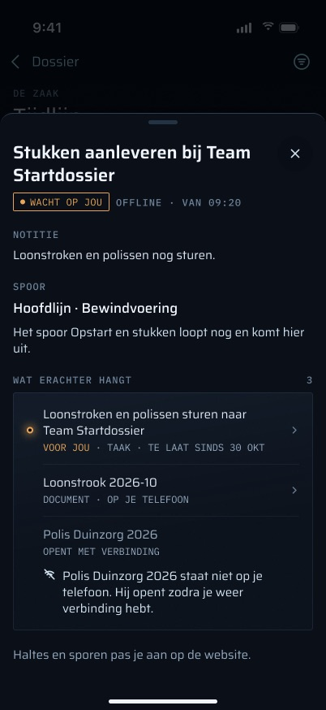

#### Nog niets gekoppeld

Wanneer er niets achter de halte zit, zegt de code "Nog niets achter deze halte. Zodra er een mail, een taak of een document aan hangt, staat het hier." Het ontwerp zegt "Niets gekoppeld." met "KOPPELEN DOE JE OP DE WEBSITE", en toont het aantal "0".

**Status:** Deels gebouwd — de lege staat bestaat (`TimelineCopy.nothingBehind`); de formulering van het ontwerp ontbreekt.

#### Bewerken gebeurt op de website

Het blad eindigt met "Haltes en sporen pas je aan op de website.", zodat een alleen-lezen scherm zegt waar de wijziging wordt gemaakt. Het blad heeft geen knoppen die iets veranderen.

**Status:** Deels gebouwd — het blad is alleen-lezen (`TimelineStopSheet` heeft geen acties). Ontbreekt: de slotregel (UI).

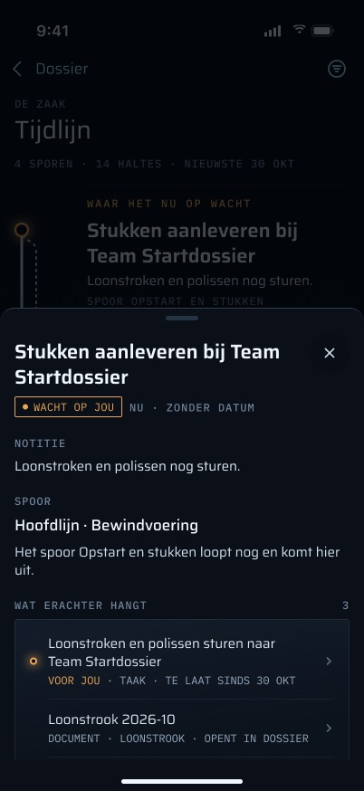

## Staten

`TimelineStore.screen` bepaalt de staat, en de weergave tekent hem alleen.

#### Laden

Nog niets bekend en een verzoek onderweg (ook terwijl een nieuwe poging loopt). De code toont "DE KAART" met skeletregels. Het skelet in het ontwerp heeft de vorm van de kaart: spookrails en -stippen in de goot, plaatshoudertitels en -metaregels ernaast, zoals de brief vereist ("a skeleton in the shape of the real content").

**Status:** Deels gebouwd — een skelet, nooit een spinner (`TimelineScreen.content`, `SkeletonLines`). Ontbreekt: het kaartvormige skelet met spookrails (UI).

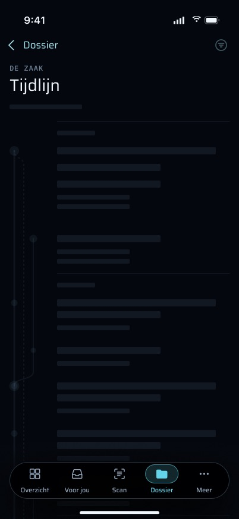

#### Kaart

De kaart van de server of de gecachte kaart, zoals hierboven beschreven.

**Status:** Gebouwd — `TimelineScreen.content`.

#### Leeg

De kaart op het scherm (opgehaald of gecacht) heeft geen haltes. De code toont de kaart "WAAR HET NU OP WACHT" met "Er staat op dit moment geen halte open." en "Er staat nog niets op de kaart. Zodra er een halte is, staat hij hier." Het lege scherm in het ontwerp houdt de tellingenregel ("0 SPOREN · 0 HALTES"), tekent een eenzame NU-halte en zegt waarom en wat nu: "Nog geen sporen op je tijdlijn / Hier zie je straks je zaak van nu naar vroeger: wat er gebeurde en wat er op je wacht. Sporen en haltes maak je op de website. / Wat nu op je wacht, staat in Voor jou." met een link "Open Voor jou".

**Status:** Deels gebouwd — de lege staat bestaat (`TimelineStore.screen == .empty`). Ontbreekt: de formulering van het ontwerp en de link "Open Voor jou" (UI: naar het tabblad Voor jou wisselen), zonder welke het scherm in de zin van de brief doodloopt.

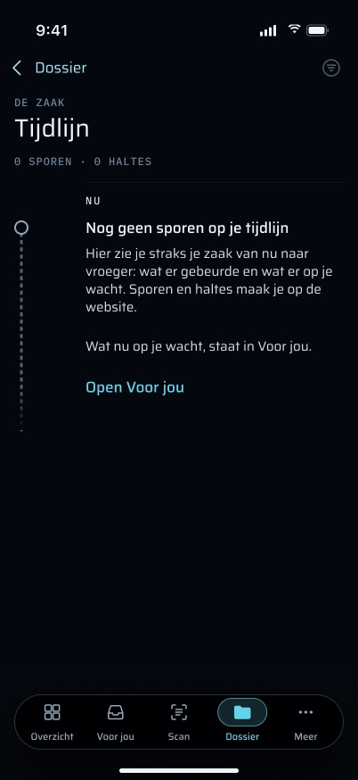

#### Offline, een kopie op de telefoon

De kopie wordt getoond met haar leeftijd, gemarkeerd als offline. Elke functie werkt, behalve verse gegevens. Documentlinks gedragen zich zoals beschreven onder [Offline beschikbaarheid per document](#offline-beschikbaarheid-per-document).

**Status:** Gebouwd — `TimelineStore` (een transportfout houdt de kopie), `TimelineStoreTests`.

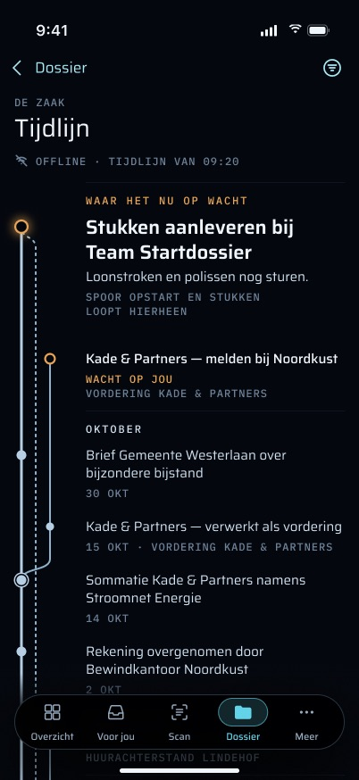

#### Offline, niets gecacht

"Geen verbinding — de tijdlijn staat nog niet op je telefoon." met "Opnieuw proberen". Geen frame toont deze staat.

**Status:** Gebouwd — `TimelineScreen.content` (`.offlineNothingCached`).

#### Serverfout terwijl er al een kaart getoond wordt

De kaart blijft, en de kop voegt toe: "Dat lukte niet. Probeer het over een moment opnieuw."

**Status:** Gebouwd — `TimelineScreen.header`.

#### Serverfout zonder iets om te tonen

De code toont dezelfde zin in het kaartje van de kaart, met "Opnieuw proberen". Het ontwerp benoemt de fout en het tijdstip en zegt wat nog wel werkt: "NIET GELADEN · 14:05", een waarschuwingssymbool, "De tijdlijn kon niet laden / De server reageert even niet. Probeer het zo opnieuw. Wat al op je telefoon staat, kun je in je dossier en Voor jou gewoon bekijken." en een "Opnieuw proberen" over de volle breedte.

**Status:** Deels gebouwd — de fout en de nieuwe poging bestaan (`TimelineScreen.content`, `.failed`). Ontbreekt: het tijdstip van de fout (de store moet onthouden wanneer het mislukte), de titel en de geruststellende regel (UI, `TimelineCopy`).

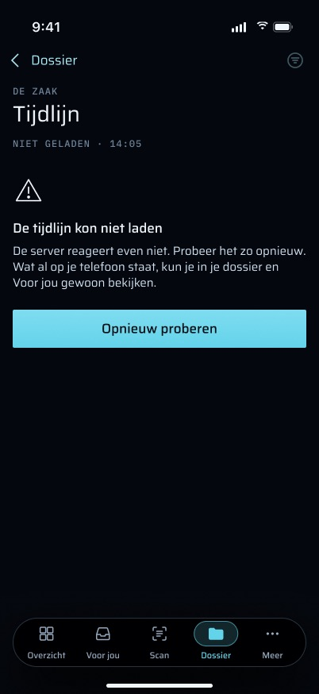

#### Sessie verlopen (401)

De store roept `auth.sessionRejected()` aan. De sessie eindigt, het inlogscherm toont "Je sessie is verlopen." (als de app ingelogd was), en de kaart en het bestand op schijf worden vergeten. Een antwoord dat binnenkomt nadat de sessie is beëindigd, een 401 inbegrepen, wordt weggegooid.

**Status:** Gebouwd — `TimelineStore.swift`; `TimelineStoreTests`.

#### Vergrendeld

De Tijdlijn staat op de Dossier-stack, die achter de vergrendeling zit. Zolang vergrendeld bestaat de inhoud helemaal niet. `LockView` vervangt haar, het is geen overlay, dus er laadt niets en er bereikt niets VoiceOver achter de vergrendeling.

**Status:** Gebouwd — de vergrendelpoort van Dossier (`apps/ios/Grip/App/RootView.swift`). Als de Tijdlijn naar de Overzicht-stack verhuist (zie hierboven), moet hij daar achter dezelfde poort blijven, omdat Overzicht zelf open is zolang vergrendeld.

#### Grote tekst

Alle tekst schaalt mee met Dynamic Type (`.display(…, relativeTo:)`, `.mono(…, relativeTo:)`). Rijen groeien met hun tekst en de rails volgen, omdat elke rij haar eigen hoogte tekent. De hoogte van de stip is een `@ScaledMetric`, zodat hij gelijk blijft met de eerste regel van de titel.

**Status:** Gebouwd — `TimelineView.swift` (`RailGutter.dotY`).

#### AX5-opmaak

Bij de toegankelijkheidsgroottes verandert het ontwerp de opmaak, niet alleen de tekst: de kaart klapt in tot de ene rail van de hoofdlijn, de relatie van elk spoor wordt onder de halte uitgeschreven in plaats van getekend ("Spoor Vordering Kade & Partners splitst hier af.", "Spoor Aanvraag bewindvoering komt hier terug.", "Laatste halte …"), de tellingenregel stapelt één getal per regel, de vaste strook wordt ingekort tot "Wacht op jou", en in het halteblad stapelen de metagegevens verticaal (badge "Wacht op jou" boven "NU · ZONDER DATUM").

**Status:** Nog te bouwen — UI (een AX-tak op `dynamicTypeSize.isAccessibilitySize` in `TimelineMap` en het blad), de relatiezinnen in `TimelineCopy` (gedeeld met het VoiceOver-label hierboven), en opmaaktests bij AX5.

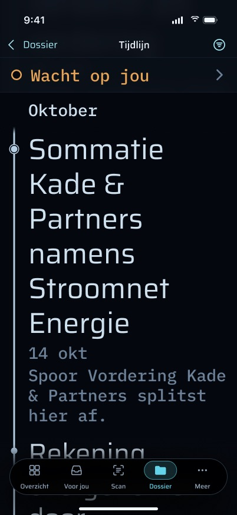

#### Kleine telefoon (iPhone SE)

Dezelfde opmaak. Bij acht banen is de titelkolom ongeveer 161 pt binnen het kaartje van de kaart (de 180 pt van de test negeert de opvulling van het kaartje; zie "Vaste baanafstand").

**Status:** Gebouwd — `TimelineLayout.Lanes`; het SE-frame in het ontwerp komt overeen met de opmaak van de code bij 375 pt.

#### Snelheid

De lat uit de brief: een eerste betekenisvol beeld (gecachte kaart of skelet) binnen 100 ms nadat het scherm verschijnt, gecachte inhoud binnen 300 ms, daarna ter plekke vernieuwd.

**Status:** Deels gebouwd — eerst de kopie, dan de server, is gebouwd (`TimelineStore.load`). Ontbreekt: een meting op het toestel tegen beide grenzen, en tegen de kaart in productie (zie Bekende beperkingen).

## Privacy en beveiliging

#### Achter Face ID

De Tijdlijn zit achter de vergrendeling van Dossier en opent pas na Face ID. Face ID wordt één keer gevraagd bij openen of heropenen, niet per scherm. Overzicht is open zolang vergrendeld, maar toont alleen tellingen en geld, dus de kopkaart, de ingang, wordt pas na ontgrendelen getekend. Niets op het vergrendelscherm of in widgets komt van dit scherm: de regel "waar het nu op wacht" van de widget komt uit de snapshot van de dashboardsamenvatting, niet uit de zaakkaart (zie `../02-overzicht/FEATURES.md`).

**Status:** Gebouwd — `apps/ios/Grip/App/RootView.swift`, `HomeTab.headlineCard` (`lock.revealsCaseContent`).

#### Wat er op de telefoon wordt bewaard

- **Waar:** één JSON-bestand per weergave, `case-map.json` of `case-map-verborgen.json`, in `Application Support/timeline`. Nooit in de App Group, omdat geen extensie het leest.
- **Hoe het wordt geschreven:** `[.atomic, .completeFileProtection]`, dus het is onleesbaar zolang de telefoon vergrendeld is. Een lezing die dan mislukt, telt als niets gecacht.
- **Back-ups:** de map is uitgesloten van back-ups. Hij wordt opnieuw opgebouwd vanaf de server, en een back-up zou de zaak naar iCloud meenemen.

**Status:** Gebouwd — `TimelineCache` in `TimelineStore.swift`; `TimelineStoreTests`.

#### Wat er wordt gewist

Uitloggen en een afgewezen sessie beëindigen allebei de gedeelde `SessionEpoch`, en de private `forget()` van de store (geregistreerd bij `epoch.whenEnded`) wist de kaart in het geheugen en verwijdert de hele map `timeline`. Het zakdossier wordt gewist door hetzelfde einde van de epoch, en de widgetsnapshot wordt tegelijk gewist.

**Status:** Gebouwd — `TimelineStore.forget`; `TimelineStoreTests`.

## Regels die het volgt

- **Amber alleen voor wat op Martin wacht.** Amber markeert alleen open haltes, en volgens de case-history-regel is elke open halte werk dat op Martin wacht. Gebeurde haltes zijn staalkleurig. Een geëindigd spoor krijgt een gewone kap en wordt nooit in een foutkleur getoond. Het problemenkaartje is niet amber. De verborgen wachttelling wordt, zodra gebouwd, om dezelfde reden amber.
- **Eén definitie van de huidige halte.** De server kiest haar, en Voor jou, de badge en Overzicht gebruiken dezelfde, in de standaardweergave. Met schulden verborgen berekent de kaart op de telefoon haar opnieuw uit de gefilterde invoer, dus de twee kunnen verschillen; de verborgen wachttelling is hoe het scherm dat gaat zeggen.
- **Geen verzonnen datums.** Een ongedateerde halte zegt "loopt nu" (in NU) of "zonder datum", nooit een geraden datum. Een datum die de halte ervoor tegenspreekt, wordt gemarkeerd, nooit stilletjes herordend. De looptijd van een spoor gebruikt alleen gedateerde haltes.
- **Nooit alleen kleur.** Elke amberen markering draagt ook woorden ("wacht op jou"), zoals de brief vereist.
- **Alleen-lezen.** De telefoon schrijft niets en voegt geen ledger-event toe. Regels over versturen, AI-suggesties en archiveren zijn hier niet van toepassing.

## Meldingen en haptiek

#### Geen haptiek

De haptiekkaart van de brief noemt geen moment op dit scherm: er wordt hier niets goedgekeurd, verstuurd, beantwoord of bevestigd, dus het speelt niets af. De code heeft hier geen `sensoryFeedback`.

**Status:** Gebouwd — bewust zo; `TimelineView.swift` heeft geen haptiek.

#### Geen melding opent het

Geen push, widget of snelle actie verstuurt `grip://timeline`, en noch het ontwerp noch de spec vraagt erom. Een halte wordt bereikt via de tellingen die ernaar wijzen (Overzicht, Dossier, Voor jou).

**Status:** Gebouwd — bewust zo; de link bestaat (`DeepLink.swift`) voor wanneer er een afzender gewenst is.

## Offline gedrag en synchronisatie

- **Eerst de kopie, dan de server.** De kopie van de telefoon wordt eerst getoond en daarna vervangen door het antwoord van de server.
- **Transportfouten:** met een kopie blijft de kopie staan, gemarkeerd als offline; zonder kopie de staat "niets gecacht".
- **Er is geen achtergrondsynchronisatie.** De kaart wordt alleen opgehaald zolang het scherm open is: bij verschijnen, bij omlaag trekken en bij terugkeer naar de voorgrond. Noch de spec noch het ontwerp vraagt om meer.
- **Elke weergave cachet apart.** De weergave "Schuldeisers verbergen" houdt een eigen kopie, dus wie offline gaat na slechts één van de twee te hebben bekeken, heeft de andere niet gecacht.

(Dit alles valt onder [De zaakkaart ophalen](#de-zaakkaart-ophalen) en de offline-functies hierboven; de statussen staan daar.)

## Bekende beperkingen en wat niet gemeten is

- **Niet gemeten tegen productie:** de telefoon is niet gecontroleerd tegen de echte kaart in productie (41 haltes). De onderste helft van de kaart is alleen gecontroleerd in het eerste scherm van de simulator (plan 3, "Added 2026-11-03").
- **Niet gemeten op het toestel:** de snelheidsgrenzen uit de brief (zie [Snelheid](#snelheid)).
- **Geen manier om te bewerken.** Bewust zo: haltes en sporen worden op de website bewerkt.

## Waar in de code

**iOS (`apps/ios/`):**

- `Grip/Timeline/TimelineView.swift`: `TimelineScreen` (kop, staten, kopkaart, legenda, problemen), `TimelineMap`, `RailGutter` (het tekenen) en `TimelineStopSheet`.
- `Grip/Timeline/TimelineLayout.swift`: `TimelineCopy` (elke tekst) en de pure `TimelineLayout` (items, banen, rails, bogen, omwegen, kappen, markeringen).
- `Grip/Timeline/TimelineStore.swift`: `TimelineStore` (ophalen, schermstaat, filter, sessie-epoch) en `TimelineCache`.
- `Grip/Timeline/CaseMapDTO.swift`: het draadformaat.
- `Grip/Dossier/DossierTab.swift` (de Tijdlijn-rij, de route `.timeline`, de kopkaart), `Grip/Dossier/DossierModel.swift` (`DossierRoute.timeline`, `DossierCopy.freshness`), `Grip/Dossier/DossierStore.swift` (`fileURL(_:)`, dat de offline beschikbaarheid per document gaat lezen).
- `Grip/Home/HomeTab.swift` (kopkaart, `openTimeline`), `Grip/App/RootView.swift` (tabbladwissel), `Grip/App/GripApp.swift`, `Grip/App/AppServices.swift` (store en cachemap).
- `Grip/Push/DeepLink.swift` (`grip://timeline`), `Grip/Fixtures/FixtureLaunch.swift` (`-route timeline`), `Grip/FixtureData/timeline/fixture.json`, `Grip/FixtureData/_shared/case-map.json`, `Grip/FixtureData/_shared/case-map~schuldeisers=verborgen.json`, `Grip/FixtureData/empty/case-map.json`.

**Server:**

- `apps/web/src/app/api/mobile/v1/case-map/route.ts`: de route.
- `apps/web/src/lib/mobile-case-map.ts`: `toCaseMapDTO` (waar de verborgen wachttelling en de soort van het document worden toegevoegd).
- `apps/web/src/lib/mobile-route.ts`: `mobileGet`.
- `packages/api/src/routers/tracks.ts` (`tracks.map`, `loadTrackMapRows`), `packages/api/src/track-map.ts` (`buildTrackMap`, `filterDebtEpisodes`, `isDebtEpisodeTrack`), `packages/api/src/track-evidence.ts`, `packages/api/src/waiting.ts`, `packages/api/src/effective-status.ts` (`effectiveDocTypeSql`).
- `apps/web/src/lib/track-marks.ts` (`trackTerminus`, de `merge` / `done` / `ended` / `open` van de website).

**Tests:**

- `apps/ios/GripTests/TimelineLayoutTests.swift` (bandvolgorde, baanafstand bij 4–8 banen, aftakkingen, samenkomsten, omgeleide omwegen, amber alleen op open haltes, kappen bij geëindigd, titels nooit afgekapt, de fixture wordt zonder gaten opgemaakt).
- `apps/ios/GripTests/TimelineStoreTests.swift` (cache met volledige bescherming, offline met leeftijd, niets gecacht, fouten, 401, het filter apart gecacht, het einde van de sessie wist kaart en cache, late antwoorden weggegooid).
- `apps/ios/GripTests/LinkDestinationTests.swift`, `apps/ios/GripTests/FixtureTests.swift`, en de door de builder gemaakte opmaakfixtures `apps/ios/GripTests/Fixtures/case-map-concurrent.json` en `case-map-lane-shared-*.json`.
- `apps/web/src/app/api/mobile/v1/case-map/route.test.ts` (401 vóór elke routeraanroep, `no-store`, het filter, met de hand gevormde DTO).
- `apps/web/src/lib/mobile-case-map.test.ts`, `apps/web/src/lib/mobile-case-map.fixture.test.ts` (de fixture-JSON is de echte DTO over de synthetische zaak; gelijktijdige sporen en sporen die een baan delen).

## Frames

Alle 24 frames in `frames/`, van links naar rechts zoals in de Figma-sectie. "Code" zegt hoe ver de huidige code overeenkomt.

| Frame | Wat het toont | Code |
|---|---|---|
| [Tijdlijn_normaal](frames/Tijdlijn_normaal.jpg) | De kaart bovenaan: tellingenregel, hero in de kaart bij NU, een open halte op Kade & Partners, oktober | Kaart en markeringen komen overeen; kop, tellingenregel, hero in de kaart en gestippeld open spoor wijken af |
| [Tijdlijn_filtermenu](frames/Tijdlijn_filtermenu.jpg) | Het filtermenu: "Alle sporen" / "Schuldeisers verbergen" met de uitleg | Niet gebouwd (in plaats daarvan een schakelaar in de kop) |
| [Tijdlijn_schuldeisers_verborgen](frames/Tijdlijn_schuldeisers_verborgen.jpg) | Schulden verborgen: "1 SPOOR VERBORGEN · DAARIN WACHT 1 OP JOU", "Toon alle sporen", stille maanden | Filter werkt; alleen "1 spoor verborgen" wordt gezegd |
| [Tijdlijn_halte_geopend](frames/Tijdlijn_halte_geopend.jpg) | Het blad van de huidige halte: badge, notitie, spoor, wat erachter hangt, een te late taak, de soort van een document | Blad bestaat; eenvoudiger; geen soort, geen "te laat" |
| [Tijdlijn_halte_geopend_offline](frames/Tijdlijn_halte_geopend_offline.jpg) | Hetzelfde blad offline, beschikbaarheid per document, de slotregel over de website | Beschikbaarheid per document en slotregel niet gebouwd |
| [Tijdlijn_spoor_samengekomen](frames/Tijdlijn_spoor_samengekomen.jpg) | Een halte op een spoor dat terugkwam ("TERUG OP DE HOOFDLIJN"), looptijd, "Toon spoor op de tijdlijn", vaste strook | Blad zegt "komt terug op de hoofdlijn"; geen badge, zin, looptijd, link of strook |
| [Tijdlijn_spoor_ge_indigd](frames/Tijdlijn_spoor_ge_indigd.jpg) | Een halte op een afgerond spoor ("AFGEHANDELD"), niets gekoppeld | Blad zegt "afgerond"; tekst bij leeg bewijs wijkt af |
| [Tijdlijn_einde](frames/Tijdlijn_einde.jpg) | Onderkant van de kaart: oudste haltes, "laatste halte · terug op 3 jun", band "onbekend", legenda als sleutel, beginkap | Legenda is een alinea; geen beginkap, geen afsluitende band "onbekend" |
| [Tijdlijn_laden](frames/Tijdlijn_laden.jpg) | Laadskelet met spookrails | Skeletregels in een kaartje |
| [Tijdlijn_leeg](frames/Tijdlijn_leeg.jpg) | Nog geen sporen, "Open Voor jou" | Andere tekst, geen link |
| [Tijdlijn_offline](frames/Tijdlijn_offline.jpg) | Offline met een kopie: "OFFLINE · TIJDLIJN VAN 09:20" | Werkt; leest "offline · bijgewerkt 09:20" |
| [Tijdlijn_fout](frames/Tijdlijn_fout.jpg) | Kon niet laden, niets gecacht: "NIET GELADEN · 14:05" | Eenvoudiger foutkaartje met "Opnieuw proberen" |
| [Tijdlijn_iPhone_SE](frames/Tijdlijn_iPhone_SE.jpg) | De normale staat op een telefoon van 375 × 667 | Zelfde opmaak als die van de code bij 375 pt |
| [Tijdlijn_AX5_bovenaan](frames/Tijdlijn_AX5_bovenaan.jpg) | Grootste toegankelijkheidstekst, bovenkant van de kaart, tellingen gestapeld | Tekst schaalt; geen AX-opmaak |
| [Tijdlijn_AX5_oktober](frames/Tijdlijn_AX5_oktober.jpg) | AX5 gescrold naar oktober, strook "Wacht op jou", uitgeschreven uitlezingen | Niet gebouwd |
| [Tijdlijn_AX5_mei](frames/Tijdlijn_AX5_mei.jpg) | AX5 bij mei: een spoor komt terug en een ander takt af | Niet gebouwd |
| [Tijdlijn_halte_geopend_AX5](frames/Tijdlijn_halte_geopend_AX5.jpg) | Het blad van de huidige halte bij AX5, metagegevens gestapeld | Blad schaalt; geen AX-opmaak |
| [Tijdlijn_vier_sporen_maattest](frames/Tijdlijn_vier_sporen_maattest.jpg) | Vier banen tegelijk, rails en kappen vrij van elkaar | Komt overeen met de opmaak met vaste afstand |
| [Tijdlijn_vanaf_Overzicht](frames/Tijdlijn_vanaf_Overzicht.jpg) | Geopend vanaf Overzicht met het blad van de huidige halte open | Code opent op Dossier, zonder blad |
| [Tijdlijn_vanaf_Overzicht_blad_dicht](frames/Tijdlijn_vanaf_Overzicht_blad_dicht.jpg) | Hetzelfde, blad dicht, terugknop leest "Overzicht" | Code toont de terugknop van Dossier |
| [Dossier_ingang_naar_de_tijdlijn](frames/Dossier_ingang_naar_de_tijdlijn.jpg) | Dossier: kopkaart "OPENT TIJDLIJN" en rij "Tijdlijn" met tellingen | Rij bestaat, regel "De zaak, het nieuwste bovenaan"; kopkaart opent de Tijdlijn niet |
| [Dossier_ingang_AX5](frames/Dossier_ingang_AX5.jpg) | Hetzelfde bij AX5 | Tekst schaalt |
| [Overzicht_naar_de_tijdlijn_vergrendeld](frames/Overzicht_naar_de_tijdlijn_vergrendeld.jpg) | Overzicht vergrendeld: de teaser "Je volgende stap staat op je tijdlijn" | Niet gebouwd (kaart verborgen zolang vergrendeld) |
| [Overzicht_naar_de_tijdlijn_ontgrendeld](frames/Overzicht_naar_de_tijdlijn_ontgrendeld.jpg) | Overzicht ontgrendeld: de kopkaart, "OPENT TIJDLIJN" | Kaart bestaat en opent de Tijdlijn |
