# Geldoverzicht en het scherm Geld: functies

## Stand van de bouw

Gecontroleerd tegen de code op branch `feat/iphone-app` op 2026-11-03 (`apps/ios/Grip/Money/`, `apps/ios/Grip/Home/`, `apps/web/src/app/api/mobile/v1/money/summary/route.ts`, `packages/api/src/leefgeld-week.ts`, `packages/api/src/money-series.ts`). Dit document beschrijft de **volledige** set functies van de twee geldschermen, zoals de definitieve frames, de spec (§7.6) en de brief (§2.5–2.7 en de flowtabel in §3) die vastleggen. Elke functie, F1 tot en met F31, heeft precies één statusregel. Martin, 2026-11-03: niet elke functie hoeft al gebouwd te zijn; het bouwen ervan is de volgende stap.

| Status | Aantal |
|---|---|
| Gebouwd | 12 |
| Deels gebouwd | 7 |
| Nog te bouwen | 12 |

**De drie belangrijkste dingen die nog gebouwd moeten worden:**

1. **De maandgrafiek, een gekozen maand en de uitlezing daarvan** ([F8](#f8-maandgrafiek-met-een-gekozen-maand), [F9](#f9-maanduitlezing-dekking-bedragen-aantallen-en-inkomensbron)). Dit is de kern van elk Geld-frame. Daarvoor zijn nodig: Swift Charts in `GeldScreen`, een selectiemodel in `MoneyGlance.swift`, en drie nieuwe velden per maand uit `/money/summary`: hoe ver het afschrift de maand dekt, het aantal afschrijvingen, en de betaler van de inkomensregel.
2. **Het sheet "Niet in de balken"** ([F13](#f13-het-sheet-niet-in-de-balken)). De regels reizen al met elke maand mee. Wat ontbreekt is het sheet zelf, de aantallen per rekening ("2 posten · 1 maand deels") en de lijst van gedekte maanden.
3. **Eerlijke actualiteit: het tijdstip van het laatste ophalen en de offlinemelding** ([F14](#f14-tijdstip-van-het-laatste-ophalen-bijgewerkt), [F19](#f19-offlinemelding-over-het-bewaarde-scherm)). Nu laat een mislukte verversing het bewaarde scherm staan zonder enig teken dat het verouderd is. Principe 5 van de brief zegt dat offline een ontworpen toestand is die altijd zijn leeftijd vermeldt.

**Geen onderdeel van dit scherm:** veegacties, ingedrukt-houden-om-te-bevestigen, een bediening in het Bedieningspaneel of op de Actieknop, en een Live Activity. De brief kent die toe aan Voor jou, het voorsteldetail, Scan en de uploadwachtrij. Geld is alleen-lezen, dus er valt niets te vegen, te bevestigen of over te dragen. Ook geen enkele widget toont geld (zie [Privacy en beveiliging](#privacy-en-beveiliging)).

---

Deze groep omvat twee schermen die hetzelfde geldantwoord tonen:

- **het geldoverzicht**, de Leefgeld-kaart op Overzicht (of, als er geen weekbedrag is ingesteld, een kaart "Geld" met één regel per rekening);
- **Geld**, het volledige geldscherm: de leefgeldweek met haar boekingen, daarna één kaart per bankrekening met de laatste zes maanden.

Beide zijn **alleen-lezen**. Niets erop schrijft naar de server of maakt een ledger-event aan, en ze tonen geen AI-uitvoer. Alleen Martin gebruikt de app.

Dit document beschrijft wat de schermen doen. Het visuele ontwerp valt erbuiten; dat staat in Figma: bestand `QDRL5zHNEOjPzLZqzd19Ii`, sectie `money · final`, node `309:2639`. De frames in `frames/` zijn op 2026-11-03 opnieuw uit die sectie geëxporteerd, nadat de tabbalk centraal was gerepareerd. Elke schermafbeelding gebruikt de synthetische fixture-dataset (een beheerrekening eindigend op 6789, een leefgeldrekening eindigend op 3210, een werkgever genaamd Atelier Sterrenwacht), geen echte dossiergegevens. UI-teksten zijn in het Nederlands geciteerd, precies zoals de app ze toont.

> **Het ontwerp loopt voor op de code, het meest bij Geld.** De frames voegen functies toe die de code nog niet heeft: rekeningen met een naam, een maandgrafiek waarop je een maand kunt kiezen door te tikken, een sheet "Niet in de balken", het tijdstip van het laatste ophalen, een offlinemelding en een diagnostische regel bij een fout. Op branch `feat/iphone-app` (`apps/ios/Grip/Money/MoneyGlanceView.swift`) is `GeldScreen` een eenvoudige lijst: een actualiteitsregel, een paneel "LEEFGELD OVER DEZE WEEK", en per rekening een titel ("Rekening NL00 …"), een kleine legenda "in"/"uit" en één regel per maand met twee horizontale balken en de toelichtingen eronder uitgeschreven. Plan 3 Taak 19 legt vast dat dit bewust is: "Swift Charts and the disclosure sheet the brief mentions are left for the Figma pass." Het overzicht op Overzicht zit veel dichter bij de frames; de tekstverschillen staan hieronder. **Dit document beschrijft de volledige set functies.** Het behandelt wat de code nu doet en, met de status "Nog te bouwen", wat de frames en de spec toevoegen. De [frametabel](#frames) aan het eind zegt per frame hoe dicht de code erbij zit.

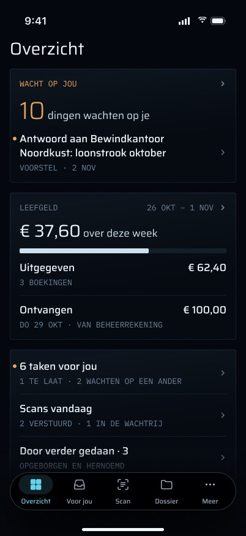

## Doel

- **In één oogopslag antwoord geven op "hoeveel leefgeld is er deze week nog over?"** VerderGroep betaalt Martin een weekbedrag (€ 100, Martins antwoord van 2026-10-31, `LEEFGELD_WEEKLY_CENTS=10000`). Het overzicht toont wat daarvan over is. Als de bankafschriften de hele week nog niet dekken, toont het wat er tot nu toe is uitgegeven.
- **Het geld per rekening tonen, nooit samengevoegd.** Onder bewind gaat geld heen en weer tussen een beheerrekening en een leefgeldrekening. Geld toont elke rekening apart, met een eigen schaal, zodat een overdracht tussen rekeningen nooit leest als een instorting.
- **Nooit een bedrag tonen dat de afschriften niet onderbouwen.** Bankregels komen alleen binnen via met de hand geïmporteerde afschriften (`routers/registry-import.ts`). Elk bedrag is dus maar zo actueel als de laatste import, en de schermen zeggen hoe ver de afschriften reiken.
- **Dezelfde getallen tekenen als de website.** De maanden worden gebouwd door dezelfde `buildMoneySeries` die `/money` gebruikt, uit dezelfde ene leesactie (`money.glance` en `money.series` delen `loadMoneyInputs`). De telefoon rekent zelf geen geld uit; hij verwoordt en schikt alleen wat de server stuurt.

## Hoe je er komt, en waar het heen leidt

### F24. Ingangen: de Overzicht-kaart, Meer en `grip://money`

**Status:** Gebouwd (`Grip/Home/HomeTab.swift` `showGeld`, `Grip/More/MoreMenu.swift`, `Grip/More/MoreTab.swift`, `Grip/Push/DeepLink.swift`)

| Ingang | Wat er gebeurt |
|---|---|
| Overzicht, de Leefgeld-kaart | Een tik zet `GeldScreen` op Overzichts eigen stack, verpakt in `.lockGated(by:)` (`HomeTab.showGeld`). Toegankelijkheidshint "Opent Geld". |
| Overzicht, de kaart "Geld" (geen weekbedrag ingesteld) | Dezelfde push. Deze kaart bestaat alleen zolang de app ontgrendeld is (zie [Toestanden](#toestanden)). |
| Meer → sectie "Dossier" → "Geld" (icoon `eurosign`) | Zet `MoreRoute.money` op de Meer-stack (`MoreMenu`, `MoreTab`). Het hele Meer-tabblad is vergrendelbeveiligd. |
| Deep link `grip://money` | Opent het Meer-tabblad met `[.money]` op de stack (`DeepLink.money`, `LinkDestination(tab: .meer, stack: .meer([.money]))`). Alleen de kale link wordt herkend: `grip://money#a` wordt geweigerd (`LinkDestinationTests`). **Geen enkele servercode stuurt deze link op dit moment**: elke worker-push linkt naar `grip://inbox` of `grip://proposal/<id>`. Ook geen widget of snelle actie gebruikt hem. |
| Fixture-opnames | `-route geld` (`FixtureLaunch.parseRoute("geld") == .link(.money)`), en de fixture-sets `money-*` (`apps/ios/scripts/capture.sh`). |

- **Terugknoplabel.** De frames tonen "‹ Overzicht" op elk Geld-frame. Dat klopt wanneer Geld vanuit Overzicht wordt geopend. Wordt het geopend vanuit Meer of via `grip://money`, dan keert de terugknop terug naar Meer.

### F25. Landen op een rekening

**Status:** Nog te bouwen — vereist dat de push een doelrekening meegeeft (`showGeld` krijgt een optionele IBAN), een `ScrollViewReader` in `GeldScreen` die naar de kaart van die rekening scrolt, `@AccessibilityFocusState` op de kop van de kaart, en een UI-test. Geen serverwijziging.

Het ontwerp zegt dat een tik op de Leefgeld-kaart op Geld landt, gescrold naar de kaart van de leefgeldrekening, met VoiceOver-focus op de kop daarvan. Een tik op een rekeningregel in het overzicht zonder budget ([F5](#f5-geen-budget-één-regel-per-rekening-elk-opent-zijn-eigen-rekening)) landt op dezelfde manier op die rekening. De code zet Geld bovenaan neer.

### F26. Naar de website

**Status:** Gebouwd (`Grip/Home/LeefgeldGlance.swift` `websitePath`)

- **"Open op de website" / "Kies hem op de website"** (bij de meldingstoestanden van het overzicht) openen `https://grip.vanderpoel.pro/money` buiten de app. De app claimt geen universal links, dus de link opent in Safari.
- **Geld heeft geen uitgaande links.** De regels zijn niet aantikbaar.

## Functies

### F1. Het ene verzoek

**Status:** Gebouwd (`apps/web/src/app/api/mobile/v1/money/summary/route.ts`, `packages/api/src/routers/money.ts`, `Grip/Money/MoneyGlance.swift` `MoneyStore`)

- **Route:** `GET /api/mobile/v1/money/summary`, opgehaald door `MoneyStore.refresh()`. De app heeft één `MoneyStore` (`GripApp`), gedeeld door Overzicht en Geld, zodat beide altijd hetzelfde antwoord tonen.
- **Het is een `mobileGet`.** De sessie wordt gecontroleerd voordat er een router draait. Een verzoek zonder sessie krijgt JSON `401 unauthorized`. Elk antwoord draagt `cache-control: no-store`.
- **Aan de serverkant, in volgorde:**
  1. `caller.money.glance()` leest elke transactie en elk registeritem **één keer**, bouwt de reeks met `buildMoneySeries`, en geeft `{ series, txs, newestBooking }` terug. `newestBooking` is de nieuwste **leesbare** boeking als Amsterdamse dagsleutel. Regels met een parse-fout worden overgeslagen, omdat hun datum van de import is geleend.
  2. `leefgeldWeek(...)` (`packages/api/src/leefgeld-week.ts`, puur) wordt twee keer uit die ene leesactie berekend: een keer voor deze week, en een keer voor de vorige week, beoordeeld als **hele** week (haar "vandaag" is de dag vóór het begin van deze week, zodat een afgelopen week nooit als gedeeltelijk leest).
  3. De reeks van elke rekening wordt met `dashboardMoneySlice([s])` ingekort tot haar zes nieuwste maanden, één rekening tegelijk, zodat er nooit tussen rekeningen gekozen wordt.
- **Configuratie**, in de route gelezen uit de omgeving van de webcontainer (`docs/deploy.md`):
  - `LEEFGELD_WEEKLY_CENTS`: alleen gewone cijfers. `"100,00"`, `"1e4"`, `"-5"` of niet ingesteld betekenen allemaal **geen budget**, nooit 0.
  - `LEEFGELD_IBAN`: de leefgeldrekening. Als die niet is ingesteld, is het de enige rekening **met een bekende IBAN** die een wekelijkse inkomensregel heeft. Nul of meer dan één zulke rekeningen geeft `no-account`. De reeks "onbekende rekening" (regels zonder IBAN) is nooit een kandidaat.
  - `LEEFGELD_WEEK_START`: ISO-weekdag 1–7, standaard maandag. Bedoeld om de uitbetalingsweekdag te worden zodra afschriften er een laten zien. Gemeten 2026-11-01: `transactions` bevatte 0 rijen, dus het blijft `1`.
- **Het antwoord:** `accounts` (één item per IBAN, plus één voor regels zonder rekening, elk met maximaal zes `MonthSeries` inclusief hun toelichtingsregels), `leefgeld`, `previousWeek` en `newestBooking`. Het antwoord heeft **geen totaal over rekeningen heen**, en de telefoon telt er geen op.
- **Er wordt niets geschreven.** Geen ledger-event, geen suggestie, geen rij van welke soort ook.
- **De telefoon decodeert strikt.** Een onbekende leefgeld-`state` laat het decoderen mislukken (`MoneyModels.swift`): een 2xx die de telefoon niet kan lezen heeft de vraag niet beantwoord, dus de store houdt wat hij had.
- **Wat het antwoord nog niet bevat**, en wat latere functies nodig hebben: einde van de dekking per maand, aantal boekingen per maand, de betaler van de inkomensregel, een nieuwste boeking per rekening, en rekeningnamen. Zie F9, F11, F12.

### F2. Hoe de leefgeldweek wordt berekend

**Status:** Gebouwd (`packages/api/src/leefgeld-week.ts`, getest in `leefgeld-week.test.ts`)

Uit `leefgeld-week.ts`, ongewijzigd door de telefoon:

- **De week** bestaat uit zeven Amsterdamse kalenderdagen, beginnend op `LEEFGELD_WEEK_START`. Ze wordt berekend op dagsleutels, nooit op tijdstippen.
- **Dekking** gebruikt `coveredRanges`, dezelfde samengevoegde afschriftperiodes die de maanden van `/money` gebruiken:
  - als geen samengevoegde periode de eerste dag van de week bevat, is de week `geen-data` en toont ze geen bedrag. Een afschrift dat midden in de week begint, laat de week `geen-data`, ook als er regels in die week op staan;
  - als een periode de eerste dag bevat en tot vandaag reikt (of tot de laatste dag van de week, zodra de week voorbij is), is de week `complete`;
  - als een periode de eerste dag bevat maar eerder eindigt, is de week `partial`, met `coveredThrough`.
- **Uitgegeven** is elke leesbare afschrijving op de leefgeldrekening in de gedekte dagen; **stortingen** zijn elke leesbare bijschrijving. Beide komen als lijst van regels, en elk totaal wordt **uit** de eigen lijst opgeteld.
- **Over** = budget − uitgegeven. Dat mag negatief zijn.

### F3. Het geldoverzicht op Overzicht: de weektoestanden

**Status:** Gebouwd (`Grip/Home/LeefgeldGlance.swift`, `Grip/Home/HomeTab.swift`; getest in `LeefgeldGlanceTests`). De teksten wijken af van de frames; zie F4.

Het volledige gedrag van de kaart staat in [`02-overzicht/FEATURES.md`](../02-overzicht/FEATURES.md#leefgeld). Kort gezegd maakt `LeefgeldGlance.make` van de week een van deze toestanden:

| Weektoestand | Wat de code toont |
|---|---|
| complete | Kop "LEEFGELD" en de periode "26 OKT – 1 NOV". Hoofdbedrag "€ 37,60" met "over van € 100,00", een balk voor wat er over is, kolommen "UITGEGEVEN" / "ONTVANGEN", en de voetnoot "Alleen je leefgeldrekening." |
| partial | Kop "ONVOLLEDIG · 26 OKT – 1 NOV". Het hoofdbedrag is wat er is **uitgegeven**: "€ 47,90" met "uitgegeven t/m do 29 okt". De gedekte dagen zijn effen en de rest gearceerd, met "VR–ZO: NOG GEEN AFSCHRIFT" (of "ZO: …" voor één dag). De enige kolom is "OVER" → "nog niet bekend". |
| overspent | Hoofdbedrag "− € 12,40", met het bijschrift "boven het weekbedrag" eronder, en de balk gearceerd voorbij een streepje bij het punt van € 100. Niet amber. |
| geen data | "Geen data voor deze week", de uitlezing "LAATSTE AFSCHRIFT T/M ZO 18 OKT", "Importeer een nieuw afschrift op de website. Daarna rekent verder deze week uit." en de link "Open op de website". Geen bedrag. De uitlezing is de nieuwste leesbare boeking **op de leefgeldrekening**, niet op een willekeurige rekening. |
| niets geïmporteerd (`no-account` zonder leesbare boeking waar dan ook, of `geen-data` zonder leesbare boeking op de leefgeldrekening) | "Nog geen afschriften", "Importeer je eerste afschrift op de website. Daarna zie je hier wat er deze week over is." en "Open op de website". Dit is geen fout: er valt nog niets te herkennen. Het is de toestand van productie sinds 2026-11-01. |
| niet herkend (`no-account` terwijl er afschriften zijn) | "Leefgeldrekening niet herkend", een van "Geen rekening krijgt wekelijks geld binnen." / "1 rekening krijgt wekelijks geld binnen." / "N rekeningen krijgen wekelijks geld binnen; verder kiest er niet zelf een.", en "Kies hem op de website". |
| geen budget | Geen Leefgeld-kaart. Zie F5. |

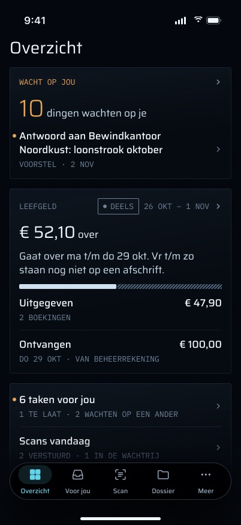
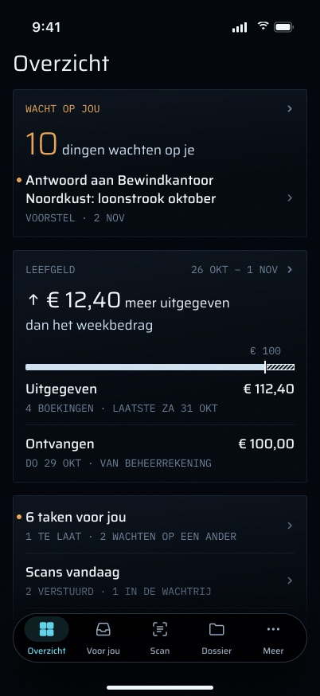

### F4. Teksten, boekingsaantallen en herkomst van stortingen zoals in de frames

**Status:** Deels gebouwd — de bedragen en toestanden bestaan (F3). Nog ontbrekend: de teksten van de frames, het aantal boekingen (op de telefoon te berekenen uit `spentRows.count`, dus alleen een wijziging in `LeefgeldGlance` en een test), en de herkomstregel onder "Ontvangen" ("DO 29 OKT · WEEKBEDRAG", "VAN BEHEERREKENING"). De dag kan uit `depositRows` komen, maar voor "weekbedrag" en "van beheerrekening" moet de server zeggen welke storting de wekelijkse uitbetaling is en van welke rekening die kwam (een veld op het leefgeldantwoord, gebouwd uit de gekoppelde paren van `splitInternalTransfers`, plus een routetest).

- **Teksten.** De frames gebruiken op verschillende plekken andere woorden. Gedeeltelijk: badge "DEELS", hoofdbedrag "€ 52,10 over" en "Gaat over ma t/m do 29 okt. Vr t/m zo staan nog niet op een afschrift." (de code toont wat er is uitgegeven, "uitgegeven t/m …", met "over" = "nog niet bekend", en nooit een bedrag dat over is voor een gedeeltelijke week). Overschreden: "↑ € 12,40 meer uitgegeven dan het weekbedrag" (de code: "− € 12,40" / "boven het weekbedrag"). Geen data: "geen data" als hoofdbedrag en "Lees het nieuwste afschrift in op de computer, onder Register → Afschrift inlezen." (de code: "Geen data voor deze week" en een link naar `/money`). Het webpad dat het ontwerp noemt bestaat wel: `/registry` heeft een knop "Afschrift inlezen" naar `/registry/import`. De link in de code gaat in plaats daarvan naar `/money`. **De tekst voor een gedeeltelijke week is een beslissing, geen gat:** dat de code voor een gedeeltelijke week geen resterend bedrag toont is bewust, en overstappen op "€ 52,10 over" uit het frame vraagt Martins akkoord.
- **Aantallen onder de kolommen.** De frames voegen "3 BOEKINGEN", "DO 29 OKT · WEEKBEDRAG" of "VAN BEHEERREKENING" toe onder de bedragen. De code toont alleen de bedragen.
- **Voetnoot.** "Alleen je leefgeldrekening." uit de code staat niet in de frames.
- **Waar de link uitkomt.** `/money` zonder regels toont "Nog geen afschriften ingelezen …" en een knop "Afschrift importeren" naar `/registry/import`, dus de import ligt op de website nog één tik verder.

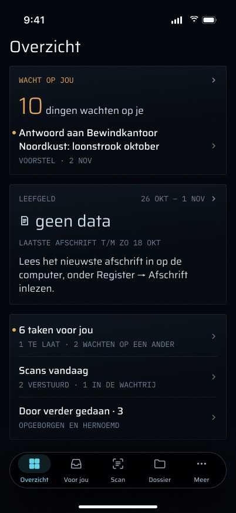

### F5. Geen budget: één regel per rekening, elk opent zijn eigen rekening

**Status:** Deels gebouwd — de code toont één knopkaart "Geld" met één regel per rekening (`MoneyGlance.overview`, `HomeTab.swift`). Nog ontbrekend: een regel per rekening die Geld bij die rekening opent (F25), de rekeningnaam (F11), en "NIEUWSTE BOEKING ZA 24 OKT" per rekening (F12, serverveld).

- **Gebouwd:** zonder weekbedrag maakt de Leefgeld-kaart, alleen in ontgrendelde toestand, plaats voor een kaart "Geld" met één regel per rekening voor haar nieuwste gedekte maand: "…6789 · okt '26 deels · in € … · uit € …". Een rekening zonder gedekte maand krijgt geen regel, en zonder regels is er helemaal geen kaart. De onderdelen zijn met NBSP verbonden, zodat een regel alleen na een " ·" afbreekt.
- **Ontworpen:** elke rekening is een eigen regel ("Beheerrekening / ··6789 · NIEUWSTE BOEKING ZA 24 OKT") die Geld bij die rekening opent. De brief (§5) merkt op dat deze toestand geen frame had toen hij werd gebouwd; het definitieve frame bestaat nu.

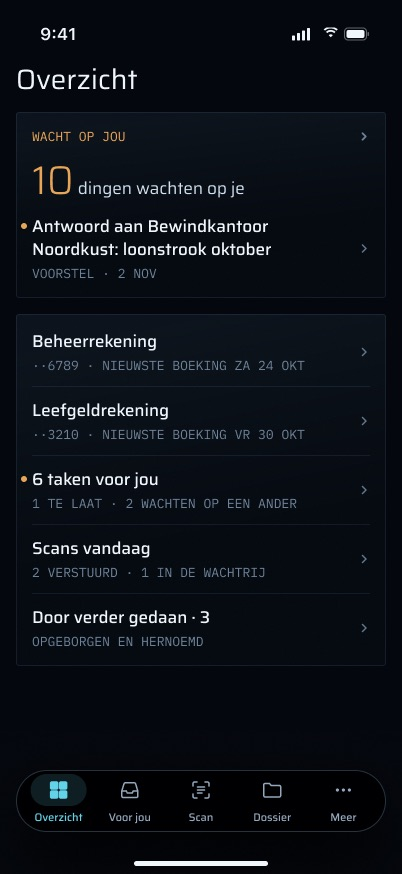

### F6. Geld: het paneel met de leefgeldweek

**Status:** Gebouwd (`Grip/Money/MoneyGlance.swift` `LeefgeldCard`, `Grip/Money/MoneyGlanceView.swift` `GeldScreen.leefgeldCard`; getest in `LeefgeldCardTests`). **De definitieve frames hebben zo'n paneel op Geld niet**: ze tonen de week alleen op Overzicht en beginnen Geld met de rekeningkaarten. Of het paneel blijft, is een open ontwerpbeslissing.

`GeldScreen` toont, van boven naar beneden. Elk woord komt uit `MoneyGlance` (`Grip/Money/MoneyGlance.swift`, met unittests); de view schikt het alleen.

1. **Titel** "Geld" (een kop voor VoiceOver).
2. **Actualiteit:** "laatste afschrift t/m do 29 okt", of "nog geen afschriften ingelezen". Dit is de leeftijd van de **afschriften**, niet van het ophalen: "deze week" is maar zo actueel als de laatste import. (Het tijdstip van ophalen is F14.)
3. **Paneel "LEEFGELD OVER DEZE WEEK"** (`LeefgeldCard.make`), afwezig als er geen budget is:
   - het bedrag: hoofdbedrag "€ 37,60" met "over deze week", of bij overschrijding de grootte met "meer uitgegeven dan het weekbedrag" (geen minteken, geen amber);
   - de regels "uitgegeven € 62,40 · ontvangen € 100,00", "t/m do 29 okt" bij een gedeeltelijke week (het hele bedrag staat dan op een gearceerde achtergrond), en "week ma 26 okt – zo 1 nov";
   - de rekeningregel: "rekening …3210 · ingesteld" (uit `LEEFGELD_IBAN`) of "rekening …3210 · herkend aan wekelijks leefgeld". Die wordt alleen op Geld getoond (Geld is zelf vergrendelbeveiligd) en nooit op Overzicht;
   - elke boeking achter het bedrag, oudste eerst, eerst de afschrijvingen en dan de stortingen: "27 okt · uitgegeven · Supermarkt …" met het bedrag rechts. Afschrijvingen houden hun geboekte teken, dus ze lezen "−€ 12,50"; een regel zonder tegenpartij leest "onbekend";
   - de vorige week in één regel: "Vorige week: € 4,10 over", "Vorige week: € 8,00 meer uitgegeven dan het weekbedrag", "Vorige week: geen data", met "(t/m …)" als die gedeeltelijk was;
   - zonder bedrag draagt het paneel in plaats daarvan een kopregel: "geen data — laatste afschrift t/m 18 okt" (hier geen weekdag, anders dan in de actualiteitsregel), "geen data — nog geen afschriften", "Nog geen afschriften" ("Zodra een bankafschrift is ingelezen, staat hier wat er deze week over is."), of "Leefgeldrekening niet herkend" met het aantal kandidaten.

   **Dit gedeeltelijke bedrag verschilt van dat op het overzicht.** `LeefgeldCard` op Geld toont ook voor een gedeeltelijke week wat er over is ("€ X" met "over deze week"), gearceerd en gemarkeerd met "t/m …". De Overzicht-kaart doet dat bewust niet; die toont wat er is uitgegeven, met "over" = "nog niet bekend". Beide lezen hetzelfde serverbedrag en verwoorden het anders.

### F7. Geld: één kaart per rekening, zes maanden, toelichtingen direct eronder

**Status:** Gebouwd (`Grip/Money/MoneyGlance.swift` `AccountCard`, `MonthBar`; `GeldScreen.accountCard`; getest in `LeefgeldCardTests`: `cardsAreNeverSummed`, `barsScalePerAccount`, `disclosuresTravelWithTheirMonth`). Het is gebouwd als lijst; de frames vervangen die door een grafiek (F8), een uitlezing (F9) en een sheet (F13).

**Eén kaart per rekening** (`AccountCard`), in de volgorde van de server (gesorteerd op IBAN, dus de reeks "onbekende rekening", met een lege IBAN als sleutel, komt eerst), nooit opgeteld:

- de titel "Rekening NL00 TEST 0123 4567 89", of "Onbekende rekening" voor regels zonder IBAN;
- de legenda "in" / "uit";
- één regel per maand, oudste eerst: "okt '26", een status ("deels" of "geen data"), "in € 2.400,00 · uit € 1.210,35", en twee balken;
- de balken schalen alleen naar de grootste maand van **deze rekening**;
- de balken van een `partial` maand zijn gearceerd **en** zeggen "deels";
- een `none` maand zegt "geen data", zonder bedrag en zonder balk, nooit € 0,00;
- onder de eigen maand (alleen voor een maand met data): "1 regel onleesbaar" / "N regels onleesbaar" voor regels met een parse-fout, daarna elke toegelichte regel: "19 aug · eenmalig · Zorgverzekeraar Duinzorg" met "€ 85,00" rechts (eenmalige bijschrijvingen die niet als inkomen tellen), en "… · eigen overboeking · …" (overboekingen tussen Martins eigen rekeningen). Deze regels zorgen dat de balken aansluiten op de bank.

Zonder rekeningen toont Geld "Nog geen rekeningen" en "Afschriften lees je in via verder op de computer. Daarna staat hier per rekening wat er in en uit ging." (De ontworpen versie van deze toestand is F20.)

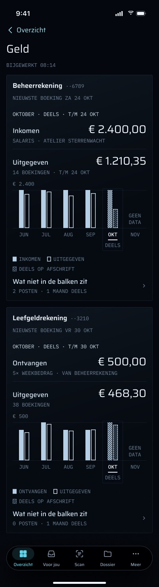

### F8. Maandgrafiek met een gekozen maand

**Status:** Nog te bouwen — vereist een Swift Charts-grafiek met `BarMark` per rekening in `GeldScreen` (inkomen gevuld, uitgaven omlijnd, een gedeeltelijke maand gearceerd met het woord "DEELS" onder het label, een `none` maand met de woorden "GEEN DATA" in plaats van balken), een selectiemodel in `MoneyGlance.swift` (standaard: de nieuwste maand met data, anders de nieuwste maand), `.chartXSelection` voor tikken en slepen, en unittests voor de standaardkeuze en voor het kiezen van een `none` maand. Geen serverwijziging: de zes maanden zitten al in het antwoord.

- Elke rekeningkaart tekent haar zes maanden als grafiek op haar eigen schaal, met de bovenste waarde erbij ("€ 2.400", "€ 500"). De schaal wordt nooit tussen rekeningen gedeeld.
- De legenda zegt in woorden wat elk teken betekent: "INKOMEN" / "UITGEGEVEN" op de beheerrekening, "ONTVANGEN" / "UITGEGEVEN" op de leefgeldrekening, en "DEELS OP AFSCHRIFT" voor de arcering.
- Martin tikt op een maand, of sleept over de grafiek, om er een te kiezen. De gekozen maand wordt gemarkeerd en onderstreept. Elke kaart houdt haar eigen keuze vast: in de frames kan de beheerrekening november tonen terwijl de leefgeldrekening september toont.
- Een maand kiezen verandert alleen de uitlezing boven de grafiek (F9, F10). Er wordt niets opgehaald.

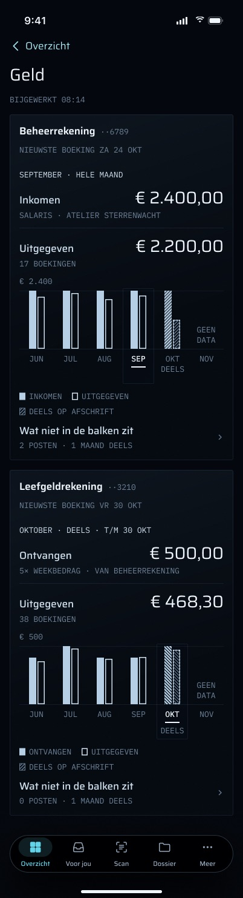

### F9. Maanduitlezing: dekking, bedragen, aantallen en inkomensbron

**Status:** Nog te bouwen — vereist drie nieuwe velden per maand op `/money/summary` (en in `MoneySummaryDTO`, `MonthSeries`): de laatste gedekte dag van een gedeeltelijke maand (uit `coveredRanges`), het aantal afschrijvingen, en de betaler en soort van de inkomensregel (uit `incomeLines`, bijvoorbeeld salaris van Atelier Sterrenwacht, of "5× weekbedrag" van de eigen beheerrekening). Daarnaast een uitleesmodel in `MoneyGlance.swift`, de view, en tests aan beide kanten, waarbij `money-series.real.test.ts` groen moet blijven.

Voor de gekozen maand toont de kaart:

- de dekkingsregel: "OKTOBER · DEELS · T/M 24 OKT" of "SEPTEMBER · HELE MAAND";
- **Inkomen** (beheerrekening) of **Ontvangen** (leefgeldrekening) met het bedrag, en daaronder waar het geld vandaan kwam: "SALARIS · ATELIER STERRENWACHT", "5× WEEKBEDRAG · VAN BEHEERREKENING";
- **Uitgegeven** met het bedrag en het aantal boekingen: "14 BOEKINGEN · T/M 24 OKT".

De uitlezing verwoordt alleen wat de server zegt. Net als de rest van Geld noemt ze geen betaler die `incomeLines` niet heeft gevonden, en toont ze geen bedrag voor niet-gedekte dagen.

### F10. Uitlezing van een maand zonder data, met hoe je importeert

**Status:** Nog te bouwen — vereist alleen de uitleestoestand in `MoneyGlance.swift` en de view, plus een test dat er geen "€" in staat. Geen serverwijziging: de `coverage: none` van een maand zit al in het antwoord.

Als de gekozen maand geen afschrift heeft, leest de uitlezing "NOVEMBER · GEEN DATA", het hoofdbedrag "geen data", en "Van november is er nog geen afschrift. Lees het afschrift in op de computer, onder Register → Afschrift inlezen." Geen bedrag en geen balk, nooit € 0,00.

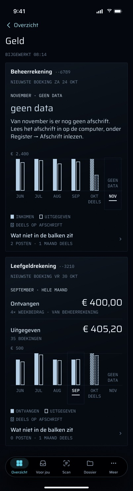

### F11. Rekeningen met een naam

**Status:** Nog te bouwen — vereist eerst een echte bron van namen: een koppeling van IBAN naar naam aan de serverkant (een kleine instellingentabel of omgevingsvariabele, door Martin op de website ingesteld, met een migratie als het een tabel is), een veld `name` per rekening op `/money/summary`, en de titel in `AccountCard`. Zonder naam houdt de kaart de gegroepeerde IBAN.

De frames geven de kaarten de titels "Beheerrekening ··6789" en "Leefgeldrekening ··3210". De server heeft geen tabel die rekeningen een naam geeft: `money.series` koppelt IBAN → IBAN (`accountLabels`), en een naam verzinnen is een bewering die het geld-subproject niet mag doen.

### F12. Nieuwste boeking per rekening

**Status:** Nog te bouwen — vereist een `newestBooking` per rekening op `/money/summary` (nu bevat het antwoord er één, over alle rekeningen heen), het veld in `MoneySummaryDTO`, en een routetest. Gebruikt op de rekeningkaart en in de regels van het overzicht zonder budget (F5).

Elke rekeningkaart zegt wanneer haar eigen afschrift eindigt: "NIEUWSTE BOEKING ZA 24 OKT" op de beheerrekening en "NIEUWSTE BOEKING VR 30 OKT" op de leefgeldrekening. Rekeningen worden apart geïmporteerd, dus één datum voor beide zou voor minstens één ervan onjuist zijn.

### F13. Het sheet "Niet in de balken"

**Status:** Nog te bouwen — vereist een regel "Wat niet in de balken zit" met de aantallen onder elke grafiek, een sheet-view (middelste detent, grabber, "Klaar"), een model in `MoneyGlance.swift` dat de `incidentalRows` en `internalRows` van de zes maanden per rekening verzamelt, en tests dat de aantallen uit de getoonde regels worden opgeteld. De lijst van gedekte maanden heeft het einde van de dekking per maand uit F9 nodig. De toelichting bij een overboeking waarvan de andere helft buiten het afschrift van deze rekening valt ("Staat daar als ontvangen. Do 29 okt staat alleen op de leefgeldrekening …") vereist dat de server zegt welke rekening het bijpassende deel heeft; `splitInternalTransfers` weet dat, maar geeft het nog niet terug.

- Onder elke grafiek opent een regel "Wat niet in de balken zit" met "2 POSTEN · 1 MAAND DEELS" (of "0 POSTEN …") een sheet voor die rekening.
- Het sheet, met de titel "Niet in de balken" en "BEHEERREKENING · ··6789 · JUN – NOV", toont:
  - **Eenmalig binnengekomen**: elke eenmalige bijschrijving, bijvoorbeeld "Teruggave € 85,00 / 19 AUG · ZORGVERZEKERAAR DUINZORG";
  - **Tussen je eigen rekeningen**: de overboekingen, gegroepeerd, bijvoorbeeld "Naar leefgeldrekening € 2.100,00 / ··3210 · 21× WEEKBEDRAG · JUN T/M 24 OKT", met een zin over waar de andere helft te zien is;
  - **Welke maanden op een afschrift staan**: elke maand die niet heel is, bijvoorbeeld "Oktober / DEELS · T/M ZA 24 OKT", "November / GEEN DATA · GEEN AFSCHRIFT".
- Het vervangt de regels die de code nu direct onder elke maand schrijft (F7). De toelichtingen blijven één tik van hun getallen af en vallen nooit weg, want een totaal zonder zijn regels sluit niet aan.
- Openen en sluiten volgen de kaart-uitklapbeweging uit de brief (spring 0,3 s), met een directe overgang bij Verminder beweging.

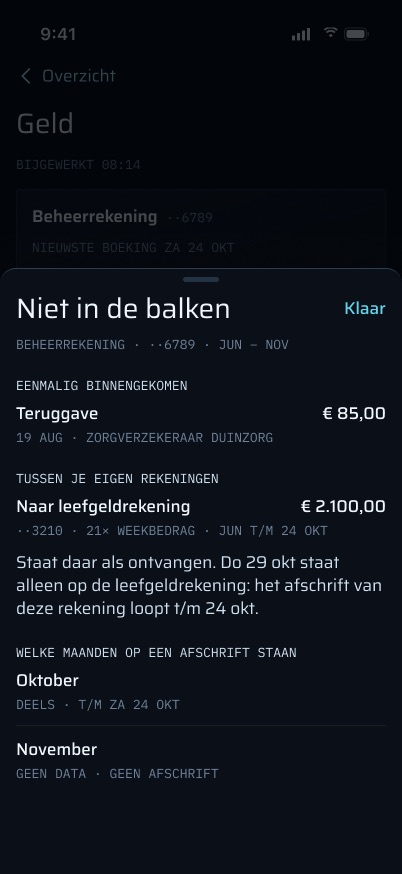

### F14. Tijdstip van het laatste ophalen ("Bijgewerkt")

**Status:** Nog te bouwen — vereist dat `MoneyStore` bij succes `fetchedAt` vastlegt (`HomeSummary.eyebrow` op Overzicht doet hetzelfde al voor de inbox en is het patroon om te hergebruiken), de regel "BIJGEWERKT 08:14" (of "BIJGEWERKT GISTEREN 22:14", "BIJWERKEN…" tijdens het laden) onder de titel, en tests. Geen serverwijziging.

Deze regel staat los van de leeftijd van de afschriften in F6: de een zegt wanneer de telefoon voor het laatst van verder hoorde, de ander hoe ver de bankafschriften reiken.

### F15. Verversen

**Status:** Gebouwd (`GeldScreen` `.task` / `.refreshable`, `HomeTab.swift`, `MoneyStore`)

- **Geld** haalt op wanneer het verschijnt (`.task`) en bij omlaagtrekken om te verversen. Het pollt niet.
- **Overzicht** haalt het geldoverzicht samen met de inbox op, parallel: bij verschijnen, elke 60 s zolang het in beeld is, en bij omlaagtrekken om te verversen.
- **Een mislukte verversing houdt het laatste goede antwoord vast** (`MoneyStore`): er is niets geleerd, dus er verandert niets. Alleen een 401 heeft een bijeffect (F16).

### F16. Einde van de sessie: late antwoorden negeren, het geld wissen

**Status:** Gebouwd (`Grip/Auth/SessionEpoch.swift`, `MoneyStore.init`; getest in `SessionEpochTests.aStaleEpochMoneyRefreshDoesNotRepopulate`)

- **Een antwoord dat binnenkomt nadat de sessie is beëindigd, wordt genegeerd** (`SessionEpoch`), ook een 401.
- **Uitloggen en een 401 wissen het geld.** Het beëindigen van de `SessionEpoch` leegt `glance` en `lastError`, en een ophaalactie die nog loopt schrijft niets terug.
- Een 401 roept `auth.sessionRejected()` aan, en de tabbalk wordt vervangen door "Je sessie is verlopen."

## Toestanden

| Toestand | Overzicht-kaart (code) | Geld (code) | Wat Martin kan doen |
|---|---|---|---|
| Laden, niets bewaard | `LeefgeldSkeleton`, in de vorm van de kaart. De geldkaart verschijnt pas op het bord van Overzicht zodra de **inbox** geladen is; als het ophalen van de inbox mislukt zonder iets bewaard, toont Overzicht zijn foutkaart en geen geldkaart, wat het ophalen van het geld ook deed | Twee lege panelen, VoiceOver-label "Laden" | Wachten; omlaagtrekken om te verversen |
| Volledig / gedeeltelijk / overschreden / geen data / niets geïmporteerd / niet herkend / geen budget | Zie F3–F5 | Zie F6–F7 | Op de kaart tikken om Geld te openen; bij een meldingstoestand de website openen |
| Fout, niets bewaard | De Leefgeld-kaart is **verborgen**, zodat Overzicht geen tweede fout toont; "Geld itself says why" | Een paneel met "Dat lukte niet. Probeer het over een moment opnieuw." en "Opnieuw proberen" | Opnieuw proberen |
| Offline, niets bewaard | Verborgen, zoals hierboven | Hetzelfde paneel met "Geen verbinding met verder. Probeer het opnieuw." | Opnieuw proberen |
| Fout of offline, antwoord bewaard | De bewaarde kaart, ongewijzigd | Het bewaarde scherm, **zonder enig teken dat het ophalen mislukte** | Omlaagtrekken om te verversen |
| Sessie verlopen (401) | De tabbalk wordt vervangen door "Je sessie is verlopen." | Hetzelfde | Opnieuw inloggen |
| Vergrendeld | De leefgeldkaart wordt getoond (alleen bedragen); de kaart "Geld" zonder budget niet, omdat haar regels een IBAN-staart bevatten | Niet bereikbaar: in plaats daarvan verschijnt het vergrendelscherm (F21) | Ontgrendelen met Face ID |
| Grote tekst | De kaart heeft AX-afhandeling (labels in zinsnaamvorm, gestapelde kop en kolommen, mono begrensd op AX3) | Elk lettertype schaalt mee met Dynamic Type (`relativeTo:`); er is geen speciale AX-indeling (F22) | Scrollen |
| Kleine telefoon (SE) | Het hoofdbedrag en het bijschrift stapelen als ze niet met 24 pt marge naast elkaar passen | Dezelfde lijst, smaller | — |

"Bewaard" betekent **in het geheugen**. `MoneyStore` schrijft het overzicht nooit naar schijf, dus een koude start zonder verbinding heeft niets om te bewaren.

### F17. Laden

**Status:** Deels gebouwd — de `LeefgeldSkeleton` van het overzicht volgt de kaart, en Geld toont twee lege panelen met het label "Laden" (`GeldScreen`). Nog ontbrekend op Geld: een skelet in de vorm van een rekeningkaart met haar grafiek, en de regel "BIJWERKEN…" (die met F14 meekomt).

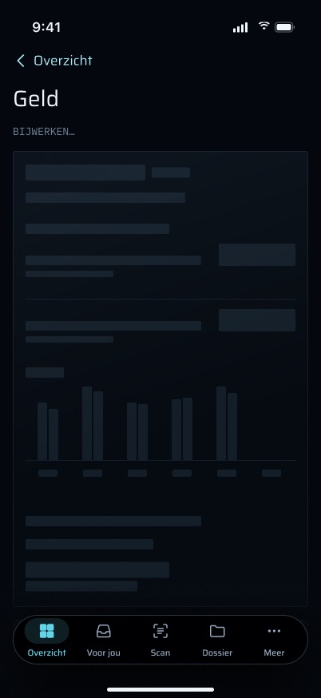

### F18. Foutkaart met een diagnostische regel

**Status:** Deels gebouwd — het paneel en "Opnieuw proberen" bestaan, met de gedeelde tekst van Voor jou (`VoorJouTab.message`). Nog ontbrekend: Geld's eigen formulering, de diagnostische regel, en de automatische volgende poging. `APIError.server(Int)` draagt de statuscode al. De regel vereist het tijdstip van de fout in `MoneyStore`, een ingeplande nieuwe poging (zonder herhaallus bij een 429, volgens `APIError.rateLimited`), tekst in `MoneyGlance.swift`, en tests.

Het frame "Geld / fout" leest "Geld is nu niet op te halen." / "De server van verder antwoordt niet. Je afschriften zijn niet weg; ze staan veilig op de server." met "SERVER 503 · 14:05 · VOLGENDE POGING 14:06" en "Opnieuw proberen". Een 401 zou "Log opnieuw in." lezen, maar het scherm voor een verlopen sessie vervangt de app eerst.

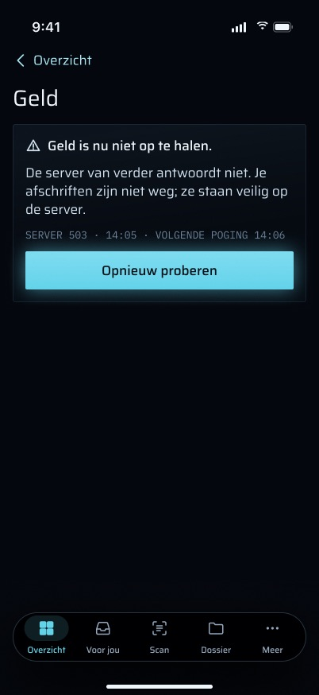

### F19. Offlinemelding over het bewaarde scherm

**Status:** Nog te bouwen — vereist `fetchedAt` uit F14, een melding in `GeldScreen` die verschijnt als de laatste verversing mislukte met `.transport` terwijl er een antwoord bewaard is, een automatische verversing zodra de verbinding terugkomt (`NWPathMonitor`), tekst in `MoneyGlance.swift`, en tests. Dezelfde eerlijkheid is verschuldigd aan de kaart op Overzicht, die haar kaart nu zonder melding laat staan. Het overzicht bewaren over een koude start heen zou het op schijf vereisen, wat de huidige privacyregel ("er wordt niets over geld op de telefoon opgeslagen") verbiedt; dat deel is dus Martins beslissing en hoort niet bij deze functie.

Het frame "Geld / offline" toont een melding boven het bewaarde scherm: "OFFLINE · BIJGEWERKT GISTEREN 22:14" en "Je ziet de stand van gisteravond. Zodra er weer verbinding is, wordt Geld vanzelf bijgewerkt." De bedragen eronder blijven leesbaar.

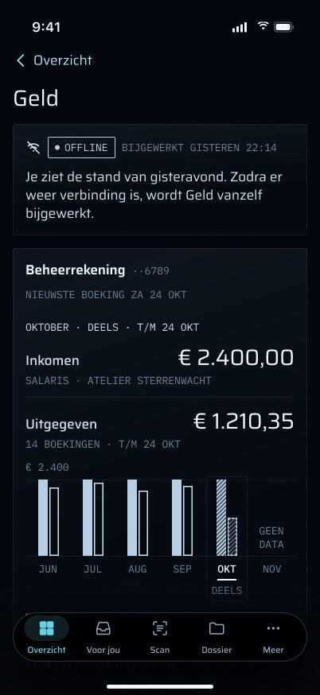

### F20. Niets geïmporteerd, op Geld

**Status:** Deels gebouwd — de toestand bestaat als "Nog geen rekeningen" plus, als er een budget is ingesteld, het eigen "Nog geen afschriften" van het leefgeldpaneel (F6, F7). Nog ontbrekend: de ene ontworpen kaart met een lege zesmaandengrafiek en de ontworpen tekst, wat een viewwijziging in `GeldScreen` en een tekstwijziging in `MoneyGlance.swift` is, met een fixture-test (`money-no-account`).

Het frame "Geld / nog geen afschriften" toont één kaart: de omtrek van een lege grafiek, "Nog geen afschriften" en "Zodra je een afschrift inleest, staan hier per rekening zes maanden inkomen en uitgaven. Lees het in op de computer, onder Register → Afschrift inlezen." Dit is de toestand van productie sinds 2026-11-01.

### F21. Vergrendeld: Face ID voordat Geld opent

**Status:** Deels gebouwd — in vergrendelde toestand wordt Geld nooit opgebouwd en verschijnt het vergrendelscherm op zijn plek (`Grip/Auth/LockView.swift` `.lockGated(by:)`), dat per vergrendeling één keer uit zichzelf vraagt. Nog ontbrekend: het systeemsheet van Face ID over Overzicht oproepen wanneer de kaart in vergrendelde toestand wordt aangetikt, en Geld pas bij succes openen; dat is een wijziging in `HomeTab.showGeld` (eerst authenticeren, dan pushen) en een UI-test voor het geannuleerde geval.

De frames "vergrendeld · Face ID vraagt" en "· geannuleerd" tonen het Face ID-sheet over Overzicht met het leefgeldbedrag nog zichtbaar erachter, en na annuleren Overzicht met "Face ID is geannuleerd. Titels zie je na ontgrendelen." en "Toon details", met de bedragen nog in beeld.

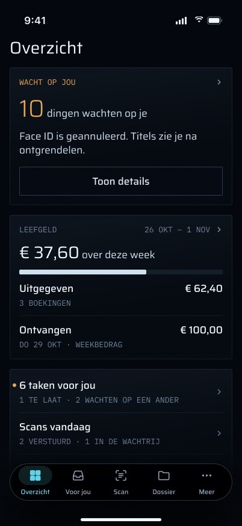

### F22. Grootste tekstgroottes: blokken "Per maand"

**Status:** Nog te bouwen — vereist een indeling voor toegankelijkheidsgroottes in `GeldScreen` (schakelend op `dynamicTypeSize.isAccessibilitySize`) die de grafiek vervangt door een lijst "Per maand", één blok per maand met de dekking en beide bedragen, en een fixture-opname op AX5. Het hangt af van F8–F9 voor wat het vervangt. Geen serverwijziging.

Het frame "Geld / complete · AX5" stapelt elk label, zet elke maand in een eigen blok onder een kop "Per maand" ("Juni / hele maand / Inkomen € 2.400,00 / Uitgegeven € 2.150,00", "November / geen data · geen afschrift"), en houdt "Wat niet in de balken zit" aan het eind van elke rekening. Bedragen worden nooit afgekapt. De code houdt bij elke grootte de compacte regelindeling.

### F23. Kleine telefoon en het overzicht bij grote groottes

**Status:** Gebouwd (`Grip/Home/HomeTab.swift` `LeefgeldGlanceView`; getest in `LeefgeldGlanceTests`)

Op de iPhone SE stapelen het hoofdbedrag en het bijschrift van het overzicht als ze niet met 24 pt marge passen, en wordt de lijst van Geld smaller. Bij toegankelijkheidsgroottes gebruikt het overzicht labels in zinsnaamvorm, stapelt het kop en kolommen, en begrenst het de monotekst op AX3.

## Privacy en beveiliging

### F27. Vergrendelregels voor geld

**Status:** Gebouwd (`MoneyGlance.summary(revealed:)`, `LeefgeldGlance.accessibilityLabel`, `LeefgeldCard.glanceText`, `.lockGated(by:)`; getest in `LeefgeldCardTests`: `revealedSummaryShowsTheAccountLines`, `revealedFigureStillLeavesTheAccountToGeld`, en de gevallen met een vergrendelde samenvatting)

- **Het overzicht op Overzicht is open in vergrendelde toestand, en toont alleen bedragen.** Het toont nooit een rekening, een IBAN-staart of een tegenpartij. Ook het VoiceOver-label bevat die niet. Op Geld laat ook de VoiceOver-tekst van het bedrag de rekeningregel weg; die wordt als eigen element voorgelezen. In vergrendelde toestand laat `MoneyGlance.summary(revealed: false)` de regels per rekening weg, zodat de kaart "Geld" zonder budget verdwijnt. De Leefgeld-kaart noemt het *soort* rekening ("Alleen je leefgeldrekening."), nooit welke.
- **Geld is vergrendelbeveiligd, omdat het tegenpartijen en IBAN's noemt.** Vanuit Overzicht is het verpakt in `.lockGated(by:)`; vanuit Meer en `grip://money` is het hele Meer-tabblad beveiligd. In vergrendelde toestand wordt de beveiligde inhoud **helemaal niet opgebouwd** (het is geen overlay), zodat die niets kan laden of aan VoiceOver kan melden.
- **Face ID één keer, bij openen en bij heropenen.** De app vraagt er uit zichzelf om bij een koude start en na meer dan 5 minuten op de achtergrond, met `.deviceOwnerAuthentication` (de toegangscode werkt als Face ID niet werkt). Zie `01-inloggen-en-vergrendeling`.
- **Niets over geld verschijnt op het toegangsscherm of in een widget.** De widget-snapshot bevat alleen het aantal dat wacht op jou, titels en de kopregel; `GripWidget` heeft geen geldcode. Geen push bevat geld.
- **Er wordt niets over geld op de telefoon opgeslagen.** Het overzicht leeft in `MoneyStore`, alleen in het geheugen. De sessiecookie staat in de Keychain (`AfterFirstUnlockThisDeviceOnly`), zoals voor elke route.

## Toegankelijkheid

### F28. VoiceOver voor de maanden en de grafiek

**Status:** Deels gebouwd — de titel is een kop, en elke maandregel is één VoiceOver-element dat de hele regel voorleest (`GeldScreen.monthRow`, `MonthBar.text`). Nog ontbrekend, zodra de grafiek bestaat (F8): de beschrijving van de grafiek in één zin en een audiografiek (`AXChartDescriptorRepresentable`, brief §2.7 en R11), het aankondigen van de gekozen maand wanneer die verandert, en de regel "Niet in de balken" als knop met zijn aantallen.

## Regels die het volgt

- **Rekeningen worden nooit samengevoegd.** Er is geen totaal over rekeningen heen in het antwoord van de route, in `MoneyGlance` of op het scherm (`cardsAreNeverSummed`; `accounts are listed separately` op de route; `accounts are never merged` in `leefgeld-week.test.ts`). Regels zonder IBAN vormen hun eigen kaart "Onbekende rekening" en sluiten nooit aan bij een bekende. De balken van elke rekening gebruiken hun eigen schaal. Elke functie die nog gebouwd moet worden houdt zich aan deze regel, de grafiek en het sheet inbegrepen.
- **Geen bedrag voor niet-gedekte dagen.** Een `geen-data` week toont geen bedrag (`geenDataShowsNoAmount` controleert dat er geen "€" in staat). Een maand zonder dekking leest "geen data", nooit € 0,00. Een gedeeltelijke week of maand is gearceerd en altijd gekoppeld aan een woord ("deels", "t/m …", "onvolledig"). Geen budget betekent helemaal geen leefgeldbedrag, nooit een dat uit een standaardwaarde is verzonnen.
- **De toelichtingen reizen mee met de getallen.** Eenmalige bijschrijvingen en overboekingen tussen eigen rekeningen staan onder hun maand (`disclosuresTravelWithTheirMonth`), en het leefgeldbedrag noemt elke boeking erachter, want een totaal zonder zijn regels sluit niet aan. Het sheet (F13) zet ze één tik verderop; het laat ze nooit weg.
- **Amber alleen voor wat wacht op jou.** Niets op beide schermen is amber, zelfs geen overschreden week: dat is informatie over geld, niet iets dat op Martin wacht.
- **Alleen-lezen.** Geen enkele actie hier keurt goed, verstuurt, archiveert of legt iets vast, dus de verzendregel, de regel voor AI-suggesties en de uitzondering voor archiveren zijn niet van toepassing.

## Meldingen, haptiek en beweging

- **Geen meldingen.** Geen worker-taak stuurt een geldpush, en niets stuurt `grip://money`. Dat is zo ontworpen: de spec geeft geld geen push.

### F29. Haptiek

**Status:** Nog te bouwen — vereist `.sensoryFeedback(.selection, trigger: selectedMonth)` op de grafiek (hangt af van F8) en `.sensoryFeedback(.error, trigger:)` bij een mislukt omlaagtrekken of een mislukte nieuwe poging in `GeldScreen`. Geen serverwijziging.

De brief (§2.5) geeft de geldgrafiek `.selection` één keer per maand die je bij het slepen passeert, en een mislukte actie `.error` naast de bijbehorende knop om het opnieuw te proberen. Alle haptiek wordt overgeslagen als de systeeminstelling voor haptiek uit staat, en niets hangt ervan af. Op dit moment heeft de geldcode geen haptiek; de `.error`-haptiek van Overzicht (mislukte nieuwe poging, mislukt ontgrendelen) hoort bij dat scherm.

### F30. Het bedrag op het overzicht animeert bij een wijziging

**Status:** Gebouwd (`Grip/Home/HomeTab.swift`, `.contentTransition(.numericText())`)

Het hoofdbedrag van het overzicht gebruikt `.contentTransition(.numericText())`, zodat een nieuw bedrag doortelt in plaats van verspringt.

## Offlinegedrag en synchronisatie

- Er is geen offline kopie: offline zonder iets in het geheugen toont Geld het paneel "Geen verbinding" en verbergt Overzicht de kaart.
- Met een antwoord in het geheugen blijven beide schermen dat tonen, en zegt Geld niet dat het verouderd is (F19 is de ontworpen oplossing).
- Er wordt niets naar de telefoon gesynchroniseerd. De bedragen veranderen alleen als er op de website een nieuw bankafschrift wordt geïmporteerd.

## Bekende beperkingen en wat nog niet is gemeten

- **Productie heeft geen bankregels.** Gemeten 2026-11-01, en opnieuw 2026-11-03: `transactions` bevat 0 rijen. De draaiende webcontainer heeft `LEEFGELD_WEEKLY_CENTS=10000` en `LEEFGELD_WEEK_START=1`, en `LEEFGELD_IBAN` is niet ingesteld. Het live antwoord is dus `no-account` met `candidates: []` en `newestBooking: null`, en de telefoon toont "Nog geen afschriften". De eerste echte import is ook de eerste echte test van deze functie; de getallen die `/money` moet opleveren staan in `packages/api/src/money-series.real.test.ts`.
- **De uitbetalingsweekdag is niet gemeten.** `LEEFGELD_WEEK_START` blijft maandag totdat afschriften een wekelijkse bijschrijving op één weekdag laten zien (Plan 3 Taak 17 Stap 0). Tot die tijd valt "deze week" mogelijk niet samen met "sinds VerderGroep voor het laatst betaalde".
- **Rekeningen hebben geen naam.** Geld toont de IBAN totdat F11 een echte bron van namen heeft.

### F31. De leefgeldrekening kiezen op de website

**Status:** Nog te bouwen — vereist een webinstelling op `/money` die de gekozen IBAN aan de serverkant opslaat (een instellingenrij en een migratie, of een bestaand instellingenmechanisme), `leefgeldWeek` die die leest vóór `LEEFGELD_IBAN`, een routetest, en daarna tekst op de telefoon die naar die instelling kan verwijzen.

"Kies hem op de website" opent `/money`, maar de rekening wordt in werkelijkheid gekozen met `LEEFGELD_IBAN` in `.env.prod`, wat Martin niet vanuit een browser kan instellen. De ontwerpspec legt vast dat een webinstelling betere teksten mogelijk zou maken.

## Waar in de code

**iOS (`apps/ios/`):**

- `Grip/Money/MoneyGlance.swift`: `LeefgeldCard`, `MonthBar`, `AccountCard`, `MoneyGlance` (inclusief `summary(revealed:)`, de vergrendelregel), `MoneyStore`.
- `Grip/Money/MoneyGlanceView.swift`: `GeldScreen`, `LeefgeldFigure`, `Hatch`, en `MoneyGlanceSummary`, dat niets meer weergeeft (Overzicht tekent zijn eigen kaart in `HomeTab.swift`; alleen `MoneyGlance.summary(revealed:)` wordt nog gebruikt).
- `Grip/Money/MoneyModels.swift`: `MoneySummaryDTO`, `MonthSeries`, `DisclosedRow`, `LeefgeldWeek` (strikt decoderen).
- `Grip/Money/MoneyFormat.swift`: euro-opmaak in hele centen, Nederlandse dag- en maandsleutels, groeperen van IBAN's en hun staarten.
- `Grip/Home/LeefgeldGlance.swift`: het kaartmodel van Overzicht. `Grip/Home/HomeTab.swift`: `leefgeldCard`, `LeefgeldGlanceView`, `LeefgeldBar`, `LeefgeldSkeleton`, de push naar Geld.
- `Grip/More/MoreMenu.swift`, `Grip/More/MoreTab.swift`: de regel en route "Geld".
- `Grip/Push/DeepLink.swift`: `grip://money`.
- `Grip/Auth/LockView.swift`: `.lockGated(by:)`. `Grip/Auth/SessionEpoch.swift`, `Grip/Auth/AuthModel.swift`: het wissen bij uitloggen.
- Fixtures: `Grip/FixtureData/money-{complete,partial,overspent,geen-data,empty,no-account,unrecognised,no-budget}`, `Grip/FixtureData/_shared/money`, `Grip/FixtureData/offline-cached/money`; `scripts/capture.sh` (`-route geld`).

**Server:**

- `apps/web/src/app/api/mobile/v1/money/summary/route.ts`
- `apps/web/src/lib/mobile-route.ts` (`mobileGet`), `apps/web/src/lib/dashboard-money-slice.ts` (zes nieuwste maanden)
- `packages/api/src/routers/money.ts` (`glance`, `loadMoneyInputs`)
- `packages/api/src/leefgeld-week.ts`, `packages/api/src/money-series.ts` (`buildMoneySeries`, `coveredRanges`, `disclosedRow`), `packages/api/src/amsterdam.ts` (`weekBounds`, `addDays`, `dayKey`)

**Tests:**

- iOS: `GripTests/LeefgeldCardTests.swift` (Geld-model, de vergrendelregel, de store, fixtures), `GripTests/LeefgeldGlanceTests.swift` (Overzicht-kaart), `GripTests/MoneyFormatTests.swift`, `GripTests/SessionEpochTests.swift` (wissen van het geld), `GripTests/LinkDestinationTests.swift` (`grip://money`, `-route geld`), `GripTests/MoreMenuTests.swift`, `GripTests/FixtureTests.swift`.
- Server: `apps/web/src/app/api/mobile/v1/money/summary/route.test.ts`, `packages/api/src/leefgeld-week.test.ts`, `packages/api/src/amsterdam.test.ts`, `packages/api/src/routers/money.test.ts`, en `packages/api/src/money-series.real.test.ts` (het geldorakel: geen enkele inkomensregel verandert zonder ertegen te meten — dat telt voor F9, dat de inkomensregels leest).

**Documentatie:** spec `docs/superpowers/specs/2026-10-28-iphone-app-design.md` §7.6 en §13; brief `docs/superpowers/specs/2026-11-01-iphone-design-brief.md` §2.5 (haptiek), §2.6 (beweging), §2.7 (toegankelijkheid), §3 (de regel Money glance) en §5 (de kaart zonder budget); plan `docs/superpowers/plans/2026-10-31-iphone-app-plan-3.md` Taken 17–19; `docs/deploy.md` (de drie `LEEFGELD_*`-variabelen).

## Frames

Alle 21 frames, op 2026-11-03 opnieuw geëxporteerd uit node `309:2639`.

| Frame | Wat het toont | Code nu | Functies |
|---|---|---|---|
| [Money_glance_complete.jpg](frames/Money_glance_complete.jpg) | Overzicht, volledige week: € 37,60 over deze week, uitgegeven / ontvangen | Gebouwd; tekst "over van € 100,00", geen boekingsaantallen | F3, F4 |
| [Money_glance_partial.jpg](frames/Money_glance_partial.jpg) | Gedeeltelijke week: badge DEELS, "€ 52,10 over", de niet-gedekte dagen gearceerd | Anders gebouwd: "onvolledig", toont wat er is **uitgegeven**, "over" = "nog niet bekend" | F3, F4 |
| [Money_glance_geen_data.jpg](frames/Money_glance_geen_data.jpg) | De afschriften reiken niet tot deze week: geen bedrag, laatste afschrift t/m zo 18 okt | Gebouwd; titel "Geen data voor deze week", link naar de website | F3, F4 |
| [Money_glance_nog_geen_afschriften.jpg](frames/Money_glance_nog_geen_afschriften.jpg) | Nog niets geïmporteerd (de toestand van productie) | Gebouwd | F3 |
| [Money_glance_niet_herkend.jpg](frames/Money_glance_niet_herkend.jpg) | Afschriften aanwezig, leefgeldrekening niet herkend | Gebouwd; link "Kies hem op de website" | F3, F31 |
| [Money_glance_overspend.jpg](frames/Money_glance_overspend.jpg) | Overschreden: € 12,40 boven het weekbedrag, streepje bij € 100, niet amber | Gebouwd; tekst "− € 12,40 / boven het weekbedrag" | F3, F4 |
| [Money_glance_no-budget.jpg](frames/Money_glance_no-budget.jpg) | Geen weekbedrag: één regel per rekening in plaats van de leefgeldkaart | Eén kaart "Geld" met één regel per rekening, alleen ontgrendeld | F5 |
| [Money_glance_vergrendeld_Face_ID_vraagt.jpg](frames/Money_glance_vergrendeld_Face_ID_vraagt.jpg) | Vergrendeld, het Face ID-sheet vraagt; het leefgeldbedrag zichtbaar | Gebouwd (aantallen en geld in vergrendelde toestand) | F21, F27 |
| [Money_glance_vergrendeld_Face_ID_geannuleerd.jpg](frames/Money_glance_vergrendeld_Face_ID_geannuleerd.jpg) | Vergrendeld na het annuleren van Face ID: "Toon details", bedragen nog in beeld | Gebouwd; een tik op de kaart toont het vergrendelscherm op Geld in plaats van het systeemsheet over Overzicht | F21, F27 |
| [Money_glance_complete_SE.jpg](frames/Money_glance_complete_SE.jpg) | Volledige week op de iPhone SE | Gebouwd (hoofdbedrag en bijschrift stapelen als het krap is) | F23 |
| [Money_glance_partial_AX5_hele_pagina.jpg](frames/Money_glance_partial_AX5_hele_pagina.jpg) | Gedeeltelijke week op de grootste tekstgrootte, hele pagina | Gebouwd (AX-indeling) | F23 |
| [Geld_complete_hele_pagina.jpg](frames/Geld_complete_hele_pagina.jpg) | Geld, beide rekeningen met de maandgrafiek, oktober gedeeltelijk, november geen data | Niet gebouwd: lijst van maanden met balken en toelichtingen direct eronder | F8, F9, F11, F12, F13, F14 |
| [Geld_maand_gekozen_nov_hele_pagina.jpg](frames/Geld_maand_gekozen_nov_hele_pagina.jpg) | November gekozen in de grafiek: "geen data", hoe je importeert | Niet gebouwd (geen maandkeuze) | F8, F10 |
| [Geld_maand_gekozen_sep_hele_pagina.jpg](frames/Geld_maand_gekozen_sep_hele_pagina.jpg) | September gekozen: een hele maand, beide bedragen | Niet gebouwd | F8, F9 |
| [Geld_toelichting_beheerrekening_sheet.jpg](frames/Geld_toelichting_beheerrekening_sheet.jpg) | Sheet "Niet in de balken": eenmalige bijschrijving, eigen overboeking, welke maanden gedekt zijn | Niet gebouwd; de regels staan direct onder elke maand | F13 |
| [Geld_laden.jpg](frames/Geld_laden.jpg) | Laadskelet, "BIJWERKEN…" | Gebouwd als twee lege panelen | F17 |
| [Geld_nog_geen_afschriften.jpg](frames/Geld_nog_geen_afschriften.jpg) | Niets geïmporteerd: lege grafiek en hoe je importeert | Anders gebouwd: "Nog geen rekeningen" | F20 |
| [Geld_fout.jpg](frames/Geld_fout.jpg) | Serverfout met een diagnostische regel en "Opnieuw proberen" | Gebouwd met gedeelde tekst en zonder diagnostische regel | F18 |
| [Geld_offline.jpg](frames/Geld_offline.jpg) | Offline over een bewaard scherm, "BIJGEWERKT GISTEREN 22:14" | Niet gebouwd: het bewaarde scherm staat er zonder melding | F19 |
| [Geld_complete_SE.jpg](frames/Geld_complete_SE.jpg) | Geld op de iPhone SE | Lijstindeling, smaller | F23 |
| [Geld_complete_AX5_hele_pagina.jpg](frames/Geld_complete_AX5_hele_pagina.jpg) | Geld op de grootste tekstgrootte, blokken "Per maand" | Niet gebouwd: lettertypes schalen, de indeling blijft gelijk | F22 |
