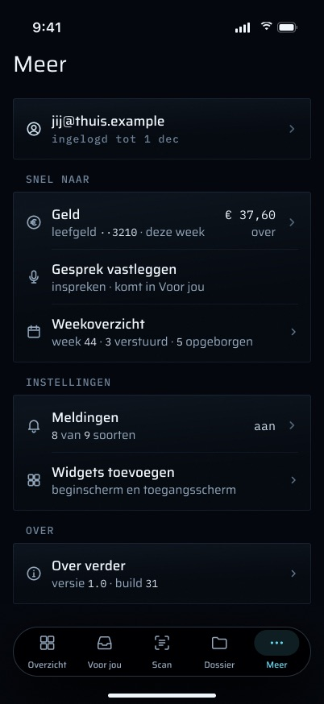
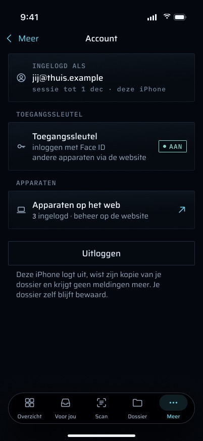
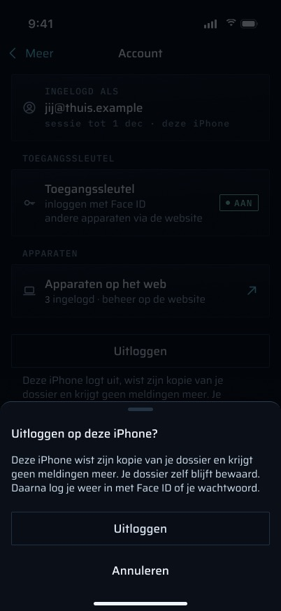
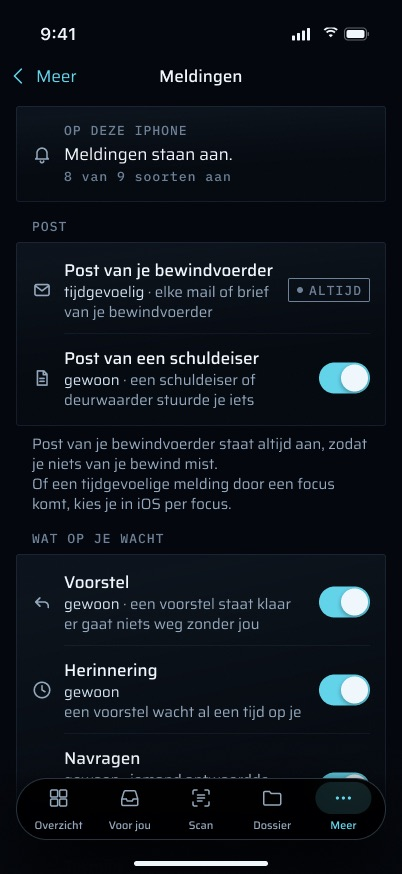
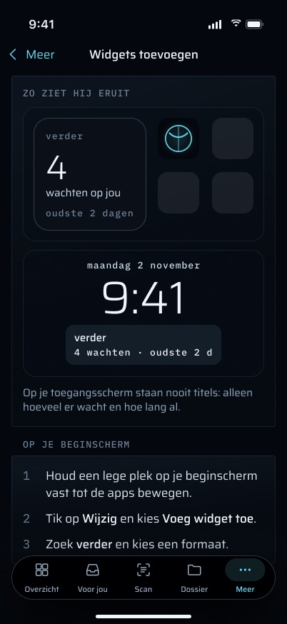
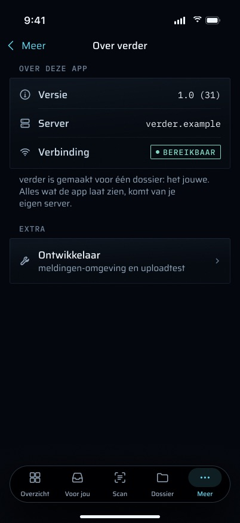
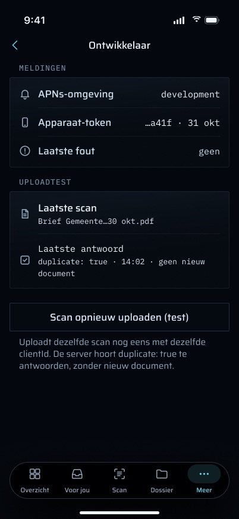

# Meer en de instellingen: functies

## Stand van de bouw

Gecontroleerd tegen de code op branch `feat/iphone-app` op 2026-11-03 (`apps/ios/Grip/More/`, `apps/web/src/app/api/mobile/v1/`, `apps/worker/src/notify/`). Dit document beschrijft **47 functies**:

| Status | Aantal |
|---|---|
| Gebouwd | 19 |
| Deels gebouwd | 13 |
| Nog te bouwen | 15 |

De drie belangrijkste dingen die nog gebouwd moeten worden:

1. **Schakelaars per soort melding** ([Meldingen](#een-schakelaar-per-soort)). Dit is het enige uitgesproken doel van de brief voor dit scherm ("Turn off one notification kind", doel 2 tikken). Daarvoor zijn nodig: een voorkeurentabel op de server, een `GET`/`PUT`-route onder `api/mobile/v1`, een `notify()` die de voorkeur leest voordat hij verstuurt, en de schakelaars op de telefoon met hun toestand voor een mislukte opslag. Vier andere functies hangen ervan af: de telling "N van 9 soorten aan", mail van Verder vast op "altijd", de toestand bij een mislukte opslag, en de keuzes die zichtbaar blijven terwijl meldingen in iOS uit staan.
2. **Een eerlijk uitloggen** ([Uitloggen](#uitloggen)). Voordat het uitloggen bevestigd wordt, hoort de telefoon te waarschuwen voor scans die nog in de wachtrij staan (met "Eerst uploaden") en te zeggen wanneer hij offline is. Een sessie die offline niet beëindigd kon worden, hoort te worden ingetrokken zodra de telefoon weer online is. Nu laat een offline uitlog de sessie op de server tot 30 dagen in leven, en kunnen er meldingen blijven binnenkomen op een telefoon die denkt dat hij is uitgelogd.
3. **Toestand op de rijen, en offline hardop gezegd** ([Statusregels op de rijen](#statusregels-op-de-rijen), [Offline](#offline-gezegd-en-uitgeschakeld-met-de-reden)). Dit omvat het einde van de sessie (`/me` moet het teruggeven), het Geld-bedrag, de weekregel, de versieregel en "offline · bijgewerkt 14:02", waarbij elke actie die de server nodig heeft is uitgeschakeld en de reden wordt gegeven. De gegevens voor het meeste daarvan staan al op de telefoon (`MoneyStore`, `WeeklyStore`, `UploadCenter.isOffline`). Alleen het einde van de sessie en het aantal apparaten hebben de server nodig.

---

Meer is het vijfde tabblad van de iPhone-app. Het is een lijst met instellingen: als wie de telefoon is ingelogd, hoe Grip Martin bereikt, een paar extra's van de zaak (Geld, het snel inspreken van een gesprek, het Weekoverzicht) en feiten over de app zelf. Daarachter zitten de schermen Account, Meldingen, Widgets toevoegen, Over Grip en Ontwikkelaar. Alleen Martin gebruikt de app.

Dit document beschrijft de **volledige functieset** van het scherm zoals de definitieve frames, de spec (`docs/superpowers/specs/2026-10-28-iphone-app-design.md`) en de ontwerpbrief (`docs/superpowers/specs/2026-11-01-iphone-design-brief.md`, §2.5 haptiek, §2.7 toegankelijkheid en de §3-rij "Meer + settings") die vastleggen. Elke functie heeft een statusregel die zegt hoe ver de code is. Het visuele ontwerp valt erbuiten; dat staat in Figma: bestand `QDRL5zHNEOjPzLZqzd19Ii`, sectienode `329:8524` ("meer · final"). De 29 frames in `frames/` zijn exports van die sectie. De frames gebruiken synthetische gegevens (het account `jij@thuis.example`, hetzelfde adres waarmee de DEBUG-fixture van de app antwoordt vanuit `apps/ios/Grip/FixtureData/_shared/me.json`), geen echte gegevens uit de zaak. UI-teksten staan tussen aanhalingstekens in het Nederlands, precies zoals de app ze toont of het frame ze tekent.

> **Het ontwerp loopt voor op de code.** Op branch `feat/iphone-app` zijn de schermen soberder dan de frames, en een aantal dingen die de frames tonen bestaat helemaal niet. Waar een status "Deels" of "Nog te bouwen" zegt, beschrijft de tekst wat de code vandaag doet en wat ontbreekt. Een doorlopend verschil in woordkeus: het ontwerp zegt overal "Toegangssleutel" (de brief en commit `e2b2b0f` verbieden het Engelse woord in de UI), terwijl Meer en Account in de code nog "Passkey" zeggen (`AccountCopy.passkeyLabel`, `AccountCopy.passkeyLine`, de knopteksten in `MoreScreens.swift` en `MoreTab.swift`, `AuthModel.Copy.passkeyAdded` / `passkeyAddFailed`). De inlogschermen en het scherm voor een verlopen sessie zeggen al "toegangssleutel" (`SessionExpiredView.swift`).

## Doel

- **Eén plek voor alles wat geen werk aan de zaak is.** De andere tabbladen zijn de zaak (Overzicht, Voor jou, Dossier) of de camera (Scan). Meer bevat het account, de instellingen voor meldingen, de uitleg over widgets, de versie van de app en de controles voor ontwikkelaars.
- **Een tweede deur naar een paar extra's van de zaak.** Geld, Gesprek vastleggen en het Weekoverzicht hebben elk elders een eigen ingang (een kaart op Overzicht, een snelle actie op het beginscherm, de melding op zondag). Meer zet ze op een rij zodat ze altijd te vinden zijn, en de rijen zeggen hun huidige toestand.
- **Kiezen waarvoor Grip stoort.** Het doel van de brief voor dit scherm: één soort melding uitzetten kost twee tikken (Meer → Meldingen → schakelaar). De server bepaalt wat er wordt verstuurd, dus de schakelaar wordt daar opgeslagen.
- **De toestand zeggen, nooit raden.** De regel over de toegangssleutel is de telling van de server, de regel over toestemming is wat iOS antwoordt, en de versie wordt uit de bundle gelezen. Waar een waarde nog niet bekend is, zegt het scherm dat ("Account wordt opgehaald…", "Meldingen worden gecontroleerd…") in plaats van een standaardwaarde te tonen.

## Hoe je er komt, en waar het heen leidt

**In:**

- **Het tabblad Meer** (`RootView`, tab `ellipsis`, label "Meer").
- **Deep link `grip://weekly`** opent Meer met `[.weekly]` op de stack, en **`grip://money`** opent Meer met `[.money]` (`DeepLink.destination`). De zondagse melding draagt `grip://inbox`, maar `NotificationRouter` stuurt een gewone tik of `OPEN` op de categorie `WEEKLY` toch naar het Weekoverzicht. Links komen alleen binnen via een melding of via Grips eigen widget. De app registreert geen `grip://`-URL-schema, dus geen webpagina of andere app kan er een afvuren.
- **Het eenmalige aanbod voor een toegangssleutel.** Na een interactieve inlog met wachtwoord op een account zonder enige passkey zet `AuthModel` `passkeyOfferPending`, en `RootView` springt naar het tabblad Meer, waar de aanbodkaart boven de lijst staat (zie [Aanbod toegangssleutel](#aanbod-toegangssleutel)).
- **Fixture-opnames:** `-fixtures <name> -tab meer`, en `-route geld` / `-route weekly` (alleen DEBUG).

**Uit:** elke rij zet een scherm op de Meer-stack (`MoreRoute`), behalve "Gesprek vastleggen", dat het spraakvel van `RootView` opent. "Apparaten op het web" verlaat de app voor de browser, en "Open Instellingen" gaat naar de iOS-instellingen.

## Functies

### De Meer-lijst

#### Meer achter Face ID

Het tabblad is vergrendeld (`.lockGated(by: lock)`), dus wie het opent terwijl de app vergrendeld is, ziet eerst het Face ID-vergrendelscherm. De Meer-stack (`meerPath`) wordt vastgehouden door `RootView`, niet door het tabblad, omdat de inhoud van een vergrendeld tabblad niet bestaat zolang de app vergrendeld is. Een link die op het vergrendelscherm binnenkomt, wacht daar en opent zodra de app ontgrendeld is.

**Status:** Gebouwd — `apps/ios/Grip/App/RootView.swift` (`meerPath`, `.lockGated(by: lock)`), `apps/ios/Grip/Auth/AppLock.swift`.

#### Links naar Meer

`grip://weekly` en `grip://money` openen het Weekoverzicht en Geld op de Meer-stack. De zondagse melding opent het Weekoverzicht, welke link ze ook draagt.

**Status:** Gebouwd — `apps/ios/Grip/Push/DeepLink.swift`, `apps/ios/Grip/Push/NotificationRouter.swift` (`weeklyCategory`); tests `DeepLinkTests`, `aWeeklyLinkOpensMeer`, `aTapOnTheWeeklyPushOpensTheSummary`.

#### De rijen en waar ze heen leiden

`MoreMenu` bepaalt de rijen, hun volgorde, symbolen en ondertitels. `MoreTab` tekent ze alleen.

| Rij | Opent |
|---|---|
| Account | `AccountScreen` |
| Meldingen | `NotificationsScreen` |
| Geld | `GeldScreen` (zie `../09-geld/FEATURES.md`) |
| Gesprek vastleggen | het spraakvel (een "+" in plaats van een chevron) |
| Weekoverzicht | `WeeklyView` |
| Widgets toevoegen | `WidgetGuideScreen` |
| Over Grip | `AboutScreen` |
| Ontwikkelaar | `DeveloperScreen` |

Het openen van Meer ververst twee dingen: het account (`GET /api/mobile/v1/me`) en de toestemming voor meldingen (`PushRegistrar.refresh()`, een lokale vraag aan iOS). Niets in de lijst schrijft iets.

**Status:** Gebouwd — `apps/ios/Grip/More/MoreMenu.swift`, `apps/ios/Grip/More/MoreTab.swift`; tests `everyRowLeadsSomewhere`, `theMenuIsInTheBriefsOrder`.

#### Indeling: accountkaart, Snel naar, Instellingen, Over

Het ontwerp opent met een **accountkaart** (het e-mailadres en het einde van de sessie, tikbaar naar Account), gevolgd door drie groepen. "SNEL NAAR" bevat Geld, Gesprek vastleggen en Weekoverzicht. "INSTELLINGEN" bevat Meldingen en Widgets toevoegen. "OVER" bevat Over Grip. **Ontwikkelaar staat niet op Meer**: het zit een niveau dieper, in Over Grip onder "EXTRA", met de regel "meldingen-omgeving en uploadtest" (de Halide-regel van de brief: "advanced a few taps away").

**Status:** Deels gebouwd — elke rij bestaat, maar de groepen in de code zijn "Jij" (Account, Meldingen), "Dossier" (Geld, Gesprek vastleggen, Weekoverzicht) en "App" (Widgets toevoegen, Over Grip, Ontwikkelaar). Er is geen accountkaart, en Ontwikkelaar is een rij op Meer zelf (`MoreMenu.sections`). De aanpassing raakt `MoreMenu.sections`, `AboutScreen` (een "EXTRA"-link naar `.developer`) en de tests `theMenuIsInTheBriefsOrder` en `developerIsLastAndOneLevelDown`.

#### Statusregels op de rijen

Elke rij zegt onder de titel wat de huidige toestand is, en sommige tonen een waarde aan de rechterrand.

| Rij | De regel in het ontwerp | In de code |
|---|---|---|
| Accountkaart | e-mailadres, dan "ingelogd tot 1 dec" | alleen het e-mailadres; het einde van de sessie heeft de server nodig (zie [Einde van de sessie](#einde-van-de-sessie)) |
| Geld | "leefgeld ··3210 · deze week", rechts "€ 37,60 / over" | geen; het bedrag staat al in `MoneyStore` (de Leefgeld-kaart op Overzicht), dus hiervoor is een ondertitel nodig die daaruit gevoed wordt en de regels van Geld volgt: geen bedrag voor een week die niet gedekt is, nooit amber |
| Gesprek vastleggen | "inspreken · komt in Voor jou" | geen (vaste tekst) |
| Weekoverzicht | "week 44 · 3 verstuurd · 5 opgeborgen" | geen; `GET /api/mobile/v1/weekly` geeft al `week`, `sent`, `filedByMartin` en `filedByGrip` terug (`WeeklyModels.swift`), dus Meer moet bij het openen het opgeslagen overzicht lezen; niets vóór de eerste zondag |
| Meldingen | "8 van 9 soorten", rechts "aan"; als meldingen in iOS uit staan: "uit in iOS · zet ze aan via Instellingen" met rechts "uit" | "Aan", "Uit" of "Nog niet aangezet", niets zolang het onbekend is; de telling heeft [de schakelaars](#een-schakelaar-per-soort) nodig |
| Widgets toevoegen | "beginscherm en toegangsscherm" | geen (vaste tekst) |
| Over Grip | "versie 1.0 · build 31", offline "versie 1.0 · server offline" | geen; de versie wordt al gelezen door `AboutInfo` |

**Status:** Deels gebouwd — `MoreMenu.subtitle` geeft het e-mailadres en het woord voor de toestemming (test `rowSubtitlesSayTheState`). Ontbreekt: het einde van de sessie, het Geld-bedrag, de spraakregel, de weekregel, de telling van de soorten, de widgetregel, de versieregel en de waarden aan de rechterrand.

#### Tijdelijke opvulling tijdens het laden

Zolang het account, het geld en de week nog worden opgehaald, tonen de rijen die erop wachten een tijdelijke opvulling in plaats van hun regel ("Meer_laden"). Rijen met een vaste regel tonen die meteen. Niets wacht op het netwerk voordat de lijst bruikbaar is.

**Status:** Deels gebouwd — de lijst is meteen bruikbaar en rijen zonder antwoord hebben gewoon geen ondertitel (`MoreMenu.subtitle` geeft nil terug). Er is geen tijdelijke opvulling, omdat de meeste regels nog niet bestaan.

#### Aanbod toegangssleutel

Staat bovenaan de Meer-lijst, hoogstens één keer per installatie, en alleen na een interactieve inlog met wachtwoord op een account **zonder** passkey (een mislukte opzoeking biedt niets aan). De kaart vraagt "Passkey toevoegen?" / "Dan log je voortaan in met Face ID, zonder wachtwoord." met "Passkey toevoegen" en "Niet nu". De voorvraag voor toestemming voor meldingen wacht tot dit aanbod weg is, zodat de twee nooit op elkaar stapelen.

**Status:** Deels gebouwd — het gedrag is gebouwd (`MoreTab.passkeyOffer`, `AuthModel.passkeyOfferPending` / `dismissPasskeyOffer`). De woorden kloppen niet: het moet "Toegangssleutel toevoegen?" en "Toegangssleutel toevoegen" zeggen.

#### Gesprek vastleggen

De rij opent het vel voor het snel inspreken van een gesprek, hetzelfde vel dat de snelle actie op het beginscherm (`pro.vanderpoel.grip.voice`, `grip://voice`) opent. Martin spreekt een gesprek in, de telefoon zet het om naar tekst, en `POST /api/mobile/v1/entries/voice` slaat het op als een **openstaande suggestie voor een logboekregel** (idempotent op de `clientId`). Het schrijft nooit een regel: Martin keurt die goed in Voor jou. Zonder opname voegt het geen ledger-event toe. Met "bewaar opname" wordt de audio opgeslagen als een `phone-voice`-document (`sourceRef = phone:<clientId>`, eerst opgezocht zodat een nieuwe poging het één keer opslaat). Dat IS één geledgerde `document.ingested`, en die kan nooit worden teruggedraaid, dus de route controleert de partij voordat hij opslaat. Het vel zelf is vergrendeld en is eigendom van `VoiceLogSession` boven de vergrendeling, dus een nieuwe vergrendeling of een 401 behoudt de tekst. Uitloggen vanuit Meer gooit het bewust weg (`forgetVoice`). De ingang via de Actieknop die de brief vraagt, hoort bij het snel inspreken en staat beschreven in `../11-gesprek-vastleggen/FEATURES.md`.

**Status:** Gebouwd — `apps/ios/Grip/More/MoreTab.swift` (`openVoice`), `apps/ios/Grip/Voice/`, `apps/web/src/app/api/mobile/v1/entries/voice/route.ts`.

#### Weekoverzicht

`WeeklyView` leest `GET /api/mobile/v1/weekly`: het nieuwste overzicht dat de worker opsloeg bij zijn `weekly-summary`-run, of 404 vóór de eerste zondag. Het toont wat er gebeurde in de week die zondag 18:00 Amsterdamse tijd eindigt, wat Grip zelf deed, wat er op zondag wachtte, en één volgende stap naar Voor jou. Het is geschiedenis en nooit amber, behalve de volgende stap, die alleen amber wordt op het actuele aantal dat wacht. Het schrijft niets.

**Status:** Gebouwd — `apps/ios/Grip/Weekly/`, `apps/web/src/app/api/mobile/v1/weekly/route.ts` (zie `../12-weekoverzicht/FEATURES.md`).

#### Geld

Opent hetzelfde `GeldScreen` als de kaart op Overzicht. Beschreven in `../09-geld/FEATURES.md`. Het volgt de regels van dat scherm: rekeningen worden nooit samengevoegd, er is geen bedrag voor een week die de afschriften niet dekken, en amber wordt nooit gebruikt voor geld.

**Status:** Gebouwd — `MoreTab`-route `.money` → `GeldScreen(store: money)`.

### Account

#### Wie er is ingelogd

"INGELOGD ALS" toont het e-mailadres uit `GET /api/mobile/v1/me` (`apps/web/src/lib/mobile-account.ts`). De route leest de gevalideerde better-auth-sessie, nooit het verzoek, en antwoordt `{ email, name|null, passkeys }`. `passkeys` is een telling op dezelfde `passkey`-tabel die `/settings/security` toont. De route schrijft niets en voegt geen ledger-event toe. De telefoon heeft hem nodig omdat een inlog met passkey de telefoon nooit het e-mailadres vertelt. De telefoon decodeert strikt: een antwoord zonder e-mailadres telt als geen antwoord. Zolang er niets bekend is, zegt het paneel "Account wordt opgehaald…".

**Status:** Gebouwd — `apps/ios/Grip/More/AccountModel.swift`, `apps/web/src/app/api/mobile/v1/me/route.ts`; tests `readsTheAccount`, `refusesAnAnswerWithoutAnEmail`, `me/route.test.ts`, `mobile-account.test.ts`.

#### Einde van de sessie

Onder het e-mailadres: "sessie tot 1 dec · deze iPhone". Dezelfde datum staat op de accountkaart van Meer als "ingelogd tot 1 dec". Het vertelt Martin wanneer hij opnieuw moet inloggen (30 dagen met "dit apparaat vertrouwen", anders 12 uur).

**Status:** Nog te bouwen — de telefoon kent het einde van zijn sessie niet. Nodig: `loadAccount` die de `expiresAt` van de gevalideerde sessie teruggeeft (better-auths `getSession` draagt die al), het veld in de strikte `AccountDTO`-decode op de telefoon, een formulering met een Amsterdamse datum in `AccountCopy`, en tests op de route en op de tekst.

#### Als het account niet gelezen kan worden

Een mislukte verversing **behoudt** een eerder getoond account. Zonder iets in de cache toont het paneel de oorzaak (dezelfde berichten als Voor jou) en "Opnieuw proberen", en de regel over de toegangssleutel zegt "Niet bekend zolang het account niet is opgehaald.". Een 401 beëindigt de sessie (`auth.sessionRejected()`), en de app toont "Je sessie is verlopen.".

**Status:** Gebouwd — `AccountModel.display` (`loading | shown | unavailable`); tests `unauthorizedEndsTheSession`, `aFailedRefreshKeepsWhatIsShown`, `aFailureWithNothingCachedSaysSoAndRetries`, `aFailureOverACachedAccountKeepsIt`.

#### Status van de toegangssleutel

"TOEGANGSSLEUTEL" zegt of het account er een heeft, als aan/uit-weergave: "AAN" met "inloggen met Face ID · andere apparaten via de website", of "UIT" met "niet ingesteld · inloggen met wachtwoord". De toestand is de telling van de server, nooit een gok.

**Status:** Deels gebouwd — `AccountCopy.passkeyLine` maakt van de telling van de server "Nog geen passkey. Je logt in met je wachtwoord.", "1 passkey op je account." of "N passkeys op je account.", en zegt "Passkeys worden opgehaald…" zolang de telling onbekend is (test `passkeyStatusIsTheServersCount`). Ontbreekt: de aan/uit-weergave, de uitleg wat het betekent voor dit apparaat en voor andere, en het woord "toegangssleutel".

#### Toegangssleutel toevoegen

Registreert een passkey voor deze iPhone (de passkey-registratie van better-auth, met de naam "Grip op iPhone") en leest daarna `/me` opnieuw, zodat de status bijwerkt. De uitkomst staat onder de regel:

- "Passkey toegevoegd. Voortaan log je in met Face ID."
- iOS-fout 1006 (er is al een passkey voor Grip hierheen gesynchroniseerd via de iCloud-sleutelhanger): "Er staat al een passkey voor Grip op deze iPhone, via je iCloud-sleutelhanger. Je kunt er meteen mee inloggen." Dit is geen fout.
- 403, of geen verse sessie: "Log eerst opnieuw in; daarna kun je een passkey toevoegen."
- Rate limit: "Even wachten — te veel pogingen. Probeer het over een minuut opnieuw."
- Offline: "Geen verbinding met Grip. Controleer je internet en probeer het opnieuw."
- Al het andere: "Passkey toevoegen lukte niet. Probeer het over een moment opnieuw." plus een korte oorzaak zonder geheimen, zoals `(ASAuthorizationError 1004)`.
- Het iOS-vel sluiten zegt niets.

Een passkey is accountgegevens in better-auth, geen bewijs, dus het toevoegen ervan voegt geen ledger-event toe.

**Status:** Deels gebouwd — de registratie en elke uitkomst hierboven zijn gebouwd (`AuthModel.addPasskey`, `PasskeyErrorMappingTests`). Ontbreekt: het woord "toegangssleutel" in de knop en in elke uitkomstregel, de regel uit het ontwerp onder de knop ("inloggen met Face ID in plaats van je wachtwoord"), en de uitgeschakelde toestand offline (zie [Offline](#offline-gezegd-en-uitgeschakeld-met-de-reden)). **Open beslissing voor Martin:** het ontwerp biedt de knop alleen aan zolang de status UIT is. De code biedt hem bewust aan zodra de telling bekend is, omdat een passkey op de Mac deze iPhone niet inlogt (`AccountCopy.offersPasskey`, test `aSecondDeviceCanStillAddAPasskey`).

#### Apparaten op het web

Opent `<server>/settings/security` in Safari. Die pagina toont elke iPhone en browser die is ingelogd en laat Martin er een uitloggen. Apparaten zijn daar sessies. De sessie van deze telefoon intrekken op het web stopt ook zijn meldingen, omdat `notify()` `push_devices.session_id` controleert tegen de levende sessies. De regel in het ontwerp onder de link luidt "3 ingelogd · beheer op de website".

**Status:** Deels gebouwd — de link en de toelichting zijn gebouwd (`AccountCopy.devicesURL`, `devicesNote`; test `devicesLiveOnTheWeb`). Ontbreekt: de telling "N ingelogd", waarvoor `/me` ook het aantal levende sessies van de gebruiker moet teruggeven (een telling op de `session`-tabel van better-auth met `expires_at > now()`, plus een routetest). De offline toestand ontbreekt ook.

#### Uitloggen

"Uitloggen" vraagt eerst: "Uitloggen op deze iPhone?". Na bevestiging (`MoreTab.signOut`, `AuthModel.signOut`):

1. Het niet verstuurde ingesproken gesprek wordt weggegooid.
2. Het account wordt vergeten en de Meer-stack wordt geleegd.
3. `POST /api/auth/sign-out` wordt **één keer** verstuurd, en het antwoord wordt genegeerd. Als het de server bereikt, verwijdert better-auth de sessie, en vanaf dan stuurt `notify()` deze telefoon niets meer.
4. Wat het antwoord ook is: de sessiecookie wordt uit de Keychain verwijderd en het sessie-epoch eindigt: elke store vergeet zijn inhoud van de zaak (inbox, overzicht, geld, cache van de tijdlijn), en de badge op het icoon gaat naar 0. Het snapshotbestand van de widget wordt gewist en de widgets herladen, en de map van het zakdossier wordt verwijderd (`dossier.wipe()`).

Niets aan de zaak op de server verandert, en er wordt geen ledger-event geschreven.

**Status:** Gebouwd — `apps/ios/Grip/More/MoreTab.swift` (`signOut`), `apps/ios/Grip/Auth/AuthModel.swift` (`signOut`, `forgetLocally`); tests `signingOutIsConfirmed`, `signOutErasesTheWidgetSnapshot`. De dialoogtekst in de code is korter dan het vel in het ontwerp ("Het dossier op deze iPhone wordt gewist. Daarna log je opnieuw in met Face ID of je wachtwoord.").

#### Scans overleven het uitloggen

De uploadwachtrij blijft bewust bewaard. Scans die nog niet verstuurd zijn, blijven in de App Group-container en gaan na de volgende inlog alsnog weg, dus uitloggen kan geen scan kwijtraken.

**Status:** Gebouwd — `apps/ios/Grip/Upload/UploadCenter.swift` (`sessionRenewed` → `drain()`).

#### Zeggen wat uitloggen doet, vóór de tik

Onder de knop: "Deze iPhone logt uit, wist zijn kopie van je dossier en krijgt geen meldingen meer. Je dossier zelf blijft bewaard." Het antwoord op "wat gaat dit doen?" staat naast de knop, niet alleen in de bevestiging.

**Status:** Nog te bouwen — alleen tekst: een regel in `AccountCopy`, getekend onder de knop in `AccountScreen`, en een test dat de regel alle drie de gevolgen noemt.

#### Waarschuwen voor scans die nog in de wachtrij staan

Als er nog scans wachten om te uploaden, zegt het uitlogvel dat: "Er staan nog 2 scans in de wachtrij." / "Ze worden verstuurd zodra je weer inlogt. Upload ze eerst, dan weet je zeker dat ze in je dossier staan." Het vel biedt "Eerst uploaden" (de hoofdkeuze: die sluit het vel, start de upload en logt niet uit), "Toch uitloggen" en "Annuleren".

**Status:** Nog te bouwen — de wachtrij blijft bewaard maar wordt nooit genoemd. Nodig: een uitlogvel dat de enkele `confirmationDialog` vervangt, het aantal niet verstuurde items uit `UploadCenter.items` (toestanden `pending`, `sending`, `failed`), "Eerst uploaden" gekoppeld aan `UploadCenter.drain()` / `retryFailed()`, tekst in enkelvoud en meervoud, en tests voor elke variant.

#### Uitloggen terwijl de iPhone offline is

Offline zegt het vel "Deze iPhone is offline · bijgewerkt 14:02." / "Hij logt nu uit en wist zijn kopie. Grip trekt je sessie in zodra deze iPhone weer online is; tot dan kunnen er nog meldingen binnenkomen." met "Toch uitloggen" en "Annuleren". Als er ook scans in de wachtrij staan, noemt het vel beide feiten in één tekst ("De 2 scans worden verstuurd zodra je weer inlogt. Je sessie wordt ingetrokken zodra deze iPhone weer online is; …").

**Status:** Nog te bouwen — de dialoog noemt het netwerk nu nooit. Nodig: de offline-stand uit `UploadCenter.isOffline` (de `NWPathMonitor` draait al), beide varianten van het vel met hun tekst, en tests. Het hangt af van de volgende functie, want zonder het uitgestelde intrekken zou de belofte in de tekst onwaar zijn.

#### De sessie intrekken zodra de iPhone weer online is

Een uitlog die de server niet kon bereiken, wordt later afgemaakt: de telefoon houdt het intrekken openstaand en stuurt `POST /api/auth/sign-out` voor de **oude** sessie zodra hij weer online is. Daarna heeft de server geen sessie meer voor deze telefoon en stopt `notify()` met meldingen ernaartoe.

**Status:** Nog te bouwen — de code stuurt het uitlogverzoek één keer en vergeet de cookie, wat het antwoord ook is. Het eigen commentaar zegt dat: "A session left alive server-side expires on its own and can be revoked from /settings/security." Tot dan blijft de sessie leven (12 uur, of 30 dagen met "dit apparaat vertrouwen"), en kunnen er nog meldingen op de telefoon binnenkomen. Nodig: de oude sessiegegevens bewaard in de Keychain onder een aparte sleutel voor "openstaand intrekken", verstuurd zodra het netwerk terug is (via de path monitor en bij het starten) en verwijderd na elk antwoord dat de server geeft, nooit te verwarren met een nieuwe sessie na een latere inlog, plus tests voor offline → online en voor een inlog tussendoor. Geen wijziging op de server: de eigen uitlogroute van better-auth is genoeg.

### Meldingen

#### Toestemming op deze iPhone

"OP DEZE IPHONE" toont wat iOS antwoordt:

| iOS zegt | Regel | Actie |
|---|---|---|
| toegestaan | "Meldingen staan aan." | geen |
| nog niet bepaald | "Meldingen zijn nog niet aangezet." | "Meldingen aanzetten" opent het iOS-toestemmingsvel (`push.acceptPrePrompt()`); bij ja meldt de telefoon zich aan bij APNs |
| geweigerd | "Meldingen staan uit. Zet ze aan in Instellingen om te horen wanneer Verder iets vraagt." | "Open Instellingen" opent de meldingsinstellingen van Grip in iOS |
| nog niet gelezen | "Meldingen worden gecontroleerd…" | geen |

Als de laatste aanmelding in deze sessie van de app mislukte, staat de reden in mono onder de regel. Dat is ofwel "Aanmelden voor meldingen lukte niet. Grip probeert het bij de volgende start opnieuw." (Grip accepteerde het token niet) ofwel "Deze iPhone kon zich niet aanmelden bij Apple voor meldingen." gevolgd door het foutdomein en de foutcode van iOS (APNs weigerde). Een tik op "Meldingen aanzetten" hier telt ook als het tonen van de voorvraag.

**Status:** Gebouwd — `NotificationsCopy.permissionLine` / `action`, `NotificationsScreen`, `apps/ios/Grip/Push/PushRegistrar.swift`; test `permissionStatesSayWhatToDo`. De tekst voor geweigerd uit het ontwerp ("Grip kan je nu niets laten weten. Zet ze aan in Instellingen; je keuzes hieronder gelden weer zodra ze aanstaan.") hangt af van de schakelaars en komt met ze mee.

#### Deze iPhone aanmelden voor meldingen

Bij elke start met een sessie en toestemming vraagt de app APNs om een token. `POST /api/mobile/v1/push/register` maakt of werkt dan een `push_devices`-rij bij die gebonden is aan de **gevalideerde sessie** (een `sessionId` in de body wordt genegeerd), met de APNs-omgeving gelezen uit het eigen provisioning profile van de app. De server werkt bij op het token, dus er een opnieuw sturen is onschuldig. Een 401 daar beëindigt de sessie op de telefoon (`auth.sessionRejected()`). Dit is geen bewijs en voegt geen ledger-event toe.

**Status:** Gebouwd — `PushRegistrar.didRegister`, `apps/web/src/app/api/mobile/v1/push/register/route.ts`; test `push/register/route.test.ts`.

#### Wat elke soort betekent

Eén item per soort melding die de worker verstuurt, gegroepeerd naar waar het over gaat. "POST": "Post van je bewindvoerder" (tijdgevoelig, "elke mail of brief van je bewindvoerder") en "Post van een schuldeiser" (gewoon, "een schuldeiser of deurwaarder stuurde je iets"). "WAT OP JE WACHT": "Voorstel" ("er gaat niets weg zonder jou"), "Herinnering", "Navragen" en "Termijn". "WAT GRIP DEED": "Opgeborgen" (stil), "Weekoverzicht" (stil, "zondag 18:00") en "Systeem". Elk item noemt zijn niveau, tijdgevoelig, gewoon of stil, zoals de worker het werkelijk instelt. De tekst belooft niet dat een melding door een focus heen komt, omdat dat nooit gemeten is.

**Status:** Deels gebouwd — `NotificationsCopy.kinds` is een alleen-lezen lijst in de volgorde van `NotificationCategories.ids` onder één kop, "WAT GRIP JE LAAT WETEN", met de namen uit de code ("Mail van Verder", "Mail van een schuldeiser", …, "Deadline"). De niveaus staan alleen in sommige uitleggen (tests `everyKindTheWorkerSendsIsExplained`, `verderMailClaimsNoFocusBreakthrough`). Ontbreekt: de drie groepen, een woord voor het niveau bij elke soort, en de namen uit het ontwerp ("Post van je bewindvoerder", "Post van een schuldeiser", "Termijn" voor `TASK_DUE`).

#### Een schakelaar per soort

Elke soort (behalve mail van Verder, zie hieronder) heeft een schakelaar. Er een uitzetten betekent dat de server die soort niet meer naar Martins apparaten stuurt. De keuze geldt voor het hele account en niet per telefoon, omdat de server bepaalt wat er wordt verstuurd. De rij Meldingen op Meer telt wat er aan staat ("8 van 9 soorten").

**Status:** Nog te bouwen — er zijn nergens voorkeuren voor meldingen: geen schakelaar op de telefoon, geen route onder `api/mobile/v1`, geen tabel, en `notify()` (`apps/worker/src/notify/notify.ts`) leest er geen. Nodig:
- een migratie met een voorkeurentabel op sleutel gebruiker en soort (geen bewijs, dus UPDATE en DELETE mogen, en er wordt geen ledger-event geschreven);
- `GET` en `PUT /api/mobile/v1/notification-preferences` op de gevalideerde sessie, die een onbekende soort weigeren en weigeren `VERDER_MAIL` uit te zetten;
- `notify()` die de voorkeur leest voordat hij uitwaaiert, en voor elk kanaal dat hij overslaat een `notification_attempts`-rij schrijft met status `skipped` en een reden zoals `muted-by-martin`, zodat het diagnosepad compleet blijft. De badge en de stille verversingsmeldingen (`badge.sync`) zijn geen soort en worden nooit gedempt;
- schakelaars op de telefoon die de opgeslagen waarde tonen, hem optimistisch zetten en bij een fout terugdraaien;
- tests voor de route, voor `notify()` die een gedempte soort overslaat en de rest nog wel verstuurt, en voor de tekst.

De webapp heeft ook geen scherm voor voorkeuren; of die er een krijgt, is open.

#### "N van 9 soorten aan"

Onder de toestemmingsregel en op de rij op Meer: hoeveel soorten aan staan, mail van Verder meegeteld, die altijd aan staat.

**Status:** Nog te bouwen — hangt af van [de schakelaars](#een-schakelaar-per-soort). Tekst in `NotificationsCopy` en `MoreMenu.subtitle`, met een test.

#### Mail van Verder staat altijd aan

"Post van je bewindvoerder" heeft geen schakelaar. Er staat "ALTIJD", met de toelichting "Post van je bewindvoerder staat altijd aan, zodat je niets van je bewind mist. Of een tijdgevoelige melding door een focus komt, kies je in iOS per focus." Dit houdt de projectregel overeind dat elke mail van Verder Martins aandacht krijgt.

**Status:** Nog te bouwen — heeft de schakelaars nodig, en de weigering van de route om `VERDER_MAIL` te dempen. Vandaag staat de helft over de focus van de toelichting in de uitleg bij `VERDER_MAIL`.

#### Een wijziging die niet is opgeslagen

Als het opslaan van een schakelaar mislukt, gaat de schakelaar terug naar zijn opgeslagen waarde en toont de soort "Niet opgeslagen · Grip niet bereikbaar." met "Opnieuw proberen". Het scherm claimt nooit een keuze die de server niet heeft opgeslagen.

**Status:** Nog te bouwen — onderdeel van de schakelaars: een opslagtoestand per soort en een nieuwe poging, een `.error`-haptiek (zie [Haptiek](#haptiek)), en een test dat een mislukte `PUT` de opgeslagen waarde getoond laat.

#### Keuzes blijven zichtbaar terwijl meldingen in iOS uit staan

Als meldingen in iOS uit staan, blijven de soorten in de lijst staan met hun opgeslagen waarde als gewone tekst ("altijd", "aan") in plaats van schakelaars, en mail van Verder toont "komt weer zodra meldingen aanstaan". Martin ziet wat er terugkomt zodra hij meldingen aanzet.

**Status:** Nog te bouwen — heeft de schakelaars nodig. Het paneel voor geweigerde toestemming zelf is gebouwd.

#### Stille uren

Herinneringen, navragen en termijnen worden alleen tussen 08:00 en 22:00 Amsterdamse tijd gestuurd. De toelichting onder "WAT OP JE WACHT" zegt dat: "Herinneringen, navragen en termijnen komen alleen tussen 08:00 en 22:00."

**Status:** Deels gebouwd — het gedrag is echt (`apps/worker/src/proposals/clocks.ts`, `ALERT_DAY_START_HOUR = 8`, `ALERT_DAY_END_HOUR = 22`). Het scherm zegt het niet. Alleen tekst, met een test dat de genoemde uren gelijk zijn aan de constanten van de worker, of ten minste een commentaar dat ze aan elkaar koppelt.

#### Wat "stil" betekent

"Stille meldingen komen in je meldingencentrum zonder geluid of scherm aan."

**Status:** Gebouwd — `NotificationsCopy.quietNote`.

### Widgets toevoegen

#### De uitleg

Een uitleg in de app. "OP JE BEGINSCHERM" heeft genummerde stappen, "OP JE TOEGANGSSCHERM" heeft drie stappen, en "FORMATEN" geeft één regel per familie die de widget ondersteunt, met wat die familie tekent (Klein, Middel, Groot, Rond, Rechthoek, Regel). Alleen Groot en Rechthoek noemen de leeftijd van het oudste, in lijn met `WidgetContent.showsOldest`. Hij eindigt met "Op je toegangsscherm toont Grip nooit titels: alleen hoeveel er wacht, en in de rechthoek hoe oud het oudste is." Er wordt niets gelezen of geschreven.

**Status:** Gebouwd — `WidgetGuide`, `WidgetGuideScreen`; tests `theWidgetGuideNamesEveryPlaceAWidgetGoes`, `theWidgetGuideIsTruePerFamily`. Het ontwerp heeft drie stappen voor het beginscherm waar de code er vier heeft, en geen lijst "FORMATEN".

#### Een voorbeeld van de widget

"ZO ZIET HIJ ERUIT" toont de widget zoals hij er vandaag uit zou zien: een widget op het beginscherm met de telling ("4 wachten op jou · oudste 2 dagen") tussen app-iconen, en het toegangsscherm met de rechthoek onder de klok ("4 wachten · oudste 2 d"). Daaronder: "Op je toegangsscherm staan nooit titels: alleen hoeveel er wacht en hoe lang al." Martin ziet wat hij toevoegt voordat hij de app verlaat om het toe te voegen.

**Status:** Nog te bouwen — hiervoor moeten de eigen views van de widget (`GripWidget`, `WidgetContent`) in de app worden getekend vanuit de huidige snapshot van de widget, zodat het voorbeeld niet kan afwijken van de echte widget. Het moet dezelfde regels volgen: geen titels in de familie van het toegangsscherm, amber alleen met de bijbehorende woorden. Nodig is een test dat de tekst van het voorbeeld gelijk is aan wat `WidgetContent` voor die familie tekent.

### Over Grip

#### Versie, server en wat Grip is

"Versie" (`CFBundleShortVersionString (CFBundleVersion)`, of "onbekend") en "Server" (de host waarmee deze build praat), beide selecteerbaar, daarna "Grip is gemaakt voor één dossier: het jouwe. Alles wat de app laat zien, komt van je eigen server." Deze worden lokaal gelezen, zonder verzoek.

**Status:** Gebouwd — `AboutInfo`, `AboutScreen`; test `aboutReadsTheBundleAndTheServer`.

#### Verbinding

"Verbinding" zegt of deze telefoon Grip op dit moment kan bereiken: "BEREIKBAAR", of niet. Op Meer toont de rij dan "server offline". Het beantwoordt "ligt het aan mij of aan de server?" zonder de ontwikkelaarstools te openen.

**Status:** Nog te bouwen — de code doet hier geen verzoek. Nodig: één lichte, geauthenticeerde aanroep als het scherm opent (`GET /api/mobile/v1/me` bestaat al en schrijft niets), drie toestanden (bereikbaar / niet bereikbaar met de oorzaak / geen internet uit `UploadCenter.isOffline`), nooit een geraden toestand zolang het antwoord uitstaat, en tests per toestand. Een 401 beëindigt de sessie, zoals overal.

### Ontwikkelaar

Controles voor ontwikkelaars, in elke build (niet alleen DEBUG), een niveau dieper.

#### APNs-omgeving

De omgeving die deze telefoon met zijn token meestuurde: "development", "production" of "nog niet aangemeld". Hij wordt getoond zodra Grip die aanmelding in de huidige sessie van de app heeft geaccepteerd, in het geheugen vastgehouden en niet teruggelezen van de server, en hij gaat terug naar "nog niet aangemeld" na een 401. Het is het eerste om te lezen als een melding niet aankomt: een sandbox-token dat naar de productiehost wordt gestuurd, faalt stil.

**Status:** Gebouwd — `PushRegistrar.registeredEnvironment`, `DeveloperScreen`.

#### Apparaat-token

Het staartje van het APNs-token van deze telefoon en de dag waarop Grip het accepteerde ("…a41f · 31 okt"). Dat is genoeg om de telefoon te koppelen aan zijn `push_devices`-rij en zijn `notification_attempts`, en het toont nooit het hele token.

**Status:** Nog te bouwen — `PushRegistrar` berekent het hex-token (`hexToken`) maar bewaart het niet, en ook het tijdstip van acceptatie niet. Nodig: de laatste vier hex-tekens en het tijdstip van acceptatie bewaard na een geslaagde aanmelding, getekend in `DeveloperScreen`, en een test dat er nooit meer dan het staartje wordt getoond.

#### Laatste fout

De laatste fout bij het aanmelden voor meldingen in deze sessie van de app, of "geen".

**Status:** Deels gebouwd — `PushRegistrar.lastError` bestaat en wordt getoond op Meldingen, niet hier, en er is geen "geen".

#### Scan opnieuw uploaden (test)

Stuurt de nieuwste verstuurde scan opnieuw, met dezelfde bytes en dezelfde `clientId`, naar `POST /api/mobile/v1/documents`. De server moet `duplicate: true` antwoorden en niets opslaan, dus er wordt geen `document.ingested`-event geschreven. Het is een echte upload naar het echte dossier, dus het wordt uitgelegd voordat het loopt. De code vraagt om bevestiging: "Laatste scan opnieuw versturen met dezelfde clientId?" / "Grip hoort te antwoorden met duplicate: true, zonder een nieuw document.". Het ontwerp zet dezelfde uitleg onder de knop. "Laatste scan" noemt het bestand. Gemeten op het toestel op 2026-10-31: `phone-scan` bleef op 1 en het ledger op 549.

**Status:** Gebouwd — `UploadCenter.lastSent` / `resendLastSent`, `DeveloperScreen`, `apps/web/src/app/api/mobile/v1/documents/route.ts`.

#### Laatste antwoord

Het antwoord van de server op dat opnieuw versturen, leesbaar gemaakt: "duplicate: true · 14:02 · geen nieuw document".

**Status:** Deels gebouwd — het ruwe antwoord wordt afgedrukt ("duplicate: … · id … · clientId …" of "Mislukt: …", `UploadCenter.resendResult`). Ontbreekt: het tijdstip en de gewone uitleg van wat `duplicate` betekent.

### Over deze schermen heen

#### Offline: gezegd, en uitgeschakeld met de reden

Offline zegt elk scherm dat in een mono-weergave, "offline · bijgewerkt 14:02", met de leeftijd van wat er getoond wordt: in de accountkaart van Meer, bovenaan Account en bovenaan Meldingen. Elke actie die de server nodig heeft, is uitgeschakeld **met de reden**, nooit zonder iets te zeggen: "Toegangssleutel toevoegen · kan weer als je online bent", "Apparaten op het web · 3 ingelogd · kan weer als je online bent", en op Meldingen worden de schakelaars gewone waarden onder "wijzigen kan weer zodra je online bent". Account voegt toe: "Uitloggen werkt ook offline. Je sessie wordt ingetrokken zodra deze iPhone weer online is." De rij van Over Grip toont "server offline".

**Status:** Nog te bouwen — er is op deze schermen geen aanduiding dat de telefoon offline is. Een passkey die offline wordt toegevoegd, faalt achteraf met het offline-bericht. De onderdelen bestaan elders: `UploadCenter.isOffline` (een `NWPathMonitor`), en dezelfde formulering van de weergave in `HomeSummary.swift` en `DossierModel.swift`. Nodig: de offline-toestand doorgegeven aan `MoreTab` en zijn schermen, een tijdstip van het laatste goede antwoord voor `/me`, de uitgeschakelde toestanden met hun reden, en tests. De zin op Account over het intrekken moet wachten op [het uitgestelde intrekken](#de-sessie-intrekken-zodra-de-iphone-weer-online-is).

#### Grote tekst

Bij de grootste toegankelijkheidsgrootte loopt elke regel door naar de volgende regel, en rijen worden hoger in plaats van af te kappen ("Meer_AX5", "Account_AX5_onderaan").

**Status:** Deels gebouwd — alle tekst gebruikt Dynamic Type (`relativeTo:`) en de schermen scrollen. De ondertitels van de rijen op Meer zijn `lineLimit(1)` in `MoreRow` en worden afgekapt.

#### Kleine telefoon

Dezelfde lay-out in één kolom, scrollend, op een iPhone SE van 375 × 667.

**Status:** Gebouwd — de schermen zijn scroll views met een marge van 16 pt (`MoreTab`, `MorePage` in `MoreScreens.swift`).

#### VoiceOver

Schermtitels zijn koppen. Elke rij is één element, voorgelezen als titel en dan toestand ("Meldingen, 8 van 9 soorten, aan"). Schakelaars noemen hun soort en hun waarde (brief §2.7).

**Status:** Deels gebouwd — elke rij is één `Button`, dus VoiceOver leest titel en ondertitel als één element. De titels getekend door `MoreText.title` zijn niet als kop gemarkeerd (geen `.accessibilityAddTraits(.isHeader)`), en de schakelaars bestaan nog niet.

#### Haptiek

Brief §2.5: een mislukte actie geeft `.error`, samen met de nieuwe poging ter plekke. Op deze schermen is dat een mislukte "Toegangssleutel toevoegen" en een wijziging van een schakelaar die niet is opgeslagen. Verder trilt hier niets. De haptiek wordt overgeslagen als de systeeminstelling uit staat, en niets hangt ervan af.

**Status:** Nog te bouwen — niets onder `apps/ios/Grip/More/` gebruikt `.sensoryFeedback` (alleen Overzicht, Scan en het scherm voor een verlopen sessie doen dat). Nodig: `.sensoryFeedback(.error, trigger:)` op het foutbericht bij de passkey en op de mislukte opslag van een voorkeur.

#### Geen schakelaar voor weergave, geen schakelaar voor Face ID

Meer biedt geen keuze tussen licht en donker (de app is alleen donker, brief §5.2) en geen schakelaar om de Face ID-vergrendeling uit te zetten (brief §5, open beslissingen: "The lock stays always-on, with no toggle in Meer").

**Status:** Gebouwd — geen van beide bestaat in `MoreMenu`, en `AppLock` heeft geen manier om het uit te zetten.

## Toestanden

| Toestand | Wat het ontwerp toont | Wat de code vandaag toont |
|---|---|---|
| Vergrendeld | — | Het Face ID-vergrendelscherm in plaats van Meer en elk scherm op de stack; "Ontgrendel met Face ID" |
| Laden (Meer) | Tijdelijke opvulling waar het account, Geld, de week, de telling van de soorten en de versie komen | De rijen zonder ondertitels tot `/me` en het antwoord over toestemming binnen zijn; alles is bruikbaar |
| Laden (Account) | — | "Account wordt opgehaald…", "Passkeys worden opgehaald…" |
| Account lezen mislukt, niets in de cache | "Account niet opgehaald." met "Opnieuw proberen" | De oorzaak en "Opnieuw proberen"; toegangssleutel "Niet bekend…" |
| Account lezen mislukt, wel in de cache | — | Het account uit de cache, ongewijzigd |
| Offline | "offline · bijgewerkt 14:02"; serveracties uitgeschakeld met de reden | Geen aanduiding. Meer, Meldingen, Widgets, Over Grip en Ontwikkelaar werken volledig (alles lokaal); Account houdt wat het had of toont de transportfout; een passkey toevoegen faalt met het offline-bericht |
| Uitloggen met scans in de wachtrij | De waarschuwing over de wachtrij met "Eerst uploaden" | De eenvoudige dialoog |
| Uitloggen offline | Het offline-vel met het uitgestelde intrekken | De eenvoudige dialoog; de sessie op de server blijft leven |
| Sessie verlopen (401) | — | De app vervangt de tabbladen door "Je sessie is verlopen."; scans in de wachtrij worden na de volgende inlog verstuurd |
| Meldingen geweigerd | Meer "uit in iOS · zet ze aan via Instellingen"; Meldingen houdt de keuzes als waarden | Ondertitel op Meer "Uit"; Meldingen biedt "Open Instellingen" |
| Voorkeur niet opgeslagen | "Niet opgeslagen · Grip niet bereikbaar." met "Opnieuw proberen" | Bestaat niet (geen voorkeuren) |
| Grote tekst (AX5) | Elke regel loopt door | Tekst schaalt; de ondertitels van de rijen op Meer worden afgekapt tot één regel |
| Kleine telefoon (SE, 375 × 667) | Dezelfde lijst, scrollend | Dezelfde lay-out in één kolom in een scroll view |

## Privacy en beveiliging

Alles in deze sectie bestaat in de code zoals beschreven (`AppLock.swift`, `SessionStore.swift`, `AuthModel.forgetLocally`, `DossierStore`, `notify.ts`). Alleen de delen die als "gepland" zijn gemarkeerd, hangen af van functies hierboven die nog gebouwd moeten worden.

- **Face ID.** Meer en alles erachter zijn vergrendeld. De app vraagt om Face ID (met de toegangscode van het toestel als terugval, `LAPolicy.deviceOwnerAuthentication`) bij een koude start en opnieuw na meer dan 5 minuten op de achtergrond (`LockPolicy.graceSeconds = 300`; een klok die achteruit is gegaan vergrendelt ook). Na een ontgrendeling is elk tabblad open tot de volgende vergrendeling. Overzicht blijft leesbaar als de app vergrendeld is, maar toont alleen aantallen en geld, en Scan is nooit vergrendeld.
- **Sessie.** De sessiecookie van better-auth staat in de Keychain, `AfterFirstUnlockThisDeviceOnly`, en wordt nooit van het toestel af gesynchroniseerd. Cookie-opslag staat uit en redirects worden nooit gevolgd, zodat een redirect naar /login niet voor succes kan worden aangezien.
- **Wat uitloggen verwijdert:** de cookie in de Keychain, alle inhoud van de zaak in het geheugen, de badge (op 0), de snapshot van de widget (zodat het beginscherm geen titels meer tekent), de cache van de tijdlijn en de map van het zakdossier (opgeslagen met `.completeFileProtection`, uitgesloten van back-ups). **Wat het bewaart:** de uploadwachtrij (niet verstuurde scans), de vlaggen "aanbod getoond" en "voorvraag getoond" in `UserDefaults`, en de toestemming voor meldingen in iOS. Het geplande [uitgestelde intrekken](#de-sessie-intrekken-zodra-de-iphone-weer-online-is) voegt één bewaard item toe: de oude sessiegegevens, alleen tot het intrekken de server heeft bereikt.
- **Toegangsscherm en widgets.** Niets op deze schermen verschijnt op het toegangsscherm. De uitleg over widgets (en het geplande voorbeeld) noemt de regel van de widget: families op het toegangsscherm tonen nooit titels.
- **Een kwijtgeraakte telefoon** wordt via het web afgehandeld: trek zijn sessie in op `/settings/security` ("Apparaten op het web"). Het volgende verzoek antwoordt 401 en de telefoon vergeet alles zoals hierboven, en `notify()` stopt meteen met meldingen ernaartoe.
- **Voorkeuren voor meldingen** (zodra gebouwd) staan op de server onder de gevalideerde sessie en zijn geen bewijs. Ze veranderen wat er wordt verstuurd, nooit wat er wordt vastgelegd: een gedempte soort laat nog steeds zijn `notification_attempts`-rij achter.

## Regels die het volgt

- **Niets wordt verzonnen.** Onbekende waarden worden onbekend genoemd. De status van de toegangssleutel is de telling van de server, nooit een gok. Geen rij belooft een functie die niet bestaat: "binnenkort" is in de hele app verboden (`NothingPromisedTests`, `noWordInMeerIsAPromise`), dus een functie in dit document die nog niet gebouwd is, blijft van het scherm weg tot hij gebouwd is, nooit als tijdelijke rij.
- **Niets hier is bewijs**, met één uitzondering. `/me`, het aanmelden voor meldingen, een passkey toevoegen, uitloggen en (gepland) voorkeuren voor meldingen voegen geen ledger-event toe, en de server ontdubbelt het opnieuw versturen vanuit Ontwikkelaar. De uitzondering is een ingesproken gesprek dat verstuurd wordt met bewaarde opname: de audio is een geledgerde `document.ingested`.
- **AI-uitvoer is een suggestie.** Het ingesproken gesprek uit "Gesprek vastleggen" komt in Voor jou binnen als een openstaande suggestie.
- **Mail van Verder kan nooit worden uitgezet.** Elke mail van Verder krijgt Martins aandacht. De geplande schakelaars laten hem vast op "altijd" staan, en de route weigert hem te dempen.
- **Amber alleen voor wat op Martin wacht.** Geen van deze schermen gebruikt amber, behalve de volgende stap van het Weekoverzicht, en alleen op het actuele aantal dat wacht (de getallen van zondag zijn geschiedenis). Het Geld-bedrag op de rij van Meer is nooit amber.

## Meldingen en haptiek

Deze schermen veroorzaken geen meldingen. Meldingen vraagt iOS om toestemming, en de app toont zijn eigen voorvraag "Meldingen aanzetten?" na een inlog of ontgrendeling, nooit bij een koude start. De meldingen zelf worden verstuurd door `notify()` van de worker. Zodra de schakelaars bestaan, bepaalt `notify()` ook welke soorten hij overslaat. Voor haptiek zie [Haptiek](#haptiek): `.error` alleen bij een mislukte actie, nog niet gebouwd.

## Offline gedrag en synchronisatie

Meer heeft geen eigen gegevens en synchroniseert niet. `/me` wordt gelezen bij elke opening van Meer en Account en nadat er een passkey is toegevoegd, en een mislukking houdt het laatste goede antwoord vast. De geplande rijregels lezen gegevens die de telefoon al bewaart (geld, het weekoverzicht), dus offline tonen ze de laatste goede waarde met haar leeftijd. Voorkeuren voor meldingen worden gelezen als Meldingen opent en per schakelaar geschreven. Offline worden ze alleen-lezen getoond, nooit in een wachtrij gezet, omdat een keuze die alleen op de telefoon staat Martin iets zou vertellen wat de server niet doet. Uitloggen werkt offline lokaal. Het kan de sessie op de server pas beëindigen als het [uitgestelde intrekken](#de-sessie-intrekken-zodra-de-iphone-weer-online-is) gebouwd is.

## Bekende grenzen en wat niet gemeten is

- `/settings/security` toont deze telefoon als "Onbekend apparaat": zijn user agent (`Grip/1 CFNetwork/… Darwin/…`) wordt niet herkend door de parser van het web. De telling "N ingelogd" telt hem onder die naam mee.
- Of een tijdgevoelige melding door een focus heen komt, is op Martins eigen keuze niet gemeten, en de tekst belooft niets.
- Het ontwikkelaarscertificaat en het profiel verlopen op 2027-10-31. Over Grip toont die datum niet.
- Open voor Martin: of "Toegangssleutel toevoegen" aangeboden blijft als het account er al een heeft (code: ja; ontwerp: nee), en of "Systeem" echt uitgezet mag kunnen worden, omdat systeemmeldingen de manier zijn waarop Grip meldt dat het kapot is (het ontwerp tekent er een schakelaar voor).

## Waar in de code

**iOS (`apps/ios/`):**

- `Grip/More/MoreMenu.swift`: `MoreRoute`, `MoreMenu` (secties, titels, symbolen, ondertitels), `AccountCopy`, `NotificationsCopy`, `WidgetGuide`, `AboutInfo`. Elk woord op deze schermen.
- `Grip/More/MoreTab.swift`: de Meer-lijst, het aanbod voor de toegangssleutel, de navigatiebestemmingen, `signOut()`.
- `Grip/More/MoreScreens.swift`: `AccountScreen`, `NotificationsScreen`, `WidgetGuideScreen`, `AboutScreen`, `DeveloperScreen`.
- `Grip/More/AccountModel.swift`: `GET /api/mobile/v1/me`, de cache die een mislukking overleeft, afhandeling van 401.
- `Grip/Auth/AuthModel.swift` (`signOut`, `forgetLocally`, `addPasskey`), `Grip/Auth/SessionStore.swift`, `Grip/Auth/SessionEpoch.swift`, `Grip/Auth/AppLock.swift`.
- `Grip/Push/PushRegistrar.swift` (toestemming, aanmelding, `registeredEnvironment`, `lastError`), `Grip/Push/DeepLink.swift`, `Grip/Push/NotificationRouter.swift`.
- `Grip/Upload/UploadCenter.swift` (`lastSent`, `resendLastSent`, `isOffline`, `items`, `drain`).
- `Grip/App/RootView.swift` (het tabblad, `meerPath`, de overstap voor het aanbod van de toegangssleutel, afhandeling van links).

**Server:**

- `apps/web/src/app/api/mobile/v1/me/route.ts` en `apps/web/src/lib/mobile-account.ts` (die het einde van de sessie en het aantal levende sessies erbij moeten krijgen).
- `apps/web/src/app/api/mobile/v1/push/register/route.ts`.
- `apps/web/src/app/api/mobile/v1/documents/route.ts` (de ontdubbeling op `clientId` bij het opnieuw versturen).
- `apps/web/src/app/api/mobile/v1/entries/voice/route.ts`, `apps/web/src/app/api/mobile/v1/weekly/route.ts`.
- `/api/auth/sign-out` is van better-auth zelf. `apps/worker/src/notify/notify.ts` bevat de sessiecontrole die meldingen stopt, en is waar een controle op voorkeuren zou komen. `apps/worker/src/proposals/clocks.ts` bevat het venster van 08:00–22:00.

**Tests:**

- `apps/ios/GripTests/MoreMenuTests.swift`: `theMenuIsInTheBriefsOrder`, `everyRowLeadsSomewhere`, `developerIsLastAndOneLevelDown`, `rowSubtitlesSayTheState`, `passkeyStatusIsTheServersCount`, `aSecondDeviceCanStillAddAPasskey`, `devicesLiveOnTheWeb`, `signingOutIsConfirmed`, `everyKindTheWorkerSendsIsExplained`, `verderMailClaimsNoFocusBreakthrough`, `permissionStatesSayWhatToDo`, `theWidgetGuideNamesEveryPlaceAWidgetGoes`, `theWidgetGuideIsTruePerFamily`, `aboutReadsTheBundleAndTheServer`, `noWordInMeerIsAPromise`, en de `AccountModel`-tests (`readsTheAccount`, `refusesAnAnswerWithoutAnEmail`, `unauthorizedEndsTheSession`, `aFailedRefreshKeepsWhatIsShown`, `aFailureWithNothingCachedSaysSoAndRetries`, `aFailureOverACachedAccountKeepsIt`, `theFixtureAnswersTheAccount`).
- `AuthModelPasskeyTests` in `PasskeyAuthTests.swift` (`signOutErasesTheWidgetSnapshot`, `sessionRejectedErasesTheWidgetSnapshot`), `SessionStoreTests`, `SessionEpochTests`, `AppLockTests`, `LinkDestinationTests`, `DeepLinkTests`, `NothingPromisedTests`, `PasskeyErrorMappingTests`.
- `apps/web/src/app/api/mobile/v1/me/route.test.ts`, `apps/web/src/lib/mobile-account.test.ts`, `apps/web/src/app/api/mobile/v1/push/register/route.test.ts`.

## Frames

| Frame | Toestand die het toont | Code |
|---|---|---|
| [Meer_normaal](frames/Meer_normaal.jpg) | Accountkaart, SNEL NAAR (Geld, Gesprek vastleggen, Weekoverzicht), INSTELLINGEN, OVER | Andere secties (JIJ/DOSSIER/APP), geen statusondertitels |
| [Meer_laden](frames/Meer_laden.jpg) | Tijdelijke opvulling terwijl het account, het geld en de week laden | Rijen hebben gewoon geen ondertitel |
| [Meer_offline](frames/Meer_offline.jpg) | "offline · bijgewerkt 14:02" in de accountkaart, "server offline" | Geen aanduiding van offline |
| [Meer_meldingen_geweigerd](frames/Meer_meldingen_geweigerd.jpg) | Meldingen "uit in iOS · zet ze aan via Instellingen" | Ondertitel "Uit" |
| [Meer_iPhone_SE](frames/Meer_iPhone_SE.jpg) | De lijst op een telefoon van 375 × 667 | Dezelfde scrollende lay-out |
| [Meer_AX5](frames/Meer_AX5.jpg) | Grootste toegankelijkheidstekst, bovenaan | Tekst schaalt; ondertitels worden afgekapt tot één regel |
| [Meer_AX5_onderaan](frames/Meer_AX5_onderaan.jpg) | AX5 aan het einde van de lijst | Tekst schaalt |
| [Account_normaal](frames/Account_normaal.jpg) | E-mailadres, einde van de sessie, Toegangssleutel AAN, Apparaten, Uitloggen met voetnoot | E-mailadres, aantal passkeys, link naar apparaten, Uitloggen; geen einde van de sessie, geen voetnoot, zegt "Passkey" |
| [Account_geen_toegangssleutel](frames/Account_geen_toegangssleutel.jpg) | Nog geen toegangssleutel, "Toegangssleutel toevoegen" | "Nog geen passkey…" en "Passkey toevoegen" |
| [Account_laden_mislukt](frames/Account_laden_mislukt.jpg) | "Account niet opgehaald." met "Opnieuw proberen" | Gebouwd: de oorzaak en "Opnieuw proberen" |
| [Account_offline](frames/Account_offline.jpg) | Offline-balk, "kan weer als je online bent", "Uitloggen werkt ook offline" | Geen balk; een passkey toevoegen faalt met het offline-bericht |
| [Account_uitloggen_bevestigen](frames/Account_uitloggen_bevestigen.jpg) | Het eenvoudige uitlogvel | Gebouwd als bevestigingsdialoog met kortere tekst |
| [Account_uitloggen_scans_in_wachtrij](frames/Account_uitloggen_scans_in_wachtrij.jpg) | "Er staan nog 2 scans in de wachtrij", "Eerst uploaden" / "Toch uitloggen" | Niet gebouwd (de wachtrij blijft bewaard, maar wordt niet genoemd) |
| [Account_uitloggen_offline](frames/Account_uitloggen_offline.jpg) | Offline-vel, intrekken "zodra deze iPhone weer online is" | Niet gebouwd; het intrekken wordt niet opnieuw geprobeerd |
| [Account_uitloggen_offline_met_wachtrij](frames/Account_uitloggen_offline_met_wachtrij.jpg) | Offline en 2 scans in de wachtrij | Niet gebouwd |
| [Account_AX5](frames/Account_AX5.jpg) | Account bij AX5, bovenaan | Tekst schaalt |
| [Account_AX5_midden](frames/Account_AX5_midden.jpg) | AX5, midden | Tekst schaalt |
| [Account_AX5_onderaan](frames/Account_AX5_onderaan.jpg) | AX5, Uitloggen en de voetnoot | Tekst schaalt; geen voetnoot |
| [Meldingen_normaal](frames/Meldingen_normaal.jpg) | "Meldingen staan aan · 8 van 9 soorten aan", een schakelaar per soort | Toestemmingsregel en een alleen-lezen lijst; geen schakelaars |
| [Meldingen_onderaan](frames/Meldingen_onderaan.jpg) | Einde van de lijst, "Opgeborgen" uitgezet, toelichting 08:00–22:00, toelichting over stil | Alleen de toelichting over stil |
| [Meldingen_geweigerd](frames/Meldingen_geweigerd.jpg) | "Meldingen staan uit" met "Open Instellingen", keuzes bewaard als waarden | Gebouwd, kortere tekst; geen keuzes om te bewaren |
| [Meldingen_opslaan_mislukt](frames/Meldingen_opslaan_mislukt.jpg) | Een wijziging van een schakelaar niet opgeslagen, "Opnieuw proberen" | Niet gebouwd (er bestaan geen voorkeuren) |
| [Meldingen_offline](frames/Meldingen_offline.jpg) | "wijzigen kan weer zodra je online bent" | Niet gebouwd |
| [Meldingen_AX5](frames/Meldingen_AX5.jpg) | Meldingen bij AX5, bovenaan | Tekst schaalt |
| [Meldingen_AX5_onderaan](frames/Meldingen_AX5_onderaan.jpg) | AX5, einde | Tekst schaalt |
| [Widgets_toevoegen_gids](frames/Widgets_toevoegen_gids.jpg) | Voorbeeld van de widget, privacyregel, stappen voor het beginscherm | Stappen, formaten en privacyregel; geen voorbeeld |
| [Widgets_toevoegen_gids_stappen](frames/Widgets_toevoegen_gids_stappen.jpg) | Gescrold: voorbeeld op het toegangsscherm en beide lijsten met stappen | Gebouwd, iets andere formulering |
| [Over_Grip_normaal](frames/Over_Grip_normaal.jpg) | Versie, Server, Verbinding, toelichting, Ontwikkelaar onder EXTRA | Versie, Server en toelichting; geen Verbinding; Ontwikkelaar staat op Meer |
| [Ontwikkelaar_normaal](frames/Ontwikkelaar_normaal.jpg) | APNs-omgeving, staartje van het token, laatste fout, laatste scan, laatste antwoord, opnieuw versturen | Omgeving, naam van de laatste scan, opnieuw versturen met het ruwe antwoord |
