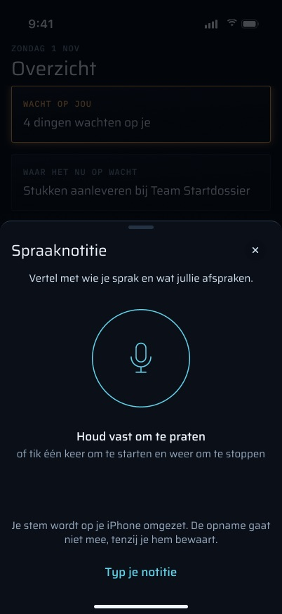
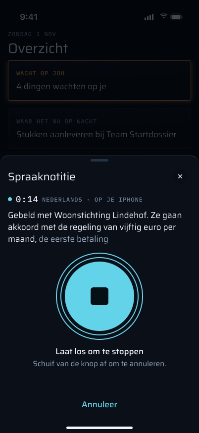
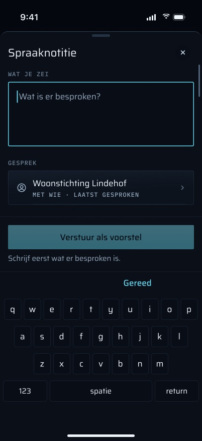
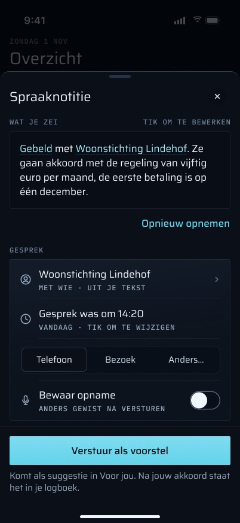
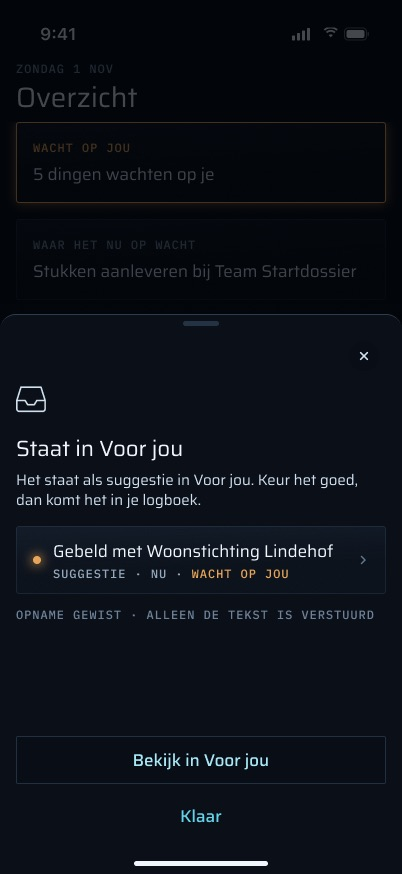
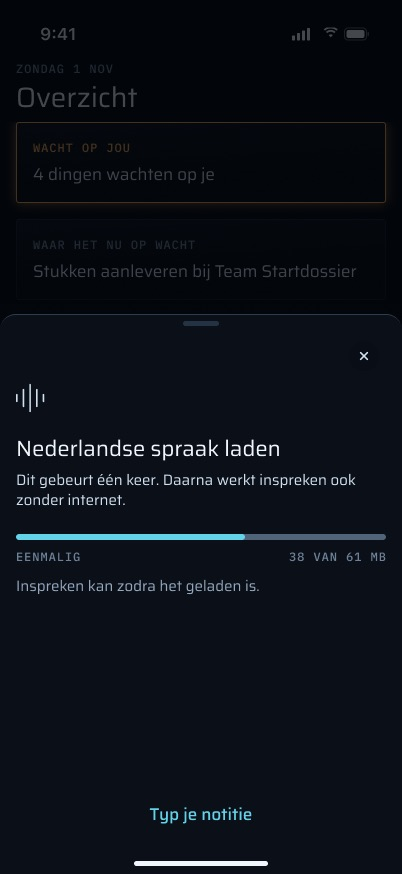
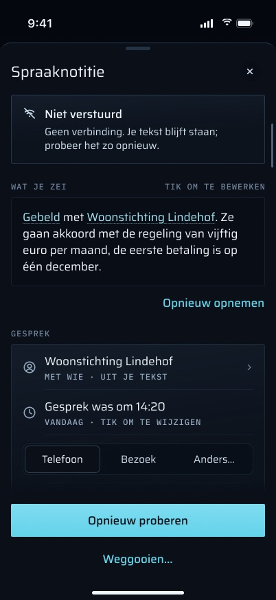

# Gesprek vastleggen (spraaknotitie): functies

## Stand van de bouw

Gecontroleerd tegen de code op 2026-11-03 (branch `feat/iphone-app`, inclusief de niet-gecommitte working tree). Dit document beschrijft de **volledige** functieset van dit scherm: wat de code doet en wat de definitieve frames, de spec (§7.4) en de design brief (§2.5, §3) daaraan toevoegen. Elke functie heeft één statusregel.

| Status | Aantal |
|---|---|
| Gebouwd | 27 |
| Deels gebouwd | 11 |
| Nog te bouwen | 19 |

> **2026-11-04: het blad volgt nu de definitieve frames.** Titel "Spraaknotitie", tikken of vasthouden, annuleren, de timer, het blad omlaag met de opname in de tabbalk, de ontlede partij en het kanaal, de partijkiezer, de blad-vullende toestanden, de vastgezette voet met reden, de mislukte verzendingen in het blad, de bevestiging voor weggooien, de suggestiekaart en de vergrendelde notitie zijn gebouwd. Wat nog open is, staat hieronder met zijn status; onder andere het live streamen op het toestel, `recognizedTranscript` naar de server, de rol van een partij op de server en de App Intent. De beschrijving onder [Functies](#functies) is van vóór deze ronde. Captures: `scripts/capture.sh <voice-fixture> overzicht <out> --voice <toestand>`.

De drie belangrijkste dingen die nog gebouwd moesten worden (2026-11-03):

1. **Vragen voordat een niet-verstuurde notitie wordt weggegooid** ([Bevestiging voor weggooien](#bevestiging-voor-weggooien-bij-sluiten)). Nu gooit "Sluiten" de tekst en de opname direct weg, zonder vraag. Dat is de enige plek waar Martin een gesprek dat hij net heeft ingesproken kan kwijtraken.
2. **De ontworpen opname zelf**: [tikken om te starten en te stoppen](#tikken-om-te-starten-en-tikken-om-te-stoppen), een [live transcript](#live-transcript-tijdens-het-praten), de [timer](#opnametimer-en-weergave-op-het-toestel) en [annuleren door van de knop af te schuiven](#een-opname-annuleren-van-de-knop-af-schuiven-of-annuleer). Het begint met de meting die nog openstaat: zet iOS 27.2 Nederlands überhaupt op de telefoon om in tekst (plan 3 Task 25 stap 1)?
3. **Met wie het was, zonder zoeken**: [partij en kanaal uit de tekst gelezen](#partij-en-kanaal-uit-de-tekst-gelezen) plus het [doorzoekbare partijblad](#partijkiezer-zoeken-recent-az), zodat het doel van de brief van twee stappen (vasthouden, praten, loslaten, versturen) overeind blijft.

Alles wat nog niet gebouwd is, staat onder [Ontworpen, nog niet gebouwd](#ontworpen-nog-niet-gebouwd). De functies die bestaan, staan onder [Functies](#functies), elk met hun status.

"Gesprek vastleggen" is de spraaknotitie van de iPhone-app. Direct na een telefoongesprek houdt Martin een knop ingedrukt en zegt hij met wie hij sprak en wat er is afgesproken. De telefoon zet de opname zelf om in tekst; Martin controleert de tekst, kiest de partij, het kanaal en het tijdstip, en verstuurt het. Op de server wordt het een **openstaande suggestie voor een logboekregel**. Het is geen logboekregel: het komt pas in het logboek als Martin het goedkeurt in Voor jou, zoals elke andere suggestie. Alleen Martin gebruikt de app.

Dit document beschrijft wat de functie doet. Het visuele ontwerp staat in Figma: bestand `QDRL5zHNEOjPzLZqzd19Ii`, sectienode `333:12132` ("Voice quick-log"). De 27 frames in `frames/` zijn op 2026-11-03 opnieuw uit die sectie geëxporteerd. Elke schermafbeelding gebruikt de synthetische fixture-dataset (Woonstichting Lindehof, Bewindkantoor Noordkust, Kade & Partners, …), geen echte dossiergegevens. UI-teksten staan tussen aanhalingstekens in het Nederlands, precies zoals de app ze toont.

> **Het ontwerp loopt voor op de code.** Het ontwerp noemt het blad "Spraaknotitie". Op branch `feat/iphone-app` (`apps/ios/Verder/Voice/`) is het een eenvoudiger blad met de titel "Gesprek vastleggen". De grootste verschillen:
> - **Geen live transcript, geen timer, geen annuleren door af te schuiven.** Het ontwerp schrijft de tekst terwijl Martin praat ("0:14 NEDERLANDS · OP JE IPHONE") en laat hem van de knop af schuiven om te annuleren. De code neemt eerst op en zet pas om nadat de vinger loslaat. Een vinger die meer dan 80 pt wegbeweegt *beëindigt* de opname bovendien, en die opname wordt nog steeds omgezet, niet weggegooid.
> - **Geen tikken om te starten.** Het ontwerp zegt "of tik één keer om te starten en weer om te stoppen". In de code is een druk korter dan 0,6 s geen opname ("Houd de knop ingedrukt zolang je praat."). Alleen VoiceOver en Switch Control krijgen een aan/uit-knop.
> - **Geen ontleding van de tekst.** Het ontwerp onderstreept "Gebeld" en de naam van de partij in de tekst, en de partijrij zegt "MET WIE · UIT JE TEKST". De code leest niets uit het transcript. De partij begint als degene met wie Martin het laatst contact had, en het kanaal begint als `call`.
> - **De partijkiezer.** Het ontwerp heeft een blad "Met wie sprak je?" met zoeken, de secties "RECENT" en "ALLE PARTIJEN · A–Z", en per rij een rol en "laatst 31 okt". De code gebruikt een gewoon iOS-menu met namen, op volgorde van meest recent contact.
> - **Kanalen.** Het ontwerp heeft Telefoon / Bezoek / Anders…. De code heeft Telefoon, Gesprek, Voicemail, WhatsApp en Anders.
> - **Aparte toestandsschermen.** Het ontwerp geeft "Niets gehoord", "Omzetten lukte niet", "Microfoon staat uit", "Spraakherkenning staat uit" en de modeldownload (met "38 VAN 61 MB") elk een eigen blad-vullende layout. De code toont elk als een zin binnen de gewone opname- of editorlayout (zie [Toestanden](#toestanden)). De code kent helemaal geen toestand voor *toestemming* voor spraakherkenning, en geen downloadvoortgang.
> - **Vergrendeling, inloggen en bevestiging.** Het ontwerp houdt de notitie zichtbaar achter "Ontgrendel met Face ID", toont een balk "Je bent uitgelogd · Log opnieuw in" en vraagt "Weggooien?" voordat er iets wordt weggegooid. In de code vervangt een vergrendeling het hele blad door het vergrendelscherm. Een 401 vervangt de hele app door het inlogscherm "Je sessie is verlopen.", en de notitie komt daarna terug. "Weggooien" gooit direct weg, zonder bevestiging.
> - **Na het versturen.** Het ontwerp toont de suggestie als kaart met "Bekijk in Voor jou". De code toont een bevestigingsregel, "Nog een gesprek" en "Klaar". Er is geen link naar Voor jou.
>
> **[Functies](#functies) beschrijft de code** en noemt elk verschil waar het van toepassing is. Elk verschil is ook een eigen functie, met status, onder [Ontworpen, nog niet gebouwd](#ontworpen-nog-niet-gebouwd). De [frametabel](#frames) aan het eind zegt per frame hoe ver de code ermee overeenkomt.

## Doel

- **Een gesprek vastleggen terwijl het vers is.** Telefoongesprekken met Verder, een schuldeiser of een deurwaarder laten geen mail achter, dus zonder notitie komen ze nooit in het dossier. De spraaknotitie maakt van "wie, wanneer, wat is afgesproken" een paar seconden praten.
- **Niets komt vanzelf in het logboek.** Het resultaat is een suggestie (`kind = 'log-entry'`, `status = 'pending'`, `prompt_version = 'voice-v1'`) die Martin in Voor jou goedkeurt, bewerkt of afwijst. Versturen schrijft niet in het logboek. Zonder bewaarde opname voegt versturen helemaal niets aan het ledger toe.
- **De stem blijft op de telefoon.** Het omzetten gebeurt op het toestel (spec §7.4: "no audio leaves the phone, no GPU contention on the homelab"). De audio gaat alleen naar verder als Martin "Bewaar opname" aanzet.

## Toegang en vervolg

**Erin:**

- **Snelle actie op het beginscherm.** Houd het app-icoon ingedrukt en kies "Gesprek vastleggen" (symbool `mic`, type `pro.vanderpoel.verder.voice`). Die is statisch gedeclareerd in `project.yml` / Info.plist en bestaat dus al voordat de app ooit heeft gedraaid. `QuickAction.link(forType:)` maakt er `DeepLink.voice` van. Bij een koude start komt het item binnen via `SceneDelegate.scene(_:willConnectTo:)`, bij een warme via `windowScene(_:performActionFor:)`. (De working tree voegt een tweede item toe, "Scan een brief"; het spraakitem is ongewijzigd.)
  **Status:** Gebouwd — `apps/ios/Verder/App/QuickAction.swift`, `apps/ios/project.yml`
- **Meer → "Gesprek vastleggen"** (sectie "DOSSIER", een "+" in plaats van een chevron). Roept `voice.open()` aan (zie `../10-meer-en-instellingen/FEATURES.md`).
  **Status:** Gebouwd — `apps/ios/Verder/More/MoreMenu.swift`, `apps/ios/Verder/App/RootView.swift`
- **Deep link `verder://voice`.** Dit is een strikte parse: `verder://voice/<anything>` is `.none`. Hij opent het blad over het tabblad dat op dat moment zichtbaar is (`LinkDestination(tab: nil, stack: nil, opensVoice: true)`). De app registreert geen `verder://`-URL-schema, dus alleen de snelle actie (en verders eigen widget of een push, die deze link geen van beide nu gebruiken) kan hem afleveren.
  **Status:** Gebouwd — `apps/ios/Verder/Push/DeepLink.swift`
- **Actieknop en "Leg vast in verder" (Siri / Opdrachten).** Het doel van de brief voor dit scherm is twee stappen: druk op de Actieknop (of zeg "Leg vast in verder"), houd vast om te praten, laat los, verstuur. Beide hebben een App Intent nodig die de spraaknotitie opent (een `OpenIntent` die `DeepLink.voice` aflevert), plus een App Shortcut-zin in het Nederlands. Geen van beide bestaat: de app heeft helemaal geen App Intents.
  **Status:** Nog te bouwen — een `AppIntent` + `AppShortcutsProvider` in het app-target dat via `DeepLinkInbox` naar `DeepLink.voice` routeert; een test dat de intent `.voice` oplevert; geen serverwijziging
- **Fixture-opname (alleen DEBUG):** `-fixtures voice -route voice` opent de echte spraaknotitie met een nep-recorder en het transcript uit het manifest, al opgenomen, zodat de opname de editor toont.
  **Status:** Gebouwd — `apps/ios/Verder/Fixtures/`, `apps/ios/Verder/FixtureData/voice/`

**Eruit:** het blad sluit altijd terug naar het tabblad waarover het geopend werd. Na een verzending sluit "Klaar" het en start "Nog een gesprek" een nieuwe notitie. Bij een geweigerde microfoon verlaat "Open Instellingen" de app richting iOS-Instellingen. De suggestie zelf wordt beoordeeld in **Voor jou** (`../03-voor-jou/FEATURES.md`, `../05-vraag-suggestie-taak/FEATURES.md`), maar het blad linkt daar niet naartoe.

## Functies

### Een notitie openen

`VoiceLogSession.open()` hergebruikt de notitie die in behandeling is als er een is, en maakt anders een nieuw `VoiceLogModel` met een **nieuwe `clientId`**. De initializer van het model leegt de opnamemap (`tmp/voice/`), wat alles verwijdert wat een crash heeft achtergelaten. Als het blad verschijnt, draait `prepare()`:

1. **Partijen.** `GET /api/mobile/v1/parties?recent=1` geeft `id, kind, name, organization, lastContactAt` terug, met de hand gevormd door de route (geen e-mail, geen notitie). Ze staan op volgorde van de nieuwste `log_entries.occurred_at` waaraan elke partij deelnam (via `entry_participants`), daarna op naam. Partijen zonder regel komen achteraan. De eerste is voorgeselecteerd.
2. **Nederlandse spraak.** `OnDeviceTranscriber.availability()` vraagt of `SpeechTranscriber` `nl_NL` ondersteunt en of het model geïnstalleerd is (`AssetInventory.status`). Ontbreekt het model, dan wordt het **meteen** gedownload en geïnstalleerd (`assetInstallationRequest(...).downloadAndInstall()`), zodat een download bij eerste gebruik nooit plaatsvindt terwijl Martin op een transcript wacht.

Het blad opent op de middelste detent met een grabber en kan naar groot worden getrokken.

**Status:** Gebouwd — `apps/ios/Verder/Voice/VoiceLogSession.swift`, `VoiceLogModel.swift` (`prepare`), `VoiceLogView.swift` (`VoiceLogSheet`), `apps/web/src/app/api/mobile/v1/parties/route.ts`

### Ingedrukt houden om op te nemen

De ronde knop (`HoldToRecord`) begint met opnemen als de vinger neergaat en stopt als die omhoogkomt. De eerste druk vraagt om toestemming voor de microfoon (`NSMicrophoneUsageDescription`: "verder neemt je stem op om een gesprek vast te leggen."). Laat de vinger los terwijl de toestemmingsmelding nog openstaat, dan wordt er niets opgenomen.

- **Formaat:** AAC in een `.m4a`, mono, 16 kHz, 32 kbit/s (`AudioRecorder.settings`). Dat is ongeveer 14 MB per uur, ruim onder de uploadlimiet van 50 MB van de server.
- **Het tijdstip van het gesprek** wordt gezet op het moment dat de opname begon, tenzij Martin al met de hand een tijd heeft ingesteld.
- **Korter dan 0,6 s** telt als tik: de opname wordt verwijderd en het blad zegt "Houd de knop ingedrukt zolang je praat."
- **VoiceOver / Switch Control:** de knop leest "Neem op" / "Stop opname", met de hint "Houd ingedrukt zolang je praat.". De activeeractie schakelt aan en uit, omdat vasthouden geen gebaar is dat deze gebruikers kunnen uitvoeren.
- De faseregel luidt "Houd ingedrukt en vertel wat er besproken is." in rust en "Opnemen — laat los om te stoppen." tijdens het opnemen. De knop bestaat alleen zolang Nederlandse spraak klaarstaat (`canRecord`): terwijl spraak nog wordt gecontroleerd, het model wordt geïnstalleerd of spraak niet beschikbaar is, is de knop verborgen en luidt de rustregel "Typ wat er besproken is."
- **Geen haptiek** tijdens het opnemen, en ook nergens anders in het blad (brief §2.5: stoor nooit de microfoon). Zie [Haptiek](#haptiek-buiten-de-opname) voor de ene die de brief wel vraagt.

**Status:** Gebouwd — `apps/ios/Verder/Voice/VoiceLogView.swift` (`HoldToRecord`), `VoiceLogModel.swift` (`startRecording`, `stopRecording`), `VoiceRecorder.swift`

### Omzetten op de telefoon

Als de vinger loslaat, wordt de fase "Omzetten naar tekst, op je telefoon…" en verschijnt een spinner. `SpeechAnalyzer` + `SpeechTranscriber(locale: nl_NL, preset: .transcription)` lezen het bestand en geven de hele tekst terug, bijgesneden. **Er is geen terugval op een server**: de spec koos voor omzetten op het toestel zodat er geen audio de telefoon verlaat, en plan 3 Task 25 verbiedt een serverterugval zonder Martins toestemming. Elke manier waarop het kan mislukken is een toestand, nooit een doodlopend pad (zie [Toestanden](#toestanden)), omdat Martin altijd kan typen wat er gezegd is.

De spec vraagt "Transcribe on-device… in Dutch". Het live transcript en de ontlede voorvertoning van het ontwerp (brief §3: "Live on-device transcript, then a parsed preview") zijn niet gebouwd; zie [Live transcript](#live-transcript-tijdens-het-praten) en [Partij en kanaal uit de tekst gelezen](#partij-en-kanaal-uit-de-tekst-gelezen).

**Status:** Gebouwd — `apps/ios/Verder/Voice/Transcriber.swift` (`OnDeviceTranscriber`). Nog niet gemeten op de telefoon (zie [Bekende beperkingen](#bekende-beperkingen-en-wat-nog-niet-gemeten-is)).

### Typen in plaats van spreken

"Typ zelf", in rust onder de knop, opent de editor met een lege tekst en de tijd op nu. Dit is ook het enige pad als Nederlandse spraak niet beschikbaar is. Het ontwerp noemt deze knop "Typ je notitie".

**Status:** Gebouwd — `apps/ios/Verder/Voice/VoiceLogModel.swift` (`typeInstead`)

### De editor

De faseregel luidt "Controleer de tekst. Er gaat niets naar het logboek tot jij het goedkeurt in Voor jou." Daaronder:

- **"TEKST"**: het transcript in een bewerkbaar tekstveld ("Tekst van het gesprek" voor VoiceOver).
  **Status:** Gebouwd — `apps/ios/Verder/Voice/VoiceLogView.swift` (`editor`)
- **"MET WIE"**: het partijmenu. Zolang er geen antwoord is binnengekomen, toont het in plaats daarvan "Partijen laden…". De ontworpen kiezer is een eigen blad ([Partijkiezer](#partijkiezer-zoeken-recent-az)).
  **Status:** Gebouwd — `apps/ios/Verder/Voice/VoiceLogView.swift` (`partyPicker`), `VoiceLogModel.swift` (`loadParties`)
- **"HOE"**: de kanaalchips Telefoon (`call`, de standaard), Gesprek (`meeting`), Voicemail, WhatsApp en Anders (`other`): de woorden uit `apps/web/src/lib/entry-labels.ts` (dat ze in kleine letters schrijft) met een hoofdletter. De route accepteert ook `email` en `letter`, maar die spreekt niemand in, dus worden ze niet aangeboden. Het ontwerp biedt Telefoon, Bezoek en "Anders…", wat suggereert dat de rest achter nog één tik zit. Elk kanaal is hoe dan ook bereikbaar.
  **Status:** Gebouwd — `apps/ios/Verder/Voice/VoiceModels.swift` (`VoiceChannel`)
- **"Gesprek was om"**: een compacte datum-en-tijdkiezer in Amsterdamse tijd (Nederlandse locale), met nu als uiterste. `setOccurredAt` begrenst op nu en `send` begrenst opnieuw, zodat een gesprek nooit in de toekomst kan worden vastgelegd. Een met de hand ingestelde tijd blijft staan bij een nieuwe opname.
  **Status:** Gebouwd — `apps/ios/Verder/Voice/VoiceLogView.swift` (`occurredPicker`), `VoiceLogModel.swift` (`setOccurredAt`)
- **"Opnieuw opnemen"**: alleen aangeboden als de tekst leeg is (na "niets verstaan" of een mislukte omzetting), Nederlandse spraak klaarstaat **en er nog geen verzending is geprobeerd**. Het verwijdert de opname en gaat terug naar de recorder met **dezelfde** `clientId`. Na een verzendpoging wordt het nooit aangeboden, omdat de server dat id dan misschien al heeft (het antwoord kan verloren zijn gegaan nadat de suggestie was opgeslagen). Een andere opname onder hetzelfde id zou dan met `duplicate` worden beantwoord en stilzwijgend vervallen, en een nieuw id zou het gesprek twee keer kunnen opslaan. Het ontwerp toont "Opnieuw opnemen" onder een transcript met tekst. De code doet dat nooit.
  **Status:** Deels gebouwd — alleen aangeboden bij een lege tekst. Opnieuw opnemen over een transcript met tekst (het ontwerp, elke editorframe) ontbreekt. Vóór de eerste verzendpoging is dat veilig onder dezelfde `clientId`, en het vraagt om een regel voor wat er met Martins bewerkingen gebeurt (vervangen, of eerst vragen) en een test.
- **"Bewaar opname"**: een schakelaar, alleen zichtbaar zolang er een opname bestaat, standaard uit, met "Alleen dan gaat de opname naar verder. Anders wordt ze na het versturen gewist."
  **Status:** Gebouwd — `apps/ios/Verder/Voice/VoiceLogView.swift`, `VoiceLogModel.swift` (`keepRecording`)
- **"Verstuur als voorstel"**: alleen actief tijdens het bewerken, met een gekozen partij en een tekst die na bijsnijden niet leeg is en hoogstens 20 000 tekens telt (`VoiceDraft.transcriptMax`, de eigen `TRANSCRIPT_MAX` van de route).
  **Status:** Gebouwd — `apps/ios/Verder/Voice/VoiceLogModel.swift` (`canSend`, `send`)
- **"Weggooien"**: verwijdert de opname en zet de notitie direct terug (een nieuwe `clientId`, kanaal terug naar `call`, weer de bovenste partij). Het is uitgeschakeld zolang er verstuurd wordt. Er is geen bevestigingsdialoog, anders dan het blad "Weggooien?" in het ontwerp ([Bevestiging voor weggooien](#bevestiging-voor-weggooien-bij-sluiten)).
  **Status:** Gebouwd — `apps/ios/Verder/Voice/VoiceLogModel.swift` (`discard`)

Tijdens het versturen luiden de faseregel en de verstuurknop allebei "Versturen…".

### Versturen: wat er van begin tot eind gebeurt

`VoiceLogModel.send()` bouwt één multipart `POST /api/mobile/v1/entries/voice` (`VoiceDraft`) met `clientId` (UUID v4 in kleine letters), `occurredAt` (ISO 8601), `partyId`, `channel` en `transcript`. Het voegt **alleen** een bestandsdeel `audio` toe (`Gesprek YYYY-MM-DD.m4a`, `audio/mp4`, datum volgens de Amsterdamse kalender) als "Bewaar opname" aan staat. Voor het versturen controleert de telefoon alleen de opname zelf: een bewaarde opname die verdwenen is geeft "De opname is niet meer op je telefoon. Zet 'bewaar opname' uit en verstuur alleen de tekst.", en een van meer dan 50 MB geeft "De opname is te groot om te bewaren. Zet 'bewaar opname' uit en verstuur alleen de tekst." De limiet van 50 MB op de server geldt voor het hele verzoek, dus een opname net onder 50 MB plus de tekst kan nog steeds met 413 worden beantwoord, wat het blad toont als het algemene "verder weigerde dit voorstel…".

De route (`apps/web/src/app/api/mobile/v1/entries/voice/route.ts`):

1. **Eerst 401**, voordat de body wordt gelezen. Het antwoord is JSON (`unauthorized`), nooit een redirect, en elk antwoord is `cache-control: no-store`.
2. Een groottebewaking (`readGuardedForm`: 413 boven `MAX_UPLOAD_BYTES` = 50 MB, 411 zonder lengte). Daarna veldvalidatie, waarbij elke fout een 400 is: `clientId` moet een UUID v4 zijn, `occurredAt` moet ISO 8601 zijn, `partyId` moet een UUID zijn, `channel` moet een van de zeven zijn (standaard `call`), het transcript moet niet leeg zijn en hoogstens 20 000 tekens tellen, en een `audio`-deel moet `audio/*` zijn.
3. **De partij wordt gecontroleerd voordat er audio wordt opgeslagen** (`parties.get`; een onbekende partij is een 400), omdat een opgeslagen opname een gelegerde `document.ingested` is en nooit kan worden teruggedraaid.
4. **Een bewaarde opname** wordt eerst opgezocht op `source = 'phone-voice'`, `sourceRef = 'phone:<clientId>'`. Wordt die niet gevonden, dan worden de bytes in de kluis geschreven (`storeFile`) en geregistreerd (`documents.registerUpload`, titel uit de bestandsnaam, `receivedAt` = het tijdstip van het gesprek). Dit voegt **één `document.ingested`-ledgergebeurtenis** toe (`ingestDocument` ontdubbelt op sha256, dus bytes die de kluis al heeft voegen niets toe). Een nieuwe poging vindt het bestaande document en slaat niets twee keer op.
5. **`suggestions.createVoice`** controleert de partij (en het audiodocument, als dat is meegegeven) opnieuw en voegt dan de suggestie in: `kind 'log-entry'`, `status 'pending'`, `model 'apple-speech-on-device'`, `prompt_version 'voice-v1'`, en `proposed = { clientId, occurredAt, channel, direction: "inbound", summary, details: transcript, participantPartyIds: [party], participantNames: [name], attachmentDocumentIds: [audio?], actionItems: [] }`. `summary` is `voiceSummary()`: de eerste zin, afgekapt op 120 tekens op een woordgrens, deterministisch, zonder model; een afgekapte samenvatting eindigt op "…". "€ 12.50" of "www.cak.nl" beëindigt geen zin. De insert is `ON CONFLICT … DO NOTHING` tegen de gedeeltelijke unieke index `suggestions_voice_client_uq` (migratie 0041), zodat twee gelijktijdige nieuwe pogingen nog steeds één rij opleveren en de tweede met `duplicate: true` wordt beantwoord. **Dit schrijft geen ledgergebeurtenis.**
6. Het antwoord is `{ suggestionId, audioDocumentId, duplicate }`.

**Status:** Gebouwd — `apps/ios/Verder/Voice/VoiceModels.swift` (`VoiceDraft`), `apps/web/src/app/api/mobile/v1/entries/voice/route.ts`, `packages/api/src/routers/suggestions.ts` (`createVoice`), `packages/db/drizzle/0041_doc_source_phone_voice.sql`. Uitgerold (P3-D3).

Bij succes wordt de lokale opname verwijderd (een bewaarde staat nu in de kluis) en zegt het blad "Verstuurd als voorstel. Keur het goed in Voor jou." Bij een duplicaat zegt het "Dit gesprek was al verstuurd. Je vindt het in Voor jou."

**Wat de worker met een bewaarde opname doet.** Die komt via de docmeta-sweep bij `suggest.docmeta`, zoals elk nieuw document. `isVoiceRecording` (`apps/worker/src/voice-recording.ts`) beslist alleen op het mimetype (elk `audio/*`-document, niet alleen `phone-voice`), geeft het een `document_texts`-rij met extractor `none` en slaat OCR, auto-name, de docmeta-suggestie en de briefcontrole over. Zonder die overslag zou Voor jou Martin vragen een audiobestand op te bergen. De opname verschijnt in Files onder het bronlabel "Spraak". Het blijft een gewoon inboxdocument, dus de synchronisatie van het zakdossier (`../07-dossier/FEATURES.md`) toont en bewaart het zoals elk ander.

**Status:** Gebouwd — `apps/worker/src/voice-recording.ts`, `apps/worker/src/index.ts` (`suggest.docmeta`)

**Goedkeuren (in Voor jou, niet hier).** De wachtrijkaart op het web en de goedkeurroute van de telefoon bouwen de regel allebei met `entryFromProposed` en geven die door aan `suggestions.approveEntry`. Voor een `voice-v1`-suggestie zet dat `source = 'manual'` en neemt het de partij mee die Martin koos (een gedolven suggestie stelt alleen namen voor, dus de deelnemers daarvan beginnen leeg). `approveEntry` lost de bijlagen opnieuw op (een opname die sindsdien is weggegooid of definitief verwijderd valt weg), voegt de regel in met **één `entry.created`-ledgergebeurtenis** en legt het oordeel vast: `approved` als samenvatting en toelichting ongewijzigd zijn, anders `edited`, met de definitieve payload (gouden regel). `direction` wordt altijd voorgesteld als `inbound`, en noch de webkaart noch de telefoon biedt een richtingveld (beide bewerken alleen Samenvatting en Toelichting), dus een gesprek dat Martin zelf startte, wordt nu als `inbound` vastgelegd.

**Status:** Gebouwd — `packages/api/src/entry-from-proposed.ts`, `packages/api/src/routers/suggestions.ts` (`approveEntry`)

### Opnieuw proberen

Een mislukte verzending houdt de tekst en de opname vast en keert terug naar de editor. Martin probeert het opnieuw door weer op "Verstuur als voorstel" te tikken, wat **dezelfde `clientId`** gebruikt, zodat een verloren antwoord het gesprek nooit twee keer kan opslaan. Er is geen automatische nieuwe poging en geen wachtrij: anders dan scans wacht een spraaknotitie alleen in het geheugen, in het open blad.

**Status:** Gebouwd — `apps/ios/Verder/Voice/VoiceLogModel.swift` (`send`, `copy(for:)`)

## Toestanden

De toestanden die de code nu toont. De ontworpen blad-vullende layouts voor een aantal ervan zijn eigen functies onder [Ontworpen, nog niet gebouwd](#ontworpen-nog-niet-gebouwd).

**Status:** Gebouwd — elke rij hieronder; `apps/ios/Verder/Voice/VoiceLogModel.swift` (`Copy`, `speechLine`, `partiesLine`, `phaseLine`)

| Toestand | Wat de code toont | Wat Martin kan doen |
|---|---|---|
| Spraak controleren | "spraakherkenning controleren…" onder de titel; opnameknop verborgen | wachten, of "Typ zelf" |
| Model downloaden (eerste gebruik) | "Nederlands spraakmodel wordt geïnstalleerd…" (geen voortgangscijfer); opnameknop verborgen | "Typ zelf" |
| Model kon niet worden geïnstalleerd (offline, geen ruimte, geweigerd) | "Het Nederlandse spraakmodel is nog niet op je telefoon. Probeer het opnieuw met internet, of typ zelf wat er besproken is."; opnameknop verborgen. Ook bereikt als het model verdwijnt tussen openen en omzetten: dan opent de editor met een lege tekst en deze regel, zonder aparte melding | "Opnieuw proberen" (controleert opnieuw en vraagt de installatie opnieuw aan), of "Typ zelf" |
| Nederlands niet ondersteund op deze iOS/dit toestel | "Nederlandse spraakherkenning is niet beschikbaar op deze iPhone. Typ zelf wat er besproken is."; opnameknop verborgen | "Typ zelf" |
| Microfoon geweigerd | "verder mag de microfoon niet gebruiken. Zet het aan in Instellingen." | "Open Instellingen", of "Typ zelf" |
| Recorder startte niet | "Opnemen lukte niet. Probeer het nog eens." | opnieuw drukken |
| Druk te kort | "Houd de knop ingedrukt zolang je praat." | indrukken en vasthouden |
| Niets gehoord | editor met een lege tekst; "Er is niets verstaan. Neem opnieuw op, of typ zelf wat er besproken is." | "Opnieuw opnemen", of typen |
| Omzetten mislukt | editor; "Omzetten naar tekst lukte niet. Typ zelf wat er besproken is; de opname blijft bewaard tot je verstuurt." | typen, of "Opnieuw opnemen" |
| Partijen laden | "Partijen laden…" (alleen vóór het eerste antwoord) | tekst bewerken; versturen is uitgeschakeld |
| Helemaal geen partijen | "Nog geen partijen in je dossier. Een gesprek leg je vast bij een partij, dus versturen kan pas als er een is. Voeg die toe in verder en probeer het opnieuw." | "Opnieuw proberen" |
| Partijen laden mislukt | "De partijen konden niet worden geladen." | "Opnieuw proberen" |
| Offline (geen HTTP-antwoord) | "Geen verbinding. Je tekst blijft staan; probeer het zo opnieuw." | opnieuw versturen |
| Serverfout / 429 | "verder kon het nu niet aannemen. Je tekst blijft staan; probeer het zo opnieuw." | opnieuw versturen |
| Geweigerd (elke andere 4xx, bijv. onbekende partij, 413, 411) | "verder weigerde dit voorstel. Controleer de tekst en de partij." | bewerken, opnieuw versturen |
| Tekst te lang | de verstuurknop blijft uitgeschakeld (de tekst `tooLong` bestaat in het model maar wordt niet door de view getoond) | de tekst inkorten |
| Sessie verlopen (401) | het scherm voor een verlopen sessie (`SessionExpiredView`, "Je sessie is verlopen.") vervangt de app. Het model zet kort "Je sessie is verlopen. Log opnieuw in; je tekst blijft staan.", wat met het blad verdwijnt | inloggen; dezelfde notitie, tekst en opname komen terug |
| Vergrendeld | het hele blad wordt vervangen door het Face ID-vergrendelscherm | ontgrendelen; de notitie is er nog |
| Grote tekst / kleine telefoon | elk lettertype schaalt mee met Dynamic Type en het blad is één scrollview, dus de verstuurknop scrolt met de inhoud mee in plaats van vast te staan | scrollen |

Het frame "Spraakherkenning staat uit" (toestemming voor spraakherkenning geweigerd) heeft geen tegenhanger in de code. `NSSpeechRecognitionUsageDescription` ("verder zet je opname op je telefoon om in tekst.") is gedeclareerd, maar de app vraagt nooit om `SFSpeechRecognizer`-autorisatie en heeft geen toestand voor een weigering.

## Privacy en beveiliging

- **Achter de vergrendeling.** Het blad noemt partijen, dus het is verpakt in `.lockGated(by: lock)`. Zolang de app vergrendeld is, bestaat de inhoud van het blad niet en staat het Face ID-vergrendelscherm op zijn plek. Openen via de snelle actie bij een koude start vraagt vanzelf om Face ID (`promptOnOpen`), één keer bij openen of heropenen, zoals de rest van de app. De gedeeltelijke vergrendeling van het ontwerp ("Ontgrendel om partijen te laden", "Ontgrendel met Face ID", "Je notitie blijft staan") is niet gebouwd ([Vergrendeld met de notitie behouden](#vergrendeld-met-de-notitie-behouden)).
  **Status:** Gebouwd — `apps/ios/Verder/App/RootView.swift` (`.lockGated(by: lock)` op `VoiceLogSheet`)
- **Niets op het vergrendelscherm of in widgets.** De functie stuurt geen melding en schrijft niets naar de widget-snapshot.
  **Status:** Gebouwd — niets in `apps/ios/Verder/Voice/` roept `notify`, de widget-snapshot of `UNUserNotificationCenter` aan
- **Op de telefoon.** Alleen de opname raakt de schijf: `tmp/voice/<clientId>.m4a` met **`NSFileProtectionComplete`**, dus onleesbaar zolang de telefoon vergrendeld is. De klasse wordt op de map gezet voordat de recorder één byte schrijft, en nogmaals op het bestand. Het transcript, de partij, het kanaal en het tijdstip leven **alleen in het geheugen** (`VoiceLogSession`), nooit op schijf.
  **Status:** Gebouwd — `apps/ios/Verder/Voice/VoiceLogModel.swift` (`protectRecording`, `startRecording`)
- **Verwijderd:** de lokale opname na elke geslaagde verzending, bij "Weggooien", bij "Sluiten", en telkens als er een nieuwe notitie opent (de map wordt geleegd, wat een crash afdekt).
  **Status:** Gebouwd — `apps/ios/Verder/Voice/VoiceLogModel.swift` (`deleteRecording`, `clear`)
- **Audio verlaat de telefoon alleen met "Bewaar opname" aan**, en wordt dan een permanent, gelegerd document (`phone-voice`). Definitief verwijderen ("Definitief verwijderen" op `/files/[id]` op het web, sub-project 11; nooit aangeboden op de telefoon) is de enige manier om het later te vernietigen.
  **Status:** Gebouwd — `apps/ios/Verder/Voice/VoiceModels.swift` (`VoiceDraft`), `apps/web/src/app/api/mobile/v1/entries/voice/route.ts`
- **Uitloggen wist het.** "Uitloggen" in Meer roept `forgetVoice` → `VoiceLogSession.close()` aan, wat de notitie en de opname weggooit. Een sessie die de server *weigerde* (401) houdt de notitie in het geheugen voor de volgende keer inloggen. Dat is bewust: Martin koos er niet voor om weg te gaan.
  **Status:** Gebouwd — `apps/ios/Verder/Voice/VoiceLogSession.swift` (`close`, `sessionEnded`), `apps/ios/Verder/App/RootView.swift` (`forgetVoice`)

## Wie de notitie bezit, en wanneer die blijft bestaan

`VoiceLogSession` (vastgehouden door `VerderApp`, boven de vergrendeling en het inlogscherm) bezit het model. Het blad heeft zelf geen toestand. De regels:

- **Alleen expliciet sluiten gooit weg:** "Sluiten", "Klaar", een veeg over een notitie waar niets in staat, of uitloggen.
- **Een veeg kan geen werk weggooien.** `interactiveDismissDisabled` staat aan zolang de notitie niet-verstuurd werk bevat (opnemen, omzetten, versturen, of bewerken met tekst of een opname).
- **Een blad dat vanzelf verdwijnt, houdt de notitie vast.** Dat geldt voor opnieuw vergrendelen, een 401 of naar de achtergrond gaan. Een lopende opname wordt gestopt en omgezet, nooit weggegooid (`sheetDisappeared`). Opnieuw "Gesprek vastleggen" openen, of opnieuw inloggen, brengt dezelfde notitie terug met dezelfde `clientId`. Een lege notitie wordt gewoon gesloten, zodat er na het inloggen geen leeg blad opduikt.
- **Geforceerd afsluiten van de app verliest de tekst.** Die leeft alleen in het geheugen. De achtergebleven opname wordt verwijderd zodra de volgende notitie opent.

**Status:** Gebouwd — `apps/ios/Verder/Voice/VoiceLogSession.swift`, `VoiceLogView.swift` (`holdsUnsentWork`); tests in `apps/ios/VerderTests/VoiceLogSessionTests.swift`. Let op: "Sluiten" telt als expliciet sluiten en gooit dus niet-verstuurd werk weg zonder te vragen; zie [Bevestiging voor weggooien](#bevestiging-voor-weggooien-bij-sluiten).

## Ontworpen, nog niet gebouwd

Functies die de definitieve frames, de spec of de design brief definiëren en die de code niet heeft, of maar gedeeltelijk. Elke beschrijft wat ze doet en wat ze nodig heeft. Niets hiervan verandert de wetten: wat het blad er ook bij krijgt, het resultaat blijft een openstaande suggestie die Martin in Voor jou goedkeurt.

### Opnemen

#### Tikken om te starten en tikken om te stoppen

Het rustframe zegt "Houd vast om te praten · of tik één keer om te starten en weer om te stoppen", en "Niets gehoord" herhaalt het ("of tik één keer om te starten"). Eén tik start een opname die handsfree doorloopt tot de volgende tik; dat is van belang als Martin de telefoon nog vasthoudt om een gesprek af te ronden of een brief hardop voorleest. Nu wordt een druk korter dan 0,6 s verwijderd met "Houd de knop ingedrukt zolang je praat.", en krijgen alleen VoiceOver en Switch Control een aan/uit-knop.

**Status:** Gebouwd (2026-11-04) — een druk korter dan 0,6 s start een handsfree opname, de volgende tik stopt en zet om; vasthouden werkt zoals voorheen. `apps/ios/Verder/Voice/VoiceLogModel.swift` (`press`, `release`, `toggleRecording`), `VoiceLogView.swift` (`RecordButton`); `VoiceQuickLogTests`

#### Live transcript tijdens het praten

Terwijl Martin praat, verschijnen zijn woorden boven de knop zodra ze herkend worden (frame "opname"). Bij loslaten wordt diezelfde tekst de tekst van de editor, zodat hij tijdens het gesprek ziet dat het begrepen wordt. Brief §3: "Live on-device transcript, then a parsed preview". Nu verschijnt de tekst pas nadat de vinger loslaat, uit het opgenomen bestand.

**Status:** Deels gebouwd (2026-11-04) — het model en het blad hebben de plek (`Transcribing.live`, `VoiceLogModel.live`; vaste woorden in ink, de staart in signal), en de fixture vult hem. Het streamen op het toestel zelf ontbreekt: `OnDeviceTranscriber` geeft een lege stroom tot Nederlands op de telefoon gemeten is (plan 3 Task 25 stap 1) en een `AVAudioEngine`-tap de m4a schrijft

#### Opnametimer en weergave op het toestel

Tijdens het opnemen toont een weergave de verstreken tijd en waar de spraak verwerkt wordt: "0:14 · NEDERLANDS · OP JE IPHONE". Dat vertelt Martin dat de opname loopt, hoe lang die is, en dat de stem op de telefoon blijft.

**Status:** Gebouwd (2026-11-04) — "0:14 · NEDERLANDS · OP JE IPHONE" (`elapsedText`, `RecordingLine`)

#### Een opname annuleren: van de knop af schuiven, of "Annuleer"

Tijdens een opname annuleert het van de knop af schuiven van de vinger die ("Schuif van de knop af om te annuleren."), en een knop "Annuleer" doet hetzelfde. Een geannuleerde opname wordt verwijderd, nooit omgezet en nooit verstuurd. Nu *beëindigt* meer dan 80 pt wegbewegen de opname en wordt die nog steeds omgezet, en annuleren bestaat helemaal niet.

**Status:** Gebouwd (2026-11-04) — `cancelRecording()`: bestand weg, geen transcript, zelfde `clientId`; afschuiven toont "Laat los om te annuleren"; tests in `VoiceQuickLogTests`

#### Opname loopt door met het blad omlaag

Martin kan het blad tijdens een (met een tik gestarte) opname omlaag trekken en de app blijven gebruiken. De opname loopt door, en het onderste accessoire van de tabbalk toont "Opname loopt 0:14 Stop" (frame "opname · blad omlaag"; brief §3: "Recording state in the tab accessory"). Tikken op het accessoire opent het blad weer, en "Stop" beëindigt de opname en zet die om.

**Status:** Gebouwd (2026-11-04) — een handsfree opname overleeft het omlaag trekken (`VoiceLogSession.sheetDisappeared`, `blocksSwipe`); `tabViewBottomAccessory` in `RootView` toont "Opname loopt 0:14 Stop" (`VoiceRecordingAccessory`); uitloggen stopt hem altijd

### De tekst en het gesprek

#### Partij en kanaal uit de tekst gelezen

Na het omzetten leest verder de tekst op een partijnaam die het kent en op woorden die het kanaal noemen ("Gebeld", "langs geweest"), en selecteert beide voor. De gevonden woorden worden in de tekst onderstreept, en de partijrij zegt waar de waarde vandaan komt: "MET WIE · UIT JE TEKST" als die uit de tekst gelezen is, "MET WIE · LAATST GESPROKEN" als het de meest recente partij is (frame "typen"). Terwijl de tekst nog wordt omgezet, tonen de gespreksrijen een laadtoestand (frame "omzetten naar tekst"). Elke waarde blijft een voorstel dat Martin kan wijzigen: er wordt nooit een partij verzonnen, alleen namen die al in zijn dossier staan worden herkend. Brief §3: "a parsed preview (party, channel `call`, date)".

**Status:** Gebouwd (2026-11-04) — `VoiceText.read`: alleen volledige namen (of organisatie) als heel woord, nooit over een keuze met de hand; gemarkeerd met een stippellijn in signal; "UIT JE TEKST" / "LAATST GESPROKEN". De laadtoestand van de gespreksrijen tijdens het omzetten is gebouwd (skelet)

#### "Aangepast": wat gehoord is naast wat verstuurd is bewaren

Als Martin het transcript bewerkt, luidt het label "WAT JE ZEI · AANGEPAST" (frame "tekst bewerken"). Volgens de gouden regel (modeluitvoer, oordeel en bewerkingsverschil worden altijd vastgelegd) worden het transcript van de machine en Martins bewerking allebei bewaard, zodat de server kan onderscheiden wat het spraakmodel hoorde en wat hij veranderde. Nu verstuurt de telefoon alleen de definitieve tekst, en gaat het transcript zoals herkend verloren.

**Status:** Deels gebouwd (2026-11-04) — de telefoon bewaart de herkende tekst en toont "WAT JE ZEI · AANGEPAST" (`isEdited`); het veld `recognizedTranscript` naar de server (route + `createVoice`) ontbreekt nog

#### Partijkiezer: zoeken, recent, A–Z

Tikken op de partijrij opent "Met wie sprak je?": een zoekveld ("Zoek een partij"), een sectie "RECENT" met de partijen met wie Martin het laatst contact had, een sectie "ALLE PARTIJEN · A–Z", een vinkje bij de huidige keuze en "Annuleer" (frame "met wie"). Nu toont een gewoon iOS-menu elke naam op volgorde van meest recent contact, zonder zoeken.

**Status:** Gebouwd (2026-11-04) — `PartyPickerSheet` met lokaal zoeken, RECENT (tot drie met een contactdatum) en A–Z (`VoiceText.sections`)

#### Laatste contact per partij

Elke partijrij in de kiezer toont wanneer Martin hen het laatst sprak ("laatst 31 okt").

**Status:** Gebouwd (2026-11-04) — "LAATST 31 OKT" in RECENT (`VoiceText.lastContact`)

#### De rol van de partij per rij

Elke partijrij zegt wat de partij voor Martin is: "VERHUURDER", "BEWINDVOERDER", "INCASSO", "WERKGEVER", "GEMEENTE", "SCHULDEISER", "ZORGVERZEKERAAR".

**Status:** Deels gebouwd (2026-11-04) — de telefoon toont `PartyDTO.role` als de server hem meegeeft (de fixture doet dat); de server geeft hem NIET: daarvoor blijft het besluit over de bron, een veld op `/parties` en een test nodig

#### Laadtoestanden van partijen in de kiezer

Het kiezerblad heeft eigen toestanden "Nog geen partijen" en "Partijen laden lukt niet", elk met "Opnieuw proberen", en beide zeggen "je notitie blijft staan" (frames "met wie · geen partijen", "met wie · laden lukt niet").

**Status:** Gebouwd (2026-11-04) — "Nog geen partijen" en "Partijen laden lukt niet" in het kiezerblad met "Opnieuw proberen" en "je notitie blijft staan"; de partijrij zegt "OPNIEUW LADEN"

### Versturen

#### Waarom de verstuurknop uitgeschakeld is, en wat versturen doet

Onder de verstuurknop zegt een regel wat er gaat gebeuren ("Komt als suggestie in Voor jou. Na jouw akkoord staat het in je logboek."). Als versturen nog niet kan, zegt de regel in plaats daarvan waarom ("Schrijf eerst wat er besproken is.", frame "typen"); brief §2.4: acties worden uitgeschakeld met de reden erbij, nooit stilzwijgend.

**Status:** Gebouwd (2026-11-04) — `footnote(locked:)`: geen tekst, te lang, partijen laden/mislukt, geen partij, vergrendeld; tests per reden

#### Verstuurknop altijd bereikbaar

De verstuurknop blijft onderaan het blad vastgezet terwijl de inhoud scrolt, ook bij de grootste toegankelijkheidstekstgrootte in een venster van één scherm hoog en op een iPhone SE (frames "voorbeeld", "AX5 · 874-venster", "iPhone SE").

**Status:** Gebouwd (2026-11-04) — vastgezette voet (`safeAreaInset`) met haarlijn en 24-pt vervaging; gecontroleerd op iPhone 17, iPhone SE en AX5

#### Bevestiging voor weggooien bij sluiten

Het blad sluiten (✕) of tikken op "Weggooien…" terwijl een notitie niet verstuurd is, vraagt eerst: "Deze notitie is nog niet verstuurd." met "Verstuur als voorstel", "Weggooien" (destructief) en "Verder bewerken" (frame "weggooien?"). Nu telt "Sluiten" als expliciet sluiten en gooit het de tekst en de opname direct weg, en doet "Weggooien" hetzelfde. Een veeg is al geblokkeerd zolang de notitie werk bevat, dus de sluitknop is de enige manier om een ingesproken gesprek per ongeluk kwijt te raken.

**Status:** Gebouwd (2026-11-04) — `requestClose()` + `confirmationDialog` (versturen / weggooien / verder bewerken), `.warning`-haptiek; iOS 26 tekent het als popover en verbergt "Verder bewerken" achter een tik ernaast

#### Mislukte verzending met oorzaak en één nieuwe poging

Een mislukte verzending toont bovenaan het blad een melding met titel ("Niet verstuurd" met de oorzaak: "Geen verbinding. Je tekst blijft staan; probeer het zo opnieuw.") en maakt van de hoofdknop "Opnieuw proberen", met "Weggooien…" eronder (frame "niet verstuurd").

**Status:** Gebouwd (2026-11-04) — `sendFailure` + `banner` bovenaan, hoofdknop "Opnieuw proberen", "Weggooien…" eronder, `.error`-haptiek

#### Opname te groot: versturen zonder

Als de bewaarde opname te groot is om te versturen, zegt de melding dat ("Niet verstuurd · opname te groot … Verstuur alleen de tekst; de opname blijft op je iPhone.") en doet één knop precies dat: "Verstuur zonder opname" (frame "niet verstuurd · verder weigert").

**Status:** Gebouwd (2026-11-04) — `sendWithoutRecording()` en "Verstuur zonder opname"; een 413 op een bewaarde opname komt hier ook uit

#### Sessie verlopen binnen het blad

Als de sessie tijdens het versturen verloopt, blijft het blad staan: een melding "Je bent uitgelogd · Je sessie is verlopen. Log opnieuw in; je tekst blijft staan." en een hoofdknop "Log opnieuw in" (frame "niet verstuurd · opnieuw inloggen").

**Status:** Gebouwd (2026-11-04) — een 401 bij versturen houdt het blad met "Je bent uitgelogd"; pas "Log opnieuw in" (`signInAgain`) geeft het over aan het inlogscherm

#### Vergrendeld met de notitie behouden

Als de app vergrendelt terwijl een notitie open is, blijft de tekst van de notitie zichtbaar, luidt de partijrij "Ontgrendel om partijen te laden · NA FACE ID", en wordt de hoofdknop "Ontgrendel met Face ID" ("Je notitie blijft staan. Na ontgrendelen kun je hem meteen versturen.", frame "voorbeeld · vergrendeld").

**Status:** Gebouwd (2026-11-04) — `VoiceLogSheet` beoordeelt de vergrendeling zelf: een lege notitie is het vergrendelscherm, een notitie met inhoud blijft zichtbaar met partijen en versturen achter Face ID. Het frame is het besluit; de tekst kan een partij noemen

### Na het versturen

#### De suggestiekaart en "Bekijk in Voor jou"

Na een verzending luidt het blad "Staat in Voor jou · Het staat als suggestie in Voor jou. Keur het goed, dan komt het in je logboek." en toont het de nieuwe suggestie als rij ("Gebeld met Woonstichting Lindehof · SUGGESTIE · NU · WACHT OP JOU"). "Bekijk in Voor jou" opent die suggestie; "Klaar" sluit (frame "staat in Voor jou").

**Status:** Gebouwd (2026-11-04) — `sentSuggestionId`, titel via `VoiceText.summary` (de server-`voiceSummary`), "Bekijk in Voor jou" levert `verder://suggestion/<id>` af; "Nog een gesprek" is vervallen (staat niet in de frames)

#### Wat er met de opname gebeurde

Na een verzending zegt één regel wat er van de opname geworden is: "OPNAME GEWIST · ALLEEN DE TEKST IS VERSTUURD", of dat die in het dossier bewaard is.

**Status:** Gebouwd (2026-11-04) — `sentRecordingLine`

#### Het aantal dat wacht op jou werkt meteen bij

Achter het blad gaat "WACHT OP JOU" in Overzicht met één omhoog zodra de suggestie is opgeslagen (4 → 5 in de frames), en Voor jou toont hem.

**Status:** Gebouwd (2026-11-04) — na een verzending ververst `RootView` de `InboxStore`; de badge op het icoon volgt nog bij de volgende tik van `badge.sync`

### Spraak- en toestemmingstoestanden

#### Modeldownload met voortgang

De download van Nederlandse spraak bij eerste gebruik toont de voortgang ("Nederlandse spraak laden · Dit gebeurt één keer. Daarna werkt inspreken ook zonder internet.", een balk, "EENMALIG · 38 VAN 61 MB", "Inspreken kan zodra het geladen is.") met "Typ je notitie" als weg verder (frame "spraak laden").

**Status:** Deels gebouwd (2026-11-04) — balk en "38 VAN 61 MB" zodra er bytes bekend zijn (`InstallProgress`); op het toestel meldt `OnDeviceTranscriber` alleen de fractie, omdat de eenheid van die `Progress` niet gemeten is

#### Download gaat vanzelf verder als er weer verbinding is

Een download die stopt door gebrek aan internet zegt waar hij stopte ("Geen internet. Het laden gaat vanzelf verder zodra je weer online bent. · GESTOPT BIJ 38 VAN 61 MB") en gaat vanzelf verder als de verbinding terugkomt, met "Opnieuw proberen" nog steeds beschikbaar (frame "spraak laden lukt niet").

**Status:** Gebouwd (2026-11-04) — `networkChanged(offline:)` uit het padbewaking van de app probeert opnieuw; "GESTOPT BIJ …" blijft staan

#### Spraakherkenning staat uit

Als spraakherkenning voor verder geweigerd is, zegt het blad dat ("Spraakherkenning staat uit · verder zet je stem op je iPhone om in tekst. Zet Spraakherkenning aan in Instellingen → verder.") met "Open Instellingen" en "Typ je notitie" (frame "spraakherkenning uit").

**Status:** Deels gebouwd (2026-11-04) — een geweigerde `SFSpeechRecognizer`-autorisatie wordt gerespecteerd (scherm + "Open Instellingen"); de app vraagt er nog steeds nooit om, en of `SpeechTranscriber` hem nodig heeft is niet gemeten

#### Uitleg vóór de microfoonvraag

Voordat iOS om de microfoon vraagt, legt verder op één scherm uit waarom het die wil, met één knop "Ga verder" en geen sluitknop; daarna volgt de systeemmelding (brief §3, "Permission pre-prompts": één scherm per toestemming, bij eerste gebruik).

**Status:** Nog te bouwen — de eerste keer vasthouden gaat direct naar de systeemmelding. De working tree heeft hetzelfde patroon voor de camera (`CameraPrePrompt` in het niet-gecommitte `apps/ios/Verder/Scan/ScanPermissionViews.swift`) om te volgen; vereist een microfoonvariant, een controle op eerste gebruik vóór `requestPermission`, en een test.

#### Blad-vullende toestanden met één volgende stap

"Microfoon staat uit", "Niets gehoord" en "Omzetten lukte niet" hebben elk een eigen blad: een symbool, een titel, één zin, een primaire actie en "Typ je notitie" (frames "microfoon uit", "niets gehoord", "omzetten lukt niet"). "Niets gehoord" begint met "Opnieuw opnemen" ("Te zacht of te kort? …"), "Omzetten lukte niet" begint met "Typ je notitie" en bewaart de opname tot het versturen.

**Status:** Gebouwd (2026-11-04) — `VoiceLogModel.screen` / `StatePage`

#### Waar de stem heen gaat, vooraf gezegd

Het rustblad zegt "Je stem wordt op je iPhone omgezet. De opname gaat niet mee, tenzij je hem bewaart.", en de omzettoestand zegt "Dit gebeurt op je iPhone. Er gaat niets naar verder tot je verstuurt."

**Status:** Gebouwd (2026-11-04)

### Terugkoppeling

#### Haptiek buiten de opname

Geen haptiek zolang de microfoon aan staat (brief §2.5, R13). Buiten de opname geldt de kaart van de brief: `.error` als een verzending mislukt (met de nieuwe poging inline), en `.warning` bij een destructieve bevestiging ([Bevestiging voor weggooien](#bevestiging-voor-weggooien-bij-sluiten)).

**Status:** Gebouwd (2026-11-04) — `.error` bij een mislukte verzending, `.warning` bij weggooien; niets tijdens het opnemen

## Regels die het volgt

- **AI-uitvoer is een suggestie.** Het transcript is machine-uitvoer (`model 'apple-speech-on-device'`). Het komt binnen als openstaande suggestie, en niets komt in het logboek zonder Martins goedkeuring in Voor jou. Het oordeel (`approved` / `edited`) en de definitieve payload worden vastgelegd.
- **Bewijs is alleen-toevoegen.** De suggestie is geen bewijs en voegt geen gebeurtenis toe. Een bewaarde opname is een `document.ingested`, en een goedkeuring is een `entry.created`. Migratie 0041 *voegt* alleen een enumwaarde en een gedeeltelijke index toe.
- **Amber alleen voor wat wacht op Martin.** Het blad gebruikt geen amber. De nieuwe suggestie wacht wel op hem, dus die telt mee in `loadWaiting` (Voor jou, de badge op het icoon, "WACHT OP JOU" in Overzicht).
- **Verzin nooit een feit.** Het tijdstip is standaard het begin van de opname, kan worden gewijzigd en ligt nooit in de toekomst. De samenvatting is een afkapping van zijn eigen woorden, geen parafrase van een model.

## Meldingen, haptiek, synchronisatie

- **Meldingen:** geen vanuit het blad. De nieuwe openstaande suggestie verhoogt de badge bij de volgende tik van `badge.sync` (elke 5 minuten, en alleen bij een wijziging).
- **Haptiek:** geen (de brief vraagt `.error` bij een mislukte verzending; zie [Haptiek](#haptiek-buiten-de-opname)).
- **Offline:** partijen kunnen niet laden (met "Opnieuw proberen"). Een model dat niet geïnstalleerd is, kan niet worden gedownload. Eenmaal geïnstalleerd werken opnemen en omzetten zonder internet. Een verzending mislukt met de offlinezin en houdt alles vast voor een handmatige nieuwe poging. Er is geen achtergrondwachtrij.

## Bekende beperkingen en wat nog niet gemeten is

- **Nederlandse spraak op het toestel is NIET GEMETEN op de telefoon** (plan 3 Task 25 stap 1, nog open, en als openstaand genoemd in het P3-D3-verslag). Niemand heeft gecontroleerd of iOS 27.2 `nl_NL` vermeldt voor `SpeechTranscriber` of het asset ervan installeert. Zo niet, dan toont het blad de toestand "niet beschikbaar" en werkt typen nog steeds. Meet dit voordat erop wordt vertrouwd.
- **Nog geen echt gesprek vastgelegd** (Task 25 stap 4). Het verwachte effect is één openstaande suggestie en **geen** ledgergebeurtenis (of +1 `document.ingested` met "Bewaar opname"), en daarna +1 `entry.created` met `source = 'manual'` bij goedkeuring.
- De serverhelft is **uitgerold** (P3-D3, 2026-11-01: migratie 0041, `/api/mobile/v1/{entries/voice,parties}` live, JSON 401 eerst).
- Niet gebouwd: live transcript, timer, afschuiven om te annuleren, tikken om aan/uit te zetten, het opnameaccessoire in de tabbalk ("Opname loopt 0:14 Stop" in het frame "blad omlaag"), partij en kanaal uit de tekst halen, het doorzoekbare partijblad, de bevestiging "Weggooien?", de link naar Voor jou na het versturen, de downloadvoortgang, de Actieknop en App Intent. Elk ervan, met wat het nodig heeft, staat onder [Ontworpen, nog niet gebouwd](#ontworpen-nog-niet-gebouwd).
- `participantNames` is een momentopname van de naam van de partij op het moment van versturen.

## Waar in de code

**iOS (`apps/ios/`)**
- `Verder/Voice/VoiceLogModel.swift`: alle toestand, elke Nederlandse tekst, versturen, nieuwe poging en bestandsbeveiliging
- `Verder/Voice/VoiceLogView.swift`: het blad (alleen layout), `HoldToRecord`, `VoiceLogFactory`, `holdsUnsentWork`
- `Verder/Voice/VoiceLogSession.swift`: eigendom boven de vergrendeling en het inloggen
- `Verder/Voice/Transcriber.swift`: `Transcribing`, `OnDeviceTranscriber` (SpeechAnalyzer, AssetInventory)
- `Verder/Voice/VoiceRecorder.swift`: `VoiceRecording`, `AudioRecorder`
- `Verder/Voice/VoiceModels.swift`: `PartyDTO`, `VoiceEntryAnswer`, `VoiceChannel`, `VoiceDraft`
- `Verder/App/QuickAction.swift` (+ `SceneDelegate`), `Verder/Push/DeepLink.swift` (`.voice`), `Verder/App/RootView.swift` (blad, vergrendeling, sessiehooks), `Verder/App/VerderApp.swift` (factory), `Verder/More/MoreTab.swift` / `MoreMenu.swift` (ingang, `forgetVoice`)
- `project.yml`: gebruiksteksten, `UIApplicationShortcutItems`
- Tests: `VerderTests/VoiceLogModelTests.swift`, `VoiceLogSessionTests.swift`, `QuickActionTests.swift`, `LinkDestinationTests.swift`, `MoreMenuTests.swift`, `FixtureTests.swift`; fixture `Verder/FixtureData/voice/`

**Server**
- `apps/web/src/app/api/mobile/v1/entries/voice/route.ts` (+ `route.test.ts`)
- `apps/web/src/app/api/mobile/v1/parties/route.ts` (+ `route.test.ts`)
- `apps/web/src/lib/vault-upload.ts` (`readGuardedForm`, `readFormFile`), `apps/web/src/lib/upload-limit.ts`
- `packages/api/src/routers/suggestions.ts` (`createVoice`), `packages/api/src/routers/suggestions-voice.test.ts`
- `packages/api/src/routers/parties.ts` (`recent`, `get`)
- `packages/api/src/voice-summary.ts` (+ test), `packages/api/src/entry-from-proposed.ts` (`VOICE_PROMPT_VERSION`, `source: manual`, gekozen partij)
- `packages/db/drizzle/0041_doc_source_phone_voice.sql`, `packages/db/src/doc-source-voice.test.ts`
- `apps/worker/src/voice-recording.ts` (+ test)

**Documentatie:** spec `docs/superpowers/specs/2026-10-28-iphone-app-design.md` §7.4; plan `docs/superpowers/plans/2026-10-31-iphone-app-plan-3.md` Tasks 24, 25, 27; design brief `docs/superpowers/specs/2026-11-01-iphone-design-brief.md` §3.

## Frames

| Frame | Getoonde toestand | In de code |
|---|---|---|
| [idle](frames/Voice_quick-log_idle.jpg) | blad over Overzicht, klaar om op te nemen | ja, maar met de titel "Gesprek vastleggen", "Typ zelf" in plaats van "Typ je notitie", geen privacyregel, geen tikken om te starten |
| [opname](frames/Voice_quick-log_opname.jpg) | opname met timer en live tekst | opnemen ja; timer, live tekst en "Annuleer" nee |
| [opname · blad omlaag](frames/Voice_quick-log_opname_blad_omlaag.jpg) | blad omlaag, opname in het accessoire van de tabbalk | nee |
| [niets gehoord](frames/Voice_quick-log_niets_gehoord.jpg) | niets gehoord | als zin in de editor, met "Opnieuw opnemen" |
| [omzetten naar tekst](frames/Voice_quick-log_omzetten_naar_tekst.jpg) | omzetten, voorvertoning laadt | een spinner en "Omzetten naar tekst, op je telefoon…" |
| [voorbeeld](frames/Voice_quick-log_voorbeeld.jpg) | editor: tekst, partij, tijd, kanaal, "Bewaar opname" | ja, met een gewoon menu en vijf kanaalchips; geen ontleding |
| [voorbeeld · vergrendeld](frames/Voice_quick-log_voorbeeld_vergrendeld.jpg) | vergrendeld, notitie behouden, partijen verborgen | het vergrendelscherm vervangt het hele blad |
| [tijd wijzigen](frames/Voice_quick-log_tijd_wijzigen.jpg) | het tijdstip van het gesprek wijzigen | ja, als compacte kiezer "Gesprek was om" |
| [tekst bewerken](frames/Voice_quick-log_tekst_bewerken.jpg) | het transcript bewerken, toetsenbord omhoog | ja |
| [met wie](frames/Voice_quick-log_met_wie.jpg) | partijblad met zoeken, recent en A–Z | een gewoon menu met namen, meest recente eerst |
| [met wie · geen partijen](frames/Voice_quick-log_met_wie_geen_partijen.jpg) | geen partijen | ja, inline met "Opnieuw proberen" |
| [typen](frames/Voice_quick-log_typen.jpg) | typen in plaats van praten | ja ("Typ zelf") |
| [weggooien?](frames/Voice_quick-log_weggooien.jpg) | weggooien van een niet-verstuurde notitie bevestigen | nee; "Weggooien" gooit direct weg |
| [staat in Voor jou](frames/Voice_quick-log_staat_in_Voor_jou.jpg) | verstuurd, suggestiekaart, "Bekijk in Voor jou" | een bevestigingsregel, "Nog een gesprek", "Klaar" |
| [spraakherkenning uit](frames/Voice_quick-log_spraakherkenning_uit.jpg) | toestemming voor spraakherkenning uit | zo'n toestand bestaat niet |
| [microfoon uit](frames/Voice_quick-log_microfoon_uit.jpg) | toestemming voor microfoon uit | ja, als zin met "Open Instellingen" |
| [spraak laden](frames/Voice_quick-log_spraak_laden.jpg) | Nederlands model downloaden, met voortgang | alleen de regel, geen voortgang |
| [spraak laden lukt niet](frames/Voice_quick-log_spraak_laden_lukt_niet.jpg) | modeldownload mislukt | ja, met "Opnieuw proberen" |
| [niet verstuurd](frames/Voice_quick-log_niet_verstuurd.jpg) | verzending mislukt, offline | ja, dezelfde zin, niet als balk |
| [niet verstuurd · opnieuw inloggen](frames/Voice_quick-log_niet_verstuurd_opnieuw_inloggen.jpg) | sessie verlopen tijdens het versturen | inloggen vervangt de app; de notitie komt daarna terug |
| [voorbeeld · AX5](frames/Voice_quick-log_voorbeeld_AX5.jpg) | grootste toegankelijkheidstekst, volledige lengte | Dynamic Type ja; niet gecontroleerd tegen dit frame |
| [voorbeeld · AX5 · 874-venster](frames/Voice_quick-log_voorbeeld_AX5_874-venster.jpg) | idem, één scherm hoog, vastgezette verstuurknop | de verstuurknop van de code scrolt met de inhoud mee |
| [voorbeeld · iPhone SE](frames/Voice_quick-log_voorbeeld_iPhone_SE.jpg) | kleine telefoon | één scrollview; niet gecontroleerd tegen dit frame |
| [omzetten lukt niet](frames/Voice_quick-log_omzetten_lukt_niet.jpg) | omzetten mislukt | als zin in de editor |
| [voorbeeld · partijen laden lukt niet](frames/Voice_quick-log_voorbeeld_partijen_laden_lukt_niet.jpg) | partijen mislukt in de editor | ja, "De partijen konden niet worden geladen." met "Opnieuw proberen" |
| [met wie · laden lukt niet](frames/Voice_quick-log_met_wie_laden_lukt_niet.jpg) | partijen mislukt in de kiezer | dezelfde inline regel (er is geen kiezerblad) |
| [niet verstuurd · verder weigert](frames/Voice_quick-log_niet_verstuurd_verder_weigert.jpg) | opname te groot, "Verstuur zonder opname" | gecontroleerd vóór het versturen; de zin vraagt Martin "Bewaar opname" uit te zetten |
