# Weekoverzicht: functies

## Stand van de bouw

Op 2026-11-03 nagelopen tegen de code. De [functielijst](#de-volledige-functieset) hieronder telt 38 functies:

- **17 Gebouwd**
- **13 Deels gebouwd**
- **8 Nog te bouwen**

De drie belangrijkste dingen die nog gebouwd moeten worden:

1. **Een geschiedenis van eerdere weken.** `/weekly` levert alleen het nieuwste overzicht. Eén route die de laatste acht weken levert, één rij per week, maakt het totaal in de hero mogelijk, de grafiek van acht weken met het gemiddelde, de regel "vorige week: …" onder elke telling en het bemoedigende oordeel. De rij van elke zondag wordt al bewaard in `worker_runs` (niets ruimt die op), dus de gegevens stapelen zich op vanaf de eerste run op 8 november. Wat ontbreekt is de route, het ontdubbelen per week (een handmatige run voegt een tweede rij voor dezelfde week toe) en een besluit over wat "gemiddelde" betekent.
2. **De offline kopie.** Het scherm bewaart niets tussen bezoeken, dus offline geopend toont het alleen een foutmelding. De frames bewaren het laatste overzicht, plus dat van vorige week, met een banner "geen verbinding · stand van …". Daarvoor is een beschermde kopie op de telefoon nodig, onder dezelfde regels als het zakdossier: bestandsbescherming, gewist bij afmelden en bij een 401.
3. **"Door verder gedaan" voor de week, met de manier om het terug te draaien.** Het overzicht telt wat verder zelf heeft opgeborgen, maar niet de scans die het een naam gaf. Geen van beide tellingen linkt naar de lijst "Door verder gedaan", waar het terugdraaien zit. De lijst en de deep link (`verder://done-by-verder`) bestaan al. Nog te bouwen: een telling van hernoemingen in het contract, de kaart en de link.

---

Dit document legt uit wat het Weekoverzicht doet: waar de getallen vandaan komen, hoe men er komt, wat elke toestand betekent en welke regels het volgt. Het beschrijft niet het visuele ontwerp. De frames hier zijn de definitieve Figma-frames (sectie `weekly · final`, node 345:15364) en gebruiken de synthetische dataset. Ze bevatten geen echte dossiergegevens.

> **Lees dit eerst: de lijst is compleet, de code niet.** [De volledige functieset](#de-volledige-functieset) noemt alles wat de definitieve frames, de spec (§7.9) en de ontwerpbrief (§2.4–2.7, §3) voor dit scherm vastleggen. Elke functie heeft een statusregel, bepaald door de code te lezen. De secties daarna beschrijven in detail hoe de **gebouwde** delen werken. Waar een frame iets toont dat de code nog niet doet, staat dat in die secties onder **Frame vs code**. Martin, 2026-11-03: niet elke functie hoeft al gebouwd te zijn; de rest volgt.

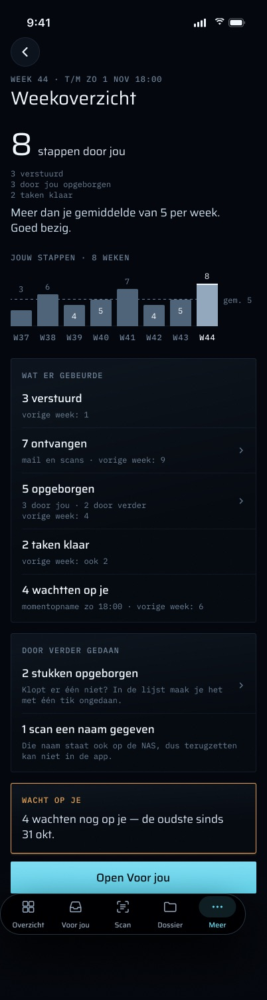

---

## Doel

Elke zondag om 18:00 (Amsterdamse tijd) stuurt verder Martin een stille push. Die zegt wat er die week in het dossier is bewogen en hoeveel er op hem wacht. Het Weekoverzicht is het scherm achter die push. Het toont dezelfde opgeslagen getallen die de push noemde en eindigt met één volgende stap: naar Voor jou, de live lijst van wat nu op hem wacht.

Het is er alleen voor Martin. Het leest alleen en schrijft nooit iets.

De spec behandelt het in §7.9 (`docs/superpowers/specs/2026-10-28-iphone-app-design.md`): "what moved this week (sent, received, filed, tasks done), and what is waiting. It opens a summary screen. The server composes it." Plan 3 bouwt het als Task 26 (`docs/superpowers/plans/2026-10-31-iphone-app-plan-3.md`), in twee delen: de server/worker-helft en de iOS-helft ("26i").

## De volledige functieset

Elke functie wordt beschreven door wat ze doet, gevolgd door één statusregel. Paden zijn relatief aan `apps/ios/Verder/`, tenzij ze beginnen met `apps/` of `packages/`.

### Erheen en weer weg

**1. De zondagse push.** Elke zondag om 18:00 Amsterdamse tijd stelt de worker de week samen, slaat die op en stuurt één stille push. Een herhaalpoging of een tweede run voor dezelfde week stuurt nooit een tweede push.
**Status:** Gebouwd — `apps/worker/src/weekly-summary.ts`, ingepland in `apps/worker/src/index.ts`. De eerste ingeplande run, zondag 8 november, is nog niet waargenomen. Zie Bekende grenzen.

**2. Een push die veilig is op het vergrendelscherm.** De push noemt alleen tellingen, nooit een titel uit het dossier.
**Status:** Gebouwd — `weeklyBody` in `apps/worker/src/weekly-summary.ts`.

**3. Een tik op de push opent het overzicht.** Een gewone tik of "Bekijken" op een `WEEKLY`-push opent het Weekoverzicht, welke link de push ook meedraagt.
**Status:** Gebouwd — `Push/NotificationRouter.swift`.

**4. Meer → Weekoverzicht.** Een rij in de sectie Dossier van Meer opent het scherm op elk moment van de week.
**Status:** Gebouwd — `More/MoreMenu.swift`, `More/MoreTab.swift`.

**5. Deep link `verder://weekly`.** Opent Meer met het Weekoverzicht bovenop. Ze wacht achter het slot en opent na ontgrendelen.
**Status:** Gebouwd — `Push/DeepLink.swift`, `App/RootView.swift`.

**6. Eén volgende stap naar Voor jou.** Elke toestand eindigt met één weg naar de live lijst van wat op Martin wacht. Die leegt de stapel van Voor jou en komt uit op de root.
**Status:** Gebouwd — `WeeklyScreen.steps`/`nextStep` in `Weekly/WeeklyModels.swift`, `App/RootView.swift`. (De frames noemen het "Open Voor jou"; de code zegt "Naar Voor jou".)

**7. Doorklikken vanaf "ontvangen" en "opgeborgen".** Een tik op een van beide tellingen opent de documenten en mail erachter, voor het venster van die week.
**Status:** Nog te bouwen — vraagt een route of filter die documenten en mail toont binnen het `[from, to)`-venster van het overzicht (het Dossier op de telefoon heeft geen filter op datumvenster), een bestemmingsscherm, een link vanaf elke telling en een test dat de lengte van de lijst gelijk is aan de telling.

**8. "Door verder gedaan" leidt naar terugdraaien.** Een tik op de rij "stukken opgeborgen" opent de lijst "Door verder gedaan", waar elk automatisch opgeborgen document met één tik terug te draaien is.
**Status:** Deels gebouwd — de lijst, het terugdraaien met één tik en de deep link `verder://done-by-verder` bestaan (`Inbox/DoneByVerderSection.swift`, `packages/api/src/routers/verder-actions.ts`). Het Weekoverzicht linkt er niet naar. De lijst beslaat een doorlopende 7 dagen (`sinceDays: 7`), niet het venster van het overzicht.

**9. Vernieuwen.** Omlaag trekken om te vernieuwen leest het opgeslagen overzicht opnieuw. In de frames doet "Opnieuw proberen" in de offline-banner hetzelfde.
**Status:** Gebouwd — `WeeklyStore.refresh`, `.refreshable` in `Weekly/WeeklyView.swift`.

### Wat er deze week gebeurde

**10. De vensterregel.** Noemt de ISO-week en het venster dat ze beslaat, dat eindigt op zondag 18:00. De frames lezen "week 44 · t/m zo 1 nov 18:00", en tonen "week 44" ook tijdens het laden en bij een fout, voordat er een overzicht binnen is.
**Status:** Deels gebouwd — `WeeklyFormat` schrijft beide tijdstippen ("zo 25 okt 18:00 – zo 1 nov 18:00") en pas zodra een overzicht geladen is. Ontbreekt: de "t/m"-vorm, en een weeklabel dat de telefoon zelf uitrekent voor de laad- en fouttoestand.

**11. "verstuurd".** Wat Martin die week verstuurde, elk bericht één keer geteld, ook na een correctie.
**Status:** Gebouwd — `composeWeekly` in `apps/worker/src/weekly-summary.ts`.

**12. "ontvangen", mail en scans.** Alles wat binnenkwam: mail van anderen, en brieven gescand op de NAS of met de telefoon.
**Status:** Deels gebouwd — mail wordt geteld (`raw_emails`, Martins eigen adressen uitgezonderd). Scans niet. Vraagt een telling van documenten met een scanbron (`nas-scan`, `phone-scan`, `phone-share`) die binnen het venster binnenkomen, een contractveld of een herdefinieerde `received`, en een worker-test.

**13. "opgeborgen", gesplitst naar wie.** Documenten die die week naar `filed` gingen, gesplitst in "door jou" en "door verder".
**Status:** Gebouwd — `filedByMartin`/`filedByVerder` in `apps/worker/src/weekly-summary.ts`, getoond door `WeeklyScreen`.

**14. "taken klaar".** Taken die die week `done` bereikten.
**Status:** Gebouwd — `tasksDone`.

**15. De wachtmomentopname van zondag.** Hoeveel er zondag om 18:00 op Martin wachtte, getoond als geschiedenis en nooit amber. De code noemt ook tot drie titels, die de frames weglaten.
**Status:** Gebouwd — `waiting`/`topWaiting`, `WeeklyScreen.Waiting`.

**16. De hero: "N stappen door jou".** Martins eigen stappen die week: wat hij verstuurde, plus wat hij opborg, plus de taken die hij afrondde. Alle drie de frames tellen zo op (3 + 3 + 2 = 8, 0 + 0 + 1 = 1, 2 + 2 + 2 = 6). De onderdelen staan onder het getal.
**Status:** Deels gebouwd — het overzicht bevat al `sent`, `filedByMartin` en `tasksDone`. Ontbreekt: een besluit dat de som de definitie is, de hero-rij en een test.

**17. De oordeelszin.** Eén bemoedigende regel, afgezet tegen Martins eigen eerdere weken, nooit een rood tekort: "Meer dan je gemiddelde van 5 per week. Goed bezig.", "Een rustige week — en dat mag.", "Je tweede week met verder. Een gemiddelde volgt vanaf 3 weken."
**Status:** Nog te bouwen — vraagt de geschiedenis (functie 18), een pure regel die de zin kiest (boven, rond of onder het gemiddelde, rustig, te weinig weken) en tests dat geen formulering als tekortkoming leest.

**18. Grafiek "Jouw stappen · 8 weken" met een gemiddelde.** De stappen van de laatste acht weken, deze week uitgelicht, en een gestippelde gemiddeldelijn.
**Status:** Nog te bouwen — vraagt een route die tot acht eerdere overzichten levert, één per ISO-week (de nieuwste `ok`-rij wint wanneer een handmatige run een tweede toevoegde). De rijen worden al bewaard in `worker_runs`. Verder nodig: een gedefinieerd gemiddelde (welke weken, en of de huidige meetelt), een Swift Charts-weergave en een modeltest.

**19. De eerste weken.** Zolang er nog geen acht weken zijn, toont de grafiek lege plekken en "geen data vóór week N". Er wordt geen gemiddelde getekend tot er drie weken zijn.
**Status:** Nog te bouwen — volgt uit functie 18, plus de drieweken-regel.

**20. "vorige week: …" onder elke telling.** Elke telling noemt het cijfer van vorige week, en zegt "ook 2" als het gelijk is.
**Status:** Nog te bouwen — vraagt het overzicht van vorige week uit de geschiedenisroute (functie 18) en de vergelijkingsregel in `WeeklyScreen`. De test `comparedWithNothingInvented` moet dan veranderen van "vergelijkt met niets" naar "vergelijkt alleen met een opgeslagen week".

**21. "Door verder gedaan": stukken opgeborgen.** Een rij in een eigen kaart die zegt hoeveel documenten verder zelf opborg, met de herinnering dat één tik het terugdraait.
**Status:** Deels gebouwd — het getal bestaat (`filedByVerder`). Het wordt alleen binnen "opgeborgen" getoond als "door verder zelf", niet als eigen kaart of rij. Automatisch opbergen staat bij oplevering uit, dus het getal is normaal 0.

**22. "Door verder gedaan": scans benoemd.** Een rij die zegt hoeveel scans auto-name die week hernoemde, en dat terugdraaien in de app niet kan omdat de naam ook op de NAS staat.
**Status:** Nog te bouwen — vraagt een telling van auto-name-rijen met `actor = 'verder'` binnen het venster (`document_status_changes`; `verderActionKind` onderscheidt ze al), een contractveld in `packages/api/src/weekly-summary.ts` met de bijbehorende controles in `isWeeklySummary` en `WeeklyDTO`, de rij en tests.

### Wat er nu wacht

**23. De live telling "wacht op je".** Het enige amber op het scherm. Ze toont hoeveel er nu op Martin wacht, live gelezen uit de store van Voor jou en nooit uit de momentopname van zondag. Zolang Voor jou nog niet geladen is, toont ze woorden in plaats van een getal.
**Status:** Gebouwd — `WeeklyScreen.nextStep(liveWaiting:)`, `InboxStore`.

**24. "de oudste sinds …".** De live kaart noemt de datum van het oudste item dat wacht.
**Status:** Deels gebouwd — elk wachtend item heeft `at`, en `InboxStore` rekent `oldestAt` al uit voor de widget (`Inbox/InboxStore.swift`). Het Weekoverzicht krijgt het niet en toont het niet.

**25. Niets wacht: "Niets wacht op je" met "laatst afgehandeld".** Als er niets wacht, zegt het scherm dat rustig en noemt het laatste moment dat er iets werd afgehandeld. In het frame van de rustige week is de knop naar Voor jou weggelaten.
**Status:** Deels gebouwd — "Niets wacht nu op je." is gebouwd. Ontbreekt: een serverveld voor de nieuwste beslissing over voorstellen, suggesties en taken, en een besluit of de knop weg mag (brief §2.4: de terugknop moet dan nog een uitweg zijn, zodat het geen doodlopend scherm is).

### Toestanden

**26. Laden.** Een skelet in de vorm van de echte inhoud, nooit een spinner.
**Status:** Deels gebouwd — twee eenvoudige plaatshouderpanelen (`Weekly/WeeklyView.swift`). Het skelet van het frame heeft ook de hero, de staven van de grafiek, de vier rijen en het label "week 44".

**27. Vóór de eerste zondag.** Zegt wanneer het eerste overzicht komt, met datum ("zondag 8 november om 18:00"), en wat erin zal staan. Het toont een leeg voorbeeld van acht weken ("eerste balk: W45 · zo 8 nov") en de live kaart "wacht op je".
**Status:** Deels gebouwd — de 404-toestand, de tekst ervan zonder datum en de volgende stap zijn gebouwd (`WeeklyStore.Copy.notYet`). Ontbreekt: datum en week van de volgende zondag 18:00 Amsterdam (kan op de telefoon worden uitgerekend), het label "eerste week" en het lege voorbeeld.

**28. Fout met oorzaak.** Zegt dat het overzicht niet kon worden opgehaald, dat er niets verloren is, en de statuscode (bijvoorbeeld "fout 503"), en biedt dan "Opnieuw proberen" en de weg naar Voor jou.
**Status:** Deels gebouwd — opnieuw proberen en de volgende stap zijn gebouwd. De regel is de algemene "Dat lukte niet. Probeer het over een moment opnieuw." (`VoorJouTab.message`). Ontbreekt: tekst die de statuscode noemt en zegt "Er is niets verloren".

**29. Offline, met het laatste overzicht bewaard.** Zonder verbinding geopend toont het scherm het laatst opgehaalde overzicht onder "geen verbinding · stand van zo 1 nov 19:02", met "Opnieuw proberen". De live kaart zegt hoe oud haar telling is: "stand van 19:02. Voor jou laat zien wat er bewaard is."
**Status:** Nog te bouwen — vraagt een kopie op de telefoon (bestandsbescherming zoals de widget-momentopname die heeft, gewist door `forgetLocally`/`SessionEpoch` bij afmelden en bij een 401), de banner, en de leeftijd van de live kaart uit `InboxStore.fetchedAt`, dat al bestaat. De privacyregel "Opgeslagen op de telefoon: niets" moet mee veranderen.

**30. Offline, deze week nog niet opgehaald.** Zegt dat het overzicht van deze week klaarstaat zodra Martin weer online is. Biedt "Opnieuw proberen" en "Bekijk week 43 (bewaard)".
**Status:** Deels gebouwd — de offline-regel, opnieuw proberen en de volgende stap bestaan. Ontbreekt: de tekst van het frame, de "stand van"-aanduiding en een bewaarde vorige week om te openen (hangt af van functie 29 die meer dan één week bewaart).

**31. Een mislukte vernieuwing houdt vast wat er staat.** Een vernieuwing door omlaag trekken die mislukt, laat het geladen overzicht ongewijzigd. Een afgebroken vernieuwing verandert niets.
**Status:** Gebouwd — `WeeklyStore.refresh` (`aFailedRefreshKeepsWhatIsShown`).

**32. Sessie verlopen.** Een 401 vergeet de lokale dossiergegevens en keert terug naar aanmelden met "Je sessie is verlopen."
**Status:** Gebouwd — `WeeklyStore.refresh` → `onUnauthorized` → `sessionRejected`.

**33. Achter het slot.** Het scherm is nooit zichtbaar terwijl de app vergrendeld is. Een push of link die binnenkomt tijdens vergrendeling opent na Face ID.
**Status:** Gebouwd — `.lockGated(by:)` op Meer, `meerPath` in `App/RootView.swift`.

**34. Grote tekst en een klein scherm.** Alles schaalt tot AX5 en past op een iPhone SE van 375 pt. Bij toegankelijkheidsformaten verplaatst het AX5-frame de live kaart "wacht op je" en haar knop omhoog, direct onder de hero, zodat de volgende stap bereikbaar is zonder langs de hele geschiedenis te scrollen.
**Status:** Deels gebouwd — elk lettertype schaalt met een tekststijl en de tekst loopt door. De AX5-herschikking is niet gebouwd.

### Gevoel, toegankelijkheid en gezondheid

**35. Een mislukte nieuwe poging is voelbaar.** Als "Opnieuw proberen" weer mislukt, geeft de telefoon één `.error`-haptiek, zoals de haptiekkaart van de brief voorschrijft voor een mislukte actie met inline opnieuw proberen (brief §2.5; Overzicht doet dit al). Het lezen van het overzicht trilt nooit.
**Status:** Nog te bouwen — vraagt een foutteller in `WeeklyStore` en `.sensoryFeedback(.error, …)` op de view, zoals `Home/HomeTab.swift` die heeft.

**36. VoiceOver.** De titel is een kop. Elke telling, en elk item in de momentopname, leest als één element. De grafiek krijgt een beschrijving van één zin en een audiografiek (brief §2.7).
**Status:** Deels gebouwd — de kop en de samengevoegde elementen zijn gebouwd (`Weekly/WeeklyView.swift`). De beschrijving en audiografiek van de grafiek (een `AXChartDescriptor`) komen met functie 18.

**37. Meer → Meldingen legt de push uit.** De meldingsinstellingen beschrijven de categorie: "Zondag om 18:00: wat er die week gebeurde. Stil."
**Status:** Gebouwd — `More/MoreMenu.swift`.

**38. Worker-gezondheid bewaakt de zondagse job.** Het Systeem-paneel van het dashboard wordt `down` na drie gemiste zondagen, of 26 uur lang na een harde fout.
**Status:** Gebouwd — `packages/api/src/worker-health.ts`.

**Geen onderdeel van dit scherm.** De spec en de brief geven het Weekoverzicht geen veegacties, geen ingedrukt-houden-om-te-bevestigen, geen bediening in het Bedieningspaneel of op de Actieknop, geen Live Activity, geen widget en geen snelle actie. Het scherm leest alleen, dus er valt niets te bevestigen, te versturen of live te volgen. De Scan-bediening, de spraak-Actieknop, ingedrukt-houden-om-te-bevestigen bij "Versturen" en de veegacties horen bij Scan, het gesproken snelle logboek, voorstellen en Voor jou.

## Hoe men er komt, en waar het heen leidt

| Ingang | Wat er gebeurt |
|---|---|
| **Meer → Weekoverzicht** | De rij staat in de sectie "Dossier" van Meer naast Geld en Gesprek vastleggen, met het `calendar`-icoon (`MoreMenu.swift`). Ze zet `MoreRoute.weekly` op de stapel van Meer. |
| **Tik op de zondagse push** (categorie `WEEKLY`) | De worker stuurt de push met `link: "verder://inbox"`. Bij een gewone tik of `OPEN` ("Bekijken") stuurt `NotificationRouter.target` een `WEEKLY`-melding naar `.weekly`, wat de link ook zegt, zodat ze nooit op Voor jou uitkomt. Elke andere actie opent hoogstens de link. |
| **Deep link `verder://weekly`** | `DeepLink.weekly` wordt tab `.meer` met stapel `[.weekly]`. Een pad na `weekly` wordt geweigerd (`.none`). |
| **Debug-fixtures** | `-route weekly` neemt hetzelfde pad als een tik op de push (`.link(.weekly)`). `scripts/capture.sh weekly weekly <out.png>` legt de geladen toestand vast en `scripts/capture.sh empty weekly <out.png>` de nog-niet-toestand (de `empty`-fixture beantwoordt `/weekly` met 404). |

Het Weekoverzicht is niet bereikbaar vanuit Overzicht, vanuit een widget of vanuit een snelle actie op het beginscherm.

**Waar het heen leidt.** Er is één volgende stap, "Naar Voor jou". Die leegt de stapel van Voor jou en schakelt naar het tabblad Voor jou op de root, de live lijst. De items onder de momentopname van zondag zijn niet aantikbaar. De terugknop gaat terug naar Meer.

## Wat het scherm toont (code)

Elk woord komt uit `WeeklyScreen` in `WeeklyModels.swift`. `WeeklyView.swift` zet het alleen op zijn plek, zodat de view op de frames kan worden afgestemd zonder te veranderen wat er staat. Van boven naar beneden:

1. **Titel:** "Weekoverzicht".
2. **Vensterregel**, bijvoorbeeld `week 44 · zo 25 okt 18:00 – zo 1 nov 18:00`. Toont beide einden van het venster als Amsterdamse tijdstippen. `to` wordt nooit omgezet in "de dag ervoor", en een venster over de klokwissel heen leest aan beide kanten nog steeds 18:00 (`WeeklyFormat`, dat locale-onafhankelijk is zodat een Engelse simulator dezelfde tekst toont als Martins telefoon).
3. **Vier tellingen**:
   - "N verstuurd"
   - "N binnen"
   - "N opgeborgen", met de detailregel "X door jou · Y door verder zelf". De detailregel vervalt als er niets is opgeborgen.
   - "1 taak klaar" of "N taken klaar".

   Nullen worden als 0 getoond.
4. **De wachtmomentopname van zondag.** De kop zegt wanneer de momentopname is gemaakt: "Op zondag wachtten er 4 op je", "Op zondag wachtte er 1 op je" of "Op zondag wachtte er niets op je". Daaronder staan hoogstens drie items uit `topWaiting`, elk met zijn Nederlandse soort (`KindLabel`: voorstel, vraag, suggestie, taak, "op de kaart" voor een halte, "overig" voor al het andere) en zijn titel, afgekapt op twee regels. De items zijn niet aantikbaar.
5. **Volgende stap: "Naar Voor jou"**, met een regel op basis van de LIVE wachttelling (`InboxStore`, doorgegeven RootView → MoreTab → WeeklyView):
   - "4 wachten nog op je" of "1 wacht nog op je", amber (het enige amber op het scherm);
   - "Niets wacht nu op je.", niet amber;
   - "Kijk wat er nu op je wacht.", niet amber, zolang Voor jou nog niet geladen is. Er wordt geen getal verzonnen.

Omlaag trekken om te vernieuwen leest `/weekly` opnieuw.

**Frame vs code (normaal frame):**
- De kop van het frame leest `WEEK 44 · T/M ZO 1 NOV 18:00`. De code toont beide tijdstippen.
- Het frame toont "8 stappen door jou" met een oordeel ("Meer dan je gemiddelde van 5 per week. Goed bezig."), de grafiek van acht weken en "vorige week: N" onder elke rij. De code vergelijkt met niets, met opzet: `/weekly` levert één week, en een vergelijking zou een getal zijn dat de server nooit heeft geteld. De test `comparedWithNothingInvented` doorzoekt elk woord op het scherm op verzonnen vergelijkingen.
- "7 ontvangen · mail en scans" in het frame telt ook scans. "binnen" in de code is `received`, en dat telt **alleen mail** (`raw_emails`). Een scan telt niet mee.
- De kaart "Door verder gedaan" in het frame heeft een rij voor automatisch opgeborgen documenten en een rij voor automatisch benoemde scans. De code toont alleen de splitsing "door verder zelf" onder opgeborgen. Hernoemingen worden helemaal niet geteld.
- Het frame suggereert doorklikken op "ontvangen" en "opgeborgen". De code heeft dat niet: geen enkele telling is aantikbaar.
- De kaart "WACHT OP JE" in het frame ("4 wachten nog op je — de oudste sinds 31 okt.") en de knop "Open Voor jou" komen overeen met de ene volgende stap in de code, "Naar Voor jou" / "4 wachten nog op je". De code toont "de oudste sinds" niet.
- Het frame toont de momentopname als een rij, "4 wachtten op je · momentopname zo 18:00". De momentopname in de code noemt ook tot drie titels.

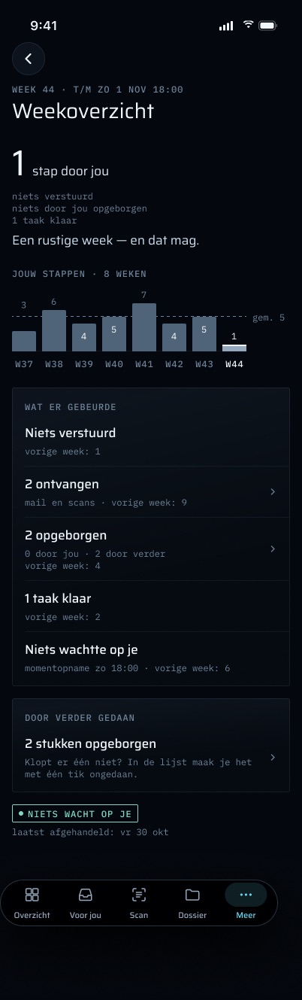

Het frame van de rustige week toont "Niets verstuurd" en een pil "NIETS WACHT OP JE" met "laatst afgehandeld". De code schrijft "0 verstuurd" en "Niets wacht nu op je." en weet niet wanneer er voor het laatst iets is afgehandeld.

## Waar de getallen vandaan komen (server)

### Samenstelling: `apps/worker/src/weekly-summary.ts`

pg-boss-queue `weekly.summary`, ingepland op `0 18 * * 0` met `tz: "Europe/Amsterdam"` (`apps/worker/src/index.ts`). Elke run doet drie dingen, in deze volgorde:

1. **Samenstellen.** `summaryWeek(now)` kiest het venster dat sluit op de nieuwste zondag 18:00 Amsterdam op of vóór `now`. `loadWeekly` leest de bronnen met een SQL-grens die aan beide kanten twee dagen is verruimd, en de pure `composeWeekly` beslist in JS.
2. **Vastleggen.** Ze schrijft één `worker_runs`-rij, `weekly-summary` / `ok`, met `detail.summary`. Die rij is de opgeslagen kopie die het scherm leest. Er is geen nieuwe tabel.
3. **Pushen.** `notify({ kind: "weekly", level: "passive", title: "Je week in verder", body, link: "verder://inbox", dedupKey: "weekly:<ISO week>" })`.

**Het venster** loopt van de vorige zondag 18:00 tot deze zondag 18:00 Amsterdam. Het is halfopen, `[from, to)`, en NIET maandag tot en met zondag. Opeenvolgende vensters raken elkaar op het moment dat de job draait, zodat activiteit op zondagavond precies één keer wordt geteld, in het volgende overzicht. Het venster hoort bij de week, niet bij het moment waarop de job draaide, dus een late run telt dezelfde rijen als een stipte.

Wat elke telling betekent:

| Veld | Bron en regel |
|---|---|
| `sent` | Uitgaande `log_entries` die door geen andere entry worden vervangen. Elke wordt beoordeeld op de datums van de ROOT van haar keten (recursieve CTE over `supersedes_id`, dieptegrens 100), zodat een correctie die de week erna wordt vastgelegd niet nog eens wordt geteld. Een verstuurd voorstel heeft altijd zijn entry (`finishSent` schrijft beide in één transactie), dus het wordt via de entry geteld. Een vraag sluit zonder entry en is nooit "verstuurd". |
| `received` | `raw_emails` waarvan de afzender niet een van Martins eigen adressen is (`ownMailboxAddresses()`). De afzender wordt GEPARSED met `senderAddress`, nooit op deeltekst vergeleken. Een header die `senderAddress` weigert, is niet aantoonbaar van hem en telt dus als ontvangen. |
| `filedByMartin` / `filedByVerder` | Documenten die binnen het venster NAAR `filed` GINGEN: de vorige status van de `filed`-rij (de eerdere wijzigingsrij, of `documents.status` voor de eerste) was niet `filed`. Elk document telt één keer, toegeschreven aan de `actor` van zijn eerste zulke overgang. `actor = 'verder'` telt als verder; al het andere telt als Martin. Een hernoeming van een document dat al is opgeborgen, telt niet opnieuw. |
| `tasksDone` | Verschillende taken met een `task_status_changes`-rij naar `done` binnen het venster. |
| `waiting` / `topWaiting` | `loadWaiting()` op het moment dat de job draait (`packages/api/src/waiting.ts`), dezelfde definitie die Voor jou, de badge en het dashboard aanstuurt: de lengte ervan, en de eerste drie items. |

**Laat vastleggen.** `raw_emails.sent_at` en `log_entries.occurred_at` zijn niet de momenten waarop verder van de rij hoorde: de Gmail-poll kan een mail van 17:55 om 18:10 ophalen. `arrivedAt` beoordeelt die rijen daarom op het latere van de datum en het vastlegmoment. De uitzondering is een verschil van meer dan zeven dagen (`LATE_RECORD_MS`, de eigen `newer_than:7d` van de Gmail-poll). Dat is een backfill, en die behoudt haar eigen datum.

**Eén push per week.** De dedupKey `weekly:<ISO week>` maakt van een herhaalpoging of een tweede handmatige run voor dezelfde week een duplicaat, en `notify()` weigert die. De job schrijft zijn eigen fouten in een `error`-rij, dus pg-boss probeert hem nooit opnieuw. Een nieuwe run gaat met de hand:
- `pnpm --filter worker weekly-summary` (`apps/worker/src/ops/weekly-summary.ts`);
- `--dry` stelt samen en drukt af, en schrijft geen rij en verstuurt niets.

Een handmatige run op maandag na een mislukte zondag herstelt **die** week, niet de nieuwe. In dat geval zijn `waiting`/`topWaiting` de momentopname op het moment van de run, niet die van zondag.

Een niet-droge handmatige run op welke dag ook vóór de volgende zondag 18:00 richt zich opnieuw op de week waarvan de push al is verstuurd: de push wordt als duplicaat geweigerd, maar de run schrijft wel een NIEUWERE `ok`-rij, en die rij is wat `/weekly` vanaf dan levert. De tellingen kunnen van de push afwijken (rijen die sinds zondag laat zijn vastgelegd) en de wachtmomentopname is die van de handmatige run. Gebruik `--dry` om te kijken. Een rustige week wordt toch vastgelegd en verstuurd, omdat de rij is waarmee worker-health een rustige week onderscheidt van een dode job.

### Lezen: `GET /api/mobile/v1/weekly`

`apps/web/src/app/api/mobile/v1/weekly/route.ts`, via `mobileGet` en de tRPC-procedure `dashboard.weekly` (`packages/api/src/routers/dashboard.ts`):
- Geeft `detail.summary` van de nieuwste `ok`-rij van `weekly-summary` terug, precies zoals opgeslagen. Een mislukte zondag verbergt nooit het overzicht van vorige week.
- `isWeeklySummary` valideert de opgeslagen JSON (weeksleutel, beide tijdstippen, elke telling een niet-negatief geheel getal, `topWaiting` een array). Als de NIEUWSTE `ok`-rij daar niet doorheen komt, antwoordt de route 404; ze valt niet terug op een oudere geldige rij. `isWeeklySummary` inspecteert de `topWaiting`-items zelf niet; de strikte `WeeklyDTO`-decode op de telefoon doet dat wel, en een misvormd item toont daar de algemene fouttoestand, nooit een standaardwaarde.
- Antwoorden:
  - `401 {"error":"unauthorized"}` zonder sessie, gecontroleerd vóór enige routeraanroep;
  - `404 {"error":"no weekly summary yet"}` vóór de eerste zondag;
  - `200` met het overzicht.
- De sessie is de better-auth-cookie, zoals op elke telefoonroute. De route heeft `cache-control: no-store`.

Het contract (`WeeklySummary`) staat in `packages/api/src/weekly-summary.ts`, omdat de worker het schrijft en de API het leest, en één spelling van een JSON-contract niet uit elkaar kan lopen.

**Lezen schrijft niets.** Er wordt geen route aangeroepen die schrijft, en er ontstaat geen ledger-event. Dat geldt voor het openen van het scherm, voor de zondagse job (die alleen een `worker_runs`-rij toevoegt, geen bewijs) en voor de push. Niets op dit scherm is AI-uitvoer.

## Toestanden

| Toestand | Wanneer | Wat Martin ziet en kan doen |
|---|---|---|
| **Laden** | Elke keer dat het scherm opent: er wordt niets bewaard tussen bezoeken. | Twee plaatshouderpanelen in de vorm van de inhoud, geen spinner. Nog geen volgende stap (`WeeklyScreen.steps(.loading)` is leeg). |
| **Geladen** | `200`. | Venster, tellingen, momentopname van zondag, "Naar Voor jou". Omlaag trekken om te vernieuwen. |
| **Nog niet** | `404` (vóór de eerste zondag). Geen fout. | "Je eerste weekoverzicht komt zondag om 18:00" en "Daarna staat hier elke zondag wat er die week gebeurde.", dan "Naar Voor jou". |
| **Offline / fout** | Een transportfout, een 5xx, een geweigerde decode. | Eén regel: "Geen verbinding met verder. Probeer het opnieuw." (transport) of "Dat lukte niet. Probeer het over een moment opnieuw." (al het andere), dan "Opnieuw proberen" en "Naar Voor jou". Voor jou leest zijn eigen gegevens, dus dat kan werken als dit scherm dat niet deed. Er wordt geen cijfer getoond (`offlineFailsWithoutAFigure`). |
| **Vernieuwen mislukt terwijl geladen** | Een vernieuwing door omlaag trekken mislukt. | Het al getoonde overzicht blijft staan, ongewijzigd (`aFailedRefreshKeepsWhatIsShown`). Een afgebroken vernieuwing (scherm gesloten) verandert niets. |
| **Sessie verlopen** | `401`. | `auth.sessionRejected()`: lokale dossiergegevens worden vergeten en het aanmeldscherm zegt "Je sessie is verlopen." |
| **Vergrendeld** | De app is voorbij de respijtperiode van 300 s (`LockPolicy.graceSeconds`). | Meer zit achter het slot (`.lockGated(by: lock)`), dus het Weekoverzicht is nooit zichtbaar tijdens vergrendeling. Een tik op een push of een deep link die binnenkomt tijdens vergrendeling wacht in `meerPath`, dat `RootView` vasthoudt, en opent na ontgrendelen. |
| **Grote tekst (AX5)** | Dynamic Type. | Elk lettertype schaalt met een tekststijl. De nog-niet-tekst, de foutregel en de regel van de volgende stap lopen door in plaats van af te kappen; een `topWaiting`-titel blijft afgekapt op twee regels. |

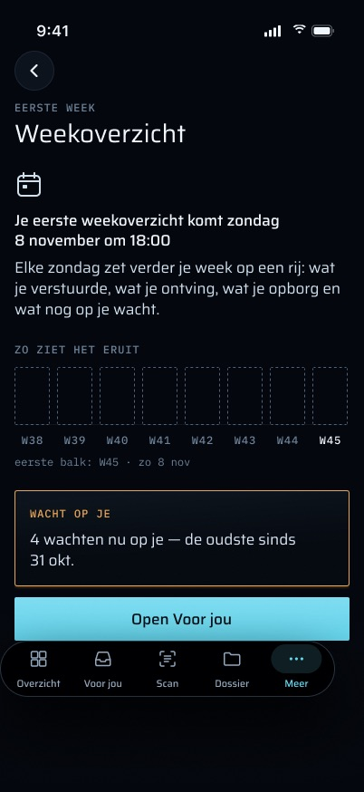

**Frame vs code (nog niet):** het frame zegt "Je eerste weekoverzicht komt zondag 8 november om 18:00", noemt de datum en toont een leeg voorbeeld van acht staven. De code zegt "zondag om 18:00" zonder datum en tekent geen grafiek. De volgende stap is "Naar Voor jou", zonder de amber kaart "WACHT OP JE" van het frame.

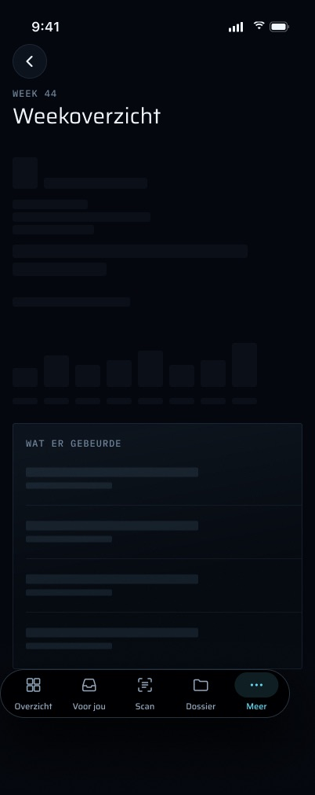

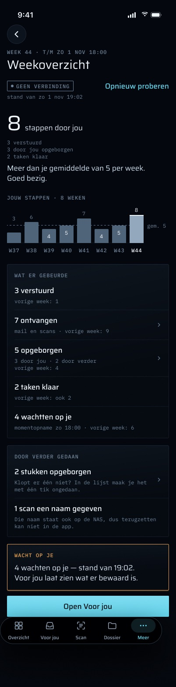

**Frame vs code (offline):**
- Het frame "geen verbinding · bewaard" toont het laatste overzicht onder een banner "GEEN VERBINDING · stand van zo 1 nov 19:02". De code bewaart geen kopie tussen bezoeken (`WeeklyStore`: "Not kept between screens — the summary changes once a week"). Offline geopend toont het de foutregel en "Opnieuw proberen". Het bewaarde overzicht blijft alleen staan als het scherm al open is en een vernieuwing mislukt, en dan wordt er geen banner getoond.
- Het frame "nog niet opgehaald" biedt "Bekijk week 43 (bewaard)". De code heeft geen opgeslagen oudere week om te tonen.

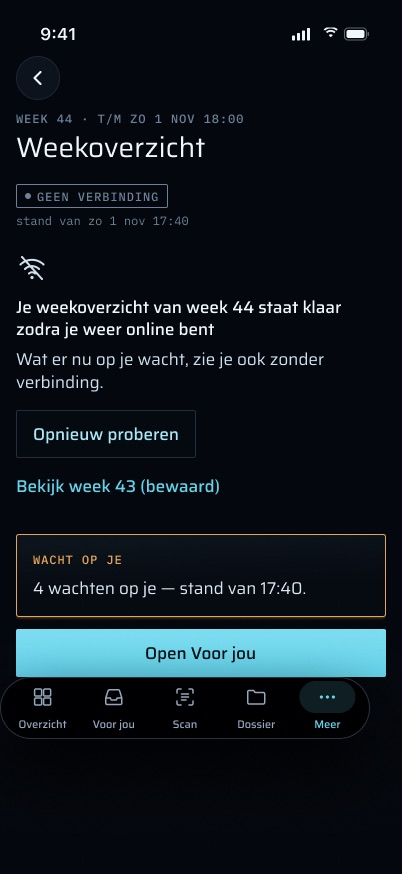

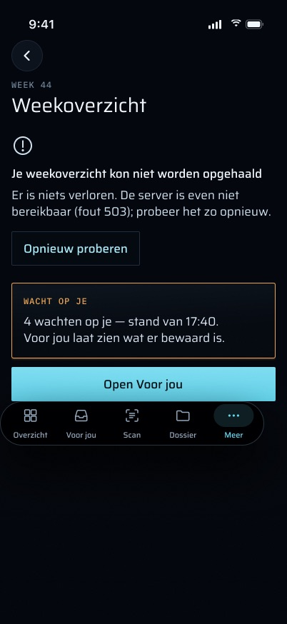

**Frame vs code (fout):** "Je weekoverzicht kon niet worden opgehaald · … (fout 503)" in het frame noemt de statuscode. De code toont de algemene "Dat lukte niet. Probeer het over een moment opnieuw." Ook "Voor jou laat zien wat er bewaard is" in de amber kaart van het frame staat niet in de code.

## Privacy en beveiliging

- **Face ID.** Het scherm zit achter het app-slot: Meer zit achter het slot, en alleen Overzicht (tellingen en geld) en Scan zijn open tijdens vergrendeling. De app vraagt uit zichzelf één keer om Face ID, bij openen of bij terugkeer na de respijtperiode van 300 s. Daarna is elk tabblad open tot de volgende vergrendeling.
- **Vergrendelscherm.** De zondagse push bevat **alleen tellingen**, bijvoorbeeld `3 verstuurd · 7 binnen · 5 opgeborgen · 2 taken klaar — 4 wachten op jou`, met de titel "Je week in verder". De `topWaiting`-titels staan nooit in de push. Een titel op het vergrendelscherm zou het dossier hardop voorlezen aan wie de telefoon oppakt, dus de titels reizen alleen mee in het opgeslagen overzicht, achter Face ID.
- **Widgets.** Geen. Het Weekoverzicht voedt geen widget.
- **Opgeslagen op de telefoon.** Niets. `WeeklyStore` houdt het overzicht in het geheugen zolang het scherm open is. Het staat niet in het zakdossier, de widget-momentopname of enig bestand. De sessiecookie waarmee het wordt opgehaald, is het gebruikelijke Keychain-item van de app (`AfterFirstUnlockThisDeviceOnly`).
- **Afmelden / ingetrokken sessie.** Er blijft niets wekelijks over om te wissen. Een 401 hier beëindigt de sessie op dezelfde manier als overal elders (`sessionRejected` → `forgetLocally`).

## Regels die het volgt

De code handhaaft deze regels vandaag, en de hieronder genoemde tests controleren ze. Elke functie die nog gebouwd moet worden, moet ze respecteren. De geschiedenisfuncties (16–20) veranderen één regel: een vergelijking mag, maar alleen met een week die de server werkelijk heeft opgeslagen.

- **Amber alleen voor wat op Martin wacht, en alleen live.** Alles wat het opgeslagen overzicht zegt, is geschiedenis: de tellingen en de momentopname van zondag. Het scherm kan op elke dag van de week opengaan, en over een item dat zondag wachtte, kan sindsdien zijn beslist. De momentopname amber kleuren zou Voor jou, de badge en het dashboard tegenspreken, die één live definitie delen (`loadWaiting`). Het enige amber is de live telling van de volgende stap. De kleur wordt in het model bepaald (`WeeklyScreen.Tone`: `.history` / `.waitsOnMartin`), en tests lezen hem daar (`theSummaryIsHistoryAndNeverAmber`, `endsWithOneNextStepToVoorJouAmberOnlyOnTheLiveCount`). De eerste bouw kleurde de momentopname amber, en dat is gecorrigeerd.
- **Geen verzonnen cijfer.** Het scherm vergelijkt niet met eerdere weken die het nooit kreeg, en het toont geen telling als het offline is. Als de live telling onbekend is, zegt de volgende stap dat in woorden.
- **Het scherm toont de getallen die de push noemde.** Het leest de opgeslagen kopie, nooit een hertelling, zodat het tikdoel niet afwijkt van de melding. De enige uitzondering is een niet-droge handmatige run in dezelfde week (zie **Eén push per week** hierboven), die de opgeslagen kopie vervangt zonder een nieuwe push te sturen.
- **De opberg-amendering verschijnt hier alleen als telling.** Documenten die verder zelf opborg (`actor = 'verder'`) worden apart geteld als "door verder zelf", nooit bij die van Martin opgeteld. Terugdraaien daarvan zit in "Door verder gedaan" op Voor jou, niet hier. Automatisch opbergen staat bij oplevering uit (`DOCMETA_AUTO_APPLY` niet gezet), dus `filedByVerder` is normaal 0.
- **Hier wordt niets verstuurd en niets beslist.** Het scherm leest alleen.

## Meldingen en haptiek

- **Eén push per ISO-week**, zondag 18:00 Amsterdam: soort `weekly`, categorie `WEEKLY`, onderbrekingsniveau **passive** (geen geluid; APNs-prioriteit 5), titel "Je week in verder", de body met alleen tellingen. Zoals elke melding gaat ze via `notify()`, dat ook de icoonbadge zet op basis van de live wachttelling en één `notification_attempts`-rij per kanaal schrijft.
- **Meer → Meldingen** beschrijft de categorie als "Weekoverzicht — Zondag om 18:00: wat er die week gebeurde. Stil."
- **Haptiek:** geen. Het scherm geeft geen haptische feedback.

## Offline gedrag en synchronisatie

Er is geen synchronisatie. Het scherm haalt `/weekly` op elke keer dat het opent en bij omlaag trekken om te vernieuwen, en bewaart daarna niets. Offline toont het de fouttoestand met "Opnieuw proberen" en "Naar Voor jou". Voor jou houdt een eigen gecachte lijst bij en kan nog steeds tonen wat er wacht.

## Bekende grenzen en wat niet gemeten is

- **De frames lopen voor op de code.** Elk gat heeft zijn status in [de volledige functieset](#de-volledige-functieset):
  - geen geschiedenis (grafiek, gemiddelde, "vorige week");
  - geen totaal "stappen door jou";
  - geen tellingen "Door verder gedaan" per week, en hernoemingen door auto-name worden niet geteld;
  - geen scans in "ontvangen";
  - geen offline kopie en geen oudere week om op terug te vallen;
  - geen datum in de nog-niet-tekst;
  - geen "oudste sinds".

  Elk hiervan vraagt servergegevens die `/weekly` niet levert, en een besluit over wat de tellingen betekenen.
- **De eerste echte zondag is niet als gedaan vastgelegd.** De serverhelft (route + schema `weekly.summary`) is uitgerold op 2026-11-01 20:16 CET (P3-D3, CLAUDE.md), na 18:00 van die zondag, dus de eerste ingeplande run is zondag 2026-11-08 en tot dan antwoordt `/weekly` met 404. Plan 3 Task 26 Step 3 is nog niet afgevinkt: `pnpm --filter worker weekly-summary --dry` in de container draaien, Martin de exacte bodytekst laten zien (de eerste ingeplande push is zijn goedgekeurde tekst), en dan bevestigen dat er een `weekly-summary`-rij gedateerd zondag 17:00 UTC (18:00 CET) is en dat de push aankwam. CLAUDE.md vermeldt geen eerste run. "A job is not scheduled until `worker_runs` says it ran."
- **Een verouderd commentaar in het contract.** `WeeklySummary.sent` in `packages/api/src/weekly-summary.ts` zegt nog "plus sent non-question proposals with no entry yet". De worker telt voorstellen niet apart (een verstuurd voorstel heeft altijd zijn entry), dus het commentaar klopt niet en de tabel hierboven wel.
- **Worker-gezondheid:** `weekly-summary` is een watcher met een wekelijkse cadans. Cadans×3 verdraagt twee gemiste zondagen en wordt `down` bij de derde, 21 dagen na de laatste run. Een harde fout is 26 uur lang `down` via de gewone foutregel.
- **De momentopname van een herstelrun is niet die van zondag.** Het scherm zegt toch "Op zondag".
- **Plaatsing:** alleen Meer. Er is geen link vanuit Overzicht, geen widget en geen snelle actie.

## Waar in de code

**iOS (`apps/ios/Verder/`)**
- `Weekly/WeeklyModels.swift`: `WeeklyDTO` (strikte decode), `WeeklyFormat` (weeksleutel, Amsterdamse tijdstippen), `WeeklyScreen` (elk woord, toon, stappen).
- `Weekly/WeeklyStore.swift`: `GET /api/mobile/v1/weekly`, met de toestanden loading / notYet / loaded / failed.
- `Weekly/WeeklyView.swift`: de opmaak.
- `More/MoreMenu.swift`, `More/MoreTab.swift`: de rij in Meer en de bestemming `MoreRoute.weekly`.
- `App/RootView.swift`: `meerPath`, het slot, de live telling en de sprong naar Voor jou.
- `Push/DeepLink.swift` (`verder://weekly`), `Push/NotificationRouter.swift` (een tik op `WEEKLY` gaat naar het overzicht), `Push/NotificationCategories.swift`.
- `Fixtures/FixtureLaunch.swift`, `FixtureData/_shared/weekly.json` (week 2026-W44), `FixtureData/weekly/fixture.json`, `FixtureData/empty/fixture.json` (weekly 404).

**Server**
- `apps/web/src/app/api/mobile/v1/weekly/route.ts` (+ `route.test.ts`).
- `packages/api/src/routers/dashboard.ts`: `dashboard.weekly`.
- `packages/api/src/weekly-summary.ts` (+ test): het contract `WeeklySummary` en `isWeeklySummary`.
- `packages/api/src/waiting.ts`: `loadWaiting`.
- `packages/api/src/amsterdam.ts`: `amsterdamAt`, `isoWeekKey`, `weekBounds`.
- `packages/api/src/worker-health.ts`, `packages/api/src/worker-names.ts`: `WEEKLY_SUMMARY_WORKER_NAME`.
- `apps/worker/src/weekly-summary.ts` (+ test): `summaryWeek`, `arrivedAt`, `composeWeekly`, `weeklyBody`, `loadWeekly`, `runWeeklySummary`.
- `apps/worker/src/index.ts`: queue en schema.
- `apps/worker/src/ops/weekly-summary.ts`: handmatige run, `--dry`.
- `apps/worker/src/notify/notify.ts`: categorie `WEEKLY`.

**Tests**
- `apps/ios/VerderTests/WeeklyDTOTests.swift`: `decodesTheRouteContract`, `refusesWhatTheContractForbids`, `aMissingFieldIsRefusedNotDefaulted`, `theWindowReadsSundayToSundayInAmsterdam`, `theWindowAcrossTheClockChangeStillReads1800`, `countsAreTheStoredOnesWithSingularForms`, `whatVerderDidOnItsOwnIsStatedPlainly`, `comparedWithNothingInvented`, `theSummaryIsHistoryAndNeverAmber`, `waitingIsSundaysSnapshot`, `everyStateEndsInANextStepAFailureInTwo`, `topWaitingIsAtMostThree`, `endsWithOneNextStepToVoorJouAmberOnlyOnTheLiveCount`, `theHeaderNamesTheWeekAndItsWindow`, `theStoreReadsTheWeeklyFixture`, `beforeTheFirstSundayItSaysWhenItComes`, `unauthorizedEndsTheSession`, `offlineFailsWithoutAFigure`, `aFailedRefreshKeepsWhatIsShown`, `aWeeklyLinkOpensMeer`, `aTapOnTheWeeklyPushOpensTheSummary`, `theFixtureRouteTakesTheTapsPath`.
- `LinkDestinationTests.swift`, `MoreMenuTests.swift`, `FixtureTests.swift`: routering, de rij in Meer en het fixture-contract.
- `apps/worker/src/weekly-summary.test.ts`: vensters, laat vastleggen, ketenroots, herstelde verzendingen, opbergovergangen, ontdubbeling, droge run.
- `packages/api/src/weekly-summary.test.ts`, `apps/web/src/app/api/mobile/v1/weekly/route.test.ts`, `packages/api/src/worker-health.test.ts`.

## Frames

| Frame | Toestand die het toont |
|---|---|
|  `Weekoverzicht_normaal.jpg` | Een normale week: hero-telling, grafiek van acht weken, "Wat er gebeurde" met vergelijkingen met vorige week, "Door verder gedaan", de amber kaart "Wacht op je" en "Open Voor jou". |
|  `Weekoverzicht_rustige_week.jpg` | Een rustige week: één stap, "Een rustige week — en dat mag.", niets wacht (pil "Niets wacht op je", geen knop). |
| 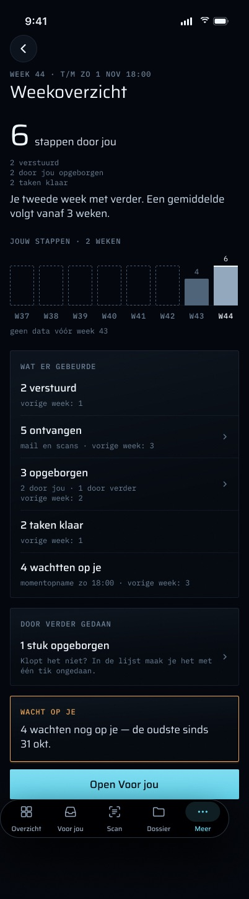 `Weekoverzicht_tweede_week.jpg` | Martins tweede week met verder: twee staven, "geen data vóór week 43", nog geen gemiddelde. |
|  `Weekoverzicht_voor_de_eerste_zondag.jpg` | Vóór de eerste zondag (de 404- / nog-niet-toestand). |
|  `Weekoverzicht_laden.jpg` | Laden: plaatshoudervormen. |
|  `Weekoverzicht_geen_verbinding_bewaard.jpg` | Offline met het laatste overzicht bewaard (niet gebouwd: de code bewaart niets tussen bezoeken). |
|  `Weekoverzicht_geen_verbinding_nog_niet_opgehaald.jpg` | Offline voordat het overzicht van deze week is opgehaald, met opnieuw proberen en een link naar de bewaarde week 43 (de link is niet gebouwd). |
|  `Weekoverzicht_fout.jpg` | Serverfout (503) met "Opnieuw proberen" en de weg naar Voor jou. |
| 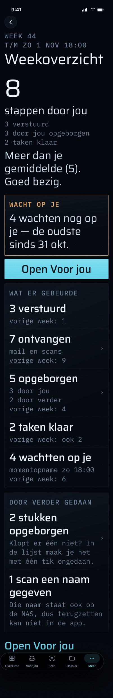 `Weekoverzicht_AX5.jpg` | De normale week bij de grootste toegankelijkheidstekstgrootte (AX5). |
| 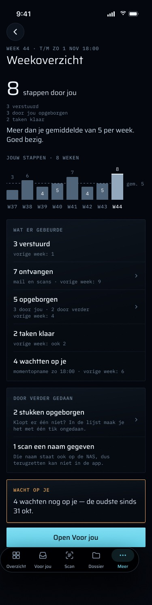 `Weekoverzicht_iPhone_SE.jpg` | De normale week op een iPhone SE van 375 pt. |
| 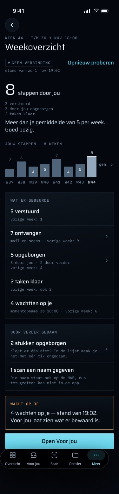 `Weekoverzicht_iPhone_SE_geen_verbinding.jpg` | iPhone SE, offline met het bewaarde overzicht. |
