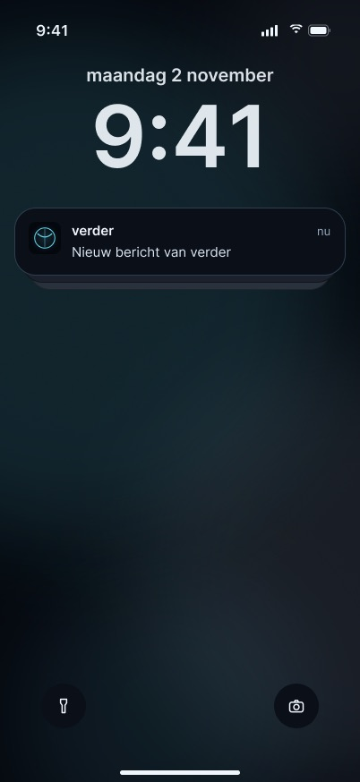
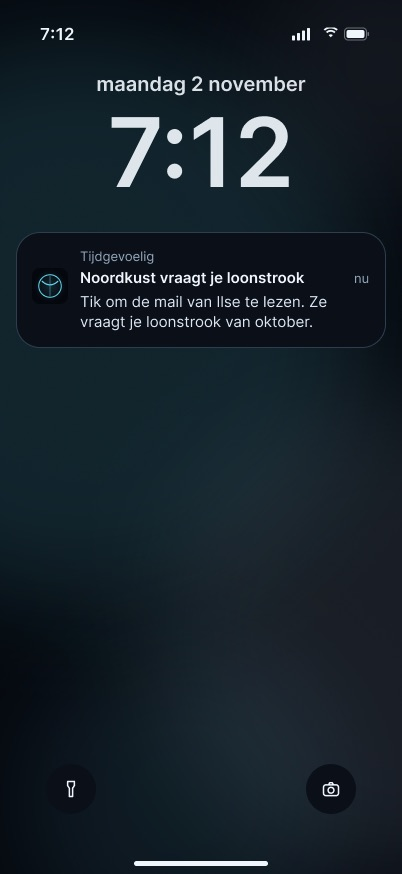
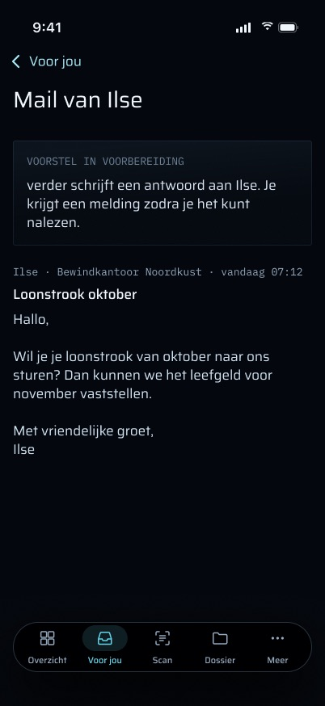
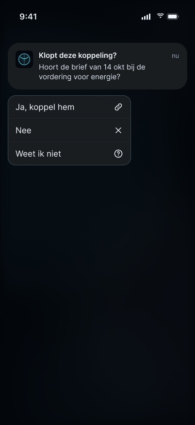
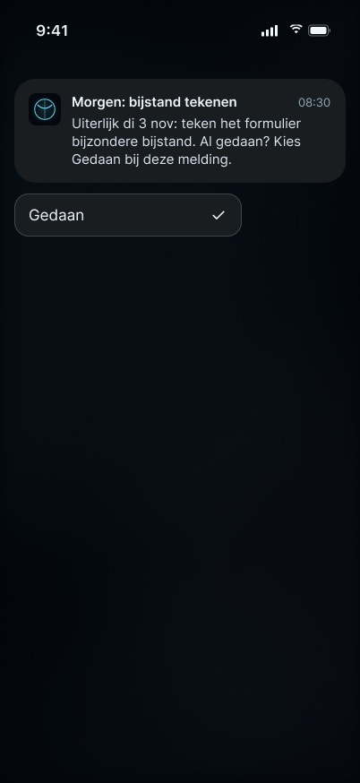
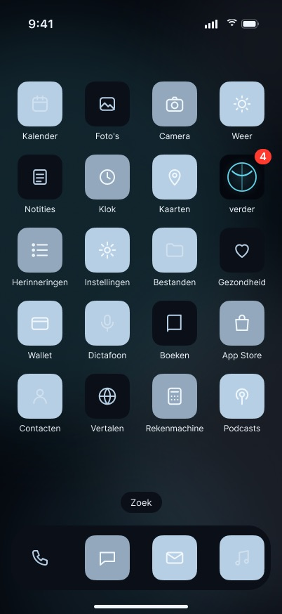
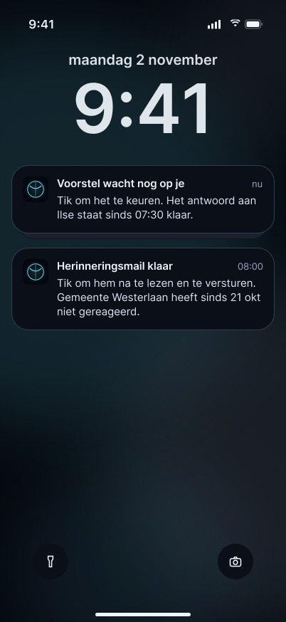

# Meldingen: functies

## Stand van de bouw

Geteld over elke functie in dit document met een **Status:**-regel (gecontroleerd tegen de code op 2026-11-03):

| Gebouwd | Deels gebouwd | Nog te bouwen |
|---|---|---|
| 26 | 5 | 11 |

De drie belangrijkste dingen die nog gebouwd moeten worden:

1. **"Gedaan" op een deadline-push**, met de drie vervolgmeldingen ("Gedaan kwam niet door", "Opnieuw inloggen nodig", "Taak al afgerond"). De serverkant bestaat (`POST /api/mobile/v1/tasks/<id>/status`); de push, de categorie-actie, het pad in de router en de terugkoppeling niet.
2. **Het mailscherm achter een mail-push**: wat de mail vraagt plus hoe het voorstel ervoor staat ("Voorstel in voorbereiding", "Geen antwoord nodig", "Geen voorstel gemaakt"), met "Opnieuw proberen" en "Zelf antwoorden". De voorstelstatussen `drafting` en `draft-failed` bestaan al op de server; geen route stelt ze per mail beschikbaar en geen scherm toont ze.
3. **Geen naam van een schuldeiser en geen bedrag op het vergrendelscherm** (brief §3). Nu is de titel van een schuldeisersmail de naam van de afzender en die van een gescande brief "Brief lijkt van ‹creditor›".

Alles wat Martin ontwierp staat hieronder beschreven, gebouwd of niet; bij elke functie staat welke van de twee.

---

Dit document legt uit wat de meldingen van verder doen: welke soorten er zijn, wie elke soort verstuurt en wanneer, wat een tik of lang indrukken doet, wat op het vergrendelscherm komt en welke regels ze volgen. Het visuele ontwerp beschrijft het niet. De frames waarnaar verwezen wordt zijn de definitieve Figma-frames (sectie `notifications · final`); ze gebruiken de synthetische dataset en bevatten geen echte dossiergegevens.

> **Lees dit eerst: de frames en de code verschillen, op drie punten.**
>
> 1. **De formulering.** Bijna elk frame gebruikt een "Tik om …"-toon die de worker niet verstuurt ("Voorstel klaar om te lezen", "Herinneringsmail klaar", "Je week in verder"). De echte titels en teksten van de worker staan hieronder per soort.
> 2. **Acties en terugkoppeling die niet bestaan.** De frames geven een deadline-push een actie **"Gedaan"** bij lang indrukken, en tonen vijf vervolgmeldingen voor als een actie mislukt: "Gedaan kwam niet door", "Opnieuw inloggen nodig", "Taak al afgerond", "Keuze kwam niet door" en "Vraag al afgehandeld". Geen daarvan zit in de code. `TASK_DUE` heeft geen acties. Als het antwoord op een vraag mislukt, plaatst de app **geen** lokale melding; ze zet het voorstel stil in de wachtrij, zodat verder dat voorstel toont wanneer de app de volgende keer opent.
> 3. **Schermen achter de tik die niet bestaan.** De drie frames "Mail van Ilse" (een maildetail met de statuskaart "Voorstel in voorbereiding", "Geen antwoord nodig" of "Geen voorstel gemaakt", plus "Opnieuw proberen" en "Zelf antwoorden") en de rij "Brief gekoppeld · beantwoord · Ongedaan maken" op Voor jou zijn niet gebouwd. Een mail-push opent de lijst Voor jou, en een beantwoorde vraag verdwijnt gewoon uit de lijst.
>
> De secties die de keten beschrijven, beschrijven de **code**. Elk verschil is ter plaatse gemarkeerd met **Frame vs code**, en elke functie die de frames, de spec of de brief definiëren maar die in de code ontbreekt, staat volledig beschreven onder "Ontworpen, nog niet gebouwd", met haar status.

---

## Doel

verder laat Martin weten wanneer iets hem nodig heeft, of wanneer er iets gebeurd is dat het weten waard is, zonder dat hij de app hoeft te openen om daarachter te komen. Het bedient alleen Martin, op zijn ene geregistreerde iPhone (en in de browser via de oude web-push, zolang die bestaat).

Drie ideeën lopen door elke melding:

- **Alleen voor wat voor hem telt, op het juiste volume.** Mail van Verder onderbreekt. Mail van een schuldeiser is een gewone melding. Wat verder zelf deed (opbergen) en het zondagsoverzicht zijn stil. Suggesties krijgen nooit een eigen push: ze bereiken hem via de badge en Voor jou (plan 3 Task 5 stap 3; de oude algemene push "Something new to review" is verwijderd).
- **Een tik opent, hij verstuurt nooit.** Niets verlaat het huis vanuit een melding. De enige actie die iets uitvoert is het beantwoorden van een vraag, en die legt een antwoord vast binnen verder en verstuurt niets naar buiten.
- **De badge spreekt de waarheid.** Het getal op het icoon is hetzelfde aantal als de lijst Voor jou, uit één definitie op de server.

Spec: §6.3 (push via APNs), §6.4 (mail van Verder), §7.2 (een vraag beantwoorden vanuit de melding), §7.3 (meldingen) in `docs/superpowers/specs/2026-10-28-iphone-app-design.md`. Plan 3 bouwt de telefoonkant in Task 5 (badge, antwoordopties bij een vraag, stille verversing) en Task 8 (meldingen op de telefoon), en Task GAP zorgt dat elke tik ergens landt.

## De keten, van begin tot eind

1. **Een worker-job besluit Martin iets te laten weten** en roept `notify()` aan (`apps/worker/src/notify/notify.ts`). Elke melding loopt via deze ene functie.
2. **`notify()` schrijft één `notifications`-rij**, met een optionele unieke `dedup_key`. Bestaat die sleutel al, dan wordt er niets verstuurd; een job met at-least-once-aflevering of een klok die twee keer afgaat, geeft dus één melding.
3. **Het leest de badge zelf**, als de lengte van `loadWaiting(db)` (`packages/api/src/waiting.ts`). Een aanroeper kan nooit een verouderd getal meegeven. Mislukt het tellen, dan blijft de badgesleutel weg (het icoon houdt zijn laatste waarde) en gaat de melding toch.
4. **Het verspreidt de melding** naar elke `push_devices`-rij waarvan de sessie nog leeft (APNs), en naar elk web-push-abonnement. Elke bestemming krijgt één `notification_attempts`-rij met de uitkomst (`delivered`, `rejected`, `error`, `skipped`), statuscode, reden en `apns_id`. Een apparaat waarvan de sessie is beëindigd wordt ingetrokken (`session-ended`) en krijgt niets. Een APNs-`410` of `400 BadDeviceToken`/`Unregistered` trekt het apparaat ook in; de app registreert zich opnieuw bij de volgende start.
5. **De APNs-host wordt per apparaat gekozen**, op basis van de omgeving die de app uit haar eigen provisioning profile las (`ProvisioningEnvironment`). De huidige development-ondertekende build is alleen bereikbaar via `api.sandbox.push.apple.com`.
6. **Op de telefoon** ziet de notification service extension (`VerderNotify`) elke push voordat hij getoond wordt. Hij past alleen een vraag-push aan (zie hieronder); al het andere wordt precies afgeleverd zoals het binnenkwam.
7. **Een tik of een actie** gaat naar `NotificationRouter`, die een plek in de app opent of een vraag beantwoordt.

**Niets hiervan is bewijs.** `notify()` voegt geen ledger-event toe; het legt per melding één `notify`-worker-run vast (`ok` wanneer minstens één bestemming afleverde). Een dubbele `dedup_key` verstuurt niets en legt geen run vast. `notify()` gooit nooit een fout: een kapot meldingspad mag de job waarover het meldt niet laten mislukken.

**Eén meldingspad, ontdubbeld en te diagnosticeren** (stappen 1–4).
**Status:** Gebouwd — `apps/worker/src/notify/notify.ts`, tabellen in migratie 0037.

**De APNs-host per apparaat** (stap 5).
**Status:** Gebouwd — `apps/worker/src/notify/apns.ts`, `apps/ios/Verder/Push/ProvisioningEnvironment.swift`.

## Elke soort, zoals de code hem verstuurt

De worker kent negen soorten, elk met een iOS-categorie van dezelfde naam (`CATEGORY` in `notify.ts`, gespiegeld door `NotificationCategories.ids`; `NotificationCategoriesTests` leest het worker-bestand van schijf en faalt bij een hernoeming).

| Soort (categorie) | Verstuurd door | Niveau | Titel / tekst (code) | Link |
|---|---|---|---|---|
| `verder-mail` (`VERDER_MAIL`) | `mail/priority-notify.ts`, na `suggest.entry` | tijdgevoelig | "Verder: ‹sender›" / de samenvatting van één regel uit de logboeksuggestie, anders het onderwerp | `verder://inbox` |
| `verder-mail`, gescande brief | `proposals/letters.ts` | tijdgevoelig | "Brief lijkt van Verder" / de documenttitel | `verder://inbox` |
| `creditor-mail` (`CREDITOR_MAIL`) | `mail/priority-notify.ts` | actief | "‹sender›" / samenvatting of onderwerp | `verder://inbox` |
| `creditor-mail`, gescande brief | `proposals/letters.ts` | actief | "Brief lijkt van ‹creditor›" / de documenttitel | `verder://inbox` |
| `proposal` (`PROPOSAL`), een antwoord | `ops/proposals-store.ts`, wanneer een concept is opgeslagen | tijdgevoelig als de aanleiding Verder was, anders actief | "Voorstel: ‹ask›" / "Antwoord klaar voor ‹wie›. Bekijk en verstuur." | `verder://proposal/<id>` |
| `proposal` (`PROPOSAL`), een vraag | idem | idem | "Voorstel: ‹ask›" / "Een vraag over ‹wie›. Kies een antwoord." plus `options` en `revision` | `verder://proposal/<id>` |
| `reminder` (`REMINDER`) | `proposals/clocks.ts`, een voorstel dat langer dan 24 u openstaat, één keer ooit | volgt de prioriteit van het voorstel | "Wacht nog: ‹ask›" / "Dit voorstel wacht al een dag op je." | `verder://proposal/<id>` |
| `follow-up` (`FOLLOW_UP`) | `proposals/clocks.ts`, 7 dagen stilte na een uitgaand bericht (`PROPOSAL_FOLLOWUP_DAYS`), niet meer na 30 | volgt de prioriteit van de thread | "Nog geen antwoord van ‹naam› sinds dd-mm" / "verder heeft een herinnering voor je klaargezet." | `verder://proposal/<id>` (het navraagconcept) |
| `task-due` (`TASK_DUE`) | `proposals/clocks.ts`, een taak `open` of `in-progress` met een deadline binnen 24 u, verlopen inbegrepen; één keer per taak per deadline (`due:<taskId>:<dueAt>`) | tijdgevoelig | "Te laat: ‹taak›", "Vandaag: ‹taak›" of "Morgen: ‹taak›" / "Deadline dd-mm." (een deadline met alleen een datum telt als het einde van die dag in Amsterdam) | `verder://inbox` |
| `filing` (`FILING`), dagelijks overzicht | `autofile-digest.ts`, 19:00 Amsterdam, alleen op dagen met acties van verder | passief | "Door verder gedaan" / bijvoorbeeld "2 documenten opgeborgen · 1 hernoemd" (alleen aantallen) | `verder://inbox` (de router stuurt het naar Door verder gedaan) |
| `filing`, dubbelzijdig samengevoegd | `duplex.ts` | passief | "Dubbelzijdige scan samengevoegd" / "scanN.pdf + scanM.pdf → één document, …" | geen (opent Dossier) |
| `filing`, loonstrook | `loondossier.ts` | passief | "Nieuwe loonstrook" / de documenttitel | geen (opent Dossier) |
| `system` (`SYSTEM`), versturen mislukt | `proposals/send.ts` | tijdgevoelig | "Niet verstuurd: ‹ask›" / "‹reden›. Er is niets verzonden." | `verder://proposal/<id>` |
| `system`, verstuurd maar niet gelogd | `proposals/send.ts`, na de derde mislukte poging | tijdgevoelig | "Mail VERSTUURD, logboek ontbreekt" / … | `verder://proposal/<id>` |
| `system`, herstel door de watchdog | `ops/watchdog-run.ts` | actief | "verder hersteld" / "Automatisch hersteld: ‹diensten›." | geen (opent Overzicht) |
| `system`, hersteltest | `ops/mail-restore-drill.ts` | actief | "Hersteltest mail MISLUKT" / de eigen redenen van de test (technische tekst, niet vertaald) | geen (opent Overzicht) |
| `weekly` (`WEEKLY`) | `weekly-summary.ts`, zondag 18:00 Amsterdam | passief | "Je week" / "3 verstuurd · 7 binnen · 5 opgeborgen · 2 taken klaar — 4 wachten op jou" | `verder://inbox` (de router opent het Weekoverzicht) |

**Status per soort.**

- **Mail van Verder** (tijdgevoelig, een Nederlandse samenvatting van één regel). **Status:** Gebouwd — `apps/worker/src/mail/priority-notify.ts`.
- **Mail van een schuldeiser** (actief). **Status:** Gebouwd — `apps/worker/src/mail/priority-notify.ts`.
- **Een gescande brief die van Verder of van een schuldeiser lijkt te komen.** **Status:** Gebouwd — `apps/worker/src/proposals/letters.ts`.
- **Een voorstel staat klaar** (een antwoord of een vraag). **Status:** Gebouwd — `apps/worker/src/ops/proposals-store.ts`.
- **Een voorstel wacht na 24 u nog** (één keer ooit). **Status:** Gebouwd — `apps/worker/src/proposals/clocks.ts`.
- **Stilte na een uitgaande mail, met een navraagconcept.** **Status:** Gebouwd — `apps/worker/src/proposals/clocks.ts`.
- **Een taak met een deadline binnen 24 u.** **Status:** Gebouwd — `apps/worker/src/proposals/clocks.ts` (alleen de push; de actie "Gedaan" staat onder "Ontworpen, nog niet gebouwd").
- **Wat verder zelf deed** (dagelijks overzicht, dubbelzijdig samenvoegen, nieuwe loonstrook). **Status:** Gebouwd — `apps/worker/src/autofile-digest.ts`, `duplex.ts`, `loondossier.ts`.
- **Er ging iets kapot of werd hersteld** (versturen mislukt, verstuurd maar niet gelogd, herstel door de watchdog, hersteltest mislukt). **Status:** Gebouwd — `apps/worker/src/proposals/send.ts`, `ops/watchdog-run.ts`, `ops/mail-restore-drill.ts`.
- **Het zondagsoverzicht.** **Status:** Gebouwd — `apps/worker/src/weekly-summary.ts`. Het gaat om 18:00, zoals de spec (§7.9) zegt; de 19:00 in het frame is van het frame.

**Niveaus.** `time-sensitive` en `active` spelen het standaardgeluid af en worden verstuurd met APNs-prioriteit 10. `passive` heeft geen geluid en prioriteit 5, zodat het scherm donker blijft. Tijdgevoelig vereist het entitlement `com.apple.developer.usernotifications.time-sensitive`, dat de app heeft; iOS tekent het label "Tijdgevoelig" zelf.
**Status:** Gebouwd — `level` → `interruption-level` en prioriteit in `apps/worker/src/notify/apns.ts`; het entitlement staat in `apps/ios/project.yml`. Of tijdgevoelig door een focusmodus heen breekt, is niet gemeten.

**Stille uren.** Alleen de klokken (reminder, follow-up, task-due; `proposals.clock`, elke 15 minuten) zijn beperkt tot 08:00–22:00 Amsterdamse tijd (`isAlertHour`, `ALERT_DAY_START_HOUR`/`_END_HOUR`); buiten die uren legt een tik zijn `proposal-clock`-run vast en verstuurt niets. Pushes voor mail, brieven, voorstellen, opbergen, systeem en het weekoverzicht gaan uit zodra hun job draait.
**Status:** Gebouwd — `apps/worker/src/proposals/clocks.ts` (`isAlertHour`).

**Wie telt als Verder of als schuldeiser.** Verder is elke afzender in de set Verder-domeinen (`mailPriority`/`prioritySets`). Een schuldeiser is een partij die aan een vordering gekoppeld is, als de schuldeiser van die vordering of via een `debt_parties`-koppeling (eiser, incasso, deurwaarder, gemachtigde) (`creditorParties` in `mail/priority.ts`). De prioriteit wordt alleen bepaald op het geparste `From`-adres (`senderAddress`), nooit op de weergavenaam. Elke andere mail, ook Martins eigen uitgaande mail, geeft geen push. De afzender van een gescande brief is een OCR-gok, dus de push zegt "lijkt van". Een schuldeiser wordt op papier alleen herkend aan zijn **e-mailadres**, nooit aan zijn naam, omdat herkennen op naam 14 valse treffers op "Kamer van Koophandel" opleverde in 163 echte scans (CLAUDE.md, Proposals and sending).

**Vervangen in plaats van stapelen.** Een push voor mail of een brief draagt `thread-id` en `apns-collapse-id`, gezet op `mail:<id>` of `letter:<id>`. De push "Voorstel" voor het voorstel dat die mail of brief opleverde, hergebruikt hetzelfde id en **vervangt** zo de eerdere melding op het vergrendelscherm, in plaats van er een tweede tijdgevoelige bij te zetten. De gedeelde `thread-id` is ook wat iOS een mail samen met zijn voorstel laat groeperen (de frames "gegroepeerde stapel").
**Status:** Gebouwd — `threadId`/`collapseId` gezet in `mail/priority-notify.ts`, `proposals/letters.ts` en `ops/proposals-store.ts`, als headers verstuurd door `notify/apns.ts`.

**Spec vs code.** Spec §6.3 noemt voorstellen en vragen `active`. De code verstuurt een voorstel als `time-sensitive` wanneer de aanleiding mail van Verder was (`row.priority === "verder"`).

### Frame vs code, per soort

| Frame | Frame toont | Code verstuurt |
|---|---|---|
| verder-mail · tijdgevoelig | "Noordkust vraagt je loonstrook" / "Tik om de mail van Ilse te lezen. …" | "Verder: ‹sender›" / de samenvatting van één regel |
| creditor-mail | "Brief van een schuldeiser" / "Tik om te kiezen bij welke vordering hij hoort. …" | voor een brief: "Brief lijkt van ‹creditor›" / de documenttitel |
| proposal | "Voorstel klaar om te lezen" / "Tik om het na te lezen en te versturen. …" | "Voorstel: ‹ask›" / "Antwoord klaar voor ‹wie›. Bekijk en verstuur." |
| reminder | "Voorstel wacht nog op je" / "… staat sinds 07:30 klaar." | "Wacht nog: ‹ask›" / "Dit voorstel wacht al een dag op je." |
| follow-up | "Herinneringsmail klaar" / "… Gemeente Westerlaan heeft sinds 21 okt niet gereageerd." | "Nog geen antwoord van ‹naam› sinds dd-mm" / "verder heeft een herinnering voor je klaargezet." |
| follow-up · aan een schuldeiser | "De schuldeiser heeft sinds 16 okt …" (anoniem) | de **partijnaam** van de schuldeiser, zoals bij elke andere tegenpartij (`counterpartyName`) |
| task-due | "Morgen: bijstand tekenen" / "Uiterlijk di 3 nov: … Kies Gedaan bij deze melding." | "Te laat / Vandaag / Morgen: ‹taak›" / "Deadline dd-mm.", en **geen** actie Gedaan |
| filing · passief | "2 opgeborgen · 1 hernoemd" als titel | titel "Door verder gedaan", aantallen in de tekst |
| system | "Mislukt: hersteltest mail" / "Je hoeft nu niets te doen; je dossier is in orde. …" | "Hersteltest mail MISLUKT" / de redenen van de test, in technische tekst |
| weekly · passief | "Je week in verder" om 19:00 / "4 wachten · 3 verstuurd · 2 afgerond · 5 opgeborgen. …" | "Je week" om **18:00** / "… verstuurd · … binnen · … opgeborgen · … taken klaar — … wachten op jou" |

## Hoe je er komt, en waar een tik heen leidt

Er valt niets naartoe te navigeren: meldingen komen binnen. Wat een melding **opent**, wordt bepaald in `NotificationRouter.target`:

| Wat werd aangetikt | Waar het landt |
|---|---|
| Een push waarvan de `link` te parsen is (`DeepLink.parse`) | De bestemming van die link: `verder://proposal/<id>`, `…/suggestion/<id>` en `…/task/<id>` openen Voor jou met dat item bovenaan; `verder://inbox` opent de lijst Voor jou; `verder://document/<id>` opent het document in Dossier. De parser kent ook `done-by-verder`, `dossier`, `timeline`, `overzicht`, `weekly`, `money` en `voice`; de pushes van de worker gebruiken nu alleen `proposal/<id>` en `inbox`. |
| `WEEKLY` (tik of "Bekijken") | Altijd het Weekoverzicht (Meer → Weekoverzicht), wat de link ook zegt. |
| `FILING` met `verder://inbox` (het dagelijkse overzicht) | Door verder gedaan, op Voor jou. |
| Een push zonder bruikbare link | De plek van zijn categorie (`fallback`): mail, voorstel, herinnering, navraag en deadline → Voor jou; opbergen → Dossier; systeem → Overzicht; weekoverzicht → Weekoverzicht. Geen tik landt nergens. |
| Wegvegen | Niets. |

Het parsen van de link is strikt: precies het schema `verder`, een bekende host, geen gebruiker, poort, query of fragment, en precies één UUID waar er één verwacht wordt. Al het andere is `.none`. De app registreert **geen** `verder://`-URL-schema, dus geen webpagina of andere app kan deze links afvuren. Ze komen alleen binnen in een push, vanuit verders eigen widget, of vanuit de snelle actie op het beginscherm (`verder://voice`).

**Status:** Gebouwd — `apps/ios/Verder/Push/NotificationRouter.swift`, `apps/ios/Verder/Push/DeepLink.swift`.

Een tik die de app koud start, gaat niet verloren. De delegate wordt gezet voordat de start terugkeert, en de link wacht in `DeepLinkInbox` tot `RootView` hem oppakt.
**Status:** Gebouwd — `apps/ios/Verder/App/AppDelegate.swift`, `DeepLinkInbox` in `DeepLink.swift`.

**Frame vs code.** De frames "verder-mail · na tik" tonen een eigen mailscherm ("Mail van Ilse", terug naar "Voor jou") met een statuskaart. De code heeft zo'n scherm niet. De mail-push draagt `verder://inbox`, omdat hij **voordat** er een voorstel bestaat verstuurd wordt en `notifications`-rijen niet bijgewerkt kunnen worden; hij landt dus op de lijst Voor jou. Een voorstel dat nog wordt opgesteld staat niet in de lijst (`proposals.list` toont `pending`, plus `approved`/`sending`/`failed` van de laatste 7 dagen), dus niets in de app zegt "voorstel in voorbereiding". Zodra het concept klaar is, vervangt de push "Voorstel" de mail-push en opent hij het voorstel zelf. "Opnieuw proberen" en "Zelf antwoorden" bestaan op de telefoon niet.

## Acties bij lang indrukken

iOS legt de knoppen van een categorie vast wanneer de categorie geregistreerd wordt. verder registreert bij elke start negen vaste categorieën (`NotificationCategories.register`), plus één categorie per vraag, die de extension registreert wanneer de vraag binnenkomt.

### "Bekijken" bij voorstel, herinnering en navraag

`PROPOSAL`, `REMINDER` en `FOLLOW_UP` hebben één actie, `OPEN` ("Bekijken"), met `.foreground` en `.authenticationRequired`. Die doet precies wat een tik doet: hij opent het concept. Hij **verstuurt nooit**. Versturen vereist dat het concept in de app openstaat, dat Martin de definitieve tekst goedkeurt, en een verse Face ID (zie 04-voorstel). De andere zes vaste categorieën hebben helemaal geen actie.
**Status:** Gebouwd — `apps/ios/Verder/Push/NotificationCategories.swift` (`withOpenAction`). De brief wil deze actie weghalen; zie "Ontworpen, nog niet gebouwd".

### Een vraag beantwoorden vanuit de melding

Een vraag is een `proposal` van soort `question`. De push ervan draagt op het hoogste niveau een array `options` (hoogstens 4 labels van hoogstens 40 tekens, op de server afgekapt per code point), een geheel getal `revision`, de link `verder://proposal/<id>` en `mutable-content: 1`.

1. **De service extension** (`VerderNotify/NotificationService.swift`) leest de push, bouwt een categorie `q.<proposal id>` met één actie per optie (`answer.0` … `answer.3`, elk `.authenticationRequired` en **niet** `.foreground`), en laat de melding daarnaar verwijzen. Omdat `setNotificationCategories` de hele set vervangt, registreert hij de **vereniging**: elke vaste categorie, plus hoogstens de 20 nieuwste `q.*`-categorieën, geordend via een kleine lijst in de App Group (`push/q-order.json`, alleen voorstel-id's). De extension doet geen netwerkaanroep en verandert nooit wat de melding zegt. Raakt hij door zijn tijd heen, dan wordt de oorspronkelijke melding ongewijzigd afgeleverd en kan de vraag nog steeds met een tik geopend worden.
2. **Martin drukt lang en kiest een optie.** iOS vraagt hem eerst de telefoon te ontgrendelen (`.authenticationRequired`). De app draait op de achtergrond; ze komt niet naar voren.
3. **`NotificationRouter`** controleert dat de categorie en de link hetzelfde voorstel noemen, en roept dan `POST /api/mobile/v1/proposals/<id>/answer` aan met `{ revision, option }`.
4. **De server**: de route antwoordt `401` zonder sessie, nog voordat de body gelezen wordt; daarna vergrendelt `proposals.answer` (`packages/api/src/routers/proposals.ts`) het openstaande voorstel op die revisie, weigert alles wat geen vraag is, valideert de optie opnieuw en voert haar uit via de bestaande procedure op Martins eigen caller, binnen één transactie:
   - `set-task-status` → `tasks.setStatus`, die een **`task.status`-ledger-event** toevoegt;
   - `link-document-to-debt` → `registry.debts.linkDocument`, een `debt_documents`-rij, **geen ledger-event** (vorderingen zijn geen bewijs);
   - `create-task` → `tasks.create`, een `tasks`-rij, **geen ledger-event**;
   - `none` → niets behalve het antwoord.

   Het voorstel gaat daarna van `pending → sent` met `final_payload.answer`, `verdict = approved`, `decided_by` Martin, en `revision + 1`. Een vraag verlaat het huis nooit, dus "sent" betekent hier "afgesloten". (Dezelfde route accepteert vanuit de app ook `{ revision, freeText }`, vastgelegd als `verdict = edited`; een melding stuurt altijd alleen een optie.) Elke weigering draait de hele transactie terug, dus de schrijfactie van de procedure blijft nooit achter.
5. **Bij succes** ververst de app de inbox, wat de lijst, de widget-snapshot en de badge bijwerkt.

**Status:** Gebouwd — `apps/ios/VerderNotify/NotificationService.swift`, `apps/ios/Verder/Push/QuestionCategories.swift`, `NotificationRouter.swift`, `apps/web/src/app/api/mobile/v1/proposals/[id]/answer/route.ts`, `proposals.answer` in `packages/api/src/routers/proposals.ts`. Gemeten op de telefoon (zie hieronder).

**Als het antwoord niet doorkomt**, verandert er niets op de server en wordt het antwoord **nooit opnieuw geprobeerd**. Dat geldt voor: geen revisie in de push, geen sessie, `409` (intussen op het web beantwoord, of een nieuwere revisie), `400`, en een netwerkfout. In elk geval zet de router `verder://proposal/<id>` in de wachtrij, zodat verder bij de volgende keer openen het voorstel toont en hoe het ervoor staat. Een vraag die zonder revisie binnenkomt wordt niet herschreven: hij houdt de vaste categorie `PROPOSAL`, toont dus alleen "Bekijken", en een tik opent hem.

**Gemeten op iOS 27.2 (2026-11-01):** een test-vraagpush toonde **Ja / Nee** bij lang indrukken, dus iOS gebruikt wel degelijk een categorie die binnen de extension geregistreerd is voor diezelfde melding. Een gewone tik erop opende Voor jou op "Dit voorstel bestaat niet (meer)." (de test verwees naar een voorstel dat niet bestaat).

**Frame vs code (vragen).**
- "Keuze kwam niet door" en "Vraag al afgehandeld" zijn lokale meldingen die de code niet plaatst. Een mislukt antwoord is stil, en het voorstel opent de volgende keer dat Martin kijkt.
- "Na antwoord · Voor jou" toont een rij "Brief gekoppeld · beantwoord · zojuist" met "Ongedaan maken". De code toont geen beantwoorde rij, en een antwoord kan niet ongedaan gemaakt worden. "Ongedaan maken" bestaat alleen in Door verder gedaan, voor wat verder zelf opborg.

### Frame vs code: de actie "Gedaan" bij een deadline

De task-due-frames (normaal, AX5, AX5 doorgescrold) geven `TASK_DUE` een actie **"Gedaan"**, en drie vervolgmeldingen tonen wat er gebeurt als die mislukt of te laat komt. **Niets hiervan bestaat.** `TASK_DUE` heeft geen acties (`NotificationCategories.withOpenAction` geldt alleen voor voorstel, herinnering en navraag), en de enige actie die iets op de achtergrond mag uitvoeren is het antwoord op een vraag (`NotificationCategoriesTests.onlyQuestionActionsWorkInBackground`). "Gedaan" bouwen voegt een tweede schrijfpad op de achtergrond toe. Het zou een `task.status`-ledger-event toevoegen (de taakstatus is aan Martin, dus zijn lang indrukken telt als zijn besluit), en het vraagt een besluit over de terugkoppeling bij mislukken die de frames tekenen.

## De badge

Het getal op het icoon is hoeveel items op Martin wachten: de lengte van `loadWaiting`, de **ene** definitie achter Voor jou, de widget en het amber op het dashboard. Het telt openstaande voorstellen; suggesties die pending of needs-manual zijn (niet weggegooid, niet definitief verwijderd); taken die `open` of `in-progress` zijn (Martins besluit, 2026-10-31; `waiting` telt niet mee); en de huidige open halte op de zaakkaart. Het icoon kan dus nooit 3 zeggen boven een lijst van 2.

Het aantal blijft op drie manieren kloppen:

- **Elke melding draagt het mee** (`aps.badge`, gelezen binnen `notify()`).
- **`badge.sync`** (`apps/worker/src/badge-sync.ts`, elke 5 minuten, een `badge-sync`-watcher) vergelijkt het aantal met het laatste dat het aan de telefoon doorgaf. Is het aantal veranderd, dan stuurt het **twee** pushes, omdat Apple een badge op een achtergrondpush verbiedt: een push van het alert-type met alleen `{aps:{badge:N}}` (geen tekst, geen geluid; die bereikt zelfs een geforceerd gesloten app), en een achtergrondpush met `content-available` die de inbox en de widget-snapshot ververst wanneer iOS dat toestaat. Geen van beide schrijft een `notifications`-rij. Een badgepush die geen enkel apparaat bereikte, wordt vastgelegd als `error`, zodat de volgende tik het opnieuw probeert.
- **De app zet het zelf** wanneer de inbox ververst (`InboxStore`, `setBadgeCount`), en zet het op **0** wanneer de sessie eindigt.

Gemeten 2026-10-31: 18:10 `sent: true, count 498, delivered 2`, 18:15 `sent: false`, en Martin bevestigde 498 op Voor jou, op het web en op het icoon.

**Status:** Gebouwd — `packages/api/src/waiting.ts`, `apps/worker/src/badge-sync.ts`, `apps/ios/Verder/Inbox/InboxStore.swift`; de stille verversing wordt afgehandeld in `apps/ios/Verder/App/AppDelegate.swift`. Of het juist is het aantal dat wacht (in plaats van ongelezen meldingen) op de badge te houden, is een open besluit in de brief ("Icon badge semantics").

## Toestanden

| Toestand | Wat er gebeurt |
|---|---|
| **Toestemming nog niet gevraagd** | De app vraagt nooit bij een koude start (de start is van de camera). Na de eerste keer inloggen of de eerste ontgrendeling met een sessie toont ze haar eigen voorvraag, "Meldingen aanzetten?" ("verder laat je weten als Verder iets vraagt of als er iets klaarstaat om te versturen."), met "Meldingen aanzetten" en "Niet nu". Het systeemvenster verschijnt alleen bij ja. De voorvraag wordt één keer per installatie aangeboden (`pushPrePromptShown`). "Niet nu" kost niets: Meer → Meldingen houdt een knop "Meldingen aanzetten", die meteen naar het systeemvenster gaat. |
| **Toestemming geweigerd** | Er komt niets binnen. Meer → Meldingen zegt "Meldingen staan uit. Zet ze aan in Instellingen om te horen wanneer Verder iets vraagt." met "Open Instellingen". |
| **Toegestaan** | Elke start met een sessie registreert het token opnieuw (`registerForRemoteNotifications`, daarna `POST /api/mobile/v1/push/register`), omdat tokens veranderen; de server doet een upsert op het token. Een mislukte registratie zegt "Aanmelden voor meldingen lukte niet. verder probeert het bij de volgende start opnieuw."; een mislukte APNs-registratie op de telefoon zegt "Deze iPhone kon zich niet aanmelden bij Apple voor meldingen." plus het foutdomein en de foutcode. Een `401` van de registratieroute stuurt de app terug naar inloggen. |
| **Telefoon vergrendeld, voorvertoning verborgen** | Elke categorie zet `hiddenPreviewsBodyPlaceholder` = "Nieuw bericht van verder" en zet `.hiddenPreviewsShowTitle` niet. Met iOS' "Toon voorvertoning" zo ingesteld dat voorvertoningen verborgen zijn zolang de telefoon vergrendeld is, toont het vergrendelscherm alleen de appnaam en "Nieuw bericht van verder": geen titel, geen afzender, geen regel uit het dossier. Dat is het eerste frame hierboven. (`NotificationCategoriesTests.everyCategoryHidesItsPreview`.) |
| **Telefoon vergrendeld, voorvertoning zichtbaar** | Titel en tekst verschijnen zoals verstuurd. Daarin staan partijnamen ("Verder: ‹sender›", "Nog geen antwoord van ‹naam›") en taaktitels. Of voorvertoningen op het vergrendelscherm verschijnen, is een instelling van de iPhone, niet van verder. |
| **verder op de voorgrond** | Een push verschijnt nog steeds als banner, in de lijst en met geluid (`willPresent`), omdat "a Verder question is worth the banner even mid-scan". |
| **App geforceerd gesloten** | Meldingen en de push met alleen de badge komen nog binnen. De achtergrondverversing niet; iOS wekt een geforceerd gesloten app nooit. |
| **App vergrendeld van binnen (Face ID)** | Elke plek waar een link naar wijst (Voor jou, Dossier, Meer) zit achter het slot, dus wat een tik opent verschijnt pas na Face ID. De link naar het Weekoverzicht wacht op dezelfde manier. |
| **Offline** | Zonder verbinding kan er geen push binnenkomen; APNs houdt meldingen tot 24 uur vast (`apns-expiration`). Een antwoordactie die mislukt door een ontbrekend netwerk wordt niet opnieuw geprobeerd (zie hierboven). |
| **Sessie verlopen of ingetrokken** | De telefoon intrekken in `/settings/security` of uitloggen beëindigt zijn sessie. Vanaf de volgende melding ziet `notify()` dat de sessie weg is, trekt het apparaat in (`session-ended`) en stuurt het niets. Een antwoordactie zonder sessie beantwoordt niets en opent het voorstel; de app toont dan het inlogscherm. |
| **Veel tegelijk** | iOS groepeert meldingen van één app. Pushes voor mail en brieven en hun voorstellen delen een `thread-id`; de andere hebben er geen. Zie de frames "gegroepeerde stapel". |
| **Grote tekst (AX5)** | iOS zet de banner en het actiemenu op de toegankelijkheidsgrootte; de tekst van verder is platte tekst en wordt door de app nooit afgekapt. |
| **Kleine telefoon (iPhone SE)** | Zelfde inhoud, de eigen opmaak van iOS. |

De toestanden hierboven komen neer op deze functies:

**Toestemming vragen** (niet gevraagd, geweigerd, toegestaan). De brief (§3, "Permission pre-prompts") ontwerpt per toestemming één scherm bij het eerste gebruik, met ÉÉN knop ("Ga verder") en zonder sluiten, gevolgd door de systeemmelding.
**Status:** Deels gebouwd — `apps/ios/Verder/Push/PushRegistrar.swift` vraagt na de eerste keer inloggen of ontgrendelen, niet bij het eerste gebruik, en biedt twee knoppen ("Meldingen aanzetten" en "Niet nu"); de voorvraag met één knop die het tabblad Scan al gebruikt (`ScanPermissionViews.swift`) wordt hier niet gebruikt.

**Deze iPhone bij elke start registreren voor pushes.**
**Status:** Gebouwd — `PushRegistrar.swift`, `apps/web/src/app/api/mobile/v1/push/register/route.ts`, `packages/api/src/routers/push.ts`.

**Niets uit het dossier op een vergrendelde telefoon met verborgen voorvertoning.**
**Status:** Gebouwd — `hiddenPreviewsBodyPlaceholder` in `apps/ios/Verder/Push/NotificationCategories.swift`.

**Een banner, ook terwijl verder op de voorgrond staat.**
**Status:** Gebouwd — `willPresent` in `apps/ios/Verder/App/AppDelegate.swift`.

**Een ingetrokken of verlopen sessie stopt de pushes.**
**Status:** Gebouwd — de controle op een levende sessie in `apps/worker/src/notify/notify.ts`.

## Meer → Meldingen

Het instellingenscherm voor meldingen (`NotificationsScreen` in `MoreScreens.swift`, teksten in `NotificationsCopy`) toont:

- de toestand van de toestemming: "Meldingen staan aan.", "Meldingen staan uit. Zet ze aan in Instellingen om te horen wanneer Verder iets vraagt." met "Open Instellingen" (de meldingsinstellingen van iOS voor verder), of "Meldingen zijn nog niet aangezet." met "Meldingen aanzetten" (het systeemvenster);
- een registratiefout, als die er is;
- "Wat verder je laat weten": één regel per categorie, in de volgorde van `NotificationCategories.ids`: "Mail van Verder", "Mail van een schuldeiser", "Voorstel", "Herinnering", "Navragen", "Deadline", "Opgeborgen", "Systeem", "Weekoverzicht", elk met een korte uitleg. De tekst belooft bewust niet dat een melding door een focus heen breekt ("per focus bepaalt iOS of hij doorkomt"), omdat dat nooit gemeten is;
- "Stille meldingen komen in je meldingencentrum zonder geluid of scherm aan."

Er zijn in verder geen schakelaars per soort. Een soort uitzetten gebeurt in de iOS-instellingen.

**Status:** Gebouwd — `NotificationsScreen` in `apps/ios/Verder/More/MoreScreens.swift`, teksten in `NotificationsCopy` (`apps/ios/Verder/More/MoreMenu.swift`). De schakelaars per soort die de brief ontwerpt, staan onder "Ontworpen, nog niet gebouwd".

## Privacy en beveiliging

- **Het vergrendelscherm met verborgen voorvertoning** toont alleen "Nieuw bericht van verder". Met zichtbare voorvertoning toont het titel en tekst zoals verstuurd, en die kunnen partijen en taken noemen. Het dagelijkse opbergoverzicht en het weekoverzicht bevatten alleen aantallen.
- **Een antwoord vanaf het vergrendelscherm** vereist dat de telefoon ontgrendeld is (`.authenticationRequired`). Het vraagt **niet** om verders eigen Face ID, omdat het niets opent en niets naar buiten verstuurt (spec §7.2).
- **"Bekijken" en een tik** openen de app, en de plek die ze openen zit achter verders Face ID-slot (één keer bij openen en bij heropenen na de respijtperiode). Overzicht is open terwijl de app vergrendeld is, maar toont alleen aantallen en geld.
- **Opgeslagen op de telefoon:** de `q.*`-categorieën (de optielabels van tot 20 recente vragen, bewaard door iOS) en `push/q-order.json` in de App Group (alleen voorstel-id's, geen dossiertekst, standaardbescherming "tot de eerste ontgrendeling", omdat de extension draait terwijl de telefoon vergrendeld is). Het apparaattoken staat bij iOS en op de server.
- **Opgeslagen op de server:** `push_devices` (token, omgeving, appversie, de sessie waaronder het registreerde, revoked-at). `notifications` en `notification_attempts` bevatten van elke melding de titel, tekst, link en uitkomst. Niets hiervan is bewijs, en er wordt geen ledger-event geschreven. De worker heeft SELECT op kolomniveau op alleen `session(id, expires_at)`, nooit op het sessietoken.
- **Bij uitloggen:** de sessie eindigt op de server (zodat pushes bij de volgende melding stoppen), de badge wordt op 0 gezet, en de widget-snapshot en de gecachete dossierinhoud worden gewist. Meldingen die al op het vergrendelscherm staan en de geregistreerde `q.*`-categorieën worden door de app niet verwijderd.

## Regels die het volgt

- **Vanuit een melding wordt niets verstuurd.** "Bekijken" en een tik openen alleen. Versturen vereist Martins goedkeuring van de definitieve tekst in de app, achter een verse Face ID.
- **De enige achtergrondactie is het antwoord op een vraag.** Die voert een bestaande procedure uit op Martins eigen caller. Waar die procedure in de ledger komt (een taakstatus), is het event van Martin, gemaakt door zijn keuze. De optie zelf was de suggestie van het model, en het antwoord legt `verdict = approved` vast.
- **Nooit "nieuwe mail".** Elke push draagt Nederlandse tekst die zegt waar het over gaat (spec §6.4). Suggesties geven geen eigen push.
- **De badge is gelijk aan wat op Martin wacht**, uit de ene definitie, en het amber elders volgt dezelfde lijst.
- **De opberg-uitzondering** verschijnt alleen als het passieve overzicht "Door verder gedaan", met aantallen en zonder titels, dat de lijst opent waarin elke automatische opberging met één tik ongedaan gemaakt kan worden.

## Haptiek

verder speelt bij meldingen geen eigen haptiek af. Het geluid is het standaardgeluid van iOS voor `time-sensitive` en `active`; `passive` is stil. Dat is wat de haptiekkaart van de brief (§2.5) vraagt: het beantwoorden van een vraag krijgt `.success` in de app, maar "the notification action has no haptic of its own". De `.success` in de app hoort bij het vraagscherm (zie 05-vraag-suggestie-taak), niet bij dit scherm.
**Status:** Gebouwd — er wordt geen haptiek afgespeeld vanuit `NotificationRouter.swift` of de extension, bewust.

## Ontworpen, nog niet gebouwd

Alles hieronder is gedefinieerd door de definitieve frames, de spec of de brief (§3, de rij Notifications en de rijen ernaast) en zit niet, of niet helemaal, in de code. Bij elk punt staat wat het doet en wat bouwen ervan vraagt.

### De woorden: elke tekst noemt de volgende stap

De brief vraagt dat elke melding zegt wat er als volgende moet gebeuren ("Voorstel klaar om te keuren"), en de frames gebruiken daar één toon voor ("Tik om het na te lezen en te versturen", "Kies Gedaan bij deze melding").
**Status:** Deels gebouwd — de teksten van voorstel ("Bekijk en verstuur."), vraag ("Kies een antwoord.") en navraag ("verder heeft een herinnering voor je klaargezet.") noemen de stap; de tekst van een mail is de samenvatting of het onderwerp, die van een brief de documenttitel, die van een deadline "Deadline dd-mm.", en een systeempush draagt zijn redenen (die van de hersteltest in technisch Engels). Nodig: nieuwe titels en teksten in de aanroepers die onder "Elke soort" staan, met bijgewerkte tests.

### Geen schuldeiser en geen bedrag op het vergrendelscherm

De brief: de voorvertoning op het vergrendelscherm toont nooit een schuldeiser of een bedrag, ook niet met zichtbare voorvertoning. Het frame "follow-up · aan een schuldeiser" toont de vorm: "De schuldeiser heeft sinds 16 okt …", met de naam alleen binnen de app.
**Status:** Nog te bouwen — nu is de titel van een schuldeisersmail de afzender ("‹sender›"), die van een schuldeisersbrief "Brief lijkt van ‹creditor›", en een navraag aan een schuldeiser noemt de partij (`counterpartyName` in `proposals/clocks.ts`). Nodig: een regel in de worker (waar `priority === "creditor"` noemen titel en tekst geen partij en geen bedrag), tests per aanroeper, en een controle dat de mailsamenvatting die als tekst dient geen bedrag kan bevatten.

### Een schuldeisersbrief vraagt bij welke vordering hij hoort

Het frame creditor-mail: "Tik om te kiezen bij welke vordering hij hoort. Hij staat al in je dossier." De brief van een schuldeiser leidt rechtstreeks naar de keuze van de vordering.
**Status:** Deels gebouwd — een schuldeisersbrief maakt wel een voorstel aan (`proposals/letters.ts`), en de opsteller MAG antwoorden met een vraag waarvan de opties `link-document-to-debt` bevatten (`proposals/draft-prompt.ts`), die `proposals.answer` uitvoert. Maar de push vraagt niet om die keuze, en niets maakt van het voorstel een keuze van vordering. Nodig: een besluit of een schuldeisersbrief altijd een vraag "bij welke vordering?" wordt, daarna de prompt of een vraagbouwer zonder model over de vorderingen van de schuldeiser, en de formulering van de push.

### Het mailscherm achter een mail-push

De drie frames "verder-mail · na tik": een tik op een push voor mail van Verder opent die mail ("Mail van Ilse", terug naar "Voor jou"), met de mail zelf en bovenaan één statuskaart die zegt hoe verder ervoor staat: **Voorstel in voorbereiding** (er wordt een concept geschreven), **Geen antwoord nodig** (ter informatie, niets gevraagd, het staat in het dossier) of **Geen voorstel gemaakt** (opstellen mislukt).
**Status:** Nog te bouwen — de server houdt de statussen al bij (`proposals.status` `drafting` en `draft-failed`, `packages/db/src/schema.ts`; `draft-failed` geschreven door `ops/proposals-store.ts`), maar er is geen status "geen antwoord nodig", `proposals.list` verbergt `drafting`, en geen route geeft één mail terug met de status van zijn voorstel. Nodig: een mobiele route (`GET /api/mobile/v1/mail/<id>` of iets vergelijkbaars, met sessiecontrole), een manier om "niets gevraagd" vast te leggen, een maillink in de push (`verder://mail/<id>` in `DeepLink.parse` en `LinkDestinationTests`; de mail-push wordt verstuurd voordat er een voorstel bestaat, dus hij kan alleen naar de mail wijzen), het scherm, en tests.

### "Opnieuw proberen" en "Zelf antwoorden"

Op "Geen voorstel gemaakt": **Opnieuw proberen** vraagt verder opnieuw een concept op te stellen; **Zelf antwoorden** laat Martin het antwoord zelf schrijven, dat daarna de gewone weg gaat (zijn definitieve tekst, een verse Face ID).
**Status:** Nog te bouwen — geen route zet een `draft-failed`-voorstel opnieuw in de rij voor `ops/proposal-drafter.sh`, en de telefoon heeft geen antwoord-vanaf-nul. Nodig: een route voor opnieuw proberen en een statusovergang (`draft-failed → drafting`), een antwoordeditor die leeg begint en het pad voor goedkeuren en versturen hergebruikt, en tests dat een zelfgeschreven antwoord nog steeds goedkeuring van de definitieve tekst vereist.

### "Bekijken" weghalen

De brief: een actie die alleen opent, doet hetzelfde als een tik (R16), dus PROPOSAL, REMINDER en FOLLOW_UP verliezen "Bekijken"; de tik blijft.
**Status:** Nog te bouwen — "Bekijken" is nog geregistreerd (`withOpenAction` in `NotificationCategories.swift`). Nodig: het weghalen, en `NotificationCategoriesTests` en `NotificationRouterTests` bijwerken.

### "Gedaan" op een deadline-push

De task-due-frames (normaal, AX5, AX5 doorgescrold): druk lang op een deadline-push en kies **Gedaan**; de taak wordt afgerond zonder de app te openen. Het vereist een ontgrendelde telefoon (`authenticationRequired`), draait op de achtergrond, en is Martins eigen actie, dus het `task.status`-ledger-event dat het toevoegt is van hem.
**Status:** Nog te bouwen — de serverkant bestaat (`POST /api/mobile/v1/tasks/<id>/status`, `apps/web/src/app/api/mobile/v1/tasks/[id]/status/route.ts`, die de status onder slot opnieuw leest en een ongeldige overgang weigert), maar `TASK_DUE` heeft geen actie, de push draagt `verder://inbox` in plaats van de taak, en `NotificationCategoriesTests.onlyQuestionActionsWorkInBackground` verbiedt een tweede achtergrondactie. Nodig: het taak-id (en een link `verder://task/<id>`) in de `task-due`-push vanuit `proposals/clocks.ts`, een actie `DONE` op `TASK_DUE`, een pad in de router dat de statusroute aanroept, die test herschreven zodat hij precies deze twee toestaat, en de terugkoppeling hieronder.

### "Gedaan kwam niet door"

Als Gedaan mislukt door een ontbrekende verbinding, zegt een lokale melding dat en blijft de taak open: "Bijstand tekenen staat nog open: er was geen verbinding. Kies Gedaan nog een keer bij deze melding."
**Status:** Nog te bouwen — de app plaatst helemaal geen lokale meldingen. Nodig: een lokale melding vanuit `NotificationRouter` bij een netwerkfout, opnieuw met de categorie `TASK_DUE` zodat Gedaan nog een keer gekozen kan worden, en een test.

### "Opnieuw inloggen nodig"

Als Gedaan mislukt omdat de sessie is beëindigd: "Gedaan voor bijstand tekenen kwam niet door. Tik om in te loggen en kies daarna Gedaan opnieuw." Een tik opent het inlogscherm.
**Status:** Nog te bouwen — nodig is hetzelfde pad voor lokale meldingen, uitgelokt door een `401`, en een tik die op het inlogscherm landt.

### "Taak al afgerond"

Als Gedaan binnenkomt voor een taak die al af is (op het web, of een tweede tik), zegt een melding dat in plaats van een fout.
**Status:** Nog te bouwen — de statusroute weigert de overgang met `400`; nodig is dat de router die weigering leest als "al afgerond" en de melding plaatst, en een test.

### "Keuze kwam niet door"

Als het antwoord op een vraag mislukt door een ontbrekende verbinding, zegt een lokale melding dat en biedt ze de opties opnieuw aan.
**Status:** Deels gebouwd — de fout wordt veilig afgehandeld (er verandert niets op de server, niets wordt opnieuw geprobeerd, en het voorstel staat in de rij om de volgende keer te openen: `NotificationRouter.swift`), maar Martin krijgt het niet te horen. Nodig: een lokale melding die de categorie `q.<id>` van de vraag hergebruikt, en een test.

### "Vraag al afgehandeld"

Als het antwoord te laat komt (op het web beantwoord, of een nieuwere revisie), zegt een melding dat de vraag al is afgehandeld.
**Status:** Deels gebouwd — de server antwoordt `409` en de router opent het voorstel de volgende keer, stil. Nodig: een lokale melding bij `409`, en een test.

### De beantwoorde rij op Voor jou, met "Ongedaan maken"

Het frame "na antwoord · Voor jou": na een antwoord vanaf het vergrendelscherm toont Voor jou bovenaan wat er gebeurde ("Brief gekoppeld · beantwoord · zojuist") met **Ongedaan maken**, boven de items die nog wachten.
**Status:** Nog te bouwen — een beantwoorde vraag verdwijnt gewoon uit de lijst, en een antwoord kan niet ongedaan gemaakt worden. Nodig: dat de inboxroute recent beantwoorde vragen teruggeeft met wat hun optie deed; een route voor ongedaan maken per soort optie (een `debt_documents`-rij ontkoppelen — DELETE is daar toegestaan; voor `set-task-status` een NIEUW `task.status`-event terug naar de vorige status, nooit een verwijdering; voor `create-task` een besluit, omdat `tasks` geen DELETE heeft); de rij en haar knop; tests.

### Eén soort uitzetten in Meer → Meldingen

De brief (§3, Meer + instellingen): Meer → Meldingen → een schakelaar per soort (R17), twee tikken.
**Status:** Nog te bouwen — Meldingen legt elke soort uit maar schakelt niets (plan 3 Task GAP), en een soort uitzetten gebeurt in de iOS-instellingen. Nodig: voorkeuren per soort op de server (een tabel of een kolom op `push_devices`), een mobiele route om ze te lezen en te zetten, `notify()` dat ze respecteert (en toch de `notifications`-rij schrijft), schakelaars op `NotificationsScreen`, en tests.

### Onderbrekingsniveaus naar urgentie

Het open besluit in de brief: Tijdgevoelig alleen voor deadlines van vandaag, Actief voor mail en voorstellen, Passief voor overzichten, in plaats van elke mail van Verder als Tijdgevoelig.
**Status:** Nog te bouwen — wacht op Martins besluit; tot dan blijft elke mail van Verder tijdgevoelig (de wet "every mail from Verder gets his attention"). Bouwen is een wijziging van `level` in `mail/priority-notify.ts`, `proposals/letters.ts` en `ops/proposals-store.ts`, plus de teksten van Meldingen.

### Geen onderdeel van dit scherm

De bediening **Scan** voor het bedieningspaneel en de actieknop uit de brief, en de **Live Activity** van de uploadwachtrij, verschijnen ook op het vergrendelscherm, maar het zijn geen meldingen: ze worden beschreven (en hun status bijgehouden) in 06-scan-en-wachtrij. Geen van beide bestaat vandaag in de code (geen gebruik van `ControlWidget` of `ActivityKit` in `apps/ios`).

## Bekende grenzen en wat niet gemeten is

- **Niet gemeten:** of een tijdgevoelige push door een focusmodus heen breekt (Martins keuze om het niet te testen).
- **Niet gemeten:** de vertraging van de badge na een echt besluit, en of die badge een geforceerd gesloten app bereikt. Dit wacht op een suggestie waarover Martin echt wil beslissen; er wordt niets goedgekeurd voor een test.
- **Niet gemeten:** de latentie van een echte mail van Verder → push → voorstel, en een gescande brief van Verder. Beide wachten op echte exemplaren.
- Een mislukt antwoord is stil. Martin merkt het pas door verder te openen (zie Frame vs code).
- Vragen ouder dan de 20 nieuwste verliezen hun knoppen (hun categorie vervalt) en worden in de app beantwoord.
- Schuldeisers zonder bekend e-mailadres (KvK, CAK, PLM, CZ) worden op een gescande brief niet herkend, dus hun brieven geven geen schuldeiserspush.
- De development-build praat alleen met de APNs-sandbox. Een production-ondertekende build zou `production` registreren, en de server zou per apparaat de productiehost kiezen.

## Waar in de code

**iOS**
- `apps/ios/Verder/Push/NotificationCategories.swift`: de negen categorieën, "Bekijken", de plaatsvervanger voor verborgen voorvertoning, registratie van de vereniging
- `apps/ios/Verder/Push/QuestionCategories.swift`: `q.<id>`-categorieën, limieten op opties, het samenvoegen van de 20 nieuwste, `push/q-order.json`
- `apps/ios/VerderNotify/NotificationService.swift`: de notification service extension
- `apps/ios/Verder/Push/NotificationRouter.swift`: afhandeling van tik, "Bekijken" en antwoord; terugvalplekken per categorie
- `apps/ios/Verder/Push/DeepLink.swift`: het strikte parsen van `verder://` en elke bestemming; `DeepLinkInbox`
- `apps/ios/Verder/Push/PushRegistrar.swift`: toestemming, de voorvraag, registratie van het token
- `apps/ios/Verder/Push/ProvisioningEnvironment.swift`: leest `aps-environment` uit het ondertekende profiel
- `apps/ios/Verder/App/AppDelegate.swift`: token-callbacks, de notification delegate op de main actor, stille verversing, weergave op de voorgrond
- `apps/ios/Verder/Inbox/InboxStore.swift`: zet de badge; 0 bij het einde van de sessie
- `apps/ios/Verder/More/MoreMenu.swift` (`NotificationsCopy`), `apps/ios/Verder/More/MoreScreens.swift` (`NotificationsScreen`)

**Serverroutes** (`apps/web/src/app/api/mobile/v1/`)
- `push/register/route.ts`: `POST`, sessie gecontroleerd voordat de body gelezen wordt, body begrensd, het sessie-id uit de cookie → `push.registerDevice` (`packages/api/src/routers/push.ts`)
- `proposals/[id]/answer/route.ts`: `POST { revision, option }` of `{ revision, freeText }`, eerst de sessie gecontroleerd → `proposals.answer` (`packages/api/src/routers/proposals.ts`)

**Worker**
- `apps/worker/src/notify/notify.ts` (`notify`, `CATEGORY`, `pushToDevices`), `apps/worker/src/notify/apns.ts` (payload, HTTP/2-verzender, sandbox-/productiehost)
- `apps/worker/src/badge-sync.ts`; `packages/api/src/waiting.ts` (`loadWaiting`)
- `apps/worker/src/mail/priority.ts` (`mailPriority`, `prioritySets`, `creditorParties`)
- Aanroepers: `mail/priority-notify.ts`, `proposals/letters.ts`, `ops/proposals-store.ts`, `proposals/clocks.ts`, `proposals/send.ts`, `autofile-digest.ts`, `duplex.ts`, `loondossier.ts`, `weekly-summary.ts`, `ops/watchdog-run.ts`, `ops/mail-restore-drill.ts`

**Tests**
- iOS: `NotificationCategoriesTests`, `QuestionCategoriesTests`, `NotificationRouterTests`, `DeepLinkTests`, `LinkDestinationTests` (elke `verder://`-letterlijke waarde in worker en web parset naar een bestemming), `PushRegistrarTests`, `ProvisioningEnvironmentTests`, `MoreMenuTests`
- Worker: `notify/notify.test.ts`, `notify/apns.test.ts`, `push.test.ts`, `badge-sync.test.ts`, `mail/priority-notify.test.ts`, `proposals/letters.test.ts`, `proposals/clocks.test.ts`, `proposals/send.test.ts`, `ops/proposals-store.test.ts`, `autofile-digest.test.ts`, `weekly-summary.test.ts`, `duplex.test.ts`, `loondossier.test.ts`, `ops/mail-restore-drill.test.ts`
- Web: `push/register/route.test.ts`, `proposals/[id]/answer/route.test.ts`

## Elk frame

| Frame | Wat het toont | In de code? |
|---|---|---|
| [vergrendeld · verborgen voorvertoning](frames/Meldingen_vergrendeld_verborgen_voorvertoning.jpg) | Vergrendelde telefoon, voorvertoning verborgen: alleen "Nieuw bericht van verder" | Ja |
| [verder-mail · tijdgevoelig](frames/Meldingen_verder-mail_tijdgevoelig.jpg) | Mail van Verder, tijdgevoelig, op het vergrendelscherm | Ja; de formulering verschilt |
| [verder-mail · na tik · voorstel in voorbereiding](frames/Meldingen_verder-mail_na_tik_voorstel_in_voorbereiding.jpg) | Mailscherm na een tik, concept wordt nog geschreven | Nee: de tik opent de lijst Voor jou |
| [verder-mail · na tik · geen antwoord nodig](frames/Meldingen_verder-mail_na_tik_geen_antwoord_nodig.jpg) | Mailscherm, mail ter informatie, niets gevraagd | Nee |
| [verder-mail · na tik · geen voorstel gemaakt](frames/Meldingen_verder-mail_na_tik_geen_voorstel_gemaakt.jpg) | Mailscherm, opstellen mislukt, "Opnieuw proberen" / "Zelf antwoorden" | Nee |
| [creditor-mail](frames/Meldingen_creditor-mail.jpg) | Push voor een schuldeisersbrief, actief | Ja; de formulering verschilt |
| [proposal](frames/Meldingen_proposal.jpg) | Een antwoordconcept staat klaar | Ja; de formulering verschilt |
| [reminder](frames/Meldingen_reminder.jpg) | Een voorstel dat nog wacht | Ja; de formulering verschilt |
| [follow-up](frames/Meldingen_follow-up.jpg) | Stilte na een uitgaande mail; een navraagconcept staat klaar | Ja; de formulering verschilt |
| [follow-up · aan een schuldeiser](frames/Meldingen_follow-up_aan_een_schuldeiser.jpg) | Hetzelfde voor een schuldeiser, geanonimiseerd | Deels: de code noemt de schuldeiser |
| [task-due · lang ingedrukt · Gedaan](frames/Meldingen_task-due_lang_ingedrukt_Gedaan.jpg) | Deadline-push met een actie "Gedaan" | Push ja; actie nee |
| [task-due · lang ingedrukt · Gedaan · AX5](frames/Meldingen_task-due_lang_ingedrukt_Gedaan_AX5.jpg) | Hetzelfde op AX5 | Push ja; actie nee |
| [task-due · lang ingedrukt · Gedaan · AX5 · doorgescrold](frames/Meldingen_task-due_lang_ingedrukt_Gedaan_AX5_doorgescrold.jpg) | Hetzelfde, doorgescrold naar de actie | Push ja; actie nee |
| [task-due · Gedaan kwam niet door](frames/Meldingen_task-due_Gedaan_kwam_niet_door.jpg) | Terugkoppeling: "Gedaan" mislukte offline | Nee |
| [sessie verlopen · opnieuw inloggen](frames/Meldingen_sessie_verlopen_opnieuw_inloggen.jpg) | Terugkoppeling: "Gedaan" mislukte, sessie verlopen | Nee |
| [task-due · al afgerond](frames/Meldingen_task-due_al_afgerond.jpg) | Terugkoppeling: de taak was al afgerond | Nee |
| [filing · passief](frames/Meldingen_filing_passief.jpg) | Het dagelijkse overzicht "Door verder gedaan", passief | Ja; de titel verschilt |
| [system](frames/Meldingen_system.jpg) | Een mislukte hersteltest van de mail | Ja; de formulering verschilt |
| [weekly · passief](frames/Meldingen_weekly_passief.jpg) | Het zondagsoverzicht, passief | Ja; 18:00 en de formulering verschillen |
| [weekly · AX5](frames/Meldingen_weekly_AX5.jpg) | Hetzelfde op AX5 | Ja |
| [app-icoon · badge](frames/Meldingen_app-icoon_badge.jpg) | De badge op het beginscherm | Ja |
| [vraag · lang ingedrukt](frames/Meldingen_vraag_lang_ingedrukt.jpg) | Een vraag met haar opties als acties | Ja |
| [vraag · lang ingedrukt · AX5](frames/Meldingen_vraag_lang_ingedrukt_AX5.jpg) | Hetzelfde op AX5 | Ja |
| [vraag · lang ingedrukt · AX5 · doorgescrold](frames/Meldingen_vraag_lang_ingedrukt_AX5_doorgescrold.jpg) | Hetzelfde, doorgescrold naar de laatste optie | Ja |
| [vraag · keuze kwam niet door](frames/Meldingen_vraag_keuze_kwam_niet_door.jpg) | Terugkoppeling: het antwoord mislukte offline | Nee: de fout is stil |
| [vraag · al afgehandeld](frames/Meldingen_vraag_al_afgehandeld.jpg) | Terugkoppeling: de vraag was al beantwoord | Nee: een 409 is stil |
| [gegroepeerde stapel](frames/Meldingen_gegroepeerde_stapel.jpg) | Meerdere meldingen van verder gegroepeerd | Ja (groepering door iOS) |
| [gegroepeerde stapel · AX5](frames/Meldingen_gegroepeerde_stapel_AX5.jpg) | Hetzelfde op AX5 | Ja |
| [na antwoord · Voor jou](frames/Meldingen_na_antwoord_Voor_jou.jpg) | Voor jou na een antwoord, met een rij "beantwoord" en "Ongedaan maken" | Nee: de beantwoorde vraag verdwijnt uit de lijst |
| [vergrendeld · iPhone SE](frames/Meldingen_vergrendeld_iPhone_SE.jpg) | Vergrendelscherm op een telefoon van 375 × 667 | Ja (opmaak door iOS) |
