# Widgets: beginscherm, toegangsscherm en StandBy

## Stand van de bouw

Gecontroleerd tegen de code op 2026-11-04 (`apps/ios`, `apps/web/src/app/api/mobile/v1`, `packages/api`, `apps/worker`). De volledige lijst, met één status per functie, staat hieronder onder **Functies en bouwstatus**.

- **Gebouwd:** 46
- **Deels gebouwd:** 1
- **Nog te bouwen:** 1

Wat nog openstaat:

1. **De Scan-bediening voor het Bedieningspaneel en de Actieknop** (F47): deels gebouwd.
2. **De Live Activity voor drie of meer uploads** (F48): nog te bouwen.
3. **Server-ingekorte titels** (`widgetTitle`, `widgetHeadline` uit het ontwerp, ≤ 300 / 314 pt gemeten): de server stuurt ze niet; de widget tekent de volledige titel in maximaal twee regels en VoiceOver leest hem helemaal.

Dit document beschrijft wat de widget van verder doet: wat hij toont, waar hij zijn gegevens vandaan haalt, wat hij verbergt en waar een tik naartoe leidt. Het beschrijft niet het visuele ontwerp. De frames komen uit de Figma-sectie `widgets · final` (node 347:16197) en gebruiken de synthetische dataset (`docs/superpowers/specs/2026-11-01-iphone-synthetic-data.md`). Ze bevatten geen echte dossiergegevens.

Twee woorden worden in dit document zorgvuldig gebruikt:

- **Code** betekent wat er vandaag in `apps/ios` wordt geleverd.
- **Ontwerp** betekent de definitieve Figma-frames.

Die twee komen niet overal overeen. Elk verschil wordt ter plekke gemarkeerd met **Ontwerp versus code**, en ze zijn allemaal verzameld in de sectie "Ontwerp versus code" aan het eind.

---

## Doel

De widget beantwoordt één vraag zonder dat de app open hoeft: **"Hoeveel wacht er op mij?"** Hij is er voor Martin en voor niemand anders. De app is voor één enkel dossier gebouwd.

- **Beginscherm en Vandaag-weergave** (klein, middel, groot): het aantal dat wacht, de bovenste items en op het grote formaat de headline van de dossierkaart ("waar het nu op wacht").
- **Toegangsscherm** (rond, rechthoek, regel): **alleen aantallen, nooit een titel.**
- **StandBy:** links de kleine "Voor jou" in zijn eigen StandBy-compositie, rechts de tweede widget "Waar het nu op wacht" (zie de sectie StandBy hieronder).

Het aantal is het eigen getal van de server. Het komt uit de ene definitie van "wacht op Martin" in `packages/api/src/waiting.ts`. Die definitie (`loadWaiting`) omvat openstaande voorstellen (vragen zijn ook voorstellen; voorstellen die worden opgesteld, zijn goedgekeurd of worden verzonden wachten op verder, niet op Martin), openstaande en needs-manual suggesties (niet bij een weggegooid of definitief verwijderd document), open taken en taken in uitvoering, en de huidige open halte van de kaart, tenzij de taak daarvan al in de lijst staat. De Voor jou-lijst, de badge op het app-icoon, de widget en "wacht op jou · N" op het webdashboard lezen allemaal die ene definitie: `count` is de lengte van de lijst zelf (`inbox.list` / `inbox.count`, en `countWaiting` in de worker), nooit een tweede SQL-telling. Het aantal in de widget en de Voor jou-lijst komen uit dezelfde fetch, dus de widget kan nooit 4 zeggen terwijl de lijst er 3 toont (`InboxStore.swift`, `/api/mobile/v1/inbox`).

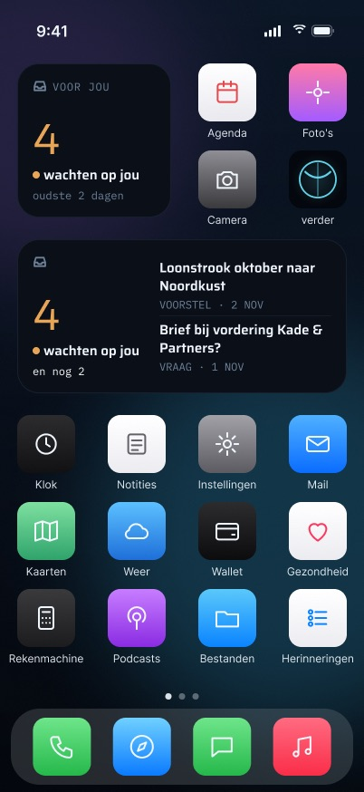

---

## Functies en bouwstatus

Deze lijst omvat elke functie, toestand en elk gedrag dat de definitieve frames, de spec (§7.7, `2026-10-28-iphone-app-design.md`), de brief (§3 rij Widgets, plus de rijen Scan en Upload-wachtrij voor de twee extensie-oppervlakken aan het eind) en plan 3 Task 23 voor dit scherm vastleggen. Elke functie krijgt één status, bepaald door de code te lezen. De secties na deze lijst leggen het gebouwde gedrag in detail uit.

### Gegevens en verversen

**F1. Eén definitie van "wacht op Martin".** Het aantal en de rijen komen uit `loadWaiting`. De Voor jou-lijst, de badge op het icoon, de widget en het webdashboard lezen allemaal diezelfde definitie, en `count` is de lengte van de lijst zelf.
**Status:** Gebouwd — `packages/api/src/waiting.ts`, `apps/web/src/app/api/mobile/v1/inbox/route.ts`, `toInboxDTO` in `apps/web/src/lib/mobile-dto.ts`.

**F2. De widget leest één App Group-bestand en nooit het netwerk.** De widget heeft geen sessie. Het enige wat hij kent is `<group>/widget/snapshot.json`.
**Status:** Gebouwd — `apps/ios/Verder/Shared/WidgetSnapshot.swift`, `VerderProvider` in `apps/ios/VerderWidget/VerderWidget.swift`.

**F3. De app schrijft de snapshot bij elke verversing en herlaadt de widget.** De app haalt inbox en samenvatting naast elkaar op en bewaart het aantal, de bovenste vijf items, de oudste datum, de headline en het schrijftijdstip.
**Status:** Gebouwd — `InboxStore.refresh()` in `apps/ios/Verder/Inbox/InboxStore.swift`.

**F4. Een mislukte verversing schrijft niets.** Als alleen de samenvatting mislukt, gaat het aantal toch door, met de laatste headline die de app kende.
**Status:** Gebouwd — `InboxStore.refresh()`, getest door `aWrittenSnapshotReloadsTheWidgetAndAFailedRefreshDoesNot`.

**F5. Verversen via een stille push tussen het openen van de app door.** `badge.sync` draait elke vijf minuten en pusht alleen bij een wijziging: een badge-push plus een `content-available`-verversing, die `inbox.refresh()` uitvoert.
**Status:** Gebouwd — `apps/worker/src/badge-sync.ts`, de planning ervan in `apps/worker/src/index.ts`, en `AppDelegate.application(_:didReceiveRemoteNotification:…)`. Hoe lang de widget erover doet om na een echte beslissing bij te werken, is niet gemeten (plan 3 Task 23 Step 3).

**F6. De tijdlijn leest het bestand elke 30 minuten opnieuw en wordt op precies 24 uur verouderd.**
**Status:** Gebouwd — `VerderTimeline` in `apps/ios/Verder/Widget/WidgetContent.swift`.

**F7. De badge op het icoon wordt bij elke verversing gezet en bij afmelden gewist.**
**Status:** Gebouwd — `InboxStore` (`setBadgeCount`).

**F8. Operationeel spoor zonder bewijs.** De telefoonkant schrijft geen ledger-event en geen rij. `badge.sync` legt per tick één `worker_runs`-rij vast en is een watcher in `worker-health.ts`.
**Status:** Gebouwd — `apps/worker/src/badge-sync.ts`, `packages/api/src/worker-health.ts`.

### Families en wat ze tonen

**F9. Eén widget, "Voor jou", in zes families.** De galerij toont hem met de beschrijving "Hoeveel er op je wacht. Op het toegangsscherm nooit titels."
**Status:** Gebouwd — `VerderWidget.swift`, `WidgetContent.families`.

**F10. Klein: het aantal met zijn woorden. Middel: het aantal en de bovenste twee items. Groot: het aantal, vijf rijen en de headline van de kaart als vaste voettekst.**
**Status:** Gebouwd — `WidgetContent.make`, `WidgetSmall`/`WidgetMedium`/`WidgetLarge` in `apps/ios/Verder/Widget/WidgetViews.swift`. Het ontwerp voegt de onderdelen uit F11–F13 toe.

**F11. "en nog N".** Middel en groot zeggen hoeveel items er wachten buiten de getoonde rijen ("en nog 2", "en nog 493"), zodat het aantal en de zichtbare rijen met elkaar kloppen.
**Status:** Gebouwd — `WidgetContent.more(showing:)` / `largeReadout(showing:)`; middel toont "en nog N" onder de woorden, groot in de kopregel ("en nog 493 · oudste 6 wk"), en telt precies wat de `ViewThatFits` verbergt. Test `enNogCountsExactlyWhatIsHidden`.

**F12. Een datum op elke rij.** Na de soort volgt de datum van het item ("VOORSTEL · 2 NOV"). Bij een taak met een deadline toont de rij in plaats daarvan de deadline ("TAAK · VÓÓR 3 NOV").
**Status:** Gebouwd — `WidgetSnapshot.Item.at`/`dueAt` (optioneel, oude snapshots decoderen nog), geschreven door `InboxStore.refresh()`; `WidgetContent.line(for:)` en `DutchDate`. Tests `rowsCarryTheirKindAndDate`, `aDeadlineReadsAsAPlainDayOrAnInstant`, `itemDatesAndTheSporeRoundTripAndAnOlderItemStillReads`.

**F13. De leeftijd van het oudste item.** Geteld in hele Amsterdamse kalenderdagen over alle wachtende items: "oudste van vandaag", "oudste 1 dag", "oudste N dagen".
**Status:** Gebouwd — `WidgetContent.oldest(since:now:single:)`: klein, rechthoek, groot en StandBy; vanaf 14 dagen in hele weken ("oudste 6 wk", VoiceOver "6 weken"); bij één item "sinds 2 dagen". Test `theAgeTurnsToWeeksAndOneItemSaysSinds`.

**F14. Toegangsscherm, rond: het aantal en "voor jou".**
**Status:** Gebouwd — `WidgetCircular`. Het ontwerp tekent het bakje en het aantal; "4 wachten op jou" is het VoiceOver-label, de rechthoek ernaast zegt de woorden.

**F15. Toegangsscherm, rechthoek: het aantal, het onderschrift en "oudste N dagen".**
**Status:** Gebouwd — `WidgetRectangular`.

**F16. Toegangsscherm, regel: "verder · 3 voor jou" / "verder · niets voor jou".**
**Status:** Gebouwd — `WidgetContent.make` (`inlineText`).

**F17. Enkelvoud en meervoud.** Het onderschrift luidt "wacht op jou" bij 1 en anders "wachten op jou".
**Status:** Gebouwd — `WidgetContent.make`.

### Tikken

**F18. Een rij opent zijn eigen item.** Voorstellen en vragen gaan naar `verder://proposal/<uuid>`, suggesties naar `verder://suggestion/<uuid>`, taken naar `verder://task/<uuid>`. Een kaarthalte, een onbekende soort of een id die geen UUID is, opent Voor jou.
**Status:** Gebouwd — `WidgetContent.url(for:)`, `apps/ios/Verder/Push/DeepLink.swift`, `RootView.onOpenURL`. Of de tik de app bereikt zonder geregistreerd scheme, is niet op het toestel vastgelegd (plan 3 Task 23 Step 3).

**F19. Tikken op de widget buiten een rij, of op een willekeurige toegangsschermfamilie, opent Voor jou.**
**Status:** Gebouwd — `WidgetContent.inboxURL`.

**F20. De voettekst "waar het nu op wacht" van de grote widget opent de dossierkaart.** Het ontwerp annoteert die als "footer link → Dossier".
**Status:** Gebouwd — `LargeFooter` is een `Link` naar `WidgetContent.mapURL` (`verder://timeline`); test `theLargeFooterOpensTheMap`.

**F21. De app-vergrendeling geldt ook na een tik.** Het item waar een link naar wijst, verschijnt pas na Face ID.
**Status:** Gebouwd — `RootView.swift`.

### Toestanden

**F22. Wachtend, in elke weergavemodus.** In volle kleur zijn het aantal en de stip amber. In getinte, heldere en toegangsschermweergave is er geen amber: het aantal is `.widgetAccentable()` en de woorden dragen de betekenis.
**Status:** Gebouwd — `WidgetContent.countIsAmber`, `CountBlock`, `Masthead`; tests `amberOnlyInFullColor` en `everyFamilyPaintsItsWords`.

**F23. Leeg: er wacht niets.** Het ontwerp toont een vinkje met "Niets wacht op je" en, op middel en groot, de aanmoedigende regel "Goed bezig. verder laat het weten zodra er iets binnenkomt.". Het toont geen "0".
**Status:** Gebouwd — vinkje (`okay`), "Niets wacht op je" en op middel en groot de aanmoedigende regel; geen "0". Tests `zeroCountIsNotAmber`, `emptySaysWhenItLastLooked`.

**F24. Groot, leeg: de voettekst beantwoordt nog steeds "waar het nu op wacht".** Als er niets wacht, luidt die "Nergens op. Je bent helemaal bij.".
**Status:** Gebouwd — de voettekst zegt "Nergens op. Je bent helemaal bij." (niet gevoelig). De open halte telt mee in "wacht op Martin", dus bij 0 is er geen; mocht de snapshot toch een headline dragen, dan toont de voettekst die.

**F25. Verouderd: helemaal geen aantal.** Zonder snapshot, bij een bestand dat niet decodeert, of bij een snapshot van 24 uur of ouder toont de widget een verversingssymbool en "Open verder om bij te werken".
**Status:** Gebouwd — "oud" (rond) en "verder · open de app" (regel), zoals het ontwerp; test `staleSnapshotSaysOpenApp`.

**F26. Tijd "bijgewerkt".** Lege en verouderde weergaven zeggen wanneer de snapshot is geschreven: "bijgewerkt 08:12" voor vandaag, "bijgewerkt 31 okt" of "laatst bijgewerkt za 31 okt 14:02" voor oudere. De grote lege weergave toont het in de kop.
**Status:** Gebouwd — `DutchDate.updated`/`full` in Amsterdamse tijd; klein, middel, groot (kop of voettekst), rechthoek en StandBy. Zonder bestand blijft de regel weg. Tests `emptySaysWhenItLastLooked`, `staleSaysWhenItWasLastTrue`, `noSnapshotIsStale`.

**F27. De uitlegregel bij verouderd, "verder toont bewust geen oud aantal."** Op middel zegt die waarom er geen aantal staat.
**Status:** Gebouwd — `WidgetContent.body` op middel en groot.

**F28. Afgemeld.** Na afmelden of een verlopen sessie zegt de widget "Log in bij verder". Klein toont "tik en log in". Middel toont "Open verder om je lijst te zien." en "afgemeld · niets bewaard op dit toestel". Het toegangsscherm toont "log in" en "verder · log in". StandBy toont hetzelfde in een eigen weergave. Een tik opent het inlogscherm.
**Status:** Gebouwd — `WidgetSnapshot.erase` laat een LEEG bestand `widget/signed-out` achter (alle afmeldpaden gaan erlangs), `write` haalt het weg; `WidgetContent.State.signedOut` voor alle zes families en StandBy. Tests `theSignedOutMarkerIsEmpty`, `signedOutSaysLogInAndHoldsNothing`. Een tik opent de app, die zelf het inlogscherm toont.

**F29. Gewist bij afmelden en bij elke geweigerde sessie.** De snapshot wordt gewist, de widget herladen en de badge op 0 gezet.
**Status:** Gebouwd — `AuthModel.forgetLocally()`, `InboxStore.forgetCaseContent()`; tests `signOutErasesTheWidgetSnapshot`, `sessionRejectedErasesTheWidgetSnapshot`, `unauthorizedErasesTheWidgetSnapshotAndReloads`.

**F30. Een late verversing kan niet meer schrijven nadat de sessie is beëindigd.**
**Status:** Gebouwd — `apps/ios/Verder/Auth/SessionEpoch.swift`.

**F31. Snapshots van oudere builds worden nog gelezen** als een aantal zonder rijen.
**Status:** Gebouwd — `WidgetSnapshot.init(from:)`; test `aSnapshotWithoutItemsStillReads`.

**F32. De placeholder in de galerij verzint nooit een aantal.** Het is een verse "er wacht niets"-snapshot, afgeschermd getekend.
**Status:** Gebouwd — `VerderProvider.placeholder`.

**F33. Offline.** De widget houdt de laatste snapshot vast en wordt na 24 uur verouderd. Hij heeft geen eigen wachtrij.
**Status:** Gebouwd — volgt uit F2, F4 en F6.

### Privacy

**F34. Titels en de headline worden afgeschermd zolang de telefoon vergrendeld is** (Vandaag-weergave, StandBy, altijd-aan). Het aantal en zijn woorden blijven zichtbaar.
**Status:** Gebouwd — `.privacySensitive()` in `ItemRow` en de grote voettekst; test `redactedMediumShowsNoTitleText` (met mutatie gecontroleerd). Nog niet op het toestel vastgelegd.

**F35. De toegangsschermfamilies tonen alleen aantallen, nooit een titel.**
**Status:** Gebouwd — `WidgetContent.rowLimit`/`showsHeadline`; test `lockScreenEntryHasNoTitles`.

**F36. Het snapshotbestand blijft leesbaar terwijl de telefoon vergrendeld is, maar niet vóór de eerste ontgrendeling** (`NSFileProtectionCompleteUntilFirstUserAuthentication`, atomisch geschreven).
**Status:** Gebouwd — `WidgetSnapshot.write`, gemeten op het toestel op 2026-11-01.

**F37. Fixture-runs raken nooit de echte snapshot of badge.**
**Status:** Gebouwd — `FixtureEnvironment`.

### Tekstgrootte en kleine telefoons

**F38. Elke weergave past in zijn vak bij grote Dynamic Type op de kleinste widgetformaten, en de grote weergave behoudt haar headline.**
**Status:** Gebouwd — `everyHomeScreenFaceFitsItsFamily` (standaard, iPhone SE 148 / 321 pt en AX5, in elke toestand) en `largeKeepsTheFooterAndFitsARowCount`; de grote rijen zijn een `ViewThatFits` van 5 naar 1, zodat een tweede titelregel een rij kost en nooit de voettekst.

**F39. Een lay-out voor toegankelijkheidsgroottes.** Bij AX5 wordt het onderschrift ingekort tot "voor jou". Middel schakelt over op aantal + "en nog N" boven één titel over de volle breedte van maximaal twee regels.
**Status:** Gebouwd — `WidgetContent.Layout` (`standard`/`compact`/`accessibility`, uit `context.displaySize` en `dynamicTypeSize`); AX-composities met vaste groottes 64 / 22 / 17. Test `accessibilitySizesTakeTheShortWords`.

### StandBy

**F40. StandBy toont de systeemfamilies,** en iOS past de rode nachtmodustint toe.
**Status:** Gebouwd — iOS tekent `systemSmall` en past de nachttint zelf toe; `WidgetStandBy` en `HeadlineFace` volgen bij `showsWidgetContainerBackground == false`.

**F41. Een eigen StandBy-weergave.** Links: "VOOR JOU", het aantal, zijn woorden en "oudste N dagen". Rechts: "WAAR HET NU OP WACHT", de titel van de halte, en het spoor met zijn datum ("Opstart bewind · 28 okt"). Er zijn varianten voor leeg, verouderd en afgemeld.
**Status:** Gebouwd — `headlineTrack`/`headlineAt` in `WidgetSnapshot`; links `WidgetStandBy`, rechts een TWEEDE widget "Waar het nu op wacht" (`HeadlineWidget`, `HeadlineContent`), want StandBy toont twee losse stapels van elk één kleine widget. Varianten voor leeg, verouderd en afgemeld; de klok rechts in die frames is de systeemklok die Martin zelf kiest. Test `theHeadlineWidgetNamesTheStopItsSporeAndDate`.

**F42. StandBy terwijl vergrendeld.** De rechterkolom is afgeschermd en zegt "ontgrendel om te zien". Het aantal blijft zichtbaar.
**Status:** Gebouwd — `HeadlineFace`; test `redactedHeadlineShowsNoStop`.

### Uitleg en beweging

**F43. Uitleg in de app, Meer → "Widgets toevoegen".** Die behandelt het beginscherm, het toegangsscherm, de formaten en de privacyregel.
**Status:** Gebouwd — `WidgetGuide` in `apps/ios/Verder/More/MoreMenu.swift`, `WidgetGuideScreen` in `apps/ios/Verder/More/MoreScreens.swift`. Zodra F41 bestaat, is er een StandBy-regel nodig.

**F44. Alleen systeemanimaties bij bijwerken; geen haptiek en geen meldingen vanuit de widget.** Het aantal verandert met `.contentTransition(.numericText())`. De regel uit de brief is ≤ 2 s, alleen systeem.
**Status:** Gebouwd — `CountBlock`.

**F45. De headline die de widget toont, is de halte die de kaart als huidige tekent,** dezelfde halte die het webdashboard noemt.
**Status:** Gebouwd — `toDashboardSummaryDTO`, `apps/web/src/app/api/mobile/v1/dashboard/summary/route.ts`.

**F46. Deep links worden strikt geparseerd.** Alles wat misvormd is, opent niets, of Voor jou, nooit een half gevuld scherm.
**Status:** Gebouwd — `DeepLink.parse`.

### Extensie-oppervlakken uit de brief die naast de widget leven

De brief plaatst deze twee op andere schermen (Scan en Upload-wachtrij). Ze staan hier omdat ze in dezelfde widgetextensie (`VerderWidgetBundle`) worden gebouwd, die vandaag alleen `VerderWidget` bevat.

**F47. Een "Scan"-bediening voor het Bedieningspaneel en de Actieknop** (brief R20). Die opent direct de camera, zonder Face ID: één tik plus de pagina's, vanaf een vergrendelde telefoon.
**Status:** Deels gebouwd — de werkboom (nog niet gecommit) heeft `DeepLink.scan` (`verder://scan` → Scan met `opensCamera`) en de snelle actie "Scan een brief" op het beginscherm (`QuickAction.scanType`). Ontbreekt: een `ControlWidget` in `VerderWidgetBundle` met een `OpenIntent`/AppIntent die de app op Scan opent, de Actieknop-optie die daarbij hoort, en een test dat de intent naar `.scan` leidt.

**F48. Een Live Activity zolang er drie of meer uploads worden afgewerkt** (brief R18). De wachtrij is zichtbaar op het toegangsscherm en in het Dynamic Island tot hij klaar is.
**Status:** Nog te bouwen — er bestaat geen ActivityKit-code. Nodig: `NSSupportsLiveActivities` in `project.yml`, een `ActivityAttributes`-type dat met de app wordt gedeeld, start-, update- en eindaanroepen vanuit `UploadCenter`/`UploadQueue` bij de drempel van 3+, een `ActivityConfiguration` in `VerderWidgetBundle` zonder documenttitels op het toegangsscherm, en tests op de start/stop-regel.

---

## Hoe je er komt, en waar het naartoe leidt

**De widget toevoegen.** iOS voegt widgets toe; de app kan dat niet. De app legt uit hoe in **Meer → "Widgets toevoegen"** (`WidgetGuideScreen`, tekst in `WidgetGuide` in `Verder/More/MoreMenu.swift`):

- **"Op je beginscherm"**: "Houd je vinger op een lege plek van je beginscherm tot de apps bewegen." → "Tik op Wijzig en kies Voeg widget toe." → "Zoek verder en kies een formaat." → "Tik op Voeg widget toe en zet hem waar je wilt."
- **"Op je toegangsscherm"**: "Houd je vinger op je toegangsscherm en tik op Pas aan." → "Kies Toegangsscherm en tik op het vak onder de klok." → "Kies verder."
- **"Formaten"**: één regel per formaat (Klein, Middel, Groot, Rond, Rechthoek, Regel). Deze uitleg is de samenvatting in de app van de familietabel hieronder.
- De privacyregel: "Op je toegangsscherm toont verder nooit titels: alleen hoeveel er wacht, en in de rechthoek hoe oud het oudste is."

De widgetgalerij toont hem als **"Voor jou"**, met de beschrijving "Hoeveel er op je wacht. Op het toegangsscherm nooit titels." (`VerderWidget.swift`, kind `pro.vanderpoel.verder.waiting`).

**Tikken.** De beslissing wordt genomen in `WidgetContent` en strikt geparseerd door `DeepLink.parse`.

| Tik op | Opent |
|---|---|
| De widget ergens buiten een rij, en elke toegangsschermfamilie | `verder://inbox` → Voor jou |
| Een rij met een voorstel of vraag | `verder://proposal/<uuid>` |
| Een rij met een suggestie | `verder://suggestion/<uuid>` |
| Een rij met een taak | `verder://task/<uuid>` |
| Een rij voor een kaarthalte, een onbekende soort, of een id die geen UUID is | `verder://inbox`. Een link zonder UUID zou anders een tik zijn die niets doet. |
| De voettekst "waar het nu op wacht" van de grote widget | Voor jou. De voettekst is geen eigen `Link`, dus de URL van de hele widget geldt. |

- **Er is geen URL-scheme geregistreerd.** verder registreert geen `verder://`-scheme, dus geen webpagina of andere app kan een van deze links activeren. De `widgetURL` en `Link`s van de widget bereiken `RootView.onOpenURL` omdat een widget altijd zijn eigen bovenliggende app kan openen. Plan 3 Task 23 Step 3 vroeg om die aflevering op het toestel te controleren. Die stap staat in het plan nog open, dus dit document beweert niet dat het gemeten is.
- **De app-vergrendeling blijft gelden.** De doeltabbladen staan achter de vergrendeling, dus het item waar een link naar wijst, verschijnt pas na Face ID (`RootView.swift`: "what the link points at shows only after unlock"). De widget omzeilt de app-vergrendeling nooit.

**Ontwerp versus code:** het ontwerp annoteert de voettekst van de grote widget als "footer link → Dossier". In de code opent die Voor jou.

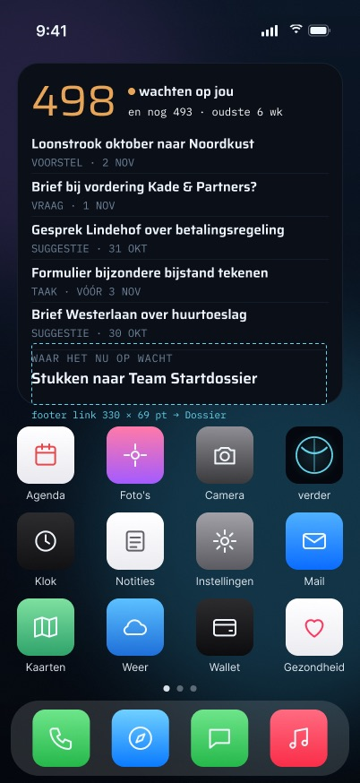

---

## Wat elke familie toont (code)

Al deze beslissingen zitten in `WidgetContent.make` in `Verder/Widget/WidgetContent.swift`. De views in `WidgetViews.swift` schilderen alleen wat daar besloten wordt.

| Familie | Toont | Rijen | Headline | Leeftijd van het oudste |
|---|---|---|---|---|
| `systemSmall` ("Klein") | Kop, groot aantal, "wacht op jou" / "wachten op jou" | 0 | nee | nee |
| `systemMedium` ("Middel") | Aantal links; rechts de bovenste twee items, soortlabel boven een titel van één regel | 2 | nee | nee |
| `systemLarge` ("Groot") | Kop met "oudste N dagen", het aantal en zijn woorden op één regel, vijf rijen van één regel (soort naast de titel), en "waar het nu op wacht" + de headline als vaste voettekst | 5 | ja | ja |
| `accessoryCircular` ("Rond") | Aantal + "voor jou" | 0 | nee | nee |
| `accessoryRectangular` ("Rechthoek") | Aantal + onderschrift; "oudste N dagen" eronder | 0 | nee | ja |
| `accessoryInline` ("Regel") | "verder · 3 voor jou" | 0 | nee | nee |

Details die voor alle families gelden:

- **Enkelvoud en meervoud.** Het onderschrift is "wacht op jou" als het aantal 1 is en anders "wachten op jou".
- **De leeftijd van het oudste item** wordt geteld in hele kalenderdagen in Amsterdam: "oudste van vandaag", "oudste 1 dag", "oudste N dagen". Ze wordt gemeten over **alle** wachtende items, niet alleen over de vijf die de snapshot bewaart.
- **Soortlabels** komen uit `KindLabel.dutch`: "voorstel", "vraag", "suggestie", "taak", "op de kaart", "overig".
- **Overal één regel titel.** Als een grotere tekstgrootte de grote weergave te hoog maakt, worden de rijen van onderaf afgekapt. De headline is nooit het deel dat wegvalt (`largeKeepsTheHeadlineWithFiveRows`).

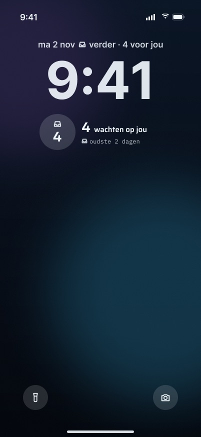

---

## Waar de gegevens vandaan komen

**De widget gebruikt nooit het netwerk.** Hij heeft geen sessie en geen cookie. Zijn enige invoer is één bestand in de App Group, `group.pro.vanderpoel.verder`: `<group>/widget/snapshot.json`, een `WidgetSnapshot`.

**Wat de snapshot schrijft.** Alleen de app schrijft hem, in `InboxStore.refresh()`:

1. De app haalt `GET /api/mobile/v1/inbox` en `GET /api/mobile/v1/dashboard/summary` naast elkaar op en stuurt daarbij de sessiecookie mee.
   - De inbox-route geeft `inbox.list()` en `verderActions.list({ sinceDays: 7 })` terug. `count` is de lengte van de lijst zelf.
   - De samenvattingsroute geeft `tracks.map()` (de headline), `tasks.stats()` en `inbox.count()` terug.
2. Als het ophalen van de inbox slaagt, schrijft de app:
   - `count`;
   - de bovenste vijf items als soort, id en titel, in de volgorde van de server;
   - `oldestAt`, de vroegste `at` over alle items;
   - `headline` = `summary.headline.stopTitle`;
   - `updatedAt`.
3. Na een geslaagde schrijfactie roept de app `WidgetCenter.shared.reloadAllTimelines()` aan.
4. Als alleen het ophalen van de samenvatting mislukt, gaat het aantal toch door, met de laatste headline die de app in het geheugen had (geen na een herstart).
5. **Een mislukte verversing schrijft niets en herlaadt de widget niet.** Een verversing die niets te weten kwam, mag een aantal niet op nul zetten.

**Wanneer er ververst wordt.**

- **Bij elke verversing van de app op de voorgrond.**
- **De stille `badge.sync`-push.** De workerjob draait elke vijf minuten (`apps/worker/src/badge-sync.ts`, gepland in `apps/worker/src/index.ts`). Hij pusht alleen als het badgegetal veranderd is, en hij stuurt twee pushes:
  - een alert-type `{aps:{badge:N}}`, die zelfs een geforceerd afgesloten app bereikt;
  - een `content-available`-verversing op de achtergrond, die `AppDelegate.application(_:didReceiveRemoteNotification:…)` wekt, die op zijn beurt `inbox.refresh()` aanroept.

  iOS remt achtergrondpushes af en wekt nooit een geforceerd afgesloten app, dus de tweede push is een poging zonder garantie.
- **De tijdlijn zelf** (`VerderTimeline`). Die leest het bestand elke 30 minuten opnieuw. Als de snapshot vóór de volgende herlaadbeurt de 24 uur zal passeren, voegt de tijdlijn op precies dat moment een entry toe, zodat een verouderd aantal nooit na zijn limiet wordt getoond.

**Niets in deze functie schrijft bewijs.** De telefoonkant leest alleen (twee GET's). Ze maakt geen ledger-event aan en schrijft geen `document_status_changes`-rij, geen `notifications`-rij en geen suggestie. De enige schrijfactie aan de serverkant is operationeel: `badge.sync` legt per tick één `worker_runs`-rij vast (count, sent, delivered/failed/skipped), veranderd of niet, omdat het een watcher is (`badge-sync` in `worker-health.ts`, cadans van 5 minuten) en zijn stilte storing moet betekenen. Een tick waarvan de badge-push geen enkel toestel bereikte, legt `error` vast, zodat de volgende tick het opnieuw probeert.

---

## Toestanden

### Wachtend (verse snapshot, aantal > 0)

- **Volle kleur:** het aantal is amber, met een amberen stip naast "verder".
- **Getint (`.accented`), helder en toegangsscherm (`.vibrant`):** geen amber. Het aantal hoort bij de accentgroep (`.widgetAccentable()`), en de woorden "wacht op jou" dragen de betekenis. **Amber is nooit de enige drager van betekenis** (`amberOnlyInFullColor`, `everyFamilyPaintsItsWords`).

| Getint | Helder |
|---|---|
| 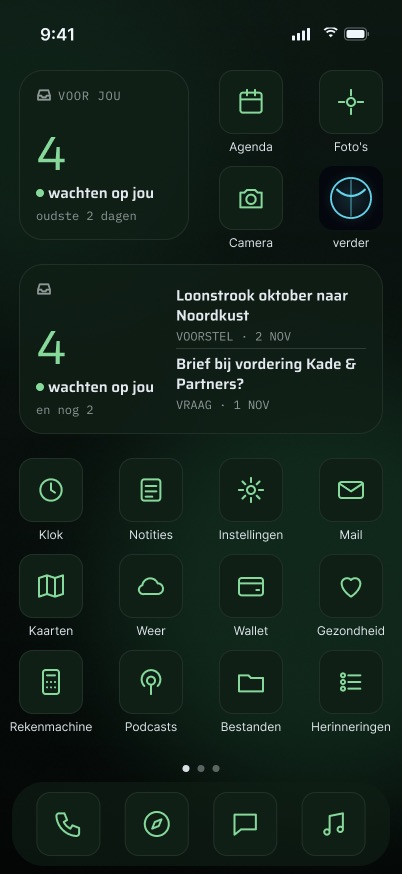 | 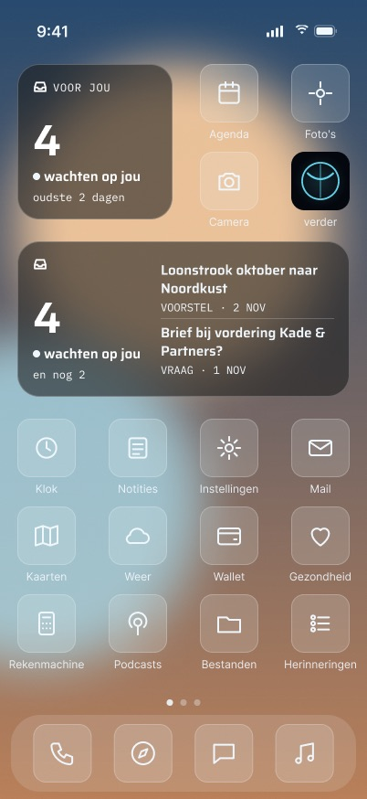 |

**Eén item.** Het onderschrift wordt enkelvoud: "wacht op jou".

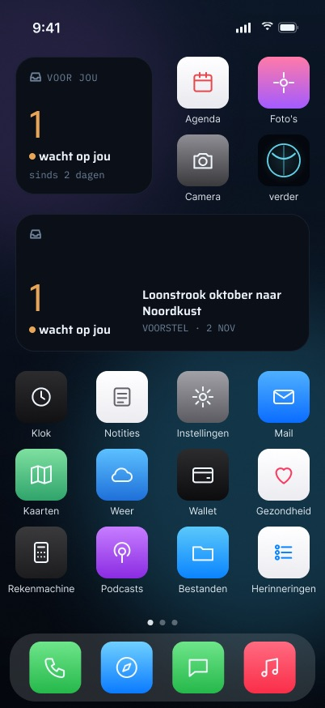

### Leeg (verse snapshot, aantal 0)

- **Code:** het aantal luidt "0" met "Niets wacht op je." Het is nooit amber. De regelfamilie luidt "verder · niets voor jou".
- **Ontwerp versus code:** het ontwerp voegt "Goed bezig. verder laat het weten zodra er iets binnenkomt." (middel) en "bijgewerkt 08:12" toe. De code heeft de aanmoedigende regel noch een bijwerktijd.

### Verouderd (geen snapshot, een bestand dat niet decodeert, of een snapshot van 24 uur of ouder)

- **Helemaal geen aantal.** Een aantal van een dag oud is een gok, en de widget gokt niet. Hij toont een verversingssymbool en "Open verder om bij te werken", in inkt en nooit in amber.
- **Per familie:**
  - rond: "open";
  - rechthoek: "verder" + de verouderd-tekst;
  - regel: "verder · open om bij te werken".
- **Oude snapshots worden nog gelezen.** Een snapshot die door een oudere build is geschreven, zonder `items` of `oldestAt`, decodeert nog en wordt getoond als een aantal zonder rijen. Hij wordt daardoor niet verouderd (`aSnapshotWithoutItemsStillReads`).
- **Ontwerp versus code:**
  - Het ontwerp voegt "bijgewerkt 31 okt" of "laatst bijgewerkt za 31 okt 14:02" toe, en "verder toont bewust geen oud aantal.". De code toont geen leeftijd.
  - De verouderd-woorden op het toegangsscherm zijn in het ontwerp "oud" (rond) en "verder · open de app" (regel). In de code zijn ze "open" en "verder · open om bij te werken".

| Beginscherm | Toegangsscherm |
|---|---|
| 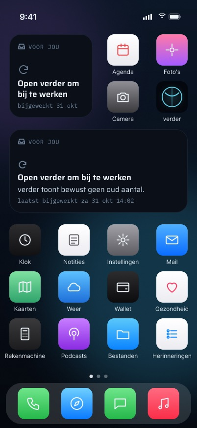 |  |

### Afgemeld of sessie verlopen

- **Code:** bij afmelden, en bij elke geweigerde sessie (een 401), wordt de snapshot **gewist**. `AuthModel.forgetLocally()` en `InboxStore.forgetCaseContent()` roepen allebei `WidgetSnapshot.erase` aan en herladen de widget. Een ontbrekend bestand wordt gelezen als de verouderde toestand, dus de widget zegt dan "Open verder om bij te werken", zonder aantal, zonder titels en zonder headline.
- **Ontwerp versus code:** het ontwerp heeft een aparte toestand **"afgemeld"**: "Log in bij verder", "tik en log in", "Open verder om je lijst te zien.", "afgemeld · niets bewaard op dit toestel", en op het toegangsscherm "log in" / "verder · log in". De code kan die niet tekenen, omdat de widget alleen "geen bestand" ziet. Hij kan afgemeld niet onderscheiden van nooit ververst.

| Beginscherm | Toegangsscherm |
|---|---|
|  | 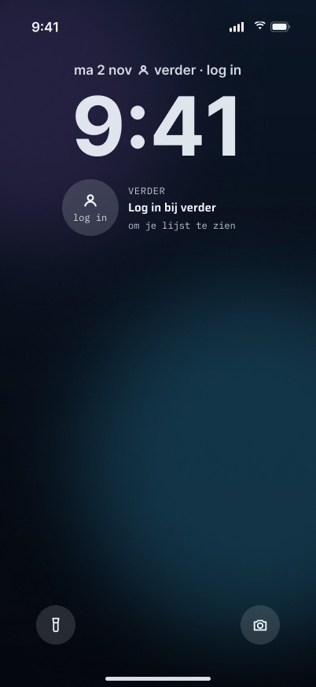 |

### Vergrendelde telefoon (Vandaag-weergave, StandBy, altijd-aan)

Widgets op het beginscherm worden ook getekend terwijl de telefoon vergrendeld is, en de app-vergrendeling reikt niet tot widgets. Daarom:

- **Elke titel en de headline zijn `.privacySensitive()`.** iOS schermt ze af zodra het toestel vergrendeld is.
- **Het aantal en zijn woorden blijven zichtbaar.** Zij zijn de blik in één oogopslag, en ze zijn niet gevoelig.

De unittest `redactedMediumShowsNoTitleText` rendert twee middelgrote widgets die alleen in hun titels verschillen. Onder `.redacted(reason: .privacy)` zijn de twee renders pixel voor pixel gelijk. De test is met mutatie gecontroleerd: `.privacySensitive(false)` zetten laat hem falen. **Op het toestel is het afschermen in StandBy en op een vergrendelde telefoon niet vastgelegd** (plan 3 Task 23 Step 3 staat open).

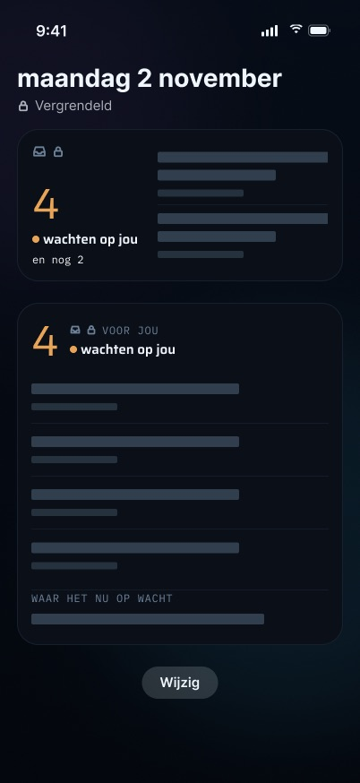

### Grote tekst en kleine telefoons

- **Elke weergave wordt getest tegen haar vak.** `everyHomeScreenFaceFitsItsFamily` rendert klein, middel en groot op de binnenbreedte van de **kleinste** huidige widgetformaten. De test gebruikt de langste synthetische titels en de gevallen leeg, verouderd en geen snapshot, bij Dynamic Type `.large`. Gemeten hoogtes: klein 120 van 126 pt, middel 108 van 126, groot 312 van 322.
- **Bij grotere formaten:**
  - het grote aantal op klein, middel en de cirkel krimpt tot het past (`minimumScaleFactor(0.5)`); het aantal op de grote weergave niet;
  - de woorden op de grote weergave schalen naar 0,8;
  - de rijen op de grote weergave worden van onderaf afgekapt terwijl de headline blijft.
- **Ontwerp versus code:** bij AX5 kort het ontwerp de woorden in tot "voor jou" en geeft het de middelgrote widget één titel. De code houdt op elk formaat hetzelfde onderschrift en vertrouwt op schalen en afkappen.

| iPhone SE | AX5 middel/klein | AX5 groot |
|---|---|---|
| 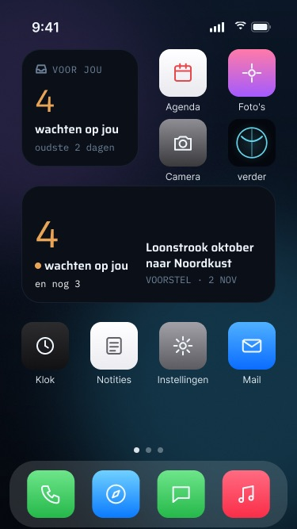 | 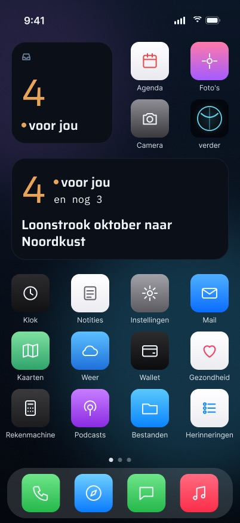 | 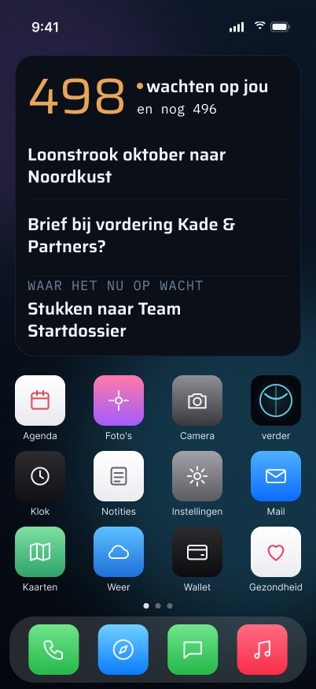 |

### Offline

De widget kan niet offline zijn. Hij haalt nooit iets op. Met de telefoon offline:

1. De verversing van de app mislukt en schrijft niets.
2. De widget blijft de laatste snapshot tonen.
3. Na 24 uur wordt de widget verouderd.

Er is geen eigen wachtrij of synchronisatie.

### Laden

Geen. De placeholder in de galerij is een verse "er wacht niets"-snapshot (aantal 0), die iOS afgeschermd tekent. Het is nooit een verzonnen aantal.

---

## StandBy

- **Code:** er is **geen StandBy-specifieke weergave**. StandBy toont de systeemfamilies. In de praktijk is dat `systemSmall`: de kop, het aantal en zijn woorden, zonder headline. De ontwerpbrief (§3 rij Widgets) en de herafbakening in het plan zeggen allebei "StandBy uses the system families". De rode tint van de nachtmodus wordt door iOS toegepast, niet door verder.
- **Ontwerp versus code:** het ontwerp tekent een StandBy-weergave in twee kolommen. Links "VOOR JOU", het aantal, "wachten op jou" en "oudste 2 dagen". Rechts "WAAR HET NU OP WACHT", de titel van de halte en het spoor met zijn datum ("Opstart bewind · 28 okt"). Vergrendeld wordt de rechterkolom afgeschermd met "ontgrendel om te zien". De code kan die rechterkolom vandaag om twee redenen niet tekenen:
  - De snapshot bevat alleen `headline` (de titel van de halte). Hij bevat niet de titel van het spoor of de datum, die `DashboardSummaryDTO.headline` wel meedraagt.
  - `systemSmall` tekent geen headline.

| Ontgrendeld | Nacht | Vergrendeld, afgeschermd |
|---|---|---|
| 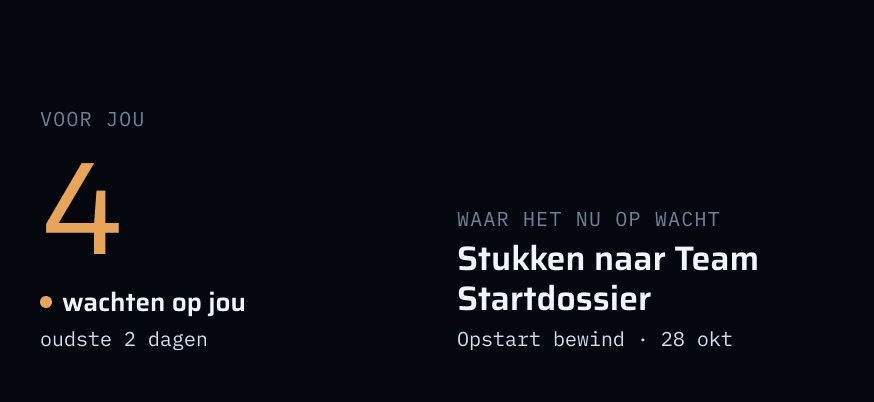 | 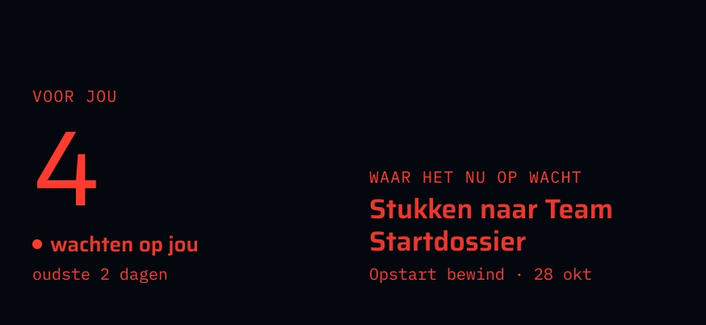 | 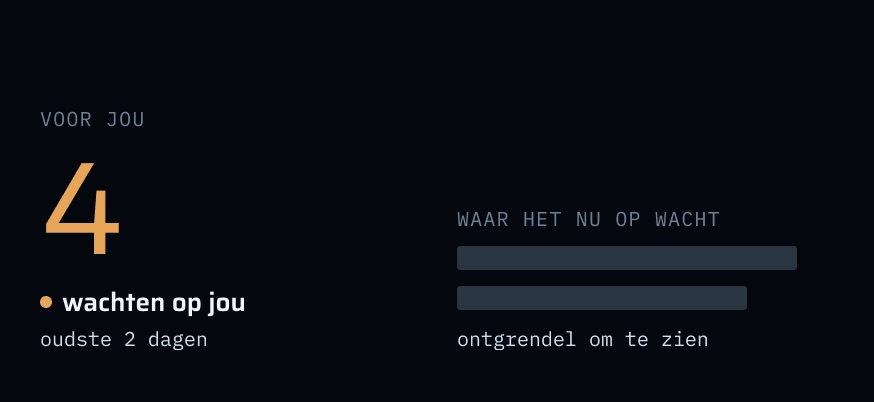 |

---

## Privacy en beveiliging

- **Niet achter Face ID.** De widget toont een aantal aan iedereen die naar de telefoon kijkt. Dat is bewust: het is de blik "zie het aantal zonder te ontgrendelen".
- **Titels en de headline** verschijnen alleen op het beginscherm en in de Vandaag-weergave. Ze zijn `.privacySensitive()`, dus iOS schermt ze af zodra de telefoon vergrendeld is. De toegangsschermfamilies krijgen **per constructie** geen rijen en geen headline (`lockScreenEntryHasNoTitles`). `drawnText` wordt per familie gecontroleerd, zodat geen enkele weergave woorden wordt toegeschreven die ze niet schildert.
- **Tikken vereist nog steeds Face ID.** Elke tik opent de app, en het item erachter verschijnt pas na de Face ID-ontgrendeling van de app.
- **Wat er voor de widget op de telefoon wordt bewaard:** `<group>/widget/snapshot.json`. Het bevat:
  - het aantal;
  - maximaal vijf titels met hun soort en id;
  - de titel van de halte uit de headline;
  - de leeftijd van het oudste item, als datum;
  - het schrijftijdstip.
- **Hoe dat bestand beschermd is.** Het wordt atomisch geschreven met **`NSFileProtectionCompleteUntilFirstUserAuthentication`**, niet `.complete` zoals het zakdossier. Een `.complete`-bestand kan niet worden gelezen terwijl de telefoon vergrendeld is, dus de widget zou leeg zijn op precies de oppervlakken waar het meest naar gekeken wordt. Dit is gemeten op het toestel (2026-11-01): starten met `VERDER_REPORT_SNAPSHOT_PROTECTION=1` drukte `NSFileProtectionCompleteUntilFirstUserAuthentication` af. iOS 27 staat niet toe dat `devicectl` bestanden uit een App Group kopieert; daarom meldt de app het attribuut zelf.
- **Gewist bij afmelden en bij elke geweigerde sessie.** De snapshot wordt gewist, de widget wordt herladen en de badge wordt op 0 gezet.
- **Late verversingen kunnen hem niet herschrijven.** `SessionEpoch` voorkomt dat een verversing die nog op het netwerk wachtte, de snapshot terugschrijft nadat de sessie is beëindigd.
- **Fixture-runs laten hem met rust.** `FixtureEnvironment` raakt nooit de echte snapshot of badge, dus synthetische gegevens bereiken nooit de echte App Group.

---

## Regels die hij volgt

- **Amber alleen voor wat op Martin wacht.** Amber verschijnt alleen zolang het aantal boven nul is, bij een verse snapshot, in volle kleur. Het is nooit amber bij leeg of verouderd, en de betekenis verschijnt altijd ook in woorden.
- **AI-uitvoer is een suggestie.** De widget toont suggesties alleen als rijen "suggestie". Hij kan niets goedkeuren. Elke beslissing gebeurt in de app achter Face ID.
- **Er wordt niets verzonden zonder dat Martin de definitieve tekst goedkeurt.** Een voorstelrij opent alleen het voorstel.
- **Eén definitie van "wachten".** De widget, de badge en de Voor jou-lijst worden door één fetch gevoed en kunnen het niet oneens zijn. De badge op het icoon wordt OOK door de server gezet tussen verversingen van de app door (`badge.sync`, en elke melding van `notify()` draagt het actuele aantal mee), dus een tijdje kan het icoon nieuwer zijn dan de snapshot van de widget; beide zijn hetzelfde servergetal, nooit een getal dat de telefoon zelf uitrekent.
- **Geen geraden getallen.** Een snapshot die te oud is, toont geen aantal. De regel "geen getal voor niet-gedekte weken" hoort bij geld, en geld verschijnt niet in de widget.

## Meldingen en haptiek

- **De widget produceert geen van beide.** Hij wordt ververst door de stille `badge.sync`-push en door verversingen van de app, zoals hierboven beschreven.
- **Het aantal verandert met `.contentTransition(.numericText())`.** iOS bepaalt of dat geanimeerd wordt.

## Bekende beperkingen en wat nog niet gemeten is

- **Plan 3 Task 23 Step 3 staat open.** Nog niet vastgelegd:
  - Martin die de widget toevoegt;
  - de afgeschermde middelgrote titels in StandBy en op een vergrendelde telefoon;
  - hoe lang het duurt voordat het aantal na een echte beslissing daalt, en of dat via `badge.sync` of via de herlaadbeurt van 30 minuten gebeurt, inclusief of de app geforceerd was afgesloten.

  CLAUDE.md noemt de badgevertraging als nog niet gemeten. Dat moet gebeuren op een suggestie waarover Martin echt wil beslissen, nooit op een die voor een test wordt goedgekeurd.
- **Een widgettik die `onOpenURL` bereikt zonder geregistreerd scheme** is niet op het toestel vastgelegd (zelfde stap).
- **iOS remt achtergrondpushes af,** dus tussen het openen van de app door kan de widget tot zijn herlaadbeurt van 30 minuten achterlopen op de server, of langer als iOS de herlaadbeurt uitstelt.
- **De widget kan afgemeld niet onderscheiden van nooit ververst.** Beide worden gelezen als verouderd.
- **Ontwerp en code verschillen op meerdere oppervlakken** (opgesomd in de volgende sectie). Waar dat zo is, beschrijft dit document wat de code doet.

## Ontwerp versus code (samenvatting)

| Ontwerp | Code |
|---|---|
| Klein toont "oudste 2 dagen"; middel toont "en nog 2"; groot toont "en nog 493 · oudste 6 wk" | Geen "en nog N". De leeftijd verschijnt alleen op groot ("oudste N dagen") en op de rechthoek. |
| Rijen dragen een datum ("VOORSTEL · 2 NOV") | Alleen de soort. De snapshot slaat geen itemdatum op. |
| Lege toestand: aanmoedigende regel, "bijgewerkt 08:12" | "0" + "Niets wacht op je." |
| Verouderde toestand: "bijgewerkt 31 okt", "verder toont bewust geen oud aantal." | "Open verder om bij te werken", zonder leeftijd |
| Toestand "afgemeld" ("Log in bij verder") | Hetzelfde als verouderd: de snapshot wordt gewist |
| Grote voettekst → Dossier | De voettekst is geen link; een tik opent Voor jou |
| StandBy: weergave in twee kolommen met headline, spoor en datum | Systeemfamilies (klein); geen headline in StandBy |
| AX5: kort onderschrift "voor jou" | Hetzelfde onderschrift, verkleind |

---

## Waar in de code

**Widgetextensie (`pro.vanderpoel.verder.widget`)**
- `apps/ios/VerderWidget/VerderWidget.swift`: de provider, `VerderEntryView`, de configuratie van de widget en de bundle.
- `apps/ios/VerderWidget/WidgetPreviews.swift`: `#Preview`s opgebouwd uit de synthetische dataset (alleen DEBUG).
- `apps/ios/VerderWidget/Info.plist`: `UIAppFonts`.
- `apps/ios/VerderWidget/VerderWidget.entitlements`: de App Group.

**Gedeeld met de app** (in beide targets gecompileerd, zodat de tests van de app ze afdekken)
- `apps/ios/Verder/Widget/WidgetContent.swift`: `VerderEntry`, `VerderTimeline` en `WidgetContent`, die elke beslissing bevatten.
- `apps/ios/Verder/Widget/WidgetViews.swift`: de zes weergaven.
- `apps/ios/Verder/Shared/WidgetSnapshot.swift`: het bestandsformaat, de beschermingsklasse, `write`, `read`, `erase` en `reportProtectionIfAsked`.
- `apps/ios/Verder/Shared/KindLabel.swift` en `apps/ios/Verder/Shared/AppGroup.swift`.
- `apps/ios/Verder/Theme/Tokens.swift`, `apps/ios/Verder/Theme/Fonts.swift` en de meegeleverde lettertypen.

**App-kant**
- `apps/ios/Verder/Inbox/InboxStore.swift`: `refresh()` schrijft de snapshot, herlaadt de tijdlijnen en zet de badge; `forgetCaseContent()` wist hem.
- `apps/ios/Verder/Auth/AuthModel.swift`: `forgetLocally()` wist de snapshot bij afmelden en bij een geweigerde sessie.
- `apps/ios/Verder/Auth/SessionEpoch.swift`: voorkomt dat een late verversing schrijft nadat de sessie is beëindigd.
- `apps/ios/Verder/App/AppDelegate.swift`: de stille push → `inbox.refresh()`.
- `apps/ios/Verder/App/RootView.swift`: `.onOpenURL` → `DeepLink.parse`.
- `apps/ios/Verder/Push/DeepLink.swift`: de strikte linkparser.
- `apps/ios/Verder/More/MoreMenu.swift` (`WidgetGuide`) en `apps/ios/Verder/More/MoreScreens.swift` (`WidgetGuideScreen`): Meer → "Widgets toevoegen".
- `apps/ios/project.yml`: het `VerderWidget`-target.

**Server**
- `apps/web/src/app/api/mobile/v1/inbox/route.ts` (+ `route.test.ts`): aantal en items.
- `apps/web/src/app/api/mobile/v1/dashboard/summary/route.ts` (+ `route.test.ts`): de headline.
- `apps/web/src/lib/mobile-dto.ts`: `toInboxDTO`, `toDashboardSummaryDTO`.
- `packages/api/src/waiting.ts`: de ene definitie van "wacht op Martin" (`loadWaiting`), gelezen via `packages/api/src/routers/inbox.ts` en, in de worker, via `countWaiting` in `apps/worker/src/notify/notify.ts`.
- `apps/worker/src/badge-sync.ts` (+ `badge-sync.test.ts`) en de planning ervan in `apps/worker/src/index.ts`: de badge-push en stille verversing van elke vijf minuten.
- `packages/api/src/worker-health.ts`: daar is `badge-sync` als watcher gedeclareerd.

**Tests**
- `apps/ios/VerderTests/WidgetEntryTests.swift`: titels op het toegangsscherm, rijen per familie, de privacymarkeringen, amber alleen in volle kleur, woorden in elke familie, verouderd en vers rond 24 uur, deep links, Amsterdamse dagen, oudere snapshots, de herlaadbeurt van de tijdlijn en de omslag naar verouderd, het passen bij Dynamic Type, de headline die blijft bij vijf rijen, en de afgeschermde middelgrote render.
- `apps/ios/VerderTests/WidgetSnapshotTests.swift`: de heen-en-terugreis, corrupte en ontbrekende bestanden, en de schrijfopties (atomisch, tot de eerste gebruikersauthenticatie).
- `InboxStoreTests` (`VerderTests/InboxStoreTests.swift`):
  - `refreshWritesTheItemsAndTheOldestForTheWidget`;
  - `refreshKeepsAtMostFiveItems`;
  - `aWrittenSnapshotReloadsTheWidgetAndAFailedRefreshDoesNot`;
  - `unauthorizedErasesTheWidgetSnapshotAndReloads`.
- `AuthModelPasskeyTests` (in `VerderTests/PasskeyAuthTests.swift`): `signOutErasesTheWidgetSnapshot` en `sessionRejectedErasesTheWidgetSnapshot`.

---

## Frames

Alle 29 frames komen uit Figma `widgets · final` (347:16197) en zijn op 2026-11-03 opnieuw geëxporteerd. Frames gemarkeerd met *(alleen ontwerp)* tonen een toestand of lay-out die de code vandaag niet tekent.

| Frame | Wat het toont |
|---|---|
| [Widgets_thuis_volle_kleur](frames/Widgets_thuis_volle_kleur.jpg) | Beginscherm, volle kleur: kleine en middelgrote widget, 4 wachtend, amberen aantal |
| [Widgets_thuis_getint](frames/Widgets_thuis_getint.jpg) | Hetzelfde in getinte modus: geen amber, de woorden dragen de betekenis |
| [Widgets_thuis_helder](frames/Widgets_thuis_helder.jpg) | Hetzelfde in heldere modus |
| [Widgets_thuis_leeg](frames/Widgets_thuis_leeg.jpg) | Leeg: "Niets wacht op je" *(ontwerp voegt de aanmoedigende regel en de bijwerktijd toe)* |
| [Widgets_thuis_leeg_getint](frames/Widgets_thuis_leeg_getint.jpg) | Leeg, getint |
| [Widgets_thuis_verouderd](frames/Widgets_thuis_verouderd.jpg) | Verouderd: geen aantal, "Open verder om bij te werken" |
| [Widgets_thuis_afgemeld](frames/Widgets_thuis_afgemeld.jpg) | Afgemeld, "Log in bij verder" *(alleen ontwerp; de code toont de verouderde toestand)* |
| [Widget_groot_volle_kleur](frames/Widget_groot_volle_kleur.jpg) | Groot, volle kleur: aantal, vijf rijen, voettekst "waar het nu op wacht" |
| [Widget_groot_getint](frames/Widget_groot_getint.jpg) | Groot, getint |
| [Widget_groot_helder](frames/Widget_groot_helder.jpg) | Groot, helder |
| [Widget_groot_leeg](frames/Widget_groot_leeg.jpg) | Groot, leeg |
| [Widget_groot_verouderd](frames/Widget_groot_verouderd.jpg) | Groot, verouderd |
| [Widget_groot_afgemeld](frames/Widget_groot_afgemeld.jpg) | Groot, afgemeld *(alleen ontwerp)* |
| [Vandaag-weergave_vergrendeld_afgeschermd](frames/Vandaag-weergave_vergrendeld_afgeschermd.jpg) | Vandaag-weergave op een vergrendelde telefoon: aantal zichtbaar, titels en headline afgeschermd |
| [Toegangsscherm_wacht_op_jou](frames/Toegangsscherm_wacht_op_jou.jpg) | Toegangsscherm: regel, rond, rechthoek; alleen aantallen en leeftijd |
| [Toegangsscherm_leeg](frames/Toegangsscherm_leeg.jpg) | Toegangsscherm, er wacht niets |
| [Toegangsscherm_verouderd](frames/Toegangsscherm_verouderd.jpg) | Toegangsscherm, verouderd |
| [Toegangsscherm_afgemeld](frames/Toegangsscherm_afgemeld.jpg) | Toegangsscherm, afgemeld *(alleen ontwerp)* |
| [Toegangsscherm_n_item](frames/Toegangsscherm_n_item.jpg) | Toegangsscherm, één item: enkelvoud "wacht op jou" |
| [iPhone_SE_widgets_thuis_volle_kleur](frames/iPhone_SE_widgets_thuis_volle_kleur.jpg) | Kleine telefoon (375 × 667), beginscherm, volle kleur |
| [AX5_widgets_thuis_volle_kleur](frames/AX5_widgets_thuis_volle_kleur.jpg) | Grootste toegankelijkheidstekst, klein en middel *(ontwerp kort de woorden in)* |
| [AX5_widget_groot_volle_kleur](frames/AX5_widget_groot_volle_kleur.jpg) | Grootste toegankelijkheidstekst, grote widget |
| [StandBy_ontgrendeld](frames/StandBy_ontgrendeld.jpg) | StandBy, ontgrendeld: aantal plus headline *(lay-out alleen in ontwerp)* |
| [StandBy_nacht](frames/StandBy_nacht.jpg) | StandBy, nachtmodus (de rode tint van iOS) *(lay-out alleen in ontwerp)* |
| [StandBy_vergrendeld_afgeschermd](frames/StandBy_vergrendeld_afgeschermd.jpg) | StandBy, vergrendeld: headline afgeschermd, "ontgrendel om te zien" *(lay-out alleen in ontwerp)* |
| [StandBy_leeg](frames/StandBy_leeg.jpg) | StandBy, er wacht niets *(lay-out alleen in ontwerp)* |
| [StandBy_verouderd](frames/StandBy_verouderd.jpg) | StandBy, verouderd *(lay-out alleen in ontwerp)* |
| [StandBy_afgemeld](frames/StandBy_afgemeld.jpg) | StandBy, afgemeld *(alleen ontwerp)* |
| [Widgets_thuis_n_item](frames/Widgets_thuis_n_item.jpg) | Beginscherm, één item: enkelvoud "wacht op jou" |
