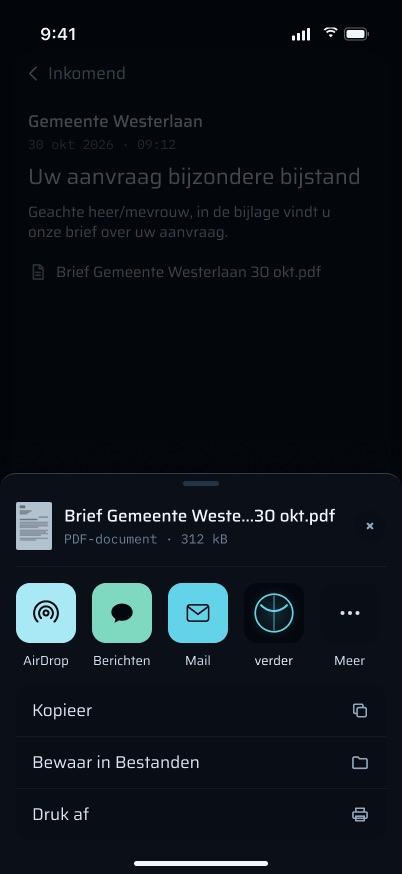
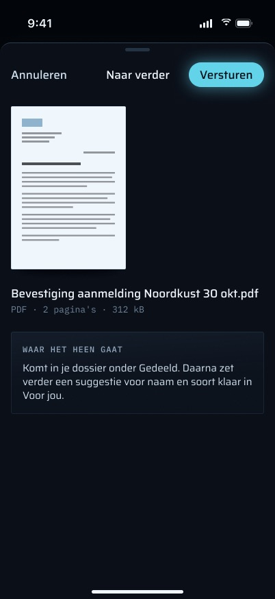
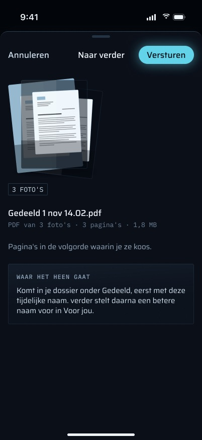
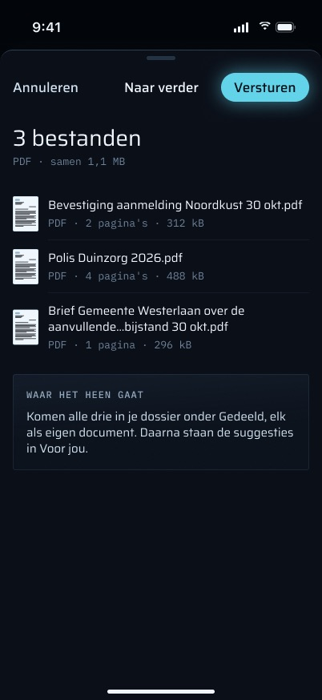
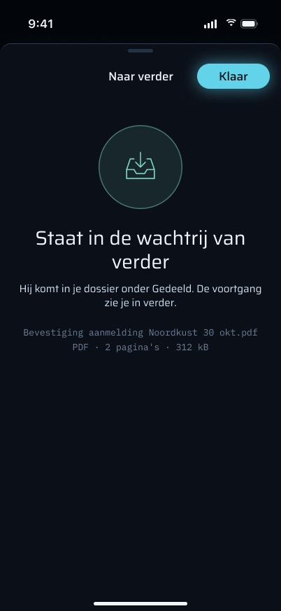
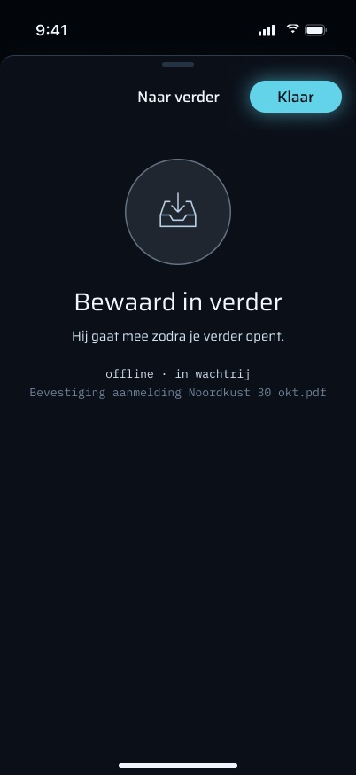
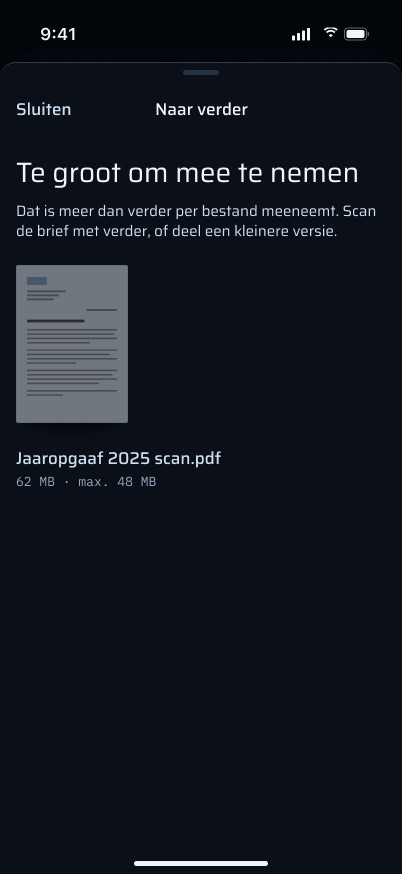

# Delen naar verder: de deelextensie

Dit document beschrijft wat de deelextensie van verder doet: wat ze accepteert, waar ze een gedeeld item in omzet, hoe het bestand in het dossier komt en wat elke toestand betekent. Het beschrijft de code op branch `feat/iphone-app` (`apps/ios`, target `VerderShare`, bundle `pro.vanderpoel.verder.share`). Het beschrijft niet het visuele ontwerp. De frames komen uit de Figma-sectie `share · final` (node 348:16604) en gebruiken de synthetische dataset (`docs/superpowers/specs/2026-11-01-iphone-synthetic-data.md`). Ze bevatten geen echte dossiergegevens.

> **De frames gaan verder dan de code.** Dit document beschrijft de VOLLEDIGE functieset van het scherm zoals ontworpen (definitieve frames, spec §7.8, design brief §2 en §3) en zegt per functie of de code die heeft. Elke functie heeft precies één statusregel: **Gebouwd** (bestaat in de code, bestand genoemd), **Deels gebouwd** (wat ontbreekt wordt genoemd) of **Nog te bouwen** (wat ervoor nodig is wordt genoemd). De ontworpen functies en hun stand staan onder "Ontworpen: wat nu gebouwd is en wat niet". De status is bepaald door de code te lezen op 2026-11-03, inclusief de niet-gecommitte working tree op `feat/iphone-app`, en bijgewerkt op 2026-11-04 toen het scherm naar de definitieve frames is gebouwd (`ShareView` in `apps/ios/Verder/Upload/ShareView.swift`; captures via `scripts/capture.sh <fixture> share:<scene>`).

## Stand van de bouw

| Status | Functies |
|---|---|
| Gebouwd | 50 |
| Deels gebouwd | 3 |
| Nog te bouwen | 1 |

Wat nog openstaat:

1. **De stap "PDF maken" na Versturen** (frame `Versturen`). De foto-pdf wordt bij het LADEN gemaakt, omdat het klaar-scherm zijn grootte ("1,8 MB") en paginatelling al toont; die zijn pas bekend als de pdf bestaat. De voortgangsbalk toont daarom de upload ("Versturen", of "Versturen · bestand 2 van 3"), en "Annuleren" is gedimd zodra de drops geschreven zijn.
2. **De naam van de bron-app** in "Mail gaf het bestand niet binnen 10 seconden door." iOS geeft een extensie geen publieke manier om te weten welke app deelde; de code zegt dan "De app gaf het bestand …". Alleen de capture noemt "Mail".
3. **Op de telefoon meten**: of de paginavolgorde van een foto-pdf echt Martins keuzevolgorde is (de regel "Pagina's in de volgorde waarin je ze koos." staat er nu wel), en de oude punten van plan 3 Task 22 Step 3.

---

## Doel

Met de deelextensie zet Martin een document in zijn dossier **vanuit elke andere app**, zonder eerst verder te openen. Typische gevallen zijn een pdf-bijlage in Mail, foto's van een brief in Foto's, of een bestand in Bestanden of WhatsApp. Ze is er alleen voor Martin.

Ze doet één ding: ze zet de gedeelde items in **dezelfde uploadwachtrij** die een telefoonscan gebruikt, met bron `phone-share` (spec §7.8, plan 3 Task 22). Op het web verschijnt het resultaat onder Files, bron **"Gedeeld"** (`apps/web/src/components/files-tree.tsx`), en in labels als "gedeeld" (`apps/web/src/lib/entry-labels.ts`).

De extensie beslist nooit iets over het document. Ze geeft het geen soort, archiveert het niet en koppelt het niet aan een schuld of logboekregel. Alles na de upload is de gewone serverpijplijn (zie "Wat er op de server gebeurt").

---

## Hoe je er komt, en waar het heen leidt

- **In:** het iOS-deelblad van elke app → **"verder"** (`CFBundleDisplayName` in `VerderShare/Info.plist`). Er is geen tab, deep link, widget, melding of snelle actie die de extensie opent. Ze bestaat alleen binnen het deelblad van een andere app.
  **Status:** Gebouwd (`apps/ios/VerderShare/Info.plist`, target `VerderShare` in `apps/ios/project.yml`).
- **Waardoor verder in het blad verschijnt:** de activatieregel in `project.yml`: `NSExtensionActivationSupportsFileWithMaxCount: 10` en `NSExtensionActivationSupportsImageWithMaxCount: 10`. iOS telt bestanden en afbeeldingen onder aparte sleutels, dus een gemengde deling kan meer dan 10 items aanleveren. Dat is niet gemeten (plan 3 Task 22). De regel heeft geen sleutel voor web-URL's, dus een deling van alleen een link zou verder helemaal niet moeten aanbieden.
  **Status:** Gebouwd (`apps/ios/project.yml`, `NSExtensionActivationRule`). De ontworpen linktoestand (hieronder) vraagt om een ruimere regel.
- **Het scherm:** één blad met de kop **"Naar verder"**, met "Annuleren" aan de beginkant en "Versturen" (later "Sluiten") aan de eindkant. Een pdf uit Mail staat er in **2 tikken na het deelblad** in (verder → Versturen), het doel uit §3 van de brief.
  **Status:** Gebouwd (`ShareView` in `apps/ios/VerderShare/ShareViewController.swift`).
- **Uit:** de extensie sluit zichzelf, of Martin sluit haar. Ze opent nooit de app. Het bestand gaat door naar het dossier, rechtstreeks vanuit de extensie of later vanuit de wachtrij van de app; zie "Versturen, van begin tot eind".
  **Status:** Gebouwd (`ShareViewController.finish`).

---

## Wat ze accepteert en wat ze ervan maakt

`ShareViewController.load` leest elke `NSItemProvider`, en `SharePreparation.prepare` maakt van het resultaat de bestanden die verstuurd worden.

- **Foto's (elke afbeelding die geen pdf is) worden ÉÉN pdf.** Elke afbeelding in één deling wordt een pagina van één pdf, in de volgorde waarin iOS ze aanleverde. De pdf wordt gebouwd met dezelfde `PDFAssembler` als een scan: lange zijde hoogstens 2200 px, grijswaarden als een pagina geen kleur heeft. Er is **geen `PageCleaner`-stap**, omdat een gedeelde foto niet per se een pagina is. Twee foto's van een brief van twee pagina's worden één brief.
  **Status:** Gebouwd (`SharePreparation.prepare` in `apps/ios/Verder/Upload/SharePreparation.swift`; `PDFAssemblerTests.swift`). Nog niet op de telefoon geprobeerd (plan 3 Task 22 Step 3).
  - De pdf heet **`Gedeeld <d mmm HH.mm>.pdf`** volgens de Amsterdamse klok (`SharePreparation.photosTitle`). Auto-name hernoemt hem zodra de tekst gelezen is.
    **Status:** Gebouwd — `Gedeeld 1 nov 14.02.pdf` (Nederlandse dag en korte maand, het woord "Gedeeld", gelijk aan de bron; `SharePreparation.photosTitle`, getest in `ShareModelTests.photosTitleIsDutchOnTheAmsterdamClock`).
  - Elke foto wordt op schijf klaargezet en **al verkleind** gedecodeerd (`PhotoPage.page(at:)`, ImageIO-thumbnail met de EXIF-oriëntatie toegepast). Een decodering op volle grootte van een foto van 24 MP kost ongeveer 96 MB, en een extensie wordt bij ongeveer 120 MB beëindigd. Een zijwaarts opgeslagen foto komt rechtop uit (getest).
    **Status:** Gebouwd (`PhotoPage` in `SharePreparation.swift`; `PhotoPageTests.swift`). Het piekgeheugen op de telefoon is niet gemeten.
  - Een afbeelding die geen JPEG/HEIC is en groter dan 16 MP (`PhotoPage.maxFullDecodePixels`) kan niet goedkoop verkleind worden. Die gaat mee als het **bestand** dat het is, met eigen naam en mime, en wordt geen pagina.
    **Status:** Gebouwd (`PhotoPage.maxFullDecodePixels`).
  - Een afbeelding die de pdf niet kan coderen, telt als niet meegenomen (zie de waarschuwing voor gedeeltelijk meenemen hieronder).
    **Status:** Gebouwd (`SharePreparation.prepare`, `leftOut`).
- **Pdf's en alle andere bestanden gaan byte voor byte door**, met hun eigen naam en mediatype. Een naam zonder extensie krijgt de extensie van het type. Een bestand zonder naam heet "Gedeeld bestand". De server bewaart het type dat hij krijgt.
  **Status:** Gebouwd (`ShareViewController.load`, `fileName(_:type:)`).
- **Een bron die alleen een bestands-URL aanbiedt** (sommige apps doen dat) wordt via die URL gelezen, met security-scoped toegang.
  **Status:** Gebouwd (`ShareViewController.loadFileURL`).
- **Bestanden worden gemeten voordat ze gelezen worden**, en daarna gekopieerd naar een privé klaarzetmap (`ShareStaging.stage`). Ze worden nooit in het geheugen gelezen. Eén uitzondering: een foto waarvan de bron geen bestandsvorm aanbiedt, wordt als data overgenomen en staat dus één keer in het geheugen; die wordt boven 48 MB geweigerd en meteen naar de klaarzetmap geschreven. De klaarzetmap wordt verwijderd als de extensie sluit (annuleren of sluiten). Als de klaarzetmap niet aangemaakt kan worden, telt elk item als onleesbaar.
  **Status:** Gebouwd (`ShareStaging` in `SharePreparation.swift`; tests voor klaargezette bestanden in `IncomingDropTests.swift`).

Grenzen (`ShareModel`):

| Grens | Waarde | Wat er daarboven gebeurt |
|---|---|---|
| Items per deling | 10 (`maxItems`; de activatieregel biedt verder aan tot 50) | De eerste 10 worden geladen en gaan mee; de rest wordt genoemd: "Dat zijn er 14; verder neemt de eerste 10 mee. Deel foto 11–14 daarna opnieuw." |
| Bytes per bestand | 48 MB (`maxFileBytes`, onder de 50 MB `MAX_UPLOAD_BYTES` van de server) | Dat bestand gaat niet mee en wordt bij naam genoemd ("Jaaropgaaf 2025 scan.pdf is te groot (62 MB, max. 48 MB)."); de andere gaan wel. Alleen als elk bestand te groot is, wordt de deling geweigerd ("Te groot om mee te nemen"). Het bestand wordt niet gekopieerd. |
| Laden | 10 s (`loadTimeout`) | "Bestand laden lukt niet" met "Opnieuw proberen". |
| Eigen upload van de extensie | 8 MB per bestand (`ShareSender.foregroundLimit`) | Niet geprobeerd vanuit de extensie. De wachtrij van de app verstuurt het. |
| Eigen poging van de extensie | 20 s in totaal (`sendBound`), 30 s per verzoek | De poging wordt afgebroken en de wachtrij van de app verstuurt het. |

**Status:** Gebouwd (`ShareModel.maxItems`, `maxFileBytes`, `loadTimeout`, `sendBound`; `ShareSender.foregroundLimit`, `timeout`).

### Wat het scherm over een deling zegt

- **Titel:** de bestandsnaam bij één bestand (hoogstens twee regels, in het midden ingekort; bij de toegankelijkheidsmaten de hele naam, want hier controleert Martin wat hij verstuurt), anders "N bestanden" (`ShareModel.title`). De foto-pdf telt als één bestand. Een dag en zijn maand ("30 okt") worden nooit over twee regels verdeeld (`ShareModel.displayName`).
  **Status:** Gebouwd (`ShareModel.title`, `displayName`).
- **Detail** (`ShareModel.detail`, per deel zodat grote tekst ze onder elkaar zet): één pdf leest "PDF · 2 pagina's · 312 kB", een foto-pdf "PDF van 3 foto's · 3 pagina's · 1,8 MB", een ander bestand "XLSX · 14 kB" (of "Bestand" zonder extensie). Meerdere bestanden lezen "PDF · samen 1,1 MB".
  **Status:** Gebouwd (`ShareModel.detail`, `detail(of:)`, `pageCount` via PDFKit).
- **Thumbnail:** de eerste pagina van een pdf (PDFKit), anders een documentsymbool; foto's als gestapelde pagina's van de foto-pdf.
  **Status:** Gebouwd (`PageThumbnail`, `PhotoStack` in `ShareView.swift`).
- **Elk bestand wordt een eigen document.** Alleen afbeeldingen worden samengevoegd; pdf's en andere bestanden worden nooit samengevoegd.
  **Status:** Gebouwd (één drop per bestand in `ShareModel.commit`; `ShareModelTests.swift`).

---

## Versturen, van begin tot eind

Een tik op **"Versturen"** (`ShareModel.commit`) doet drie dingen, in deze volgorde.

1. **Ze schrijft een drop per bestand** in de App Group, in `<group>/uploads/incoming/` (`IncomingDrop.write`). Eerst de bytes (`<uuid>.bin`), als laatste de beschrijving (`<uuid>.json`), zodat de app nooit een halve drop ziet. Vanaf dat moment is de deling veilig: de app **gaat** hem versturen, wat er daarna ook gebeurt. Mislukt een schrijfactie, dan worden de al geschreven drops weer verwijderd en zegt het scherm "Opslaan lukte niet", met de oorzaak (te weinig ruimte, of een algemene regel) en "er is nog niets verstuurd", plus "Opnieuw proberen". Niets van die deling bereikt het dossier. Ontbreekt de App Group zelf (een verkeerd geconfigureerde build), dan weigert deze stap met "verder kan hier niet bij zijn eigen map. Open de app en probeer het opnieuw."
   **Status:** Gebouwd (`IncomingDrop.write` in `apps/ios/Verder/Upload/IncomingDrop.swift`, `ShareModel.commit`).
2. **Ze doet één begrensde eigen uploadpoging** (`ShareSender.sendOne`, per drop, met een reden als hij niet lukt: `ShareSendResult`) voor elke drop tot 8 MB, de een na de ander. Ze gebruikt de sessiecookie van de app uit het gedeelde Keychain-item (`keychain-access-groups`). Het verzoek is hetzelfde dat de wachtrij bouwt (`UploadRequest.build`): `POST /api/mobile/v1/documents`, multipart met `clientId` = de UUID van de drop, `source` = `phone-share`, `capturedAt`, en het bestand met eigen naam en mime. Alleen een 2xx met de JSON van het endpoint schrijft `<uuid>.sent`. Al het andere (offline, geen sessie, een trage 4G-verbinding, de grens van 20 s) laat de drop over aan de app.
   **Status:** Gebouwd (`apps/ios/Verder/Upload/ShareSender.swift`). Of een bestand van 5 MB op 4G binnen de grens klaar is, is niet gemeten.
3. **Ze meldt de uitkomst** op een eindscherm met een symbool, een kop, één uitlegregel en het bestand, met "Klaar" als enige knop. Heeft de server elk bestand bevestigd: "Staat in de wachtrij van verder". Anders "Bewaard in verder", met de reden ("offline · in wachtrij", "groot bestand · in wachtrij" met de grootte, "in wachtrij", of bij uitgelogd "Open verder en log in"). Zonder melding op het scherm sluit de extensie zichzelf na 3 s, maar nooit onder VoiceOver, Switch Control of een toegankelijkheidstekstmaat, en niet na "log in".
   **Status:** Gebouwd (`ShareModel.closing`, `outcome`, `closesByItself`; `ShareViewController.send`).

**`capturedAt` is het moment van Versturen**, niet de eigen datum van het bestand. Het wordt de `receivedAt` van het document, dus een pdf van vorig jaar die vandaag gedeeld wordt, staat in het dossier op vandaag.
**Status:** Gebouwd (`ShareModel.commit` geeft `now()` door).

**De helft van de app** (`UploadQueue.importIncoming`, vanuit `UploadCenter.start()`): elke keer dat de app start of naar voren komt **terwijl er iemand ingelogd is** (`RootView`), importeert ze elke complete drop als wachtrij-item waarvan de id de UUID van de drop **is**, oudste `capturedAt` eerst. Een drop met een `.sent`-markering wordt meteen als verstuurd vastgelegd en niet opnieuw geüpload. De rest gaat door de gewone wachtrij: achtergrond-`URLSession`, backoff 30 s / 2 min / 10 min / 1 u, `failed` bij de vijfde mislukking, een 401 (of welke redirect ook) houdt al het versturen tegen tot er ingelogd is. Het scandocument beschrijft dit volledig (`../06-scan-en-wachtrij/FEATURES.md`). Importeren is idempotent. Opruimen verwijdert eerst de `.json`. Een `.bin` of `.sent` zonder `.json`, een `.json` zonder `.bin` en een onleesbare `.json` worden opgeruimd zodra ze ouder zijn dan 24 u.
**Status:** Gebouwd (`apps/ios/Verder/Upload/IncomingImport.swift`, aangeroepen vanuit `UploadCenter.start()`; `IncomingDropTests.swift`).

**Een dubbel document is onmogelijk.** De poging van de extensie en die van de app dragen dezelfde `clientId`, en de server beantwoordt de tweede met `duplicate: true`. Dat dekt ook de race waarin de upload van de extensie binnenkomt nadat de app de drop al geïmporteerd heeft.
**Status:** Gebouwd (clientId = drop-UUID in `IncomingImport.swift`; `bySourceRef` in de route; `route.test.ts`).

**De extensie schrijft nooit `queue.json`.** `UploadQueue` laadt dat bestand één keer en houdt het in het geheugen, dus twee processen die erin schrijven zouden de items van één kant kwijtraken.
**Status:** Gebouwd (de extensie schrijft alleen `IncomingDrop`s).

**De voortgang loopt door in de wachtrij van de app** (brief §3, R22). Na import verschijnt een gedeeld bestand in de wachtrij van de Scan-tab onder zijn eigen bestandsnaam (een scan leest "Scan 14:32 · 2 pagina's"), met dezelfde rijen voor wachtend, mislukt en verstuurd als een scan. De extensie zelf toont na het sluiten geen voortgang.
**Status:** Gebouwd (`ScanScreen.title` in `apps/ios/Verder/Scan/ScanScreen.swift`, niet-gecommitte working tree). De scan-specifieke delen van die wachtrij (het duplexvenster, de notitiechip, de regels "Je scan staat veilig op dit toestel") filteren op `phone-scan` en spreken niet over gedeelde items.

### Wat er op de server gebeurt

`apps/web/src/app/api/mobile/v1/documents/route.ts`, dezelfde route als een telefoonscan:

1. De sessie wordt gecontroleerd voordat er één byte gelezen is (JSON `401 {"error":"unauthorized"}` zonder sessie).
2. Groottebewaking (`readGuardedFile`): geen `Content-Length` geeft 411, een body of bestandsdeel boven 50 MB geeft 413, geen `file`-deel geeft 400.
3. Validatie: `clientId` een UUID v4, `source` `phone-scan` of `phone-share`, en `capturedAt` ISO 8601. Al het andere geeft 400.
4. Idempotentie op `source` + `sourceRef = "phone:<clientId>"` (`documents.bySourceRef`), opgezocht **voordat** er iets bewaard wordt. Een treffer geeft `{id, duplicate: true}`.
5. `storeFile` schrijft de bytes in de kluis onder hun sha256. `documents.registerUpload` → `ingestDocument` voegt de `documents`-rij toe (titel = de naam van het gedeelde bestand, mime = het mediatype van het deel of `application/octet-stream`, `receivedAt` = `capturedAt`) en voegt in dezelfde transactie **één `document.ingested`-ledgerevent** toe. Staan identieke bytes al in de kluis (dezelfde pdf kwam eerder per mail binnen), dan wordt dat document teruggegeven met `duplicate: true` en wordt er **geen** rij of event geschreven.

**Status:** Gebouwd (`apps/web/src/app/api/mobile/v1/documents/route.ts`, `packages/api/src/routers/documents.ts`; `route.test.ts`). Op het web staat het resultaat onder bron "Gedeeld" (`apps/web/src/components/files-tree.tsx`, `apps/web/src/lib/entry-labels.ts`; enumwaarde in `packages/db/src/doc-sources.ts`).

Daarna neemt de gewone pijplijn het over. Niets daarvan is specifiek voor delen:

- `docmeta.sweep` (elke minuut, in porties van 5) vindt het document omdat het nog geen tekst heeft en zet `suggest.docmeta` in de rij. Die taak doet, in volgorde: de tekst uitlezen en bewaren (`pdf-parse`, OCR of `sheet`), auto-name uitvoeren, de documentmeta-suggestie schrijven en de briefcontrole uitvoeren.
- Auto-name kan het hernoemen. Die hernoeming is verders eigen wijziging (`actor = 'verder'`, één `document.updated`-event), vermeld onder "Door verder gedaan".
- Een documentmeta-**suggestie** (soort, naam) verschijnt in Voor jou. Het is alleen een suggestie. Automatisch archiveren zou verder het zelf laten archiveren, maar dat **staat bij levering uit** (`DOCMETA_AUTO_APPLY` niet gezet; zie CLAUDE.md, eval baselines).
- **Status:** Gebouwd (`apps/worker/src/docmeta-sweep.ts`, `suggest.docmeta` in `apps/worker/src/index.ts`, `apps/worker/src/auto-name.ts`). Niets daarin is specifiek voor delen.
- `phone-share` is een van de **briefbronnen** (`LETTER_SOURCES` in `apps/worker/src/proposals/letters.ts`). Een gedeeld document waarvan de tekst eruitziet als een brief van Verder, krijgt een tijdgevoelige push "Brief lijkt van Verder" en een voorstel. Een document van een schuldeiser, alleen herkend aan het e-mailadres, krijgt een actieve push "Brief lijkt van <naam>" en een voorstel. De afzender is een gok op basis van de tekst en wordt op het voorstel bewaard, nooit op het document. De controle schrijft geen ledgerevent. Er wordt niets verstuurd zonder dat Martin de definitieve tekst goedkeurt.
  **Status:** Gebouwd (`LETTER_SOURCES` in `apps/worker/src/proposals/letters.ts` bevat `phone-share`).

---

## Toestanden

| Toestand | Wat het scherm toont | Wat Martin kan doen |
|---|---|---|
| Laden | Een skeleton in de vorm van de thumbnail en twee regels, de uitlegkaart, "Versturen" uitgeschakeld | "Annuleren" |
| Laden mislukt (10 s) | "Bestand laden lukt niet" met de oorzaak | "Opnieuw proberen", "Annuleren" |
| Klaar | Thumbnail of fotostapel, naam, detail, uitlegkaart; "Versturen" actief | "Versturen" of "Annuleren" |
| Deel gaat niet mee (onleesbaar, te groot, een link, meer dan 10) | Een melding ("verder neemt er 2 van de 3 mee." / "Dat zijn er 14; …") met de reden per geval, en bij meerdere bestanden een rij per bestand | De rest versturen, of annuleren |
| Niet ingelogd | "Je bent niet ingelogd", de knop leest "Bewaar" | "Bewaar" (geen uploadpoging), of annuleren |
| Versturen | Voortgangsbalk met "Versturen · bestand 1 van 3"; de knop wordt een uploadsymbool; "Annuleren" gedimd | Wachten (hoogstens ongeveer 20 s) |
| Opslaan mislukt | "Opslaan lukte niet" met de oorzaak en "er is nog niets verstuurd"; de deling | "Opnieuw proberen", "Annuleren" |
| Afgeleverd | "Staat in de wachtrij van verder", "Klaar" | Sluit zichzelf na 3 s (niet met een melding of hulptechnologie) |
| Bewaard, nog niet afgeleverd | "Bewaard in verder" met de reden, "Klaar" | Idem; verder later openen |
| Alleen te groot | "Te groot om mee te nemen", het bestand gedimd met "62 MB · max. 48 MB" | "Sluiten" |
| Een link | "Hier zit geen bestand in" met de link | "Sluiten" |
| Niets / onleesbaar / geen App Group | "Niets om te bewaren" / "Niet te lezen" / "Opslaan lukte niet" | "Sluiten" |
| App vergrendeld (Face ID) | Niet van toepassing: de extensie heeft geen appvergrendeling (zie Privacy) | — |
| Grote tekst | Alles onder de balk scrolt; de balk schaalt niet mee (Large Content Viewer bij lang drukken); detailregels staan per feit onder elkaar | — |
| Kleine telefoon (SE) | Dezelfde lay-out; de titel schuift tussen de knoppen als hij in het midden niet past | — |

**Status van de tabel:** elke rij is Gebouwd (`ShareModel.Phase`, `notice`, `explanation`, `closing`, `failure`, `leading`, `trailing`; `ShareModelTests.swift`; captures in `share · final`-volgorde via `scripts/capture.sh empty share:<scene>`).

In elke weigertoestand leest de knop aan de beginkant "Sluiten" en is er geen "Versturen".

Waarom "Annuleren" gedimd wordt: vanaf "Versturen" is elke drop geschreven en gaat de app hem versturen, en elke drop wordt een blijvend `document.ingested`. Annuleren zou op dat punt niets annuleren, dus de knop is alleen actief zolang hij waar is (`ShareModel.canCancel`, `leading`); VoiceOver zegt "De bestanden staan al in de wachtrij."
**Status:** Gebouwd (`ShareModel.canCancel`; getest in `ShareModelTests.swift`).

Waarom een gedeeltelijke deling niet vanzelf sluit: een melding moet gelezen worden (`closesByItself`). De melding dekt onleesbare items, afbeeldingen die de pdf niet kon coderen, bestanden boven 48 MB (bij naam), links en alles voorbij de eerste 10.
**Status:** Gebouwd (`ShareModel.notice`, `closesByItself`).

---

## Privacy en beveiliging

- **Geen Face ID in de extensie.** De appvergrendeling geldt niet voor een extensie. Er wordt niets uit het dossier getoond: het scherm tekent alleen wat Martin op dat moment deelt. Het leest de inbox, het dossier, het geld en de widget-snapshot niet.
- **De sessie** is de better-auth-cookie van de app, gelezen uit het gedeelde Keychain-item (`AfterFirstUnlockThisDeviceOnly`). De extensie heeft `VerderKeychainAccessGroup` nodig in **haar eigen** Info.plist, omdat `KeychainSessionStore` `Bundle.main` leest. Ze schrijft de sessie nooit. Redirects worden nooit gevolgd (zie het scandocument), dus een 307 naar /login kan nooit als afgeleverd tellen.
- **Op de telefoon:** klaargezette kopieën staan in de eigen tijdelijke map van de extensie en worden verwijderd als ze sluit. Drops en `.sent`-markeringen staan in de App Group (`group.pro.vanderpoel.verder`, `uploads/incoming/`), geschreven met `.completeFileProtectionUntilFirstUserAuthentication`. Ze zijn versleuteld tot de eerste ontgrendeling na een herstart, waardoor de wachtrij kan versturen terwijl de telefoon vergrendeld is. Na import worden ze gewone wachtrij-items, en de wachtrij verwijdert een bestand zodra de server het bevestigt.
- **Wat de telefoon verstuurt:** het mediatype van een deel dat geen eenvoudig `type/subtype` is, gaat uit als `application/octet-stream` (`Multipart`). Een bestandsextensie wordt nooit als pad vertrouwd (`UploadItem.safeExtension`: 1–10 kleine letters/cijfers, nooit `body`, `json`, `sent` of `partial`; al het andere wordt bewaard als `bin`).
- **Niets op het vergrendelscherm of in widgets** komt van de extensie.
- **Bij uitloggen:** `forgetLocally` wist de sessie en de widget-snapshot en beëindigt de sessie-epoch, maar **niet `uploads/`**. Drops en gedeelde items in de wachtrij blijven op de telefoon en gaan mee met de volgende sessie. Dat is bewust (een gedeeld item mag nooit verdwijnen), maar geen test legt het vast.
- **Aan de serverkant:** als bij een scan. De sessie wordt gecontroleerd voordat er een byte gelezen is, de grootte wordt bewaakt en de velden worden gevalideerd.

**Status:** Gebouwd (`KeychainSessionStore` met `VerderKeychainAccessGroup` in `VerderShare/Info.plist`; bestandsbescherming in `IncomingDrop.swift`; `UploadItem.safeExtension`; `Multipart.swift`). Het gedrag bij uitloggen (drops blijven bestaan) is Gebouwd maar niet vastgelegd in een test.

---

## De regels die ze volgt

- **Bewijs is alleen-toevoegen.** Een deling voegt precies één `document.ingested` toe per nieuw document, en geen voor een dubbel (dezelfde `clientId`, of bytes die al in de kluis staan). Niets in de extensie schrijft rechtstreeks naar de ledger.
- **AI-uitvoer is een suggestie.** Over de suggestie voor soort en naam die volgt, beslist Martin in Voor jou. Automatisch archiveren (de archiveringsuitzondering) staat in productie uit. Hernoemingen door auto-name zijn verders eigen wijzigingen en staan onder "Door verder gedaan".
- **Er wordt niets verstuurd zonder dat Martin de definitieve tekst goedkeurt.** Een gedeelde brief die eruitziet als een brief van Verder of van een schuldeiser kan tot een voorstel leiden, maar versturen vraagt altijd Martins goedkeuring.
- **Nooit stilletjes een item kwijtraken.** Van elk aangeleverd item wordt rekenschap gegeven: geweigerd met een reden, gemeld als niet meegenomen, of verstuurd.

## Meldingen en haptiek

- De extensie geeft zelf **geen melding**. Haptiek volgt de definitieve frames: `.impact(.medium)` op elk eindscherm, `.error` op "Laden mislukt" en "Opslaan mislukt", niets bij weigeringen of annuleren (overgeslagen als systeemhaptiek uit staat). NB: de brief (§2.5) zei "Upload succeeded: none in the foreground"; de frames (it5/it6/final) vragen `.impact(.medium)`, en die zijn gevolgd.
  **Status:** Gebouwd (`.sensoryFeedback` in `ShareView`).
- Verderop in de keten kan een gedeelde brief de push "Brief lijkt van Verder" (tijdgevoelig) of "Brief lijkt van <naam>" (actief) van de server opleveren. Zie `../13-meldingen/FEATURES.md`.

## Offline gedrag en synchronisatie

- Offline werkt "Versturen" nog steeds. De drop wordt geschreven, de poging mislukt en het scherm zegt "Bewaard. Het gaat mee zodra je verder opent."
- **De drop beweegt alleen als de app draait.** Hij wordt geïmporteerd wanneer verder de volgende keer start of naar voren komt terwijl er ingelogd is. Een deling terwijl de app nooit geopend wordt, blijft op de telefoon. De extensie start zelf geen achtergrondupload.

**Status:** Gebouwd (`ShareModel.commit`, `IncomingImport.swift`, `RootView`). Het leeglopen na de vliegtuigmodus is alleen met unittests getest.

## Bekende grenzen en wat niet gemeten is

- **Plan 3 Task 22 Step 3 is nog niet afgevinkt.** Niets hiervan is al op de telefoon gedaan: een pdf uit Mail en twee foto's uit Foto's delen (verwacht: twee documenten onder bron "Gedeeld", geen dubbel, ledger +2 `document.ingested` plus hoogstens één `document.updated` van auto-name per document), of de eigen upload van de extensie van een bestand van 5 MB op 4G binnen de grens klaar is, en het piekgeheugen van de extensie met drie of meer foto's van 24/48 MP (verwacht ruim onder 120 MB). De weigering van een bestand boven 48 MB is alleen met unittests getest; die hoort niet bij Step 3 en is ook nog niet op de telefoon geprobeerd.
- Een gemengde deling (bestanden plus afbeeldingen) kan meer dan 10 items aanleveren. De code weigert boven 10, maar het geval zelf is niet gemeten.
- **De optionele notitie van één regel uit de spec is uitgesteld** (spec §7.8). `POST /api/mobile/v1/documents` heeft geen notitieveld en `documents` heeft geen notitiekolom.
- De paginavolgorde van een foto-pdf is de volgorde waarin iOS de bronnen aanlevert; of dat altijd de volgorde is waarin Martin ze koos, is niet gecontroleerd.
- De bron-app wordt niet genoemd bij een mislukte lading: iOS heeft geen publieke API die een extensie vertelt welke app deelde.
- De activatieregel biedt verder nu aan tot 50 bestanden/afbeeldingen en voor één web-link (om die met "Hier zit geen bestand in" te beantwoorden). Of een deling uit Safari ook tekst als bestand aanbiedt, is niet gemeten; de code behandelt een URL met alleen tekst ernaast als link.
- **De bytes van een definitief verwijderd document delen zet ze terug op schijf.** De route roept `storeFile` aan vóór de sha256-dedup van `ingestDocument`, dus het bestand wordt opnieuw geschreven onder de hash van de tombstone, terwijl er geen nieuwe rij of event geschreven wordt. `/verify` meldt het als restant van een verwijdering en een herhaalde verwijdering haalt het weg. Dit volgt uit de code en is niet getest; het geldt voor elke uploadroute, niet alleen voor delen.

## Ontworpen: wat nu gebouwd is en wat niet

De definitieve frames, de spec (§7.8) en de design brief (§2.4 toestanden, §2.5 haptiek, §2.7 toegankelijkheid, §3 flowrij) leggen deze vast. Elke functie wordt beschreven als wat ze doet; het frame dat haar toont, staat tussen haken. Gebouwd op 2026-11-04 in `ShareModel.swift` (alle teksten en beslissingen, getest) en `ShareView.swift` (de weergave).

### Vóór Versturen: wat het scherm Martin vertelt

- **"Waar het heen gaat": waar de deling terechtkomt**, afgestemd op de deling (één bestand, meerdere, een foto-pdf met tijdelijke naam, een gedeeltelijke deling, uitgelogd: "Na het inloggen"). [`E_n_PDF`, `Foto_s_n_PDF`, `Meerdere_bestanden`, `Meerdere_bestanden_deels`, `Meer_dan_10`, `Niet_ingelogd`, `Laden`]
  **Status:** Gebouwd (`ShareModel.explanation`, `ShareExplanation`; tests per geval).
- **Paginatelling in de detailregel.** "PDF · 2 pagina's · 312 kB", "PDF van 3 foto's · 3 pagina's · 1,8 MB", "1 pagina". [`E_n_PDF`, `Foto_s_n_PDF`, `Meerdere_bestanden`]
  **Status:** Gebouwd (`ShareModel.pageCount` via PDFKit, `detail(of:)`).
- **Eén rij per bestand bij meerdere bestanden**, in deelvolgorde, een te groot bestand gedimd met "Gaat niet mee · 62 MB, max. 48 MB". [`Meerdere_bestanden`, `Meerdere_bestanden_deels`]
  **Status:** Gebouwd (`ShareModel.rows`, `ShareRows`).
- **De foto-pdf noemt zijn foto's en hun volgorde.** Badge "3 FOTO'S" / "FOTO 1–10 VAN 14" op een gestapelde thumbnail, en "Pagina's in de volgorde waarin je ze koos." [`Foto_s_n_PDF`, `Meer_dan_10`]
  **Status:** Deels gebouwd — badge, stapel en regel staan er (`photoBadge`, `orderNote`, `PhotoStack`); de meting op de telefoon dat de volgorde van de bronnen echt de keuzevolgorde is, ontbreekt nog. Tot die meting belooft de regel iets wat niet gecontroleerd is.

### Gedeeltelijk meenemen in plaats van weigeren

- **De eerste 10 van een grotere deling meenemen**, met het bereik om opnieuw te delen. [`Meer_dan_10`, `Meer_dan_10_AX5`]
  **Status:** Gebouwd (`handedOver(count:)` geeft het aantal te laden; `loaded` houdt de eerste `maxItems`; de activatieregel biedt verder aan tot 50).
- **De andere bestanden versturen als er één boven 48 MB zit**, het te grote bij naam en grootte. [`Meerdere_bestanden_deels`]
  **Status:** Gebouwd (`SharedInput.tooLarge(fileName:bytes:thumbnail:)`, `SharePreparation.TooLargeFile`, `ShareModel.notice`). Alleen als elk bestand te groot is, wordt geweigerd.

### Weigeringen, mislukkingen en doodlopende wegen

- **Te groot: een scherm dat zegt wat te doen**, met het bestand gedimd (de eerste pagina, door PDFKit getekend terwijl het gemeten werd) en "62 MB · max. 48 MB"; "Sluiten", geen Versturen. [`Te_groot`]
  **Status:** Gebouwd (`ShareStaging.firstPageThumbnail`, `ShareFailureView`).
- **Laden toont de vorm van wat er komt** (skeleton). [`Laden`]
  **Status:** Gebouwd (`ShareLoadingView`).
- **Laden dat blijft hangen, eindigt met een oorzaak en opnieuw proberen** (10 s). [`Laden_fout`]
  **Status:** Deels gebouwd — grens, `loadFailed`, "Opnieuw proberen" (dat dezelfde bronnen opnieuw laadt; een laat antwoord van de eerste poging wordt genegeerd) zijn gebouwd en getest (`ShareModel.load`, `retryLoad`). De bron-app noemen ("Mail gaf …") kan niet: iOS geeft een extensie geen publieke API voor de deler, dus de regel leest "De app gaf …".
- **Een mislukte opslag noemt de oorzaak en biedt opnieuw proberen.** [`Versturen_fout`]
  **Status:** Gebouwd (`ShareModel.saveFailure` herkent ENOSPC/`NSFileWriteOutOfSpaceError`, ook onder een omhullende fout; `commit` vanuit `.saveFailed`).
- **Een gedeelde link krijgt een eigen antwoord.** [`Niet_ondersteund`]
  **Status:** Gebouwd (`NSExtensionActivationSupportsWebURLWithMaxCount: 1` in `project.yml`; `SharedInput.link`; `ShareViewController.loadLink`). Een link reist nooit als bestand mee.
- **De `.error`-haptiek bij een mislukking met opnieuw proberen.**
  **Status:** Gebouwd (`.sensoryFeedback` in `ShareView`).

### Uitgelogd, en waarom een deling wacht

- **Uitgelogd, herkend vóór Versturen**: "Je bent niet ingelogd", de knop "Bewaar" (schrijft de drop, geen uploadpoging), daarna "Bewaard in verder. Open verder en log in; …". [`Niet_ingelogd`, `Bewaard`]
  **Status:** Gebouwd (`ShareModel.signedOut`, gezet uit `KeychainSessionStore().load()?.isLive()` in `ShareViewController`). Een verlopen maar aanwezige cookie eindigt in de 401 en leest daarna ook "log in".
- **Het scherm voor later bewaren zegt waarom.** [`Bewaard_offline`, `Bewaard_groot_bestand`, `Bewaard`]
  **Status:** Gebouwd (`ShareSendResult`, `ShareModel.outcome`, `closing`).
- **Een eindscherm dat de deling afsluit**, "Klaar" als enige knop. [`Verstuurd`, `Verstuurd_AX5`, `Bewaard_*`]
  **Status:** Gebouwd (`ShareClosingView`).

### Tijdens het versturen

- **Zichtbare voortgang.** De knop wordt een uploadsymbool (`.pulse`, stil onder Verminder beweging), er loopt een balk met de stap. [`Versturen`]
  **Status:** Deels gebouwd — balk, symbool en stap zijn er (`ShareModel.Progress`), maar de stap is de upload ("Versturen · bestand 2 van 3"), niet "PDF maken · foto 2 van 3": de foto-pdf wordt bij het laden gemaakt, omdat het klaar-scherm zijn grootte en paginatelling al toont. "Annuleren" is gedimd zodra de drops geschreven zijn, want annuleren is dan niet meer waar.

### De optionele notitie van één regel

- **Eén regel voor Martins context.** [geen frame]
  **Status:** Nog te bouwen — UITGESTELD door de spec (2026-11-01): `POST /api/mobile/v1/documents` leest geen `note`-veld en `documents` heeft er geen plek voor. Vraagt eerst om een ontworpen plek op de server, daarna een `note` in de JSON van `IncomingDrop`, een veld in `ShareView`, en tests.

### Grote tekst en toegankelijkheid

- **Het blad scrolt bij de grootste tekstmaten**, met de balk vast. [`E_n_PDF_AX5`, `E_n_PDF_AX5_doorgescrold`, `Verstuurd_AX5`, `Verstuurd_AX5_doorgescrold`, `Meer_dan_10_AX5`]
  **Status:** Gebouwd (`ScrollView` in `ShareView`; onderaan 80 pt ruimte bij AX-maten zodat het einde nooit een half afgesneden regel onder de balk laat).
- **iPhone SE.** [`E_n_PDF_iPhone_SE`]
  **Status:** Gebouwd en gecontroleerd in de SE-simulator (`ShareNavLayout` centreert de titel tussen de knoppen als het midden niet past).
- **VoiceOver.** Kop "Naar verder" als kop, de deling als één element, thumbnails overgeslagen, gedimde knoppen met een hint.
  **Status:** Gebouwd (`ShareView.swift`).

### Verwant, elders belegd

De "Scan"-bediening van de brief in Bedieningspaneel / de Actieknop en de Live Activity van de uploadwachtrij (3+ items die leeglopen, R18) zijn functies van de Scan- en wachtrijschermen (`../06-scan-en-wachtrij/FEATURES.md`), niet van deze extensie. Een deling van meerdere bestanden zou die Live Activity voeden zodra die bestaat; niets daarvan wordt hier meegeteld.

---

## Waar in de code

**iOS**

- `apps/ios/VerderShare/ShareViewController.swift`: het laden van de `NSItemProvider`s (ook een link), klaarzetten, de sessiecontrole, sluiten/annuleren.
- `apps/ios/Verder/Upload/ShareView.swift`: het ene scherm, in de extensie EN de app gecompileerd zodat de captures hetzelfde scherm tekenen.
- `apps/ios/Verder/Fixtures/FixtureShareHost.swift`: de capture-host (`-share-host <scene>`), alleen DEBUG.
- `apps/ios/Verder/Upload/ShareModel.swift`: fasen, teksten, grenzen, `commit`, de begrensde poging, `canCancel`, waarschuwingen.
- `apps/ios/Verder/Upload/SharePreparation.swift`: `SharedInput`, `PreparedShare`, `SharePreparation` (foto's naar één pdf, doorgeven), `ShareStaging`, `PhotoPage`.
- `apps/ios/Verder/Upload/ShareSender.swift`: de ene voorgrondupload van de extensie en de `.sent`-markering.
- `apps/ios/Verder/Upload/IncomingDrop.swift`: het dropformaat in `<group>/uploads/incoming/`.
- `apps/ios/Verder/Upload/IncomingImport.swift`: `UploadQueue.importIncoming`, de helft van de app, plus het opruimen na 24 u.
- `apps/ios/Verder/Upload/UploadRequest.swift`, `UploadItem.swift`, `Multipart.swift`: het gedeelde verzoek, item en de multipart-body.
- `apps/ios/Verder/Upload/UploadCenter.swift` (`start()`) en `apps/ios/Verder/App/RootView.swift`: import bij starten en naar voren komen, alleen als er ingelogd is.
- `apps/ios/Verder/Scan/PDFAssembler.swift`, `ScanNaming.swift`: het samenstellen van pagina's en de naam volgens de Amsterdamse klok.
- `apps/ios/Verder/Shared/AppGroup.swift`; `apps/ios/project.yml` (target `VerderShare`, activatieregel, entitlements, lettertypen).

**Server**

- `apps/web/src/app/api/mobile/v1/documents/route.ts` (`POST`), `apps/web/src/lib/vault-upload.ts`, `apps/web/src/lib/upload-limit.ts`.
- `packages/api/src/routers/documents.ts` (`registerUpload` → `ingestDocument`, `bySourceRef`), `packages/api/src/storage.ts`.
- `apps/worker/src/docmeta-sweep.ts`, de `suggest.docmeta`-taak in `apps/worker/src/index.ts`, `apps/worker/src/auto-name.ts`, `apps/worker/src/proposals/letters.ts` (briefbronnen bevatten `phone-share`).

**Tests**

- `apps/ios/VerderTests/ShareModelTests.swift`: één drop per bestand, de grens, weigeringen, titels, onleesbare items, meer dan 10, annuleerregels, teruggedraaide mislukte opslag, klaargezette bestanden.
- `apps/ios/VerderTests/IncomingDropTests.swift`: zichtbaarheid van drops, idempotente import, clientId = drop-UUID, afhandeling van `.sent`, opruimen van wezen, klaarzetten, de voorgrondgrens van 8 MB, en `oldQueueJsonStillDecodes` (fixture `Fixtures/queue-before-share.json`).
- `apps/ios/VerderTests/PhotoPageTests.swift`, `PDFAssemblerTests.swift`: verkleind decoderen, één pagina tegelijk, zijwaartse foto's rechtop, pagina's pas geteld als ze geschreven zijn.
- `apps/ios/VerderTests/UploadQueueTests.swift`, `MultipartTests.swift`.
- `apps/web/src/app/api/mobile/v1/documents/route.test.ts`.

---

## Frames

Elke toestand is gebouwd; de captures maakt `scripts/capture.sh empty share:<scene>` (zie de kop van dat script). Waar de code nog afwijkt, staat hierboven onder "Ontworpen".

| Frame | Toestand die het toont |
|---|---|
| `Share_extension_Deelblad_systeem.jpg` | Het iOS-deelblad in Mail, met verder in de rij apps |
| `Share_extension_Laden.jpg` | Laden |
| `Share_extension_Laden_fout.jpg` | Mislukt laden met opnieuw proberen |
| `Share_extension_E_n_PDF.jpg` | Eén pdf, klaar om te versturen |
| `Share_extension_Foto_s_n_PDF.jpg` | Drie foto's als één pdf |
| `Share_extension_Meerdere_bestanden.jpg` | Drie bestanden |
| `Share_extension_Meerdere_bestanden_deels.jpg` | Drie bestanden, één te groot en weggelaten |
| `Share_extension_Meer_dan_10.jpg` | 14 foto's, de eerste 10 meegenomen |
| `Share_extension_Versturen.jpg` | Versturen |
| `Share_extension_Versturen_fout.jpg` | Mislukte opslag met opnieuw proberen |
| `Share_extension_Verstuurd.jpg` | Verstuurd |
| `Share_extension_Bewaard_offline.jpg` | Bewaard voor later, offline |
| `Share_extension_Bewaard_groot_bestand.jpg` | Bewaard voor later, groot bestand (boven de uploadgrens van 8 MB van de extensie) |
| `Share_extension_Niet_ingelogd.jpg` | Niet ingelogd, vooraf herkend |
| `Share_extension_Bewaard.jpg` | Bewaard na de melding over uitgelogd zijn |
| `Share_extension_Niet_ondersteund.jpg` | Een gedeelde link |
| `Share_extension_Te_groot.jpg` | Een bestand boven 48 MB, geweigerd |
| `Share_extension_E_n_PDF_iPhone_SE.jpg` | Eén pdf op de iPhone SE (375 × 667) |
| `Share_extension_E_n_PDF_AX5.jpg` | Eén pdf bij de grootste toegankelijkheidstekstmaat |
| `Share_extension_E_n_PDF_AX5_doorgescrold.jpg` | Hetzelfde, doorgescrold |
| `Share_extension_Meer_dan_10_AX5.jpg` | Meer dan 10 bij de grootste tekstmaat |
| `Share_extension_Verstuurd_AX5.jpg` | Verstuurd bij de grootste tekstmaat |
| `Share_extension_Verstuurd_AX5_doorgescrold.jpg` | Hetzelfde, doorgescrold |
